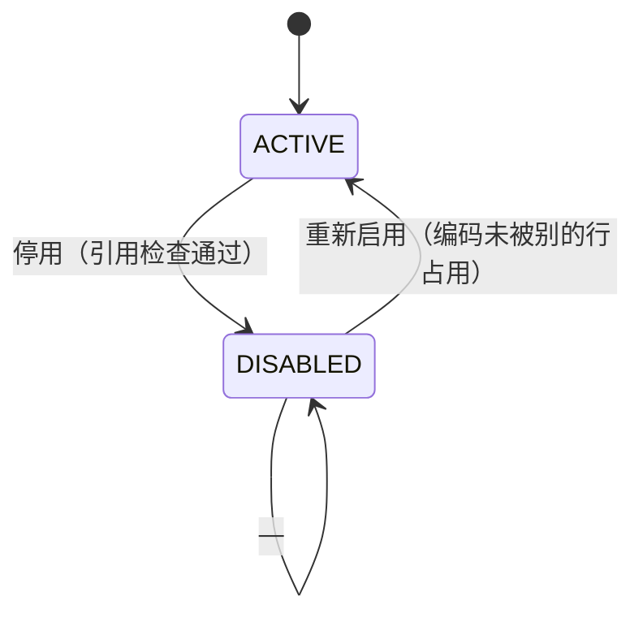
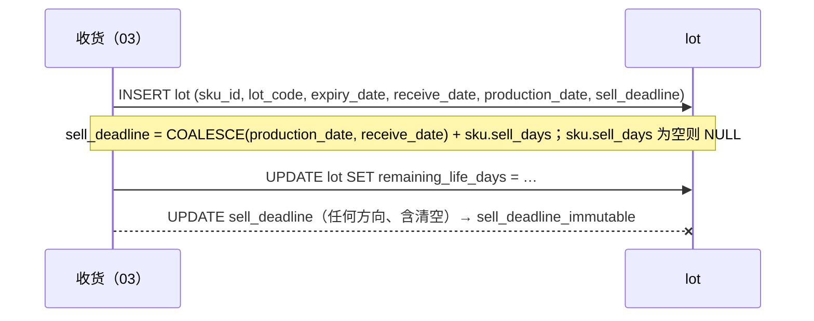

# 01 主数据 详细设计

> 作者：磐石 ｜ 基线：`origin/main` 分文件 schema（`wms-design/sql/schema/01_master.sql`）｜ 评审：待定（至少 2 名：1 测试 + 1 非作者）
> 全局约定以第 0 篇为准：数量 milli（R2）、雪花 ID（§6.1）、单号与仓前缀（§6.2）、错误码与段位（§6.4）、幂等（§6.5）、权限模型（§6.6）、时间 UTC 整秒（§6.8）、PG 函数 search_path（§6.9）、防 REPLACE（§6.10）、部署形态（§9.1）。本篇只写本模块特有的部分，不重复 00 的条文。

## 1. 职责与边界

### 1.1 负责

- **仓库**（`warehouse`）：仓编码、时区、截单时间、作业日偏移与切换时刻。
- **库区与温区**（`zone`）：`temp_zone`（AMBIENT/CHILLED/FROZEN/FRESH）即温区，温度上下限用 `temp_min_c10` / `temp_max_c10`（0.1 ℃ 整数，与第 18 篇同口径）。
- **库位**（`location`）：库位编码、类型、容量、`max_lots`、可拣标记、盘点冻结状态、拣货位补货水位（`min_level_milli` / `max_level_milli`，第 7 篇的补货触发依据）。
- **SKU**（`sku`）：基本单位、温区要求、保质期与允收/禁发期、**可售天数 `sell_days`**、自然损耗容差 `natural_loss_tolerance_ppm`、称重与越库/质检标记。
- **条码与单位换算**（`sku_barcode` / `sku_unit`）：PDA 扫码解析的唯一入口、作业单位 → 基本单位的整数换算。
- **批次**（`lot`）：只定义主键与效期规则（唯一键、日历日口径、`sell_deadline` 建档不可改）；批次由第 3 篇收货创建。

本篇同时是本模块**库层不变量的所有者**：`01_master.sql` 里的 CHECK / 触发器 / 唯一键及其防 REPLACE 守卫，以及对应的双库校验断言。

### 1.2 不负责

| 内容 | 归属 |
|---|---|
| 账号、角色、权限点、设备实例绑定、离线令牌、审批单 | 第 12 篇 |
| 库存数量、占用、冻结、流水 | 第 2 篇 |
| 批次的质量状态流转（合格 / 待检 / 不合格）、效期扫描与报损 | 第 3 篇收货、第 9 篇效期 |
| 上架库位推荐、补货与移库 | 第 3 篇（推荐约束）、第 7 篇（算法与单据） |
| 主数据下发到边缘节点、节点号登记 | **未建**，见 §3.4 与 §12 Q1 |

### 1.3 与原说明书 / 旧稿（`origin/docs/01-master-data`）的差异

旧稿是合并前分支上的单文件架构，表结构按"中心 + 下发"一整套写。本篇落在当前分文件架构上，差异如下：

| 项 | 旧稿 | 本篇（当前 schema） |
|---|---|---|
| 单位换算 | `sku_unit.ratio_to_base NUMERIC(14,6)` | `sku_unit.base_qty_milli BIGINT`：1 个该单位 = 多少 milli 基本单位，换算只做整数乘法（R2，02 §换算已按此引用） |
| 补货水位 | `location.min_level` / `max_level` NUMERIC | `min_level_milli` / `max_level_milli` BIGINT（R2；第 7 篇补货扫描用） |
| 损耗容差 | `sku.natural_loss_pct NUMERIC(5,2)` | `sku.natural_loss_tolerance_ppm BIGINT`（0–50000，≤5%）；第 9 篇按整数比较 |
| 温区温度 | `temp_min` / `temp_max` NUMERIC(5,2) | `temp_min_c10` / `temp_max_c10` INTEGER，0.1 ℃（与第 18 篇 `*_c10` 同口径），`ck_zone_temp` 要求同时为空或 **下限 < 上限** |
| 可售天数 | 旧稿末尾已提出 `sku.sell_days`，但当时 DDL 与文档脱节 | 本稿落库：`sell_days` + `ck_sku_sell_days`（1 ≤ sell_days ≤ 保质期）+ `ck_sku_sell_days_req`（冷藏/冷冻必填） |
| 时间列 | `DEFAULT now()`（会话时区 + 微秒） | `DEFAULT (date_trunc('second', now() AT TIME ZONE 'UTC'))`（00 §6.8 第 3 条） |
| 供应商 / 客户 / 车辆 / 司机 / 设备台账、节点号登记、主数据下发（`md_*`）、停用与软删两段式 | 旧稿都有表与状态机 | **本篇不建**（缺表和缺子系统），见 §3.4；错误码 40962 / 42221 也随之暂无可实现处 |

> 旧稿里仍然成立、本篇继续沿用的设计：仓编码字符集与不可改、库位两态正交思路（本篇简化为单 `status`，见 §5.2）、条码全局唯一、换算比例被引用后不可改、`lot.sell_deadline` 建档不可改、防 REPLACE 逐唯一键覆盖。

### 1.4 本篇对 00 的依赖（改这些地方要回 00 登记）

- 错误码段位：`40960–40969`、`42220–42229` 归第 1 篇（00 §6.4）。
- 库层错误名 → 对外码映射表：00 §6.4 的"库层名"表（本篇涉及 `master_duplicate`、`barcode_duplicate`、`lot_duplicate`、`sell_deadline_immutable`）。
- 防 REPLACE 基线：00 §6.10 第 5 条（`REPLACE_OK` 只剩 `sku_unit`）与第 6 条（01 已覆盖表清单）、第 9 条（01/02 触发器与索引冻结基线）。
- 时间硬规则：00 §6.8 第 3 / 4 / 5 条。

## 2. 用例

| 用例 | 角色 | 发生在 |
|---|---|---|
| 新建/修改 SKU（含 `sell_days`、损耗容差） | 主数据管理员 | 中心 |
| 维护 SKU 单位换算与条码 | 主数据管理员 | 中心 |
| 新建库区（温区上下限）、库位，调整补货水位 | 仓库主管（本仓） | 中心 |
| 停用 / 启用 SKU、库位 | 主数据管理员 / 仓库主管 | 中心 |
| 批次建档（收货时） | 收货员（经第 3 篇） | 权威库 |
| PDA 扫码解析条码 → SKU | 作业员 | 权威库只读 |
| 效期扫描 / 可售期判定 | 系统任务 | 第 9 篇（读本篇 `sell_days` / `sell_deadline`） |

## 3. 领域模型

### 3.1 层次与温区

`warehouse 1─n zone 1─n location`。温区不单独建表，就是 `zone.temp_zone`；库位继承库区温区（`location → zone → warehouse` 都是声明外键）。上架 / 就近放回 / 补货换位校验的是 **SKU 的 `temperature_required` = 目标库区 `temp_zone`**（第 3、4、7 篇引用，本篇只提供两张表）。

温度一律 0.1 ℃ 整数：`-18.0 ℃` 写作 `-180`，`0 ℃` 写作 `0`。`ck_zone_temp`：**空区间只允许 `AMBIENT`**（不控温库区）；`CHILLED` / `FROZEN` / `FRESH` 这类控温库区必须同时给出上下限，且 `temp_min_c10 < temp_max_c10`（相等等于没有区间，拒绝）。理由（镜鉴 I-2）：两列全空时应用层取不到区间快照，冷链测温校验会被当成"无区间"而失效。

### 3.2 数量口径（R2）

| 列 | 类型 | 含义 |
|---|---|---|
| `location.min_level_milli` / `max_level_milli` | BIGINT | 拣货位补货水位，SKU 基本单位的千分之一 |
| `sku_unit.base_qty_milli` | BIGINT | 1 个作业单位折合多少 milli 基本单位（1 BOX = 12.500 KG → `12500`） |
| `sku.natural_loss_tolerance_ppm` | BIGINT | 百万分比；第 9 篇判定用 `|损耗 milli| × 1 000 000 ≤ 账面 milli × ppm`（整数比较，不做除法） |

换算：`milli = 数量(milli) × base_qty_milli / 1000`；**结果不是整数直接 400 `40010`**，不取整（02 §3.1）。基本单位自己那一行（`uom = sku.base_uom`）`base_qty_milli` 必须等于 `1000` —— 这是**应用层断言**（R12）；库层只有正数约束 `ck_unit_ratio`，不加触发器（理由与后续动作见 §12 Q8）。

容量 / 重量类列（`capacity_weight`、`capacity_volume`、`used_weight`、`used_volume`、`avg_weight_g`、`weight_tolerance_pct`、`unit_gross_weight`、`unit_volume`）**保留 NUMERIC**：只用于规划与提示，不参与任何入账与整数判定（沿用旧稿 Q3 口径）。

### 3.3 编码与唯一键

| 对象 | 唯一键 | 规则 |
|---|---|---|
| `warehouse.code` | 全局唯一 | `ck_wh_code`：只允许 `[A-Z0-9]`、长度 2–16、不含 `-`（单号与审批单号 `APR-{仓编码}-{yyyyMMdd}-{6 位}` 用 `-` 分段，见 00 §6.2、02 `ck_hold_approval_no`）。**创建后不可改**（改了历史单号前缀就对不上） |
| `zone.(warehouse_id, code)` | 仓内唯一 | zone 编码 |
| `location.(warehouse_id, code)` | 仓内唯一 | 印在库位标签上，**创建后不可改** |
| `sku.code` | 全局唯一 | `base_uom` 有过库存或单据后不可改 |
| `sku_barcode.barcode` | 全局唯一 | PDA 一次命中；走唯一索引，不缓存 |
| `sku_unit.(sku_id, uom)` | SKU 内唯一 | 被引用后比例不可改：要改就新建单位编码（`BOX12` → `BOX10`），旧单位停用 |
| `lot.(sku_id, lot_code, expiry_date)` | SKU 内唯一 | 同批次号不同效期是两行 |

`ck_wh_code` 两库同一条表达式（SQLite 没有正则，不能用 `~` / `GLOB`）：嵌套 `replace` 去掉 36 个合法字符后必须为空串，并配 `length(code) BETWEEN 2 AND 16`。这条写成一行、36 层嵌套，见 `01_master.sql`。

### 3.4 本篇建的表 / 不建的表（缺口）

**建（7 张）**：`warehouse`、`zone`、`location`、`sku`、`sku_barcode`、`sku_unit`、`lot`。

**不建（缺口，已报 Chief，属"01 增量"候选）**：

| 缺什么 | 谁在引用它 | 影响 |
|---|---|---|
| `supplier`（供应商台账） | `03_inbound.inbound_order.supplier_id`、`10_returns.supplier_return.supplier_id`、`lot.supplier_id`（三处都只是 BIGINT，无外键） | 供应商主数据校验无库；退供/收货的供应商关系只能靠上游文本 |
| `customer`（客户 / 门店） | `04_outbound.outbound_order.customer_id NOT NULL` | 门店主数据、对账按门店汇总无表 |
| `vehicle` / `driver` | `04_outbound.driver_id`、`06_pack_ship.shipment.driver_id` / `driver_name` / `driver_phone`；00 §6.4 `42220 DRIVER_CERT_EXPIRED` 挂在第 1 篇 | 排车校验（健康证过期）无可实现处 |
| `device`（设备台账） | `12b_auth_audit.user_device_binding.device_id`（注释写明"第 1 篇 device 台账"） | 设备丢失 → 吊销令牌的链路缺上游 |
| `node_registry` | 00 §9.1 ④（节点号登记、防复用） | 节点号分配与防复用无表；与主数据下发同批 |
| 主数据生命周期与下发：`md_version`、`md_change_log`、`md_sync_state`、`md_pending_disable`、`md_disable_action_policy` | 00 §6.4 `40962 MASTER_READ_ONLY_NODE`、`42221 MASTER_DISABLED`、`40936 MD_DELETE_REQUEST_REQUIRED`；11 篇"主数据版本与下发内容归第 1 篇" | 边缘节点写主数据、停用两段式、软删两段式都没有库层；本篇 §5 只到"停用前检查引用"这一层 |

本篇不为上述缺口造占位表，也不替别篇改表（跨篇缺口按纪律发 Chief 汇总）。

> **更新（01 增量，2026-10-15）**：上表**前四行**——`supplier`、`customer`、`vehicle` / `driver`、`device`——已由 Chief 拍板纳入 01 增量（§12 Q4），设计与接口见 **§4.11–§4.15、§4.16、§7.3**；库层 DDL / 断言等 16 篇合入后落。`node_registry` 与「主数据生命周期与下发」那一行**不在本增量**，仍归 §12 Q1 的独立增量。`42220` 的处置见 §4.14（收口为服务层已建、无库层守卫）。

## 4. 数据模型

所有 ID 是雪花 ID（00 §6.1）；`wms_app` 对 7 张表只有 `SELECT, INSERT, UPDATE`（**没有 DELETE**，主数据不物删；条码换绑用 UPDATE，见 §6.4）；时间列全部 `TIMESTAMP`（不带时区），语义 UTC。

### 4.1 `warehouse`

| 列 | 类型 | 说明 |
|---|---|---|
| `id` / `code` / `name` | BIGINT / VARCHAR(32) / VARCHAR(64) | `code` 全局唯一 + `ck_wh_code`，创建后不可改 |
| `status` | VARCHAR(16) | `ACTIVE` / `DISABLED`（§5.1） |
| `timezone` | VARCHAR(32) | 默认 `Asia/Shanghai`；业务日期按它算（R3） |
| `cutoff_time` | TIME | 截单时间 |
| `work_date_offset` | SMALLINT | 凌晨作业归属哪一天：`-1` = 今日凌晨拣昨日截单的货 |
| `day_switch_time` | TIME | 默认 `00:30`，作业日切换时刻（00 §6.8） |
| `address` / `contact_name` / `contact_phone` / `geohash` | — | 联系与坐标，可空 |
| `created_at` / `updated_at` / `deleted_at` | TIMESTAMP | 前两个库写 UTC 整秒；`deleted_at` 本篇一期不写（软删生命周期未建，见 §3.4） |

索引：`uq_warehouse_code (code)`。防 REPLACE：`trg_warehouse_no_replace`（`id`）、`trg_warehouse_no_replace_code`（`code`），两条都是 SQLite 侧守卫（PG 由主键 / 唯一约束兜底）。

### 4.2 `zone`

| 列 | 类型 | 说明 |
|---|---|---|
| `id` / `warehouse_id` / `code` / `name` | — | `warehouse_id` 声明外键；`uq_zone_code (warehouse_id, code)` |
| `temp_zone` | VARCHAR(16) | `AMBIENT` / `CHILLED` / `FROZEN` / `FRESH`（枚举值由服务层与 `StrEnum` 保证；库层不加 `IN` 约束，理由见 §12 Q5） |
| `temp_min_c10` / `temp_max_c10` | INTEGER | 0.1 ℃；`ck_zone_temp`：两列要么都为空（**只允许 `temp_zone = 'AMBIENT'`**），要么都有值且 `min < max` |
| `zone_type` | VARCHAR(16) | `RECEIVE` / `STORAGE` / `PICK` / `STAGE` / `SHIP` / `RETURN` / `QUARANTINE` |
| `pick_sequence` | VARCHAR(32) | 拣货路径排序（同 `location.pick_sequence`） |
| `created_at` / `updated_at` / `deleted_at` | TIMESTAMP | 同 §4.1 |

索引：`ix_zone_wh_type (warehouse_id, zone_type, temp_zone)`。防 REPLACE：`trg_zone_no_replace`（`id`）、`trg_zone_no_replace_code`（`warehouse_id, code`）。

`temp_zone` 修改：库区内有在库库存时禁止（服务层 409 类冲突），否则会出现冷冻品挂在常温区的账。

### 4.3 `location`

| 列 | 类型 | 说明 |
|---|---|---|
| `id` / `warehouse_id` / `zone_id` / `code` | — | 两个父都是声明外键；`uq_location_code (warehouse_id, code)`，创建后不可改 |
| `location_type` | VARCHAR(16) | `PALLET` / `SHELF` / `FLOOR` / `BIN` / `LIVE_TANK`（活鲜池扩展见第 18 篇；库层不加 `IN` 约束，理由同 §12 Q5） |
| `capacity_weight` / `capacity_volume` / `used_weight` / `used_volume` | NUMERIC | 规划与展示，不入账（§3.2） |
| `max_lots` | SMALLINT | 默认 4；**拣货位设 1~2 强制 FEFO**（第 3 篇上架与第 7 篇换位共用这条约束） |
| `mix_sku` | BOOLEAN | 是否允许混放 SKU |
| `pickable` | BOOLEAN | 是否可拣（拣货位为 true） |
| `abc_class` | VARCHAR(2) | ABC 分类 |
| `status` | VARCHAR(16) | `AVAILABLE` / `LOCKED` / `DISABLED`；`LOCKED` = 盘点冻结（第 8 篇，40906） |
| `lock_reason` | VARCHAR(64) | 冻结 / 停用原因 |
| `min_level_milli` / `max_level_milli` | BIGINT | 补货水位；`ck_loc_level`：`0 ≤ min ≤ max` |
| `pick_sequence` | VARCHAR(32) | 拣货路径排序 |
| `created_at` / `updated_at` / `deleted_at` | TIMESTAMP | 同 §4.1 |

索引：`uq_location_code`、`ix_loc_replen (zone_id, pick_sequence) WHERE pickable = true AND status = 'AVAILABLE'`（部分索引，第 7 篇待补货扫描走它；SQLite 3.8+ 支持，语义一致）。防 REPLACE：`trg_location_no_replace`（`id`）、`trg_location_no_replace_code`（`warehouse_id, code`）。

### 4.4 `sku`

| 列 | 说明 |
|---|---|
| `code` / `name` / `spec` / `category_id` / `brand` | 基础属性；`code` 全局唯一 |
| `base_uom` | `KG` / `PCS` / `EA`。**有过库存或单据后不可改**（所有 milli 都以它为准） |
| `temperature_required` | 温区要求，默认 `AMBIENT`。**取值域由 `ck_sku_temp` 约束**：`AMBIENT` / `CHILLED` / `FROZEN` / `FRESH` / `LIVE`（`LIVE` 是第 18 篇活鲜的正式取值），大小写不同 / 尾空格 / 未知值一律拒（镜鉴 I-1） |
| `shelf_life_days` | 保质期天数 |
| `receive_min_shelf_life` / `ship_min_shelf_life` | 收货允收期 / 出库禁发期 |
| `sell_days` | **可售天数**（可空）。批次 `sell_deadline = COALESCE(production_date, receive_date) + sku.sell_days`；`sku.sell_days` 为空时批次也没有 `sell_deadline`。判定：`sell_deadline` 过期即不可售 → 第 9 篇按 `SELL_EXPIRED` 转损耗（00 §6.4） |
| `is_weighing` / `avg_weight_g` / `weight_tolerance_pct` | 称重品；`weight_tolerance_pct` 只用于提示，不参与入账 |
| `natural_loss_tolerance_ppm` | 自然损耗容差，0–50000（≤5%） |
| `unit_gross_weight` / `unit_volume` | 体积重量，规划用 |
| `cross_dock` / `need_quality_check` / `abc_class` / `status` | 越库、必检、ABC、状态（§5.1） |
| `created_at` / `updated_at` / `deleted_at` | 同 §4.1 |

约束：

| 名称 | 内容 | 为什么 |
|---|---|---|
| `ck_sku_temp` | `temperature_required IN ('AMBIENT','CHILLED','FROZEN','FRESH','LIVE')` | **取值域（镜鉴 I-1，食品安全）**：`ck_sku_sell_days_req` 是精确匹配，`'chilled'`（小写）、`'FROZEN '`（尾空格）、`'CHILL'`（未知值）都会绕过它 → 冷链 SKU 没有 `sell_deadline` → 第 9 篇 `SELL_EXPIRED` 失效。`LIVE` 必须留在取值域内（第 18 篇活鲜正式形态） |
| `ck_sku_shelf_life` | 三个期都是 `≥ 0`；`shelf_life_days > 0` 时两个阈值都 `≤ shelf_life_days` | 禁发期 > 保质期会导致"永远不可发" |
| `ck_sku_sell_days` | `sell_days IS NULL OR (1 ≤ sell_days ≤ shelf_life_days)` | 可售天数必须落在保质期内；保质期未登记（=0）的 SKU 不允许设 `sell_days` |
| `ck_sku_sell_days_req` | `temperature_required NOT IN ('CHILLED','FROZEN') OR sell_days IS NOT NULL` | **冷链生鲜必须给可售天数**，否则批次永远没有 `sell_deadline`，第 9 篇 `SELL_EXPIRED` 整条链失效。`FRESH` / `LIVE` 的必填口径见 §12 Q3（一期只对 `CHILLED` / `FROZEN` 强制） |
| `ck_sku_loss_ppm` | `0 ≤ natural_loss_tolerance_ppm ≤ 50000` | 上限防止把容差设成 100% 绕过第 9 篇报损审批 |

索引：`uq_sku_code (code)`、`ix_sku_category (category_id, status)`。防 REPLACE：`trg_sku_no_replace`（`id`）、`trg_sku_no_replace_code`（`code`）。

跨篇加列：`return_as_fresh`（BOOLEAN，默认 false）与 `ck_sku_rtn_fresh`（只允许常温 SKU 置真）由第 10 篇 `10_returns.sql` ALTER 上来，登记在 `schema/README.md` 跨篇加列表。**本篇不重复定义这两列。**

### 4.5 `sku_barcode`

| 列 | 说明 |
|---|---|
| `sku_id` | 声明外键 → `sku(id)` |
| `barcode` | `uq_barcode`，全局唯一；PDA 解析必须走这个唯一索引，一次命中 |
| `uom` | 该条码对应的包装层级（默认 `EA`） |
| `is_primary` | 主条码标记 |

防 REPLACE：`trg_bc_no_replace`（`id`）、`trg_bc_no_replace_code`（`barcode`）。错误名 `barcode_duplicate: sku_barcode.<列>` → 40960（00 §6.4）。条码行不是业务单据，允许物理删除；但**本篇一期 `wms_app` 没有 DELETE 权限**，换绑走 UPDATE（§6.4）。

### 4.6 `sku_unit`

| 列 | 说明 |
|---|---|
| `sku_id` | 声明外键 → `sku(id)` |
| `uom` | 作业单位编码 |
| `base_qty_milli` | 1 个该单位 = 多少 milli 基本单位；`ck_unit_ratio`：`> 0` |
| `is_pick_uom` / `is_receive_uom` | 默认拣货 / 收货单位 |
| `barcode_level` | 包装层级，默认 1 |

`uq_sku_uom (sku_id, uom)`。**防 REPLACE 豁免**：`sku_unit` 在 00 §6.10 第 5 条的 `REPLACE_OK` 名单里（表级豁免，2026 年第十三轮冻结）：没有任何表引用它，按 `(sku_id, uom)` 换 id REPLACE 等价于整行改写换算系数，与 UPDATE 能做的一样，不涉及去重 / 序号语义。**这一点决定了本篇不能给 `sku_unit` 加 `BEFORE UPDATE` 触发器**（会把整表推进受锁集合），见 §12 Q8。

### 4.7 `lot`

| 列 | 说明 |
|---|---|
| `sku_id` | 声明外键 → `sku(id)` |
| `lot_code` / `origin_batch` | 批次号 / 上游批次 |
| `production_date` | 生产日期，可空（日历日） |
| `expiry_date` | 到期日，**FEFO 排序键**，日历日（04 I5） |
| `receive_date` | 收货自然日，纯日期不带时间（00 §6.8 第 9 条） |
| `supplier_id` | BIGINT，无外键（供应商表未建，§3.4） |
| `quality_status` | 默认 `QUALIFIED`；质量状态机归第 3 / 9 篇 |
| `remaining_life_days` | 冗余剩余天数，定时刷新；`ix_lot_aging` 支撑效期预警列表 |
| `sell_deadline` | 可售截止日（§4.4 `sell_days`）；**建档写入后不可改**（含 `NULL → 日期`、改早、改晚、清空都拒） |
| `cert_no` | 检疫合格证等 |
| `created_at` / `updated_at` | 库写 UTC 整秒 |

约束与索引：`uq_lot (sku_id, lot_code, expiry_date)`；`ix_lot_expiry (sku_id, expiry_date) WHERE quality_status = 'QUALIFIED'`；`ix_lot_aging (remaining_life_days, sku_id)`；SQLite 侧 `ck_lot_date`（三个日期列只收 `YYYY-MM-DD` 且 `date(x) IS x`）与 `ck_lot_recv_ts`（`receive_date` 只收纯日期，拒时间 / `24:00:00` / 时区偏移 / 斜杠 / 紧凑写法）。

守卫：
- `trg_lot_sell_deadline`（两库）：`sell_deadline` 与旧值不同即 `sell_deadline_immutable`（PG 用 `IS DISTINCT FROM`，search_path 固定 `pg_catalog, public, pg_temp`，`=(date,date)` 来自 `pg_catalog`，会话里同名运算符劫持不生效 —— verify 有用例）。
- `trg_lot_no_replace`（SQLite）：REPLACE 撞 `id` 或 `uq_lot` 会删旧行再插新行、绕过 `trg_lot_sell_deadline`，所以两个唯一键都拦，报 `lot_duplicate` → 40960。

### 4.8 时间列（00 §6.8）

本篇有 10 个库写时间列（`warehouse` / `zone` / `location` / `sku` / `lot` 各 `created_at` + `updated_at`），默认值一律 `DEFAULT (date_trunc('second', now() AT TIME ZONE 'UTC'))`；SQLite 经翻译器写成 `DEFAULT (datetime('now'))`（恒为整秒 UTC）。**本篇没有客户端提交的时间列**（没有 `client_occurred_at`，主数据写入全部发生在服务端），所以不引入 §6.8 第 4 条的 ±300 s 窗口 CHECK。`updated_at` 由服务端在每次 UPDATE 时显式写。

### 4.9 防 REPLACE 覆盖矩阵（00 §6.10）

| 表 | 唯一键 | 守卫 | 错误名 → 对外码 |
|---|---|---|---|
| `warehouse` | `id`、`code` | `trg_warehouse_no_replace`、`trg_warehouse_no_replace_code` | `master_duplicate: warehouse.<列>` → 40960 |
| `zone` | `id`、`(warehouse_id, code)` | `trg_zone_no_replace`、`trg_zone_no_replace_code` | `master_duplicate: zone.<列>` → 40960 |
| `location` | `id`、`(warehouse_id, code)` | `trg_location_no_replace`、`trg_location_no_replace_code` | `master_duplicate: location.<列>` → 40960 |
| `sku` | `id`、`code` | `trg_sku_no_replace`、`trg_sku_no_replace_code` | `master_duplicate: sku.<列>` → 40960 |
| `sku_barcode` | `id`、`barcode` | `trg_bc_no_replace`、`trg_bc_no_replace_code` | `barcode_duplicate: sku_barcode.<列>` → 40960 |
| `lot` | `id`、`(sku_id, lot_code, expiry_date)` | `trg_lot_no_replace` | `lot_duplicate` → 40960 |
| `sku_unit` | `id`、`(sku_id, uom)` | **无（REPLACE_OK 表级豁免）** | 由 `uq_sku_uom` / 主键兜底 |

两条服务端纪律：**先查再插**（撞到守卫说明服务层绕过了先查逻辑）；条码换绑不要写成"删除 + 新增"两行，而是一条 `UPDATE sku_barcode SET sku_id = :new WHERE barcode = :b AND sku_id = :old`（幂等、无 DELETE 权限也能做、审计有 before/after）。

### 4.10 跨篇加列（别篇对本篇表的 ALTER）

| 对象 | 表 | 哪一篇 ALTER | 状态 |
|---|---|---|---|
| `return_as_fresh`、`ck_sku_rtn_fresh` | `sku` | 第 10 篇 `10_returns.sql` | 已落库，`schema/README.md` 跨篇加列表有登记 |

本篇自己的文件**不改别篇的表**，也不重复定义别篇 ALTER 上来的列。

### 4.11–4.16 台账增量（01 增量第一批，§12 Q4 已拍板）

> **状态：已落库（本增量，2026-10-16）**。库层在 `wms-design/sql/schema/01_master.sql`：五张表 + `lot.supplier_id` 显式外键 `fk_lot_supplier` + 五表逐唯一键的 SQLite 防 REPLACE 守卫；两库断言在 `verify.sh` / `verify_sqlite.py` 的 `2a-01L` 段（正向 / 按名拒绝 / 变异三件套）。**全局计数**：93→**98 表**、307→**322 索引**、视图仍 3，S4 权限矩阵加 5 个对象。本节给表、约束、索引、权限点与接口契约，供 13/15 前端与 03/04/06/10/12 交叉评审。为不打乱既有编号，新增内容按 4.11–4.16 追加，既有 §4.1–§4.10 编号不动。

#### 4.11 `supplier`（供应商台账）

| 列 | 说明 |
|---|---|
| `code` | 供应商编码，`ck_supplier_code`：`[A-Z0-9]{2,32}`；`uq_supplier_code` |
| `name` | 供应商名称，必填 |
| `status` | `ACTIVE` / `DISABLED`（`ck_supplier_status`） |
| `contact_name` / `contact_phone` | 联系人 / 电话（可空） |
| `food_safety_license_no` / `food_safety_license_expiry` | 食品经营许可号与到期日（`DATE`，可空）。到期只是 13 篇列表上的提醒，**不阻断收货**（收货的实质校验在 03 篇质检） |
| `created_at` / `updated_at` | 00 §6.8 库写 UTC 整秒 |

- 引用方：`03_inbound.inbound_order.supplier_id`、`10_returns.supplier_return.supplier_id`、`01.lot.supplier_id`（三处现在都是裸 `BIGINT`，外键见 §4.16）。
- 停用：有引用 → `40960 MASTER_IN_USE` + `detail.blockers`（与 warehouse/zone/sku 同口径）；**不做软删**。
- 防 REPLACE：`trg_supplier_no_replace`（`id`）、`trg_supplier_no_replace_code`（`code`）→ `master_duplicate: supplier.<列>` → 40960。

#### 4.12 `customer`（客户 / 门店）

| 列 | 说明 |
|---|---|
| `code` | 门店编码，`uq_customer_code` |
| `name` | 门店名称，必填 |
| `store_type` | `STORE` / `MALL` / `OTHER`（`ck_customer_type`，默认 `STORE`） |
| `status` | `ACTIVE` / `DISABLED` |
| `contact_name` / `contact_phone` / `address` | 收货信息（可空） |
| `delivery_window` | 收货时间窗文本（13 篇显示用，可空；**不参与调度计算**） |

- 引用方：`04_outbound.outbound_order.customer_id`（`NOT NULL`，现在也是裸 `BIGINT`）。
- 报表按门店汇总（00 §7 报表）以本表 `code` 为准，不用门店名做键。
- 防 REPLACE：`trg_customer_no_replace` / `_code`。

#### 4.13 `vehicle`（车辆）

| 列 | 说明 |
|---|---|
| `plate_no` | 车牌，`uq_vehicle_plate`；**不做格式 CHECK**（各省规则不一），只在服务层去空白、归一大小写 |
| `vehicle_type` | `VAN` / `TRUCK` / `REFRIGERATED` / `OTHER`（`ck_vehicle_type`） |
| `temp_min_c10` / `temp_max_c10` | 车厢可保温区间的 0.1 ℃ 整数，`ck_vehicle_temp`：**两列同空或同填且 `min < max`**（与 01 温区 `ck_zone_temp` 同口径） |
| `capacity_kg` | 额定载重，`BIGINT` 可空；`ck_vehicle_cap`：`NULL` 或 `> 0` |
| `status` | `ACTIVE` / `DISABLED` |

- 引用方：15 篇装车页与 06 篇发运交接按车牌核对；`06_pack_ship.shipment` 现在**没有** `vehicle_id` 列，是否补由 06 篇定（见 §4.16 注解），本篇不代为加列。

#### 4.14 `driver`（司机）

| 列 | 说明 |
|---|---|
| `name` | 姓名，必填 |
| `phone` | 手机号，`uq_driver_phone`；`ck_driver_phone`：11 位数字 |
| `cert_no` | 健康证 / 驾驶证编号（可空） |
| `cert_expiry` | 证照到期日（`DATE`，可空） |
| `status` | `ACTIVE` / `DISABLED` |

- **`42220 DRIVER_CERT_EXPIRED` 收口为「已建（服务层）」**：司机登录（15 篇）与排车 / 发运交接（06 篇）时校验 `cert_expiry >= 作业日`。**库层不做**：`CHECK` 里不能用 `now()`（PG 非 `IMMUTABLE`，SQLite 不可移植），所以它天然是服务层码；00 §6.4 里本码的「未建」标注随本增量改成「服务层已建、无库层守卫」。
- 引用方：`04_outbound.outbound_order.driver_id`、`06_pack_ship.shipment.driver_id` / `driver_name` / `driver_phone`（现在是裸 `BIGINT` 加文本冗余）。
- 防 REPLACE：`trg_driver_no_replace` / `_phone`。

#### 4.15 `device`（设备台账）

| 列 | 说明 |
|---|---|
| `device_instance_id` | 设备实例号，`uq_device_instance`；`ck_device_instance`：`btrim(device_instance_id) <> ''`（**禁空串与全空白串**，与 05 篇 `ck_pt_device` 同口径） |
| `device_type` | `PDA` / `SCANNER` / `PRINTER` / `SCALE` / `OTHER`（`ck_device_type`） |
| `warehouse_id` | 所属仓 → `warehouse(id)`，必填 |
| `status` | `ACTIVE` / `DISABLED` / `LOST`（`ck_device_status`）。`LOST` 由运维手动置位，上游触发 12 篇吊销该设备绑定令牌（链路见 §4.16 第 6 行） |
| `last_seen_at` | 最近心跳时间（库写，可空）；`ck_device_seen`：`NULL` 或 `>= created_at`（不允许心跳早于建档） |

- 引用方：`12b_auth_audit.user_device_binding.device_id`（该列注释已写「第 1 篇 device 台账」）。
- 防 REPLACE：`trg_device_no_replace` / `_instance`。

#### 4.16 台账增量需要的跨篇外键（**Chief 已裁定：本增量只落第 1 行**）

| # | 别篇表.列 | 指向 | 归属篇 | 状态 |
|---|---|---|---|---|
| 1 | `lot.supplier_id` | `supplier(id)` | 01 本篇（`01_master.sql` 内 `ALTER`） | **本增量落** |
| 2 | `inbound_order.supplier_id` | `supplier(id)` | 03 | **本期不加**，排进 00 §6.6.5「跨篇 FK 收口」 |
| 3 | `supplier_return.supplier_id` | `supplier(id)` | 10 | **本期不加**，同上 |
| 4 | `outbound_order.customer_id` | `customer(id)` | 04 | **本期不加**，同上 |
| 5 | `outbound_order.driver_id` | `driver(id)` | 04 | **本期不加**，同上 |
| 6 | `user_device_binding.device_id` | `device(id)` | 12 | **本期不加**；镜鉴在 01 的 `device` 台账落库后补（`12b_auth_audit.sql` 是他的文件） |

- **06 的 `shipment.driver_id` 一行已划掉**（Chief 2026-10-15 裁定）：按 06/16 边界，`shipment.driver_*` 整列要删、司机归 16 篇 `waybill`，登记里不再留这条。
- 第 2–6 行**不进 01 这一笔**：在 01 里改别篇 DDL 会连锁触发各篇断言与 `EXPECT` 重跑，收益不抵扰动；统一排进 `00 §6.6.5` 的「跨篇 FK 收口」一轮，期间服务层「先查后插」兜底。
- 16 的 `pod_op.device_instance_id`（字符串快照）**不建 FK**：与 05 的 `pick_task.device_instance_id` 同口径——跨节点设备实例号不适合做主键外键（镜鉴已确认）。
- 本篇文件**不给别篇的表加 FK**（与 §4.10 同一纪律）；**没有这些 FK 之前台账仍可用**，只是库层拦不住悬空引用。

## 5. 状态机

### 5.1 主数据状态（`warehouse` / `sku`）



| from → to | 触发者 | 守卫 | 副作用 |
|---|---|---|---|
| （新建）→ `ACTIVE` | 主数据管理员 | 编码唯一、格式合法 | 写 `audit_log` |
| `ACTIVE` → `DISABLED` | 主数据管理员 / 仓库主管 | 各权威库引用检查通过（§5.3） | 停用后不再允许新单据引用该 SKU / 仓 |
| `DISABLED` → `ACTIVE` | 同上 | 编码未被别的行占用 | 写 `audit_log` |

停用接口用条件更新：`UPDATE sku SET status='DISABLED', updated_at=… WHERE id=:id AND status='ACTIVE'`，`rowcount = 0` → 40930 带当前状态（00 §6.7）。终态没有：`DISABLED` 可以再启用。

> **未建**：`PENDING_DISABLE`（有引用时先挂起、引用清零后由 worker 置 `DISABLED`）、软删 `PENDING_DELETE → DELETED`、以及"停用期间哪些动作放行"的白名单表。这三件与主数据下发同批，见 §3.4。本篇的停用只保证"检查引用 + 立即停用"，没有悬挂态。

### 5.2 库位状态（`location.status`）

`location.status` 同时承担两个语义，一篇一期**不拆列**：

| 值 | 语义 | 谁写 |
|---|---|---|
| `AVAILABLE` | 可作业（默认） | 建位 |
| `LOCKED` | 盘点冻结：不可上架 / 移入 / 拣货（40906） | 第 8 篇盘点开始 / 结束 |
| `DISABLED` | 停用：不再参与补货扫描与上架推荐 | 本篇停用接口 |

补货扫描（`ix_loc_replen`）只看 `pickable = true AND status = 'AVAILABLE'`。

> 旧稿把库位分为"作业状态 `status` + 主数据状态 `md_status`"两列（小钱 I1）。当前 schema 没有 `md_status`，两列拆分依赖上一条的 `PENDING_DISABLE` 生命周期，所以本篇一期保持单列，并把"是否拆列"记入 §12 Q2。

### 5.3 "引用"的定义（停用守卫，服务层）

停用检查由服务层对各权威库执行（本篇只有表，没有跨库查询能力）：

| 实体 | 在库库存 | 未完结单据 / 任务 |
|---|---|---|
| SKU | 任一 `stock.on_hand_qty_milli > 0`、或存在 `HELD` 冻结（含系统冻结） | 入库单、出库单、波次、拣货任务、待回库记录、盘点单、报损单未到终态 |
| 库位 | 同上（按 `location_id`） | 拣货任务、移库、待回库 `target_location`、盘点单 |
| 仓库 | 本仓任一库位有库存 | 本仓任一未完结单据 |

有引用时本篇只能拒绝停用（返回冲突码），**不能**挂起后自动停用 —— 这是 §3.4 缺口的直接后果，已写给 Chief。

## 6. 核心流程

### 6.1 SKU 建档（含 `sell_days`）

```mermaid
sequenceDiagram
    participant A as 主数据管理员
    participant API as /api/v1/master/skus
    participant DB as 权威库
    A->>API: POST /skus {temperature_required, shelf_life_days, sell_days, ppm, units[]}
    API->>API: 校验：CHILLED/FROZEN 必带 sell_days；1 ≤ sell_days ≤ shelf_life_days；ppm ≤ 50000
    API->>DB: BEGIN; INSERT sku …; INSERT sku_unit …（基本单位行 base_qty_milli = 1000）; 写 audit_log; COMMIT
    DB-->>API: ck_sku_sell_days_req / ck_sku_loss_ppm / ck_unit_ratio / uq_sku_code
    API-->>A: 201 {id, code}
```

服务层校验与库层 CHECK 是同一套口径的两份（R12）：服务层先判断给出 4xx 明确提示，库层 CHECK 兜住任何绕过接口的写入（迁移、脚本）。

### 6.2 批次建档与 `sell_deadline`

批次由第 3 篇收货创建，本篇定义"什么时候写、写什么、之后不能改什么"：



### 6.3 PDA 扫码解析

`GET /api/v1/master/barcodes/{barcode}` 走 `uq_barcode` 唯一索引一次命中，返回 `{sku_id, uom, is_primary, base_uom}`。**端上不缓存条码表**（旧稿 Q4）：条码换绑后旧缓存会解析到错的 SKU。边缘节点上该接口是本地读（主数据表在边缘只读，见 §3.4）。

### 6.4 条码换绑（不删行）

一个新条码从 SKU A 换到 SKU B：`UPDATE sku_barcode SET sku_id = :b WHERE barcode = :bc AND sku_id = :a`，`rowcount = 0` 说明条码已不在 A 名下 → 返回 40930 / 40960 并带当前归属；同事务写 `audit_log`（before/after 全量快照）。一次 UPDATE 而不是旧稿的"删旧 + 插新两条同批次日志"，是因为本篇一期没有主数据下发机制，`wms_app` 也没有 DELETE 权限；下发机制补齐后是否改回批次写法见 §12 Q1。

## 7. 接口清单与契约

前缀 `/api/v1/master`。写接口要求 `Idempotency-Key`（00 §6.5）；数量字段是 3 位小数字符串（`"12.500"`）；仓级资源带 `X-Warehouse-Id` 并做数据权限校验（40311）。

| 方法 | 路径 | 权限点 | 说明 |
|---|---|---|---|
| GET | `/warehouses`、`/warehouses/{id}/zones`、`/zones/{id}/locations` | `master.warehouse.view` / `master.location.view` | 列表 / 详情 |
| POST / PUT | `/warehouses`、`/zones`、`/locations` | `master.warehouse.edit` / `master.location.edit` | 建 / 改；`code` 与库位所属关系不可改 |
| GET | `/skus`、`/skus/{id}` | `master.sku.view` | 含单位与条码 |
| POST / PUT | `/skus`、`/skus/{id}/units`、`/skus/{id}/barcodes` | `master.sku.edit` | `sell_days`、`natural_loss_tolerance_ppm` 在这里校验 |
| GET | `/barcodes/{barcode}` | `master.sku.view` | PDA 解析，走唯一索引；边缘节点本地可用 |
| PUT | `/skus/{id}/barcodes/rebind` | `master.sku.edit` | 条码换绑（§6.4） |
| POST | `/{entity}/{id}/disable`、`/enable` | 对应 `*.edit` | 返回 `{status, blockers}`；有引用时返回冲突码，不挂起 |

`{entity}` 取 `warehouses` / `zones` / `locations` / `skus`。

**未建接口**（属 §3.4 缺口）：`/{entity}/{id}/delete-request` 与 `…/cancel`、`GET …/pending-actions`、`/nodes`（节点号登记）、`/sync/{node_id}`（下发）。00 §6.4 已登记的 `40936 MD_DELETE_REQUEST_REQUIRED` 目前**没有实现处**。

**显式延期**：字典接口 `GET /api/v1/master/dicts`（权限点 `system.dict.view`，支持 `since` 增量语义）**归 01 增量（与 Q1 / Q4 同批）**，本篇 §7 不列它；一期前端按 `system.dict.view` + `since` 语义预留（界面副评 B1 的处置，见 §12 Q9、00 §6.6.5）。

### 7.1 错误码（00 §6.4 登记，段位 40960–40969 / 42220–42229 归本篇）

| 码 | HTTP | 名称 | 场景 |
|---|---|---|---|
| 40001 | 400 | PARAM_INVALID | 字段格式 / 取值非法：仓编码不是 `[A-Z0-9]{2,16}`、换算系数 ≤ 0、`min_level_milli > max_level_milli`、温区上下限不成立（含控温库区不给区间）、`sell_days` 越界、`sell_days` 缺失（冷藏/冷冻）。**损耗容差超范围不走本码**，归 42222（界面副评 I5 的处置） |
| 40010 | 400 | QTY_FORMAT_INVALID | 数量不是字符串 / 超过 3 位小数 / 换算后不是整数 milli（00 §6.5、02 §3.1） |
| 40311 | 403 | WAREHOUSE_FORBIDDEN | 仓级主数据越仓 |
| 40930 | 409 | ILLEGAL_STATE_TRANSITION | 停用 / 启用的条件更新影响 0 行（状态已被别人改），`detail` 带当前状态 |
| 40960 | 409 | MASTER_IN_USE | ①停用时仍有引用（`detail.blockers: [{type, id, count}]`）；②改不可改字段（`base_uom`、已引用的换算比例、库区温区）；③库层重复插入 / REPLACE 守卫命中（`master_duplicate`、`barcode_duplicate`、`lot_duplicate`）；④`sell_deadline_immutable`（批次可售截止日写入后改动） |
| 40961 | 409 | MASTER_CODE_DUPLICATE | 编码 / 条码重复（撞唯一约束 → 业务码，不走 50010）。与 40960 的分工：**40961 只用于"编码本身重复"**，能被唯一约束精确定位 |
| 40962 | 409 | MASTER_READ_ONLY_NODE | 在边缘节点写主数据 —— **未建**（边缘只读靠部署账号授权，库层无守卫） |
| 42221 | 422 | MASTER_DISABLED | 引用已停用主数据 —— **未建**（无 `PENDING_DISABLE` 生命周期与动作白名单） |
| 42222 | 422 | LOSS_TOLERANCE_OUT_OF_RANGE | `natural_loss_tolerance_ppm` 不在 0–50000（先于库层 `ck_sku_loss_ppm`，不走 50010；**格式非法才归 40001**） |
| **42223** | 422 | SELL_DAYS_REQUIRED | `CHILLED` / `FROZEN` SKU 没有 `sell_days`（前端按字段定位：SKU 表单必填项）。先于库层 `ck_sku_sell_days_req`，不走 50010 |
| **42224** | 422 | SELL_DAYS_OUT_OF_RANGE | `sell_days` 不在 `1 … shelf_life_days` 区间内。先于库层 `ck_sku_sell_days`，不走 50010 |
| 42220 | 422 | DRIVER_CERT_EXPIRED | 司机证照过期 —— **未建**（司机台账缺失，§3.4；归 01 增量 Q4） |

`40963–40969`、`42225–42229` 留作本篇增量（下发 / 停用生命周期 / 车队）。

### 7.2 示例

```json
POST /api/v1/master/skus
{ "code": "SKU-APPLE", "name": "山东红富士 80#", "base_uom": "KG",
  "temperature_required": "CHILLED", "shelf_life_days": 30,
  "receive_min_shelf_life": 20, "ship_min_shelf_life": 10, "sell_days": 14,
  "natural_loss_tolerance_ppm": 5000,
  "units": [{ "uom": "KG", "base_qty": "1.000" }, { "uom": "BOX", "base_qty": "12.500" }] }
```

`base_qty` 是字符串，按 00 §3.1 解析成 `base_qty_milli`（`"12.500"` → `12500`）；超过 3 位小数 → 400 `40010`。

### 7.3 台账接口（01 增量，设计草案）

统一前缀 `/api/v1/master`，标准信封 `{code,message,trace_id,data}` 与游标分页同既有接口；写操作带 `Idempotency-Key`（00 §6.5），`X-Warehouse-Id` 规则不变（越仓 40311）。**13 篇已经在用的路径以本节为准**（`13:208` 那行"一期未建"随本增量收口）。

| 方法 | 路径 | 权限点 | 说明 |
|---|---|---|---|
| GET | `/suppliers`、`/suppliers/{id}` | `master.supplier.view` | 列表（`status` / `q` / `cursor`）、详情 |
| POST / PUT | `/suppliers`、`/suppliers/{id}` | `master.supplier.edit` | 建 / 改；`code` 不可改，停用走 `PUT` 的 `status` |
| GET | `/customers`、`/customers/{id}` | `master.customer.view` | 列表（`store_type` / `status` / `q` / `cursor`）、详情 |
| POST / PUT | `/customers`、`/customers/{id}` | `master.customer.edit` | 建 / 改 |
| GET | `/vehicles`、`/vehicles/{id}` | `master.vehicle.view` | 列表（`status` / `vehicle_type` / `q`） |
| POST / PUT | `/vehicles`、`/vehicles/{id}` | `master.vehicle.edit` | 建 / 改；`temp_min_c10` / `temp_max_c10` 同空或同填 |
| GET | `/drivers`、`/drivers/{id}` | `master.driver.view` | 列表（`status` / `q`） |
| POST / PUT | `/drivers`、`/drivers/{id}` | `master.driver.edit` | 建 / 改；`cert_expiry` 过期只提示，登录 / 排车时才 42220 |
| GET | `/devices`、`/devices/{id}` | `master.device.view` | 列表（`status` / `device_type` / `warehouse_code`） |
| POST / PUT | `/devices`、`/devices/{id}` | `master.device.edit` | 建 / 改；`status=LOST` 由运维置位（上游触发 12 篇吊销绑定） |
| GET | `/dicts?since=&codes[]=&type=` | `system.dict.view` | **字典增量契约（Q9，与 13 §6.3-10 统一）**：`since` = 上次响应的整数 `version`（不传 = 全量）；响应 `{version:int, items:[{dict_code, value, label, sort, enabled, updated_at}]}`。**停用值也返回 `enabled=false`**，由前端隐藏或置灰（服务端不过滤，否则前端拿不到「已停用」提示）；**服务端按 `sort` 升序返回**，前端不再排序；`codes[]` 精确过滤、`type` 整类过滤。`version` 单调递增，客户端缓存上次的 `version` 作 `since` |

错误码沿用 §7.1，不新增：格式非法 40001、越仓 40311、状态非法 40930、编码重复 40961、停用时仍有引用 40960（`detail.blockers`）、引用已停用主数据 42221（服务层；台账增量不落库层守卫，与 §3.4 的 Q1 一致）、司机证照过期 42220（服务层）。

## 8. 并发与幂等

- **写入只在权威库**：单仓单写库（00 §6.1a）。边缘节点对主数据表只有 `SELECT`（部署账号授权，见 §3.4 的 40962 缺口）。
- **条件更新 + `rowcount`**（R7）：停用 / 启用用 `WHERE id=:id AND status=:from`，0 行 → 40930 带当前状态。多行更新按主键升序。
- **重复提交**：`Idempotency-Key`（00 §6.5），记录与业务同库同事务，保留 24 h。
- **无乐观锁版本列**：本篇一期没有 `md_version`，两个管理员同时改同一 SKU 是"后到者覆盖"。缓解：所有写操作写 `audit_log`（before/after 全量快照，12 篇），前端提示"他人已修改"。补齐版本列与下发的方案见 §12 Q1。
- **编码唯一**：依赖 `uq_warehouse_code` / `uq_sku_code` / `uq_zone_code` / `uq_location_code` / `uq_barcode` + 防 REPLACE 守卫；先查再插，撞了就是 40961 / 40960。
- **批次创建**：`uq_lot` 撞了先查回复用（收货重试不能造第二个批次行）。

## 9. 异常与补偿

| 异常 | 处理 |
|---|---|
| 编码撞唯一键 | 返回 40961，不回滚已成功的事务（写接口本身是单事务） |
| 库层 CHECK / 守卫命中（服务层漏检） | 500 → 转 50010 并告警；同时在服务层补校验（同一口径两份，R12） |
| 停用时发现引用 | 拒绝并返回 `detail.blockers`，不改数据（不挂起） |
| 换算比例需要变更 | 不允许改已引用的行：新建单位编码（`BOX12` → `BOX10`）、旧单位停用；历史单据的箱数仍可还原 |
| 条码换绑并发 | 条件更新 `WHERE barcode=:b AND sku_id=:a`，0 行 → 40930 |
| 批次 `sell_deadline` 写错 | 不可改（`sell_deadline_immutable`）。只能作废该批次并按收货更正流程重建（第 3 篇） |

## 10. 权限

| 权限点 | 说明 | 默认角色 |
|---|---|---|
| `master.warehouse.view` | 仓库 / 库区只读 | 全部仓内角色 |
| `master.warehouse.edit` | 仓库、库区（含温区上下限） | 主数据管理员 / 仓管主管 |
| `master.location.view` | 库位只读 | 全部仓内角色 |
| `master.location.edit` | 库位、补货水位、库位启停 | 仓库主管（本仓） |
| `master.sku.view` | SKU / 单位 / 条码 / 批次只读 | 全部 |
| `master.sku.edit` | SKU、单位换算、条码、条码换绑 | 主数据管理员 |
| `master.supplier.view` / `.edit` | 供应商台账读 / 写（01 增量 §4.11） | 采购 / 品控读，主数据管理员写 |
| `master.customer.view` / `.edit` | 客户 / 门店台账读 / 写（§4.12） | 客服 / 调度读，主数据管理员写 |
| `master.vehicle.view` / `.edit` | 车辆台账读 / 写（§4.13） | 调度读，主数据管理员写 |
| `master.driver.view` / `.edit` | 司机台账读 / 写（§4.14） | 调度读，主数据管理员写 |
| `master.device.view` / `.edit` | 设备台账读 / 写（§4.15）；`LOST` 置位也是 `.edit` | 运维读，主数据管理员写 |
| `system.dict.view` | 字典增量接口 `GET /api/v1/master/dicts`（§7.3、§12 Q9） | 全部（`since` 增量语义） |

仓级主数据（仓库 / 库区 / 库位）按 `X-Warehouse-Id` 做数据权限（40311）；全局主数据（SKU）不按仓隔离。所有写操作写 `audit_log`（12 篇），`before_json` / `after_json` 为全量快照。权限点与角色的矩阵由第 12 篇维护，本篇只登记权限点。

## 11. 测试要点（双库可证伪）

校验脚本：`wms-design/sql/verify.sh`（PostgreSQL 16）与 `wms-design/sql/verify_sqlite.py`（SQLite）。两库跑**同一套断言**，每条新不变量都是"正向放行 + 反向按名拦截 + 变异（去掉约束后原被拒语句通过）"三件套。

| 断言组 | 内容 |
|---|---|
| `ck_sku_temp` | 5 个取值全放行（含 `LIVE`）；`'chilled'`（小写）/ `'FROZEN '`（尾空格）/ `'CHILL'`（未知值）且不填 `sell_days` 全拦；**三个绕过值各做一次变异（去掉 `ck_sku_temp` 后必须放行）**——镜鉴 S-4 的要求 |
| `ck_sku_sell_days` | 10/30 放行；31 > 30 拦；0 拦；变异放行 |
| `ck_sku_sell_days_req` | 冷藏缺 `sell_days` 拦；常温缺放行；变异放行 |
| `ck_sku_loss_ppm` | 50000 放行；50001 拦；变异放行 |
| `ck_sku_shelf_life` | 禁发期 6 > 保质期 5 拦；阈值等于保质期放行；变异放行 |
| `ck_zone_temp` | `-180/-150` 放行；上下限相等 / 只给一列 / 下限大于上限拦；**两列全空只对 `AMBIENT` 放行，`CHILLED` / `FROZEN` / `FRESH` 两列全空一律拦**（镜鉴 I-2）；变异放行（相等、控温库区全空各一次） |
| `ck_loc_level` | `0/100000` 放行；下限 > 上限拦；下限为负拦；变异放行 |
| `ck_wh_code` | `WHSH02` 放行；小写 / 含 `-` / 1 位 / 17 位拦；变异放行 |
| `ck_unit_ratio` | 12500 放行；0 / 负数拦；变异放行 |
| 列口径 | 旧列（`zone.temp_min`、`temp_max`、`sku.natural_loss_pct`、`location.min_level`、`max_level`、`sku_unit.ratio_to_base`）必须不存在；新列必须存在且是整数类型（变异：把 `temp_min_c10` 改回 `NUMERIC` → 扫描变红） |
| 时间默认值 | 01 的 10 个 `created_at` / `updated_at` 默认值都是 UTC 整秒（PG `date_trunc('second', now() AT TIME ZONE 'UTC')`，SQLite `datetime('now')`）；变异：把 `sku.updated_at` 改回裸 `now()` → 扫描计数 10 → 9 变红 |
| 既有断言（回归） | `sell_deadline_immutable` 四种改法、`trg_lot_sell_deadline` 的 `pg_catalog` 劫持、`lot_duplicate`、条码 REPLACE、`master_duplicate` 逐键实打、01/02 触发器与索引冻结基线、00 §6.10 2z3 静态扫描（`sku_unit` 仍在 `REPLACE_OK`） |

**通过数**（本分支实测，0 失败）：PostgreSQL `1572` 项（基线 1534 + 38 项新增）；SQLite `2241` 项（基线 2203 + 38 项新增）。两库新增断言数一致。

## 12. 待定问题

| # | 问题 | 建议 | 决策人 |
|---|---|---|---|
| Q1 | 主数据生命周期与下发（`md_version` / `md_change_log` / `md_sync_state` / `md_pending_disable` / `md_disable_action_policy`、节点号 `node_registry`、边缘只读 40962、`PENDING_DISABLE` / 软删两段式）是否作为"01 增量"补 | 建议单独一篇增量 PR：它与 §3.4 的伙伴 / 车队 / 设备表同批，且要改 00 §6.4、§9.1 与 11 篇的通道约定 | Chief |
| Q2 | `location.status` 是否拆成"作业状态 + 主数据状态"两列（旧稿小钱 I1） | 依赖 Q1 的 `PENDING_DISABLE`，Q1 定了再拆 | Chief |
| Q3 | `sku.temperature_required` 的取值域与 `FRESH` / `LIVE` 的 `sell_days` 必填口径 | **已拍板落库**：取值域 `ck_sku_temp` = `AMBIENT/CHILLED/FROZEN/FRESH/LIVE`（镜鉴 I-1，`LIVE` 保留给第 18 篇活鲜）；`FRESH` / `LIVE` 的 `sell_days` **一期仍非必填**（只对 `CHILLED`/`FROZEN` 强制），因为它们代表"未定义映射 / 活鲜"等场景（第 10 篇 `trg_srtn_temp` 的用例依赖 `LIVE` 无映射），必填口径待第 10 / 18 篇确认后再收紧 | 已定（取值域）／待 10/18 篇（必填） |
| Q4 | 供应商 / 客户 / 车辆 / 司机 / 设备台账归谁 | **已拍板（Chief）：全部归第 1 篇**。**01 增量已开工**：设计见 §4.11–§4.16、接口 §7.3、权限点 §10；库层 DDL / 两库断言 / `EXPECT` 增量等 16 篇合入后落（Chief 2026-10-15）；跨篇 FK 登记在 §4.16，待 03/04/06/10/12 各自增量 ALTER | 已定（Chief）／库层待 16 后 |
| Q5 | `zone.temp_zone` / `location.location_type` 是否加 `IN` 枚举 CHECK | **不加**（保持服务层 `StrEnum`）：`location_type` 已有 `LIVE_TANK`（18 篇）、`temp_zone` 未来可能有活鲜区，加 CHECK 会挡别篇。注意与 Q3 的区别：`sku.temperature_required` 是**已加**取值域的（因为它是 `ck_sku_sell_days_req` 的判定输入），`zone.temp_zone` 不是 | 已定（Chief） |
| Q6 | 条码换绑是否改回"删旧 + 插新、同一变更批次" | 一期保持单条 `UPDATE`（`wms_app` 对 01 的 7 张表没有 DELETE，且一期无下发机制）；Q1 的下发（`md_change_log` 批次）落地后再评估 | 已定（一期） |
| Q7 | `sell_days` 缺失 / 越界的对外码 | **已拍板**：`42223 SELL_DAYS_REQUIRED`、`42224 SELL_DAYS_OUT_OF_RANGE`（4222x 段），由本篇登记 00 §6.4；服务层先给 422，库层 CHECK 兜底 | 已定（Chief） |
| Q8 | `sku_unit` 基本单位行 = 1000 是否落库 | **本轮不做，单独立治理 PR**：新增 / 修改换算单位会影响 00 §6.10 防 REPLACE 治理（要把 `sku_unit` 移出 `REPLACE_OK`、补 no-REPLACE 守卫与 2z3b 样本），需与 §6.10 一起改，现在不动 `REPLACE_OK` | 已定（Chief） |
| Q9 | 字典接口 `GET /api/v1/master/dicts` | **显式延期**：归 01 增量（Q1/Q4 同批）给出契约；一期前端按 `system.dict.view` + `since` 增量语义预留（界面副评 B1 的处置） | 已定（Chief） |

## 13. 对抗评审攻击面（请评审逐条打）

| # | 攻击 / 异常 | 防线 | 验证 |
|---|---|---|---|
| A1 | 冷藏 SKU 不设 `sell_days`，批次永远没有 `sell_deadline`，冷链货永不触发 `SELL_EXPIRED` | `ck_sku_sell_days_req` + 服务层 422 | verify ✓（拦 + 变异放行） |
| A2 | `sell_days` 设成 999 天，绕过可售期 | `ck_sku_sell_days`（≤ 保质期） | verify ✓（31 > 30 拦） |
| A3 | 损耗容差设成 100% 绕过第 9 篇报损审批 | `ck_sku_loss_ppm` ≤ 50000 + 服务层 42222 | verify ✓（50001 拦、50000 放行） |
| A4 | 禁发期 > 保质期 → 永远不可发 | `ck_sku_shelf_life` | verify ✓（拦 + 变异放行） |
| A5 | 温区上下限写成相等或只填一边，温控校验形同虚设 | `ck_zone_temp` | verify ✓（三种反向） |
| A6 | 补货水位下限 > 上限，第 7 篇补货永远触发 | `ck_loc_level` | verify ✓ |
| A7 | 仓编码含小写 / `-` / 超长，污染单号与审批单号前缀 | `ck_wh_code`（两库同一条嵌套 `replace` 表达式） | verify ✓（四种反向 + 变异） |
| A8 | 换算系数写成 0 或负数，所有箱数换算归零 | `ck_unit_ratio` | verify ✓ |
| A9 | 把换算列 / 水位列改回 NUMERIC，SQLite 上退化成 REAL 丢精度 | 整数列扫描 + 变异（改回 NUMERIC → 变红） | verify ✓ |
| A10 | 时间列退回裸 `now()`（会话时区 + 微秒） | UTC 整秒默认值扫描 + 变异 | verify ✓（10 → 9） |
| A11 | `sell_deadline` 建档后被改早 / 改晚 / 清空 | `trg_lot_sell_deadline`（两库） | verify ✓（四种反向） |
| A12 | 用 REPLACE 绕 `sell_deadline` 锁 | `trg_lot_no_replace`（`id` + `uq_lot`） | verify ✓（同 id / 换 id 都拦） |
| A13 | 条码用 REPLACE 从别的 SKU 抢走 | `trg_bc_no_replace` + `trg_bc_no_replace_code` | verify ✓ |
| A14 | 主数据按业务键换 id REPLACE，静默删父行留孤儿 | `trg_warehouse/zone/location/sku_no_replace(_code)` + 逐键实打 | verify ✓（2z3 静态 + 2z3b 逐键实打） |
| A15 | 会话 `search_path` 放同名 `=(date,date)` 运算符劫持 `trg_lot_sell_deadline` | PG 函数 `SET search_path = pg_catalog, public, pg_temp` | verify ✓（劫持用例） |
| A16 | 在边缘节点直接改主数据造成与中心分叉 | **当前无库层防线**（40962 未建），靠部署账号只授 SELECT | 缺口，见 §3.4 / Q1 |
| A17 | 停用有库存的 SKU / 库位，库存"消失"在报表里 | 服务层引用检查 + 拒绝停用；**没有** `PENDING_DISABLE` 挂起态 | 集成测试；缺口见 Q1 |
| A18 | 条码换绑后 PDA 用旧缓存解析到错 SKU | 端上不缓存条码表（旧稿 Q4） | 集成测试 |
| A19 | 两个管理员同时改同一 SKU，后到者静默覆盖 | 审计留痕 + 前端提示；**无版本列** | 缺口见 Q1 |

## 14. 本篇给其他篇的接口（下游引用点）

| 下游 | 用本篇的什么 |
|---|---|
| 02 库存核心 | `sku.base_uom`（milli 口径）、`sku_unit.base_qty_milli` 换算、`location.status`（`LOCKED` = 40906） |
| 03 入库 | `zone.temp_zone` / `temp_*_c10`（收货测温区间）、`location.max_lots` / `pickable` / `status`（上架推荐）、`lot` 建档与 `sell_deadline` |
| 04 出库与分配 | `sku.temperature_required`（集货位温区校验 42215）、`location.status`、`lot.expiry_date` / `sell_deadline`（FEFO 与复核 `SELL_EXPIRED` 42214） |
| 07 补货与移库 | `location.min_level_milli` / `max_level_milli` / `pickable` / `status`、`ix_loc_replen`、`sku.temperature_required` |
| 09 效期与损耗 | `sku.sell_days`、`sku.natural_loss_tolerance_ppm`、`lot.sell_deadline` |
| 10 退货与异常 | `sku.temperature_required` + 第 10 篇 ALTER 的 `return_as_fresh` |
| 12 权限与审计 | `audit_log` 写主数据变更；权限点 `master.*` |
| 18 活鲜暂存 | `location.location_type = 'LIVE_TANK'`、`zone` 温区；温度口径 `*_c10` 同源 |
