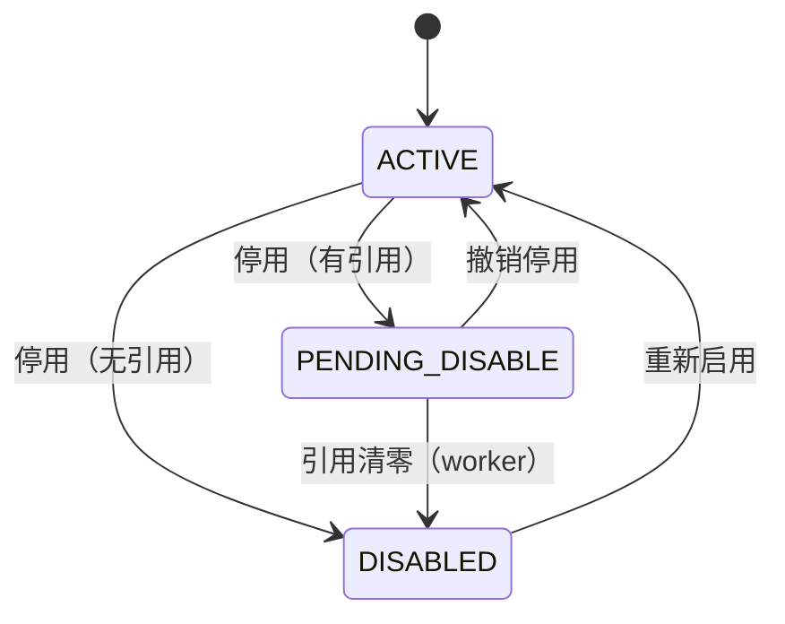

# 01 主数据 详细设计

> 作者：大肥鱼 ｜ 基线：docs/first-design 73a55d0（二轮：小钱副审 B1–B4、I1–I4、建议全部处理，见 §13） ｜ 全局约定以第 0 篇为准（数量 milli、错误码表、雪花 ID、幂等、§9.1 部署形态、X-Write-Epoch），本篇只写本模块特有的部分。

## 1. 职责与边界

### 1.1 负责
- 仓库、库区、温区、库位；SKU（基本单位、单位换算、条码、效期参数、自然损耗容差）；批次（只定义主键与效期规则，批次由收货创建）。
- 往来方：供应商、客户/门店；运力：车辆、司机；设备台账；节点号登记（`node_registry`）。
- 主数据**以中心为准**、按版本号下发到边缘节点（00 §9.1 ①③）。
- 停用/删除时对在库库存、未完结单据的约束（延迟停用）。

### 1.2 不负责
- 账号、角色、权限点、设备实例与账号绑定、离线令牌 → 第 12 篇。
- 批次的质量状态流转（合格/待检/不合格）→ 第 3 篇收货、第 9 篇效期。
- 库存数量 → 第 2 篇；本篇只给库存提供维度。

### 1.3 与原文档的差异
| 项 | 原说明书 | 本篇 |
|---|---|---|
| 损耗容差 | `sku.natural_loss_pct NUMERIC(5,2)` | `sku.natural_loss_tolerance_ppm BIGINT`（0–1 000 000），SQLite 下不退化为 REAL（00 R2） |
| 单位换算 | `sku_unit.ratio_to_base NUMERIC(14,6)` | `sku_unit.base_qty_milli BIGINT`：1 个该单位等于多少 milli 基本单位，换算只做整数乘法 |
| 补货水位 | `location.min_level/max_level NUMERIC` | `min_level_milli/max_level_milli BIGINT` |
| 主数据下发 | 未定义 | `md_version` + `md_change_log` 全量快照按 `seq` 下发，边缘幂等应用 |
| 删除 | `deleted_at` 软删 | 业务主数据**只停用不删除**；`deleted_at` 只给误建且从未被引用的行用（§5.3） |

## 2. 用例

| 用例 | 角色 | 发生在 |
|---|---|---|
| 新建/修改 SKU、单位、条码 | 主数据管理员 | 中心 |
| 新建库区、库位，调整补货水位 | 仓库主管（本仓） | 中心 |
| 新建供应商、客户、门店 | 主数据管理员 | 中心（或经第 11 篇从 ERP 同步） |
| 登记车辆、司机、设备 | 仓库主管（本仓） | 中心 |
| 分配/退役节点号 | 中心运维 | 中心 |
| 停用 SKU/库位/门店 | 主数据管理员 / 仓库主管 | 中心发起，权威库判定是否立即生效 |
| PDA 扫码解析条码 | 作业员 | 权威库（中心或边缘）只读 |

## 3. 领域模型

### 3.1 层次
`warehouse 1─n zone 1─n location`；`zone.temp_zone ∈ {AMBIENT, CHILLED, FROZEN, FRESH}` 即温区，温区不单独建表（温度范围 `temp_min/temp_max` 在库区上）。库位继承库区温区，上架/放回校验"SKU `temperature_required` = 库区 `temp_zone`"（第 3、4 篇引用）。

### 3.2 全局主数据与仓级主数据
| 范围 | 实体 | 下发范围 |
|---|---|---|
| 全局 | SKU、SKU 单位、条码、供应商、客户/门店 | 所有边缘节点 |
| 仓级 | 仓库、库区、库位、车辆、司机、设备 | 只发到该仓的边缘节点（`scope_warehouse_id`） |
| 用户权限 | 见第 12 篇 | 按 `sys_user_warehouse` 过滤后下发 |

## 4. 数据模型

所有 ID 为雪花 ID（00 §6.1）；所有带数量的列都是 BIGINT milli（00 §3.1）。每张主数据表（warehouse、zone、location、sku、supplier、customer、vehicle、driver、device）都有 `md_version BIGINT NOT NULL DEFAULT 1`，中心每次修改 `+1`（条件更新 `WHERE id=? AND md_version=?`，0 行 → 40930 并带当前版本，按乐观锁处理）。**库层保证只升不降**：两库 `trg_mdv_*` 触发器拒绝 `NEW.md_version < OLD.md_version`（`md_version_rewind`）。SQLite 下所有 milli/ppm 列另有 `ck_*_int`（`x = CAST(x AS BIGINT)`），拦截 REAL/TEXT 混入，口径同 02 R2。

### 4.1 `warehouse` / `zone`（沿用）
- `warehouse.code` 全局唯一，也是单号里的仓前缀来源（00 §6.2）。**创建后不可改**（改了单号前缀就对不上历史）。
- `zone.temp_zone` 修改：库区内有在库库存时禁止（40960，`detail.blockers`），否则会出现冷冻品挂在常温区的账。

### 4.2 `location`
新增/改动：`min_level_milli`、`max_level_milli`、`md_version`、**`md_status`**；CHECK `ck_loc_level (0 ≤ min ≤ max)`、`ck_loc_int`、`ck_loc_status`、`ck_loc_md_status`。
- 两个正交维度（小钱 I1）：`status ∈ {AVAILABLE, LOCKED}` 是作业状态（LOCKED = 盘点冻结，第 8 篇，40906）；`md_status ∈ {ACTIVE, PENDING_DISABLE, DISABLED}` 是主数据状态，走 §5 状态机。一个库位可以同时 LOCKED 且 PENDING_DISABLE。`status` 不再有 `DISABLED`。补货扫描索引只看 `status='AVAILABLE' AND md_status='ACTIVE'`。
- 库位编码 `(warehouse_id, code)` 唯一，印在标签上，**创建后不可改**。

### 4.3 `sku`
| 列 | 说明 |
|---|---|
| `base_uom` | 基本单位（KG/PCS/EA）。**有过库存或单据后不可改**（所有 milli 都以它为准）|
| `shelf_life_days` / `receive_min_shelf_life` / `ship_min_shelf_life` | 效期参数，天。`ck_sku_shelf_life`：都 ≥0；保质期 >0 时两个阈值 ≤ 保质期 |
| `natural_loss_tolerance_ppm` | 自然损耗容差，百万分比。`ck_sku_loss_ppm` **0–50 000（≤ 5%）**；接口层超出返回 422 **`42222 LOSS_TOLERANCE_OUT_OF_RANGE`**（先于库层 CHECK，不走 50010）。上限防止把容差设到 100% 绕过第 9 篇报损审批（小钱 I4）。第 9 篇按 `|损耗 milli| × 1 000 000 ≤ 账面 milli × ppm` 判断是否在容差内（整数比较，不做除法）|
| `is_weighing` / `weight_tolerance_pct` | 称重品。`weight_tolerance_pct` 仍为 NUMERIC，只用于提示，不参与入账（见 Q3）|
| `status` | `ACTIVE / PENDING_DISABLE / DISABLED`（§5）|

迁移：`natural_loss_tolerance_ppm = round(natural_loss_pct × 10000)`，一次性脚本，迁移后删旧列（00 §9.2 三步走）。

### 4.4 `sku_unit` / `sku_barcode`
- `sku_unit.base_qty_milli`：`1 BOX = 12500` 表示 1 箱 = 12.500 KG。CHECK `ck_unit_ratio > 0`。基本单位自己也登记一行，`base_qty_milli` **必须 = 1000**（两库触发器 `base_unit_ratio_must_be_1000`，小钱 I3）；`ck_unit_int` 拦 SQLite 小数。
- 换算：`milli = 数量(milli) × base_qty_milli / 1000`，**结果不是整数直接 400 `40010`**，不取整（与 02 §换算一致；02 文中 `ratio_to_base` 的写法由小钱在 02 跟改，Q1 已定）。
- `sku_barcode.barcode` 全局唯一（PDA 一次命中）。同一条码换给别的 SKU：先停用旧绑定（删行，条码行不是业务单据，可删，写 `audit_log`），再建新行；两步在同一个 `md_version` 下发。
- 被引用后的换算比例**不可改**：要改就新建单位编码（如 `BOX12` → `BOX10`），旧单位停用。否则历史单据的箱数无法还原。

### 4.5 `lot`（沿用）
唯一键 `(sku_id, lot_code, expiry_date)`；`expiry_date` 是日历日，禁发期按仓库时区自然日算（04 I5）。批次由收货创建，属于**作业数据**，在权威库生成，不走主数据下发；中心经回传得到镜像。`supplier_id` 引用供应商。

### 4.6 `supplier` / `customer`（新增）
- `supplier.code`、`customer.code` 全局唯一。来自 ERP 的按 ERP 编码落库（第 11 篇映射）。
- 客户与门店同表：`customer_type ∈ {CUSTOMER, STORE}`；`ck_customer_type` 要求门店必须有 `parent_id`、客户不能有；触发器 `customer_parent_invalid` 要求 `parent_id` 指向**已存在的 CUSTOMER**（不能挂在门店下或悬空）。出库单 `customer_id` 指向门店（配送到门店签收，第 16 篇），对账按 `parent_id` 汇总。

### 4.7 `vehicle` / `driver`（新增）
- `vehicle.plate_no` 全局唯一，`temp_zone` 含 `MULTI`（多温车）；`capacity_weight_milli`。
- `driver.user_id` 唯一：司机的登录账号在 `sys_user`，本表存业务属性（健康证到期等）。健康证过期的司机不能被排车（第 15 篇校验，422 `42220`）。

### 4.8 `device`（新增）与 `node_registry`（新增）
- `device`：物理设备台账，`device_code` 是机身资产编号。`device_instance_id`（App 安装实例，重装即变）与账号的绑定由第 12 篇管理，本表只到"机器"。设备丢失 → `LOST`，第 12 篇据此吊销该设备上的全部令牌。
- `node_registry`：落实 00 §9.1 ④。`node_id` 即主键（0–1023，`ck_node_id_range`）；`ck_node_form`：边缘节点必须挂仓。防复用（小钱 B2，全部报 `node_id_never_reused`）：
  - 两库禁 DELETE；PG 另加语句级 `BEFORE TRUNCATE`。
  - SQLite 的 `INSERT OR REPLACE` 在 `recursive_triggers=OFF` 时删旧行不触发 DELETE 触发器，所以加 `BEFORE INSERT … WHEN EXISTS(同 node_id)` 直接 ABORT（同 02 `trg_hold_no_replace`）。
  - ACTIVE 行只能改 `status/retired_at/retire_reason`（走退役）；`warehouse_id/form/role/host_label/assigned_at` 锁死；RETIRED 行完全冻结，不可复活。
  - `wms_app` 只授 SELECT/INSERT + 三个退役列的 UPDATE。

### 4.9 下发：`md_change_log` / `md_sync_state`（新增）
- 中心每次修改主数据，在**同一事务**里写 `md_change_log(seq, entity_type, entity_id, md_version, op, scope_warehouse_id, payload_json)`。`payload_json` 是**全量快照**，不发差量（丢一条不会导致后面的差量错位）。
- `uq_mdlog_ver (entity_type, entity_id, md_version)`：同一版本只有一条；`ck_mdlog_entity` 限定实体类型。
- **真只追加**（小钱 B3）：行级 UPDATE/DELETE + PG 语句级 TRUNCATE 触发器；SQLite 加防 REPLACE 的 BEFORE INSERT（`seq` 或 `(entity_type, entity_id, md_version)` 已存在即 ABORT）；`wms_app` 只授 SELECT/INSERT。
- `md_sync_state(node_id, applied_seq)`：每个边缘节点的应用水位，**只前进**（两库触发器 `applied_seq_rewind`，小钱 I2）。

### 4.10 `md_pending_disable`（新增）
停用命令在权威库判定"有引用"时登记到这里，`uq_mdpd_waiting` 保证同一实体在同一仓只有一条等待中的记录；`ck_mdpd_entity` 限定可停用的实体类型。

### 4.11 `md_disable_action_policy`（新增，停用期间动作白名单）
服务层在新建单据/任务/分配前，对涉及的每个主数据按 `action_code` 查本表：主数据为 PENDING_DISABLE/DISABLED 且（查不到 或 `allowed_when_pending=false`）→ 42221。`ck_mdap_add_never` 在库层保证 **`ref_effect='ADD'` 的动作永远不能放行**；本表 `wms_app` 只读，改动走迁移。白名单见 §5.2。

## 5. 状态机

### 5.1 主数据状态（SKU、库位、往来方、车辆、司机通用）

| from → to | 触发者 | 守卫 | 副作用 |
|---|---|---|---|
| ACTIVE → DISABLED | 管理员 | 各权威库检查引用为 0 | `md_version+1`，写 `md_change_log(op=DISABLE)` |
| ACTIVE → PENDING_DISABLE | 管理员 | 任一权威库存在引用 | 写 `md_pending_disable`；**立即**禁止新引用 |
| PENDING_DISABLE → DISABLED | worker | 引用清零 | 同上 |
| PENDING_DISABLE → ACTIVE | 管理员 | — | 取消 `md_pending_disable` |
| DISABLED → ACTIVE | 管理员 | 编码未被别的行占用 | `md_version+1` |

库位的 `LOCKED`（盘点）不在这张图里，与停用正交。设备用 `ACTIVE/LOST/RETIRED`，节点号用 `ACTIVE/RETIRED`（单向）。

### 5.2 "引用"的定义（停用守卫）
| 实体 | 在库库存 | 未完结单据 / 任务 |
|---|---|---|
| SKU | 任一 `stock.on_hand_qty_milli > 0` | 入库单、出库单、波次、拣货任务、待回库记录、盘点单、报损单未到终态 |
| 库位 | 同上（按 `location_id`）| 拣货任务、移库、待回库 `target_location`、盘点 |
| 供应商 | — | 未完结入库单 |
| 客户/门店 | — | 未完结出库单、未签收运单 |
| 车辆/司机 | — | 未完结运单 |

补充引用：`stock_hold.status='HELD'`（含系统冻结）、OPEN 的待回库记录、未终态报损单（小钱 B1）。

**PENDING_DISABLE 的含义**（小钱 B1 修订）：42221 **只拦"增加引用"的动作**；"减少引用"的动作必须放行，否则库存/冻结永远清不到 0，停用会死锁。

| action_code | 效果 | 停用期间 | 归属 |
|---|---|---|---|
| `INBOUND_CREATE` 新入库 / 采购收货 | ADD | 拦 42221 | 03 |
| `PUTAWAY_TO_LOCATION` 上架到该库位 | ADD | 拦 | 03 |
| `OUTBOUND_CREATE` 新出库单行 | ADD | 拦 | 04 |
| `ALLOCATE` 新分配 / 预占 | ADD | 拦 | 04 |
| `MOVE_IN` 移入该库位 | ADD | 拦 | 02 |
| `NEARBY_PUTBACK_TO` 待回库就近放回到该库位 | ADD | 拦（改选别的库位，或放回原位）| 04 |
| `SCRAP_CREATE` 报损单（含 SCRAP_HANDOVER 同事务建单）| REDUCE | **放行** | 09 |
| `MOVE_OUT` 从该库位移出 | REDUCE | 放行 | 02 |
| `COUNT_ADJUST` 盘点差异调整 | REDUCE | 放行 | 08 |
| `RETURN_TO_SUPPLIER` 退供出库 | REDUCE | 放行 | 10 |
| `CUSTOMER_RETURN_IN` 门店退货回仓 | REDUCE | 放行；**先建第 10 篇质检单**（质检单来源字段记 `STORE_RETURN`），入库同事务写 `RETURN_QC` 系统冻结（`source_type='QC'`，`source_id` = 质检单 id，`operator_id=0`，即 02 现有口径），只能由质检 `release_qc_hold` 释放；不合格品 `convert_hold` 转 `SCRAP_PENDING` 走报损。停用期间质检合格也**不能转可售**，只能退供或报损 | 10 |
| `RETURN_RECORD_CLOSE` 待回库 confirm / resolve（原位、报损交接）| REDUCE | 放行 | 04 |
| `PICK_EXISTING_TASK` 停用前已生成任务的拣货、复核、发货 | REDUCE | 放行 | 05 |
| `RELEASE_HOLD` `release_return_hold` / `release_scrap_hold` / `release_qc_hold` 等 `release_*_hold` | REDUCE | 放行 | 02 |
| `CONVERT_HOLD` `convert_hold`（如 RETURN_PENDING → SCRAP_PENDING）| REDUCE | 放行 | 02 |

新增动作必须在本表登记并标明效果；未登记的动作对停用主数据一律拦截（默认拒绝）。

### 5.3 删除
业务主数据不物理删除。只有"从未被任何单据、库存、流水引用"的行可以由管理员软删（`deleted_at`），用于清理误建；判断不到就拒绝（40960）。条码行与单位行例外，见 §4.4。

## 6. 下发与边缘节点（引用 00 §9.1，只写本篇特有部分）

1. **写入只在中心**：边缘节点的主数据表只读。边缘节点收到主数据写请求返回 409 **`40962 MASTER_READ_ONLY_NODE`**，`detail.center_endpoint` 给中心地址。
2. **下发**：中心 worker 按 `seq` 把 `scope_warehouse_id IS NULL OR = 该仓` 的记录推给边缘节点；边缘节点在一个事务里：按 `(entity_type, entity_id)` 比较 `md_version`，**高于本地才覆盖**，低于或相等直接跳过（幂等），然后推进 `md_sync_state.applied_seq`。
3. **缺口**：边缘发现 `seq` 不连续（按 `scope` 过滤后的序列由中心附带 `prev_seq`）就暂停应用并请求补发，不跳号。
4. **停用的两段式**：中心发出停用 → 边缘节点（权威库）检查引用：无引用直接 DISABLED；有引用写本地 `md_pending_disable` 并以事件回传，中心把状态置为 PENDING_DISABLE。引用清零后边缘回传 `APPLIED`，中心再 `md_version+1` 置 DISABLED 并下发。**是否有引用以权威库为准**（形态 B 的库存和单据只在边缘），中心镜像只用来提示。
5. **断网**：边缘按最后版本运行；上游单据引用了边缘尚未收到的 SKU/门店 → 单据进"待主数据"（00 §9.1 ②），收到对应 `md_version` 后自动重试。
6. **X-Write-Epoch**：主数据写接口只在中心，带 `X-Write-Epoch`（中心权威库自身的 epoch）；边缘应用下发不经 HTTP 写接口，不受 epoch 栅栏约束，但应用前校验本节点仍是该仓权威库（不是则只读，不推进水位）。

## 7. 接口

前缀 `/api/v1/master`。写接口全部要求 `Idempotency-Key`（00 §6.5）和 `X-Write-Epoch`；数量字段为 3 位小数字符串。

| 方法 | 路径 | 权限点 | 说明 |
|---|---|---|---|
| GET | `/warehouses`、`/warehouses/{id}/zones`、`/zones/{id}/locations` | `master.warehouse.view` / `master.location.view` | 列表/详情 |
| POST/PUT | `/warehouses`、`/zones`、`/locations` | `master.location.edit` | 改动带 `md_version`（乐观锁）|
| GET | `/skus`、`/skus/{id}` | `master.sku.view` | 含单位、条码 |
| POST/PUT | `/skus`、`/skus/{id}/units`、`/skus/{id}/barcodes` | `master.sku.edit` | |
| GET | `/barcodes/{barcode}` | `master.sku.view` | PDA 解析，走唯一索引；**边缘节点本地可用** |
| GET/POST/PUT | `/suppliers`、`/customers` | `master.partner.view` / `master.partner.edit` | |
| GET/POST/PUT | `/vehicles`、`/drivers` | `master.fleet.view` / `master.fleet.edit` | |
| GET/POST/PUT | `/devices` | `master.device.view` / `master.device.edit` | |
| POST | `/{entity}/{id}/disable`、`/enable` | 对应 `*.edit` | 返回 `{status: DISABLED \| PENDING_DISABLE, blockers}` |
| GET/POST | `/nodes`、`/nodes/{node_id}/retire` | `system.node.manage` | 只有中心运维；分配节点号 = **从未登记过的最小号**（已退役的号也算登记过，永不再用）|
| GET | `/sync/{node_id}?after_seq=` | 节点凭证（第 12 篇） | 边缘拉取下发日志 |

示例：
```json
PUT /api/v1/master/skus/7311000000000001
{ "md_version": 4, "ship_min_shelf_life": 10, "natural_loss_tolerance_ppm": 5000,
  "units": [{ "uom": "BOX", "base_qty": "12.500" }] }
```
`base_qty` 是字符串，按 00 §3.1 解析成 `base_qty_milli=12500`；超过 3 位小数 → 400 `40010`。

### 7.1 错误码（本篇新增，00 码表同步登记）
| 码 | HTTP | 名称 | 场景 |
|---|---|---|---|
| 40960 | 409 | MASTER_IN_USE | 改不可改字段（`base_uom`、已引用的换算、库区温区）或软删时仍有引用。`detail.blockers: [{type, id, count}]` |
| 40961 | 409 | MASTER_CODE_DUPLICATE | 编码/条码/车牌重复（唯一约束 → 业务码，不走 50010）|
| 40962 | 409 | MASTER_READ_ONLY_NODE | 在边缘节点写主数据 |
| 40963–40969 | 409 | — | 预留给第 1 篇 |
| 42220 | 422 | DRIVER_CERT_EXPIRED | 司机健康证过期，不能排车 |
| 42221 | 422 | MASTER_DISABLED | "增加引用"的动作（§5.2 白名单 ADD 行或未登记动作）引用了 DISABLED 或 PENDING_DISABLE 的主数据。`detail {entity_type, entity_id, status, action_code}` |
| 42222 | 422 | LOSS_TOLERANCE_OUT_OF_RANGE | `natural_loss_tolerance_ppm` 不在 0–50 000（5%）|
| 42223–42229 | 422 | — | 预留给第 1 篇 |

乐观锁版本冲突沿用 40930（带当前 `md_version`）；参数非法沿用 40001/40010；不存在沿用 404xx。

## 8. 并发与幂等
- 中心修改主数据：条件更新 `md_version`，同事务写 `md_change_log`；并发修改同一 SKU 后到者 40930。
- 边缘应用：版本比较 + `applied_seq` 推进同事务，重放安全。
- 停用与新建单据并发：新建单据在事务内重读主数据 `status`（`ACTIVE` 才放行）；停用在权威库内检查引用并写状态，同一权威库内两者串行化（SQLite 单写者；PG 对主数据行 `SELECT … FOR SHARE` vs 停用的 `FOR UPDATE`）。
- 节点号分配：`INSERT node_registry` 撞主键即重取，主键保证不会两人拿到同一个号。

## 9. 权限
| 权限点 | 说明 | 默认角色 |
|---|---|---|
| `master.warehouse.view` / `master.location.view` | 只读 | 全部仓内角色 |
| `master.location.edit` | 库区、库位、补货水位 | 仓库主管 |
| `master.sku.view` / `master.sku.edit` | SKU、单位、条码 | 全部 / 主数据管理员 |
| `master.partner.view` / `master.partner.edit` | 供应商、客户、门店 | 客服 / 主数据管理员 |
| `master.fleet.view` / `master.fleet.edit` | 车辆、司机 | 调度 / 仓库主管 |
| `master.device.view` / `master.device.edit` | 设备台账 | 仓库主管 |
| `system.node.manage` | 节点号分配、退役 | 中心运维 |

仓级主数据按 `X-Warehouse-Id` 隔离（40311）；全局主数据（SKU、往来方）不按仓隔离。所有写操作写 `audit_log`（第 12 篇），`before_json/after_json` 为全量快照。

## 10. 对抗评审攻击面（给小赵）
| # | 攻击/异常 | 防线 | 验证 |
|---|---|---|---|
| A1 | 改换算比例让历史箱数错 | 已引用后不可改（40960）；新建单位 | 接口测试 |
| A2 | 换算比例为 0 或负 | `ck_unit_ratio` | verify ✓ |
| A3 | 损耗容差填 100% 绕过第 9 篇报损审批 | `ck_sku_loss_ppm` ≤ 50 000（5%），接口 42222；容差改动写审计 | verify ✓（50001 拦、50000 放）|
| A4 | 禁发期 > 保质期导致永远不可发 | `ck_sku_shelf_life` | verify ✓ |
| A5 | 退役节点号被重新分配 → 雪花 ID / 单号撞号 | 主键 + 禁 DELETE/TRUNCATE + SQLite 防 REPLACE + 非退役列锁死 + 列级授权 | verify ✓（同号 INSERT、REPLACE、TRUNCATE、复活、改仓、删除都拦）|
| A6 | 越界节点号 | `ck_node_id_range` | verify ✓ |
| A7 | 下发日志被篡改或同版本两条内容 | 只追加（UPDATE/DELETE/TRUNCATE/REPLACE）+ `uq_mdlog_ver` + wms_app 只 SELECT/INSERT | verify ✓ |
| A8 | 低版本覆盖高版本（乱序、重放）、水位回退 | `trg_mdv_*`、`trg_mdss_monotonic` | verify ✓ |
| A9 | 停用有库存的库位，库存"消失"在报表里；或停用死锁清不掉库存 | PENDING_DISABLE + 白名单（只拦 ADD）；引用判定以权威库为准 | verify ✓（白名单正反向）+ 集成测试 |
| A10 | 停用期间并发新建单据 | 新建事务内重读 status；同库串行 | 并发测试 |
| A11 | 同一实体重复登记延迟停用 | `uq_mdpd_waiting` | verify ✓ |
| A12 | 在边缘节点直接改主数据造成与中心分叉 | 边缘主数据表无写接口（40962）+ 应用账号仅 SELECT（部署脚本）| 接口测试 |
| A13 | 门店无归属客户，对账汇总丢 | `ck_customer_type` | verify ✓ |
| A15 | 应用账号删主数据 / 改白名单 | 新表最小授权，过 02 全表授权断言 | verify ✓ |
| A14 | 条码移给另一 SKU 时 PDA 用旧缓存 | 同 `md_version` 下发；PDA 解析一律走服务端，不在端上缓存条码表（见 Q4）| 集成测试 |

## 11. 测试要点
- verify（SQLite/PG 两套同断言）：`ck_sku_loss_ppm`、`ck_sku_shelf_life`、`ck_unit_ratio`（含 12500 放行）、`ck_loc_level`、`ck_customer_type`（含门店挂客户放行）、`uq_customer_code`、`ck_node_id_range`、`ck_node_form`、节点号同号 INSERT / 复活 / 删除、`uq_mdlog_ver`、`md_change_log` 只追加、`uq_mdpd_waiting`。
- 换算：`"1.5" BOX × 12500` → 18750 milli；`"0.001" BOX × 12500` → 12.5 → 400 `40010`。
- 下发：乱序（v3 先到 v2 后到）→ 最终 v3；重放同 seq → 无变化；缺口 → 暂停。
- 停用：有在途拣货任务的库位 → PENDING_DISABLE，拣完后 worker 置 DISABLED；期间新上架 → 42221。
- 断网：边缘断网时中心改 SKU，联网后按序应用；断网期间上游单引用新 SKU → 待主数据 → 恢复后自动处理。
- 非计划切换：新节点拿新节点号，旧号 RETIRED（00 §9.1 ④ 验收用例）。

## 12. 待定问题
| # | 问题 | 建议 | 决策人 |
|---|---|---|---|
| Q1 | ~~`ratio_to_base` 改名~~ | **已定**：小钱在 02 跟改 | 已定 |
| Q2 | 40960–40969、42220–42229 两个新段（本 PR 已登记到 00 码表，含新增 42222）| 同意登记 | Yuri |
| Q3 | `weight_tolerance_pct`、`avg_weight_g`、`capacity_weight/volume` 等仍为 NUMERIC | 只用于提示和规划，不入账，本期保留；如第 3 篇称重收货要用来判定，再改 ppm/milli | Yuri |
| Q4 | PDA 是否允许离线缓存条码表（边缘节点内网可达时不需要）| 不缓存，扫码都走服务端（形态 B 走边缘节点）| Yuri |
| Q5 | 客户/门店、供应商以 ERP 为主还是 WMS 为主 | ERP 为主，经第 11 篇同步，WMS 只补充配送属性（收货时间窗、坐标）| Yuri |
| Q6 | `warehouse_db_authority`、`write_epoch` 两张表归属 | 归第 0 篇/运维，不在本篇建表 | Yuri |
| Q7 | 主数据管理员、中心运维是否作为独立角色（第 12 篇角色矩阵）| 是 | Yuri |

## 13. 二轮修订记录（小钱副审 #8 issuecomment-6176861523）
| 项 | 处理 |
|---|---|
| B1 停用死锁 | 42221 只拦 ADD；`md_disable_action_policy` 白名单（含 release_*_hold、convert_hold、门店退货回仓先建质检单（来源 STORE_RETURN）再入 RETURN_QC）；`ck_mdap_add_never`；verify 正反向 |
| B2 节点号复用 | 禁 DELETE/TRUNCATE、SQLite 防 REPLACE、非退役列锁死、退役不可复活 |
| B3 md_change_log | UPDATE/DELETE/TRUNCATE/REPLACE 全拦 + 授权 |
| B4 授权 | 新表最小授权，过全表授权断言；wms_app 越权 4 条断言 |
| I1 | 库位新增 `md_status`，与作业 `status` 正交 |
| I2 | `md_version`、`applied_seq` 单调触发器 |
| I3 | 基本单位行 = 1000 触发器；SQLite `ck_*_int` |
| I4 | ppm ≤ 50 000，42222 |
| 建议 | 门店 parent 校验触发器；entity_type CHECK；节点号分配措辞 |
