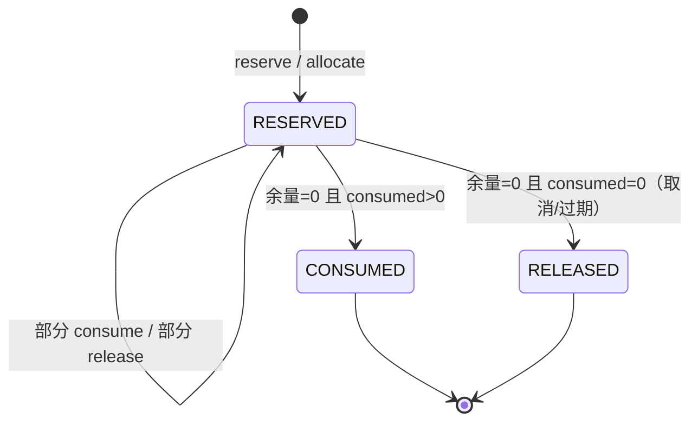
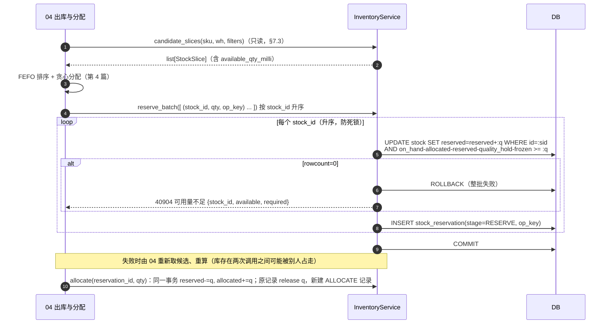
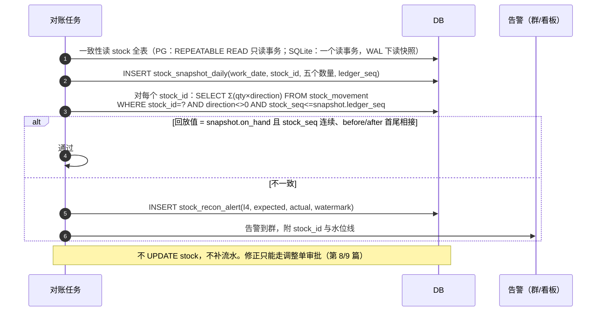

# 02 库存核心 详细设计

| 项 | 内容 |
|---|---|
| 模块编号 | 02 |
| 作者 | 小钱（后端） |
| 评审 | 小赵（测试，对抗性评审，见 §13）、非作者开发 1 名 |
| 基线 | `main@8ed5f0c`，《[WMS详细设计说明书](archive/WMS详细设计说明书.md)》§3.1、§3.4、§4.1–§4.3、§4.6、§4.8、§6.1、附录 A |
| 依赖 | 00 总体设计（数量口径、ID/单号、幂等、错误码、权限）；04 出库与分配（消费 FEFO 钩子）；05 波次与拣货（PDA 业务幂等键、待回库）；08 盘点；12 权限与审计 |
| 状态 | 草稿，与总体设计、第 4 篇合并为一个 PR 评审 |

> 本篇只写库存核心：数量模型、不变量、扣减原语、流水、快照对账，以及给其他模块用的服务接口。收货、拣货、盘点等业务流程只写到"它们调用库存核心的哪个原语"为止，流程本身归各自模块。

---

## 1. 职责与边界

### 1.1 本模块负责

1. **库存余额**：`stock` 一行代表一个记账维度 `仓库 + 库位 + SKU + 批次 + 容器`（原文档 §4.1，I6）上的五个数量：在库量 `on_hand`，以及四个占用列 `allocated / reserved / quality_hold / frozen`。
2. **占用明细**：`stock_reservation`（预占、分配）和 `stock_hold`（质检冻结、人工冻结）。四个占用列是这两张表的**物化汇总**（I3）。
3. **库存原语**（§7.1）：入账、出账、移库、预占、预占转分配、释放、消耗、冻结、解冻。所有改库存的业务都**只能**调这些原语，不许直接写 `stock`。
4. **库存流水** `stock_movement`：只追加，每一次 `on_hand` 变化对应一条流水，与余额在同一事务。
5. **不变量**：库层 CHECK + 应用层断言两道防线（§4.3）。
6. **快照与对账**：日终快照、流水回放对账、占用汇总对账。**只告警，不自动修数**（§6.4）。
7. **FEFO 钩子**：给第 4 篇提供"候选库存切片"查询和"按分配结果原子占用"两个接口。排序与分配算法本身归第 4 篇（§7.3）。
8. **只读查询接口**：库存查询、流水、占用明细、对账差异（原文档 §6.2"库存"组）。

### 1.2 本模块不负责

| 不做 | 归属 |
|---|---|
| FEFO 排序、过滤、拆零、缺货判定 | 第 4 篇 出库与分配 |
| 收货/质检/上架流程 | 第 3 篇 |
| 拣货任务、PDA 业务幂等键、待回库记录的表与接口 | 第 5 篇 |
| 盘点差异计算与审批；调整单/报损单审批 | 第 8、9 篇（审批通过后调用本模块原语入账） |
| 单号/ID 生成，Redis 不可用时的离线降级 | 00 总体设计（见 §8.6） |
| 错误码最终分配、`Idempotency-Key` 通用中间件 | 00 总体设计（本篇只提议，见 §7.5） |

### 1.3 与原文档的差异（评审重点）

| # | 原文档 | 本篇 | 原因 |
|---|---|---|---|
| Δ1 | 数量 `NUMERIC(14,3)`（D3、R2、§3.3） | **`BIGINT`，单位 = SKU `base_uom` 的 1/1000，列名后缀 `*_qty_milli`**，两库一致 | PM 裁决；附录 A 已证实 SQLite 侧 NUMERIC 退化为 REAL，原 DDL 未体现 R2 |
| Δ2 | 流水只有 `idempotency_key UK` | 增加业务唯一键：非 PDA 单据 `(biz_no, line_no, leg)`；PDA 作业 `(task_id, line_no, device_instance_id, op_seq, leg)` | 重复过账在库层冲突；`Idempotency-Key` 过期后仍不能二次扣减。相对 PM 原定 `(biz_no, line_no)` 加了 `leg` 并拆成两个键，**PM 已批准** |
| Δ3 | 流水无 `stock_id`，I4 只按仓汇总 | 流水带 `stock_id` + 每行连续序号 `stock_seq`，`stock.ledger_seq` 同步递增 | 能按行回放、定位到具体行；序号唯一，记账链不能分叉 |
| Δ4 | `quality_hold / frozen` 无明细（§4.2 提到 `stock_freeze` 但未建表） | 新增 `stock_hold` | 四个占用列都能对账（I3 扩展为 I3a–I3d） |
| Δ5 | `stock_reservation` 不区分预占与分配 | 增加 `stage = RESERVE / ALLOCATE`、`released_qty_milli`、`op_key UK` | 原 I3 只能对上 `allocated`，`reserved` 无来源 |
| Δ6 | 快照按 `(work_date, wh, sku, lot)`，缺 `frozen` | 按 `(work_date, stock_id)`，带全部五个数量和 `ledger_seq` 水位线 | 对账要能精确到行，并排除快照时刻之后的流水 |
| Δ7 | 无对账结果表 | 新增 `stock_recon_alert` | 对账结论需要持久化、可认领、可追溯 |
| Δ8 | 错误码带字母前缀、按模块分段 | 纯 5 位数字，前 3 位 = HTTP 状态 | PM 裁决，见 §7.5 |
| Δ9 | 待回库没有库存表达 | 生成待回库记录时写 `RETURN_PENDING` 冻结 | PM 裁决，见 §8.5 |

---

## 2. 用例

| 编号 | 用例 | 调用方 | 用到的原语 | `on_hand` 变化 | 写流水 |
|---|---|---|---|---|---|
| UC1 | 收货入暂存位（待检同时冻结） | 03 入库 | `post_in` (+ `hold QUALITY`) | +q | `RECEIVE` +1 |
| UC2 | 上架 / 移库 / 补货 | 03、07 | `move` | 来源 −q，目标 +q | `PUTAWAY`/`MOVE` 两腿 |
| UC3 | 出库单预占 | 04 | `reserve` | 0 | 否 |
| UC4 | 波次分配（预占转分配） | 04/05 | `allocate`（RESERVE→ALLOCATE） | 0 | 否 |
| UC5 | 拣货确认 | 05（PDA） | `consume`（allocated −q 且 on_hand −q） | −q | `PICK` −1 |
| UC6 | 撤销拣货 / 已拣订单取消倒回 | 05、04 | `post_in`（REVERSE_PICK） | +q | `REVERSE_PICK` +1 |
| UC7 | 发货 | 06 | `post_event` | 0 | `SHIP` direction=0 |
| UC8 | 订单取消 / 预占过期释放 | 04、定时任务 | `release` | 0 | 否 |
| UC9 | 质检放行 / 拒收 | 03 | `unhold`；拒收再 `post_out` 或 `move` 到隔离区 | 0 或 −q | 视情况 |
| UC10 | 人工冻结 / 解冻 | 管理后台 | `hold MANUAL` / `unhold` | 0 | 否 |
| UC11 | 盘盈盘亏、调整、报损（审批后） | 08、09 | `post_in` / `post_out` | ±q | `COUNT`/`ADJUST`/`SCRAP` |
| UC12 | 退货入库 | 10 | `post_in` + `hold QUALITY` | +q | `RETURN` +1 |
| UC13 | 查询库存、流水、占用、对账差异 | 后台、PDA | 只读 | — | — |
| UC14 | 日终快照、实时对账 | 定时任务 | 只读 + 写告警 | — | — |
| UC15 | 待回库：生成时冻结，确认时解冻 | 05 | `hold RETURN_PENDING` / `unhold` | 0 | 否 |
| UC16 | 待回库：主管处置"就近回库" | 05（主管） | `unhold` + `move`（标准移库路径） | 原库位 −q，目标 +q | `MOVE` 两腿 |

UC15/UC16 说明见 §8.5：待回库**确认**不写流水、不改 `on_hand`，只释放 RETURN_PENDING 冻结；只有主管处置为"就近回库"时，才在释放冻结后走一次标准移库。

---

## 3. 领域模型

### 3.1 数量值对象 `Quantity`

- 内部只存整数 `milli: int`，单位是 SKU `base_uom` 的 1/1000。KG 计的 SKU 就是克，PCS 计就是 0.001 个。
- **入参**：只收字符串，正则 `^-?\d{1,15}(\.\d{1,3})?$`。超过 3 位小数、科学计数法、空串、JSON number 一律 **400**，不四舍五入（错误码见 §7.5）。
- **出参**：固定 3 位小数字符串，如 `12500 → "12.500"`，`-2000 → "-2.000"`。单位取 `sku.base_uom`，接口里单独返回 `uom` 字段。
- **换算**：作业单位（箱）→ 基本单位只在入口做一次（原文档 §3.3）：`milli = parse(qty) × ratio_to_base`。如果结果不是整数 milli（比如 `ratio_to_base` 有 6 位小数），返回 400，不取整。
- 绝不经过 `float`。原文档 §4.3 示例里的 `bindparams(qty=float(qty))` 作废，改为绑定 `int`。
- 取值范围：`BIGINT` 上限约 9.2×10^18 milli，远超业务量。JSON 输出用字符串，不受 JS 2^53 限制（原文档 §6.1）。

### 3.2 库存行 `Stock`

```
on_hand        在库总量（物理在库）
allocated      已分配未拣   = Σ ALLOCATE 占用的未结余量
reserved       已预占       = Σ RESERVE  占用的未结余量
quality_hold   质检/盘点冻结 = Σ QUALITY  冻结的未结余量
frozen         人工冻结     = Σ MANUAL   冻结的未结余量

available = on_hand − allocated − reserved − quality_hold − frozen   （可预占量）
pickable  = on_hand − quality_hold − frozen − allocated              （原文档 §3.4，不含 reserved）
book      = on_hand                                                  （盘点基准）
```

列名一律加 `_qty_milli` 后缀，如 `on_hand_qty_milli`。下文为可读性简写。

### 3.3 占用与冻结

- `Reservation(stage, quantity, consumed, released, status)`：未结余量 = `quantity − consumed − released`。`status` 是派生的：余量 > 0 为 `RESERVED`；余量 = 0 时，有消耗为 `CONSUMED`，否则为 `RELEASED`。
- `Hold(hold_type, quantity, released, status)`：未结余量 = `quantity − released`。

### 3.4 流水 `Movement`

`(biz_type, biz_no, line_no, leg, direction, stock_id, stock_seq, qty, before, after, PDA 业务键四列)`。只追加，不可修改。`direction ∈ {−1, 0, +1}`：0 是纯事件（`SHIP`），不改 `on_hand`，不进记账链。

### 3.5 不变量

| # | 内容 | 库层 CHECK | 应用层断言 | 对账任务 |
|---|---|---|---|---|
| I1 | 五列均 ≥ 0 | `ck_stock_nonneg` | 每次原语后 | — |
| I2 | `allocated + reserved + quality_hold + frozen ≤ on_hand` | `ck_stock_nonneg` | 每次原语后 | — |
| I2' | 所有数量列都是整数（SQLite 防 REAL/TEXT 混入） | `ck_stock_int` 等 | `Quantity` 类型 | — |
| I3a | `allocated = Σ(ALLOCATE 余量)` | 不能（跨表） | 原语内同事务更新 | 每 5 分钟 |
| I3b | `reserved = Σ(RESERVE 余量)` | 不能 | 同上 | 每 5 分钟 |
| I3c | `quality_hold = Σ(QUALITY 余量)` | 不能 | 同上 | 每 5 分钟 |
| I3d | `frozen = Σ(MANUAL 余量)` | 不能 | 同上 | 每 5 分钟 |
| I4 | 每行 `on_hand = Σ(该 stock_id 流水 qty × direction)`；按仓汇总同理 | 不能 | — | 日终 + 抽样 |
| I5 | 每条流水 `after = before + qty × direction` | `ck_mv_balance` | 写流水前 | — |
| I5' | 每行记账链连续：第 n 条的 `before` = 第 n−1 条的 `after`，`stock_seq` 从 1 连续无缺号 | 唯一性：`uq_mv_stock_seq` | — | 每 5 分钟（增量） |
| I6 | 同维度只有一行 `stock` | `uq_stock_dim`（0 哨兵） | — | — |
| I7 | 单据未完成时，其占用不能被提前清零（原文档 I7） | 不能 | 由各单据模块断言 | 每 5 分钟 |
| I8 | 占用/冻结：`consumed + released ≤ quantity` | `ck_res`、`ck_hold` | — | — |

应用层断言放在 `domain/invariants.py`。CI 中用 hypothesis 生成随机原语序列（含并发交错），每步后校验 I1–I8（原文档 §4.1）。

---

## 4. 涉及的表（字段、约束、索引）

完整 DDL 见本 PR 中的 `wms-design/sql/schema_postgres.sql`。`schema_sqlite.sql` 由 `verify_sqlite.py` 机械生成，翻译改动仍然只有 3 类。下面列关键字段。

### 4.1 `stock`

| 字段 | 类型 | 说明 |
|---|---|---|
| id | BIGINT PK | 应用层生成（R1） |
| warehouse_id / location_id / sku_id / lot_id | BIGINT NOT NULL | |
| container_id | BIGINT NOT NULL DEFAULT 0 | 0 = 散货（R11） |
| uom | VARCHAR(16) | 恒等于 `sku.base_uom` |
| on_hand_qty_milli / allocated_qty_milli / reserved_qty_milli / quality_hold_qty_milli / frozen_qty_milli | BIGINT NOT NULL DEFAULT 0 | |
| ledger_seq | BIGINT NOT NULL DEFAULT 0 | 每改一次 `on_hand` 加 1，与流水 `stock_seq` 对应 |
| version | BIGINT | 每次 UPDATE 加 1（观测与乐观展示用，不参与判断） |

约束：`uq_stock_dim`、`ck_stock_container`、`ck_stock_int`（`x = CAST(x AS BIGINT)`）、`ck_stock_nonneg`（I1+I2）。
索引：`ix_stock_sku_avail (sku_id, warehouse_id, lot_id) WHERE on_hand_qty_milli > 0`（FEFO 候选）、`ix_stock_loc`、`ix_stock_wh`。

### 4.2 `stock_reservation`

| 字段 | 说明 |
|---|---|
| stage | `RESERVE` / `ALLOCATE`，CHECK |
| source_type / source_id / source_line_id | `source_line_id NOT NULL DEFAULT 0`（R11） |
| op_key VARCHAR(80) UK | 占用操作幂等键，如 `RES:{outbound_code}:{line_no}:{attempt}` |
| reserve_qty_milli / consumed_qty_milli / released_qty_milli | `ck_res`：`reserve > 0`，`consumed + released ≤ reserve` |
| status | `RESERVED / CONSUMED / RELEASED`，与余量同事务维护 |
| expires_at | 预占过期时间，过期释放（UC8） |

索引：`ix_res_stock (stock_id, stage, status)`、`ix_res_source`、`ix_res_exp WHERE status='RESERVED'`。

### 4.3 `stock_hold`（新增）

`hold_type`（`QUALITY` 计入 `quality_hold`，`MANUAL` 计入 `frozen`）、`reason_code`、`source_type/source_id`、`op_key UK`、`hold_qty_milli`、`released_qty_milli`、`status (HELD/RELEASED)`、`operator_id`。

- `reason_code` 码表（`ck_hold_reason`）：`QC_PENDING` 待检、`COUNT_LOCK` 盘点冻结、`RETURN_QC` 退货待检、`DAMAGE` 破损、`EXCEPTION` 异常待处理、**`RETURN_PENDING` 待回库**、`OTHER`。新增原因走迁移，各模块在自己的文档里登记。
- `ck_hold_return`：`RETURN_PENDING` 必须是 `hold_type = MANUAL`（计入 `frozen`），且 `source_type = 'RETURN_RECORD'`、`source_id` = 第 5 篇待回库记录 id。
- `uq_hold_return (source_id) WHERE source_type = 'RETURN_RECORD'`：一条待回库记录最多一条冻结。
- 约束：`ck_hold`、`ck_hold_type`、`ck_hold_reason`、`ck_hold_return`。

### 4.4 `stock_movement`

| 字段 | 说明 |
|---|---|
| biz_type / biz_no / line_no / leg | 业务单据行；`leg` 是同一操作的第几条腿：拣货/收货恒为 1，移库/上架 1 = 出、2 = 入。`leg` **由操作类型决定，不是计数器** |
| direction | −1 / 0 / +1，`ck_mv_dir` |
| stock_id / stock_seq | 记账到哪一行，以及本次之后的 `stock.ledger_seq` |
| warehouse_id / location_id / from_location_id / sku_id / lot_id / container_id | 维度冗余，便于查询和归档 |
| src_task_id / src_line_no / device_instance_id / src_op_seq | **PDA 作业来源**，即第 5 篇业务幂等键 `(task_id, line_no, device_instance_id, op_seq)`。非 PDA 作业四列全 NULL；`ck_mv_pda_src` 要求四列同时为空或同时非空 |
| move_qty_milli | > 0 |
| on_hand_before_qty_milli / on_hand_after_qty_milli | `ck_mv_balance` |
| occurred_at / recorded_at | 业务发生时间 / 落库时间（R3，UTC） |
| idempotency_key UK | `{biz_type}:{biz_no}:{line_no}:{leg}`，与原文档 §4.6③ 兼容 |

唯一约束（两库都是部分唯一索引，均在交集内）：

| 名称 | 列 | 条件 | 防什么 |
|---|---|---|---|
| `uq_mv_idem` | idempotency_key | — | 原文档 §4.6③ |
| `uq_mv_biz_line` | (biz_no, line_no, leg) | `src_task_id IS NULL` | 非 PDA 单据行重复过账 |
| `uq_mv_pda_op` | (src_task_id, src_line_no, device_instance_id, src_op_seq, leg) | `src_task_id IS NOT NULL` | PDA 同一操作重复过账，包括 `Idempotency-Key` 过期后的重放 |
| `uq_mv_stock_seq` | (stock_id, stock_seq) | `direction <> 0` | 记账链分叉（两条流水声称同一个序号） |

`leg` 和两个唯一键的拆分是对 PM 原定 `(biz_no, line_no)` 的偏离，**PM 已批准**。PDA 行不进 `uq_mv_biz_line`：同一任务行可以有多次操作（部分确认、撤销后重拣），由 `op_seq` 区分，`(biz_no, line_no, leg)` 会误伤。
本表 `REVOKE UPDATE, DELETE`（PG）；SQLite 侧靠 repository 只暴露 insert，加 CI 静态检查（grep 禁止 `update(StockMovement)`）。

### 4.5 `stock_snapshot_daily`

PK `(work_date, stock_id)`，带维度、五个数量和 `ledger_seq` 水位线。索引 `ix_snap_sku (work_date, warehouse_id, sku_id, lot_id)` 用于报表和 ERP 对账。

### 4.6 `stock_recon_alert`（新增）

`check_code (I3/I4/I5/SNAP)`、`warehouse_id`、`stock_id`、`expected_qty_milli`、`actual_qty_milli`、`watermark_ledger_seq`、`status (OPEN/ACKED/RESOLVED)`、`resolved_by`、`resolution`。**只记差异**；修正必须走调整单审批，生成新的流水。

### 4.7 同步改动的非库存表

为了让验证脚本的期望值统一为 milli，`count_line` 的数量列也改成 `*_qty_milli BIGINT`，`diff_qty_milli` 生成列语义不变（`68000 − 100000 − (−30000) = −2000`）。其余单据表（`inbound_line`、`outbound_line`、`pick_task_line`、`adjust_line` 等）的数量列**本 PR 不改**，由各模块文档按同一口径改。见 §12 Q1。

---

## 5. 状态机

### 5.1 占用 `stock_reservation`



- `RESERVE → ALLOCATE`（UC4）不改原记录的 `stage`：原 RESERVE 记录 `release q`，同事务新建一条 ALLOCATE 记录。这样每条记录的 `stage` 不可变，I3a/I3b 汇总简单。
- 迁移函数收敛在 `domain/reservation.py`（原文档 D4），Service 不许直接改 `status`。

### 5.2 冻结 `stock_hold`

`HELD →（部分 unhold）→ HELD →（余量 = 0）→ RELEASED`。

### 5.3 对账告警 `stock_recon_alert`

`OPEN → ACKED（有人认领）→ RESOLVED（填处置结论：已开调整单 / 确认为误报并附原因）`。`RESOLVED` 只是结论记录，不触发任何库存变更。

`stock` 本身没有状态字段，库位锁定看 `location.status`（第 1 篇）。

---

## 6. 核心流程

### 6.1 原语的统一事务模板

所有改 `on_hand` 的原语都是同一个模板，**一个事务内**：

1. 条件 UPDATE `stock`：把校验写进 WHERE，同时 `ledger_seq = ledger_seq + 1`，用 `RETURNING on_hand_qty_milli, ledger_seq` 拿回新值（PG 支持；SQLite ≥ 3.35 支持）。这是数据库返回的写后值，**不是先读后判断**，不违反原文档 §4.3 纪律 1。
2. `rowcount == 0` → 抛业务异常（库存不足等），回滚。
3. 用 RETURNING 的值写流水：`after = 返回值`，`before = after − qty × direction`，`stock_seq = 返回的 ledger_seq`。
4. 写流水撞唯一约束 → 整个事务回滚（重复过账，见 §8.3）。
5. 应用层断言 I1/I2/I5 → 提交。

> **SQLite 版本门槛**：`RETURNING` 需要 SQLite ≥ 3.35。附录 A 是 3.50.4，本机复验是 3.46.1。部署检查脚本要断言版本，低于门槛就拒绝启动（§12 Q6）。

### 6.2 拣货确认扣减（UC5，最热路径）


### 6.3 预占（UC3）与预占转分配（UC4）



一批全成或全败，由第 4 篇决定是缩量重试还是记缺货。本模块不做部分成功，避免"占了一半"的中间态泄漏。

### 6.4 日终快照与流水回放对账（UC14）



要点：

- **水位线解决在途单据**：快照记的是每行的 `ledger_seq`。回放只累加 `stock_seq ≤ 水位线` 的流水，所以对账期间新提交的拣货不会造成假差异。不用流水 `id` 当水位线，因为 id 由号段生成，多实例之间不单调。
- 占用对账（I3a–d）在同一个读快照里，比较 `stock` 四列与明细表余量汇总。
- 流水归档（PG 按月分区、SQLite 按月导出）之后，回放从"上一份已验证快照 + 之后的流水"开始，不必从头扫全表。
- 全仓 I4（按仓汇总）每天跑一次；按行增量校验（只校验当天 `ledger_seq` 有变化的行）每 5 分钟跑一次。

### 6.5 移库（UC2 / UC15）

一个事务：来源行条件扣减（`on_hand − allocated − reserved − quality_hold − frozen ≥ q`，也就是只能移可用量）→ 目标行 upsert（不存在就插一行 0 库存，`uq_stock_dim` 冲突时说明并发插入，重查 id 后继续）→ 目标行 `on_hand += q` → 写两条流水，`leg = 1/2`。两行按 `stock_id` 升序加锁（原文档 §4.3 纪律 2）：先执行 id 较小那一行的 UPDATE。

---

## 7. 接口清单与契约

### 7.1 服务内接口（Python，供其他模块调用）

| 原语 | 签名（简写） | 改的列 | 流水 | 失败码 |
|---|---|---|---|---|
| `post_in` | `(stock_dim, qty, biz, src?)` | on_hand +q | +1 | — |
| `post_out` | `(stock_id, qty, biz, src?)` | on_hand −q，条件：`available ≥ q` | −1 | 40902 |
| `move` | `(from_id, to_dim, qty, biz, src?)` | 见 §6.5 | −1/+1 两腿 | 40902 |
| `reserve_batch` | `([(stock_id, qty, op_key)], source)` | reserved +q，条件 `available ≥ q` | 无 | 40904 |
| `allocate` | `(reservation_id, qty, op_key)` | reserved −q，allocated +q | 无 | 40905 |
| `release` | `(reservation_id, qty, op_key)` | 对应列 −q | 无 | 40905 |
| `consume` | `(reservation_id, qty, biz, src)` | allocated −q，on_hand −q | −1 | 40902/40905 |
| `hold` | `(stock_id, type, qty, reason, op_key, source?)`；`RETURN_PENDING` 只能由第 5 篇待回库流程调用，人工冻结接口传它返回 `42202` | quality_hold/frozen +q，条件 `available ≥ q` | 无 | 40904 |
| `unhold` | `(hold_id, qty, op_key)` | 对应列 −q | 无 | 40905 |
| `post_event` | `(stock_id, qty, biz)` | 无 | 0 | — |

- `biz = (biz_type, biz_no, line_no, leg)`；`src = (task_id, line_no, device_instance_id, op_seq)`，只有 PDA 作业传。
- 调用方必须已开启事务（单据状态变更与库存变更同事务）。本模块不自己提交，只在出错时抛异常。
- `post_out` 扣的是**可用量**：被预占或冻结的货不能被盘亏/报损直接扣掉。盘亏、报损要先 `release`/`unhold`，由第 8/9 篇在同一事务内编排。§12 Q4 需要第 8 篇确认。

### 7.2 HTTP 接口（`/api/v1`，沿用原文档 §6.2"库存"组）

| 方法 | 路径 | 说明 | 权限点 |
|---|---|---|---|
| GET | `/inventory` | 多维聚合查询（按 sku/lot/location/zone） | `inventory.stock.view` |
| GET | `/inventory/movements` | 流水，游标分页（`?cursor=&size=`），按 `stock_id`/`biz_no`/时间过滤 | `inventory.movement.view` |
| GET | `/inventory/reservations` | 占用明细 | `inventory.reservation.view` |
| GET | `/inventory/holds` | 冻结明细（新增） | `inventory.hold.view` |
| GET | `/inventory/summary` | 看板汇总 | `inventory.stock.view` |
| POST | `/inventory/move` | 人工移库 | `inventory.move.execute` |
| POST | `/inventory/freeze` | 人工冻结（`MANUAL`） | `inventory.hold.freeze` |
| POST | `/inventory/unfreeze` | 解冻 | `inventory.hold.unfreeze` |
| GET | `/inventory/recon` | 对账差异列表 | `inventory.recon.view` |
| POST | `/inventory/recon/{id}/ack` / `/resolve` | 认领 / 填结论（不改库存） | `inventory.recon.handle` |

`/inventory/expiry-alert` 归第 9 篇。

**契约示例 `POST /inventory/freeze`**

```http
POST /api/v1/inventory/freeze
Idempotency-Key: 6f1c...（客户端一次操作一个）
X-Warehouse-Id: 1
```
```json
{ "stock_id": 8812, "qty": "2.500", "reason_code": "DAMAGE", "remark": "外箱破损待判定", "version": 41 }
```
200：
```json
{
  "code": "0",
  "data": {
    "hold_id": 90012, "stock_id": 8812, "uom": "KG",
    "frozen_qty": "2.500",
    "stock": { "on_hand": "30.000", "allocated": "10.000", "reserved": "0.000",
               "quality_hold": "0.000", "frozen": "2.500", "available": "17.500" }
  }
}
```
失败：`"qty": "2.5001"` → 400 `40001`；可用量不够 → 409 `40904`，`detail: {"stock_id":8812,"available":"1.000","required":"2.500"}`。
`version` 只用于提示"你看到的数据已变化"，**不参与扣减判断**；判断仍以条件 UPDATE 为准。

**数量字段一律是 3 位小数字符串**，同一响应里的数量单位都是该 SKU 的 `uom`。

### 7.3 FEFO 钩子（给第 4 篇的边界）

本模块**只提供数据和原子占用，不排序、不做决策**。

```python
class InventoryForAllocation(Protocol):
    def candidate_slices(self, *, warehouse_id: int, sku_id: int,
                         exclude_location_status=("LOCKED",),
                         pickable_only: bool) -> list[StockSlice]: ...
    # StockSlice = (stock_id, location_id, location_code, pick_sequence, zone_type, temp_zone,
    #               lot_id, lot_code, expiry_date, production_date, receive_date, quality_status,
    #               container_id, available_qty_milli, pickable_qty_milli, ledger_seq)
    # 数据来源 v_stock_available（已改为 *_qty_milli 列）；无锁读，结果可能过期

    def reserve_batch(self, items: list[ReserveItem], *, source: SourceRef) -> list[ReservationRef]: ...
    def allocate(self, reservation_id: int, qty_milli: int, *, op_key: str) -> ReservationRef: ...
    def release(self, reservation_id: int, qty_milli: int, *, op_key: str) -> None: ...
```

约定：

1. `candidate_slices` 是**提示**，不是承诺。第 4 篇必须假设库存在读取后随时被别人占走，以 `reserve_batch` 的结果为准（D2）。
2. 排序键、禁发期、温区、拣货位优先、整箱优先，全部在第 4 篇的 `domain/fefo.py` 纯函数里做。本模块不读 `sku.ship_min_shelf_life`。
3. `reserve_batch` 内部按 `stock_id` 升序执行，调用方不需要自己排序。
4. 越权分配（原文档 D7 `allocation_override`）的审计由第 4 篇记，本模块只记 `op_key` 和 `source`。

### 7.4 幂等语义（与总体设计一致）

- 所有 POST 必须带 `Idempotency-Key`。同 key、同请求（`req_hash` 相同）→ 返回首次响应；同 key、不同请求 → **409 `40910`**（编号待总体设计确认）。中间件归 00 总体设计。
- 本模块在中间件之下**再兜两层**，因为 `idempotency_record` 只保留 24h，而 PDA 离线补传可能晚于这个时间：
  - 占用/冻结：`op_key` 唯一。重复调用撞 UK → 读回已有记录，按幂等成功返回。
  - 记账：流水唯一约束（§4.4）。撞约束 → 回滚，读回原流水，返回原结果。**绝不二次扣减**。

### 7.5 错误码

规则（PM 裁决，00 总体设计落定）：**业务码是纯 5 位数字，没有任何前缀；前 3 位等于 HTTP 状态码**。`400xx` 是格式错误，`404xx` 是不存在，`409xx` 是状态/并发冲突（含任务冲突 40920–40922、待回库冲突 40930），`422xx` 是业务校验失败，`5xxxx` **只用于服务端错误**。原文档 §6.1 的"带字母前缀 + 按模块分段"方案作废。

本模块的码（"提议"表示具体编号待 00 总体设计确认，规则本身已定）：

| HTTP | 业务码 | 名称 | 场景 | 状态 |
|---|---|---|---|---|
| 400 | 40001 | QTY_FORMAT_INVALID | 数量不是字符串、超过 3 位小数、换算后不是整数 milli | 提议 |
| 404 | 40401 | STOCK_NOT_FOUND | 库存行不存在（原文档 40901，按新规则改到 404xx） | 提议 |
| 409 | 40902 | STOCK_INSUFFICIENT | 扣减时 `on_hand`/可用量不足 | 原文档已有，保留 |
| 409 | 40904 | AVAILABLE_INSUFFICIENT | 预占/冻结/移库时可用量不足 | 提议 |
| 409 | 40905 | OVER_RELEASE | 分配/释放/消耗/解冻超过占用余量（超分配、重复释放） | 提议 |
| 409 | 40906 | LOCATION_LOCKED | 库位 `LOCKED`（盘点冻结）时禁止出账/移库 | 提议 |
| 409 | 40910 | IDEMPOTENCY_KEY_REUSED | 同 `Idempotency-Key` 不同请求（通用码，归 00 总体设计） | 提议 |
| 422 | 42201 | LOT_EXPIRY_MISMATCH | 批次/效期不符（原文档 40903，属于业务校验，按新规则改到 422xx） | 提议 |
| 422 | 42202 | HOLD_REASON_INVALID | 冻结原因不在码表，或人工冻结接口传了 `RETURN_PENDING` | 提议 |
| 500 | 50001 | INVARIANT_VIOLATION | 应用层断言失败，或撞 `ck_stock_*` CHECK（说明条件 UPDATE 有漏洞）。回滚并立即告警，**不是**用户可处理的错误 | 提议 |
| 503 | 50301 | STORAGE_BUSY | SQLite 写锁等待超时（退避后仍失败）或发号失败，客户端用同一个 key 重试 | 提议 |
| 200 | — | 重复过账（撞流水唯一约束） | 按幂等成功返回原结果，打 `inventory_duplicate_post_total` 指标 | 提议 |

第 5 篇的 `40920 TASK_REASSIGNED / 40921 TASK_CANCELLED / 40922 TASK_CLOSED` 和待回库冲突 `40930` 符合新规则，保留不变。本模块预留 40901–40919、42201–42219。

---

## 8. 并发与幂等

### 8.1 条件 UPDATE（不读后写）

所有判断都放进 WHERE，以 `rowcount` 为准（原文档 D2、§4.3）。各原语的 WHERE：

| 原语 | WHERE 条件 |
|---|---|
| post_out / move 来源 / hold / reserve | `on_hand − allocated − reserved − quality_hold − frozen ≥ :q` |
| allocate | `reserved ≥ :q`（并且占用明细 `余量 ≥ :q`） |
| consume | `allocated ≥ :q AND on_hand ≥ :q`（并且占用明细 `余量 ≥ :q`） |
| release / unhold | 对应列 `≥ :q`（并且明细 `余量 ≥ :q`） |

明细表同样用条件 UPDATE：`UPDATE stock_reservation SET consumed = consumed + :q WHERE id = :rid AND reserve − consumed − released ≥ :q`。两条 UPDATE 在同一事务，任一 `rowcount = 0` 就整体回滚。

CHECK 约束是**兜底**，正常路径不该撞上。撞上即 `50001` 告警，因为这说明某条 WHERE 写漏了。验证脚本里专门有一条断言："可用量为 0 时再占 1 milli，`rowcount = 0`，不是 CHECK 报错"。

### 8.2 加锁顺序与事务边界

- 多行按 `stock_id` 升序（原文档纪律 2），`reserve_batch`、`move` 内部自动排序。
- 先改 `stock` 再改明细表，所有原语都一样，避免 stock/明细两张表之间交叉等待。
- SQLite：WAL + `busy_timeout=5000` + 最多 3 次退避重试，重试只针对 `database is locked`，不针对业务失败。写事务用 `BEGIN IMMEDIATE`，避免读事务升级写事务时 `SQLITE_BUSY` 不走 busy handler。
- PG：`READ COMMITTED`。条件 UPDATE 冲突时等待前一事务，再对新版本行重判 WHERE（EvalPlanQual），语义与 SQLite 串行写一致。

### 8.3 重复过账

| 来源 | 防线 1 | 防线 2 | 防线 3 |
|---|---|---|---|
| 用户狂点 / 网络重试 | `Idempotency-Key` 中间件 | 单据行状态（如 `pick_task_line.status = DONE`，第 5 篇） | 流水唯一约束 |
| `Idempotency-Key` 过期后重放 | — | 第 5 篇业务键 | `uq_mv_pda_op` |
| 上游重推单据 | `UNIQUE(source_system, source_order_no)` | — | `uq_mv_biz_line` |
| 代码 bug 重复调用原语 | — | — | `uq_mv_biz_line` / `uq_mv_pda_op` / `uq_mv_idem` |

流水插入与库存 UPDATE 在同一事务，所以流水插不进去，库存也一定回滚（原文档 §4.6③）。

### 8.4 PDA 作业与第 5 篇业务键的映射

第 5 篇的 PDA 业务幂等键是 `(task_id, line_no, device_instance_id, op_seq)`（已定稿）。本模块的映射：

| 流水字段 | 取值 |
|---|---|
| biz_type | `PICK` / `REVERSE_PICK` / `MOVE`（补货）等 |
| biz_no / line_no | 任务单号 `PK…` / 任务行 `seq` |
| leg | 操作类型决定：拣货 1；移库 1 出 2 入 |
| src_task_id / src_line_no / device_instance_id / src_op_seq | 原样落第 5 篇业务键四个字段 |
| idempotency_key | `{biz_type}:{biz_no}:{line_no}:{device_instance_id}:{op_seq}:{leg}` |

- 唯一键 `uq_mv_pda_op (src_task_id, src_line_no, device_instance_id, src_op_seq, leg) WHERE src_task_id IS NOT NULL`。因为 `leg` 是由操作决定的，同一操作重放一定得到同一个 `leg`，`Idempotency-Key` 过期后重放也会撞约束，不会二次扣减。验证脚本里有这条断言。
- 四列由 `ck_mv_pda_src` 约束为同时为空或同时非空，防止半截键（例如 `device_instance_id` 为 NULL）让唯一索引静默失效，这是 R11 的同类问题。
- 撤销拣货（`undo`）是新的 `op_seq`，写 `REVERSE_PICK +1`，不修改原流水。

### 8.5 离线拒收行与"待回库"记录（表与接口归第 5 篇，本模块定义库存口径）

PDA 离线时拣了、但任务已被改派/取消/关闭的行，服务端返回 `409`，业务码 `40920 TASK_REASSIGNED` / `40921 TASK_CANCELLED` / `40922 TASK_CLOSED`，并生成一条**待回库记录**，响应带 `returnRecordId`。

**库存口径（PM 裁决）**

1. **被拒收的行从未扣减**：服务端拒收时没有调用 `consume`，`on_hand / allocated` 不变，账面上货仍在原库位。但实物在分拣员手上，不能再被分出去。
2. **生成待回库记录时，同一事务写一条 `stock_hold`**：`hold_type = MANUAL`、`reason_code = RETURN_PENDING`、`hold_qty = 拒收数量`、`source_type = RETURN_RECORD`、`source_id = 待回库记录 id`、`op_key = RTP:{returnRecordId}`。`frozen` 增加，所以 `available` 不含这部分，FEFO 候选（`v_stock_available.available_qty_milli`）分不到它。冻结同样走条件 UPDATE（`available ≥ q`）。
3. 待回库记录在第 5 篇业务键 `(task_id, line_no, device_instance_id, op_seq)` 上唯一；冻结在 `source_id` 上唯一（`uq_hold_return`）。同一行重复补传被拒时返回已有记录的 `returnRecordId`，**不新建记录，也不重复冻结**。
4. **确认回库**（分拣员扫原库位）：同一事务内 ①条件 UPDATE 记录 `status = CONFIRMED WHERE status = 'OPEN'`，②`unhold` 释放该 RETURN_PENDING 冻结。**不写流水**，`on_hand` 不变；只是 `frozen` 减回去，货重新可用。扫的不是原库位 → `422`（码由第 5 篇定义）。
5. **主管处置为"就近回库"**（原库位不可用）：同一事务内 ①条件 UPDATE `WHERE status = 'OPEN'`，②先 `unhold` 释放冻结，③再调标准 `move`（§6.5）从原库位移到目标库位：条件扣减 + 两腿 `MOVE` 流水，受流水唯一键约束。这是待回库链路上**唯一会写流水的地方**。
6. 确认和处置并发时，只有一方的 `WHERE status = 'OPEN'` 命中。输的一方整个事务回滚（包括它的 unhold/move），返回 `409 40930`，响应体字段固定为 `currentStatus`、`handledBy`、`handledAt`。所以冻结只会被释放一次，也不会出现"已确认又移库"。
7. I3d 对账时，`RETURN_PENDING` 冻结按普通 MANUAL 冻结计入 `frozen`；长期不关闭的待回库记录由第 5 篇的超时告警处理。

**冻结失败的情况**：如果拒收时原库存行可用量已经不足（比如改派后新拣货人已经把同一批货分配走），条件 UPDATE `rowcount = 0`。建议仍然创建待回库记录，但标记"冻结未生效"并告警到主管，不阻塞 PDA。见 §12 Q9。

### 8.6 ID 与单号

按 00 总体设计的离线方案（PM 已定），本模块只做引用，不重复设计：

- **ID**：雪花 ID。节点号由中心统一分配，写在节点配置里，**不依赖 Redis**。检测到时钟回拨时拒绝发号并告警，不等待、不借号。
- **单号**：`WH-节点-日期-序号`，序号来自本地序列表的条件 UPDATE 取段（与原文档 `numbering_segment` 同一写法），两库语义一致，离线可用。

对本模块的影响：

- 快照水位线用每行的 `ledger_seq`，不用流水 id，排序和对账都不依赖 id 大小。
- 流水业务唯一键不含 `id`。即使号段异常，PK 冲突也会让事务回滚，重试即可，不会多记账。
- 时钟回拨期间发号失败 → 原语拿不到 id → 事务不开始，返回 `50301`，客户端用同一个 key 重试。

---

## 9. 异常与补偿

| 场景 | 现象 | 处理 |
|---|---|---|
| 可用量不足 | `rowcount=0` | 回滚，40902/40904，上层决定缺货或重试 |
| 写冲突 SQLite `database is locked` | 超过 busy_timeout | 最多 3 次指数退避；仍失败 → 503 `50301`，客户端用同一个 `Idempotency-Key` 重试 |
| PG 死锁 `deadlock detected` | 理论上不该出现（已升序） | 回滚 + 重试 1 次 + 告警，说明有路径没排序 |
| 撞 CHECK `ck_stock_*` | 条件写漏 | 回滚，500 `50001`，告警 |
| 撞流水唯一约束 | 重复过账 | 回滚，读回原流水，按成功返回；计数指标 |
| 进程崩溃/断电，事务中途 | — | 事务原子：要么余额和流水都在，要么都不在。PG 靠 WAL；SQLite 靠 WAL + `synchronous=NORMAL`：断电**可能丢最后几个已提交事务，但不会出现半个事务**。丢失的事务客户端没收到 200，会用同一 key 重试；由于 `idempotency_record` 与业务写在同一库同一事务，二者一起丢或一起在，重试不会二次扣减 |
| 提交成功但响应丢失 | 客户端以为失败 | 同 key 重试 → 返回缓存响应 |
| `idempotency_record` 已过期后的重试 | 中间件放行 | 记账层唯一键兜底（§8.3） |
| 预占过期 | `expires_at` 到期 | 定时任务调用 `release`（条件 UPDATE），与正在进行的 `allocate` 竞争时只有一方成功，输的一方 40905 |
| 已拣后订单取消 | 货已离开库位 | `REVERSE_PICK` 入账回原库位或集货位（原文档 §4.2），新流水，不改旧流水 |
| 对账发现差异 | 告警 | **不自动修**：写 `stock_recon_alert`，人工排查，确认后开调整单审批入账 |

**电源/存储保证需要部署落实**：SQLite 边缘节点若要求"已提交不丢"，需改 `synchronous=FULL`，代价是吞吐下降（附录 A 的 30k TPS 是在 NORMAL 下测的）。§12 Q5。

---

## 10. 权限

沿用原文档 §6.4 的三层校验，权限点名为 `{模块}.{资源}.{动作}`：

| 权限点 | 说明 | 建议角色 |
|---|---|---|
| inventory.stock.view / movement.view / reservation.view / hold.view | 只读 | 库管、主管、客服 |
| inventory.move.execute | 人工移库 | 库管 |
| inventory.hold.freeze / hold.unfreeze | 冻结 / 解冻；**解冻人 ≠ 冻结人**（职责分离，应用层校验） | 主管 |
| inventory.recon.view / recon.handle | 对账查看 / 认领、填结论 | 主管、财务 |

- 本模块的原语没有 HTTP 入口，不能被前端直接调用改 `on_hand`。盘盈盘亏、调整、报损只能经各自单据审批后由服务端调用。
- 数据权限：查询全局注入 `warehouse_id IN (user.warehouses)`。写接口校验目标 `stock.warehouse_id` 属于当前仓，**不信任请求体里的 warehouse_id**。
- 超级管理员不能做业务操作（原文档 §2.2），也就没有任何"直接改库存"的后门接口。
- 冻结/解冻、对账处置、就近回库都写 `audit_log`。

---

## 11. 测试要点

### 11.1 必须有的自动化测试

1. **双库矩阵**：所有仓储层测试在 SQLite 和 PG 各跑一遍（原文档 D5）。
2. **Quantity 解析**：`"12.5"`、`"12.500"`、`"12.5001"`（400）、`"1e3"`（400）、`12.5`（JSON number，400）、`"-0.000"`、超大值、作业单位换算后不是整数 milli（400）。
3. **原语单测**：每个原语的成功、`rowcount=0`、明细余量不足三种路径，每步后校验 I1–I8。
4. **hypothesis 状态机测试**：随机交错 reserve/allocate/consume/release/hold/unhold/move/post，每步校验不变量；最后做流水回放，结果必须等于余额。
5. **并发**：50 并发扣减（沿用附录 A：33 成功/17 拒绝/剩 1000/version 33）；交错执行 reserve 与 release、consume 与 release、hold 与 reserve，各 200 轮，最后校验 I2/I3。
6. **重复过账**：同一 `biz` 调两次；同一 PDA 业务键、不同 `Idempotency-Key` 调两次；`idempotency_record` 删掉后重放 → 都只有一条流水。
7. **对账**：人为插入一条不平衡流水（绕过原语）→ 告警，且 `stock` 不被修改；对账进行中并发拣货 → 无假告警。
8. **断电**：SQLite 下用子进程在事务中途 `kill -9`，重启后校验 I1–I5 与回放一致。

### 11.2 本 PR 的验证脚本结果（本机实测）

| 脚本 | 环境 | 结果 |
|---|---|---|
| `verify_sqlite.py` | Linux box，Python 3.13.5，SQLite 3.46.1 | **39 / 39 通过**（main 基线 16 项，按 QA 要求加严，并新增 23 项，其中 5 项覆盖 RETURN_PENDING：冻结后可用量、重复冻结、原因约束、码表、确认解冻且不写流水）。40 表 / 1 视图；50 线程并发：成功 33 / 拒绝 17 / 异常 0 / 剩余 1000 / version 33；FEFO 序列 `LOT-1008 → LOT-1008 → LOT-1012 → LOT-1014` 不变；`diff_qty_milli = −2000`；可用量 `20000` |
| `verify.sh` | — | **未运行**：本机没有 docker 也没有 psql。`schema_postgres.sql` 用 PG16 语法解析器（pglast 8.6）解析 81 条语句全部通过；用同一方法统计 main 得到 38 表 / 99 索引，与 QA 基线一致，本 PR 预期 **40 表 / 111 索引 / 1 视图**（脚本已改为这个期望值）。需要在 CI 的 PG service container 上跑 |

脚本本身的改动：

- `verify.sh` 支持 `PGHOST/PGPORT/PGUSER/PGPASSWORD/PGDATABASE` 直连，Docker 只作回退；表/索引/视图数量写成断言；schema 文件缺失直接失败；"拦截"类断言必须命中**指定约束名**（带引号精确匹配，防止 `ck_res` 误命中 `ck_res_int`）；并发测试同时断言 `version = 33`。
- `verify_sqlite.py` 采用相同的精确规则：CHECK 匹配约束名；UNIQUE 匹配列清单，因为 SQLite 报错只给列不给约束名。另外断言表数和视图数，schema 缺失时直接失败。改错期望约束名后断言会变红，已手工验证。

---

## 12. 待定问题

| # | 问题 | 建议 | 裁决人 |
|---|---|---|---|
| Q1 | 其他单据表的数量列（inbound/outbound/pick_task/adjust/pack_box）何时改为 `*_qty_milli` | 各模块文档 PR 各自改，00 总体设计写死口径；本 PR 只改库存表和 `count_line` | 大肥鱼 |
| Q2 | ~~40920–40922 与原文档分段冲突~~ | **已关闭**：业务码为 5 位纯数字、前 3 位 = HTTP 状态；409xx 是冲突类（40920–40922、40930 保留），422xx 是业务校验，5xxxx 只用于服务端错误。见 §7.5 | PM 已裁决 |
| Q3 | ~~Redis 不可用时的离线 ID/单号~~ | **已关闭**：雪花 ID + 中心分配节点号，无 Redis，时钟回拨拒绝发号并告警；单号 `WH-节点-日期-序号`，本地序列表条件 UPDATE 取段。详见 00 总体设计，本篇 §8.6 | PM 已裁决 |
| Q4 | 盘亏/报损遇到已预占或冻结的货：先强制释放占用还是拒绝 | 建议拒绝，由第 8/9 篇显式先 release/unhold 并记原因 | 第 8/9 篇作者 |
| Q5 | SQLite 边缘节点用 `synchronous=NORMAL` 还是 `FULL` | 边缘离线节点建议 FULL，中心仓 PG 不受影响 | 大肥鱼 / Yuri |
| Q6 | SQLite 最低版本：`RETURNING` 需要 ≥ 3.35，`GENERATED STORED` 需要 ≥ 3.31 | 启动时检查版本，低于 3.35 拒绝启动 | 大肥鱼 |
| Q7 | PG 把数值字面量 `3.5` 写进 bigint 会静默四舍五入为 4（脚本里已写成"已知差异"断言，**待 PG 实测**），SQLite 侧被 `ck_stock_int` 拦截 | 两库行为不同，所以精度校验必须在应用层 `Quantity` 解析完成，不能依赖库 | 记录即可 |
| Q8 | 预占默认过期时长 | 建议跟作业日截单时间走，由第 4 篇定 | 第 4 篇 |
| Q9 | 拒收时原库存行可用量不足，RETURN_PENDING 冻结写不进去 | 建议仍建待回库记录，标记"冻结未生效"并告警到主管，不阻塞 PDA | 大肥鱼 / 第 5 篇 |

---

## 13. 对抗性评审目标（给小赵）

请按"想办法把它打坏"的思路评审，每条给出复现步骤或推演。

| # | 攻击面 | 具体打法 | 本设计的防线 | 我自己认为最可能出问题的地方 |
|---|---|---|---|---|
| A1 | **负库存** | 并发 consume/post_out 同一行；`qty` 传负数字符串 `"-3.000"`；作业单位换算溢出 | 条件 WHERE + `ck_stock_nonneg` + `ck_mv_pos` + Quantity 拒负 | `REVERSE_PICK`/`post_in` 有没有被传负数的路径 |
| A2 | **超分配/超释放** | 同一 reservation 并发 release + consume；重复 release；allocate 超过 reserve | 明细余量条件 UPDATE + `ck_res` + `op_key` UK | stock 列与明细表是两条 UPDATE，有没有只改一张的分支 |
| A3 | **并发交错** | reserve 与 release 交错 200 轮；hold 与 reserve 抢同一可用量；move 双向（A→B 与 B→A 同时） | 升序加锁、先 stock 后明细 | move 的目标行 upsert 与并发插入 |
| A4 | **流水回放** | 构造一行，回放不等于余额：漏写流水、`direction=0` 误改 on_hand、`stock_seq` 跳号 | 同事务、`uq_mv_stock_seq`、`ck_mv_balance`、I5' 连续性检查 | 归档后用"快照 + 增量"回放的边界 |
| A5 | **快照与在途单据** | 快照进行中有拣货提交；快照跨作业日切换点；长事务 | `ledger_seq` 水位线 + 一致性读 | SQLite 长读事务会阻止 WAL checkpoint，WAL 文件膨胀 |
| A6 | **重复过账** | 同一 PDA 操作换 `Idempotency-Key`；删掉 `idempotency_record` 后重放；离线补传晚于 24h；同一业务键但 `leg` 不同 | `uq_mv_pda_op`、`uq_mv_biz_line`、`ck_mv_pda_src` | 第 5 篇生成 `op_seq` 的规则如果有重复，会把合法的第二次操作当成重放 |
| A7 | **SQLite vs PG 差异** | SQLite 写 `3.5`/`'12.500'` 进 BIGINT（REAL/TEXT 亲和性）；PG 写 `3.5`（静默取整为 4）；CHECK 在 REAL 与 INTEGER 比较下的结果；`RETURNING` 版本；`BEGIN` vs `BEGIN IMMEDIATE`；PG 行锁等待 vs SQLite 库级写锁；部分唯一索引中 NULL 的处理 | `ck_*_int`、应用层 Quantity、版本门槛 | PG 3.5 → 4 未实测（Q7） |
| A8 | **断电/崩溃** | 事务中途 kill -9；提交后响应前断电；SQLite `synchronous=NORMAL` 下最后一个事务丢失后，客户端带同一 key 重试 | 单事务原子、幂等记录同库同事务 | NORMAL 下"客户端收到 200 但事务丢了"的可能性（Q5） |
| A9 | **待回库** | 确认与主管就近回库并发；扫错库位；同一拒收行重复补传；FEFO 会不会分到 RETURN_PENDING 冻结的货；冻结会不会被释放两次 | `WHERE status='OPEN'` 条件 UPDATE（输方 40930）、422、业务键唯一、`uq_hold_return`、冻结与状态同事务 | 拒收时可用量不足、冻结写不进去（Q9）；就近回库 move 失败时整个事务回滚、记录保持 OPEN |
| A10 | **越权** | 改请求体 `warehouse_id`；用 PDA 账号调 `/inventory/freeze`；冻结人自己解冻 | 服务端校验 + 权限点 + 职责分离 | — |

评审结论请按 **阻塞 / 重要 / 建议** 标注，有分歧的写进 §12。
