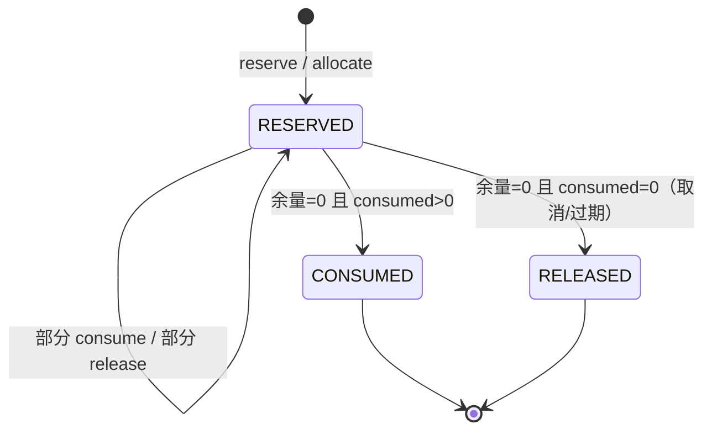
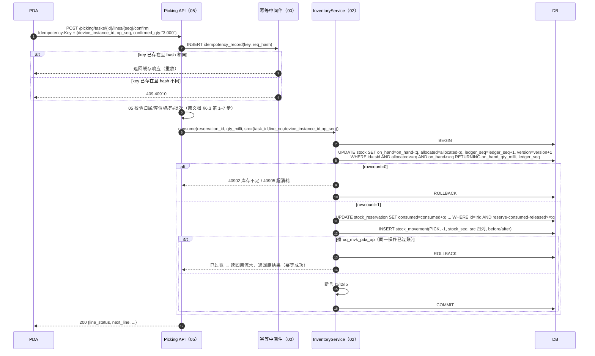
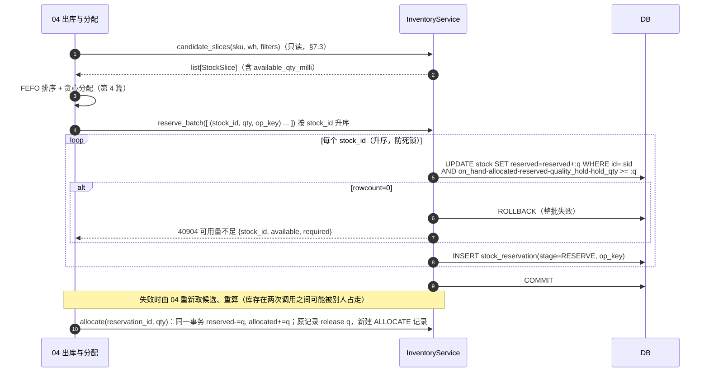
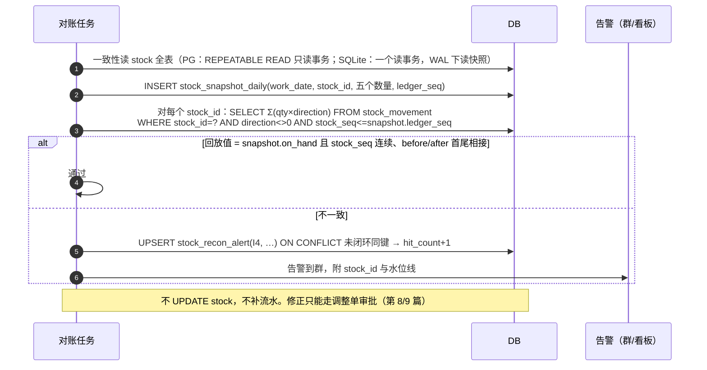

# 02 库存核心 详细设计

| 项 | 内容 |
|---|---|
| 模块编号 | 02 |
| 作者 | 小钱（后端） |
| 评审 | 小赵（测试，对抗性评审，见 §13）、非作者开发 1 名 |
| 基线 | `main@8ed5f0c`，《[WMS详细设计说明书](archive/WMS详细设计说明书.md)》§3.1、§3.4、§4.1–§4.3、§4.6、§4.8、§6.1、附录 A |
| 依赖 | 00 总体设计（数量口径、ID/单号、幂等、错误码、权限）；04 出库与分配（消费 FEFO 钩子）；05 波次与拣货（PDA 业务幂等键、待回库）；08 盘点；12 权限与审计 |
| 状态 | 草稿，与总体设计、第 4 篇合并为一个 PR 评审 |

> 本篇只写库存核心：数量模型、不变量、扣减原语、流水、快照对账，以及给其他模块用的服务接口。收货、拣货、盘点等业务流程只写到"它们调用库存核心的哪个原语"为止，流程本身归各自模块。

---

## 1. 职责与边界

### 1.1 本模块负责

1. **库存余额**：`stock` 一行代表一个记账维度 `仓库 + 库位 + SKU + 批次 + 容器`（原文档 §4.1，I6）上的五个数量：在库量 `on_hand`，以及四个占用列 `allocated / reserved / quality_hold / hold_qty`。
2. **占用明细**：`stock_reservation`（预占、分配）和 `stock_hold`（质检冻结、人工冻结）。四个占用列是这两张表的**物化汇总**（I3）。
3. **库存原语**（§7.1）：入账、出账、移库、预占、预占转分配、释放、消耗、冻结、解冻。所有改库存的业务都**只能**调这些原语，不许直接写 `stock`。
4. **库存流水** `stock_movement`：只追加，每一次 `on_hand` 变化对应一条流水，与余额在同一事务。
5. **不变量**：库层 CHECK + 应用层断言两道防线（§4.3）。
6. **快照与对账**：日终快照、流水回放对账、占用汇总对账。**只告警，不自动修数**（§6.4）。
7. **FEFO 钩子**：给第 4 篇提供"候选库存切片"查询和"按分配结果原子占用"两个接口。排序与分配算法本身归第 4 篇（§7.3）。
8. **前提**：每仓只有一个权威写库（00 §6.1a；一期中心 PG，SQLite 只用于开发测试，边缘节点是 00 G4）。
9. **只读查询接口**：库存查询、流水、占用明细、对账差异（原文档 §6.2"库存"组）。

### 1.2 本模块不负责

| 不做 | 归属 |
|---|---|
| FEFO 排序、过滤、拆零、缺货判定 | 第 4 篇 出库与分配 |
| 收货/质检/上架流程 | 第 3 篇 |
| 拣货任务、PDA 业务幂等键、待回库记录的表与接口 | 第 5 篇 |
| 盘点差异计算与审批；调整单/报损单审批 | 第 8、9 篇（审批通过后调用本模块原语入账） |
| 单号/ID 生成，Redis 不可用时的离线降级 | 00 总体设计（见 §8.6） |
| 错误码最终分配、`Idempotency-Key` 通用中间件 | 00 总体设计（本篇只提议，见 §7.5） |

### 1.3 与原文档的差异（评审重点）

| # | 原文档 | 本篇 | 原因 |
|---|---|---|---|
| Δ1 | 数量 `NUMERIC(14,3)`（D3、R2、§3.3） | **`BIGINT`，单位 = SKU `base_uom` 的 1/1000，列名后缀 `*_qty_milli`**，两库一致 | PM 裁决；附录 A 已证实 SQLite 侧 NUMERIC 退化为 REAL，原 DDL 未体现 R2 |
| Δ2 | 流水只有 `idempotency_key UK` | 增加业务唯一键：非 PDA 单据 `(biz_no, line_no, leg)`；PDA 作业 `(task_id, line_no, device_instance_id, op_seq, leg)` | 重复过账在库层冲突；`Idempotency-Key` 过期后仍不能二次扣减。相对 PM 原定 `(biz_no, line_no)` 加了 `leg` 并拆成两个键，**PM 已批准** |
| Δ3 | 流水无 `stock_id`，I4 只按仓汇总 | 流水带 `stock_id` + 每行连续序号 `stock_seq`，`stock.ledger_seq` 同步递增 | 能按行回放、定位到具体行；序号唯一，记账链不能分叉 |
| Δ4 | `quality_hold / hold_qty` 无明细（§4.2 提到 `stock_freeze` 但未建表） | 新增 `stock_hold` | 四个占用列都能对账（I3 扩展为 I3a–I3d） |
| Δ5 | `stock_reservation` 不区分预占与分配 | 增加 `stage = RESERVE / ALLOCATE`、`released_qty_milli`、`op_key UK` | 原 I3 只能对上 `allocated`，`reserved` 无来源 |
| Δ6 | 快照按 `(work_date, wh, sku, lot)`，缺 `hold_qty` | 按 `(work_date, stock_id)`，带全部五个数量和 `ledger_seq` 水位线 | 对账要能精确到行，并排除快照时刻之后的流水 |
| Δ7 | 无对账结果表 | 新增 `stock_recon_alert` | 对账结论需要持久化、可认领、可追溯 |
| Δ8 | 错误码带字母前缀、按模块分段 | 纯 5 位数字，前 3 位 = HTTP 状态 | PM 裁决，见 §7.5 |
| Δ9 | 待回库没有库存表达 | 生成待回库记录时写 `RETURN_PENDING` 冻结（独立系统冻结类型） | PM 裁决，见 §8.5 |
| Δ10 | 流水唯一约束直接建在流水表上 | 唯一键移到不分区的 `stock_movement_key`，加单据行来源归属表 `stock_ledger_line` | PG 分区表唯一键只在分区内有效（QA B2） |
| Δ11 | 流水“禁止 UPDATE/DELETE”只写在注释里 | PG 权限 + 两库触发器 | QA B1 |
| Δ12 | 迁移余额无流水 | `OPENING` 期初流水 | QA 重要-5 |

---

## 2. 用例

| 编号 | 用例 | 调用方 | 用到的原语 | `on_hand` 变化 | 写流水 |
|---|---|---|---|---|---|
| UC1 | 收货入暂存位（待检同时冻结） | 03 入库 | `post_in` (+ `hold QUALITY`) | +q | `RECEIVE` +1 |
| UC2 | 上架 / 移库 / 补货 | 03、07 | `move` | 来源 −q，目标 +q | `PUTAWAY`/`MOVE` 两腿 |
| UC3 | 出库单预占 | 04 | `reserve` | 0 | 否 |
| UC4 | 波次分配（预占转分配） | 04/05 | `allocate`（RESERVE→ALLOCATE） | 0 | 否 |
| UC5 | 拣货确认 | 05（PDA） | `consume`（allocated −q 且 on_hand −q） | −q | `PICK` −1 |
| UC6 | 撤销拣货 / 已拣订单取消倒回 | 05、04 | `post_in`（REVERSE_PICK） | +q | `REVERSE_PICK` +1 |
| UC7 | 发货 | 06 | `post_event` | 0 | `SHIP` direction=0 |
| UC8 | 订单取消 / 预占过期释放 | 04、定时任务 | `release` | 0 | 否 |
| UC9 | 质检放行 / 拒收 | 03 | `unhold`；拒收再 `post_out` 或 `move` 到隔离区 | 0 或 −q | 视情况 |
| UC10 | 人工冻结 / 解冻 | 管理后台 | `hold MANUAL` / `unhold` | 0 | 否 |
| UC11 | 盘盈盘亏、调整、报损（审批后） | 08、09 | `post_in` / `post_out` | ±q | `COUNT`/`ADJUST`/`SCRAP` |
| UC17 | 期初建账 / 数据迁移 | 运维脚本 | `post_opening` | +q | `OPENING`（每行一条，seq=1） |
| UC12 | 退货入库 | 10 | `post_in` + `hold QUALITY` | +q | `RETURN` +1 |
| UC13 | 查询库存、流水、占用、对账差异 | 后台、PDA | 只读 | — | — |
| UC14 | 日终快照、实时对账 | 定时任务 | 只读 + 写告警 | — | — |
| UC15 | 待回库：生成时冻结，确认时解冻 | 05 | `hold RETURN_PENDING` / `release_return_hold` | 0 | 否 |
| UC16 | 待回库：主管处置"就近放回" | 05（主管） | 先 `release_return_hold` 再 `move`（标准移库路径） | 原库位 −q，目标 +q | `MOVE` 两腿 |

UC15/UC16 说明见 §8.5：待回库**确认**不写流水、不改 `on_hand`，只释放 RETURN_PENDING 冻结；只有主管处置为"就近放回"时，才在释放冻结后走一次标准移库。

---

## 3. 领域模型

### 3.1 数量值对象 `Quantity`

- 内部只存整数 `milli: int`，单位是 SKU `base_uom` 的 1/1000。KG 计的 SKU 就是克，PCS 计就是 0.001 个。
- **入参**：只收字符串，正则 `^-?\d{1,15}(\.\d{1,3})?$`。超过 3 位小数、科学计数法、空串、JSON number 一律 **400**，不四舍五入（错误码见 §7.5）。
- **出参**：固定 3 位小数字符串，如 `12500 → "12.500"`，`-2000 → "-2.000"`。单位取 `sku.base_uom`，接口里单独返回 `uom` 字段。
- **换算**：作业单位（箱）→ 基本单位只在入口做一次（原文档 §3.3）：`base_milli = parse_milli(qty) × base_qty_milli / 1000`，`base_qty_milli` 是 1 个作业单位折合的基本单位量（milli 整数，第 1 篇 #8 由 `ratio_to_base` 改名）。如果结果不是整数 milli，返回 400，不取整。
- 绝不经过 `float`。原文档 §4.3 示例里的 `bindparams(qty=float(qty))` 作废，改为绑定 `int`。
- 取值范围：`BIGINT` 上限约 9.2×10^18 milli，远超业务量。JSON 输出用字符串，不受 JS 2^53 限制（原文档 §6.1）。

### 3.2 库存行 `Stock`

```
on_hand        在库总量（物理在库）
allocated      已分配未拣   = Σ ALLOCATE 占用的未结余量
reserved       已预占       = Σ RESERVE  占用的未结余量
quality_hold   质检/盘点冻结 = Σ QUALITY  冻结的未结余量
hold_qty       冻结         = Σ MANUAL + Σ RETURN_PENDING 冻结的未结余量（列 hold_qty_milli）

available = on_hand − allocated − reserved − quality_hold − hold_qty   （可预占量）
pickable  = on_hand − quality_hold − hold_qty − allocated              （原文档 §3.4，不含 reserved）
book      = on_hand                                                  （盘点基准）
```

列名一律加 `_qty_milli` 后缀，如 `on_hand_qty_milli`。下文为可读性简写。

### 3.3 占用与冻结

- `Reservation(stage, quantity, consumed, released, status)`：未结余量 = `quantity − consumed − released`。`status` 是派生的：余量 > 0 为 `RESERVED`；余量 = 0 时，有消耗为 `CONSUMED`，否则为 `RELEASED`。
- `Hold(hold_type, quantity, released, status)`：未结余量 = `quantity − released`。

### 3.4 流水 `Movement`

`(biz_type, biz_no, line_no, leg, direction, stock_id, stock_seq, qty, before, after, PDA 业务键四列)`。只追加，不可修改。`direction ∈ {−1, 0, +1}`：0 是纯事件（`SHIP`），不改 `on_hand`，不进记账链。

### 3.5 不变量

| # | 内容 | 库层 CHECK | 应用层断言 | 对账任务 |
|---|---|---|---|---|
| I1 | 五列均 ≥ 0 | `ck_stock_nonneg` | 每次原语后 | — |
| I2 | `allocated + reserved + quality_hold + hold_qty ≤ on_hand` | `ck_stock_nonneg` | 每次原语后 | — |
| I2' | 所有数量列都是整数（SQLite 防 REAL/TEXT 混入） | `ck_stock_int` 等 | `Quantity` 类型 | — |
| I3a | `allocated = Σ(ALLOCATE 余量)` | 不能（跨表） | 原语内同事务更新 | 每 5 分钟 |
| I3b | `reserved = Σ(RESERVE 余量)` | 不能 | 同上 | 每 5 分钟 |
| I3c | `quality_hold = Σ(QUALITY 余量) + Σ(RETURN_QC 余量)` | 不能 | 同上 | 每 5 分钟 |
| I3d | `hold_qty = Σ(MANUAL 余量) + Σ(RETURN_PENDING 余量) + Σ(SCRAP_PENDING 余量)` | 不能 | 同上 | 每 5 分钟 |
| I3e | 每条 `RETURN_QC` 明细：`released_qty_milli = Σ stock_hold_release.qty_milli + 转报损量（op_key = CVT:{hold_id} 的明细量）`；不等说明有人绕过 `release_qc_hold` 直接 UPDATE 释放（小赵 S6）；另查**误报回转**：`op_key = CVT:x` 的 `RETURN_QC`，x 必须是同 `stock_id`、已 RELEASED 的 `SCRAP_PENDING`，否则说明回转来源不合法（九轮） | 不能 | 同上 | 每 5 分钟 |
| I4 | 每行 `on_hand = Σ(该 stock_id 流水 qty × direction)`；按仓汇总同理 | 不能 | — | 日终 + 抽样 |
| I5 | 每条流水 `after = before + qty × direction` | `ck_mv_balance` | 写流水前 | — |
| I5' | 每行记账链连续：第 n 条的 `before` = 第 n−1 条的 `after`，`stock_seq` 从 1 连续无缺号 | 唯一性：`uq_mvk_stock_seq` | — | 每 5 分钟（增量） |
| I6 | 同维度只有一行 `stock` | `uq_stock_dim`（0 哨兵） | — | — |
| I7 | 单据未完成时，其占用不能被提前清零（原文档 I7） | 不能 | 由各单据模块断言 | 每 5 分钟 |
| I8 | 占用/冻结：`consumed + released ≤ quantity` | `ck_res`、`ck_hold` | — | — |
| I9 | 占用/冻结的 `status` 由余量决定 | `ck_res_status`、`ck_hold_status` | — | — |
| I10 | 流水只追加；一行单据只有一种记账来源，PDA 行只有持有设备能记账 | 权限 + 触发器 | repository 只暴露 insert | — |

应用层断言放在 `domain/invariants.py`。CI 中用 hypothesis 生成随机原语序列（含并发交错），每步后校验 I1–I8（原文档 §4.1）。

---

## 4. 涉及的表（字段、约束、索引）

完整 DDL 见本 PR 中的 `wms-design/sql/schema_postgres.sql`。`schema_sqlite.sql` 由 `verify_sqlite.py` 机械生成，翻译改动仍然只有 3 类。下面列关键字段。

### 4.1 `stock`

| 字段 | 类型 | 说明 |
|---|---|---|
| id | BIGINT PK | 应用层生成（R1） |
| warehouse_id / location_id / sku_id / lot_id | BIGINT NOT NULL | |
| container_id | BIGINT NOT NULL DEFAULT 0 | 0 = 散货（R11） |
| uom | VARCHAR(16) | 恒等于 `sku.base_uom` |
| on_hand_qty_milli / allocated_qty_milli / reserved_qty_milli / quality_hold_qty_milli / hold_qty_milli | BIGINT NOT NULL DEFAULT 0 | |
| ledger_seq | BIGINT NOT NULL DEFAULT 0 | 每改一次 `on_hand` 加 1，与流水 `stock_seq` 对应 |
| version | BIGINT | 每次 UPDATE 加 1（观测与乐观展示用，不参与判断） |

约束：`uq_stock_dim`、`ck_stock_container`、`ck_stock_int`（`x = CAST(x AS BIGINT)`）、`ck_stock_nonneg`（I1+I2）。
索引：`ix_stock_sku_avail (sku_id, warehouse_id, lot_id) WHERE on_hand_qty_milli > 0`（FEFO 候选）、`ix_stock_loc`、`ix_stock_wh`。

### 4.2 `stock_reservation`

| 字段 | 说明 |
|---|---|
| stage | `RESERVE` / `ALLOCATE`，CHECK |
| source_type / source_id / source_line_id | `source_line_id NOT NULL DEFAULT 0`（R11） |
| op_key VARCHAR(80) UK | 占用操作幂等键，如 `RES:{outbound_code}:{line_no}:{attempt}` |
| reserve_qty_milli / consumed_qty_milli / released_qty_milli | `ck_res`：`reserve > 0`，`consumed + released ≤ reserve` |
| op_key | **`RES:{doc_no}:{line_no}:{alloc_round}:{stock_id}`**，`uq_res_op` 唯一。`alloc_round` 存在出库行上（第 4 篇），每次重新分配 +1；同一轮分配重试时键不变，按幂等返回已有占用；重新分配是新的一轮，不会撞到旧占用。一轮分配拆到多行库存时，`stock_id` 区分每一条 |
| status | `RESERVED / CONSUMED / RELEASED`，**由余量决定**（`ck_res_status`）：余量 > 0 ⇔ `RESERVED`；余量 = 0 时有消耗为 `CONSUMED`，否则 `RELEASED`。过期任务按 `status = 'RESERVED'`（`ix_res_exp`）扫描，不会漏掉还占着量的记录，也不会扫到已结清的 |
| expires_at | 预占过期时间，过期释放（UC8） |

索引：`ix_res_stock (stock_id, stage, status)`、`ix_res_source`、`ix_res_exp WHERE status='RESERVED'`。

### 4.3 `stock_hold`（新增）

`hold_type`、`reason_code`、`source_type/source_id`、`op_key UK`、`hold_qty_milli`、`released_qty_milli`、`status (HELD/RELEASED)`、`operator_id`、`approval_type`、`approval_no`（九轮新增，可空，只有误报回转的 `RETURN_QC` 填写，§7.1.1）。

**一套方案：`hold_type` 是大类，决定计入哪一列；`reason_code` 是细分原因，二者成对约束。**

| hold_type | 计入列 | 允许的 reason_code | 谁能冻结 / 解冻 |
|---|---|---|---|
| `QUALITY` | `quality_hold` | `QC_PENDING` 待检、`COUNT_LOCK` 盘点冻结 | 03/08 流程 |
| `RETURN_QC` | `quality_hold` | 只能是 `RETURN_QC` 退货待检 | **系统冻结**（A3，小吴 #5）：第 10 篇退货入库时生成，`source_type = 'QC'`、`source_id` = 质检单 id、`operator_id = 0`；**只能**由质检通过走 `release_qc_hold`（§7.1.3）释放，或由不合格报损走 `convert_hold` 转 `SCRAP_PENDING`；另可由 `SCRAP_PENDING` 误报回转生成（`op_key = CVT:{原 hold_id}`，必须带 `SCRAP_MISREPORT` 审批单号，§7.1.1）；人工解冻接口拒绝（`40933`）。原先是 `QUALITY` 的一个原因，可被人工解冻，退货未检就回到可售 |
| `MANUAL` | `hold_qty` | `DAMAGE` 破损、`EXCEPTION` 异常待处理、`OTHER` | 人工冻结/解冻接口（解冻人 ≠ 冻结人） |
| `RETURN_PENDING` | `hold_qty` | 只能是 `RETURN_PENDING` | **系统冻结**：只由待回库流程生成（`operator_id = 0`），**只能**在待回库 confirm/resolve 的同一事务里释放；人工解冻接口拒绝（`40933`） |
| `SCRAP_PENDING` | `hold_qty` | 只能是 `SCRAP` 报损待处置 | **系统冻结**：只由 `convert_hold` 从 `RETURN_PENDING`（SCRAP_HANDOVER）或 `QUALITY`/`RETURN_QC`（质检不合格报损）转入（§7.1.1，`operator_id = 0`），**只能**由第 9 篇的报损完成或报损撤销释放，或凭 `SCRAP_MISREPORT` 审批走 `convert_hold` 回转 `RETURN_QC` 重新质检（§7.1.1）；人工解冻接口拒绝（`40933`）。原先用 `MANUAL` + 原因 `SCRAP`，但 MANUAL 可人工解冻，交给报损的货被解冻后会回到可售，所以改成独立系统类型 |

约束：

- `ck_hold_type`：`hold_type IN ('QUALITY','RETURN_QC','MANUAL','RETURN_PENDING','SCRAP_PENDING')`。
- `ck_hold_retqc`：`RETURN_QC` 必须 `source_type = 'QC'`、`source_id > 0`（质检单 id）、`operator_id = 0`。
- `ck_hold_approval`（九轮）：`RETURN_QC` 且 `op_key LIKE 'CVT:%'`（误报回转）⇔ `approval_type = 'SCRAP_MISREPORT'` 且 `approval_no` 非空；其余明细两列必须都为 NULL。缺审批、审批类型不对、非回转明细带审批都被拒。应用层先查审批（缺少或类型不对 → 40930），CHECK 是库层兜底。
- `ck_hold_approval_no`（十一轮）：`approval_no` 非空时必须是 `APR-{仓库编码}-{yyyyMMdd}-{6 位数字}`，如 `APR-SH01-20261015-000001`。仓库编码取 `warehouse.code`。第 1 篇（#8）只规定它全局唯一、`VARCHAR(32)`、作为单号仓前缀（示例 `SH01`），没有明文字符集；本篇按 `[A-Z0-9]{1,32}` 约束（大写字母和数字，不含 `-`，否则无法按 `-` 切分），待第 1 篇补定义后对齐。月份限 01–12、日限 01–31（不校验大小月和闰年，交给应用层）。PG 用正则 `^APR-[A-Z0-9]{1,32}-[0-9]{4}(0[1-9]|1[0-2])(0[1-9]|[12][0-9]|3[01])-[0-9]{6}$`；SQLite 用长度 21–52、`substr` 切分 + `GLOB`（编码段 `NOT GLOB '*[^A-Z0-9]*'`，末 16 位 `-yyyyMMdd-NNNNNN`，月/日两位分别 GLOB）。
- `ck_hold_reason`：类型与原因成对（类型非法时只由 `ck_hold_type` 报，不会两条一起报）。
- `ck_hold_return`：`RETURN_PENDING` 必须 `source_type = 'RETURN_RECORD'`、`source_id` = 待回库记录 id、`operator_id = 0`。`op_key` 固定为 `RRH:{return_record_id}`（与第 4 篇一致）。
- `ck_hold_scrap`：`SCRAP_PENDING` 必须 `source_type = 'SCRAP'`、`source_id` = **第 9 篇报损单 id**（小赵 N2 口径 (a)：SCRAP_HANDOVER 同事务先建报损单，不挂待回库记录 id）、`operator_id = 0`。
- `trg_hold_immutable`（两库，小赵 N1）：`stock_hold` 写入后只允许改 `released_qty_milli`、`status`、`version`、`updated_at`（表上没有 released_at/released_by 列，释放人和时间记在调用方单据与审计里，不需要额外放行）；`id/stock_id/hold_type/reason_code/source_type/source_id/op_key/hold_qty_milli/operator_id/approval_type/approval_no/created_at` 改了就报 `hold_immutable`。类型转换只走 `convert_hold`（关旧建新），否则先把 `SCRAP_PENDING` 改成 `MANUAL` 就能绕过 40933。PG 另有列级授权：`wms_app` 对 `stock_hold` 只有 `UPDATE (released_qty_milli, status, version, updated_at)`。
- **只能沿释放方向变**（小赵 R1）：`trg_hold_immutable` 另拒 `NEW.released_qty_milli < OLD.released_qty_milli`（释放量只增不减）和 `OLD.status = 'RELEASED' AND NEW.status <> 'RELEASED'`（已释放不能回 HELD）。这两列在 PG 列级授权里是放行的，所以 `wms_app` 也靠这个触发器拦住，不然改回 HELD 后再走一次释放原语，`stock.hold_qty_milli` 会被多减一次 q，减掉的是同行别的冻结量。
- **不可删除、不可 REPLACE**（小赵 R2）：
  - PG：`trg_hold_no_delete`（`BEFORE DELETE`，行级）与 `trg_hold_no_truncate`（`BEFORE TRUNCATE`，语句级）报 `hold_immutable`。`wms_app` 本来就没有 DELETE/TRUNCATE 权限（`permission denied`），触发器兜底超级用户和迁移脚本，与流水表写法一致。PG 的 `ON CONFLICT DO UPDATE` 走 UPDATE 触发器和列级授权，不需要另外处理。
  - SQLite：`trg_hold_no_delete`（`BEFORE DELETE`）报 `hold_immutable`。`INSERT OR REPLACE`/`REPLACE` 冲突时会先删旧行，但默认 `recursive_triggers = OFF`，这次删除**不触发** DELETE 触发器。两种办法都实测过：① `PRAGMA recursive_triggers = ON` 后 REPLACE 会撞上 DELETE 触发器，但这是**连接级**开关，每个连接都要设，漏一个就失效；② `trg_hold_no_replace`（`BEFORE INSERT`，`WHEN EXISTS (… h.id = NEW.id OR h.op_key = NEW.op_key)`）报 `hold_duplicate`，冲突检查之前就中止，REPLACE 走不到删除那一步，写在 schema 里，库级生效。**采用 ②**。代价是 SQLite 上 `convert_hold` 等重试撞的是 `hold_duplicate`，PG 上撞的是 `uq_hold_op`（23505），两者都走"按 `op_key` 查回已有明细"的幂等分支；`stock_hold` 的写入一律用普通 `INSERT`，不用 `ON CONFLICT DO NOTHING`/`OR IGNORE`（BEFORE INSERT 触发器先于冲突处理，会直接报错）。
- `uq_hold_return (source_id) WHERE hold_type = 'RETURN_PENDING'`（PG、SQLite 都是部分唯一索引）：一条待回库记录最多一条 `RETURN_PENDING` 冻结。**只约束 `RETURN_PENDING`**，`convert_hold` 转出的报损明细（`SCRAP_PENDING/SCRAP`，`source_type = 'SCRAP'`，不用 `RETURN_RECORD`）不受它约束（小赵二轮 D1）。
- `ck_hold`：`0 ≤ released ≤ hold`；`ck_hold_status`：**状态由余量决定**，`HELD ⇔ released < hold`，`RELEASED ⇔ released = hold`。
- 新增原因走迁移，各模块在自己的文档里登记。

**列名统一**：`stock` 上的冻结汇总列改名为 **`hold_qty_milli`**（原 `frozen_qty_milli`，与 00/04 的写法一致），`= Σ MANUAL 余量 + Σ RETURN_PENDING 余量 + Σ SCRAP_PENDING 余量`。`v_stock_available.available_qty_milli = on_hand − allocated − reserved − quality_hold − hold_qty`，所以 RETURN_PENDING 冻结的量**直接从可用量扣除，FEFO 候选查询（`available > 0`）分不到**。验证脚本两库各一条断言：把 stock 12 的可用量全部 RETURN_PENDING 冻结后，available 从 20000 变成 0，FEFO 候选从 4 行变成 3 行且不含 12（事务内验证后回滚）。

**盘点口径**（第 8 篇负责，本篇只引用）：`RETURN_PENDING` 冻结的货账面在原库位、实物在分拣员手上。盘点算差异时，这部分要从账面量里扣掉，**不能生成盘亏调整**；由待回库闭环（confirm / 就近放回）来消掉。

**`stock_hold_release`（新增，A3）**：冻结部分释放的操作去重，`(id, hold_id FK fk_hr_hold → stock_hold, op_key UK uq_hr_op, qty_milli, created_at)`，只追加：PG 拒 UPDATE/DELETE（行级触发器）和 TRUNCATE（`trg_hr_no_truncate`，小赵 S5），`wms_app` 只授 `SELECT, INSERT`；SQLite 拒 UPDATE/DELETE，并用 `trg_hr_no_replace`（BEFORE INSERT，`id` 或 `op_key` 已存在 → `hold_duplicate`）挡住 `INSERT OR REPLACE`/`REPLACE`/UPSERT（小赵 Q1，原因同 §4.3 R2：REPLACE 删旧行不触发 DELETE 触发器，去重记录被冲掉后重放会再释放一次）。`release_qc_hold` 每次释放写一行，重放同一 `op_key` 在 PG 撞 `uq_hr_op`、在 SQLite 撞 `hold_duplicate`，整个事务回滚，不会重复解冻（§7.1.3）。`hold_id` 外键保证释放记录挂在真实冻结上（小赵 S6）；绕过本表直接 UPDATE 释放 `RETURN_QC` 由 I3e 对账发现（§3.5）。

### 4.4 `stock_movement`、`stock_movement_key`、`stock_ledger_line`

**设计前提：单仓单写库**（00 总体设计 §6.1a）。每个仓只有一个权威写库：一期中心 PG，SQLite 只用于开发和测试；是否做边缘节点是 00 的待定问题 G4（Yuri 定范围）。本篇的所有唯一性和记账链都只在**一个库内**成立，不处理两个库之间的去重合并。

#### 4.4.1 `stock_movement`（流水主表，只追加）

| 字段 | 说明 |
|---|---|
| biz_type / biz_no / line_no | 业务单据行。`biz_no` 带单据类型前缀，全局唯一 |
| op_no | **DOC 来源**：调用方在这一行上的第几次操作（如分批收货第 2 次 = 2），由调用模块的业务记录给出、重试不变；**PDA 来源**恒为 0 |
| leg | 同一操作的第几条腿：拣货/收货恒为 1，移库/上架 1 = 出、2 = 入。**由操作类型决定，不是计数器**，所以重放一定得到同一个 leg |
| src_kind | `DOC` / `PDA` |
| direction | −1 / 0 / +1，`ck_mv_dir` |
| stock_id / stock_seq | 记账到哪一行，以及本次之后的 `stock.ledger_seq` |
| warehouse_id / location_id / from_location_id / sku_id / lot_id / container_id | 维度冗余 |
| src_task_id / src_line_no / device_instance_id / src_op_seq | **PDA 四元组**（00 §6.5）。`ck_mv_kind`：`DOC` 四列全 NULL 且 `op_no ≥ 1`；`PDA` 四列全非空且 `op_no = 0` |
| move_qty_milli / on_hand_before_qty_milli / on_hand_after_qty_milli | `ck_mv_pos`、`ck_mv_balance` |
| occurred_at / recorded_at | 业务时间 / 落库时间（UTC） |
| idempotency_key | 与去重表同值，见 4.4.2 |

PK `(id, occurred_at)`：PG 侧 `PARTITION BY RANGE (occurred_at)` 按月分区，分区表的主键必须带分区键。`id` 是雪花 ID，全局唯一由去重表的 `movement_id PK` 保证。

#### 4.4.2 `stock_movement_key`（记账去重表，不分区）

**为什么单独一张表**：PG 分区表上的唯一约束必须包含分区键，只能保证**分区内**唯一。同一个键 10-31 写一次、11-01 再写一次会落进两个分区，两条都能写进去。所以所有业务唯一键放到这张**不分区**的表里，与流水**同一事务**写入，撞任一唯一键整个事务回滚。验证脚本有"跨分区重复"断言（10-31 与 11-01 同键，第二笔被拦且流水随之回滚）。

| 唯一键 | 列 | 条件 | 防什么 |
|---|---|---|---|
| `movement_id` PK | = 流水 id | — | 跨分区 id 唯一 |
| `uq_mvk_idem` | idempotency_key | — | 同一操作重复过账 |
| `uq_mvk_biz_line` | (biz_no, line_no, op_no, leg) | `src_kind = 'DOC'` | DOC 单据行同一次操作重复过账 |
| `uq_mvk_pda_op` | (src_task_id, src_line_no, device_instance_id, src_op_seq, leg) | `src_kind = 'PDA'` | PDA 同一操作重复过账，包括 `Idempotency-Key` 过期后的重放 |
| `uq_mvk_stock_seq` | (stock_id, stock_seq) | `direction <> 0` | 记账链分叉 |

占用（`stock_reservation.op_key`）不是记账键，格式见 §4.2：`RES:{doc_no}:{line_no}:{alloc_round}:{stock_id}`。

**`idempotency_key` 只有一种格式**：

```
{biz_no}:{line_no}:{op_ref}:{leg}
op_ref = D{op_no}                          （DOC）
       = P{device_instance_id}.{op_seq}    （PDA）
例：ADJ-SH01-0003-20261015-000012:1:D2:1
    PK-SH01-0003-20261015-000842:3:PDEV-7f3a.2:1
```

**流水与 key 行在库层绑定**（小赵二轮 C2）：`stock_movement` 上有外键 `fk_mv_key (id, idempotency_key, biz_no, line_no, op_no, leg, src_kind, stock_id, stock_seq, direction, occurred_at) → stock_movement_key` 的同名列（被引用键 `uq_mvk_mv`），`DEFERRABLE INITIALLY DEFERRED`，提交时检查。

- 只写流水不写 key 行 → 提交失败；key 行和流水任一列对不上（如 key 写 `RR-1`、流水写 `ADJ-9`）→ 提交失败。所有去重都建在 key 表上，绕不过去。
- 只列 NOT NULL 列：外键是 `MATCH SIMPLE`，任一列为 NULL 会整条跳过检查。PDA 四元组由 `ck_mv_kind`/`ck_mvk_kind` 和 `uq_mvk_pda_op` 管。
- **为什么用外键而不是触发器**：PG 11 起分区表可以作为外键的引用方指向普通表，`stock_movement` 是分区表这一点不受限；外键在两库语义一致，比各写一份触发器少一处分叉。代价是 key 表多一个唯一索引（PG 索引总数 114 → 115）。
- SQLite 外键要求**每个连接** `PRAGMA foreign_keys = ON`（默认关），连接工厂必须设置，启动自检读一次该 pragma，为 0 拒绝启动。
- 反方向（有 key 行没流水）不约束：两者同事务写入，事务回滚时一起消失。

它和两个业务唯一键表达的是同一件事，三者同时存在只是为了"按字符串查"和"按字段约束"两种用法。**同一行的第二次合法操作不会被吞**：DOC 的 `op_no` 不同，PDA 的 `op_seq` 不同，键就不同（验证脚本里两种来源各有一条断言）。原来 §4.4、§8.4 和验证种子里的三种写法作废。

#### 4.4.3 `stock_ledger_line`（单据行记账来源归属）

`PK (biz_no, line_no)`，`src_kind`，`owner_device_instance_id`（PDA 行当前唯一允许记账的设备实例），`post_count`。

- **一行单据只能有一种记账来源**：第一次记账时 `INSERT … ON CONFLICT DO NOTHING` 占位，之后每次记账条件更新 `post_count = post_count + 1 WHERE src_kind = :kind AND (owner_device_instance_id IS NULL OR owner_device_instance_id = :dev)`，影响 0 行就拒绝（`40930`）。PK 保证两种来源并发抢第一次时只有一个能占位。
- **来源不可改**（小赵二轮 C3）：`trg_sll_immutable`（`BEFORE UPDATE`，两库各一份）禁止修改 `src_kind`、`biz_no`、`line_no`，报 `ledger_line_immutable`；换主只能改 `owner_device_instance_id`、`post_count`、`updated_at`。PG 侧 `wms_app` 在这张表上只有 `SELECT, INSERT` 和这三列的列级 `UPDATE`，见 §4.4.4。
- **库层兜底**：`stock_movement_key` 上的 `BEFORE INSERT` 触发器 `trg_mvk_line_kind` 要求归属行存在、来源一致，PDA 行还必须是当前持有设备，否则报 `ledger_line_owner_mismatch`。两库各一份，语义相同。
- 换设备见 §8.4。

#### 4.4.4 只追加的强制手段

| 层 | PG | SQLite |
|---|---|---|
| 权限 | 应用角色 `wms_app` 只有 `SELECT, INSERT`；`REVOKE UPDATE, DELETE, TRUNCATE` | 无角色体系 |
| TRUNCATE | `trg_mv_no_truncate` / `trg_mvk_no_truncate`：`BEFORE TRUNCATE … FOR EACH STATEMENT`（行级触发器拦不住 TRUNCATE，小赵二轮 C5） | 无 TRUNCATE |
| 触发器 | `trg_mv_append_only` / `trg_mvk_append_only`：`BEFORE UPDATE OR DELETE … FOR EACH ROW` 抛 `append_only_violation`（防超级用户/运维脚本误操作） | `trg_mv_no_update/no_delete`、`trg_mvk_no_update/no_delete`：`RAISE(ABORT, 'append_only_violation: …')` |
| 代码 | repository 只暴露 insert；CI 静态检查禁止 `update(StockMovement)` / `delete(StockMovement)` | 同左 |

**`wms_app` 授权清单**（PG，小赵二轮 C3；schema 里逐条 GRANT）：

| 表 | 权限 |
|---|---|
| `stock_movement`、`stock_movement_key` | `SELECT, INSERT` |
| `stock`、`stock_reservation`、`stock_recon_alert` | `SELECT, INSERT, UPDATE`（无 DELETE/TRUNCATE） |
| `stock_hold_release` | `SELECT, INSERT`（只追加） |
| `audit_log`、`stock_snapshot_daily` | `SELECT, INSERT`（只追加） |
| `idempotency_record`、`outbox_event` | `SELECT, INSERT, UPDATE`（**无 DELETE/TRUNCATE**，小赵 Q2；清理只经 `purge_expired()`，见下） |
| 其余业务表（主数据、出入库、波次拣货、装箱发运、盘点调整、权限、`inbound_message` 等） | `SELECT, INSERT, UPDATE` |
| 视图 `v_stock_available` | `SELECT` |
| `stock_hold` | `SELECT, INSERT`；列级 `UPDATE (released_qty_milli, status, version, updated_at)`（小赵 N1），另有 `trg_hold_immutable` 兜底 |
| `stock_ledger_line` | `SELECT, INSERT`；列级 `UPDATE (owner_device_instance_id, post_count, updated_at)` |
| schema `public` | `USAGE`（schema 里显式 GRANT，避免重建 schema 后丢权限，小赵二轮 C6） |

**去重记录与 outbox 清理**（小赵 Q2，PM 已定）：

- `wms_app` 对 `idempotency_record`、`outbox_event` 没有 DELETE/TRUNCATE，否则能删掉未过期的去重记录（不记库存的写接口重放会重新执行）或未投递的事件（直接丢失）。
- 清理函数 `public.purge_expired()`：`SECURITY DEFINER`，固定 `SET search_path = pg_catalog, public`，表名全部 schema 限定；**不接受参数**，删除条件写死，**按库内 UTC 比较**（十轮 P1）：`idempotency_record` 只删 `expires_at < (now() AT TIME ZONE 'UTC')`，`outbox_event` 只删 `status = 'SENT' AND sent_at < (now() AT TIME ZONE 'UTC') − 7 天`（保留期 7 天），`PENDING`/`FAILED` 一律不删。返回 `(idem_deleted, outbox_deleted)`。
- 属主 `wms_purge_owner`：`NOLOGIN NOSUPERUSER`，只有这两张表的 `SELECT, DELETE`。`REVOKE EXECUTE … FROM PUBLIC`，只 `GRANT EXECUTE` 给 `wms_cleaner`；`wms_cleaner` 对任何表都没有权限，直接 DELETE 报 `permission denied`。定时任务用 `wms_cleaner` 连接执行 `SELECT * FROM purge_expired()`。
- **时间一律按 UTC 存**（十轮 P1，大肥鱼定）：两表的 `created_at`、`expires_at`、`next_retry_at`、`sent_at` 是不带时区的 `TIMESTAMP`，语义固定为 UTC；PG 默认值改为 `now() AT TIME ZONE 'UTC'`，应用连接固定 `TimeZone = UTC` 写入。清理函数和删除守卫都和 `now() AT TIME ZONE 'UTC'` 比较，与调用方会话时区无关，`wms_cleaner` 改 `TimeZone` 不能放宽窗口。SQLite 的 `datetime('now')` 本身就是 UTC，与进程时区无关。verify：PG 在会话时区 UTC+8 / UTC−10 / UTC+14 下各调一次 `purge_expired()`，删的行数相同（都只删已过期那条）；+14 下超级用户删还剩 12 小时的记录被 `purge_not_allowed` 拦；SQLite 在进程时区 +8 / −10 下清理行数相同。
- **过期列只许往后改**（十轮 P2）：两库 `trg_idem_expiry_fwd`/`trg_outbox_expiry_fwd`（BEFORE UPDATE）报 `expiry_backdate`：`expires_at` 不能调小；`sent_at` 写入后不能调小、不能清空，首次写入不得早于 `created_at`（挡 PENDING → SENT 时倒填 2000-01-01）；`SENT` 是终态，不能退回；两表 `created_at` 不可改。所以 `wms_app` 不能先 UPDATE 把活记录"改成已过期"再让清理删掉。
- **SENT 必带 sent_at**（十轮 P3）：`ck_outbox_sent CHECK (status <> 'SENT' OR sent_at IS NOT NULL)`。
- 库层兜底（两库，条件与函数一致）：PG `trg_idem_purge_guard`/`trg_outbox_purge_guard`（BEFORE DELETE，行级）和 `trg_idem_no_truncate`/`trg_outbox_no_truncate`（BEFORE TRUNCATE）报 `purge_not_allowed`，拦超级用户和迁移脚本；条件用 `COALESCE(<条件>, false)`（SQLite `COALESCE(<条件>, 0)`），NULL 比较不再漏过（十轮 P3）；SQLite 同名 BEFORE DELETE 触发器，另加 `trg_idem_no_replace`/`trg_outbox_no_replace`（BEFORE INSERT，主键已存在 → `idem_duplicate`/`outbox_duplicate`），挡 REPLACE 删旧行。SQLite 上应用把 `idem_duplicate` 当作「键已存在」，与 PG 的 23505 走同一分支；写入用普通 `INSERT`，不用 `OR IGNORE`/`ON CONFLICT DO NOTHING`。
- 残留风险：`wms_app` 仍能 UPDATE 这两张表（业务需要改 `status`/`retry_count`），理论上可以先把 `expires_at` 改早再等清理；这属于应用代码路径，由 repository 只暴露业务字段更新来约束，不在库层再拦。

**新表必须授权**：`public` 下每张表和视图都必须对 `wms_app` 有显式 GRANT（按最小权限，不给 TRUNCATE），写在 `schema_postgres.sql` 的表旁或末尾授权清单里。`verify.sh` 按**期望权限矩阵**逐表核对（小赵 S4）：遍历 `public` 下所有表（含分区父表、不含分区子表）、视图、物化视图和序列（序列查 `USAGE`），对每个对象算出 `wms_app` 实际拥有的 `SELECT/INSERT/UPDATE/DELETE/TRUNCATE` 组合，与脚本里的期望矩阵（即上表）逐项比对。少给、多给（比如 DELETE、TRUNCATE）、漏登记的新表都会失败，并打印差异。列级 UPDATE（`stock_hold`、`stock_ledger_line`）不计入表级矩阵，另有专门断言。SQLite 没有角色，不适用。

**`stock.hold_qty_milli` 只能经原语改**（小赵 N1）：它是 `MANUAL + RETURN_PENDING + SCRAP_PENDING` 明细余量的汇总，必须和明细在同一事务里变（`hold`/`unhold`/`release_return_hold`/`release_scrap_hold`/`post_out` 等，§7.1）。保障分三层：① 代码层：只有库存原语模块持有 `stock` 的写 SQL，CI 静态检查禁止原语模块以外出现 `UPDATE stock … hold_qty_milli`；② 库层：明细侧由 `trg_hold_immutable` + PG 列级授权保证明细量/类型不可改，所以汇总列只能跟着原语的释放/新建走；`stock` 行本身不加列级限制，因为扣减、占用原语都要更新同一行；③ 对账：I3d 每轮比对 `hold_qty_milli = Σ 明细余量`，不等即告警（§9）。SQLite 没有角色和列级授权，靠 ① + `trg_hold_immutable` + I3d；SQLite 只在边缘单进程内使用，只有 WMS 服务进程持有库文件。

归档：PG 按分区 `DETACH`（DDL，需要 DBA 权限，不经过行触发器）；SQLite 导出后由维护脚本"删触发器 → 删行 → 重建触发器"，全程写审计。这是唯一允许的删除路径，且不在应用里。验证脚本断言：两库 UPDATE/DELETE 都被触发器拦下；PG 的 `wms_app` 收到 `permission denied`。

#### 4.4.5 期初/迁移余额（`OPENING`）

所有 `on_hand > 0` 的库存行都必须能从流水回放出来，迁移进来的余额也不例外：

- 迁移或期初建账时，每行写**一条** `biz_type = 'OPENING'`、`direction = +1`、`stock_seq = 1`、`before = 0`、`after = 期初量` 的流水，`biz_no` = 迁移批次单号，`line_no` = 批次内序号。`ck_mv_opening` 强制这三个条件。
- `stock.ledger_seq` 同步为 1。之后的业务流水从 seq 2 开始，回放公式不需要任何特例。
- 期初量为 0 的行不写 OPENING，第一条业务流水 seq = 1。

### 4.5 `stock_snapshot_daily`

PK `(work_date, stock_id)`，带维度、五个数量和 `ledger_seq` 水位线。索引 `ix_snap_sku (work_date, warehouse_id, sku_id, lot_id)` 用于报表和 ERP 对账。

### 4.6 `stock_recon_alert`（新增）

`check_code`（`ck_recon_code`：`I3a/I3b/I3c/I3d/I3e/I4/I5/SNAP`，即 §3.5、§6.4 定义的对账项；新增走迁移，小赵二轮 C4）、`warehouse_id`、`stock_id`、`expected_qty_milli`、`actual_qty_milli`、`watermark_ledger_seq`、`status (OPEN/ACKED/RESOLVED)`、`resolved_by`、`resolution`。**只记差异**；修正必须走调整单审批，生成新的流水。

### 4.7 同步改动的非库存表

为了让验证脚本的期望值统一为 milli，`count_line` 的数量列也改成 `*_qty_milli BIGINT`，`diff_qty_milli` 生成列语义不变（`68000 − 100000 − (−30000) = −2000`），并加了 `ck_cnt_int` 整数约束（SQLite 侧拦 REAL）。其余单据表（`inbound_line`、`outbound_line`、`pick_task_line`、`adjust_line` 等）的数量列**本 PR 不改**，由各模块文档按同一口径改。见 §12 Q1。

---

## 5. 状态机

### 5.1 占用 `stock_reservation`



- `RESERVE → ALLOCATE`（UC4）不改原记录的 `stage`：原 RESERVE 记录 `release q`，同事务新建一条 ALLOCATE 记录。这样每条记录的 `stage` 不可变，I3a/I3b 汇总简单。
- 迁移函数收敛在 `domain/reservation.py`（原文档 D4），Service 不许直接改 `status`。

### 5.2 冻结 `stock_hold`

`HELD →（部分 unhold）→ HELD →（余量 = 0）→ RELEASED`，状态与余量由 `ck_hold_status` 绑定。`RETURN_PENDING` 只有一次性的整笔释放（confirm/resolve 同事务）。

### 5.3 对账告警 `stock_recon_alert`

`OPEN → ACKED（有人认领）→ RESOLVED（填处置结论：已开调整单 / 确认为误报并附原因）`。`RESOLVED` 只是结论记录，不触发任何库存变更。

`stock` 本身没有状态字段，库位锁定看 `location.status`（第 1 篇）。

---

## 6. 核心流程

### 6.1 原语的统一事务模板

所有改 `on_hand` 的原语都是同一个模板，**一个事务内**：

1. **来源归属**（§4.4.3）：`INSERT stock_ledger_line … ON CONFLICT DO NOTHING`，再条件更新 `post_count`（来源/设备不符 → 回滚，`40930`）。
2. **条件 UPDATE `stock`**：把校验写进 WHERE，包括可用量、以及**库位未被盘点锁定**（`AND EXISTS (SELECT 1 FROM location l WHERE l.id = stock.location_id AND l.status <> 'LOCKED')`，§8.1）。同时 `ledger_seq = ledger_seq + 1`，用 `RETURNING on_hand_qty_milli, ledger_seq` 拿回新值（PG 支持；SQLite ≥ 3.35 支持，00 启动自检强制）。这是数据库返回的写后值，**不是先读后判断**。
3. `rowcount == 0` → 回滚，再做一次**只读分类**决定返回哪个码（库位锁定 `40906`，可用量不足 `40902/40904`）。分类读只用于报错，不用于判断能不能扣。
4. 写流水 `stock_movement`：`after` = 返回值，`before = after − qty × direction`，`stock_seq` = 返回的 `ledger_seq`。
5. 写去重键 `stock_movement_key`：撞任一唯一键 → 整个事务回滚（重复过账，§8.3）。
6. 应用层断言 I1/I2/I5 → 提交。

### 6.2 拣货确认扣减（UC5，最热路径）



### 6.3 预占（UC3）与预占转分配（UC4）



一批全成或全败，由第 4 篇决定是缩量重试还是记缺货。本模块不做部分成功，避免"占了一半"的中间态泄漏。

### 6.4 日终快照与流水回放对账（UC14）



要点：

- **水位线解决在途单据**：快照记的是每行的 `ledger_seq`。回放只累加 `stock_seq ≤ 水位线` 的流水，所以对账期间新提交的拣货不会造成假差异。不用流水 `id` 当水位线，因为 id 由号段生成，多实例之间不单调。
- **告警去重**：`uq_recon_open (check_code, warehouse_id, stock_id) WHERE status <> 'RESOLVED'`。同一差异重复检出只累加 `hit_count`、刷新 `last_seen_at`，不会每 5 分钟刷一条新告警；闭环后再出现才新开一条。
- 占用对账（I3a–d）在同一个读快照里，比较 `stock` 四列与明细表余量汇总。
- 流水归档（PG 按月分区、SQLite 按月导出）之后，回放从"上一份已验证快照 + 之后的流水"开始，不必从头扫全表。
- 全仓 I4（按仓汇总）每天跑一次；按行增量校验（只校验当天 `ledger_seq` 有变化的行）每 5 分钟跑一次。

### 6.5 移库（UC2 / UC15）

一个事务：来源行条件扣减（`on_hand − allocated − reserved − quality_hold − hold_qty ≥ q`，也就是只能移可用量）→ 目标行 upsert（不存在就插一行 0 库存，`uq_stock_dim` 冲突时说明并发插入，重查 id 后继续）→ 目标行 `on_hand += q` → 写两条流水，`leg = 1/2`。两行按 `stock_id` 升序加锁（原文档 §4.3 纪律 2）：先执行 id 较小那一行的 UPDATE。

---

## 7. 接口清单与契约

### 7.1 服务内接口（Python，供其他模块调用）

| 原语 | 签名（简写） | 改的列 | 流水 | 失败码 |
|---|---|---|---|---|
| `post_in` | `(stock_dim, qty, biz, src?)` | on_hand +q，条件：库位未锁定（`biz_type = REVERSE_PICK` 除外，§8.1） | +1 | 40906 |
| `post_out` | `(stock_id, qty, biz, src?)` | on_hand −q，条件：`available ≥ q` | −1 | 40902 |
| `move` | `(from_id, to_dim, qty, biz, src?)` | 见 §6.5 | −1/+1 两腿 | 40902 |
| `reserve_batch` | `([(stock_id, qty, op_key)], source)` | reserved +q，条件 `available ≥ q` | 无 | 40904 |
| `allocate` | `(reservation_id, qty, op_key)` | reserved −q，allocated +q | 无 | 40905 |
| `release` | `(reservation_id, qty, op_key)` | 对应列 −q | 无 | 40905 |
| `consume` | `(reservation_id, qty, biz, src)` | allocated −q，on_hand −q | −1 | 40902/40905 |
| `hold` | `(stock_id, type, qty, reason, op_key, source?)`；`RETURN_PENDING` 只能由待回库流程调用，人工冻结接口传它返回 `40001` | quality_hold/hold_qty +q，条件 `available ≥ q` | 无 | 40904 |
| `unhold` | `(hold_id, qty, op_key)` | 对应列 −q | 无 | 40905；人工路径碰到 `RETURN_PENDING`/`SCRAP_PENDING`/`RETURN_QC` → `40933` |
| `convert_hold` | `(hold_id, to_hold_type, to_source)`，`to_source = (source_type, source_id, reason_code)`；见 §7.1.1 | 无（总量不变） | 无 | 40905；不在允许的转换表里 → 40930，`detail = {from_hold_type, to_hold_type}`（允许表见 §7.1.1） |
| `release_return_hold` | `(return_record_id)`，只给待回库 confirm/resolve 用，必须在其 `status='OPEN'` 条件更新的同一事务里 | hold_qty −q | 无 | 40905 |
| `release_scrap_hold` | `(hold_id, scrap_doc_id, mode = POSTED \| REVOKED)`，只给第 9 篇报损记账/撤销在同一事务里调用；`REVOKED` 对 `RETURN_HANDOVER` 交接单和 `RETURN_QC` 质检不合格报损单拒绝；见 §7.1.2 | POSTED：hold_qty −q、on_hand −q；REVOKED：hold_qty −q（回可用） | POSTED：`SCRAP` −1；REVOKED：无 | 40930 |
| `release_qc_hold` | `(hold_id, qc_doc_id, op_key)`，只给质检（第 3/10 篇）在质检行 `qc_passed` 累加的同一事务里调用；见 §7.1.3 | quality_hold −q | 无 | 40930（不匹配）；`uq_hr_op`（重放） |
| `post_event` | `(stock_id, qty, biz)` | 无 | 0 | — |
| `post_opening` | `(stock_dim, qty, batch_no, line_no)`，只给迁移脚本用 | on_hand = q，ledger_seq = 1 | OPENING +1 | — |

#### 7.1.1 `convert_hold`：冻结类型转换（小赵二轮 D1）

用途：待回库 SCRAP_HANDOVER（04 §7.3）把 `RETURN_PENDING` 冻结转成报损冻结。原写法"先 `hold` 报损、再 `unhold` 待回库"走不通：`hold` 要求 `available ≥ q`，而这部分量本来就不在可用量里，`available = 0` 时影响 0 行；有别的可用量时又会冻到别的货上（冻了 2q）。

语义：同一事务里关闭原冻结明细的**剩余量**，新建一条同量、同 `stock_id` 的目标类型明细。**不走可用量检查**。允许的转换（白名单，其余返回 40930，`detail = {from_hold_type, to_hold_type}`）：

| 原类型 → 目标类型 | 汇总列 | `stock` 行 |
|---|---|---|
| `RETURN_PENDING` → `SCRAP_PENDING`（SCRAP_HANDOVER）以及其他 `hold_qty` 列内转换 | 同列 | 一列都不改，`version` 不变 |
| `QUALITY` → `SCRAP_PENDING`、`RETURN_QC` → `SCRAP_PENDING`（质检不合格报损，A3） | 跨列：`quality_hold` → `hold_qty` | 同事务 `quality_hold −q、hold_qty +q`，`version +1` |
| `SCRAP_PENDING` → `RETURN_QC`（报损误报回转，九轮）：**必须**带 `approval_type = 'SCRAP_MISREPORT'` 的审批单号，缺少或类型不对 → 40930 | 跨列：`hold_qty` → `quality_hold` | 同事务 `hold_qty −q、quality_hold +q`，`version +1` |

原来"只允许同一汇总列内转换"和不合格报损冲突：`QUALITY`/`RETURN_QC` 计入 `quality_hold`，`SCRAP_PENDING` 计入 `hold_qty`。可行做法是在同一事务里把 q 从一列挪到另一列：`UPDATE stock SET quality_hold_qty_milli = quality_hold_qty_milli − :q, hold_qty_milli = hold_qty_milli + :q, version = version + 1 WHERE id = :stock_id AND quality_hold_qty_milli >= :q`。可用量 `on_hand − allocated − reserved − quality_hold − hold_qty` 里两列都被减，所以**可用量和冻结总量（quality_hold + hold_qty）都不变**，`ck_stock_nonneg` 不受影响，I3c、I3d 同时成立。这条 UPDATE 影响 0 行说明 I3c 不平：整个事务回滚，返回 `50010`。不合格报损的顺序：第 9 篇先建 DRAFT 报损单，再在同一事务里 `convert_hold(hold_id, 'SCRAP_PENDING', ('SCRAP', 报损单 id, 'SCRAP'))`。反方向只开放 `SCRAP_PENDING` → `RETURN_QC` 一条（误报回转，见下），转 `QUALITY` 及其他从 `hold_qty` 列转出仍返回 40930。

**误报回转**（九轮）：报损待处置的货被判定误报时，凭 `SCRAP_MISREPORT` 审批把 `SCRAP_PENDING` 剩余量转回 `RETURN_QC` 重新质检，不直接回可售。同一事务内：① 应用层校验审批单存在、类型为 `SCRAP_MISREPORT`（否则 40930，`detail = {from_hold_type, to_hold_type, approval_type}`）；② 新建质检单（第 3/10 篇）；③ 关闭原 `SCRAP_PENDING`；④ 插入 `RETURN_QC`（`reason_code = 'RETURN_QC'`、`source_type = 'QC'`、`source_id` = 新质检单 id、`operator_id = 0`、`op_key = 'CVT:{原 hold_id}'`、带审批两列）；⑤ `UPDATE stock SET hold_qty_milli = hold_qty_milli − :q, quality_hold_qty_milli = quality_hold_qty_milli + :q, version = version + 1 WHERE id = :stock_id AND hold_qty_milli >= :q`（0 行 → 回滚 + 50010）。可用量和冻结总量都不变。之后只能走 `release_qc_hold` 或再次不合格报损。对应报损单由第 9 篇在同一事务里关闭（REVOKED 以外的状态，交接单同样适用，不经过 `release_scrap_hold`）。

```sql
-- PG（SQLite 相同，只是没有 FOR UPDATE：单写者，BEGIN IMMEDIATE 拿写锁）
BEGIN;
SELECT stock_id, hold_type, hold_qty_milli - released_qty_milli AS q, released_qty_milli AS rel
  FROM stock_hold WHERE id = :hold_id FOR UPDATE;            -- 不存在或已 RELEASED → 40905
-- 应用层：目标类型的汇总列 ≠ 原类型 → 40930，detail = {from_hold_type, to_hold_type}（小赵 N6，与单据状态冲突区分）；ck_hold_reason 校验 (to_hold_type, reason_code)
UPDATE stock_hold
   SET released_qty_milli = hold_qty_milli, status = 'RELEASED',
       version = version + 1, updated_at = now()
 WHERE id = :hold_id AND status = 'HELD' AND released_qty_milli = :rel;   -- 条件更新
-- rowcount = 0 → 走"幂等/并发输家"分支
INSERT INTO stock_hold (id, stock_id, hold_type, reason_code, source_type, source_id,
                        op_key, hold_qty_milli, released_qty_milli, status, operator_id)
VALUES (:new_id, :stock_id, :to_hold_type, :reason_code, :to_source_type, :to_source_id,
        'CVT:' || :hold_id, :q, 0, 'HELD', :operator_id);
-- 同列：stock 行不动，Σ 明细余量不变，I3d 仍成立
-- 跨列（QUALITY/RETURN_QC → SCRAP_PENDING）：同事务挪列，0 行 → 回滚 + 50010
-- 误报回转（SCRAP_PENDING → RETURN_QC）：INSERT 另带 approval_type='SCRAP_MISREPORT', approval_no=:approval_no，
--   source_id = 同事务新建的质检单 id；挪列方向相反：
--   UPDATE stock SET hold_qty_milli = hold_qty_milli - :q, quality_hold_qty_milli = quality_hold_qty_milli + :q, ...
--    WHERE id = :stock_id AND hold_qty_milli >= :q;
UPDATE stock SET quality_hold_qty_milli = quality_hold_qty_milli - :q, hold_qty_milli = hold_qty_milli + :q,
       version = version + 1, updated_at = now()
 WHERE id = :stock_id AND quality_hold_qty_milli >= :q;
COMMIT;
```

- **幂等**：新明细 `op_key` 固定为 `CVT:{原 hold_id}`，`uq_hold_op` 保证一条冻结只能被转换一次。重试时条件更新影响 0 行，按 `op_key = 'CVT:{hold_id}'` 查到已有明细 → 返回它（200，同结果）；查不到 → 原冻结已被别的路径释放，返回 40905。
- **并发**：与 `unhold`/`release_return_hold` 抢同一条冻结时，`status='HELD' AND released_qty_milli = :rel` 只让一个赢；与分配/扣减并发时，同列转换不改 `stock` 行，跨列转换只在两列间挪量，可用量全程不变，不存在冻错货的窗口。
- **SCRAP_HANDOVER 用法**（04 §7.3 引用）：`to_hold_type = 'SCRAP_PENDING'`、`reason_code = 'SCRAP'`、`source_type = 'SCRAP'`（不用 `RETURN_RECORD`）、`source_id` = **第 9 篇报损单 id**（同事务先建报损单，小赵 N2）、`operator_id = 0`。转出的 `SCRAP_PENDING` 不能人工解冻（`40933`），只能由第 9 篇报损完成（同事务 `unhold` + `post_out SCRAP`）或报损撤销释放，统一走 `release_scrap_hold`（§7.1.2）。必须在待回库记录 `status='OPEN'` 条件更新的同一事务里调用。
- 验证脚本两库断言：stock 40 被 `RETURN_PENDING` 冻满（available = 0）时转换成功；之后 `hold_qty = 5000`、available = 0、同列明细余量 = 5000；报损明细 `source_id` 是报损单 id（9001），`uq_hold_return` 只约束 `RETURN_PENDING`，报损单 id 与 RR id 同值也不撞；重试在 PG 撞 `uq_hold_op`，在 SQLite 先撞 `hold_duplicate`（§4.3）；第二个关闭 rowcount = 0；人工解冻路径（只放行 `QUALITY/MANUAL`）对 `SCRAP_PENDING` rowcount = 0（→ 40933）；`MANUAL/SCRAP` 撞 `ck_hold_reason`；`SCRAP_PENDING` 挂 `RETURN_RECORD` 或 operator≠0 撞 `ck_hold_scrap`。A3 另加：stock 41（quality_hold 9000）上 `QUALITY` 3000 转 `SCRAP_PENDING` 后 quality/hold/available = 5000/3000/1000，`RETURN_QC` 剩余 5000 再转后 = 0/8000/1000，冻结总量 8000 与可用量都不变。九轮另加：缺审批、审批类型 `OTHER`、`MANUAL` 带审批各撞 `ck_hold_approval`（三条用不同 id，互不连带）；`SCRAP_PENDING` 52（3000）凭 `SM-2026-001` 回转 `RETURN_QC` 56（质检单 7010）后 = 3000/5000/1000；改 `approval_no` 撞 `hold_immutable`；I3e 回转规则正反各 1 条。

#### 7.1.2 `release_scrap_hold`：释放报损待处置冻结

用途：第 9 篇报损单记账（`POSTED`）或撤销（`REVOKED`）时，在报损单状态条件更新的同一事务里释放 `SCRAP_PENDING`。这是 `SCRAP_PENDING` 唯一的释放路径；人工解冻接口拒绝它（40933）。

```sql
-- PG
BEGIN;   -- 调用方已开启，且已做报损单 status 条件更新
UPDATE stock_hold
   SET released_qty_milli = hold_qty_milli, status = 'RELEASED', version = version + 1, updated_at = now()
 WHERE id = :hold_id AND hold_type = 'SCRAP_PENDING' AND status = 'HELD'
   AND source_type = 'SCRAP' AND source_id = :scrap_doc_id
   -- 仅 mode = REVOKED 时追加：交接单（04 SCRAP_HANDOVER 转入）和质检不合格报损单（RETURN_QC）只进不退，不能撤销释放回可售
   -- （09 §5.2 I1/I2）；质检判错只能凭 SCRAP_MISREPORT 审批走 convert_hold 转回 RETURN_QC（§7.1.1）
   AND (:mode = 'POSTED' OR EXISTS (SELECT 1 FROM scrap_order o
                                     WHERE o.id = :scrap_doc_id AND o.source_type NOT IN ('RETURN_HANDOVER', 'RETURN_QC')))
RETURNING stock_id, hold_qty_milli AS q;   -- SCRAP_PENDING 只整条释放、从不部分释放，所以释放量 q = hold_qty_milli
-- rowcount = 0 → 40930（类型不对 / 报损单不匹配 / 已释放 / REVOKED 碰到 RETURN_HANDOVER 交接单或 RETURN_QC 质检报损单），
--   detail = {hold_id, scrap_doc_id, hold_type, status, mode}；这两类被拒时另带 scrap_source_type（'RETURN_HANDOVER' / 'RETURN_QC'）
-- REVOKED：货回可用
UPDATE stock SET hold_qty_milli = hold_qty_milli - :q, version = version + 1
 WHERE id = :stock_id AND hold_qty_milli >= :q;
-- POSTED：同一条 UPDATE 再扣 on_hand，并写 SCRAP −1 流水 + 去重键（§4.4，biz = (SCRAP, 报损单号, 行号, 1)）
UPDATE stock SET hold_qty_milli = hold_qty_milli - :q, on_hand_qty_milli = on_hand_qty_milli - :q,
       ledger_seq = ledger_seq + 1, version = version + 1
 WHERE id = :stock_id AND hold_qty_milli >= :q AND on_hand_qty_milli >= :q
RETURNING on_hand_qty_milli, ledger_seq;
COMMIT;
```

- **SQLite**：同样三条语句，`BEGIN IMMEDIATE` 拿写锁（单写者，无 FOR UPDATE）；`now()` 换 `CURRENT_TIMESTAMP`，`RETURNING` 需 3.35+（00 启动自检保证）。
- **不走可用量检查**：被冻结的量本来就不在可用量里；POSTED 只扣 `hold_qty` 与 `on_hand`，所以 `available` 不变；REVOKED 后 `available` +q。库位盘点锁不拦（与 `post_out` 不同，这部分货已不可售，报损记账不影响盘点口径，计入快照后的期间流水）。
- **交接单不能 REVOKED**：`source_type = 'RETURN_HANDOVER'` 的报损单，其 `SCRAP_PENDING` 来自待回库（04 SCRAP_HANDOVER），待回库记录已 RESOLVED 不会重开；REVOKED 释放会让破损货直接回到可售。所以 `mode = REVOKED` 时条件更新多一个 `EXISTS (… source_type <> 'RETURN_HANDOVER')`，交接单 0 行 → 40930；`POSTED` 不受影响。误报走第 10 篇异常单（09 Q8）。
- **质检不合格报损单也不能 REVOKED**（十一轮）：`source_type = 'RETURN_QC'`（第 9 篇 `ck_scr_src_type` 的取值，第 10 篇质检不合格，`source_id = inbound_line.id`）的报损单，其 `SCRAP_PENDING` 由 `convert_hold` 从 `QUALITY`/`RETURN_QC` 转入。REVOKED 释放会让质检没通过的货跳过复检直接回可售。条件更新的排除表扩为 `NOT IN ('RETURN_HANDOVER', 'RETURN_QC')`，0 行 → 40930，`detail.scrap_source_type = 'RETURN_QC'`。**质检判错只能走 `SCRAP_MISREPORT` 审批**，用 `convert_hold` 把冻结转回 `RETURN_QC`，重新质检（§7.1.1），然后由 `release_qc_hold` 释放；报损单由第 9 篇在同一事务里关闭。第 9 篇的 `trg_scr_forward` 目前只拦交接单，需要 #4 同步扩到 `RETURN_QC`；02 的 verify 测不到这一条（原因同上）。**库层强制在第 9 篇**：`scrap_order` 表归第 9 篇（PR #4），02 的 schema 里没有这张表，所以 02 的 verify 测不了这条；强制靠 ① 本条件更新（服务层），② 第 9 篇 `trg_scr_forward`（交接单不能进入 DRAFT/CANCELLED/REJECTED，报 `scrap_handover_no_revoke`），REVOKED 只会在这些迁移的同一事务里调用，迁移被拦则整个事务回滚。PR #4（`docs/09-expiry-loss` 3391682）的 verify 两库各有正反断言：交接单 REVOKED rowcount = 0，手工单 = 1。
- **与 N1 触发器兼容**：只改 `released_qty_milli/status/version/updated_at`，且沿释放方向（HELD → RELEASED，释放量增加），R1 的方向限制也不会拦。
- **库存行更新命中 0 行**（小赵 S2）：明细已释放、但 `stock` 那条 UPDATE（`hold_qty_milli >= :q`，POSTED 另加 `on_hand_qty_milli >= :q`）影响 0 行，说明 I3d 汇总与明细不平。此时**整个事务回滚**（包括明细释放、报损单状态更新），返回 500 `50010 INVARIANT_VIOLATION` 并告警，不能只回滚明细。
- **幂等**：重复调用时条件更新影响 0 行。调用方先看报损单状态：已经是 POSTED/REVOKED（同一事务里报损单状态条件更新先 0 行）→ 直接返回上次结果，不再调用本原语；POSTED 的流水另由去重键 `uq_mvk_biz_line` 兜底，不会扣两次。只有报损单状态条件更新成功、本原语却 0 行时才返回 40930（冻结与报损单不匹配，属于数据错误）。
- 验证脚本两库断言（事务内验证后回滚）：REVOKED 后 `on_hand/hold_qty/available/status = 5000/0/5000/RELEASED`；POSTED 后 `0/0/0/RELEASED`；报损单 id 不匹配（9002）rowcount = 0；非 `SCRAP_PENDING` 冻结 rowcount = 0。

#### 7.1.3 `release_qc_hold`：质检释放退货待检冻结（A3）

用途：第 10 篇退货（以及第 3 篇需要系统冻结的质检）质检通过时释放 `RETURN_QC`。一张质检单可以分多次判定，所以是**部分释放**，每次用质检行的操作键去重。这是 `RETURN_QC` 唯一的释放路径（不合格的部分走 `convert_hold` 转 `SCRAP_PENDING`）；人工解冻接口拒绝它（40933）。

```sql
-- PG（调用方已开启事务）
-- ① 质检行累加（第 10 篇的表，条件更新防超量）
UPDATE qc_line SET qc_passed_qty_milli = qc_passed_qty_milli + :q
 WHERE id = :qc_line_id AND qc_passed_qty_milli + qc_rejected_qty_milli + :q <= qc_qty_milli;
-- ② 释放去重：同一 op_key（如 QCR:{qc_line_id}:{op_no}）只能写一次；重放撞 uq_hr_op → 整个事务回滚，①也撤销
INSERT INTO stock_hold_release (id, hold_id, op_key, qty_milli) VALUES (:rid, :hold_id, :op_key, :q);
-- ③ 明细条件更新：类型与来源必须匹配
UPDATE stock_hold
   SET released_qty_milli = released_qty_milli + :q,
       status = CASE WHEN released_qty_milli + :q = hold_qty_milli THEN 'RELEASED' ELSE 'HELD' END,
       version = version + 1, updated_at = now()
 WHERE id = :hold_id AND hold_type = 'RETURN_QC' AND status = 'HELD'
   AND source_type = 'QC' AND source_id = :qc_doc_id
   AND hold_qty_milli - released_qty_milli >= :q;            -- 0 行 → 回滚，40930，detail = {hold_id, qc_doc_id}
-- ④ 汇总列
UPDATE stock SET quality_hold_qty_milli = quality_hold_qty_milli - :q, version = version + 1, updated_at = now()
 WHERE id = :stock_id AND quality_hold_qty_milli >= :q;      -- 0 行 → I3c 不平，回滚，50010
COMMIT;
```

- **SQLite**：同样四条语句，`BEGIN IMMEDIATE`；重放先撞 `trg_hr_no_replace`（`hold_duplicate`），与 PG 的 `uq_hr_op` 走同一个幂等分支。
- **幂等**：重放（同一 `op_key`）在 ② 撞唯一键，整个事务回滚，调用方按 `op_key` 查回已有释放行，返回原结果（200）；不会重复解冻，也不会把 `qc_passed` 加两次。①②③④同一事务，任一失败全部回滚。
- **与 N1/R1 触发器兼容**：只改 `released_qty_milli/status/version/updated_at`，释放量只增。
- 验证脚本两库断言：`RETURN_QC` 挂非 `QC` 来源或 operator≠0 撞 `ck_hold_retqc`；人工解冻路径（只放行 `QUALITY/MANUAL`）对 `RETURN_QC` rowcount = 0（→ 40933）；释放 1000 成功；同一 `op_key` 重放被 `uq_hr_op` 拦下，之后已释放 = 1000、quality_hold = 8000（只释放一次）；`stock_hold_release` UPDATE 被拒。`qc_line` 归第 10 篇，verify 只测库存侧 ②③④。

- `biz = (biz_type, biz_no, line_no, leg)`；`src = (task_id, line_no, device_instance_id, op_seq)`，只有 PDA 作业传。
- 调用方必须已开启事务（单据状态变更与库存变更同事务）。本模块不自己提交，只在出错时抛异常。
- `post_out` 扣的是**可用量**：被预占或冻结的货不能被盘亏/报损直接扣掉。盘亏、报损要先 `release`/`unhold`，由第 8/9 篇在同一事务内编排。§12 Q4 需要第 8 篇确认。

### 7.2 HTTP 接口（`/api/v1`，沿用原文档 §6.2"库存"组）

| 方法 | 路径 | 说明 | 权限点 |
|---|---|---|---|
| GET | `/inventory` | 多维聚合查询（按 sku/lot/location/zone） | `inventory.stock.view` |
| GET | `/inventory/movements` | 流水，游标分页（`?cursor=&size=`），按 `stock_id`/`biz_no`/时间过滤 | `inventory.movement.view` |
| GET | `/inventory/reservations` | 占用明细 | `inventory.reservation.view` |
| GET | `/inventory/holds` | 冻结明细（新增） | `inventory.hold.view` |
| GET | `/inventory/summary` | 看板汇总 | `inventory.stock.view` |
| POST | `/inventory/move` | 人工移库 | `inventory.move.execute` |
| POST | `/inventory/freeze` | 人工冻结（`MANUAL`） | `inventory.hold.freeze` |
| POST | `/inventory/unfreeze` | 解冻（只接受 `QUALITY`/`MANUAL`；`RETURN_PENDING`/`SCRAP_PENDING`/`RETURN_QC` 返回 `409 40933`） | `inventory.hold.unfreeze` |
| GET | `/inventory/recon` | 对账差异列表 | `inventory.recon.view` |
| POST | `/inventory/recon/{id}/ack` / `/resolve` | 认领 / 填结论（不改库存） | `inventory.recon.handle` |

`/inventory/expiry-alert` 归第 9 篇。

**契约示例 `POST /inventory/freeze`**

```http
POST /api/v1/inventory/freeze
Idempotency-Key: 6f1c...（客户端一次操作一个）
X-Warehouse-Id: 1
```
```json
{ "stock_id": 8812, "qty": "2.500", "reason_code": "DAMAGE", "remark": "外箱破损待判定", "version": 41 }
```
200：
```json
{
  "code": "0",
  "data": {
    "hold_id": 90012, "stock_id": 8812, "uom": "KG",
    "hold_qty": "2.500",
    "stock": { "on_hand": "30.000", "allocated": "10.000", "reserved": "0.000",
               "quality_hold": "0.000", "hold_qty": "2.500", "available": "17.500" }
  }
}
```
失败：`"qty": "2.5001"` → 400 `40010`；可用量不够 → 409 `40904`，`detail: {"stock_id":8812,"available":"1.000","required":"2.500"}`。
`version` 只用于提示"你看到的数据已变化"，**不参与扣减判断**；判断仍以条件 UPDATE 为准。

**数量字段一律是 3 位小数字符串**，同一响应里的数量单位都是该 SKU 的 `uom`。

### 7.3 FEFO 钩子（给第 4 篇的边界）

本模块**只提供数据和原子占用，不排序、不做决策**。

```python
class InventoryForAllocation(Protocol):
    def candidate_slices(self, *, warehouse_id: int, sku_id: int,
                         exclude_location_status=("LOCKED",),
                         pickable_only: bool) -> list[StockSlice]: ...
    # StockSlice = (stock_id, location_id, location_code, pick_sequence, zone_type, temp_zone,
    #               lot_id, lot_code, expiry_date, production_date, receive_date, quality_status,
    #               container_id, available_qty_milli, pickable_qty_milli, ledger_seq)
    # 数据来源 v_stock_available（已改为 *_qty_milli 列）；无锁读，结果可能过期

    def reserve_batch(self, items: list[ReserveItem], *, source: SourceRef) -> list[ReservationRef]: ...
    def allocate(self, reservation_id: int, qty_milli: int, *, op_key: str) -> ReservationRef: ...
    def release(self, reservation_id: int, qty_milli: int, *, op_key: str) -> None: ...
```

约定：

1. `candidate_slices` 是**提示**，不是承诺。第 4 篇必须假设库存在读取后随时被别人占走，以 `reserve_batch` 的结果为准（D2）。
2. 排序键、禁发期、温区、拣货位优先、整箱优先，全部在第 4 篇的 `domain/fefo.py` 纯函数里做。本模块不读 `sku.ship_min_shelf_life`。
3. `reserve_batch` 内部按 `stock_id` 升序执行，调用方不需要自己排序。
4. 越权分配（原文档 D7 `allocation_override`）的审计由第 4 篇记，本模块只记 `op_key` 和 `source`。

### 7.4 幂等语义（与总体设计一致）

- 所有 POST 必须带 `Idempotency-Key`。同 key、同请求（`req_hash` 相同）→ 返回首次响应；同 key、不同请求 → **409 `40910`，`detail.key_type = "IDEMPOTENCY_KEY"`**（00 §6.5）。
- **只缓存确定性结果**：2xx、400xx、409xx。**不缓存 422、5xx、429**：扫错库位、写锁超时、限流都是可纠正或暂时性的，同一个 key 重试要重新执行；不缓存的响应不写 `idempotency_record`（随事务回滚）。
- PDA 同一四元组、同数量 → 回放之前的结果；同一四元组、不同数量 → **409 `40910`，`detail.key_type = "PDA_OP"`**。
- `idempotency_record` 只保留 24h，PDA 离线补传可能晚于这个时间，所以本模块在中间件之下再兜两层：
  - 占用/冻结：`op_key` 唯一。重复调用撞 UK → 读回已有记录，按幂等成功返回。
  - 记账：`stock_movement_key` 的唯一键（§4.4.2）。撞约束 → 回滚，读回原流水，返回原结果。**绝不二次扣减**。

### 7.5 错误码

全部采用 **00 总体设计 §6.4 已确认的码**：5 位纯数字、前 3 位 = HTTP 状态、`5xxxx` 只用于服务端错误。旧码数值一律不复用：**50001、50002、50003、40901、40907 已废弃，不能再赋新含义**。

| HTTP | 码 | 名称 | 本模块场景 | 状态 |
|---|---|---|---|---|
| 400 | 40001 | PARAM_INVALID | 冻结原因不在码表、人工冻结接口传了 `RETURN_PENDING` | 00 已确认 |
| 400 | 40010 | QTY_FORMAT_INVALID | 数量不是字符串、超过 3 位小数、换算后不是整数 milli | 00 已确认 |
| 404 | 40401 | STOCK_NOT_FOUND | 库存行不存在 | 00 已确认 |
| 409 | 40902 | STOCK_INSUFFICIENT | 扣减时 `on_hand`/可用量不足 | 00 已确认 |
| 409 | 40903 | LOT_EXPIRY_MISMATCH | 批次/效期不符 | 00 已确认 |
| 409 | 40904 | AVAILABLE_INSUFFICIENT | 预占/冻结/移库时可用量不足 | 00 已确认 |
| 409 | 40905 | OVER_RELEASE | 分配/释放/消耗/解冻超过占用余量 | 00 已确认 |
| 409 | 40906 | LOCATION_LOCKED | 库位被盘点锁定（条件写在扣减原语的 WHERE 里，§8.1） | 00 已确认 |
| 409 | 40933 | SYSTEM_HOLD_NOT_RELEASABLE | 人工解冻碰到系统冻结：`RETURN_PENDING`（只能待回库 confirm/resolve 释放）、`SCRAP_PENDING`（只能 `release_scrap_hold`）、`RETURN_QC`（只能 `release_qc_hold` 或转报损）。`detail` **必带** `{hold_type, source_type, source_id}`，前端按 `hold_type` 区分提示和跳转链接：`RETURN_QC` → 质检单，`RETURN_PENDING` → 待回库记录，`SCRAP_PENDING` → 报损单 | 00 已确认（适用范围与 detail 待 00 §6.4 同步） |
| 409 | 40910 | IDEMPOTENCY_CONFLICT | 同 key 不同请求体（`key_type=IDEMPOTENCY_KEY`）；同四元组不同数量（`key_type=PDA_OP`） | 00 已确认 |
| 409 | 40930 | ILLEGAL_STATE_TRANSITION | 单据行记账来源/持有设备不符（§4.4.3）；`convert_hold` 不在允许转换表（detail `{from_hold_type, to_hold_type}`）；`SCRAP_PENDING` → `RETURN_QC` 缺 `SCRAP_MISREPORT` 审批或类型不对（detail 另带 `approval_type`）；`release_scrap_hold`/`release_qc_hold` 冻结与单据不匹配；`release_scrap_hold(REVOKED)` 碰到 `RETURN_HANDOVER` 交接单或 `RETURN_QC` 质检不合格报损单（detail 带 `scrap_source_type`，§7.1.2；质检判错走 `SCRAP_MISREPORT` 回转）；以及通用非法状态流转 | 00 已确认 |
| 409 | 40932 | RECORD_ALREADY_CLOSED | 待回库 confirm/resolve 并发的后到方，`detail` 必带 `{status, resolution, target_location, closed_by, closed_at}` | 00 已确认 |
| 422 | 42212 | LOCATION_MISMATCH | 待回库 confirm 扫到的不是原库位 | 00 已确认 |
| 422 | 42213 | PUT_BACK_REJECTED | 就近放回时原库位盘点锁定或目标温区不符 | 00 已确认 |
| 422 | 42214 | OVER_QTY | 数量超上限（码名以 00 §6.4 为准）。`detail.reason` 必带：`OVER_PICK`（拣货确认超过计划量，第 5 篇，与去重、`consume` 同事务）或 `OVER_REVERSE`（回冲超过已拣量，04）；`OVER_PICK`/`OVER_REVERSE` 只是 `reason` 取值，不是码名 | 00 已确认 |
| 500 | 50010 | INVARIANT_VIOLATION | 应用层断言失败，或撞 `ck_stock_*` CHECK（说明条件 UPDATE 有漏洞）。回滚并立即告警 | 00 已确认 |
| 503 | 50301 | DEPENDENCY_UNAVAILABLE | SQLite 写锁等待超时（退避后仍失败） | 00 已确认 |
| 503 | 50302 | ID_CLOCK_BACKWARD | 时钟回拨，发号失败，原语不开始 | 00 已确认 |
| 200 | — | — | 重复过账（撞记账唯一键）：按幂等成功返回原结果，打 `inventory_duplicate_post_total` 指标 | 本模块约定 |

任务冲突码 `40920 TASK_REASSIGNED / 40921 TASK_CANCELLED / 40922 TASK_CLOSED` 属于 409xx 冲突类，已在 00 确认，本模块不再讨论。

---

## 8. 并发与幂等

### 8.1 条件 UPDATE（不读后写）

所有判断都放进 WHERE，以 `rowcount` 为准（原文档 D2、§4.3）。各原语的 WHERE：

| 原语 | WHERE 条件 |
|---|---|
| post_out / move 来源 / hold / reserve | `on_hand − allocated − reserved − quality_hold − hold_qty ≥ :q` **AND 库位未锁定** |
| move 目标 / post_in（非盘点、非 `REVERSE_PICK`） | 库位未锁定 |
| allocate | `reserved ≥ :q`（并且占用明细 `余量 ≥ :q`） |
| consume | `allocated ≥ :q AND on_hand ≥ :q` **AND 库位未锁定**（并且占用明细 `余量 ≥ :q`） |
| release / unhold | 对应列 `≥ :q`（并且明细 `余量 ≥ :q`） |

**库位锁定**统一写成 `AND EXISTS (SELECT 1 FROM location l WHERE l.id = stock.location_id AND l.status <> 'LOCKED')`，两库都支持。例外：盘点自己的 `COUNT` 调整入账不带这个条件（盘点就是在锁定状态下做的）；**`post_in` 来源为 `REVERSE_PICK`（撤销拣货、已拣取消回冲）也放行库位锁**，写成 `AND (:biz_type = 'REVERSE_PICK' OR EXISTS (...))`。货已经在人手上，不能因盘点锁定卡在库外；这笔入账计入**盘点快照之后的期间流水**，第 8 篇按“实盘 − (快照 + 期间流水)”算差异，不会被算成盘盈（与 04 Q8 口径一致）。其他来源（RECEIVE、MOVE 目标腿等）仍被拦，返回 40906。两库验证脚本各 3 条断言：库位 LOCKED 时 REVERSE_PICK rowcount = 1，RECEIVE、MOVE rowcount = 0。PG `READ COMMITTED` 下，锁定和扣减并发时，扣减可能看到锁定前的库位状态；盘点按原文档 §5.6 扣除期间流水，所以结果仍正确。

明细表同样用条件 UPDATE：`UPDATE stock_reservation SET consumed = consumed + :q WHERE id = :rid AND reserve − consumed − released ≥ :q`。两条 UPDATE 在同一事务，任一 `rowcount = 0` 就整体回滚。

CHECK 约束是**兜底**，正常路径不该撞上。撞上即 `50010` 告警，因为这说明某条 WHERE 写漏了。验证脚本里专门有一条断言："可用量为 0 时再占 1 milli，`rowcount = 0`，不是 CHECK 报错"。

### 8.2 加锁顺序与事务边界

- 多行按 `stock_id` 升序（原文档纪律 2），`reserve_batch`、`move` 内部自动排序。
- 先改 `stock` 再改明细表，所有原语都一样，避免 stock/明细两张表之间交叉等待。
- SQLite：WAL + `busy_timeout=5000` + 最多 3 次退避重试，重试只针对 `database is locked`，不针对业务失败。写事务用 `BEGIN IMMEDIATE`，避免读事务升级写事务时 `SQLITE_BUSY` 不走 busy handler。
- PG：`READ COMMITTED`。条件 UPDATE 冲突时等待前一事务，再对新版本行重判 WHERE（EvalPlanQual），语义与 SQLite 串行写一致。

### 8.3 重复过账

| 来源 | 防线 1 | 防线 2 | 防线 3（库层） |
|---|---|---|---|
| 用户狂点 / 网络重试 | `Idempotency-Key` 中间件 | 单据行状态（第 5 篇） | `stock_movement_key` 唯一键 |
| `Idempotency-Key` 过期后重放 | — | 第 5 篇四元组 + 超拣条件更新（42214） | `uq_mvk_pda_op` |
| 上游重推单据 | `UNIQUE(source_system, source_order_no)` | — | `uq_mvk_biz_line` |
| 同一键跨月（PG 不同分区） | — | — | 去重表不分区（§4.4.2） |
| 同一单据行 DOC 与 PDA 两种来源各记一次 | — | 原语里的归属条件更新 | `trg_mvk_line_kind` |
| 代码 bug 重复调用原语 | — | — | 以上所有唯一键 |

流水、去重键、库存 UPDATE 在同一事务，任一失败都回滚（原文档 §4.6③）。

### 8.4 PDA 作业与四元组的映射

PDA 业务幂等键是 00 §6.5 的四元组 `(task_id, line_no, device_instance_id, op_seq)`。映射：

| 流水 / 去重键字段 | 取值 |
|---|---|
| biz_type | `PICK` / `REVERSE_PICK` / `MOVE`（补货）等 |
| biz_no / line_no | 任务单号 / 任务行 `seq` |
| src_kind / op_no | `PDA` / 0 |
| leg | 由操作类型决定：拣货 1；移库 1 出 2 入 |
| src_task_id / src_line_no / device_instance_id / src_op_seq | 原样落四元组 |
| idempotency_key | `{biz_no}:{line_no}:P{device_instance_id}.{op_seq}:{leg}`（§4.4.2 的唯一格式） |

- **同一四元组、不同数量**：中间件和第 5 篇在去重阶段比较数量，返回 `40910`（`key_type = PDA_OP`），不会走到记账。
- 拣货消耗的占用由 `RES:{doc_no}:{line_no}:{alloc_round}:{stock_id}` 定位（§4.2），PDA 只带四元组，服务端按任务行映射到当前轮次的占用。
- 撤销拣货（`undo`）是新的 `op_seq`，写 `REVERSE_PICK +1`，不修改原流水。

**换设备实例不能重复记账**（推演）：

1. `device_instance_id` 在装机时生成，重装或换机就变；新实例的 `op_seq` 从 1 重新开始，所以四元组和旧设备**不同**，`uq_mvk_pda_op` 本身拦不住"同一个物理动作在两台设备上各报一次"。
2. 所以加一层**持有设备**：`stock_ledger_line.owner_device_instance_id` 记录该任务行当前唯一允许记账的设备实例。第 5 篇领取或改派任务时用条件更新换主（`WHERE owner_device_instance_id = :old`）；换主之前，服务端把该行已确认数量下发给新设备。
3. 记账时归属条件更新要求 `owner = :dev`，库层触发器同样校验。旧设备还在离线补传时，它已经不是持有者，补传被拒 → 走 40920/40921/40922 + 待回库（§8.5），**不扣库存**。
4. 新设备在换主之后才能记账，起点是服务端下发的已确认量；第 5 篇的超拣条件更新（`confirmed + q ≤ planned`，42214）再兜一层上限。
5. 剩余风险：拣货员在新设备上把旧设备已经报过、但服务端还没收到的数量再报一次。这不是"重复记账"，而是两次真实上报。由第 5 篇在换主时强制旧设备先同步或作废本地队列来解决，见 §12 Q10。

验证脚本断言：持有设备是 `DEV-A` 时，`DEV-B` 的记账被 `ledger_line_owner_mismatch` 拦下；PDA 行上来一条 DOC 记账同样被拦。

### 8.5 离线拒收行与"待回库"记录（表与接口归第 5 篇，第 4 篇 §7.3 定并发规则，本模块定库存口径）

PDA 离线时拣了、但任务已被改派/取消/关闭的行，服务端返回 `409`，业务码 `40920 TASK_REASSIGNED` / `40921 TASK_CANCELLED` / `40922 TASK_CLOSED`，并生成一条**待回库记录**，响应带 `returnRecordId`。

**库存口径**

1. **被拒收的行从未扣减**：服务端拒收时没有调用 `consume`，`on_hand / allocated` 不变，账面上货仍在原库位。但实物在分拣员手上，不能再被分出去。
2. **生成待回库记录时，同一事务写一条 `RETURN_PENDING` 冻结**：`hold_type = RETURN_PENDING`（独立的系统冻结类型，不是 MANUAL）、`reason_code = RETURN_PENDING`、`hold_qty` = 拒收数量、`source_type = RETURN_RECORD`、`source_id` = 待回库记录 id、`op_key = RRH:{returnRecordId}`、`operator_id = 0`。`hold_qty` 增加，所以 `available` 不含这部分，FEFO 候选分不到它。冻结同样走条件 UPDATE（`available ≥ q`）。
3. 待回库记录在四元组上唯一，冻结在 `source_id` 上唯一（`uq_hold_return`）。同一行重复补传被拒时返回已有 `returnRecordId`，**不新建记录，也不重复冻结**。
4. **确认回库**（分拣员扫原库位）：同一事务内 ①`UPDATE return_record SET status = 'CONFIRMED' WHERE id = ? AND status = 'OPEN'`，②`release_return_hold` 释放冻结（`hold_qty` 减回去，货重新可用）。**不写流水，`on_hand` 不变**。扫的不是原库位 → `422 42212`，记录保持 OPEN，冻结保留。
5. **主管处置为"就近放回"**（原库位不可用）：同一事务内，按这个顺序 ①条件更新 `WHERE status = 'OPEN'`，②**先**释放冻结，③**再**调标准 `move`（§6.5）从原库位移到目标库位：条件扣减 + 两腿 `MOVE` 流水 + 去重键。顺序不能反：冻结没释放时可用量里不含这部分，`move` 的来源条件会失败（40904）。原库位被盘点锁定或目标温区不符 → `422 42213`，整个事务回滚，记录保持 OPEN。这是待回库链路上**唯一会写流水的地方**。之后分拣员到 B 库位扫码放货，**只是物理动作，不再写流水**：移库已经在 resolve 时记过，再记就是重复记账。
6. **并发闭环**：confirm 和 resolve 只有一方的 `WHERE status = 'OPEN'` 命中。后到的一方整个事务回滚（包括它的释放冻结/move），返回 **`409 40932 RECORD_ALREADY_CLOSED`**，`detail` 带 `{status, resolution, target_location, closed_by, closed_at}`。`resolution` 取 `CONFIRMED`（扫原库位确认）/ `RETURNED_TO_ORIGINAL`（主管处置为放回原位）/ `NEARBY_PUTBACK`（就近放回），`target_location` 是货最终应在的库位。PDA 收到后视为已闭环，并提示把货放到 `target_location`。所以冻结只会被释放一次，也不会出现"已确认又移库"。`40930` 只表示通用的非法状态流转，不用于这个场景。
7. **`RETURN_PENDING`（以及 SCRAP_HANDOVER 转出的 `SCRAP_PENDING`）不能被人工解冻**：`/inventory/unfreeze` 和 `unhold` 的人工路径碰到它返回 `409 40933`；只有 4、5 两条路径在同一事务里释放它。
8. 盘点：`RETURN_PENDING` 冻结的量不参与盘点差异调整（第 8 篇负责，见 §4.3）。
9. I3d 对账：`hold_qty = Σ(MANUAL 余量) + Σ(RETURN_PENDING 余量) + Σ(SCRAP_PENDING 余量)`。长期不闭环的待回库由第 5 篇超时告警处理。

**冻结失败**：如果拒收时原库存行可用量已经不足（比如改派后新拣货人已经把同一批货分配走），条件 UPDATE `rowcount = 0`。建议仍然创建待回库记录，但标记"冻结未生效"并告警到主管，不阻塞 PDA。见 §12 Q9（**保持待定**）。

### 8.6 ID 与单号

按 00 总体设计 §6.1、§6.2 执行，本模块只引用：

- **ID**：雪花 ID，节点号由中心分配并写在节点配置里，**不依赖 Redis**。发号器的毫秒高水位持久化在本地表 `id_node_hwm`（每个节点号一行，条件更新预留窗口），防止重启后时钟回拨重号。检测到回拨时拒绝发号（`50302`）并告警。
- **单号**：`{单据前缀}-{仓}-{节点}-{作业日}-{序号}`，序号来自本地序列表 `numbering_segment` 的条件更新取段，两库写法相同。
- 边缘节点是否在一期启用是 00 的待定问题 **G4**（Yuri 定范围）；本篇按"每仓单写库"写，不处理多库去重。

对本模块的影响：

- 快照水位线用每行的 `ledger_seq`，不用流水 id，排序和对账都不依赖 id 大小（00 §6.1 明确 ID 不保证单调）。
- 流水的业务唯一键不含 `id`；`movement_id` 在去重表上是 PK，号段/发号异常导致的重复 id 会让事务回滚。
- 发号失败 → 原语拿不到 id → 事务不开始，返回 `50302`（时钟回拨）或 `50301`，客户端用同一个 key 重试（5xx 不缓存）。

---

## 9. 异常与补偿

| 场景 | 现象 | 处理 |
|---|---|---|
| 可用量不足 | `rowcount=0` | 回滚，40902/40904，上层决定缺货或重试 |
| 写冲突 SQLite `database is locked` | 超过 busy_timeout | 最多 3 次指数退避；仍失败 → 503 `50301`（不缓存），客户端用同一个 `Idempotency-Key` 重试 |
| PG 死锁 `deadlock detected` | 理论上不该出现（已升序） | 回滚 + 重试 1 次 + 告警，说明有路径没排序 |
| 撞 CHECK `ck_stock_*` | 条件写漏 | 回滚，500 `50010`，告警 |
| 撞 `append_only_violation` / `permission denied` | 有代码或脚本试图改流水 | 回滚，500 `50010`，告警（不应出现） |
| 撞 `hold_immutable` / `hold_duplicate`（非幂等重试）/ `ledger_line_immutable`（PG SQLSTATE 23514，SQLite `RAISE(ABORT)`） | 有代码或脚本试图改、删、REPLACE 冻结明细，或改单据行记账来源 | 回滚，500 `50010`，告警（不应出现）。例外：原语按 `op_key` 重试时撞 `hold_duplicate`/`uq_hold_op`，走幂等分支查回已有明细 |
| 撞 `purge_not_allowed` / `idem_duplicate`（非重放）/ `outbox_duplicate` | 有代码或脚本删未过期去重记录、未投递事件，或 REPLACE 覆盖 | 回滚，500 `50010`，告警。例外：写去重记录撞 `idem_duplicate`/23505 是正常的「键已存在」分支 |
| `release_scrap_hold(REVOKED)` 碰到 `RETURN_HANDOVER` 交接单或 `RETURN_QC` 质检不合格报损单 | 两类都只进不退（09 §5.2）；质检判错应走 `SCRAP_MISREPORT` 审批回转 `RETURN_QC`（§7.1.1） | 明细条件更新 0 行，回滚，409 `40930`，`detail` 带 `scrap_source_type`；不告警（业务拒绝） |
| `release_scrap_hold` 的 `stock` 更新 0 行 | I3d 汇总与明细不平 | 整个事务回滚，500 `50010`，告警（§7.1.2） |
| 撞 `ledger_line_owner_mismatch` | 来源或持有设备不符 | 回滚，`40930` |
| 撞流水唯一约束 | 重复过账 | 回滚，读回原流水，按成功返回；计数指标 |
| 进程崩溃/断电，事务中途 | — | 事务原子：要么余额和流水都在，要么都不在。PG 靠 WAL；SQLite 靠 WAL + `synchronous=FULL`：已提交事务不丢，**也不会出现半个事务**。未提交的事务客户端没收到 200，会用同一 key 重试；由于 `idempotency_record` 与业务写在同一库同一事务，二者一起丢或一起在，重试不会二次扣减 |
| 提交成功但响应丢失 | 客户端以为失败 | 同 key 重试 → 返回缓存响应 |
| `idempotency_record` 已过期后的重试 | 中间件放行 | 记账层唯一键兜底（§8.3） |
| 预占过期 | `expires_at` 到期 | 定时任务调用 `release`（条件 UPDATE），与正在进行的 `allocate` 竞争时只有一方成功，输的一方 40905 |
| 已拣后订单取消 | 货已离开库位 | `REVERSE_PICK` 入账回原库位或集货位（原文档 §4.2），新流水，不改旧流水 |
| 对账发现差异 | 告警 | **不自动修**：写 `stock_recon_alert`，人工排查，确认后开调整单审批入账 |

**电源/存储保证**：SQLite 采用 WAL + `synchronous=FULL`（00 G2 已定，启动自检校验），已提交事务断电不丢；附录 A 的 30k TPS 是 NORMAL 下测的，FULL 下需复测。

---

## 10. 权限

沿用原文档 §6.4 的三层校验，权限点名为 `{模块}.{资源}.{动作}`：

| 权限点 | 说明 | 建议角色 |
|---|---|---|
| inventory.stock.view / movement.view / reservation.view / hold.view | 只读 | 库管、主管、客服 |
| inventory.move.execute | 人工移库 | 库管 |
| inventory.hold.freeze / hold.unfreeze | 冻结 / 解冻；**解冻人 ≠ 冻结人**（职责分离，应用层校验） | 主管 |
| inventory.recon.view / recon.handle | 对账查看 / 认领、填结论 | 主管、财务 |

- 本模块的原语没有 HTTP 入口，不能被前端直接调用改 `on_hand`。盘盈盘亏、调整、报损只能经各自单据审批后由服务端调用。
- 数据权限：查询全局注入 `warehouse_id IN (user.warehouses)`。写接口校验目标 `stock.warehouse_id` 属于当前仓，**不信任请求体里的 warehouse_id**。
- 超级管理员不能做业务操作（原文档 §2.2），也就没有任何"直接改库存"的后门接口。
- `RETURN_PENDING`、`SCRAP_PENDING`、`RETURN_QC` 是系统冻结，任何角色都不能通过人工解冻接口释放（`40933`）；它的 SoD 规则豁免（冻结人是系统）。
- 冻结/解冻、对账处置、就近放回都写 `audit_log`。

---

## 11. 测试要点

### 11.1 必须有的自动化测试

1. **双库矩阵**：所有仓储层测试在 SQLite 和 PG 各跑一遍（原文档 D5）。
2. **Quantity 解析**：`"12.5"`、`"12.500"`、`"12.5001"`（400）、`"1e3"`（400）、`12.5`（JSON number，400）、`"-0.000"`、超大值、作业单位换算后不是整数 milli（400）。
3. **原语单测**：每个原语的成功、`rowcount=0`、明细余量不足三种路径，每步后校验 I1–I8。
4. **hypothesis 状态机测试**：随机交错 reserve/allocate/consume/release/hold/unhold/move/post，每步校验不变量；最后做流水回放，结果必须等于余额。
5. **并发**：50 并发扣减（沿用附录 A：33 成功/17 拒绝/剩 1000/version 33）；交错执行 reserve 与 release、consume 与 release、hold 与 reserve，各 200 轮，最后校验 I2/I3。
6. **重复过账**：同一 `biz` 调两次；同一 PDA 业务键、不同 `Idempotency-Key` 调两次；`idempotency_record` 删掉后重放 → 都只有一条流水。
7. **对账**：人为插入一条不平衡流水（绕过原语）→ 告警，且 `stock` 不被修改；对账进行中并发拣货 → 无假告警。
8. **断电**：SQLite 下用子进程在事务中途 `kill -9`，重启后校验 I1–I5 与回放一致。

### 11.2 本 PR 的验证脚本结果

| 脚本 | 环境 | 结果 |
|---|---|---|
| `verify_sqlite.py` | 本机：Linux，Python 3.13.5，SQLite 3.46.1 | 七轮修复后 **131 / 131 通过**，43 表 / 42 手工索引 / 1 视图。本轮新增 15 条：Q1 `stock_hold_release` 的 `INSERT OR REPLACE`、`REPLACE` 撞 op_key、UPSERT 都报 `hold_duplicate`，去重记录不变；S6 外键、I3e 对账正反各 1 条；Q2 删未过期去重记录、删 PENDING、删未过保留期 SENT 都报 `purge_not_allowed`，REPLACE 覆盖去重记录/事件报 `idem_duplicate`/`outbox_duplicate`，按函数同条件清理只删过期行。A3 重放断言改为 `hold_duplicate`。50 线程并发：成功 33 / 拒绝 17 / 异常 0 / 剩余 1000 / version 33；FEFO 序列不变；`diff_qty_milli = −2000`；可用量 `20000` |
| `verify.sh` | 本机 PG 16（临时数据目录、新建空库） | 七轮修复后 **129 / 129 通过**，**43 表 / 118 索引 / 1 视图**。本轮新增 17 条：S4 权限矩阵（44 个对象逐表一致，替换原 SELECT 断言）；S5 TRUNCATE `stock_hold_release` 被拦；S6 外键、I3e 正反；Q2 `wms_app` DELETE 两表、TRUNCATE、`wms_cleaner` 直接 DELETE、`wms_app` 调函数都报 `permission denied`，超级用户删未过期/PENDING/未过保留期、TRUNCATE 都报 `purge_not_allowed`，函数属性（SECURITY DEFINER、search_path、属主非超级用户、PUBLIC 无 EXECUTE），`wms_cleaner` 调函数删 1+1 条且未过期行都在。R2 的 TRUNCATE 断言改为 `TRUNCATE stock_hold CASCADE`（加外键后不带 CASCADE 会先报外键错误） |

十一轮（审批单号格式）：SQLite **167 / 167**（新增 15 条），PG **166 / 166**（新增 15 条），表/索引/视图数不变。新增 `ck_hold_approval_no` 反向 11 条（编码小写、前缀错、编码含 `-`、编码为空、编码 33 位、月 13、日 32、序号 5/7 位、日期 7 位、末尾空格）、正向 3 条（`SH01`、单字符编码 + 年末、32 位编码），外加无残留检查 1 条。§7.1.2 的 REVOKED 拒绝范围扩到 `RETURN_QC` 质检不合格报损单（错误表同步更新），只改了文档：`scrap_order` 不在 02 schema 里。原有审批号都已改成合法格式（`APR-SH01-20261015-00000x`）。新增用例只用普通 `INSERT` 加回滚，没有 UPSERT（#9 e2ddff2）。

十轮（小赵六轮复评 P1–P3）：SQLite **152 / 152**（新增 12 条），PG **151 / 151**（新增 13 条），表/索引/视图数不变（43/42/1、43/118/1）。新增：P3 `ck_outbox_sent` 正反；P2 `expires_at` 改早、`created_at` 改动、`sent_at` 改早/清空/倒填、SENT 退回 PENDING 共 6 条反向（PG 侧用 `wms_app` 执行）及往后改 2 条正向；P1 时区用例（PG：+8/−10/+14 清理行数一致、+14 守卫拦截、实删后活记录仍在；SQLite：+8/−10 一致、活记录仍在）。`verify.sh` 开头设 `PGTZ=UTC`（写入端按 UTC）。顺手修正：九轮误报回转的三条反向断言实际都用 id 57，本轮改为 57/59/60。

九轮（误报回转 `SCRAP_PENDING` → `RETURN_QC`）：SQLite **140 / 140**（新增 9 条），PG **138 / 138**（新增 9 条），表/索引/视图数不变（43/42/1、43/118/1）。新增：`ck_hold_approval` 三条反向、回转正向（3000/5000/1000）、审批列不可改、I3e 回转规则正反。

八轮（交接单 REVOKED 拒绝）只改文档：`scrap_order` 不在 02 schema 里，02 无法在库层断言；两库重跑结果不变（SQLite 131/131，PG 129/129）。正反断言在 PR #4 的 verify 里（交接单 REVOKED rowcount = 0、手工单 = 1）。

本次新增断言（两个脚本用同一张用例表生成）：OPENING 期初；重复过账（DOC/PDA/idempotency_key）；同一行第二次合法操作不被吞（DOC、PDA 各一条）；记账链分叉；跨分区同键；DOC/PDA 互斥；换设备实例；PDA 半截键；只追加（UPDATE/DELETE 触发器，PG 另测 `wms_app` 权限）；占用/冻结状态与余量绑定；冻结类型/原因/RETURN_PENDING 约束；对账告警去重与 upsert；库位锁定写进扣减 WHERE；`count_line` 整数约束；Q7 取整行为（PG）。

---

## 12. 待定问题

| # | 问题 | 建议 / 结论 | 裁决人 |
|---|---|---|---|
| Q1 | 其他单据表的数量列（inbound/outbound/pick_task/adjust/pack_box）何时改为 `*_qty_milli` | 各模块文档 PR 各自改，00 已写死口径；本 PR 只改库存表和 `count_line` | 大肥鱼 |
| Q2 | ~~错误码分段 / 40920–40922~~ | **已关闭**：全部采用 00 §6.4 已确认的码，见 §7.5 | PM 已裁决 |
| Q3 | ~~离线 ID/单号~~ | **已关闭**：雪花 ID + 中心分配节点号 + `id_node_hwm` 高水位，单号走本地序列表，无 Redis（00 §6.1、§6.2；本篇 §8.6） | PM 已裁决 |
| Q4 | 盘亏/报损遇到已预占或冻结的货：先强制释放占用还是拒绝 | 建议拒绝，由第 8/9 篇显式先 release/unhold 并记原因 | 第 8/9 篇作者 |
| Q5 | ~~SQLite `synchronous`~~ | **已关闭**：WAL + `synchronous=FULL`（00 G2） | PM 已裁决 |
| Q6 | ~~SQLite 最低版本~~ | **已关闭**：00 启动自检要求 SQLite ≥ 3.35（`RETURNING`） | PM 已裁决 |
| Q7 | ~~PG 写 bigint 的取整~~ | **已关闭**（QA 在 PG 16.14 实测）：numeric 字面量 3.5→4、2.5→3（四舍五入），`float8` 2.5→2（银行家舍入）。两库行为不同、PG 内部也不一致，所以**应用层只绑定 `int`**，精度校验全部在 `Quantity` 解析完成；`verify.sh` 已改成断言 `4,3,2` | QA 实测 |
| Q12 | `lot.expiry_date` 改为 `DATE` | PM 正在改两份 schema，本 PR 不动这一列；本篇约定**效期边界按仓库时区的日历日计算**（`expiry_date ≥ 仓库当地作业日 + 禁发天数`），不按 UTC 时刻比较 | PM |
| Q8 | 预占默认过期时长 | 建议跟作业日截单时间走，由第 4 篇定 | 第 4 篇 |
| Q9 | 拒收时原库存行可用量不足，RETURN_PENDING 冻结写不进去 | 建议仍建待回库记录，标记"冻结未生效"并告警到主管，不阻塞 PDA | 大肥鱼 / 第 5 篇（**待定**） |
| Q10 | 换主时旧设备本地队列里"已拣未报"的数量如何处理（§8.4 第 5 条） | 建议换主前要求旧设备先同步；旧设备失联则其后续补传一律走待回库 | 第 5 篇 |
| Q11 | 边缘节点一期是否启用 | 本篇按单仓单写库写，不解决多库去重 | 00 G4（Yuri） |

---

## 13. 对抗性评审目标（给小赵）

请按"想办法把它打坏"的思路评审，每条给出复现步骤或推演。

| # | 攻击面 | 具体打法 | 本设计的防线 | 我自己认为最可能出问题的地方 |
|---|---|---|---|---|
| A1 | **负库存** | 并发 consume/post_out 同一行；`qty` 传负数字符串 `"-3.000"`；作业单位换算溢出 | 条件 WHERE + `ck_stock_nonneg` + `ck_mv_pos` + Quantity 拒负 | `REVERSE_PICK`/`post_in` 有没有被传负数的路径 |
| A2 | **超分配/超释放** | 同一 reservation 并发 release + consume；重复 release；allocate 超过 reserve | 明细余量条件 UPDATE + `ck_res` + `op_key` UK | stock 列与明细表是两条 UPDATE，有没有只改一张的分支 |
| A3 | **并发交错** | reserve 与 release 交错 200 轮；hold 与 reserve 抢同一可用量；move 双向（A→B 与 B→A 同时） | 升序加锁、先 stock 后明细 | move 的目标行 upsert 与并发插入 |
| A4 | **流水回放** | 构造一行，回放不等于余额：漏写流水、`direction=0` 误改 on_hand、`stock_seq` 跳号 | 同事务、`uq_mvk_stock_seq`、`ck_mv_balance`、I5' 连续性检查 | 归档后用"快照 + 增量"回放的边界 |
| A5 | **快照与在途单据** | 快照进行中有拣货提交；快照跨作业日切换点；长事务 | `ledger_seq` 水位线 + 一致性读 | SQLite 长读事务会阻止 WAL checkpoint，WAL 文件膨胀 |
| A6 | **重复过账** | 同一 PDA 操作换 `Idempotency-Key`；删掉 `idempotency_record` 后重放；离线补传晚于 24h；同一业务键但 `leg` 不同 | `uq_mvk_pda_op`、`uq_mvk_biz_line`、`ck_mv_pda_src` | 第 5 篇生成 `op_seq` 的规则如果有重复，会把合法的第二次操作当成重放 |
| A7 | **SQLite vs PG 差异** | SQLite 写 `3.5`/`'12.500'` 进 BIGINT（REAL/TEXT 亲和性）；PG 写 `3.5`→4、`2.5`→3、`2.5::float8`→2（Q7 已实测）；触发器语法差异；CHECK 在 REAL 与 INTEGER 比较下的结果；`RETURNING` 版本；`BEGIN` vs `BEGIN IMMEDIATE`；PG 行锁等待 vs SQLite 库级写锁；部分唯一索引中 NULL 的处理 | `ck_*_int`、应用层 Quantity、版本门槛 | 应用层若误用 float 绑定，PG 侧会按银行家舍入静默写入 |
| A8 | **断电/崩溃** | 事务中途 kill -9；提交后响应前断电；客户端带同一 key 重试 | 单事务原子、幂等记录同库同事务、SQLite `synchronous=FULL` | FULL 下吞吐需复测 |
| A11 | **分区与去重** | 同一键跨月写两次；归档 DETACH 后旧键是否还能拦重放 | 去重表不分区、不归档 | 去重表永久增长，需评估保留期（与流水归档解耦） |
| A12 | **只追加** | 超级用户/运维脚本 UPDATE/DELETE 流水；TRUNCATE | 触发器 + REVOKE（TRUNCATE 只靠权限） | PG 超级用户可以 `DISABLE TRIGGER`，只能靠审计发现 |
| A13 | **换设备** | 重装后新 `device_instance_id` 重报同一动作；旧设备离线补传 | 持有设备 + 超拣上限 | §8.4 第 5 条剩余风险（Q10） |
| A9 | **待回库** | 确认与主管就近放回并发；扫错库位；同一拒收行重复补传；FEFO 会不会分到 RETURN_PENDING 冻结的货；冻结会不会被释放两次 | `WHERE status='OPEN'` 条件 UPDATE（输方 40932）、422、业务键唯一、`uq_hold_return`、冻结与状态同事务 | 拒收时可用量不足、冻结写不进去（Q9）；就近放回 move 失败时整个事务回滚、记录保持 OPEN |
| A10 | **越权** | 改请求体 `warehouse_id`；用 PDA 账号调 `/inventory/freeze`；冻结人自己解冻 | 服务端校验 + 权限点 + 职责分离 | — |

评审结论请按 **阻塞 / 重要 / 建议** 标注，有分歧的写进 §12。
