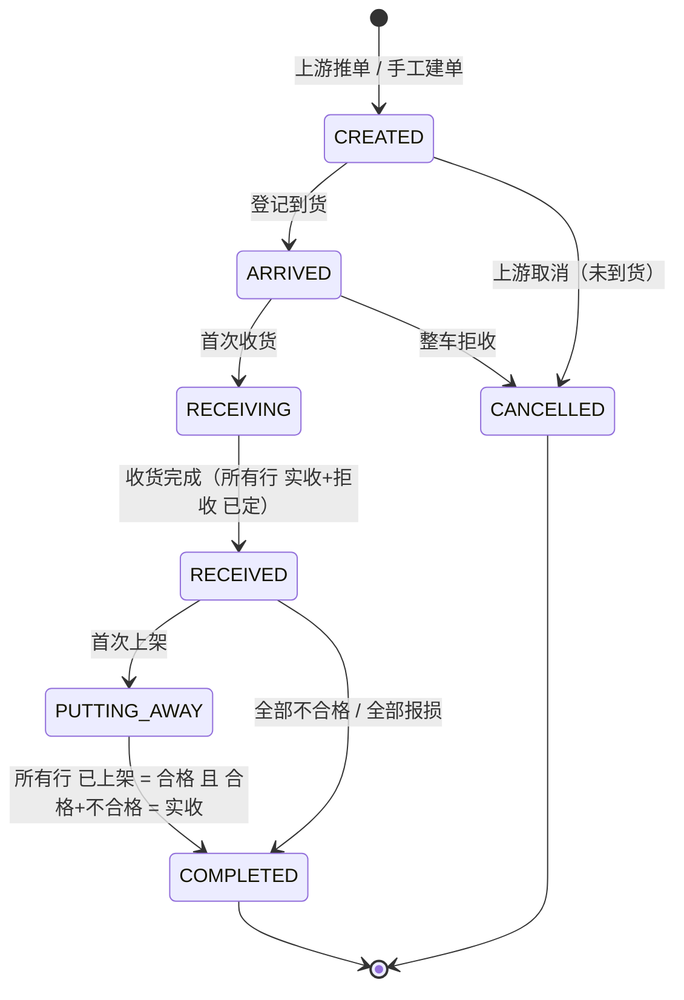
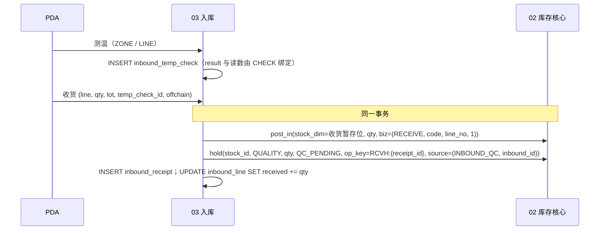

# 03 入库：收货、质检、上架

| 项 | 内容 |
|---|---|
| 状态 | 新稿（小肥鱼，2026-10-15），基于 `docs/first-design` @ `1d907031` |
| 依赖 | 00 总体设计（R2 数量口径、单号、幂等、错误码、SoD）；02 库存核心（`post_in` / `post_out` / `move` / `hold` / `unhold` / `convert_hold` / `release_qc_hold`，UC1、UC2、UC9）；09 效期与损耗（报损单）；10 退货与异常（退货入库复用本篇表）；11 集成（入站消息、outbox）；12 权限与审计 |
| 表 | `sql/schema/03_inbound.sql`：`inbound_order`、`inbound_line`、`inbound_temp_check`、`inbound_receipt`、`inbound_correction`、`inbound_putaway`、`inbound_quality_feedback`（7 张） |
| 验证 | `verify.sh` / `verify_sqlite.py` 第 2j 段（PG 另有 2j-sp）（PG 55 条、SQLite 54 条；PG 多一条 TRUNCATE） |

> 对标说明：盒马公开资料以门店（店仓一体）作业为主，本篇是配送中心 WMS，只借鉴做法，不照搬参数。凡是标「未查到」的，都没有公开来源，本篇做成**可配置**，不写成「对标盒马」。来源见 `/workspace/hema-research-小肥鱼.md` 第 1 节。

---

## 1. 职责与边界

**负责**：到货登记、测温（按温区、按行）、收货、离开冷链时长记录、质检放行 / 不合格、收货更正、上架、入库后质量反馈、入库完成回传。

**不负责**：

| 事项 | 归属 |
|---|---|
| 库存数量怎么改、流水、冻结汇总列 | 02（本篇只调原语，**不直接写 `stock`**） |
| 报损单审批、报损记账 | 09（本篇只建 DRAFT 并 `convert_hold` 到 `SCRAP_PENDING`） |
| 退货入库的来源、预约、盲收、异常单 | 10（复用 `inbound_order(order_type='RETURN')` 和 `inbound_line`） |
| 上游推单幂等、outbox 投递 | 11 |
| 预约到货、月台排班 | 未立项（§12 Q1；盒马无公开资料） |
| 上架库位推荐算法 | 本篇只规定约束（温区一致、库位未锁定、`max_lots`），推荐策略留给 07 补货与移库共用 |

**与旧稿（单表版 `03_inbound.sql`）的差异**

| # | 旧 | 新 | 原因 |
|---|---|---|---|
| Δ1 | 数量 `NUMERIC(14,3)` | 全部 `BIGINT *_qty_milli` | 00 R2 |
| Δ2 | 单头 `total_qty / received_qty / putaway_qty` | 删除，单头汇总从行算 | 两处存同一个数会漂移 |
| Δ3 | 单头一个 `temperature_in` | `inbound_temp_check`：按温区 + 按行，上下限快照，结果与读数由 CHECK 绑定 | 盒马调研 1-3 |
| Δ4 | 无 | 收货记录 `inbound_receipt`，带离开冷链时长 | 同上 |
| Δ5 | `putaway_op_id` 注释写「与 receiver_id 不同」 | `inbound_putaway` 组合外键带出收货人，`ck_inbp_sod` 库层拦 | 00 §2 SoD 写进模型层 |
| Δ6 | 收货后数量不能改，只能直接 UPDATE | 关单后开**收货更正单** `inbound_correction`（只追加）：不改原单/收货记录/入库行，经 02 原语补正/反向 `ADJUST` 流水；原因码必填；24h 内主管审批、24h–7d 主管 + 采购双审、超 7d 或已对账转 08；收货人不能审批 | 盒马「收货更正」；窗口按 fresh-rules-decisions §5（Alex 定） |
| Δ7 | 无 | `inbound_quality_feedback` | 盒马「质量反馈单」 |
| Δ8 | #5 用 ALTER 补 `received/qc_passed/qc_failed_qty_milli`、`ck_inbl_int`、`ck_inbl_qc`、`ck_inb_rtn_src` | 维持 #5 的 ALTER（基线已落库），本篇 CREATE TABLE 不重复定义；本篇自己的整数约束改名 `ck_inbl_int3` | 05d82171 已含 10_returns.sql，重复定义会建表失败 |

## 2. 用例

| 编号 | 用例 | 调用的 02 原语 | 写本篇哪张表 | 流水 |
|---|---|---|---|---|
| UC1（02） | 收货入暂存位，待检同时冻结 | `post_in(RECEIVE)` + `hold(QUALITY, QC_PENDING)` | `inbound_receipt`、`inbound_line.received_qty_milli` | `RECEIVE` +1 |
| UC9（02） | 质检放行 | `unhold`（QUALITY）；退货单的 `RETURN_QC` 走 `release_qc_hold` | `inbound_line.qc_passed_qty_milli` | 无 |
| UC9（02） | 质检不合格 | `convert_hold(QUALITY → SCRAP_PENDING)`（报损），或 `unhold` 后 `move` 到隔离区（退供待定，§12 Q4） | `inbound_line.qc_failed_qty_milli` | 报损时无；移隔离区 `MOVE` 两腿 |
| UC2（02） | 上架 | `move(PUTAWAY)` | `inbound_putaway`、`inbound_line.putaway_qty_milli` | `PUTAWAY` 两腿 |
| 03-U1 | 到货测温 | 无 | `inbound_temp_check` | 无 |
| 03-U2 | 收货更正单（+，关单后） | `post_in(ADJUST)`（biz_no = 更正单号） | `inbound_correction` | `ADJUST` +1 |
| 03-U3 | 收货更正单（−，关单后） | `post_out(ADJUST)` | `inbound_correction` | `ADJUST` −1 |
| 03-U4 | 入库后质量反馈 | `hold(QUALITY, QC_PENDING)`；处置 `convert_hold` / `unhold` | `inbound_quality_feedback` | 视处置 |
| 03-U5 | 月台拒收 | 无（未入账） | `inbound_line.rejected_qty_milli` | 无 |

## 3. 领域模型

- **入库单**（`inbound_order`）：一张上游单据（采购 / 退货 / 调拨入）。状态见 §5。
- **入库行**（`inbound_line`）：一个 SKU + 批次。行上有五个数：订货、实收（净额，含更正）、拒收、合格、不合格、已上架。不等式：`合格 + 不合格 ≤ 实收`（`ck_inbl_qc`），`已上架 ≤ 合格`（`ck_inbl_put`）。
- **测温**（`inbound_temp_check`）：一次读数。`scope = ZONE`（同温区整批测一次）或 `LINE`（按行）。上下限是测温当时从温区配置取的**快照**，配置以后改了也不影响历史判定。
- **收货记录**（`inbound_receipt`）：一次 `post_in`。冷藏 / 冷冻 / 生鲜行必须挂一条处置为 `ACCEPT` 或 `QC_HOLD` 的测温；`REJECT` 的测温不能收货。
- **收货更正单**（`inbound_correction`）：关单后对某条收货记录开的正/反向更正，一行 = 一张已终审并已过账的更正单，只追加。净实收 = `inbound_line.received_qty_milli` + Σ(direction × qty)。
- **上架记录**（`inbound_putaway`）：一次 `move(PUTAWAY)`，挂在一条收货记录上。
- **质量反馈**（`inbound_quality_feedback`）：上架复检或在库发现的来货质量问题。

**离开冷链时长**：收货记录上记 `offchain_start_at`（离开车厢，默认取单头 `unload_start_at`）、`offchain_end_at`（进入收货暂存冷区）和 `offchain_sec`；上架记录再记暂存位到存储位途中的 `offchain_sec`。上限 `offchain_limit_sec` 是温区配置的快照。超限时 `is_offchain_over = 1`，由 CHECK 和读数绑定，不能手填成 0。超限**不自动拒收**：货照常进 `QC_PENDING`，质检员必须看到超限标记再判（应用层把超限行排到质检队列最前）。

> 参考值：一份 2018 年盒马门店审核标准培训材料（豆丁转载）写「冷藏品离开冷链不超过 20 分钟、冷冻品不超过 30 分钟」，测温限值冷藏 0–4 ℃、冷冻 ≤ −18 ℃。这是**门店**标准、二手来源，本篇只拿来做测试数据，不写成默认值；DC 的实际值由仓库配置（§12 Q2）。

## 4. 涉及的表

数量列一律 `BIGINT *_qty_milli`，温度一律 `*_c10`（0.1 ℃ 整数，范围 −60.0 ～ 60.0 ℃），时长一律 `*_sec`。

### 4.1 `inbound_order`

| 列 | 说明 |
|---|---|
| `code` | `INB-` / `RTN-` + 00 §6.2 单号，`uq_inb_code` |
| `order_type` | `PURCHASE` / `RETURN` / `TRANSFER_IN`（`ck_inb_type`） |
| `source_system, source_order_no` | `uq_inb_src`，上游幂等（00 §6.5） |
| `source_hash` | 64 位小写 hex（`ck_inb_hash`）。WMS 内部生成的单（拒收回仓、盲收）可空 |
| `status` | `ck_inb_status` 白名单，见 §5；终态必须带 `closed_at`（`ck_inb_closed`） |
| `expected_at / dock_code / vehicle_no` | 预计到货、实际卸货月台（自由文本，不排班）、车牌 |
| `arrived_at / unload_start_at / received_at / closed_at` | 到场、开始卸货（冷链起点默认值）、收货完成、关单 |

约束 `ck_inb_rtn_src`（#5 在 `10_returns.sql` 里 ALTER，本篇不重复）：`RETURN` 单的来源只能是 `WMS_DELIVERY / STORE_RETURN / STORE_BLIND / SCRAP_MISREPORT / MALL / ERP`。

### 4.2 `inbound_line`

| 列 | 说明 |
|---|---|
| `inbound_id` | 入库单 id。02 §7.1.3 的 SQL 写作 `inbound_order_id`，指的就是这一列；保留旧列名是为了不打断 #5 已写好的用例（§12 Q6） |
| `temp_zone` | 下单时快照 `sku.temperature_required` |
| `ordered / received / rejected / qc_passed / qc_failed / putaway _qty_milli` | 见 §3 |

约束：`uq_inb_line (inbound_id, line_no)`；`uq_inbl_ord (id, inbound_id)` 给子表做组合外键（子记录必须挂在**本单**的行上）；`fk_inbl_order`；`ck_inbl_int`、`ck_inbl_qc`（#5 的 ALTER，三列 milli 也由它加）；本篇 `ck_inbl_int3`、`ck_inbl_qty`。「上架 ≤ 合格」原 `ck_inbl_put` 引用 10 才加的列，03 建表时写不了，改由上架条件更新 `putaway + :q ≤ qc_passed` 兜底（§8）。已关单的单头和行由 `trg_inb_closed_guard` / `trg_inbl_closed_guard` 锁住（单头只许把 `supplier_reconciled_at` 由空补上一次）。

超收容差（实收 > 订货多少算超收）**不放库层**：按 SKU / 供应商配置，应用层判，超了返回 42214 `detail.reason = OVER_RECEIVE`（§12 Q3）。

### 4.3 `inbound_temp_check`（只追加）

| 约束 | 内容 |
|---|---|
| `ck_itc_scope` | `ZONE` 不带行号；`LINE` 必带行号 |
| `ck_itc_range` | 读数在 −600 ～ 600；非 AMBIENT 必须至少有一个限值快照 |
| `ck_itc_result` | `PASS` ⇔ 读数在 [min, max] 内；`FAIL` ⇔ 越界。不能把 8 ℃ 记成 PASS |
| `ck_itc_disp` | `FAIL` 只能 `QC_HOLD` 或 `REJECT`，不能 `ACCEPT` |
| `fk_itc_line` | `(inbound_line_id, inbound_id)` → 本单的行 |
| `uq_itc_ref (id, inbound_id, disposition)` | 收货记录的组合外键目标 |

按温区测是必做的最低要求（每个温区至少一条 `ZONE`）；冷藏 / 冷冻 / 生鲜行是否每行都要测，做成仓库配置 `temp_check_per_line`（默认开）。复测追加新行，不改旧行。

### 4.4 `inbound_receipt`（只追加）

| 约束 | 内容 |
|---|---|
| `uq_rcp_op` | `op_key = RCV:{inbound_line_id}:{op_seq}`，重放撞键整笔回滚 |
| `uq_rcp_hold` / `fk_rcp_hold` | 一条收货对应一条 `QUALITY` 冻结 |
| `fk_rcp_temp` | `(temp_check_id, inbound_id, temp_check_disp)` → 测温 `(id, inbound_id, disposition)`：处置是从测温表带过来的，不能自己写 |
| `ck_rcp_temp` | AMBIENT 可以不挂测温；其余必须挂，且处置只能是 `ACCEPT / QC_HOLD` |
| `ck_rcp_chain` | 非 AMBIENT 必须记离冷链起止、秒数、上限快照；`is_offchain_over` 与 `offchain_sec > offchain_limit_sec` 一致 |
| `uq_rcp_ref (id, inbound_line_id, received_by)` | 上架记录 SoD 组合外键目标 |

### 4.5 `inbound_correction`（收货更正单，只追加）

| 列 / 约束 | 说明 |
|---|---|
| `code` | `IRC-` 前缀单号，也是 ADJUST 流水的 `biz_no` |
| `receipt_id` + `received_by` | 组合外键 `fk_irc_rcp` → `inbound_receipt(id, inbound_line_id, received_by)`：收货人取自原收货记录，伪造不了 |
| `order_closed_at` | 组合外键 `fk_irc_closed` → `inbound_order(id, closed_at)`：窗口起点就是真实关单时间 |
| `direction` / `qty_milli` / `stock_id` / `movement_id` | `trg_irc_guard` 核对 `movement_id` 那条流水：`biz_type='ADJUST'`、`biz_no=code`、方向、数量、库存行都一致（`inbound_correction_movement_mismatch`）；`uq_irc_mv` 一条流水只挂一张单 |
| `reason_code` | 必填：`COUNT_ERROR / WEIGHT_ERROR / WRONG_SKU / WRONG_BATCH / QUALITY_FOUND / OTHER`；`OTHER` 必填 `reason_note`（`ck_irc_reason`） |
| `approval_tier` | `SUPERVISOR`（只填 `supervisor_id`）/ `DUAL`（`supervisor_id` + `purchasing_id`，两人不同）（`ck_irc_tier`） |
| `ck_irc_receiver_sod` | 收货人不能当任何一级审批人（00 40312 `SOD_VIOLATION`，`detail.reason = RECEIVER_NOT_APPROVER`） |
| `ck_irc_self_apr` | 申请人不能自批 |

审批窗口（`trg_irc_guard`，按 `approved_at − order_closed_at`，单位秒）：

| 关单后 | 要求 | 不满足时 |
|---|---|---|
| ≤ 24h（含正好 24h） | `SUPERVISOR` | 填 `DUAL` → `inbound_correction_tier_mismatch` |
| > 24h 且 ≤ 7d（含正好 7d） | `DUAL` | 只有主管 → `inbound_correction_dual_approval_required` |
| > 7d | 拒绝 | `inbound_correction_window_closed`：40930，`detail.reason = INBOUND_CORRECTION_WINDOW_EXPIRED`，前端引导到 08 盘点差异 / 库存调整 |
| 已对账（`supplier_reconciled_at ≤ approved_at`） | 拒绝 | `inbound_correction_reconciled`：同上 40930，转 08 |

单必须是 `COMPLETED`（`inbound_correction_order_not_closed`）。

### 4.6 `inbound_putaway`（只追加）

`received_by` 不是自己填的：组合外键 `fk_inbp_rcp (receipt_id, inbound_line_id, received_by)` → `inbound_receipt (id, inbound_line_id, received_by)`，所以只能等于那条收货的收货人。`ck_inbp_sod`：`putaway_by <> received_by`，除非带放宽审批单号 `sod_waiver_no`（00 §2：小仓可以放宽，放宽本身记审计）。

### 4.7 `inbound_quality_feedback`

| 列 / 约束 | 内容 |
|---|---|
| `stage` | `PUTAWAY_RECHECK`（上架员复检不合格）/ `IN_STOCK`（在库发现） |
| `issue_code` | `ROT / DAMAGE / TEMP / SPEC / SHORT_WEIGHT / FOREIGN / OTHER` |
| `disposition` | `PENDING / SCRAP / RETURN_SUPPLIER / REJECTED / CLAIM_ONLY`；对应盒马质量反馈单的「减库存 / 换货 / 驳回 / 加库存」，换货与加库存在 DC 侧分别落到「退供后重新收货」和「收货更正」 |
| `ck_iqf_hold` | 除 `CLAIM_ONLY` 外必须挂冻结 |
| `ck_iqf_close` | `OPEN` ⇔ `PENDING` 且无关单人；`CLOSED` 必须有处置、关单人、关单时间，且**关单人 ≠ 发现人** |
| `trg_iqf_guard` | 关单后整行不能改；行、数量、冻结、发现人、发现时间任何时候不能改；不能删 |

### 4.8 只追加与权限

测温、收货、更正、上架四张表：PG 用第 2 篇的 `trg_append_only()` 拦 UPDATE/DELETE，另加语句级 TRUNCATE 触发器；SQLite 用等价触发器，并拦 `INSERT OR REPLACE`（REPLACE 的隐式删除不触发 DELETE 触发器）。`wms_app` 对这四张表只有 `SELECT, INSERT`；`inbound_order / inbound_line / inbound_quality_feedback` 为 `SELECT, INSERT, UPDATE`。

## 5. 状态机

| from → to | 触发者 | 守卫 | 副作用 |
|---|---|---|---|
| CREATED → ARRIVED | 仓管 | — | 记 `arrived_at`、`unload_start_at` |
| ARRIVED → RECEIVING | 收货员 | 本单各温区至少一条 `ZONE` 测温 | — |
| RECEIVING → RECEIVED | 收货员 | 没有未完成的收货 PDA 任务 | 记 `received_at` |
| RECEIVED → PUTTING_AWAY | 上架员 | — | — |
| PUTTING_AWAY / RECEIVED → COMPLETED | 系统 | 见图 | outbox `INBOUND_COMPLETED`（11 篇），记 `closed_at` |
| CREATED / ARRIVED → CANCELLED | 上游 / 主管 | 未入账 | 记 `closed_at` |

按 00 §6.7：条件更新 `WHERE id=:id AND status=:from`，0 行 → 40930。终态之后的数量变化只走收货更正和质量反馈，不改状态。关单后不再改原单和行（库层触发器拦，`inbound_order_closed_immutable`）；数量更正只开收货更正单，窗口见 §4.5（24h / 7d，Alex 定）。

## 6. 核心流程

### 6.1 收货（UC1）

测温 `REJECT` 的量记到 `rejected_qty_milli`，不入账。

### 6.2 质检（UC9）

质检抽样比例**未查到**盒马公开资料，做成 SKU 类目级配置 `qc_sample_policy`（全检 / 按比例 / 按件数），本篇只记录结果，不在库层规定比例。

- **合格 q**：`unhold(hold_id, q, op_key=QCP:{line_id}:{op_seq})`，同事务 `qc_passed += q`（条件 `qc_passed + qc_failed + q ≤ received`）。退货单（10 篇）的 `RETURN_QC` 冻结改走 `release_qc_hold`，同一列累加。
- **不合格 q（报损）**：09 篇先建 DRAFT 报损单，同事务 `convert_hold(hold_id, q, SCRAP_PENDING, (SCRAP, 报损单 id, SCRAP), op_key=CVT:{line_id}:{op_seq})`，`qc_failed += q`。
- **不合格 q（退供 / 待处置）**：同样先由 09 建 DRAFT 报损单并 `convert_hold` 到 `SCRAP_PENDING`（不再用 `hold(MANUAL)`），`qc_failed += q`；退供与否由 10 的供应商退货规则决定，超期未提的由 09 报废。本篇不建退供单。

### 6.3 上架（UC2）

1. 上架员扫暂存位、扫目标库位。校验：目标库位温区 = 行温区、库位未锁定、`max_lots`；库位锁定返回 40906；温区不符暂用 40001 `detail.reason = PUTAWAY_TEMP_ZONE_MISMATCH`（专用码待 00 登记，§12 Q7）。
2. 同一事务：`move(from=暂存位库存行, to=目标库位, q, biz=(PUTAWAY, code, line_no, op_no))`，`INSERT inbound_putaway`（`received_by` 从收货记录带出），`putaway_qty += q`（条件 `putaway + q ≤ qc_passed`）。
3. 上架人 = 收货人 → `ck_inbp_sod` 拦，接口返回 40312 `detail.reason = RECEIVE_PUTAWAY_SOD`。
4. 上架员复检发现问题（盒马门店做法：上架员再检查一次）：不上架，改开质量反馈单 `stage = PUTAWAY_RECHECK`（§6.5）。

### 6.4 收货更正单（关单后）

- 申请：仓内人员发起（申请人可以就是收货人），走 12 审批单 `INBOUND_CORRECTION`；按 §4.5 窗口定审批层级。收货人不能审批。
- 终审通过的同一事务里过账：**+q** `post_in(ADJUST)`；**−q** `post_out(ADJUST)`（可用量条件更新，不足 40902/40904）。都写 02 的 `stock_ledger_line` / `stock_movement` / `stock_movement_key`，`biz_no` = 更正单号；然后 `INSERT inbound_correction`（`movement_id` 指这条流水）和 outbox（`status = PENDING`，11 篇触发器只收 PENDING），回传 11 给采购 / 财务做应付调整。
- 不 UPDATE 原入库单、入库行、收货记录。+q 补进来的货若还要质检，另走 `hold(QUALITY)`；`QUALITY_FOUND` 的不合格量走 §6.5 质量反馈，处置一律 `hold(SCRAP_PENDING)`。
- 超 7d 或已对账：拒绝，改走 08。

### 6.5 入库后质量反馈

1. 发现人开单：`hold(QUALITY, QC_PENDING, source=(INBOUND_FB, feedback_id))` + `INSERT inbound_quality_feedback(OPEN, PENDING)`。
2. 主管处置并关单（关单人 ≠ 发现人）：`SCRAP` → `convert_hold` 到 `SCRAP_PENDING`（09）；`REJECTED` → `unhold`；`RETURN_SUPPLIER` → 同 §6.2，先 `convert_hold` 到 `SCRAP_PENDING` 待处置；`SCRAP` / `RETURN_SUPPLIER` 关单必须挂 `scrap_hold_id`，且该冻结的 `hold_type` 必须是 `SCRAP_PENDING`（`ck_iqf_scrap` + `trg_iqf_guard`）；`CLAIM_ONLY` → 不动库存，只回传索赔。
3. 关单后 outbox `INBOUND_QUALITY_FEEDBACK` 回传上游（供应商考核、扣款）。

## 7. 接口清单与契约

| 方法 | 路径 | 权限点 | 幂等 | 主要失败码 |
|---|---|---|---|---|
| POST | `/api/v1/inbound/orders`（上游推单走 11 篇入站消息） | `inbound.order.create` | `uq_inb_src` + `source_hash` | 40910 `SOURCE_ORDER` |
| POST | `/api/v1/inbound/orders/{id}/arrive` | `inbound.receive` | 状态条件更新 | 40930 |
| POST | `/api/v1/inbound/orders/{id}/temp-checks` | `inbound.receive` | `op_key` | 40001；42219（待登记，§12 Q7） |
| POST | `/api/v1/inbound/lines/{id}/receipts` | `inbound.receive` | `op_key` / PDA 四元组 | 40906、42214 `OVER_RECEIVE`、42219、50304（`RECEIVE` 暂停） |
| POST | `/api/v1/inbound/lines/{id}/qc` | `inbound.qc` | `op_key` | 40905、40930 |
| POST | `/api/v1/inbound/receipts/{id}/putaways` | `inbound.putaway` | `op_key` / PDA 四元组 | 40312 `RECEIVE_PUTAWAY_SOD`、40906、42212、40001 |
| POST | `/api/v1/inbound/receipts/{id}/adjustments` | `inbound.receipt.adjust`（审批 `inbound.receipt.adjust.approve`） | `op_key` | 40312（自批）、40905、40930 |
| POST | `/api/v1/inbound/quality-feedbacks` | `inbound.feedback.create` | `code` | 40904 |
| POST | `/api/v1/inbound/quality-feedbacks/{id}/close` | `inbound.feedback.close` | 状态条件更新 | 40312（发现人自关）、40930 |

数量入参一律 3 位小数字符串（00 R2）。

## 8. 并发与幂等

- 所有库存变化走 02 原语的条件更新（R7），本篇不加 `SELECT FOR UPDATE`。
- 行上累加用条件更新：`qc_passed + qc_failed + :q ≤ received`、`putaway + :q ≤ qc_passed`，0 行 → 40905；库层 `ck_inbl_qc` 兜底（上架超合格只靠条件更新，见 §4.2）。
- 每条记录表都有 `op_key` 唯一键；重放撞键 → 整个事务回滚，返回首次结果（00 §6.5）。
- 同一张单的收货与更正并发：都改同一行 `received_qty_milli`，条件更新 + `version` 串行化。

## 9. 异常与补偿

| 场景 | 处理 |
|---|---|
| 到货温度超限 | 测温 `FAIL`；处置 `REJECT`（记拒收量）或 `QC_HOLD`（收货进待检，质检员决定） |
| 离冷链超时 | 照常收货进待检，`is_offchain_over = 1`，质检优先；同时生成告警 |
| 收错数 | 关单后开收货更正单（24h 主管 / 7d 双审），不改原记录；超窗或已对账转 08 |
| 上架后发现质量问题 | 质量反馈单 |
| 收货暂存位被盘点锁定 | `post_in` 0 行 → 40906，换暂存位 |
| 离线超过 12 小时 | `RECEIVE` 进 `paused_actions`（00 §6.4），返回 50304 |

## 10. 权限

新增权限点（待 12 篇 / #9 登记，§12 Q7）：`inbound.order.create`、`inbound.receive`、`inbound.qc`、`inbound.putaway`、`inbound.receipt.adjust`、`inbound.receipt.adjust.approve`、`inbound.sod.waive`、`inbound.feedback.create`、`inbound.feedback.close`。

新增审批类型（待 00 §6.6.1 登记）：`INBOUND_CORRECTION`（收货更正单：24h 内主管；24h–7d 主管 + 采购；收货人不能审批）、`INBOUND_SOD_WAIVER`（收货 / 上架同一人放宽）。申请人不能自批。

库层 SoD：收货人 ≠ 上架人（`ck_inbp_sod`）；更正申请人 ≠ 审批人（`ck_rca_sod`）；质量反馈发现人 ≠ 关单人（`ck_iqf_close`）。

## 11. 测试要点（`verify.sh` / `verify_sqlite.py` 第 2j 段（PG 另有 2j-sp））

- 单头：状态白名单、hash 格式、退货来源白名单、终态必带关单时间、上游单号重推。
- #5 兼容：只给 #5 用到的列也能建 RTN 单和行；行实收为负被拦。
- 测温：结果与读数不符、FAIL 判 ACCEPT、按行不带行号、冷藏无限值、挂别的单的行、只追加。
- UC1：`post_in(RECEIVE)` + `hold(QUALITY)` + 收货记录；不挂测温、挂 REJECT 测温、谎报处置（组合外键）、离冷链超时不标、冷藏不记离冷链、只追加（UPDATE / DELETE / TRUNCATE）、重放。
- UC9：放行（unhold）、不合格（convert_hold → SCRAP_PENDING）、合格 + 不合格超实收、（上架超合格不再有库层用例）。
- 上架：`move(PUTAWAY)` 两腿；同一人被拦、放宽单号格式不对被拦、伪造收货人被组合外键拦、带审批单号放宽通过、只追加。
- 关单：改单头 / 改行 / 加行 / 删单都被拦。
- 更正单：正好 24h 主管单审通过；24h+1s 主管单审被拦；正好 7d 双审通过；7d+1s 被拦（转 08）；24h 内填双审被拦；已对账被拦；对账时间回写后再改被拦；收货人当主管 / 当采购被拦；申请人自批；原因码为空 / OTHER 无说明 / 不在字典；伪造收货人、伪造关单时间（组合外键）；流水数量不符；op_key 重放；只追加。
- 对账：净实收 = 行实收 + Σ更正；存储位在库；更正流水净额；outbox 全 PENDING；原收货记录未改；行上架量 = Σ上架记录 = 存储位在库。
- search_path（PG）：4 个函数 proconfig；同名 `inbound_order` 劫持 `trg_irc_guard` 被挡住。
- 质量反馈：开单（hold）、驳回处置不挂冻结、报损 / 退供关单不挂 SCRAP_PENDING、挂 QUALITY 冻结冒充、OPEN 改数量、发现人自关、主管关单（convert_hold）、关单后改、删除。

## 12. 待定问题（需 Doro / Alex 拍板）

| # | 问题 | 本稿做法 |
|---|---|---|
| Q1 | 预约到货、月台排班要不要做 | 盒马未查到公开资料；本篇不建表，只留 `expected_at`、`dock_code` |
| Q2 | 各温区测温限值、离冷链上限的默认值 | 全部做成温区配置并在记录上快照；测试数据用门店参考值，不当默认 |
| Q3 | 超收容差（按 SKU？按供应商？） | 应用层配置，42214 `OVER_RECEIVE`；需 00 登记新的 `detail.reason` |
| Q4 | 质检不合格 / 质量反馈的「退供应商」流程 | 与 Doro 12:00 差异表里的退供规则一起报 Alex；本篇只留处置枚举 `RETURN_SUPPLIER` |
| Q5 | 关单后多久内允许收货更正 | **已定**（fresh-rules-decisions §5）：24h 主管 / 7d 主管 + 采购 / 超 7d 或已对账转 08 |
| Q6 | 行外键列名 `inbound_id` 还是 `inbound_order_id` | 保留 `inbound_id`（#5 用例在用）；02 §7.1.3 的 SQL 写的是 `inbound_order_id`，建议 02 改成 `inbound_id` 或另开迁移统一 |
| Q7 | 新错误码 / 权限点 / 审批类型 | 提议：42219 `RECEIVE_TEMP_OUT_OF_RANGE`（42200–42219 段最后一个空号）、40312 `detail.reason = RECEIVE_PUTAWAY_SOD`、§10 权限点与两个审批类型，需登记到 00 / 12 后才能定稿 |
| Q8 | 质检抽样比例 | 盒马未查到；类目级配置，不在库层规定 |
| Q9 | 称重 SKU 收货时是否记单件标签净重（盒马「缺重退差」） | 属于 05/06 第 4 条的范围变更，等 Alex 定了再补 |
| Q10 | 收货更正 / 质量反馈的流水 `biz_type` | 本稿复用 02 已登记的 `ADJUST`，不新增；若要单独统计，需 02 登记 `RECEIVE_ADJ` |

## 13. 对抗评审攻击面

| # | 攻击面 | 期望的防线 |
|---|---|---|
| A1 | 直接 UPDATE 收货记录改数量、或 REPLACE 覆盖 | 只追加触发器（两库）+ 权限只给 INSERT |
| A2 | 同一个人收货又上架 | `ck_inbp_sod` + 组合外键带出收货人，伪造 `received_by` 撞外键 |
| A3 | 温度超限却记 PASS / ACCEPT | `ck_itc_result`、`ck_itc_disp`；收货端 `fk_rcp_temp` 带处置 |
| A4 | 离冷链超时却标未超时 | `ck_rcp_chain` |
| A5 | 用更正把实收压到已判定量以下、或把已上架的量减掉 | `ck_inbl_qc`；−q 只能从待检冻结里 `unhold` |
| A6 | 质检放行超量、上架超合格 | 条件更新 + `ck_inbl_qc`；上架超合格只有条件更新（`ck_inbl_put` 引用 10 的列，03 写不了） |
| A7 | 质量反馈发现人自己关单、关单后改处置 | `ck_iqf_close`、`trg_iqf_guard` |
| A8 | 行实收与流水不平 | 对账：行实收 = Σ收货 + Σ更正 = RECEIVE/ADJUST 流水净额（verify 已断言，生产走 02 对账任务） |

## 13. r2 修订（小玛丽 pr03 评审 + Doro 时间约定 00 §6.8/§6.9）

- **B1 超上架**：`trg_inbp_apply`（AFTER INSERT，PG `SECURITY DEFINER`）累加 `inbound_line.putaway_qty_milli`，0 行即报 `inbound_putaway_over_qty`（42214 OVER_QTY reason=OVER_PUTAWAY）；单已关报 `inbound_order_closed_immutable: putaway`；`trg_inbl_counter_guard` 要求上架量 ≤ 合格量且 = Σ上架记录；`wms_app` 对 `inbound_line` 只有 9 个非计数列的列级 UPDATE。
- **B2/B3 时间**：服务端时间（关单 `closed_at`、对账 `supplier_reconciled_at`、质量反馈 `closed_at`、更正单 `approved_at`、各表 `created_at`）PG 非属主写入一律改成 `date_trunc('second', now() AT TIME ZONE 'UTC')`（表属主豁免：种子 / 迁移）；SQLite 只收 `length 19 AND datetime(x) IS x` 的整秒 UTC，且与 now 相差 ≤ 300 s，否则 `<入库表>_clock_skew: 40003 CLIENT_TIME_INVALID <列>`。`created_at` 建后不可改：`<入库表>_time_immutable: 40004 TIME_FIELD_IMMUTABLE created_at`。日期列 SQLite 只收 `YYYY-MM-DD`。所有比较按整秒（PG 原生 TIMESTAMP；SQLite `CAST(strftime('%s', x) AS INTEGER)`）。所有时间列为 TIMESTAMP（不带时区）。
- **状态迁移表**（同 09 `trg_scr_forward`）：CREATED→ARRIVED/RECEIVING/CANCELLED；ARRIVED→RECEIVING/CANCELLED；RECEIVING→RECEIVED/PUTTING_AWAY/COMPLETED/CANCELLED；RECEIVED→PUTTING_AWAY/COMPLETED；PUTTING_AWAY→COMPLETED；COMPLETED/CANCELLED 终态（`inbound_order_state_forward_only`）。质量反馈 OPEN→CLOSED。收货记录、更正单没有状态列，整表只追加。
- **N1** 放宽单号格式同 12b `ck_apr_code`（`ck_inbp_waiver`，区分大小写）。**N4** 对账时间 = 批准时间（同一秒）算已对账。
- **search_path**：本篇 9 个 PG 函数固定 `pg_catalog, public, pg_temp`（防 `CREATE TEMP TABLE` 冒充）。
- 待定（N2）：`approval_no` / `sod_waiver_no` → `approval_request(code)` 外键 + 类型 / 状态校验、`INBOUND_CORRECTION` / `INBOUND_SOD_WAIVER` 的发起 / 审批权限点核对，需改 12b（`ck_apr_type`、`trg_apr_insert`、`trg_apr_final` 两库），本轮未做。N3（outbox 事件库层不强制）、N5（时区）记录在案，N5 已由上面的 UTC 约定覆盖。

## 14. R3 修订（round11 / 11 e39ca5a5 底座）

- **no-REPLACE 覆盖全部唯一键**（小玛丽 pr2-r11 X1/X2）：03 七张表、18 九张表的 SQLite no-replace 触发器 WHEN 逐条列出本表 PK 和每个 UNIQUE（含 `(id, closed_at)` 这类组合外键用的超键）；部分唯一索引（18 的 `uq_lth_active`、`uq_lw_key`）对已有行 `k.` 和 `NEW.` 两侧都判谓词；无表达式索引；WHEN 里没有 `IS NULL` 放行子句。触发器放在各文件末尾。verify 对每个键造冲突行跑 REPLACE / INSERT OR REPLACE：必须被拒、原行仍在；另断言每表唯一索引数 = 用例数，并对每个键做"WHEN 去掉该键"的变异（行为 + 静态覆盖两层，超键只做静态层）。
- **去重键不可改、计数器只增**（两库）：可变表 inbound_order / inbound_line / inbound_quality_feedback / sku_live_param / live_tank / live_stock_count / live_tank_hold / live_death 的 PK 与全部 UNIQUE 键列不可改（可空键列 `movement_id`、`closed_at` 只许 NULL → 值一次）；计数器（入库行五个量、各表 `version`、`live_death.deducted_qty_milli`）只增。PG 共用 `trg_keylock()`（固定 search_path，无属主豁免），SQLite 每表 `trg_<表>_keylock` / `_monotonic`。只追加表本来整行不可改，不重复加。`live_stock_count.on_hand_count` 是余额（死亡会减），不算计数器。因此"把合格量压到已上架量以下"现在先报 `<表>_counter_not_monotonic`。
- **时间**：SQLite 所有时钟容差触发器另加 `substr(x, 12, 2) > '23'`（拒 24 时）；格式 CHECK `datetime(x) IS x` 本来就拒 24:00:00，这条是双保险。PG 对服务端强制时间（`created_at`、`approved_at`、18 的 `inspected_at` / `weighed_at` / `reported_at`）**显式传 NULL 一律拒绝，报 40003**（`<入库表>_clock_skew` / `live_clock_skew`），不覆盖成 now；不传列走 DEFAULT 不受影响。与 #2 round11 `movement_clock_skew` 一致。
- `lot.receive_date` 归 #2 round11（DATE / `ck_lot_recv_ts`），03 撤回原跨篇触发器；流水 `occurred_at` 由 round11 服务端强制，03 用例不再传历史值。
