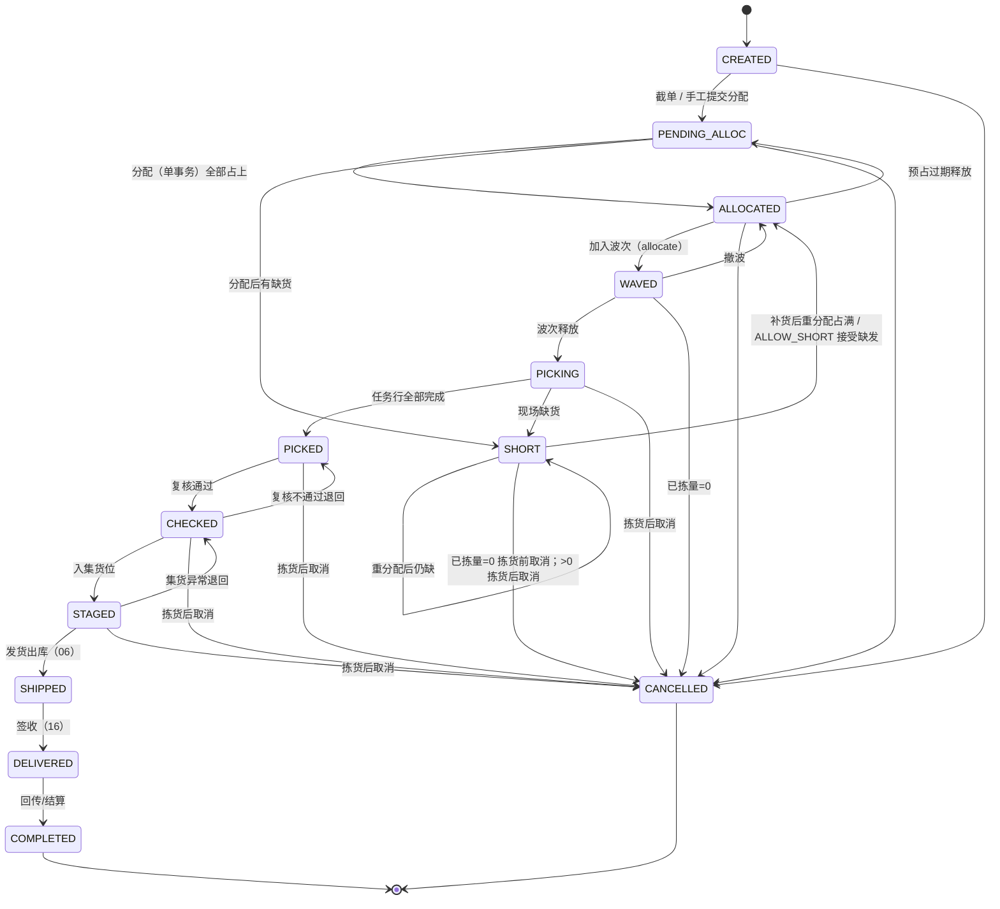
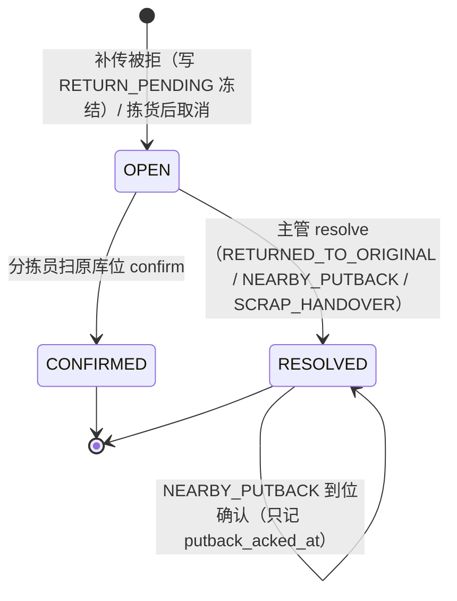
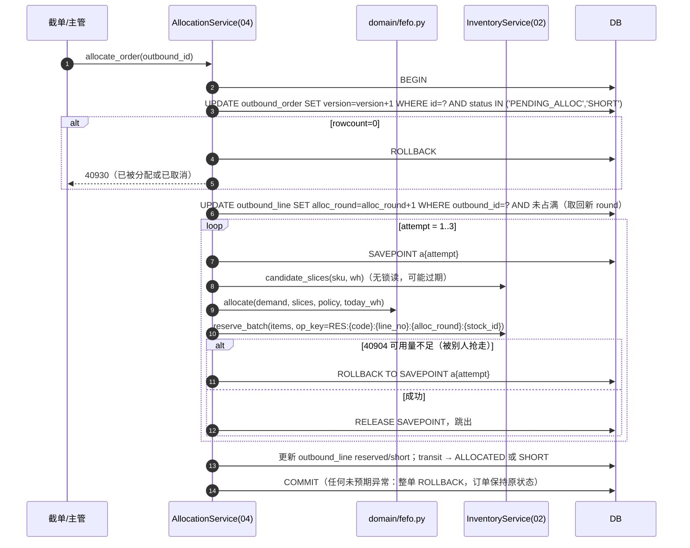
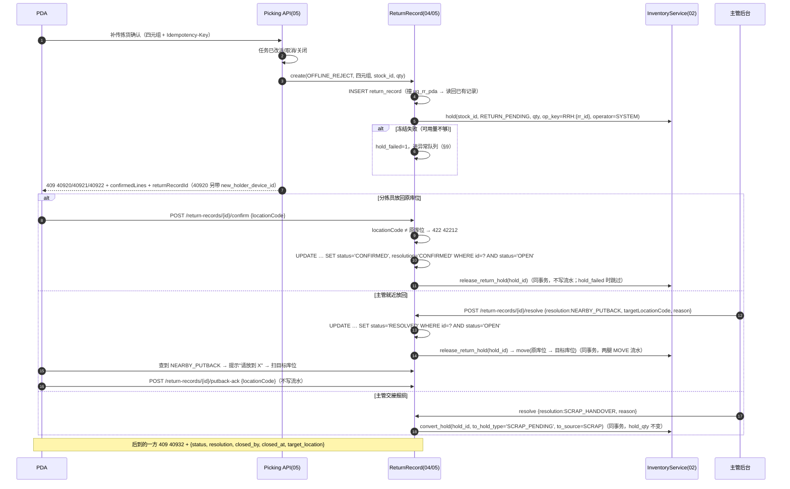

# 04 出库与分配 详细设计

| 项 | 内容 |
|---|---|
| 编号 | 04 |
| 作者 | 大肥鱼 |
| 评审 | 小赵（对抗评审，§13）、非作者开发 1 名 |
| 基线 | `main@8ed5f0c`，[原说明书](archive/WMS详细设计说明书.md) §3.5、§4.4、§5.2、§6.2、§6.3 |
| 依赖 | 00 总体设计；02 库存核心（`candidate_slices`、`reserve_batch`、`allocate`、`release`、`hold`、`release_return_hold`、`convert_hold`、`move`、`post_in`）；05 波次与拣货；08 盘点；09 效期与损耗 |
| 状态 | 草稿，首个设计 PR。已按小赵对抗评审（PR #2 评论 6176073930）修订 |

---

## 1. 职责与边界

### 1.1 负责

1. 出库单接单（上游推单、手工建单），按 `(source_system, source_order_no)` + `source_hash` 幂等。
2. 出库单状态机（§5.1），以及库层 `ck_obo_status` 兜底。
3. **FEFO 分配**：排序、过滤、贪心分配、缺货判定、越权分配审计（`domain/fefo.py`）。
4. 编排第 2 篇的原语：预占、预占转分配、释放；预占过期回退。
5. 取消（拣货前 / 拣货后）、缺货、重分配。
6. **待回库记录**（`return_record`）的库存口径和接口契约：生成时冻结、confirm、resolve、就近放回到位确认、并发闭环（§7.3）。表和 PDA 交互由第 5 篇定义，本篇定库存和并发规则，两篇必须一致。

### 1.2 不负责

| 不做 | 归属 |
|---|---|
| 库存余额、流水、条件 UPDATE 的实现；`RETURN_PENDING` 在 `stock` 上的列 | 02 |
| 聚波规则、拣货任务生成、任务领取、PDA 拣货确认 | 05 |
| 复核、装箱、发货出库 | 06 |
| 配送、签收 | 16（出库单的 `DELIVERED/COMPLETED` 由第 16 篇的签收事件驱动） |
| 补货任务的执行 | 07（本篇只触发补货需求） |
| 盘点基准与差异 | 08 |
| 报损单 | 09 |

### 1.3 与原文档的差异

| # | 原文档 | 本篇 | 原因 |
|---|---|---|---|
| Δ1 | 出库单、出库行、拣货任务行、装箱行数量 `NUMERIC(14,3)` | 全部 `*_qty_milli BIGINT`，两份 schema 已改 | 00 R2 |
| Δ2 | 状态图、迁移表、`transit()` 三处不一致 | 统一成 §5.1 一张完整迁移表 + `ck_obo_status` | 原文档不一致；小赵 I4 |
| Δ3 | 分配直接扣 `allocated` | 先 `reserve`（截单后），波次时 `allocate` | 跟第 2 篇 RESERVE/ALLOCATE 两段对齐 |
| Δ4 | 可用量没有考虑待回库 | `RETURN_PENDING` 冻结，FEFO 分配不到 | 小赵评审 |
| Δ5 | `CUTOFF`、`ALLOCATING` 是持久化状态 | 改为 `PENDING_ALLOC`（待分配）；分配是**单事务**，`ALLOCATING` 不落库 | 小赵 I3 |
| Δ6 | `lot.expiry_date` 是 `TIMESTAMP` | `DATE`，禁发期按仓库时区自然日计算 | 小赵 I5 |
| Δ7 | 错误码 `WMS-xxxxx` | 00 §6.4 | |

---

## 2. 用例

| 编号 | 用例 | 触发者 | 库存原语 |
|---|---|---|---|
| OB1 | 上游推单 / 手工建单 | ERP、商城、客服 | — |
| OB2 | 截单（进入待分配） | 定时任务（仓库 `cutoff_time`） | — |
| OB3 | FEFO 分配（预占） | 截单后自动 / 主管手工 | `candidate_slices` + `reserve_batch` |
| OB4 | 缺货处理（允许缺发 / 整单等齐 / 拆单） | 系统按 `short_ship_policy` | `release`（等齐时） |
| OB5 | 加入波次（预占转分配） | 05 | `allocate` |
| OB6 | 越权分配（指定临期批次或非 FEFO 批次） | 主管 | 同 OB3，记 `allocation_override` |
| OB7 | 拣货前取消（已拣量 = 0） | 客户 / 客服 | `release` |
| OB8 | 拣货后取消（已拣量 > 0） | 主管 | `release` 余量 + 生成待回库记录（`CANCEL_AFTER_PICK`） |
| OB9 | 预占过期释放，订单回到 `PENDING_ALLOC` | 定时任务 | `release` |
| OB10 | 离线补传被拒，生成待回库记录（`OFFLINE_REJECT`） | 05 拣货接口 | `hold(RETURN_PENDING)` |
| OB11 | 待回库 confirm | 分拣员 PDA | `release_return_hold`；`CANCEL_AFTER_PICK` 时 `post_in(REVERSE_PICK)` |
| OB12 | 待回库 resolve（放回原位 / 就近放回 / 报损交接） | 主管 | `release_return_hold`（+ `move`）/ 报损交接 `convert_hold` |
| OB13 | 就近放回到位确认 | 分拣员 PDA | 无（不写流水） |

---

## 3. 领域模型

### 3.1 可用量（引用第 2 篇口径）

```
available = on_hand − allocated − reserved − hold
```

- `hold` 是 `stock` 上全部冻结的汇总。按第 2 篇口径，**`RETURN_PENDING` 计入 `hold_qty_milli`**，从可用量中扣除，**FEFO 不分配**。`RETURN_PENDING` 是独立的 `hold_type`，不借用 `MANUAL`（00 G1）。
- `ck_hold_type`、`hold_qty_milli` 列、`ck_stock_nonneg`、视图 `v_stock_available` 和 I3 汇总口径都以第 2 篇和建表脚本为准，本篇不重复定义。04 跟 02 一起合入；02 落地之前，§7.3 规则 1 只是设计结论，不能当作已经生效。

### 3.2 分配输入输出

```python
@dataclass(frozen=True)
class DemandLine:      # 出库行（只含本轮还没占上的量）
    outbound_line_id: int; line_no: int; sku_id: int; qty_milli: int
    alloc_round: int; allow_short: bool; temperature_required: str

@dataclass(frozen=True)
class AllocationPolicy:
    allow_near_expiry: bool = False        # 越权才为 True
    override_lot_ids: tuple[int, ...] = () # 越权指定批次
    pick_from_case_first: bool = True

AllocationResult = (list[Allocation(stock_id, qty_milli, reason)], list[Shortage(sku_id, qty_milli, cause)])
```

`fefo.allocate(demand, supply: list[StockSlice], policy, today_wh: date)` 是**纯函数**，`StockSlice` 来自第 2 篇 §7.3。`today_wh` 是**仓库时区**下的今天（`warehouse.timezone`），由 service 层算好传进来，纯函数里不取系统时间。

### 3.3 FEFO 规则

**过滤**（不满足的切片直接丢掉）：
1. `quality_status = QUALIFIED`。lot 的 `RELEASED`（让步放行）作为合法状态保留在第 3 篇的枚举里，**默认不参与自动分配**，只能越权分配（小赵 S3）。
2. 禁发期：`expiry_date − today_wh ≥ sku.ship_min_shelf_life`。`expiry_date` 是 `DATE`（日历日），两边都是自然日，相减得到整天数，**不做时区换算**。越权时可以放宽，但必须记 `allocation_override`。
3. 库位温区兼容 SKU 和订单的温区要求。
4. `location.status ≠ LOCKED`（盘点冻结）。
5. `available_qty_milli > 0`（已扣除 `RETURN_PENDING`）。

**排序**（原 §4.4）：`expiry_date ASC → production_date ASC NULLS LAST → receive_date ASC → zone_type(PICK 优先) → pick_sequence ASC → stock_id ASC`。`production_date` 可以为空，空值排在最后（不确定生产日期的批次不优先出）。最后一个键保证结果可复现。`production_date`、`receive_date`、`container_id`、`ledger_seq` 需要补进 `v_stock_available`（小赵 S4，第 2 篇改视图）。

**贪心**：按顺序取 `min(剩余需求, available)`；满足整箱倍数且开了 `pick_from_case_first` 时，同一批次内整箱位优先。拣货位不够、存储位有货时，产生补货需求（交给第 7 篇），这一行记为 `Shortage(cause=NEED_REPLENISH)`。一行需求可以拆到多个 stock 行（拆批），每个 stock 行一条占用。

**不做**组合优化（原 §4.4）。

---

## 4. 涉及的表

约束名**以建表脚本为准**（小赵 S1），文档跟脚本对齐。

### 4.1 `outbound_order`（沿用原 §3.5，改动如下）

- `code`：按 00 §6.2 生成，`OBT-{仓前缀}-{节点号}-{作业日}-{序号}`。
- `status`：取值见 §5.1，库层 **`ck_obo_status`** 限定取值（已加入两份 schema）。
- 新增 **`source_hash VARCHAR(64) NOT NULL`**：上游单据规范化内容的 SHA-256 hex，**无默认值**，`ck_obo_hash`：长度 64 且只含小写十六进制（两库同一种嵌套 `replace` 写法，见 schema）。漏算 hash 的写入直接被库层拒绝，不会出现"空串 = 同内容"误判（小赵 D6）。
- 汇总数量列 `total / allocated / picked / shipped / short` → `*_qty_milli BIGINT`，`ck_obo_qty`：非负且为整数。新增 `version BIGINT`、`reserve_expires_at`。以上均已在两份 schema 落地。
- 约束：`uq_obo_src (source_system, source_order_no)`、`uq_obo_code (code)`、`ck_obo_sod`（拣货人 ≠ 复核人）、`ck_obo_status`。

### 4.2 `outbound_line`

| 字段 | 类型 | 说明 |
|---|---|---|
| order_qty_milli / reserved_qty_milli / allocated_qty_milli / picked_qty_milli / shipped_qty_milli / short_qty_milli | BIGINT NOT NULL（`order` 无默认，其余 DEFAULT 0） | 基本单位 milli，已落 schema。`picked_qty_milli` 是累计拣出量，撤销/回冲不减它 |
| **alloc_round** | INT NOT NULL DEFAULT 0 | 分配轮次。每次（重新）分配开始时用条件更新 +1，进入占用幂等键（B1）。已加入 schema |
| uom | VARCHAR(16) | 等于 `sku.base_uom` |
| **reversed_qty_milli** | BIGINT NOT NULL DEFAULT 0 | 已撤销/回冲的累计量：05 撤销拣货（`REVERSE_PICK`）和 `CANCEL_AFTER_PICK` 回冲都累加到这里。`picked_qty_milli` 是累计拣出量，`picked − reversed` 就是还能冲回的量。已加入两份 schema（`ck_obl_reversed`：`≥ 0` 且为整数） |
| order_uom / order_uom_qty | VARCHAR / VARCHAR | 下单时的作业单位原值，只做展示 |

约束（两份 schema 已落地，verify 有断言）：

| 约束 | 内容 |
|---|---|
| `uq_obo_line` | `(outbound_id, line_no)` |
| `ck_obl_int` | 所有 `*_qty_milli` 为整数（SQLite 防 REAL） |
| `ck_obl_nonneg` | `order > 0`，其余 `≥ 0` |
| `ck_obl_reversed` | `reversed ≤ picked`：回冲不超过拣出，库层兜底（D4） |
| `ck_obl_sum` | 净拣出 `picked − reversed`：`净拣出 + short ≤ order`；`reserved + allocated + 净拣出 ≤ order`；`shipped ≤ 净拣出` |

正常路径靠条件更新 `reversed + :qty ≤ picked`（§6.3），影响 0 行返回 42214；CHECK 只是兜底，撞上即 50010 告警。

**相关出库表同步改 milli**：`pick_task_line.plan_qty / plan_qty_base / actual_qty` → `planned_qty_milli`、`confirmed_qty_milli`（`ck_ptl_qty`：`0 ≤ confirmed ≤ planned`，跟 00 §6.5 防超拣条件更新同名）；`pack_box_line.quantity` → `qty_milli`（`ck_box_line_qty`：`> 0` 且为整数）。`uom` 列保留作业单位，仅展示。

### 4.3 `allocation_override`（新增）

`id, outbound_line_id, stock_id, lot_id, qty_milli, rule_broken (NEAR_EXPIRY / NON_FEFO / TEMP_ZONE / QUALITY_RELEASED), reason, operator_id, approved_by, created_at`。只追加。

### 4.4 `return_record`（待回库，第 5 篇建表，本篇定约束）

| 字段 | 说明 |
|---|---|
| id / code | `RR-…` |
| source_type | `OFFLINE_REJECT`（离线补传被拒，货**没**扣账）/ `CANCEL_AFTER_PICK`（拣货后取消，货**已**扣账） |
| task_id, line_no, device_instance_id, op_seq | `OFFLINE_REJECT` 时为 PDA 四元组，`uq_rr_pda`；`CANCEL_AFTER_PICK` 时按 `(outbound_line_id, pick_movement_id)` 唯一 |
| reject_code | 40920 / 40921 / 40922（仅 `OFFLINE_REJECT`） |
| stock_id / location_id / sku_id / lot_id / qty_milli | 原库位就是 `location_id` |
| hold_id | `OFFLINE_REJECT` 时写的冻结，`hold_type=RETURN_PENDING`（系统冻结，`operator_id=0`）。冻结失败时为空，`hold_failed=1` |
| hold_failed | 0/1，见 §9 |
| status | `OPEN / CONFIRMED / RESOLVED` |
| resolution | `CONFIRMED`（分拣员放回原位确认）/ `RETURNED_TO_ORIGINAL`（主管处置为放回原位）/ `NEARBY_PUTBACK`（就近放回）/ `SCRAP_HANDOVER`（交接报损） |
| target_location_id | 就近放回的目标库位 |
| putback_acked_at / putback_acked_by | `NEARBY_PUTBACK` 时分拣员扫目标库位的到位确认，不写流水 |
| closed_by / closed_at / version | 处理人、处理时间 |
| payload | 被拒的原始请求，留证据 |

`CONFIRMED` 状态的 `resolution` 恒为 `CONFIRMED`。

---

## 5. 状态机

### 5.1 出库单



**完整迁移表**（代码里只有一个 `OUTBOUND_TRANSITIONS` 字典，测试按它穷举所有 `(from, to)`；库层 `ck_obo_status` 只限定取值，迁移合法性由 `transit()` + `WHERE status=:from` 保证）：

| # | from → to | 触发者 | 守卫 | 副作用（同事务） |
|---|---|---|---|---|
| T1 | CREATED → PENDING_ALLOC | 截单定时 / 客服提交 | — | 无 |
| T2 | PENDING_ALLOC → ALLOCATED | 分配服务 | 所有行占满 | `alloc_round+1`，`reserve_batch`，写 `reserve_expires_at` |
| T3 | PENDING_ALLOC → SHORT | 分配服务 | 有行未占满 | 同 T2，记缺货原因 |
| T4 | SHORT → ALLOCATED | 分配服务 / 主管 | 重分配占满，或 `ALLOW_SHORT` 接受缺发 | 重分配同 T2（新的 `alloc_round`）；接受缺发时把缺量记入 `short_qty`，**已拣行不受影响** |
| T5 | SHORT → SHORT | 分配服务 | 重分配后仍缺 | 同 T2（部分占上的照常保留） |
| T6 | ALLOCATED → PENDING_ALLOC | 预占过期任务 | `WHERE status='ALLOCATED'`；WAVED 及以后不过期 | `release` 全部 RESERVE 余量，记事件 `RESERVATION_EXPIRED` |
| T7 | ALLOCATED → WAVED | 05 | — | `allocate`（RESERVE→ALLOCATE） |
| T8 | WAVED → ALLOCATED | 主管撤波 | 波次内任务都没有被领取 | ALLOCATE 释放、重新 RESERVE |
| T9 | WAVED → PICKING | 05 波次释放 | — | 无 |
| T10 | PICKING → PICKED | 05 | 任务行全部 DONE/SHORT | 无 |
| T11 | PICKING → SHORT | 05 | 现场缺货 | 已拣行保持不变，`picked_qty_milli > 0` |
| T12 | PICKED → CHECKED | 06 | 复核人 ≠ 拣货人 | 无 |
| T13 | CHECKED → PICKED | 06 | 复核不通过 | 无 |
| T14 | CHECKED → STAGED | 06 | — | 无 |
| T15 | STAGED → CHECKED | 06 | 集货异常 | 无 |
| T16 | STAGED → SHIPPED | 06 | — | `post_event(SHIP)` |
| T17 | SHIPPED → DELIVERED | 16 | 有效签收 | 无 |
| T18 | DELIVERED → COMPLETED | 11 回传成功 | — | 无 |
| T19 | {CREATED, PENDING_ALLOC, ALLOCATED, WAVED, SHORT} → CANCELLED（**拣货前取消**） | 客服 | **订单所有行 `picked_qty_milli = 0`，且关联任务已拣量 = 0** | `release` 所有占用余量；通知 05 取消任务（PDA 收到 40921） |
| T20 | {SHORT, PICKING, PICKED, CHECKED, STAGED} → CANCELLED（**拣货后取消**） | 主管 | `outbound.order.cancel_after_pick` + 原因；任一行 `picked_qty_milli > 0` | 未拣占用 `release`；对每条已拣行生成待回库记录（`CANCEL_AFTER_PICK`）；05 取消剩余任务 |

- 守卫判断"已拣量"用条件更新写进 WHERE（`… AND NOT EXISTS (已拣量 > 0 的行)`），不先读后判断。客服调拣货前取消时如果已拣量 > 0，返回 **40930**，`detail.hint = CANCEL_AFTER_PICK_REQUIRED`（小赵 B2，方案 ②）。
- 迁移用条件更新 `WHERE status=:from`，失败返回 **40930**。`SHIPPED` 之后不允许取消，只能红冲。

### 5.2 待回库记录



---

## 6. 核心流程

### 6.1 分配（单事务）



- **单事务**：`ALLOCATING` 不再是落库状态，崩溃时整单回滚，订单留在 `PENDING_ALLOC/SHORT`，下次调度重试，不需要超时回收任务（小赵 I3）。
- **幂等键**：`RES:{单号}:{行号}:{alloc_round}:{stock_id}`（裁决 B1）。
  - 同一轮内的多次 attempt 复用同一个 `alloc_round`，失败的 attempt 已回滚到 SAVEPOINT，不会留下占用，所以同一键不会对应两笔成功的占用。
  - 一行拆到多个 stock 行时，`stock_id` 不同，键不冲突。
  - 补货后重分配进入新的一轮，`alloc_round` 已 +1，键与上一轮不重复，不会被当成幂等成功吞掉；本轮需求只包含**还没占上的量**（`order − reserved − allocated − picked`），已有占用不动。
- 第 2 篇原语"调用方开事务、原语不提交"的约定不变；SAVEPOINT 由本模块管理。第 2 篇 §4.2 的 `op_key` 示例需要同步成本格式（见 §12 Q5）。

### 6.2 补传被拒 → 待回库 → 闭环



**顺序要求**：
- 就近放回必须**先 `release_return_hold` 再 `move`**：`move` 的来源条件是 `available ≥ q`，冻结未释放时 move 会失败（40904）。
- 交接报损**只调用第 2 篇的 `convert_hold(hold_id, to_hold_type, to_source)`**：在同一条冻结上关闭 `RETURN_PENDING` 明细、新建报损明细，`stock.hold_qty_milli` 不变，**不经过可用量条件**，所以 `available = 0` 时也能成功，也不会冻到别的货上。原来"先建报损冻结、再解冻"的写法作废：`hold` 原语要求 `available ≥ q`，而这部分量本来就不在可用量里，库层走不通（小赵 D1）。报损冻结为系统冻结 `hold_type='SCRAP_PENDING'`，`reason='SCRAP'`，`source_type='SCRAP'`（第 2 篇 `ck_hold_scrap`）；**不可手工解冻**（40933），只能由第 9 篇报损完成或撤销释放。不再使用 `MANUAL`，也不用 `RETURN_RECORD`（会撞 `uq_hold_return`）。

- **报损冻结的 `source_id`（小赵 N2）**：`source_type='SCRAP'` 时 `source_id` **一律是第 9 篇报损单 id**。SCRAP_HANDOVER 在同一事务里先建第 9 篇报损单（DRAFT），再 `convert_hold(..., to_source=(SCRAP, 报损单 id))`；待回库记录上记 `scrap_doc_id` 反查。不用 RR id。

### 6.3 拣货后取消 → 待回库

已拣的货已经 `consume`（`on_hand` 已扣），账上不在原库位，所以 `CANCEL_AFTER_PICK` 记录**不写 `RETURN_PENDING` 冻结**（没有可冻结的账面库存）。

**生成记录（T20，同一事务内按顺序）**：
1. **先建记账来源行**：`INSERT stock_ledger_line(biz_no=RR 单号, line_no=1, src_kind='DOC') ON CONFLICT DO NOTHING`。不先建这一行，后面的回冲会被 `trg_mvk_line_kind` 拒绝（`ledger_line_owner_mismatch`），confirm 永远失败（小赵 D3）。
2. **占住可回冲量**：
   ```sql
   UPDATE outbound_line
      SET reversed_qty_milli = reversed_qty_milli + :qty
    WHERE id = :line_id
      AND reversed_qty_milli + :qty <= picked_qty_milli      -- 即 qty ≤ picked − 已撤销量
   ```
   影响 0 行 → 整个事务回滚，返回 **42214**，`detail = {reason: "OVER_REVERSE", outbound_line_id, picked_qty, reversed_qty, requested_qty}`（数量为三位小数字符串）。这样同一条拣货被 05 撤销拣货冲回过、或者被重复生成 RR 时，都不会虚增库存（小赵 D4）。05 的撤销拣货也用同一条条件更新累加 `reversed_qty_milli`。
3. 插入 `return_record(source_type=CANCEL_AFTER_PICK, qty_milli=:qty, ref_movement_id=原拣货流水 id)`。

**闭环时回冲**：
- **回冲键固定**：`(biz_no=RR 单号, line_no=1, op_no=1, leg=1)`，**confirm 和 resolve 共用这一个键**，受 `uq_mvk_biz_line` 约束（`idempotency_key = {RR 单号}:1:D1:1`）。confirm 重试、confirm 与 resolve 抢跑，除了 `status='OPEN'` 条件更新之外，库层还会再挡一次，不可能回冲两次（小赵 D2）。回冲流水带 `ref_movement_id`。
- confirm（扫原库位）：同事务 `post_in(REVERSE_PICK)` 回原库位，新流水，不改旧流水。
- resolve `NEARBY_PUTBACK`：同一个键，`post_in(REVERSE_PICK)` 直接入目标库位（不走 move）。
- resolve `SCRAP_HANDOVER`：不回库，交给第 9 篇按"已出库待报损"处理（Q6）；不写回冲流水，`reversed_qty_milli` 保持已占住的量。
- **原库位处于盘点锁定时，回冲照常入账，不等锁定解除**，不返回 40906。这笔 `REVERSE_PICK` 记在盘点快照之后，计入该盘点的**期间流水（在途调整）**，盘点差异 = 实盘 − 快照账面 − 期间流水，因此不会被算成盘盈（Q8 已定，第 8 篇对齐；第 2 篇 `post_in` 对 `REVERSE_PICK` 来源放行库位锁）。

这是"confirm 不写流水"规则的**唯一例外**，原因是货已经扣过账。`OFFLINE_REJECT` 记录的 confirm 仍然只改状态、不写流水。

---

## 7. 接口清单与契约

### 7.1 出库单

| 方法 | 路径 | 说明 | 权限点 |
|---|---|---|---|
| POST | `/api/v1/outbound-orders` | 建单 | `outbound.order.create` |
| GET | `/api/v1/outbound-orders` | 列表 | `outbound.order.view` |
| GET | `/api/v1/outbound-orders/{id}` | 详情（含占用明细、分配理由、事件） | `outbound.order.view` |
| POST | `/api/v1/outbound-orders/{id}/allocate` | 手工触发分配 | `outbound.order.allocate` |
| POST | `/api/v1/outbound-orders/{id}/allocate-override` | 越权分配，必填 `reason`、`lots` | `outbound.allocation.override` |
| POST | `/api/v1/outbound-orders/{id}/cancel` | 拣货前取消 | `outbound.order.cancel` |
| POST | `/api/v1/outbound-orders/{id}/cancel-after-pick` | 拣货后取消，必填 `reason` | `outbound.order.cancel_after_pick` |
| GET | `/api/v1/outbound-orders/{id}/shortages` | 缺货明细 | `outbound.order.view` |

**建单幂等（小赵 I1）**：服务端对规范化后的单据内容（行按 `line_no` 排序，数量统一成 milli）算 `source_hash`。

| 情况 | 响应 |
|---|---|
| 新单 | 201 |
| 同 `(source_system, source_order_no)`、同 `source_hash` | 200 + 已有单号和当前状态 |
| 同号、不同 `source_hash` | **409 `40910`**，`detail.key_type = "SOURCE_ORDER"`，带已有单号；改单走"取消重下"，本期不做在线改单（Q4） |

```json
{ "source_system": "ERP", "source_order_no": "SO-778812", "customer_id": 31,
  "required_delivery_date": "2026-10-16", "short_ship_policy": "ALLOW_SHORT",
  "lines": [ { "line_no": 1, "sku_code": "APL-80-5KG", "qty": "12.500", "uom": "KG" } ] }
```

`qty` 是字符串，`"12.5001"` 返回 400 `40010`。

**分配结果**（`GET …/{id}` 的 `allocations`）：

```json
{ "stock_id": 8812, "lot_code": "LOT-1008", "expiry_date": "2026-10-25", "qty": "10.000",
  "alloc_round": 2, "reason": "FEFO: 效期最早，拣货位" }
```

**事件**（`GET …/{id}` 的 `events`）：`RESERVATION_EXPIRED`、`REALLOCATED`、`CANCEL_AFTER_PICK` 等，只追加，写 `audit_log`。

### 7.2 错误码（本篇使用）

| 码 | 场景 |
|---|---|
| 40002 | 越权分配缺少原因（参数类） |
| 40010 | 数量格式 |
| 40311 | `X-Warehouse-Id` 不在用户权限内，或与资源所属仓不一致 |
| 40904 | 预占时可用量不足（内部重试 3 次仍失败则转缺货，不对外抛） |
| 40906 | 原语在 LOCKED 库位上出账或移库（第 2 篇） |
| 40910 | `key_type=IDEMPOTENCY_KEY`：同一 `Idempotency-Key` 不同请求体；`PDA_OP`：同一四元组不同数量；`SOURCE_ORDER`：上游同单号不同内容 |
| 40923 | 任务已被别人领取（05） |
| 40930 | 非法状态流转；拣货前取消但已拣量 > 0 时 `detail.hint=CANCEL_AFTER_PICK_REQUIRED` |
| 40931 | 单据已锁定（如已进波次时改行） |
| 40932 | RECORD_ALREADY_CLOSED，见 §7.3 规则 6 |
| 40933 | SYSTEM_HOLD_NOT_RELEASABLE：手工解冻系统冻结（`RETURN_PENDING` / `SCRAP_PENDING` / `RETURN_QC`），`detail` 固定为 `{hold_type, source_type, source_id}`，前端按 `hold_type` 出提示、按 `source_type`/`source_id` 跳转（待回库记录 / 报损单 / 质检单）；口径以 00 §6.4 为准 |
| 42212 | 待回库 confirm / putback-ack 扫到的库位不对 |
| 42213 | 就近放回时目标库位温区不符，或原库位被盘点冻结 |
| 42214 | `detail.reason` 必带：`OVER_PICK` 超拣（05）；`OVER_REVERSE` 回冲/撤销拣货超过可冲回量（`reversed + qty > picked`），另带 `{outbound_line_id, picked_qty, reversed_qty, requested_qty}`。缺失或未知 reason 客户端标红交人 |
| 50000 | 内部错误 |
| 50010 | 不变量断言失败或撞 CHECK（条件写漏，立即告警） |

待回库记录详情 `GET /api/v1/return-records/{id}` 返回 `handover_confirmed_at`（报废交接由主管确认后写入，空表示未完成）和 `handover_confirmed_by`。

`4094x` 是本模块号段，预留给后续新增码（00 §6.4）。

### 7.3 待回库接口（路径与第 5 篇、第 14 篇 §9.4.2 一致）

| 方法 | 路径 | 说明 | 权限点 |
|---|---|---|---|
| GET | `/api/v1/return-records?status=OPEN&warehouseId=…` | 主管看板，分页；含 `hold_failed` 异常队列筛选 | `picking.return_record.view` |
| GET | `/api/v1/return-records/{returnRecordId}` | PDA 查红条状态 | 原拣货人 或 `picking.return_record.view` |
| POST | `/api/v1/return-records/{returnRecordId}/confirm` | 扫原库位确认回库，带 `Idempotency-Key`、`locationCode` | **原拣货人**（接手人手里没有这批货，不允许，小赵 S5） |
| POST | `/api/v1/return-records/{returnRecordId}/resolve` | 主管处理，必填 `resolution`、`reason`；`NEARBY_PUTBACK` 必填 `targetLocationCode` | `picking.return_record.resolve` |
| POST | `/api/v1/return-records/{returnRecordId}/putback-ack` | `NEARBY_PUTBACK` 后分拣员扫目标库位的到位确认，带 `locationCode` | 原拣货人 |

**规则**：

1. **生成即冻结**（`OFFLINE_REJECT`）：同事务写 `stock_hold(hold_type=RETURN_PENDING, source_type=RETURN_RECORD, source_id=rr_id, operator_id=0)`，数量 = 被拒收数量。按第 2 篇口径计入 `hold_qty_milli`，扣减可用量，FEFO 不分配。这是**系统冻结**：不能通过 `/inventory/unfreeze` 人工解冻，只能由系统在 confirm / resolve 时、跟记录状态更新**同一个事务**里释放；"解冻人 ≠ 冻结人"规则不适用。
2. **按四元组幂等**：同一行重复被拒，返回已有 `returnRecordId`，不新建记录、不重复冻结（冻结 `op_key = RRH:{rr_id}`）。
3. **confirm 只改状态，不写库存流水**（`OFFLINE_REJECT`）：被拒收的行服务端从来没扣过库存。例外见 §6.3。
4. **库位不对返回 422（42212）**，记录保持 OPEN，PDA 红条保留并提示重新扫码。422 不进幂等缓存，同一个 key 重扫可以成功。
5. **只有主管 resolve 选 `NEARBY_PUTBACK` 才写移库流水**：释放冻结后走第 2 篇标准 `move`。原库位被盘点冻结或目标库位温区不符 → 422（42213），记录保持 OPEN，不移库。
6. **并发闭环**：confirm 和 resolve 都是 `UPDATE return_record SET status=… WHERE id=? AND status='OPEN'`。后到的一方返回 **409 `40932 RECORD_ALREADY_CLOSED`**：

   ```json
   { "code": "40932", "detail": { "status": "RESOLVED", "resolution": "NEARBY_PUTBACK",
     "target_location": "A02-01-03", "closed_by": 2088, "closed_at": "2026-10-15T01:12:09Z" } }
   ```

   `resolution ∈ {CONFIRMED, RETURNED_TO_ORIGINAL, NEARBY_PUTBACK, SCRAP_HANDOVER}`，`target_location` 只在 `NEARBY_PUTBACK` 时有值。PDA 处理：
   - `CONFIRMED` / `RETURNED_TO_ORIGINAL`：视为已闭环，删除本地 `failed` 条目。
   - **`NEARBY_PUTBACK`：不能直接删红条**。提示"请放到 {target_location}"，分拣员扫目标库位、调用 `putback-ack` 成功后才删除。这一步**不写库存流水**（账已经在 resolve 时移过去了）。
   - `SCRAP_HANDOVER`：提示"交给主管报损"，主管在后台确认交接后删除。
   40930 只表示通用非法状态流转，这里不用。
7. 状态更新、释放冻结、移库/报损交接在**同一事务**里，任何一步失败整体回滚。

---

## 8. 并发与幂等

| 场景 | 防线 |
|---|---|
| 两次分配同一单 | 状态条件更新 + 单事务；`alloc_round` 条件更新 |
| 同行拆批 | 占用键含 `stock_id` |
| 补货后重分配 | 占用键含 `alloc_round`，不会被当成上一轮的幂等成功 |
| 两个单抢同一批次 | `reserve_batch` 条件 UPDATE，输的一方回滚到 SAVEPOINT 重算 |
| 分配与取消并发 | 两者都先做状态条件更新，只有一个成功 |
| 预占过期与加入波次并发 | 过期回退 `WHERE status='ALLOCATED'`；加波次 `WHERE status='ALLOCATED'`，只有一个成功；输的一方：过期任务跳过，加波次 40930 |
| 拣货前取消与拣货确认并发 | 取消守卫"已拣量 = 0"写在条件更新里；拣货确认先于取消提交则取消失败（40930 + hint），之后走拣货后取消 |
| 上游重推 | `uq_obo_src` + `source_hash` |
| 同一行重复补传被拒 | `uq_rr_pda` |
| confirm 与 resolve 并发 | `WHERE status='OPEN'`，后到 40932 |
| confirm 重试 / Key 过期 | 只会拿到 40932，PDA 按 `resolution` 处理 |
| 同一四元组不同数量 | 40910 `PDA_OP` |
| 超拣 | 42214 |
| 拣货后取消回冲重复 / 超量 | 生成 RR 时条件更新 `reversed + qty ≤ picked`，否则 42214；回冲键固定 `op_no=1`，confirm、resolve 共用，撞 `uq_mvk_biz_line` |
| 撤销拣货与拣货后取消并发 | 两者都累加 `reversed_qty_milli`，同一条条件更新，总量不会超过 `picked` |
| SCRAP_HANDOVER 与分配并发 | `convert_hold` 不改 `hold_qty_milli`，可用量全程不变 |
| 跨仓操作 | 40311 |

多行库存操作按 `stock_id` 升序（第 2 篇 §8.2）。

## 9. 异常与补偿

| 场景 | 处理 |
|---|---|
| 分配 3 次仍抢不到 | 转 SHORT，按 `short_ship_policy` 处理，记缺货原因 |
| 分配中途崩溃 | 单事务整单回滚，订单留在原状态，下次调度重试 |
| 拣货位不够、存储位有货 | 记 `NEED_REPLENISH`，触发第 7 篇补货，补货完成后重分配（新 `alloc_round`） |
| 预占过期 | T6：同事务 `release` + 回到 `PENDING_ALLOC` + 记 `RESERVATION_EXPIRED` 事件，下次调度重新分配 |
| 拣货后取消 | T20：生成 `CANCEL_AFTER_PICK` 待回库记录，回库时 `REVERSE_PICK` |
| 待回库长期 OPEN | 超过 4 小时看板标红，超过 1 个作业日推主管告警；冻结一直保留，宁可少卖不超卖 |
| 就近放回 move 失败 | 整个事务回滚，记录保持 OPEN，冻结保留 |
| **冻结失败（`hold_failed`）** | 说明实物已少于账面可分配量（热门 SKU 被分满时常见）。照样生成记录，`hold_failed=1`，**进入异常队列**：写 `stock_recon_alert(check_code=RR_HOLD_FAILED)`，列出该 stock 行上受影响的 ALLOCATE 占用，提示接手拣货员会遇到现场缺货。confirm/resolve 时跳过 `release_return_hold`；主管可以选"按实际处置"走调整单。**主管处理完后关闭异常**，记录正常闭环（小赵 I6） |
| **盘点与 `RETURN_PENDING` 冲突** | 冻结期间货不在货架上。按第 8 篇口径：**盘点时 `RETURN_PENDING` 冻结的部分不参与差异调整**（盘点基准扣除这部分），避免先盘亏、回库后又账少实多（小赵 I8，第 8 篇落地） |

## 10. 权限

| 权限点 | 角色 |
|---|---|
| outbound.order.view / create / allocate / cancel | 客服、仓管 |
| outbound.order.cancel_after_pick | 主管 |
| outbound.allocation.override | 主管（越权分配全部写 `allocation_override` + `audit_log`） |
| picking.return_record.view / resolve | 主管 |

- confirm、putback-ack 只允许记录的原拣货人调用。resolve 不能由记录的原拣货人自己做（SoD）。
- `X-Warehouse-Id` 必须在用户权限内并且跟出库单、待回库记录的所属仓一致，否则 403 `40311`。

## 11. 测试要点

1. FEFO 纯函数：附录 A 序列 `LOT-1008 → LOT-1008 → LOT-1012 → LOT-1014`；**禁发期边界**：效期恰好等于禁发天数（`expiry_date=2026-10-25`、`today_wh=2026-10-15`、禁发 10 天 → 可发）；UTC 16:00 前后、北京时间跨日两种情况下 `today_wh` 正确；`production_date` 为空排最后；温区不兼容；LOCKED 库位；`RETURN_PENDING` 冻结后 `available` 减少、`reserve` rowcount=0；lot `RELEASED` 不自动分配。
2. 状态机：按 `OUTBOUND_TRANSITIONS` 穷举所有 `(from, to)`；**PICKING→SHORT→CANCELLED** 必须走拣货后取消；SHORT→ALLOCATED（接受缺发）时已拣行不变；库层写非法状态值被 `ck_obo_status` 拦截。
3. **B1 用例**：同一行拆两批，两条占用都成功；补货后重分配，新占用量 = 缺货量，旧占用不变。
4. 并发：两单同时抢最后 1000 milli；分配与取消交错 200 轮；预占过期与加波次交错，最后校验 I2/I3。
5. 待回库：同四元组重复被拒只有 1 条记录 1 个冻结；confirm/resolve 并发 200 轮只有一个成功，冻结只释放一次；扫错库位 422 后再扫对能闭环；就近放回只产生一对 MOVE 流水，putback-ack 不产生流水；**`SCRAP_HANDOVER` 在 `available = 0` 的条件下交接成功**，交接后冻结类型为 `SCRAP_PENDING`、手工解冻返回 40933，过程中任意时刻 `available` 不增加；`OFFLINE_REJECT` confirm 不产生流水；`CANCEL_AFTER_PICK` confirm 只产生一条 `REVERSE_PICK`，confirm 与 resolve 抢跑、confirm 重试都只有一条（同一回冲键）；未预建 `stock_ledger_line` 时回冲被拒（反向验证）；05 已撤销拣货后再生成 RR 返回 42214；`hold_failed` 记录能闭环并关闭异常。
6. 上游重推：同号同内容 200；同号不同内容 40910 `SOURCE_ORDER`。
7. 双库矩阵。

## 12. 待定问题

| # | 问题 | 建议 | 裁决人 |
|---|---|---|---|
| ~~Q1~~ | ~~出库表数量列改 milli 的 DDL 放在哪个 PR~~ | **已关闭**：本 PR 已改出库单、出库行、拣货任务行、装箱行，两份 schema 同步，verify 通过 | 已定 |
| Q2 | 预占默认过期时长（第 2 篇 Q8） | 作业日截单时间 + 2 小时 | 大肥鱼 |
| Q3 | ~~冻结失败时仍生成待回库记录~~ | **已定**：生成，`hold_failed` 进异常队列，主管处理后关闭 | 已定 |
| Q4 | 上游改单流程 | 本期只支持取消重下；在线改单二期再议 | 大肥鱼 |
| Q5 | 第 2 篇 §4.2 `op_key` 示例同步成 `RES:{单号}:{行}:{alloc_round}:{stock_id}`；视图补 `production_date`、`receive_date`、`container_id`、`ledger_seq` | 小钱在第 2 篇改 | 小钱 |
| Q6 | `CANCEL_AFTER_PICK` + `SCRAP_HANDOVER` 时，已扣账的货在第 9 篇怎么记 | 第 9 篇定 | 小钱 |
| ~~Q8~~ | ~~RR 回冲到盘点锁定库位是否受 40906 约束~~ | **已定**：不等锁定，照常入账，计入盘点快照后的期间流水（在途调整）；第 8 篇对齐，第 2 篇 `post_in` 对 `REVERSE_PICK` 放行库位锁 | 已定：大肥鱼 |
| ~~Q9~~ | ~~出库行其余数量列仍是 NUMERIC，回冲条件更新无法在库层落地~~ | **已关闭**：已全部改 `*_qty_milli`；`ck_obl_reversed`、`ck_obl_nonneg`、`ck_obl_int` 落地，verify 断言回冲条件更新 1 行 / 超量 0 行 | 已定 |
| ~~Q7~~ | ~~B2 选方案 ① 还是 ②~~ | **已定**：方案 ②，守卫"已拣量 = 0" | 已定 |

## 13. 对抗评审攻击面（给小赵）

| # | 攻击面 | 打法 | 防线 |
|---|---|---|---|
| B-A1 | 同一批次被多单同时抢 | 50 单并发分配同一 SKU 最后一批（含冻结） | 条件 UPDATE + SAVEPOINT 重算（已实测 30/20，无超卖） |
| B-A2 | FEFO 临期边界 | 效期恰好等于禁发天数；UTC 跟仓库时区跨日 | `expiry_date DATE` + `today_wh` |
| B-A3 | 分配后批次被冻结 / 库位被锁 | 分配完成到波次 allocate 之间盘点冻结 | `allocate` 只改占用不看库位，**拣货时**由 05 校验 + 原语 40906 |
| B-A4 | 取消与分配、取消与波次、取消与拣货确认交错 | 状态条件更新 + 已拣量守卫 | |
| B-A5 | 待回库冻结泄漏 | 记录闭环但冻结没释放；重复被拒重复冻结；resolve 失败回滚后冻结状态；报损交接在 `available=0` 时失败或冻到别的货上 | 同事务 + `op_key` + `convert_hold`（hold_qty 不变） |
| B-A6 | confirm/resolve 竞争 | 同时提交；confirm 重试晚于 Key 过期；NEARBY_PUTBACK 后原拣货人 confirm | `status='OPEN'` 条件更新 + 40932 带 `resolution` |
| B-A7 | 就近放回绕过盘点冻结和温区 | 原库位 LOCKED；目标库位温区不符 | 422 42213 |
| B-A8 | 越权分配无审计 | 直接调 `allocate` 原语绕开 override | 原语没有 HTTP 入口 |
| B-A9 | 状态机漏洞 | 撤波时任务已被领取；SHIPPED 后取消；写非法状态值 | 守卫 + 40930 + `ck_obo_status` |
| B-A10 | 越权 | 非原拣货人 confirm；原拣货人自己 resolve；跨仓 `X-Warehouse-Id` | §10；40311 |
| B-A11 | 超拣 | 同一行并发确认，总量超过计划量；四元组相同数量不同 | 42214；40910 PDA_OP |
| B-A12 | 重分配静默欠占 | 补货后重分配，检查新占用量 | `alloc_round` |
| B-A13 | 上游改单被吞 | 同号不同内容重推 | `source_hash` + 40910 SOURCE_ORDER |
| B-A14 | 拣货后取消回库重复入账 | confirm 重放；confirm 与 resolve 抢跑；用不同 `op_no` 回冲 | 回冲键固定 `op_no=1` + `uq_mvk_biz_line` |
| B-A15 | 回冲虚增库存 | 05 撤销拣货后再拣货后取消；对同一行并发生成两个 RR；回冲量大于拣出量；绕过条件更新直接写 `reversed` | `reversed + qty ≤ picked` 条件更新 → 42214；库层 `ck_obl_reversed` |
| B-A17 | 回冲到盘点锁定库位 | 盘点中途回冲，看差异是否被算成盘盈 | 回冲计入期间流水（Q8） |
| B-A18 | 上游 hash 缺失 | 不带 `source_hash`、空串、大写或非十六进制写入 | 无默认值 + `ck_obo_hash` |
| B-A16 | 回冲缺来源行 | 跳过 `stock_ledger_line` 直接回冲；把来源行改成 PDA | T20 同事务先建 DOC 行；`trg_mvk_line_kind` |
