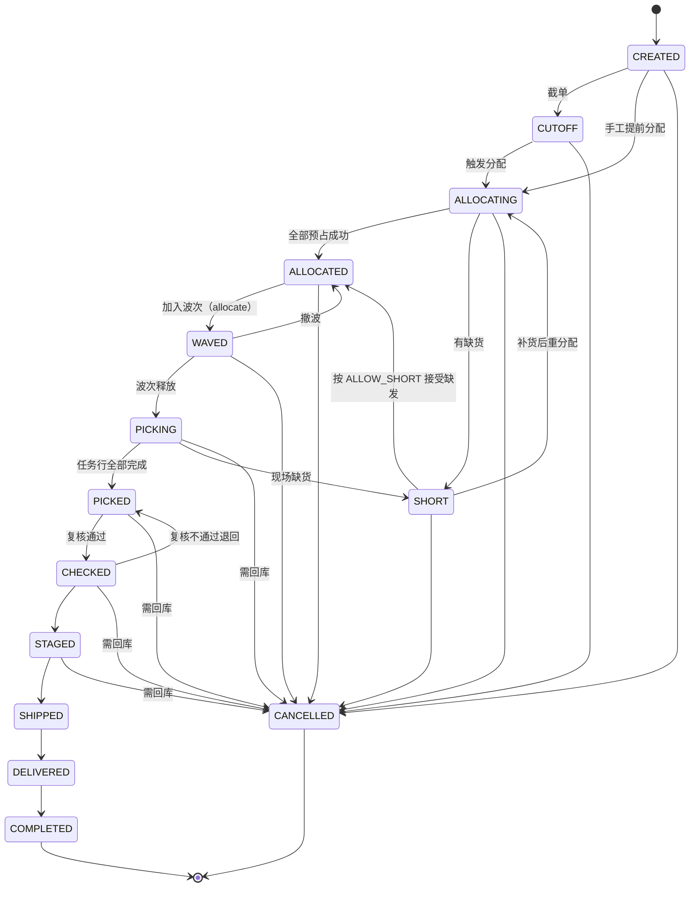
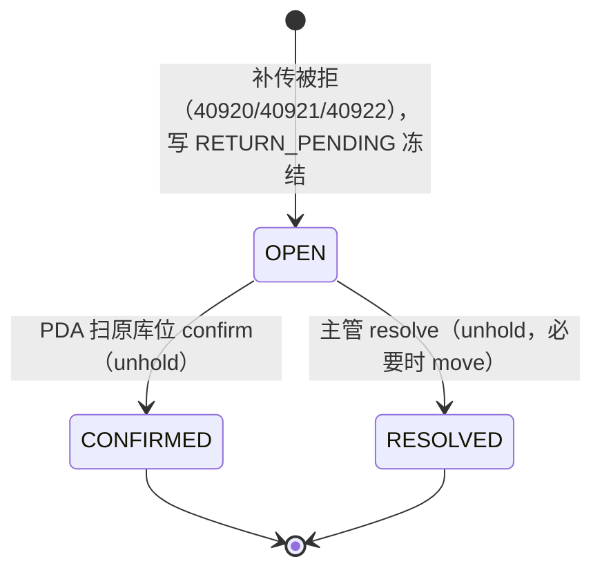
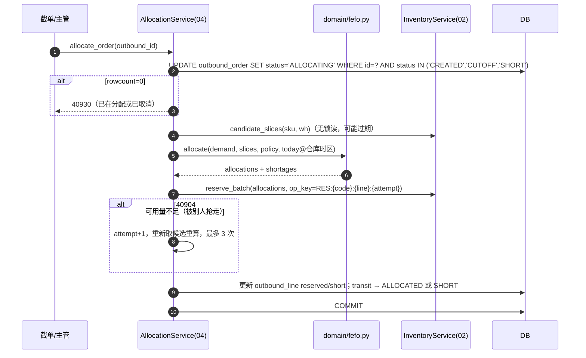
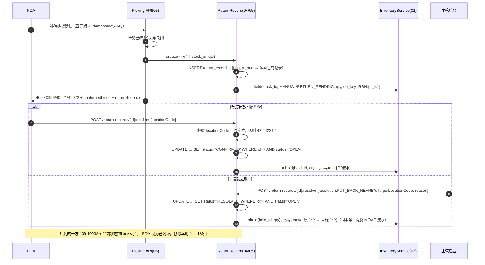

# 04 出库与分配 详细设计

| 项 | 内容 |
|---|---|
| 编号 | 04 |
| 作者 | 大肥鱼 |
| 评审 | 小赵（对抗评审，§13）、非作者开发 1 名 |
| 基线 | `main@8ed5f0c`，[原说明书](archive/WMS详细设计说明书.md) §3.5、§4.4、§5.2、§6.2、§6.3 |
| 依赖 | 00 总体设计；02 库存核心（`candidate_slices`、`reserve_batch`、`allocate`、`release`、`hold`、`unhold`、`move`）；05 波次与拣货 |
| 状态 | 草稿，首个设计 PR |

---

## 1. 职责与边界

### 1.1 负责

1. 出库单接单（上游推单、手工建单），按 `(source_system, source_order_no)` 幂等。
2. 出库单状态机（§5.1）。
3. **FEFO 分配**：排序、过滤、贪心分配、缺货判定、越权分配审计（`domain/fefo.py`）。
4. 编排第 2 篇的原语：预占、预占转分配、释放。
5. 取消、缺货、重分配。
6. **待回库记录**（`return_record`）的库存口径和接口契约：生成时冻结、confirm、resolve、并发闭环（§7.3）。表和 PDA 交互由第 5 篇定义，本篇定库存和并发规则，两篇必须一致。

### 1.2 不负责

| 不做 | 归属 |
|---|---|
| 库存余额、流水、条件 UPDATE 的实现 | 02 |
| 聚波规则、拣货任务生成、任务领取、PDA 拣货确认 | 05 |
| 复核、装箱、发货 | 06 |
| 补货任务的执行 | 07（本篇只触发补货需求） |

### 1.3 与原文档的差异

| # | 原文档 | 本篇 | 原因 |
|---|---|---|---|
| Δ1 | `outbound_line` 数量 `NUMERIC(14,3)` | `*_qty_milli BIGINT` | 00 R2 |
| Δ2 | 状态图里有 `CUTOFF`，迁移表里 `CREATED` 却不能到 `CUTOFF`；图里 `PICKED→CANCELLED`，表里还允许 `PICKING→CANCELLED`，`CHECKED/STAGED` 取消在 `transit()` 里有处理却不在表里 | 统一成 §5.1 一张表 | 原文档图、表、代码三处不一致 |
| Δ3 | 分配直接扣 `allocated` | 先 `reserve`（接单/截单），波次时 `allocate` | 跟第 2 篇 RESERVE/ALLOCATE 两段对齐 |
| Δ4 | 可用量没有考虑待回库 | 生成待回库记录时写 `RETURN_PENDING` 冻结，FEFO 分配不到 | 小赵评审意见 |
| Δ5 | 错误码 `WMS-xxxxx` | 00 §6.4 | |

---

## 2. 用例

| 编号 | 用例 | 触发者 | 库存原语 |
|---|---|---|---|
| OB1 | 上游推单 / 手工建单 | ERP、商城、客服 | — |
| OB2 | 截单 | 定时任务（仓库 `cutoff_time`） | — |
| OB3 | FEFO 分配（预占） | 截单后自动 / 主管手工 | `candidate_slices` + `reserve_batch` |
| OB4 | 缺货处理（允许缺发 / 整单等齐 / 拆单） | 系统按 `short_ship_policy` | `release`（等齐时） |
| OB5 | 加入波次（预占转分配） | 05 | `allocate` |
| OB6 | 越权分配（指定临期批次或非 FEFO 批次） | 主管 | 同 OB3，记 `allocation_override` |
| OB7 | 取消（拣货前） | 客户 / 客服 | `release` |
| OB8 | 拣货后取消（需回库） | 主管 | 05 的 `REVERSE_PICK` + `release` 余量 |
| OB9 | 预占过期释放 | 定时任务 | `release` |
| OB10 | 离线补传被拒，生成待回库记录 | 05 拣货接口 | `hold(RETURN_PENDING)` |
| OB11 | 待回库 confirm | 分拣员 PDA | `unhold` |
| OB12 | 待回库 resolve（原位 / 就近放回 / 报损转交） | 主管 | `unhold`（+ `move`） |

---

## 3. 领域模型

### 3.1 可用量

跟第 2 篇 §3.2 保持一致：

```
available = on_hand − allocated − reserved − quality_hold − frozen
```

其中 `quality_hold + frozen` 就是所有冻结（`stock_hold` 未结余量），**包括 `RETURN_PENDING`**。简写成 `available = on_hand − 已占用 − 冻结`。FEFO 只看 `available`。

### 3.2 分配输入输出

```python
@dataclass(frozen=True)
class DemandLine:      # 出库行
    outbound_line_id: int; sku_id: int; qty_milli: int
    allow_short: bool; temperature_required: str

@dataclass(frozen=True)
class AllocationPolicy:
    allow_near_expiry: bool = False        # 越权才为 True
    override_lot_ids: tuple[int, ...] = () # 越权指定批次
    pick_from_case_first: bool = True

AllocationResult = (list[Allocation(stock_id, qty_milli, reason)], list[Shortage(sku_id, qty_milli, cause)])
```

`fefo.allocate(demand, supply: list[StockSlice], policy, today_in_wh_tz)` 是**纯函数**，`StockSlice` 来自第 2 篇 §7.3。

### 3.3 FEFO 规则

**过滤**（不满足的切片直接丢掉）：
1. `quality_status ∈ {QUALIFIED, RELEASED}`
2. `expiry_date − today ≥ sku.ship_min_shelf_life`，日期按**仓库时区**算（00 R3）。越权时可以放宽，但必须记 `allocation_override`
3. 库位温区兼容 SKU 和订单的温区要求
4. `location.status ≠ LOCKED`（盘点冻结）
5. `available_qty_milli > 0`

**排序**（原 §4.4）：`expiry_date ASC → production_date ASC → receive_date ASC → zone_type(PICK 优先) → pick_sequence ASC → stock_id ASC`。最后一个键保证结果可复现。

**贪心**：按顺序取 `min(剩余需求, available)`；满足整箱倍数且开了 `pick_from_case_first` 时，同一批次内整箱位优先。拣货位不够、存储位有货时，产生补货需求（交给第 7 篇），这一行记为 `Shortage(cause=NEED_REPLENISH)`。

**不做**组合优化（原 §4.4）。

---

## 4. 涉及的表

### 4.1 `outbound_order`（沿用原 §3.5，改动如下）

- `code`：按 00 §6.2 生成，`OBT-{仓前缀}-{节点号}-{作业日}-{序号}`。
- `total_qty / picked_qty / shipped_qty / short_qty` → `*_qty_milli BIGINT`。
- 新增 `version BIGINT`（条件更新用）、`reserve_expires_at`。
- 约束：`uq_ob_source (source_system, source_order_no)`、`uq_ob_code (code)`、`ck_ob_picker_checker`（`picker_id IS NULL OR checker_id IS NULL OR picker_id <> checker_id`）。

### 4.2 `outbound_line`

| 字段 | 类型 | 说明 |
|---|---|---|
| order_qty_milli / reserved_qty_milli / allocated_qty_milli / picked_qty_milli / shipped_qty_milli / short_qty_milli | BIGINT NOT NULL DEFAULT 0 | 基本单位 milli |
| uom | VARCHAR(16) | 等于 `sku.base_uom` |
| order_uom / order_uom_qty | VARCHAR / VARCHAR | 下单时的作业单位原值，只做展示 |

约束：`ck_obl_int`（整数）、`ck_obl_qty`：`picked + short ≤ order`，`reserved + allocated + picked ≤ order`。数量列改动由本篇 PR 之后的 schema PR 落地（见 Q1）。

### 4.3 `allocation_override`（新增）

`id, outbound_line_id, stock_id, lot_id, qty_milli, rule_broken (NEAR_EXPIRY / NON_FEFO / TEMP_ZONE), reason, operator_id, approved_by, created_at`。只追加。

### 4.4 `return_record`（待回库，第 5 篇建表，本篇定约束）

| 字段 | 说明 |
|---|---|
| id / code | `RR-…` |
| task_id, line_no, device_instance_id, op_seq | PDA 四元组，`uq_rr_pda (task_id, line_no, device_instance_id, op_seq)` |
| reject_code | 40920 / 40921 / 40922 |
| stock_id / location_id / sku_id / lot_id / qty_milli | 被拒收的那一行，原库位就是 `location_id` |
| hold_id | 生成时写的 `RETURN_PENDING` 冻结 |
| status | `OPEN / CONFIRMED / RESOLVED` |
| resolution | `PUT_BACK_ORIGIN / PUT_BACK_NEARBY / SCRAP_HANDOVER`（仅 RESOLVED） |
| target_location_id | 就近放回的目标库位 |
| closed_by / closed_at / version | 处理人、处理时间 |
| payload | 被拒的原始请求，留证据 |

---

## 5. 状态机

### 5.1 出库单



| from → to | 触发者 | 守卫 | 副作用（同事务） |
|---|---|---|---|
| CUTOFF → ALLOCATING | 定时 / 主管 | — | 无 |
| ALLOCATING → ALLOCATED / SHORT | 分配服务 | — | `reserve_batch` |
| ALLOCATED → WAVED | 05 | — | `allocate` |
| WAVED → ALLOCATED | 主管撤波 | 任务都没有被领取 | ALLOCATE 释放、重新 RESERVE |
| * → CANCELLED（拣货前） | 客服 | — | `release` 所有占用余量；通知 05 取消任务（PDA 会收到 40921） |
| PICKING/PICKED/CHECKED/STAGED → CANCELLED | 主管 | `outbound.order.cancel_after_pick` + 原因 | 05 生成回库任务，已拣部分走 `REVERSE_PICK`；未拣占用 `release` |
| SHIPPED 之后 | — | 不允许取消，只能红冲 | — |

迁移用条件更新 `WHERE status=:from`，失败返回 **40930**。

### 5.2 待回库记录



---

## 6. 核心流程

### 6.1 分配



`attempt` 只在上一次整批失败、事务已回滚后才递增，所以同一个 `op_key` 不会对应两笔成功的占用。

### 6.2 补传被拒 → 待回库 → 闭环



**顺序要求**：resolve 就近放回时，必须**先 `unhold` 再 `move`**。第 2 篇 `move` 的来源条件是 `available ≥ q`，`RETURN_PENDING` 冻结没释放之前，可用量里不含这部分，直接 move 会失败（40904）。

---

## 7. 接口清单与契约

### 7.1 出库单

| 方法 | 路径 | 说明 | 权限点 |
|---|---|---|---|
| POST | `/api/v1/outbound-orders` | 建单，上游重推返回 200 + 已有单号 | `outbound.order.create` |
| GET | `/api/v1/outbound-orders` | 列表 | `outbound.order.view` |
| GET | `/api/v1/outbound-orders/{id}` | 详情（含占用明细、分配理由） | `outbound.order.view` |
| POST | `/api/v1/outbound-orders/{id}/allocate` | 手工触发分配 | `outbound.order.allocate` |
| POST | `/api/v1/outbound-orders/{id}/allocate-override` | 越权分配，必填 `reason`、`lots` | `outbound.allocation.override` |
| POST | `/api/v1/outbound-orders/{id}/cancel` | 取消；拣货后取消必填 `reason` | `outbound.order.cancel` / `outbound.order.cancel_after_pick` |
| GET | `/api/v1/outbound-orders/{id}/shortages` | 缺货明细 | `outbound.order.view` |

**建单契约**：

```json
{ "source_system": "ERP", "source_order_no": "SO-778812", "customer_id": 31,
  "required_delivery_date": "2026-10-16", "short_ship_policy": "ALLOW_SHORT",
  "lines": [ { "line_no": 1, "sku_code": "APL-80-5KG", "qty": "12.500", "uom": "KG" } ] }
```

`qty` 是字符串，`"12.5001"` 返回 400 `40010`。响应里的数量都是 3 位小数字符串。

**分配结果**（`GET …/{id}` 的 `allocations`）：

```json
{ "stock_id": 8812, "lot_code": "LOT-1008", "expiry_date": "2026-10-20", "qty": "10.000",
  "reason": "FEFO: 效期最早，拣货位" }
```

### 7.2 错误码（本篇使用）

| 码 | 场景 |
|---|---|
| 40010 | 数量格式 |
| 40904 | 预占时可用量不足（内部重试 3 次后仍失败则转缺货，不对外抛） |
| 40930 | 非法状态流转 |
| 40931 | 单据已锁定（如已进波次时改行） |
| 40940 | 越权分配缺少原因 |
| 40932 | RECORD_ALREADY_CLOSED：待回库 confirm/resolve 并发的后到方，`detail{status, closed_by, closed_at}`；不用 40930 |
| 40910 | 同一 `Idempotency-Key` 不同请求体（`key_type=IDEMPOTENCY_KEY`），或同一四元组不同数量（`key_type=PDA_OP`） |
| 42214 | 超拣：`confirmed_qty_milli + :qty <= planned_qty_milli` 条件更新 0 行（第 5 篇拣货确认，与去重、流水同事务） |
| 40311 | `X-Warehouse-Id` 不在用户权限内，或与资源所属仓不一致 |
| 42212 | 待回库 confirm 扫到的库位不是原库位 |
| 42213 | resolve 就近放回时目标库位温区不符，或原库位被盘点冻结 |

### 7.3 待回库接口（路径与第 5 篇、第 14 篇 §9.4.2 一致）

| 方法 | 路径 | 说明 | 权限点 |
|---|---|---|---|
| GET | `/api/v1/return-records?status=OPEN&warehouseId=…` | 主管看板，分页 | `picking.return_record.view` |
| GET | `/api/v1/return-records/{returnRecordId}` | PDA 查红条状态 | 记录的原拣货人 或 `picking.return_record.view` |
| POST | `/api/v1/return-records/{returnRecordId}/confirm` | 扫库位确认回库，带 `Idempotency-Key`、`locationCode` | 记录的原拣货人 |
| POST | `/api/v1/return-records/{returnRecordId}/resolve` | 主管处理，必填 `resolution`、`reason`；就近放回必填 `targetLocationCode` | `picking.return_record.resolve` |

**规则（已拍板）**：

1. **生成即冻结**：同事务写 `stock_hold(hold_type=MANUAL, reason_code=RETURN_PENDING, source_type=RETURN_RECORD)`，数量 = 被拒收数量。这部分不进 `available`，FEFO 分配不到。
2. **按四元组幂等**：同一行重复被拒，返回已有 `returnRecordId`，不新建记录、不重复冻结（冻结的 `op_key = RRH:{rr_id}`）。
3. **confirm 只改状态，不写库存流水**：被拒收的行服务端从来没扣过库存。confirm = `OPEN → CONFIRMED` + 释放冻结。
4. **库位不对返回 422（42212）**，记录保持 OPEN，PDA 红条保留并提示重新扫码。PDA 不做就近放回判断。
5. **只有主管 resolve 选"就近放回"才写流水**：释放冻结后，从原库位到目标库位走一次第 2 篇标准 `move`（两腿 `MOVE` 流水）。原库位被盘点冻结或目标库位温区不符 → 422（42213），记录保持 OPEN，不移库。
6. **并发闭环**：confirm 和 resolve 都是 `UPDATE return_record SET status=… WHERE id=? AND status='OPEN'`。后到的一方返回 **409 `40932 RECORD_ALREADY_CLOSED`**，`detail` 必带 `{status, closed_by, closed_at}`（40930 只表示通用非法状态流转，这里不用）；**PDA 收到后当作已闭环**，删除本地 `failed` 条目。
7. 状态更新、释放冻结、移库在**同一事务**里，任何一步失败整体回滚。

confirm 成功响应：

```json
{ "code": "0", "data": { "returnRecordId": 9001, "status": "CONFIRMED",
  "closed_by": 2031, "closed_at": "2026-10-15T01:12:09Z" } }
```

---

## 8. 并发与幂等

| 场景 | 防线 |
|---|---|
| 两次分配同一单 | 状态条件更新 `WHERE status IN (…)`；`op_key` 唯一 |
| 两个单抢同一批次 | `reserve_batch` 条件 UPDATE，输的一方重新取候选重算 |
| 分配与取消并发 | 两者都先做状态条件更新，只有一个成功；取消在分配之后到达时，按已有占用释放 |
| 预占过期释放与 allocate 并发 | 第 2 篇：只有一方成功，输的一方 40905 |
| 上游重推 | `uq_ob_source` |
| 同一行重复补传被拒 | `uq_rr_pda` |
| confirm 与 resolve 并发 | `WHERE status='OPEN'`，后到 40932 |
| confirm 重试 | `Idempotency-Key`；Key 过期后再次 confirm 也只会拿到 40932，PDA 同样视为闭环 |
| confirm 扫错库位后重扫 | 422 不进幂等缓存（00 §6.5），同一个 key 重扫正确库位可以成功 |
| 同一四元组不同数量 | 40910，`key_type=PDA_OP` |
| 超拣 | 42214，条件更新 `confirmed + q ≤ planned`，跟去重、流水同事务 |
| 跨仓操作 | `X-Warehouse-Id` 与资源（出库单、待回库记录）所属仓不一致 → 403 40311 |

多行库存操作按 `stock_id` 升序（第 2 篇 §8.2）。

## 9. 异常与补偿

| 场景 | 处理 |
|---|---|
| 分配 3 次仍抢不到 | 转 SHORT，按 `short_ship_policy` 处理，记缺货原因 |
| 拣货位不够、存储位有货 | 记 `NEED_REPLENISH`，触发第 7 篇补货，补货完成后重分配 |
| 已拣后取消 | 05 生成回库任务，`REVERSE_PICK` 入账；未拣部分 `release` |
| 待回库长期 OPEN | 超过 4 小时看板标红，超过 1 个作业日推主管告警；冻结一直保留，宁可少卖不超卖 |
| 就近放回 move 失败 | 整个事务回滚，记录保持 OPEN，冻结保留 |
| 待回库生成时冻结失败（可用量已不够） | 说明账实已经不一致，**照样生成记录**但不冻结，标 `hold_failed`，并写 `stock_recon_alert`，主管必须人工处理（Q3） |

## 10. 权限

| 权限点 | 角色 |
|---|---|
| outbound.order.view / create / allocate / cancel | 客服、仓管 |
| outbound.order.cancel_after_pick | 主管 |
| outbound.allocation.override | 主管（越权分配全部写 `allocation_override` + `audit_log`） |
| picking.return_record.view / resolve | 主管 |

confirm 只允许记录的原拣货人（或接手任务的人）调用。resolve 不能由记录的原拣货人自己做（SoD）。

## 11. 测试要点

1. FEFO 纯函数：原附录 A 的序列 `LOT-1008 → LOT-1008 → LOT-1012 → LOT-1014`；禁发期边界（仓库时区跨日）；温区不兼容；LOCKED 库位；`RETURN_PENDING` 冻结后同一批次不再被分配。
2. 状态机穷举：所有 `(from, to)` 组合。
3. 并发：两单同时抢最后 1000 milli；分配与取消交错 200 轮，最后校验 I2/I3。
4. 待回库：同四元组重复被拒只有 1 条记录 1 个冻结；confirm/resolve 并发 200 轮只有一个成功，且冻结只释放一次；扫错库位 422 后再扫对能闭环；就近放回只产生一对 MOVE 流水；confirm 不产生流水。
5. 双库矩阵。

## 12. 待定问题

| # | 问题 | 建议 | 裁决人 |
|---|---|---|---|
| Q1 | `outbound_line` 数量列改 milli 的 DDL 放在哪个 PR | 第 5 篇 PR 一起改出库/拣货表 | 大肥鱼 |
| Q2 | 预占默认过期时长（第 2 篇 Q8） | 作业日截单时间 + 2 小时 | 大肥鱼 |
| Q3 | 冻结失败时仍生成待回库记录是否可接受 | 可接受，必须告警 | 小赵评 |
| Q4 | `RETURN_PENDING` 用 `hold_type=MANUAL` 计入 `frozen`，解冻人 ≠ 冻结人的 SoD 规则对系统冻结是否豁免 | 系统冻结（`operator_id=0`）豁免 | 小钱 |

## 13. 对抗评审攻击面（给小赵）

| # | 攻击面 | 打法 | 防线 |
|---|---|---|---|
| B-A1 | 同一批次被多单同时抢 | 50 单并发分配同一 SKU 最后一批 | 条件 UPDATE + 重算 |
| B-A2 | FEFO 临期边界 | 效期恰好等于禁发天数；UTC 跟仓库时区跨日 | 仓库时区计算 |
| B-A3 | 分配后批次被冻结 / 库位被锁 | 分配完成到波次 allocate 之间盘点冻结 | `allocate` 只改占用不看库位，**拣货时**由 05 校验，需要确认是否足够 |
| B-A4 | 取消与分配、取消与波次交错 | 状态条件更新 | |
| B-A5 | 待回库冻结泄漏 | 记录闭环但冻结没释放；重复被拒重复冻结；resolve 失败回滚后冻结状态 | 同事务 + `op_key` |
| B-A6 | confirm/resolve 竞争 | 同时提交；confirm 重试晚于 Key 过期 | `status='OPEN'` 条件更新 + 40932 |
| B-A7 | 就近放回绕过盘点冻结和温区 | 原库位 LOCKED；目标库位温区不符 | 422 42213 |
| B-A8 | 越权分配无审计 | 直接调 `allocate` 原语绕开 override | 原语没有 HTTP 入口；override 只有一个接口 |
| B-A9 | 状态机漏洞 | 撤波时任务已被领取；SHIPPED 后取消 | 守卫条件 + 40930 |
| B-A10 | 越权 | 非原拣货人 confirm；原拣货人自己 resolve；用 A 仓的 `X-Warehouse-Id` 操作 B 仓的记录 | §10；40311 |
| B-A11 | 超拣 | 同一行并发确认，总量超过计划量；四元组相同数量不同 | 42214；40910 PDA_OP |
