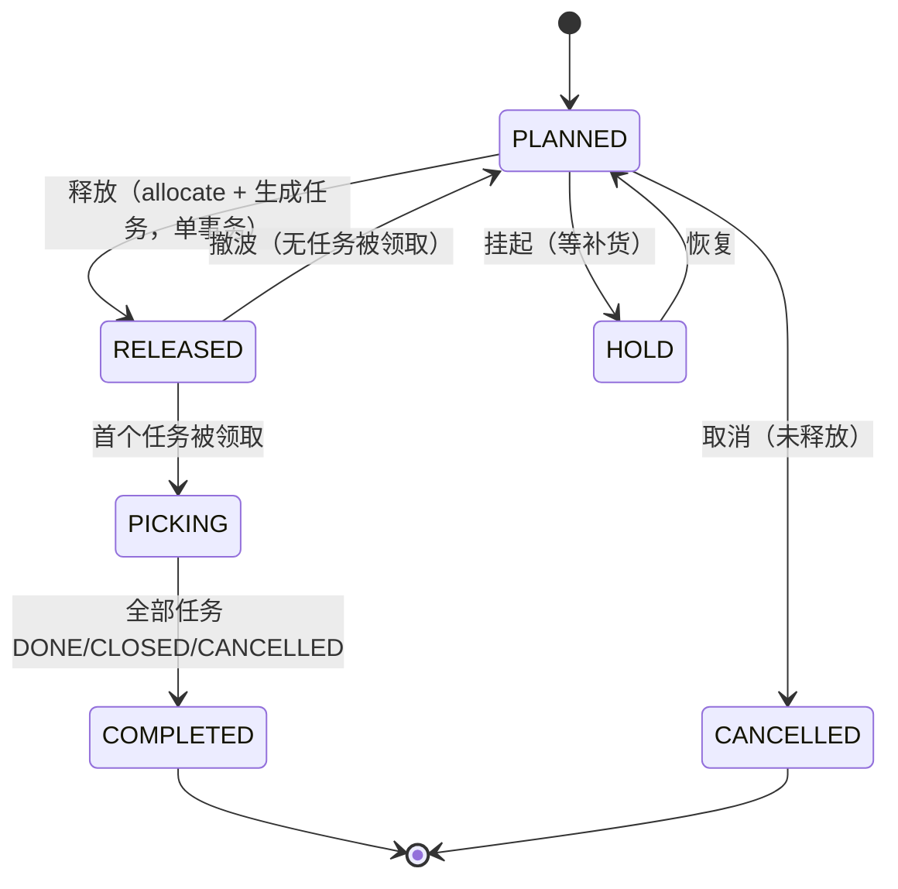
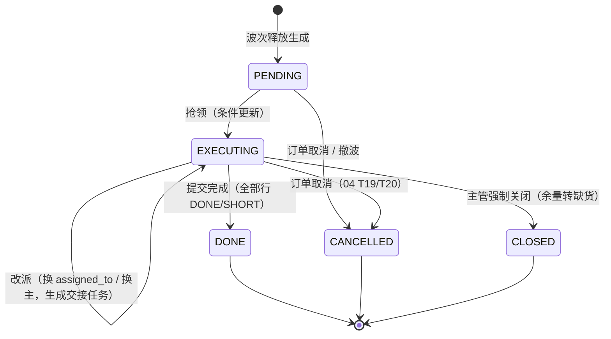
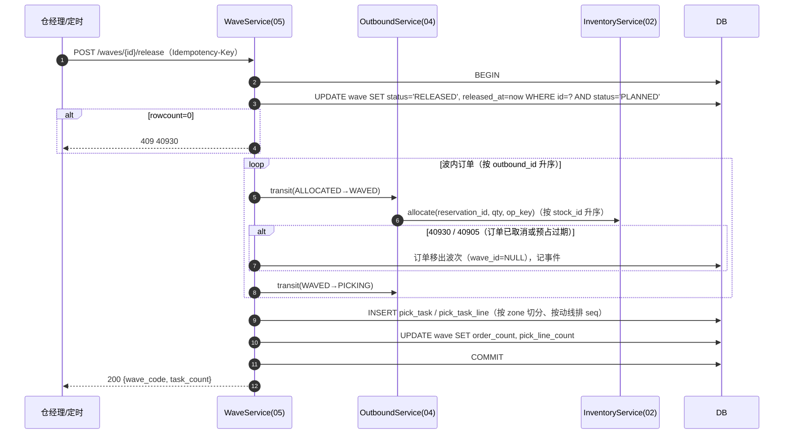
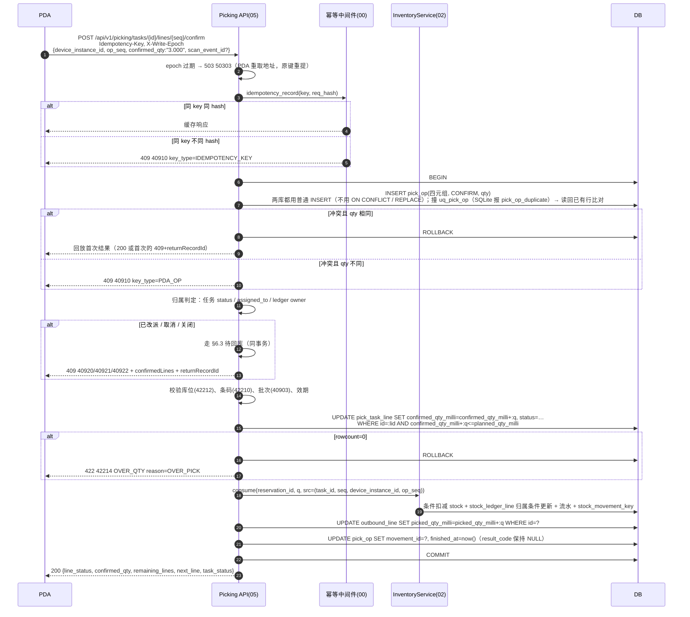
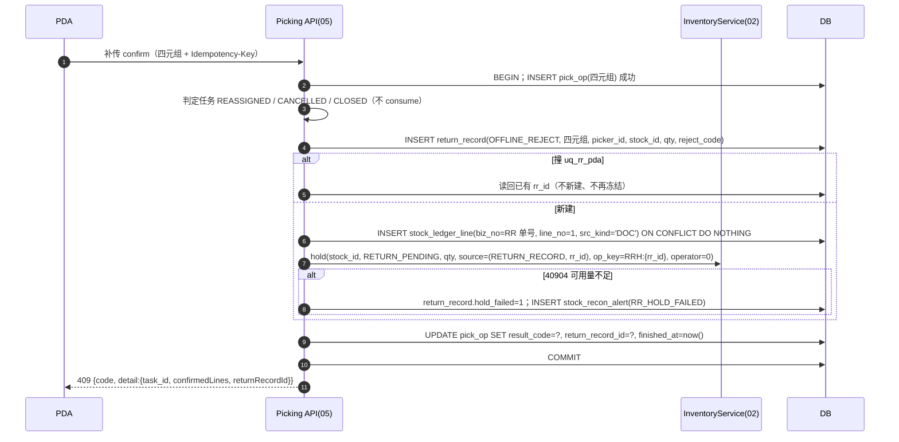
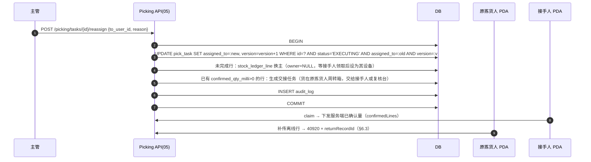
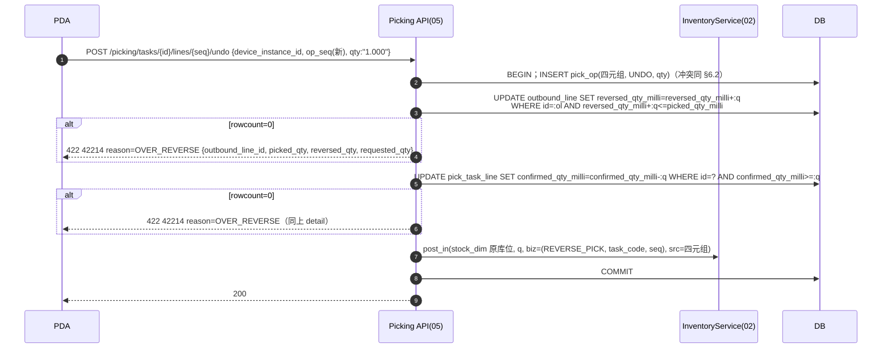

# 05 波次与拣货 详细设计

| 项 | 内容 |
|---|---|
| 编号 | 05 |
| 作者 | 小李 |
| 评审 | 主审 小赵（对抗评审，§13）；第二评审 小吴 |
| 基线 | `docs/first-design@218d33e`；[原说明书](archive/WMS详细设计说明书.md) §3.5（pick_task_line）、§4.5、§4.6、§5.3、§5.4、§6.2、§6.3 |
| 依赖 | 00 总体设计（§6.3 数量、§6.4 错误码、§6.5 幂等、§9.1 写节点 epoch）；02 库存核心（`allocate`、`consume`、`post_in`、`hold`、`release_return_hold`、`stock_ledger_line` 持有设备，§8.4、§8.5）；04 出库与分配（聚波输入、FEFO 分配结果、`reversed_qty_milli`、待回库 §7.3） |
| 状态 | 草稿。本篇只加文档，不改 schema；需要新增的表/约束列在 §4.5 和 §12，待 #2 合并后单独提 schema PR |

---

## 1. 职责与边界

### 1.1 负责

1. **聚波**：把 04 交来的 `ALLOCATED` 出库单按聚波维度组成波次，容量超限拆子波次。
2. **波次状态机**与释放；释放时编排 02 `allocate`（RESERVE→ALLOCATE，04 T7），并生成拣货任务。
3. **拣货任务**：生成、领取（抢领条件更新，40923）、改派、取消、关闭。
4. **PDA 拣货确认 / 报缺 / 撤销拣货**：两层去重（`Idempotency-Key` + 四元组）、防超拣（42214 `OVER_QTY`，`reason=OVER_PICK`）、撤销上限（42214 `OVER_QTY`，`reason=OVER_REVERSE`）。
5. **离线补传被拒**：任务已改派/取消/关闭时拒收离线行，按四元组幂等生成待回库记录（`OFFLINE_REJECT`），同事务写 `RETURN_PENDING` 冻结。
6. **`return_record` 表的建表**（04 §4.4 定约束，本篇落字段与索引）。
7. 任务完成后推进出库单 `WAVED→PICKING→PICKED / SHORT`（04 T9–T11）。

### 1.2 不负责

| 不做 | 归属 |
|---|---|
| FEFO 排序、过滤、贪心分配、预占 | 04 |
| 库存余额、流水、条件 UPDATE、冻结明细的实现 | 02 |
| 待回库 confirm / resolve / putback-ack 的接口契约与并发规则 | **04 §7.3**（本篇只引用，不重新定义） |
| 复核、装箱、发货 | 06 |
| 补货任务执行（`pick_task.task_type='REPLENISH'` 复用表，流程在 07） | 07 |
| 盘点期间流水口径 | 08 |
| PDA 端页面、本地队列、红条交互 | 14 |

### 1.3 与原文档的差异

| # | 原文档 | 本篇 | 原因 |
|---|---|---|---|
| Δ1 | `plan_qty / plan_qty_base / actual_qty NUMERIC` | `planned_qty_milli / confirmed_qty_milli BIGINT`（schema 已落，`ck_ptl_qty`） | 00 §6.3、04 Δ1 |
| Δ2 | 释放后才生成 `allocated` | 释放时 `allocate` 把 04 已有的 RESERVE 转 ALLOCATE，不重新分配 | 02/04 两段占用 |
| Δ3 | 记账幂等 key `{biz_type}:{biz_no}:{line_no}:{op_seq}` | 四元组 `(task_id, line_no, device_instance_id, op_seq)` + `stock_movement_key.uq_mvk_pda_op` | 00 §6.5、02 §8.4 |
| Δ4 | 错误码 `WMS-50001/50002/40903` | 40923 / 42210 / 40903（00 §6.4） | 00 §6.4 |
| Δ5 | "行状态非 PENDING 时幂等返回" | 改为四元组回放；行状态只做展示和完成判定 | 部分确认、计件模式下一行要多次确认 |
| Δ6 | 撤销"30 秒内"只是交互约定 | 撤销用新 `op_seq`，写 `REVERSE_PICK`，与 04 RR 回冲共用 `reversed_qty_milli` 上限；30 秒仍是 PDA 端默认窗口，主管可越过（`picking.task.undo_any`） | 04 §6.3 |
| Δ7 | 离线补传"服务端靠 idempotency_key 去重" | 补传先过归属判定：任务已改派/取消/关闭则拒收（40920/40921/40922）+ 待回库 | 02 §8.5 |

---

## 2. 用例

| 编号 | 用例 | 触发者 | 库存原语 |
|---|---|---|---|
| WP1 | 生成波次（定时 / 手工勾单 / 阈值） | 定时任务、仓经理 | — |
| WP2 | 拆波（容量超限，`parent_wave_id`） | 系统 | — |
| WP3 | 释放波次：生成拣货任务 + 出库单 `ALLOCATED→WAVED→PICKING` | 仓经理 / 定时 | `allocate` |
| WP4 | 挂起 / 恢复 / 撤波（撤波=04 T8） | 主管 | 撤波：ALLOCATE 释放后重新 RESERVE（04 T8） |
| WP5 | 抢领任务 | 分拣员 PDA | — |
| WP6 | 任务预下载（离线包） | PDA | 只读 |
| WP7 | 拣货确认（含计件模式） | 分拣员 PDA | `consume` |
| WP8 | 报缺（选原因，行置 SHORT） | 分拣员 PDA | `release`（未拣余量，按 04 缺货策略） |
| WP9 | 撤销拣货 | 分拣员（30s 内）/ 主管 | `post_in(REVERSE_PICK)` |
| WP10 | 改派任务（生成交接任务） | 主管 | — （持有设备换主） |
| WP11 | 取消任务（04 T19/T20 通知） | 系统 / 主管 | `release` 未拣余量 |
| WP12 | 关闭任务（强制结束，余量转缺货） | 主管 | `release` |
| WP13 | 离线补传被拒 → 待回库 | PDA 补传 | `hold(RETURN_PENDING)` |
| WP14 | 提交任务完成 | 分拣员 | — |

---

## 3. 领域模型

### 3.1 波次

- 聚波维度（同一波次内一致，原 §5.3）：`warehouse_id + work_date + temperature_zone + route_code + carrier_code`。schema 中 `wave` 已有这五列。
- 入波条件：出库单 `status='ALLOCATED'`（04 T7 的前置），且 `wave_id IS NULL`。**波次不做分配**，FEFO 结果（`stock_reservation` 的 RESERVE 占用，键 `RES:{单号}:{行号}:{alloc_round}:{stock_id}`）原样继承，以 04 为准。
- 容量：`max_order_count`（默认 200）、`max_pick_lines`（默认 1500）；超限拆子波次，`parent_wave_id` 指向原波。容量参数存仓库级配置表 `wave_capacity_config`，按 `(warehouse_id, wave_type)` 唯一（`wave_type` 与 `wave.wave_type` 同一取值集），不放主数据（Q7 已定，见 §4.1）；某仓某类型无配置时用上述默认值。
- `wave_type`：`NORMAL / URGENT / REPLENISH_FIRST`，必填（`ck_wave_type`），决定取哪条容量配置；与拣货方式无关。
- `pick_strategy`：`DISCRETE / BATCH（默认）/ ZONE / WAVE_AND_SPIT`，只决定拣货方式，不参与容量配置。

### 3.2 拣货任务与任务行

- 一个任务 = 一个分拣员一次走完的动线，按 `zone_id` 切分；任务行按 `pick_task_line.seq`（动线顺序）排列。
- **任务行粒度 = 一条 RESERVE→ALLOCATE 占用**：`(outbound_line_id, stock_id)` 一行，`planned_qty_milli` = 该占用量。`BATCH` 合并拣只在 PDA **展示层**按 `(location_id, sku_id, lot_id)` 合并成一个拣货动作，服务端仍按行确认，这样 `outbound_line_id` 恒有值，确认和撤销能准确落到出库行的 `picked_qty_milli / reversed_qty_milli`（schema 已改为 `outbound_line_id NOT NULL`，Q3 已定）。
- **四元组中的 `line_no` = `pick_task_line.seq`**（02 §8.4 映射；记账 `biz_no` = 任务单号 `pick_task.code`）。

### 3.3 数量

- 库内一律 `BIGINT *_qty_milli`（SKU 基本单位千分之一）。接口为三位小数字符串（`"3.000"`），按 `sku.base_uom`；入参超过 3 位小数返回 **400 `40010`，不舍入**。应用层只绑定 `int`（02 Q7）。
- 作业单位换算（箱→KG）在服务端完成，换算后不是整数 milli 同样 40010。

### 3.3a 时间

本篇所有时间列（`claimed_at`、`started_at`、`finished_at`、`released_at`、`completed_at`、`closed_at`、`putback_acked_at`、`handover_confirmed_at`、`pick_op.finished_at` 等）一律存 **UTC**（00 R3），列类型为不带时区的 `TIMESTAMP`，应用层写入前转 UTC；`work_date` 等业务日期按 `warehouse.timezone` 计算。接口出参返回 ISO 8601 带 `Z`。

### 3.4 PDA 身份

- `device_instance_id`：PDA 装机时生成并持久化，重装/换机即换新。
- `op_seq`：PDA 按**任务行**单调递增，重试保持不变；确认、撤销都消耗 `op_seq`。
- 计件模式（逐件扫码）：每次扫码带唯一 `scan_event_id`，每次扫码一个 `op_seq`；**去抖只对非计件模式生效**（非计件同一行 800ms 内重复扫码 PDA 端丢弃），计件模式不得去抖，否则真实的连续两件会被吞掉。

---

## 4. 涉及的表

约束名以建表脚本为准。

### 4.1 `wave`（schema 已有）

`id, code(uq_wave_code), warehouse_id, work_date, temperature_zone, route_code, carrier_code, pick_strategy DEFAULT 'BATCH', wave_type NOT NULL, status DEFAULT 'PLANNED', order_count, pick_line_count, parent_wave_id, released_at, completed_at, created_by, created_at, updated_at`；索引 `ix_wave_wh (warehouse_id, status, work_date DESC)`。

- `status ∈ {PLANNED, RELEASED, PICKING, COMPLETED, HOLD, CANCELLED}`。约束 `ck_wave_status`；新增 `version` 列（Q4 已定）。本篇迁移一律 `WHERE id=? AND status=:from AND version=:v`，成功后 `version=version+1`。
- 出库单挂波：`outbound_order.wave_id`，索引 `ix_obo_wave`。挂波只做预检查（状态、聚波维度、容量），**不占库存**；04 T7/T9 都在释放（W1）时触发（Q8 已定）。

**`wave_capacity_config`**（Q7 新增）：`id, warehouse_id, wave_type, max_order_count, max_pick_lines, version, updated_by, updated_at`；`uq_wcc (warehouse_id, wave_type)`；`ck_wcc_type`：`wave_type ∈ {NORMAL, URGENT, REPLENISH_FIRST}`（与 `ck_wave_type` 同）；`ck_wcc_cap`：两个上限都 > 0。主管改配置用 `version` 条件更新；`wms_app` 可 SELECT/INSERT/UPDATE，不可 DELETE。

### 4.2 `pick_task`（schema 已有）

`id, code(uq_pt_code), wave_id, warehouse_id, task_type(PICK/REPLENISH), zone_id, status DEFAULT 'PENDING', assigned_to, claimed_at, started_at, finished_at, line_count, done_count, version, created_at, updated_at`；索引 `ix_pt_claim (wave_id, status, zone_id) WHERE status='PENDING'`、`ix_pt_mine (assigned_to, status)`。

- 状态集 `PENDING/EXECUTING/DONE/ABNORMAL/CANCELLED/CLOSED`，约束 `ck_pt_status`；`CLOSED` 即主管强制关闭（40922），**终态**：`trg_pt_guard` 拒绝 `CLOSED → 其他`（`pick_task_closed_terminal`，两库）。
- `task_type ∈ {PICK, REPLENISH}`（`ck_pt_type`），补货（第 7 篇）复用本表；写入后不可改（`pick_task_type_immutable`）。`wave_id` 可空，但 `ck_pt_wave`：只有 `REPLENISH` 可以不挂波次。
- `ck_pt_exec`：`EXECUTING` 必须同时有 `assigned_to` 和 `device_instance_id`。
- 新增列（Q4、Q5 已定）：`device_instance_id`（当前持有设备，判定 40920 用；记账归属的权威仍是 `stock_ledger_line.owner_device_instance_id`）、`handover_from_task_id`（交接任务来源，`ck_pt_handover` 禁止指向自身）。改派同时写 `audit_log`。

### 4.3 `pick_task_line`（schema 已有）

| 字段 | 说明 |
|---|---|
| pick_task_id, seq | `uq_ptl (pick_task_id, seq)`；`seq` 即四元组 `line_no` |
| location_id, sku_id, lot_id, stock_id | 精确到批次和库位 |
| task_type | 冗余父任务的 `task_type`（默认 `PICK`）；`trg_ptl_type` 两库都在插入/改 `pick_task_id、task_type` 时校验与父任务一致（`ptl_task_type_mismatch`），父任务 `task_type` 又不可改，所以行上的值恒等于父任务 |
| outbound_line_id | `ck_ptl_obl`：`PICK` 行必填（§3.2，Q3）；`REPLENISH` 行为空。选冗余列 + 触发器而不是纯触发器，是为了让"拣货行必有出库行"留在 CHECK 里，两库一样可见、可测 |
| planned_qty_milli | 应拣量 |
| confirmed_qty_milli | 已确认量，撤销时减回 |
| uom | 作业单位，仅展示 |
| barcode_expected | 期望条码（主条码）。任务包下发时每行另带 `expected_barcodes[]`，取自**生成任务时**的主数据快照（`sku_barcode`），只供 PDA 离线预校验；上传时服务端按当前主数据重新校验，以服务端为准，不符返回 42210 |
| status | `PENDING / DONE / SHORT / SKIP / ABNORMAL`（原 §3.5；约束 `ck_ptl_status`） |
| short_reason_code | `STOCK_OUT / DAMAGED / EXPIRED / WRONG_LOC / OTHER` |
| scanned_at, override_reason, override_by | |

约束 `ck_ptl_qty`：`planned > 0 AND 0 ≤ confirmed ≤ planned` 且为整数。正常路径靠 §6.2 条件更新返回 42214，撞 CHECK 即 50010。索引 `ix_ptl_loc (location_id, status)`。

### 4.4 引用的 02/04 表

| 表 | 本篇用法 |
|---|---|
| `outbound_order` / `outbound_line` | `picked_qty_milli` 累计拣出（撤销不减）；`reversed_qty_milli` 撤销/回冲累计；约束 `ck_obl_int / ck_obl_nonneg / ck_obl_reversed / ck_obl_sum` |
| `stock_reservation` | 拣货 `consume` 按任务行映射到当前 `alloc_round` 的 ALLOCATE 占用 |
| `stock_movement` / `stock_movement_key` | `PICK −1` / `REVERSE_PICK +1`，`src_kind='PDA'`、`op_no=0`、`leg=1`；`uq_mvk_pda_op (src_task_id, src_line_no, device_instance_id, src_op_seq, leg)`；`idempotency_key = {task_code}:{seq}:P{device_instance_id}.{op_seq}:1` |
| `stock_ledger_line` | `(biz_no=task_code, line_no=seq, src_kind='PDA', owner_device_instance_id)`；领取/改派时条件更新换主；`trg_mvk_line_kind` 拒绝非持有设备（`ledger_line_owner_mismatch`）；待回库 RR 单号占 `DOC` 行（所有类型统一预建，Q14） |
| `stock_hold` | `RETURN_PENDING`：`reason_code='RETURN_PENDING'`、`source_type='RETURN_RECORD'`、`source_id=rr_id`、`op_key='RRH:{rr_id}'`、`operator_id=0`（`ck_hold_return`、`uq_hold_return`、`uq_hold_op`；`trg_hold_immutable`）。写入一律普通 `INSERT`，**不用** `ON CONFLICT DO NOTHING` / `INSERT OR IGNORE`（02 §4.3：SQLite `trg_hold_no_replace` 先于冲突处理报 `hold_duplicate`）；重试撞 `uq_hold_op`（PG）/ `hold_duplicate`（SQLite）走按 `op_key` 查回的幂等分支 |
| `idempotency_record` | 第一层去重，24h |
| `stock_recon_alert` | `check_code='RR_HOLD_FAILED'`（04 §9）、`RR_HOLD_MISMATCH`（§9 巡检） |

### 4.5 本篇新增（已落两份 schema，Q1/Q2 已定）

**`return_record`**（字段以 04 §4.4 为准）：

| 字段 | 类型 | 说明 |
|---|---|---|
| id / code | BIGINT / VARCHAR(64) | `RR-…`，`uq_rr_code` |
| warehouse_id | BIGINT NOT NULL | 数据权限 |
| source_type | VARCHAR(24) | `OFFLINE_REJECT` / `CANCEL_AFTER_PICK`，`ck_rr_source` |
| task_id, line_no, device_instance_id, op_seq | | `OFFLINE_REJECT` 必填；`uq_rr_pda` 部分唯一 `WHERE source_type='OFFLINE_REJECT'` |
| outbound_line_id, ref_movement_id | | `CANCEL_AFTER_PICK` 时唯一 `uq_rr_cap (outbound_line_id, ref_movement_id)` |
| reject_code | CHAR(5) | `40920/40921/40922`（仅 OFFLINE_REJECT）；`ck_rr_source` 同时校验两类来源的必填字段 |
| picker_id | BIGINT NOT NULL | 原拣货人（confirm/putback-ack 鉴权） |
| stock_id, location_id, sku_id, lot_id, qty_milli | | `ck_rr_qty`：`qty_milli > 0` 且为整数 |
| hold_id, hold_failed | BIGINT / SMALLINT | `ck_rr_hold`：`hold_failed=1` 时 `hold_id` 为空 |
| status | VARCHAR(16) | `OPEN / CONFIRMED / RESOLVED`，`ck_rr_status` |
| resolution | VARCHAR(24) | `CONFIRMED / RETURNED_TO_ORIGINAL / NEARBY_PUTBACK / SCRAP_HANDOVER`；`ck_rr_resolution`：`status='OPEN'` 时为空；`CONFIRMED` 状态恒为 `CONFIRMED`；`RESOLVED` 只能是后三种 |
| target_location_id | BIGINT | `ck_rr_target`：仅 `NEARBY_PUTBACK` 非空且必填 |
| putback_acked_at, putback_acked_by, scrap_doc_id, handover_confirmed_at, handover_confirmed_by | | 04 §4.4、§6.2、§7.2 |
| closed_by, closed_at, version, payload, created_at | | `payload` 存被拒原始请求；`ck_rr_closed`：`CONFIRMED / RESOLVED` 必须有 `closed_by` 和 `closed_at`；`ck_rr_scrap`：`SCRAP_HANDOVER` 必须有 `scrap_doc_id`（04 N2） |

`ck_rr_source`：`OFFLINE_REJECT` 四元组必填；`CANCEL_AFTER_PICK` 四元组必须**全空**。

**写入后不可改（B1、B3，两库触发器 `trg_rr_*`）**：来源、四元组、出库行、原流水、拣货人、库存定位、数量、`payload`、`created_at` 不可改（`rr_immutable`）；`hold_id` 只能 NULL→值一次（建记录与冻结同事务，冻结成功后回填）；状态只能 `OPEN → CONFIRMED / RESOLVED` 单向，关闭后 `status / resolution / target_location_id / scrap_doc_id / hold_id / hold_failed / closed_by / closed_at` 冻结（`rr_closed`）；关闭后只允许各补写一次 `putback_acked_*`（就近放回到位）和 `handover_confirmed_*`（报损交接确认）。不可删除（PG 另有 TRUNCATE 触发器）；SQLite 用 `BEFORE INSERT` 在 `id / code / uq_rr_pda / uq_rr_cap` 已存在时报 `rr_duplicate`，挡住 `INSERT OR REPLACE`、`INSERT … ON CONFLICT DO UPDATE`（UPSERT）和 `OR IGNORE`。`CONFIRMED`、`RESOLVED` 都是终态，互相之间也不能改，不能复活为 `OPEN`。`wave_capacity_config` 在 SQLite 同样有 `BEFORE INSERT`（`wcc_duplicate`），改配置只能走带 `version` 的 UPDATE。

索引：`ix_rr_open (warehouse_id, status, created_at)`（看板）、`ix_rr_picker (picker_id, status)`（PDA 查红条）。

**`pick_op`**（PDA 操作去重，四元组业务唯一键）：

| 字段 | 说明 |
|---|---|
| id | 雪花 |
| task_id, line_no, device_instance_id, op_seq | `uq_pick_op` 四元组唯一，均 NOT NULL |
| op_type | `CONFIRM / UNDO / SHORT`，`ck_pick_op_type` |
| qty_milli | 回放比较用：同四元组同 `op_type` 同数量 → 回放；否则 40910 `detail.key_type=PDA_OP`。`ck_pick_op_qty`：整数，`SHORT` 可为 0，其余 > 0。`wms_app` 只有 `result_code / movement_id / return_record_id / finished_at` 的 UPDATE 列权限 |
| scan_event_id | 计件模式必填，`uq_pick_op_scan (task_id, line_no, scan_event_id) WHERE scan_event_id IS NOT NULL` |
| result_code, movement_id, return_record_id, finished_at | 回放用的首次结果，**一次写入**：成功时 `result_code` 为 NULL（带 `movement_id`），失败时为 5 位错误码（`ck_pick_op_result`，如 40920/40921/40922）；`ck_pick_op_finish`：`finished_at` 为空时三列必须全空。`finished_at` 非空后整行冻结 |
| created_at | 不过期（与流水同寿命，按月归档） |

**写入后不可改（B1、B2，两库触发器 `trg_pick_op_*`）**：四元组、`op_type`、`qty_milli`、`scan_event_id`、`created_at` 不可改；`finished_at` 非空后任何列都不可改；不可删（`pick_op_immutable`）。SQLite 另有 `BEFORE INSERT`：`id`、四元组或 `(task_id, line_no, scan_event_id)` 已存在时报 `pick_op_duplicate`，挡住 `INSERT OR REPLACE` / `OR IGNORE`。所以 §6.2 的去重插入在 PG 用 `ON CONFLICT DO NOTHING` 判 rowcount，**在 SQLite 用普通 `INSERT` 并捕获 `pick_op_duplicate`**，两种都再读回首次行比对（S4）。

为什么需要独立表：`stock_movement_key` 只在**记账成功**时才有行，拒收（待回库）和报缺不产生流水；"同四元组不同数量"需要比对首次数量；Key 过期（24h）后仍要回放。`pick_op` 与流水同事务写入，四元组与 `uq_mvk_pda_op` 一一对应（`leg=1`）。

---

## 5. 状态机

### 5.1 波次



| # | from → to | 守卫 | 副作用（同事务） |
|---|---|---|---|
| W1 | PLANNED → RELEASED | 波内全部订单仍为 `ALLOCATED` | 每单 04 T7 `ALLOCATED→WAVED`（`allocate`），随后 T9 `WAVED→PICKING`；生成 `pick_task` / `pick_task_line`；写 `released_at`。任一订单迁移失败（被取消/过期）→ 把该单移出波次后重试，不整波失败 |
| W2 | PLANNED → CANCELLED | — | 订单 `wave_id` 置空 |
| W3 | PLANNED ⇄ HOLD | — | 无 |
| W4 | RELEASED → PICKING | 首次领取 | 无 |
| W5 | RELEASED → PLANNED（撤波） | `NOT EXISTS (pick_task WHERE wave_id=? AND status<>'PENDING')` 写进条件 | 任务 `CANCELLED`；订单 04 T8 |
| W6 | PICKING → COMPLETED | 无 `PENDING/EXECUTING` 任务 | `completed_at` |

非法迁移 40930。

> 说明（Q8 已定）：04 T7（`ALLOCATED→WAVED`）和 T9（`WAVED→PICKING`）都在 W1 释放事务内触发；挂波只做预检查，不调 `allocate`、不占库存，所以撤波（W5）前订单没有占用需要回滚。

### 5.2 拣货任务



| # | from → to | 条件更新 | 副作用 |
|---|---|---|---|
| T-claim | PENDING → EXECUTING | `WHERE id=? AND status='PENDING' AND assigned_to IS NULL` | `assigned_to`、`claimed_at`；对每行 `stock_ledger_line` 占位 PDA 行，`owner_device_instance_id=:dev` |
| T-reassign | EXECUTING → EXECUTING | `WHERE id=? AND status='EXECUTING' AND assigned_to=:old AND version=:v` | 见 §6.4 |
| T-done | EXECUTING → DONE | `AND NOT EXISTS (行 status='PENDING')` | `finished_at`；全部任务完成 → 04 T10 / T11 |
| T-cancel | {PENDING, EXECUTING} → CANCELLED | `WHERE status IN (…)` | 未拣余量 `release` |
| T-close | EXECUTING → CLOSED | 同上 | 未拣余量 `release`，行置 `SHORT`（`short_reason_code='OTHER'`）；出库行 `short_qty_milli` 由 04 按 `short_ship_policy` 处理 |

**哪些迁移只靠应用层条件更新**（库里没有对应的转换触发器，只有 CHECK 值域）：波次 W1–W6 全部、任务 T-claim / T-reassign / T-done / T-cancel / T-close 的 from 状态判断，都靠上表的 `WHERE status=:from [AND version=:v …]` 加 `rowcount` 判定（0 行 → 40930，或 40923 抢领），与 00 R7 一致。库层兜住的只有：状态值域（`ck_wave_status`、`ck_pt_status`）、`EXECUTING` 必有持有人与设备（`ck_pt_exec`）、`CLOSED` 不可再迁出（`trg_pt_guard`）。波次另有 `version`，W1/W5 带 `version=:v`。

### 5.3 任务行

`PENDING → DONE`（`confirmed = planned`）；`PENDING → SHORT`（报缺）；`DONE → PENDING`（撤销后 `confirmed < planned`）；`PENDING → SKIP`（跳过稍后再拣，仍可确认）。行状态由 `confirmed_qty_milli` 派生，与数量在同一条 UPDATE 里写。

### 5.4 待回库记录

状态机以 04 §5.2 为准，本篇不重复。

---

## 6. 核心流程

### 6.1 波次释放（单事务）



### 6.2 拣货确认（最热路径）



要点：
- **四元组去重 → 超拣条件更新 → `consume` 记账 → 出库行累加**在同一事务，任一失败全部回滚（00 §6.5）。
- 超拣靠 `confirmed_qty_milli` 上限，与 `device_instance_id` 无关：换设备、Key 过期、两台设备同时报，总量都不会超过 `planned_qty_milli`。
- 库层兜底：`uq_mvk_pda_op` 挡同四元组二次记账；`trg_mvk_line_kind` 挡非持有设备；`ck_ptl_qty` 撞上 = 50010。

### 6.3 离线补传被拒 → 待回库（同事务）



- **一律拒收，不静默合并**到新任务，即使新任务行还有余量。
- 冻结失败（`hold_failed`）沿用 04 §9：照样生成记录，进异常队列，不阻塞 PDA。
- `stock_ledger_line` DOC 行：所有待回库记录统一预建，不分类型（Q14 已定；就近放回的 `move` 流水以 RR 单号为 `biz_no`，同样受 `trg_mvk_line_kind` 约束）。
- 之后的 confirm / resolve / putback-ack 走 **04 §7.3**。

### 6.4 改派（生成交接任务）



- 已上传确认的行**有效**，不回滚；对应货物在原拣货人周转箱，由交接任务把周转箱交给接手人/复核台。交接任务不产生库存流水（货已 `consume`，只是物理转手）。
- 换主用条件更新 `WHERE owner_device_instance_id = :old`（02 §8.4 第 2 条）。

### 6.5 撤销拣货



- 去重键 = 四元组（新 `op_seq`），与 04 RR 回冲键 `(RR 单号, 1, op_no=1, leg=1)` 不同组，所以两者都能入账；**合计**回冲量由同一条 `reversed + q ≤ picked` 上限兜住。
- 撤销不改原流水，写 `REVERSE_PICK +1`；`picked_qty_milli` 不减（04 §4.2）。
- `REVERSE_PICK` 不受库位盘点锁限制（02 §7.1 `post_in` 例外），计入盘点快照之后的期间流水（第 8 篇）。
- 撤销后货回到账面可用，**不自动重新分配**（Q9 已定）：出库行的撤销量回到待分配，由下一轮 04 分配任务或主管手工触发分配接手。

---

## 7. 接口清单与契约

所有写请求带 `Idempotency-Key`、`X-Warehouse-Id`、`X-Write-Epoch`；`50303` 时 PDA 重新 `GET /api/v1/warehouses/{warehouse_code}/write-endpoint`，用**原 Key、原四元组**依次重提，不标红（00 §9.1）。

### 7.1 波次与任务

| 方法 | 路径 | 说明 | 权限点 |
|---|---|---|---|
| POST | `/api/v1/waves` | 生成波次（`order_codes` 或 filter） | `picking.wave.create` |
| GET | `/api/v1/waves` / `/{id}` | 列表/详情 | `picking.wave.view` |
| POST | `/api/v1/waves/{id}/release` | 释放 | `picking.wave.release` |
| POST | `/api/v1/waves/{id}/hold` / `/resume` / `/cancel` / `/unrelease` | 挂起/恢复/取消/撤波 | `picking.wave.manage` |
| GET | `/api/v1/picking/tasks?mine=1&status=…&preload=1` | 我的任务；`preload=1` 返回完整任务包；每行带 `expected_barcodes[]`（生成任务时的主数据快照，仅离线预校验，服务端上传时复核为准，不符 42210） | `picking.task.execute` |
| POST | `/api/v1/picking/tasks/{id}/claim` | 抢领，带 `device_instance_id` | `picking.task.execute` |
| POST | `/api/v1/picking/tasks/{id}/lines/{seq}/confirm` | 拣货确认 | `picking.task.execute`（且为当前持有人） |
| POST | `/api/v1/picking/tasks/{id}/lines/{seq}/short` | 报缺，带原因 | 同上 |
| POST | `/api/v1/picking/tasks/{id}/lines/{seq}/undo` | 撤销拣货 | 同上；超 30s 需 `picking.task.undo_any` |
| POST | `/api/v1/picking/tasks/{id}/complete` | 提交完成 | 同上 |
| POST | `/api/v1/picking/tasks/{id}/reassign` | 改派，必填 `reason` | `picking.task.reassign` |
| POST | `/api/v1/picking/tasks/{id}/close` | 强制关闭，必填 `reason` | `picking.task.close` |
| GET | `/api/v1/warehouses/{code}/wave-capacity` | 该仓各 `wave_type` 的容量配置（含 `version`；无配置的类型返回默认值、`version=null`） | `wave.capacity.view` |
| PUT | `/api/v1/warehouses/{code}/wave-capacity` | **整体替换**：请求体为全部 `wave_type` 的配置 `[{wave_type, max_order_count, max_pick_lines, version}]`，每条带读到的 `version`（新建为 null）；任一条 `version` 不符返回 **40930**，整次不生效；成功后各条 `version+1`，写 `audit_log` | `wave.capacity.edit` |

**confirm 请求**：

```json
{ "device_instance_id": "c2f1a7e0-…", "op_seq": 7, "scanned_location_code": "A01-02-03",
  "scanned_barcode": "6901234567890", "lot_code": "LOT20261012-SH",
  "confirmed_qty": "3.000", "uom": "KG", "scan_event_id": null,
  "client_time": "2026-10-15T02:13:41Z" }
```

**200**：`{ line_status, confirmed_qty, planned_qty, remaining_lines, next_line, task_status }`（数量为三位小数字符串）。

**40920/40921/40922**：

```json
{ "code": "40920", "message": "任务已改派",
  "detail": { "task_id": 123, "returnRecordId": 9001, "new_holder_device_id": "DEV-B",
    "confirmedLines": [ { "seq": 3, "confirmed_qty": "3.000", "planned_qty": "3.000" } ] } }
```

`confirmedLines` 是服务端已确认的行（PDA 据此对账本地队列）；被拒的那一行由 `returnRecordId` 跟踪，PDA 在本地标为 `failed` 红条。`new_holder_device_id` 只在 40920 时返回，是改派后的持有设备，旧设备据此提示"任务已转给 X"。

### 7.2 待回库（引用 04 §7.3，不重新定义）

`GET /api/v1/return-records`、`GET /api/v1/return-records/{id}`、`POST /api/v1/return-records/{id}/confirm`、`POST /api/v1/return-records/{id}/resolve`（另有 `putback-ack`）。本篇只重申 PDA 相关口径：

- confirm 不写库存流水（`OFFLINE_REJECT`）；库位不对 **422 `42212`**（不进幂等缓存，可原 Key 重扫）。
- 就近放回只能主管 resolve，由 02 原语完成（04 §6.2：先释放冻结再 `move`）；`SCRAP_HANDOVER` 走 `convert_hold`。
- confirm / resolve 都是 `WHERE status='OPEN'` 条件更新，后到 **409 `40932`**，`detail` 固定 `{status, resolution, target_location, closed_by, closed_at}`，`target_location` 总返回，仅 `NEARBY_PUTBACK` 非 null。
- **PDA 只有在收到 40932 且 `status ∈ {CONFIRMED, RESOLVED}` 时删除本地 `failed` 条目**；其中 `resolution=NEARBY_PUTBACK` 需先 `putback-ack` 成功、`SCRAP_HANDOVER` 需主管确认交接后再删（04 §7.3 规则 6，第 14 篇）。

### 7.3 错误码（本篇使用，以 00 §6.4 为准）

| 码 | 场景 |
|---|---|
| 40001 | 参数校验失败（缺 `device_instance_id` / `op_seq` 等） |
| 40002 | 改派/关闭缺原因 |
| 40010 | 数量格式：非字符串、超过 3 位小数、换算后非整数 milli（不舍入） |
| 40310 / 40311 | 无权限点 / 仓不符 |
| 40902 / 40905 | `consume` 库存不足 / 超消耗（02） |
| 40903 | 批次与分配批次不符 |
| 40906 | 库位被盘点冻结（`consume` 出账） |
| 40910 | `key_type=IDEMPOTENCY_KEY`：同 Key 不同请求体；`key_type=PDA_OP`：同四元组不同数量或不同操作类型。`key_type` 必带 |
| 40920 / 40921 / 40922 | TASK_REASSIGNED / TASK_CANCELLED / TASK_CLOSED，均带 `confirmedLines`；拒收离线行时带 `returnRecordId`；40920 另带 `new_holder_device_id` |
| 40923 | TASK_ALREADY_CLAIMED，抢领冲突 |
| 40930 | 非法状态流转（通用：波次、任务、撤波守卫） |
| 40932 | RECORD_ALREADY_CLOSED（04 §7.3） |
| 40933 | 手工解冻系统冻结（`RETURN_PENDING` / `SCRAP_PENDING` / `RETURN_QC`）；detail `{hold_type, source_type, source_id}`。`RETURN_PENDING` 只能经待回库 confirm/resolve 的 `release_return_hold` 释放 |
| 42210 | 条码不匹配（服务端按当前主数据校验，权威；PDA 本地 `expected_barcodes[]` 预校验通过不代表服务端通过） |
| 42212 | 库位不对：拣货确认扫错库位、待回库 confirm、putback-ack（Q6 已定，统一一个码） |
| 42213 | 就近放回被拒（04） |
| 42214 | 码名 `OVER_QTY`（00 §6.4），`detail.reason` 必带：`OVER_PICK`（确认超计划量）或 `OVER_REVERSE`（撤销超可冲回量，detail `{outbound_line_id, picked_qty, reversed_qty, requested_qty}`）。缺失/未知 reason 客户端标红交人，不自动重试 |
| 50000 | 内部错误 |
| 50010 | 不变量违反 / 撞 CHECK |
| 50301 | 依赖不可用、SQLite 写锁超时 |
| 50303 | STALE_WRITE_NODE |

拣货确认扫错**库位**返回 **422 `42212`**，与第 14 篇扫错库位提示、`putback-ack` 扫错目标库位同一个码（Q6 已定）；扫错条码仍是 42210。

---

## 8. 并发与幂等

**写法规则（两库一致）**：`pick_op`、`return_record` 一律用**普通 `INSERT`**，禁止 `ON CONFLICT DO NOTHING / DO UPDATE`、`INSERT OR REPLACE / OR IGNORE`（SQLite 的 `BEFORE INSERT` 触发器会先报 `pick_op_duplicate` / `rr_duplicate`，PG 上 UPSERT 会撞 `*_immutable`）。撞唯一键（PG `uq_pick_op` / `uq_rr_pda` / `uq_rr_cap`，SQLite `*_duplicate`）后，在**新事务**里按键读回已有行比对：`op_type`、`qty_milli`（`return_record` 再比 `outbound_line_id`、`stock_id`）全同 → 重放，返回首次结果（`result_code`、`returnRecordId`）；任一不同 → 40910 `key_type=PDA_OP`。PG 撞唯一键会把当前事务置为 aborted，所以先 INSERT 去重行、再做扣减；需要与扣减同事务的用 `SAVEPOINT` 包住这条 INSERT。

| 场景 | 防线 |
|---|---|
| 网络重试 / 狂点 | `Idempotency-Key`（第一层，24h，只缓存 2xx/400xx/409xx） |
| Key 过期后补传 | `pick_op` 四元组唯一（第二层）→ 回放首次结果；`uq_mvk_pda_op`（第三层） |
| 同四元组不同数量 | 40910 `PDA_OP`，不走到记账 |
| 同一行并发确认 / 两台设备 / 换 `device_instance_id` | 条件更新 `confirmed + q ≤ planned` → 42214 `OVER_QTY`（`reason=OVER_PICK`）；`trg_mvk_line_kind` 只认持有设备 |
| 计件模式连续扫两件 | 每件独立 `scan_event_id` + 独立 `op_seq`，不去抖；`uq_pick_op_scan` 防同一扫码事件重复 |
| 两人抢领 | `WHERE status='PENDING' AND assigned_to IS NULL`，输方 40923 |
| 改派与原拣货人确认并发 | 改派用 `version` + `assigned_to=:old` 条件更新；确认在同事务里重新判定归属（读 `pick_task` 带 `FOR UPDATE`，SQLite `BEGIN IMMEDIATE`），先提交的生效；输方确认 → 40920 + 待回库 |
| 订单取消与确认并发 | 04 T19 守卫"已拣量 = 0"在条件里；确认先提交 → 取消 40930 + `CANCEL_AFTER_PICK_REQUIRED` |
| 同一行重复被拒 | `uq_rr_pda` + `pick_op` 回放 → 同一 `returnRecordId`，`uq_hold_return` / `uq_hold_op` 保证只冻一次 |
| 撤销与 04 RR 回冲并发 | 同一条 `reversed + q ≤ picked` 条件更新，合计不超 `picked`；超了 42214 `OVER_REVERSE` |
| 撤波与领取并发 | 撤波条件 `NOT EXISTS (status<>'PENDING')`；领取后撤波 40930 |
| 释放与订单取消并发 | 订单迁移失败 → 移出波次，不整波失败 |
| 写节点切换 | `X-Write-Epoch`，50303 后原键重提 |

加锁顺序：`pick_task → pick_task_line → outbound_line → stock（按 stock_id 升序）`，与 02 §8.2 一致。

## 9. 异常与补偿

| 场景 | 处理 |
|---|---|
| 现场缺货 | 报缺（`SHORT` + 原因），未拣余量 `release`，04 T11 / 补货（07）；不阻断整波 |
| 冻结失败 `hold_failed` | 04 §9：记录照建，`stock_recon_alert(RR_HOLD_FAILED)`，主管处置后关闭 |
| 待回库与冻结不一致（巡检） | 每 5 分钟跑一次，与 02 对账同一调度：① `OPEN` 且 `hold_failed=0` 的记录必须有 `hold_id`，且该冻结 `status='HELD'`、`source_type='RETURN_RECORD'`、`source_id=rr.id`、余量 = `qty_milli`；② `CONFIRMED / RESOLVED` 的记录，其冻结必须已 `RELEASED`；③ 反向：`RETURN_PENDING` 且 `HELD` 的冻结必须对应一条 `OPEN` 记录。任一不符写 `stock_recon_alert(check_code='RR_HOLD_MISMATCH', stock_id=rr.stock_id, expected=应冻量, actual=实冻余量)`，走 `uq_recon_open` 去重，**只告警不自动修**，主管处置。`ck_recon_code` 已加 `RR_HOLD_FAILED`、`RR_HOLD_MISMATCH`（Q15） |
| 待回库长期 OPEN | 04 §9：4 小时看板标红，1 个作业日推主管告警 |
| 换主时旧设备有"已拣未报" | Q10 已定：换主前提示旧设备先同步；换主后旧设备队列补传一律返回 **40920 TASK_REASSIGNED**（detail 含 `confirmedLines`、`returnRecordId`、`new_holder_device_id`），以新持有设备的数据为准；旧操作进待回库异常队列（`OFFLINE_REJECT`）人工处理，**绝不自动合并** |
| 释放中途崩溃 | 单事务回滚，波次留 `PLANNED` |
| 50303 | PDA 暂停上传队列，重取地址后按 `op_seq` 顺序原键重提 |
| `consume` 40906（库位被盘点锁） | 行保持 PENDING，PDA 提示"库位盘点中"，可 SKIP 稍后再拣或报缺 |
| 撞 CHECK（50010） | 回滚并告警，说明条件更新漏写 |

## 10. 权限

| 权限点 | 角色 |
|---|---|
| picking.wave.view / create / release / manage | 仓经理、主管 |
| picking.task.execute | 分拣员 |
| picking.task.undo_any | 主管（超过 30 秒或代他人撤销） |
| picking.task.reassign / close | 主管（写 `audit_log`） |
| wave.capacity.view / wave.capacity.edit | 仓经理、主管（权限点定义见 #9 第 12 篇） |
| picking.return_record.view / resolve | 主管（04 §10） |

- confirm / short / undo / complete 只允许 `assigned_to = 当前用户` 且设备为持有设备；否则按归属判定返回 40920（不是 403），以便离线补传走待回库。
- 待回库 confirm / putback-ack 只允许原拣货人；resolve 不能由原拣货人自己做（04 §10）。
- `X-Warehouse-Id` 与任务/波次所属仓不一致 → 40311。

## 11. 测试要点

1. **数量**：`"3.0001"` → 40010，不舍入；`"3"`、`"3.000"` 等价。
2. **超拣**：同一行 50 个并发确认，`Σ confirmed = planned`，其余 42214 `OVER_QTY`（`reason=OVER_PICK`）；换 `device_instance_id` 重报同样 42214。
3. **四元组**：同四元组同数量 Key 过期后回放 → 同结果、一条流水；同四元组不同数量 → 40910 `PDA_OP`；同 Key 不同 body → 40910 `IDEMPOTENCY_KEY`。
4. **计件**：同一行连续 5 次扫码（5 个 `scan_event_id`）→ 5 件；同一 `scan_event_id` 重放 → 1 件。
5. **抢领**：100 并发领取同一任务，仅 1 成功，其余 40923。
6. **改派/取消/关闭**：离线行补传 → 40920/40921/40922 + `confirmedLines` + `returnRecordId`；同一行重复补传返回同一 id，只有 1 个 `RETURN_PENDING` 冻结；冻结 `operator_id=0`、`source_type=RETURN_RECORD`；手工解冻 40933；可用量不足时 `hold_failed=1` 且有告警；已上传行不受影响。
7. **撤销**：撤销后 `reversed` 累加、`confirmed` 减回、一条 `REVERSE_PICK`；撤销量 > `picked − reversed` → 42214 `OVER_REVERSE` 且 detail 四字段齐全；撤销与 04 拣货后取消并发 200 轮，`reversed ≤ picked` 恒成立；盘点锁定库位撤销照常入账。
8. **40932**：PDA 只在 `status ∈ {CONFIRMED, RESOLVED}` 时删本地条目；`NEARBY_PUTBACK` 需 putback-ack。
9. **50303**：旧 epoch 写入被拒，原键重提后只记一次。
10. **波次**：释放时有一单已被取消 → 该单移出、其余正常；撤波在任务被领取后 40930；聚波维度不一致的订单不进同一波。
11. 双库矩阵（SQLite / PG）。

## 12. 待定问题

| # | 问题 | 建议 | 裁决人 |
|---|---|---|---|
| Q1 | `return_record` 表与 `uq_rr_pda` | **已定**：按 §4.5 加进两份 schema（含 `uq_rr_code / uq_rr_pda / uq_rr_cap` 与 `ck_rr_*`），verify 两库有正反断言；接口口径以 04 §7.3 为准，保留 `returnRecordId` | 大肥鱼（审 schema） |
| Q2 | 四元组去重表 `pick_op` | **已定**：新增，`uq_pick_op` 四元组唯一并存 `qty_milli`；同四元组不同数量 → 40910 `key_type=PDA_OP`；被拒/报缺只写 `pick_op`，不写流水 | 大肥鱼 |
| Q3 | `pick_task_line.outbound_line_id` 可空 | **已定**：改 NOT NULL，任务行按占用粒度生成，合并只在展示层 | 大肥鱼 |
| Q4 | 状态无 CHECK、缺 `CLOSED`、`wave` 无 `version` | **已定**：补 `ck_wave_status`、`ck_pt_status`（含 CLOSED）、`ck_ptl_status`，`wave` 加 `version` | 大肥鱼 |
| Q5 | `pick_task` 缺交接来源、持有设备列 | **已定**：加 `handover_from_task_id`（`ck_pt_handover`）、`device_instance_id`；记账归属权威仍是 `stock_ledger_line.owner_device_instance_id` | 大肥鱼 |
| Q6 | 拣货确认扫错库位用哪个码 | **已定**：42212，与第 14 篇、`putback-ack` 统一，不新增码 | 大肥鱼 / 小周 |
| Q7 | 波次容量参数存放位置 | **已定**：仓库级配置表 `wave_capacity_config`，按 `(warehouse_id, wave_type)` 唯一，不放主数据；`wave` 新增 `wave_type NOT NULL`（`NORMAL / URGENT / REPLENISH_FIRST`，两表同一 CHECK），不复用 `pick_strategy`；已落两份 schema + verify | 大肥鱼 |
| Q8 | 04 T7/T9 触发时机 | **已定**：都在波次释放时触发；挂波只做预检查，不占库存 | 大肥鱼 |
| Q9 | 撤销拣货后是否自动重新分配 | **已定**：不自动；出库行回到待分配，由下一轮分配或主管手工触发 | 大肥鱼 |
| Q10 | 换主后旧设备队列 | **已定**：补传返回 40920 TASK_REASSIGNED（`confirmedLines`、`returnRecordId`、新增 `new_holder_device_id`）；以新持有设备为准；旧操作进异常队列人工处理，不自动合并 | 大肥鱼 |
| Q11 | 00 §6.5 键名 `uq_mv_*` | **已解决**：00 已改为 `stock_movement_key` 上的 `uq_mvk_biz_line` / `uq_mvk_pda_op`（#2 `e61687e`） | 大肥鱼 |
| Q12 | 42214 名称 | **已定**：以 00 为准，码名 `OVER_QTY`，`OVER_PICK` / `OVER_REVERSE` 是 `detail.reason` 取值；02 码表由小钱跟改 | 小钱 |
| Q13 | 04 §6.2 释放待回库冻结写成 `unhold` | **已解决**：04 已改为 `release_return_hold`（#2 `e61687e`）；手工解冻 RETURN_PENDING / SCRAP_PENDING / RETURN_QC 返回 40933，detail `{hold_type, source_type, source_id}`（`54eb78e`、`73a55d0`） | 大肥鱼 |
| Q14 | `OFFLINE_REJECT` 是否预建 DOC 行 | **已定**：所有待回库记录统一预建 `stock_ledger_line` DOC 行，不分类型 | 大肥鱼 |
| Q15 | 02 的 `ck_recon_code` 原来没有 `RR_HOLD_FAILED`（04 §9 和本篇都在用） | 本 PR 已在 `ck_recon_code` 加 `RR_HOLD_FAILED`、`RR_HOLD_MISMATCH`，02 §4.6 码表请同步 | 小钱 |
| Q16 | 00 §6.4：42212 场景仍写"待回库 confirm"；40910 ② 只写"不同数量"，40920 行（小赵 S2/S3） | 42212 改为"拣货确认 / 待回库 confirm / putback-ack"；40910 ② 改为"不同数量或不同操作类型" | 大肥鱼 |

## 13. 对抗评审攻击面（给小赵 / 小吴）

| # | 攻击面 | 打法 | 防线 |
|---|---|---|---|
| WP-A1 | 超拣 | 同一行 50 并发确认；两台设备各报满量；换 `device_instance_id` 重报 | 条件更新 → 42214 OVER_QTY（reason=OVER_PICK）；`ck_ptl_qty` 兜底 |
| WP-A2 | Key 过期后重复扣减 | 25 小时后原四元组重放 | `pick_op` + `uq_mvk_pda_op` |
| WP-A3 | 四元组篡改 | 同四元组改数量 / 改操作类型（CONFIRM→UNDO） | 40910 PDA_OP |
| WP-A4 | 计件去抖吞件 | 计件模式连续快速扫码 | 不去抖 + `scan_event_id` |
| WP-A5 | 抢领 | 100 并发领取 | 条件更新 → 40923 |
| WP-A6 | 改派后旧设备补传被静默合并 | 旧设备离线补传，新任务行还有余量 | 一律拒收 40920 + 待回库 |
| WP-A7 | 待回库重复冻结 / 重复建记录 | 同一行补传 10 次；并发补传 | `uq_rr_pda`、`uq_hold_return`、`uq_hold_op` |
| WP-A8 | 冻结被手工解除 | `/inventory/unfreeze` 解 RETURN_PENDING；直接 UPDATE `hold_type` | 40933；`trg_hold_immutable` |
| WP-A9 | 撤销虚增库存 | 撤销量 > 已拣；撤销与 04 拣货后取消并发；对同一行重复撤销 | `reversed + q ≤ picked` → 42214 OVER_REVERSE；`ck_obl_reversed` |
| WP-A10 | 撤销与确认交错导致 confirmed 为负 | 撤销量大于当前 confirmed | `confirmed ≥ q` 条件；`ck_ptl_qty` |
| WP-A11 | 非持有设备记账 | 改派后旧设备直接调 `consume` 路径 | 归属判定 + `trg_mvk_line_kind` |
| WP-A12 | 改派与确认竞态 | 改派提交瞬间原拣货人确认 | `version` 条件更新 + 事务内重新判定 |
| WP-A13 | 撤波泄漏 | 撤波时任务已被领取；撤波与领取并发 | `NOT EXISTS` 守卫 → 40930 |
| WP-A14 | 释放部分失败 | 波内一单被取消 / 预占过期 | 移出该单，其余继续；单事务 |
| WP-A15 | 写节点脑裂 | 旧 epoch 写入；50303 后换 Key 重提 | `X-Write-Epoch` + 原键重提 |
| WP-A16 | 数量精度 | `"1.0005"`、`1.5`（数字）、`"1e3"` | 40010，不舍入 |
| WP-A17 | 越权 | 非持有人确认；原拣货人自己 resolve；跨仓 | §10；40311 |
| WP-A18 | 40932 误删红条 | 收到 40932 但 status 仍 OPEN / NEARBY_PUTBACK 未 ack 就删 | PDA 只按 `status ∈ {CONFIRMED, RESOLVED}` + resolution 规则删 |
| WP-A19 | 盘点锁定库位撤销 | 盘点中撤销，看差异 | `REVERSE_PICK` 放行，计入期间流水 |
| WP-A20 | 42214 reason 缺失 | 构造无 `reason` 的 42214 | 客户端标红交人，不自动重试 |
