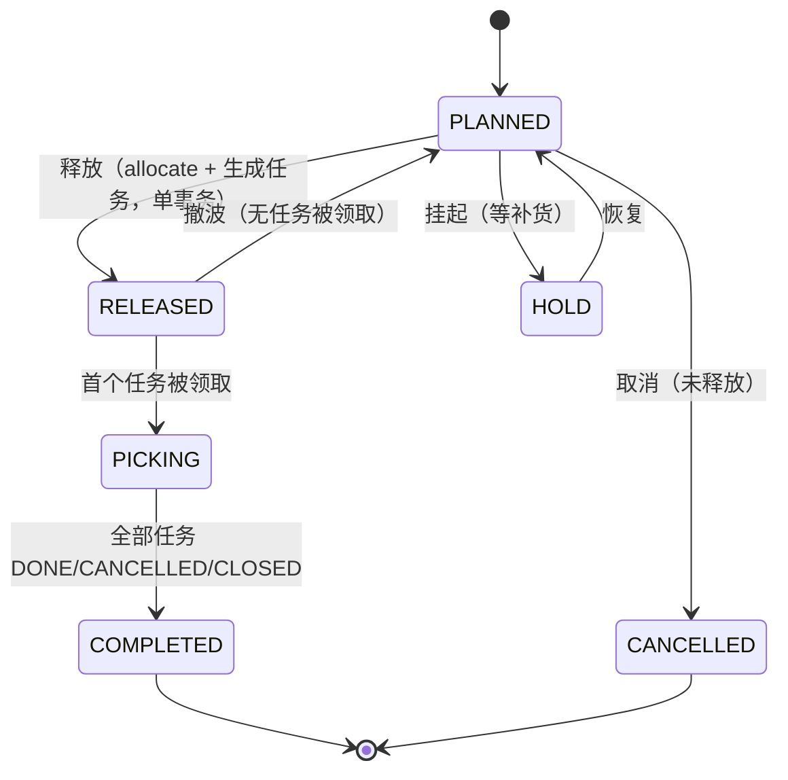
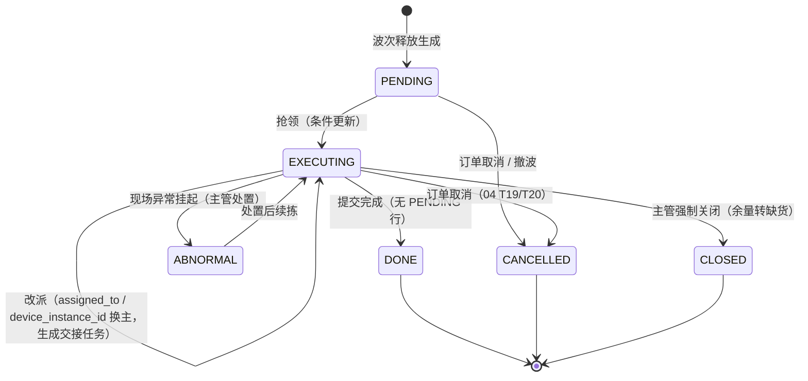
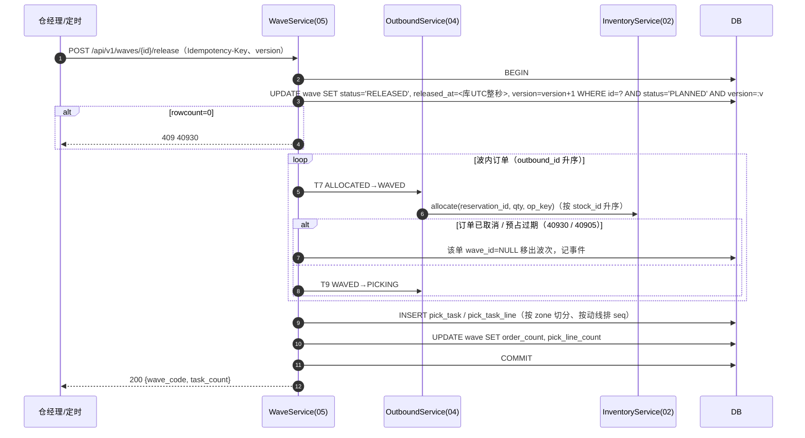
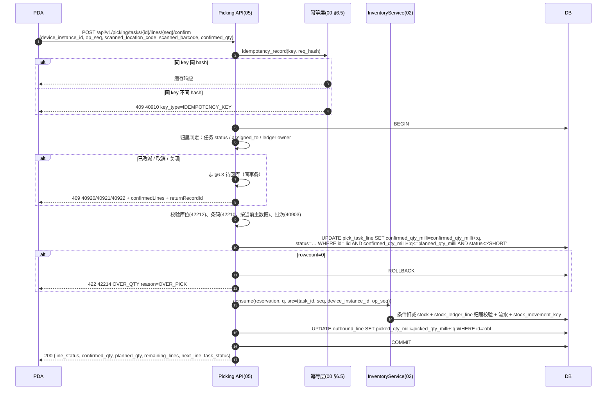
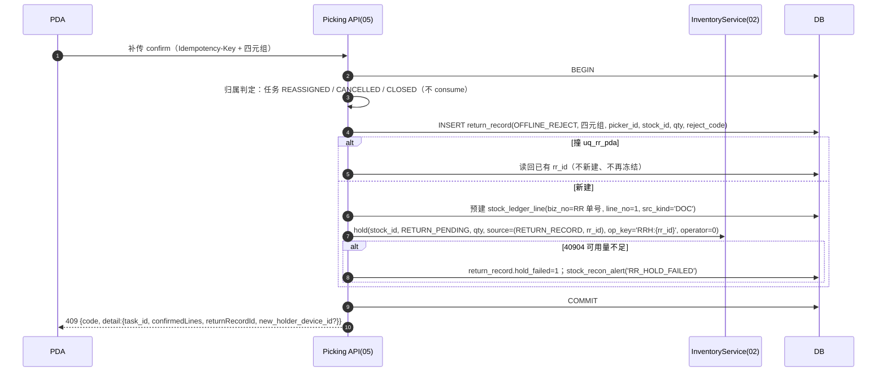
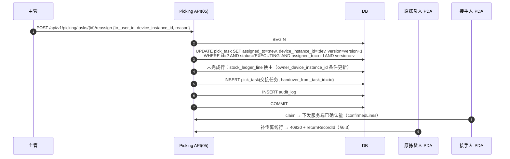
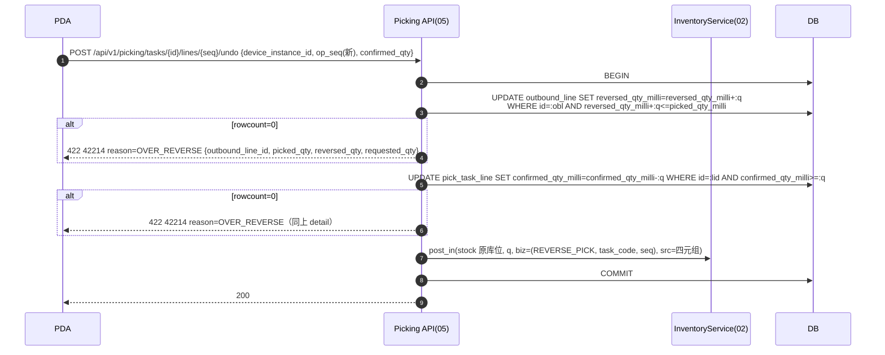

# 05 波次与拣货 详细设计

| 项 | 内容 |
|---|---|
| 编号 | 05 |
| 作者 | 小李（本轮按 main 现状搬运重写：长流） |
| 评审 | 主审 小赵（对抗评审，§13）；第二评审 小吴 |
| 基线 | `docs/00-总体设计.md`、`docs/04-出库与分配.md` @ main `13ffef8`；表以 `wms-design/sql/schema/05_picking.sql` 为准 |
| 依赖 | 00（§5 R1–R12、§6.2 单号、§6.3 数量、§6.4 错误码、§6.5 幂等、§6.6 权限、§6.7 状态机、§6.8 时间、§6.9 search_path、§6.10 防 REPLACE）；02（`allocate` / `consume` / `post_in` / `hold` / `release`，`stock_ledger_line` 持有设备，§8.4、§8.5）；04（聚波输入、FEFO 分配结果、`picked_qty_milli` / `reversed_qty_milli`、待回库 §7.3）；07（补货任务执行）；08（盘点期间流水口径）；14（PDA 页面与离线队列） |
| 状态 | 落库：本篇三张表 + 约束 + 外键 + 索引 + 授权（本 PR）。未落库：`return_record` / `pick_op` / `wave_capacity_config`，见 §4.5、§12 Q1–Q3 |

---

## 1. 职责与边界

### 1.1 负责

1. **聚波**：把 04 交来的 `ALLOCATED` 出库单按聚波维度组成波次（`wave`），容量超限拆子波次（`parent_wave_id`）。
2. **波次状态机与释放**：释放时编排 02 `allocate`（RESERVE→ALLOCATE，04 T7）、推进出库单 `ALLOCATED→WAVED→PICKING`（04 T9），并生成拣货任务与任务行。
3. **拣货任务**：生成、抢领、改派（含交接任务）、取消、强制关闭。
4. **PDA 拣货确认 / 报缺 / 撤销拣货**：两层去重（`Idempotency-Key` + 四元组）、防超拣（42214 `OVER_QTY`，`reason=OVER_PICK`）、撤销上限（42214 `OVER_QTY`，`reason=OVER_REVERSE`）。
5. **离线补传被拒**：任务已改派 / 取消 / 关闭时拒收离线行，返回 40920 / 40921 / 40922 + `confirmedLines`，并生成待回库记录（`OFFLINE_REJECT`）、同事务写 `RETURN_PENDING` 系统冻结。
6. **任务完成后推进出库单**（04 T10 `PICKING→PICKED` / T11 `PICKING→SHORT`）。

### 1.2 不负责

| 不做 | 归属 |
|---|---|
| FEFO 排序、过滤、贪心分配、预占、`ALLOCATED→WAVED` 之外的出库单状态守卫 | 04（§5.1 T6–T11、T19–T20） |
| 库存余额、占用、流水、条件 UPDATE 的实现；`RETURN_PENDING` / `RETURN_QC` 冻结原语 | 02（§7 原语、§8.4 幂等键） |
| 待回库记录的库存口径与接口契约（confirm / resolve / putback-ack / 并发闭环） | **04 §7.3**，本篇只引用并在 §6.3 说 PDA 侧口径 |
| 复核、装箱、集货、发货出库 | 06 |
| 补货任务执行（`pick_task.task_type='REPLENISH'` 复用本表，流程在 07） | 07 |
| 盘点冻结库位、期间流水口径 | 08、02 |
| 库位被盘点冻结时的出账拦截（40906） | 02 原语 + 08 |
| PDA 页面、本地队列、红条交互、扫码去抖 | 14 |

### 1.3 与原文档的差异

| # | 原文档 | 本篇 | 原因 |
|---|---|---|---|
| Δ1 | `plan_qty / plan_qty_base / actual_qty NUMERIC` | `planned_qty_milli / confirmed_qty_milli BIGINT`（`ck_ptl_qty`） | 00 §5 R2、§6.3 |
| Δ2 | 拣货任务自带分配结果 | 释放时由 02 `allocate` 把 04 已建的 RESERVE 占用转 ALLOCATE，不重新分配 | 02 / 04 两段占用 |
| Δ3 | 记账幂等键 `{biz_type}:{biz_no}:{line_no}:{op_seq}` | 四元组 `(task_id, line_no, device_instance_id, op_seq)`，落在 02 `stock_movement_key.uq_mvk_pda_op` | 00 §6.5、02 §8.4 |
| Δ4 | 错误码 `WMS-50001/50002/40903` | 40923 / 42210 / 40903（00 §6.4） | 00 §6.4 废弃码不复用 |
| Δ5 | 「行状态非 PENDING 时幂等返回」 | 改为四元组回放；行状态只做展示与完成判定 | 部分确认、计件模式下一行要多次确认 |
| Δ6 | 撤销「30 秒内」是交互约定 | 撤销用**新** `op_seq`，写 `REVERSE_PICK +1`，与 04 拣货后取消共用 `reversed_qty_milli` 上限；30 秒仍是 PDA 端默认窗口，主管可越过（`picking.task.undo_any`） | 04 §6.3 |
| Δ7 | 波次换人不留痕 | 改派写 `assigned_to` + 生成交接任务（`handover_from_task_id`）；持有设备记在 `pick_task.device_instance_id`，**记账归属**仍以 02 `stock_ledger_line.owner_device_instance_id` 为准 | 00 §6.5 四元组、02 §8.4 |
| Δ8 | 波次状态改了直接写 | 一律条件更新 `WHERE id=:id AND status=:from AND version=:v` 并 `version=version+1` | 00 §6.7 |

---

## 2. 用例

| 编号 | 用例 | 触发者 | 权限点 | 库存原语 |
|---|---|---|---|---|
| WP1 | 生成波次（定时 / 手工勾单 / 阈值） | 定时任务、仓经理 | `picking.wave.create` | — |
| WP2 | 拆波（容量超限，`parent_wave_id`） | 系统 | — | — |
| WP3 | 释放波次：生成拣货任务 + 出库单 `ALLOCATED→WAVED→PICKING` | 仓经理 / 定时 | `picking.wave.release` | `allocate` |
| WP4 | 挂起 / 恢复 / 取消 / 撤波（撤波 = 04 T8） | 主管 | `picking.wave.manage` | 撤波：ALLOCATE 释放后重新 RESERVE（04 T8） |
| WP5 | 抢领任务 | 分拣员 PDA | `picking.task.execute` | — |
| WP6 | 任务预下载（离线包，`preload=1`） | PDA | `picking.task.execute` | 只读 |
| WP7 | 拣货确认（含计件逐件模式） | 分拣员 PDA | `picking.task.execute` | `consume` |
| WP8 | 报缺（选原因，行置 `SHORT`） | 分拣员 PDA | `picking.task.execute` | `release` 未拣余量（按 04 缺货策略） |
| WP9 | 撤销拣货 | 分拣员（30s 窗口）/ 主管 | `picking.task.execute` / `picking.task.undo_any` | `post_in(REVERSE_PICK)` |
| WP10 | 改派任务（生成交接任务） | 主管（必填原因） | `picking.task.reassign` | —（持有设备换主） |
| WP11 | 取消任务（04 T19 / T20 通知） | 系统 / 主管 | `picking.task.reassign` | `release` 未拣余量 |
| WP12 | 强制关闭任务（余量转缺货） | 主管（必填原因） | `picking.task.close` | `release` |
| WP13 | 离线补传被拒 → 待回库 | PDA 补传 | `picking.task.execute` | `hold(RETURN_PENDING)` |
| WP14 | 提交任务完成 | 分拣员 | `picking.task.execute` | — |

---

## 3. 领域模型

### 3.1 波次

- **聚波维度**（同一波次内一致）：`warehouse_id + work_date + temperature_zone + route_code + carrier_code`。`carrier_code` 可空（自提单）。`temperature_zone` 取该单全部行温区的**最严**一档（冷冻 < 冷藏 < 常温），不一致的行不进同一波次。
- **入波条件**：出库单 `status='ALLOCATED'`（04 T7 的前置）、`wave_id IS NULL`、`work_date` 落在该波作业日。**挂波只做预检查，不调 `allocate`、不占库存**（00 / 04 已定）；占用在释放时建立。
- **容量**：默认 `max_order_count=200`、`max_pick_lines=1500`；超限拆子波次，`parent_wave_id` 指向原波（`ck_wave_parent` 禁止自指）。容量参数按仓维护，**配置表 `wave_capacity_config` 尚未落库**（§4.5）；落库前用仓库配置项的默认值，配置变更写 `audit_log`。
- **`pick_strategy`**：`DISCRETE / BATCH（默认）/ ZONE / WAVE_AND_SPLIT`（`ck_wave_strategy`），只决定拣货方式，不参与容量计算。`BATCH` 的合并只在 PDA 展示层做（§3.2），服务端按行确认。
- **`status`**：`PLANNED / RELEASED / PICKING / COMPLETED / HOLD / CANCELLED`（`ck_wave_status`）。
- `version` 是波次状态条件更新的乐观锁，本篇所有波次状态迁移都带 `AND version=:v`，成功后 `version+1`。

### 3.2 拣货任务与任务行

- 一个任务 = 一个分拣员一次走完的动线，按 `zone_id` 切分；任务行按 `pick_task_line.seq`（动线顺序）排列，`seq` 即四元组里的 `line_no`。
- **任务行粒度 = 一条占用**：`(outbound_line_id, stock_id)` 一行，`planned_qty_milli` = 该占用量。`BATCH` 合并拣只在 PDA **展示层**按 `(location_id, sku_id, lot_id)` 合并成一个拣货动作，服务端仍按行确认，因此 `outbound_line_id` 在 `PICK` 行上恒有值（应用层与用例保证），`REPLENISH` 行（07）为空。列的**可空**是给补货复用的，不是给拣货行留口子。
- `outbound_line_id` 同时服务"分播墙按单分发"：分播墙按出库行把货分到格口，靠这一列回溯。
- **`device_instance_id`（`VARCHAR(64)`）**：当前持有设备的装机实例号（00 §6.5），抢领 / 改派 / 交接时写；`ck_pt_exec` 保证 `EXECUTING` 必有 `assigned_to` 与 `device_instance_id` 两个字段。**记账归属的权威列是 02 `stock_ledger_line.owner_device_instance_id`**（`trg_mvk_line_kind` 按它拦非持有设备），任务表上的值只用于判定 40920 与展示。
- **`handover_from_task_id`**：改派时生成交接任务，指向原任务，只做追溯（`ck_pt_handover` 禁止自指）。
- `line_count` / `done_count` 是展示用汇总，由应用层维护（`ck_pt_count` 兜底 `0 ≤ done_count ≤ line_count`）。

### 3.3 数量

- 库内一律 `BIGINT *_qty_milli`（SKU 基本单位 `base_uom` 的千分之一，00 §5 R2）。接口出参是三位小数字符串（`"3.000"`），入参只收字符串、最多 3 位小数，**超过 3 位小数返回 400 `40010`，不四舍五入**；作业单位（箱→KG）换算后不是整数 milli 同样 40010。
- 任务行量纲：`planned_qty_milli` 来自 04 的占用（`stock_reservation.reserve_qty_milli` 的 ALLOCATE 段），`confirmed_qty_milli` 由 `consume` 与条件更新同步累加。
- 应用层只绑定 `int`，全程不经 `float`。

### 3.4 时间

- 本篇时间列（`released_at`、`completed_at`、`claimed_at`、`started_at`、`finished_at`、`scanned_at`、`created_at`、`updated_at`）一律 **UTC、不带时区、精度到秒**（00 §6.8 第 1–2 条）。
- 库写时间：`created_at` / `updated_at` 的 DEFAULT 是 `date_trunc('second', now() AT TIME ZONE 'UTC')`（PG），SQLite 侧由翻译器生成 `datetime('now')`（恒为 UTC 整秒）。
- 状态时间（`released_at`、`claimed_at`、`finished_at`、`completed_at`）由服务端在状态迁移的同一语句里写库时钟值，**不收客户端时间**；PDA 本地时间只用于展示（不放库）。
- **接口时间格式（硬规则，00 §6.8）**：入参 / 出参的时间一律 `YYYY-MM-DD HH:MM:SS`（UTC 整秒），业务日期一律 `YYYY-MM-DD`。**不接受带 `T`、带时区后缀（`Z`、`+08:00`）或小数秒的写法**；SQLite 侧撞上直接返回 40003 `CLIENT_TIME_INVALID`。本篇接口只有 `workDate` 这类业务日期入参，没有客户端时间入参。
- `work_date` 是业务日期，按 `warehouse.timezone` 计算（R3），不按浏览器或服务器时区。

### 3.5 PDA 身份与四元组

- `device_instance_id`：PDA 装机时生成并持久化，重装 / 换机换新值；同一节点多个进程不共享。
- `op_seq`：PDA 按**任务行**单调递增，重试保持不变；确认、撤销都消耗 `op_seq`。
- **四元组 `(task_id, line_no, device_instance_id, op_seq)`** 是第二层幂等键（00 §6.5）：记账路径落在 02 `stock_movement_key.uq_mvk_pda_op`，被拒（待回库）路径落在 §4.5 的 `return_record.uq_rr_pda`。
- 计件模式（逐件扫码）：每次扫码带唯一 `scan_event_id`，每次扫码一个 `op_seq`；**去抖只对非计件模式生效**（非计件同一行 800 ms 内重复扫码由 PDA 丢弃）。计件模式不得去抖，否则真实连续两件会被吞掉；同一 `scan_event_id` 重放必须回放首次结果。

---

## 4. 涉及的表

约束名以 `wms-design/sql/schema/05_picking.sql` 为准。三张表都只给 `wms_app` `SELECT / INSERT / UPDATE`（无 DELETE / TRUNCATE），`GRANT` 写在篇文件的 `-- @pg-only` 行上。

### 4.1 `wave`

| 列 | 类型 / 约束 | 说明 |
|---|---|---|
| id / code | `BIGINT` PK / `VARCHAR(64)` | 单号 `{仓前缀}-{节点号}-{yyyyMMdd}-{序号}`（00 §6.2），`uq_wave_code` |
| warehouse_id | `BIGINT NOT NULL` | 数据权限；不信任请求体 |
| work_date | `DATE NOT NULL` | 作业日（仓时区） |
| temperature_zone | `VARCHAR(16) NOT NULL` | 聚波维度 |
| route_code | `VARCHAR(32) NOT NULL` | 聚波维度 |
| carrier_code | `VARCHAR(32)` | 聚波维度，自提为空 |
| pick_strategy | `VARCHAR(24) NOT NULL DEFAULT 'BATCH'` | `ck_wave_strategy` |
| status | `VARCHAR(16) NOT NULL DEFAULT 'PLANNED'` | `ck_wave_status`；迁移见 §5.1 |
| order_count / pick_line_count | `INT NOT NULL DEFAULT 0` | 释放时写入；`ck_wave_count` |
| parent_wave_id | `BIGINT` | 拆波指向原波；`ck_wave_parent` 禁止自指 |
| released_at / completed_at | `TIMESTAMP` | 服务端库时钟 |
| created_by | `BIGINT` | |
| created_at / updated_at | `TIMESTAMP NOT NULL` | 库写整秒 UTC |
| version | `BIGINT NOT NULL DEFAULT 0` | 状态条件更新的乐观锁 |

索引 `ix_wave_wh (warehouse_id, status, work_date DESC)`：波次看板与"该仓待释放波次"。

### 4.2 `pick_task`

| 列 | 类型 / 约束 | 说明 |
|---|---|---|
| id / code | `BIGINT` PK / `VARCHAR(64)` | `uq_pt_code` |
| wave_id | `BIGINT NOT NULL` | `fk_pt_wave → wave(id)`。**当前 DDL 是 NOT NULL**：补货任务（07）也挂在波次上；是否允许无波补货见 §12 Q4 |
| warehouse_id | `BIGINT NOT NULL` | |
| task_type | `VARCHAR(24) NOT NULL DEFAULT 'PICK'` | `ck_pt_type`：`PICK / REPLENISH`。写入后不可改（应用层守卫） |
| zone_id | `BIGINT` | 动线切分；`fk_pt_zone → zone(id)` |
| status | `VARCHAR(16) NOT NULL DEFAULT 'PENDING'` | `ck_pt_status`：`PENDING / EXECUTING / DONE / ABNORMAL / CANCELLED / CLOSED`（迁移见 §5.2） |
| assigned_to | `BIGINT` | 当前持有人 |
| device_instance_id | `VARCHAR(64)` | 当前持有设备；`ck_pt_exec` |
| claimed_at / started_at / finished_at | `TIMESTAMP` | 库时钟 |
| line_count / done_count | `INT NOT NULL DEFAULT 0` | 展示用；`ck_pt_count` |
| version | `BIGINT NOT NULL DEFAULT 0` | 抢领 / 改派 / 完成的条件更新 |
| handover_from_task_id | `BIGINT` | 交接任务来源；`ck_pt_handover` 禁止自指 |
| created_at / updated_at | `TIMESTAMP NOT NULL` | 库写整秒 UTC |

索引：
- `ix_pt_claim (wave_id, status, zone_id) WHERE status='PENDING'`：领取队列，部分索引只覆盖待领取。
- `ix_pt_mine (assigned_to, status)`：PDA「我的任务」。
- `ix_pt_handover (handover_from_task_id) WHERE handover_from_task_id IS NOT NULL`：追溯改派链。

### 4.3 `pick_task_line`

| 列 | 类型 / 约束 | 说明 |
|---|---|---|
| id | `BIGINT` PK | |
| pick_task_id | `BIGINT NOT NULL` | `fk_ptl_task → pick_task(id)` |
| seq | `SMALLINT NOT NULL` | `uq_ptl (pick_task_id, seq)`；四元组的 `line_no` |
| location_id / sku_id / lot_id / stock_id | `BIGINT NOT NULL` | 精确到库位、批次、库存行；四个 `fk_ptl_*` 外键 |
| outbound_line_id | `BIGINT` | `fk_ptl_obl → outbound_line(id)`；`PICK` 行必填（§3.2），`REPLENISH` 行空 |
| planned_qty_milli | `BIGINT NOT NULL` | 应拣量；`ck_ptl_qty` 要求 `> 0` 且为整数 milli |
| confirmed_qty_milli | `BIGINT NOT NULL DEFAULT 0` | 已确认量；`ck_ptl_qty` 兜住 `0 ≤ confirmed ≤ planned` |
| uom | `VARCHAR(16) NOT NULL` | 作业单位，仅展示 |
| barcode_expected | `VARCHAR(64)` | 生成任务时的主数据快照；服务端上传时按**当前**主数据重校验，不符 42210 |
| status | `VARCHAR(16) NOT NULL DEFAULT 'PENDING'` | `ck_ptl_status`：`PENDING / DONE / SHORT / SKIP / ABNORMAL` |
| short_reason_code | `VARCHAR(24)` | `ck_ptl_short`：取值 `STOCK_OUT / DAMAGED / EXPIRED / WRONG_LOC / OTHER`，且 `status='SHORT'` 时必填 |
| scanned_at | `TIMESTAMP` | |
| override_reason / override_by | `VARCHAR(128)` / `BIGINT` | FEFO 越权（RK4）；`ck_ptl_override` 要求两列同空或同非空 |

索外键与索引：`ix_ptl_loc (location_id, status)`（拣货位待办 / 补货触发）。

### 4.4 引用的 02 / 04 表

| 表 | 本篇用法 |
|---|---|
| `outbound_order` / `outbound_line` | 状态由 04 T7–T11 推进；`picked_qty_milli` 由确认累加、撤销/回冲**不减**（04 §4.2），`reversed_qty_milli` 由撤销与拣货后取消累加，`ck_obl_reversed` / `ck_obl_sum` 兜底 |
| `stock_reservation` | 释放时 `allocate` 把当前 `alloc_round` 的 RESERVE 占用转 ALLOCATE；拣货 `consume` 按任务行映射 |
| `stock_movement` / `stock_movement_key` | `PICK` 方向 −1、`REVERSE_PICK` 方向 +1，`src_kind='PDA'`、`op_no=0`、`leg=1`；四元组唯一键 `uq_mvk_pda_op`；记账幂等键格式 `{task_code}:{seq}:P{device_instance_id}.{op_seq}:1` |
| `stock_ledger_line` | `(biz_no=task_code, line_no=seq, src_kind='PDA')` 的持有设备列 `owner_device_instance_id` 是**归属权威**；抢领 / 改派条件更新换主；`trg_mvk_line_kind` 拒绝非持有设备（`ledger_line_owner_mismatch`） |
| `stock_hold` | `RETURN_PENDING`：`reason_code='RETURN_PENDING'`、`source_type='RETURN_RECORD'`、`source_id=rr_id`、`op_key='RRH:{rr_id}'`、`operator_id=0`（系统冻结，手工解冻 40933）。写入一律普通 `INSERT`，**不用** `ON CONFLICT DO NOTHING` / `INSERT OR IGNORE`（02 §4.3：SQLite `trg_hold_no_replace` 先于冲突处理报 `hold_duplicate`） |
| `idempotency_record` | 第一层去重，24h，只缓存 2xx / 400xx / 409xx（00 §6.5） |
| `stock_recon_alert` | `check_code='RR_HOLD_FAILED'`、`RR_HOLD_MISMATCH`（§9 巡检） |
| `audit_log` | 改派 / 关闭 / 撤波 / 越权撤销写审计（12） |

### 4.5 待落库（本 PR 不含，登记在 §12）

| 对象 | 规格出处 | 为什么单独提 |
|---|---|---|
| `return_record`（待回库） | 04 §4.4 定约束，**表与 PDA 交互归本篇**（04 §1.1 第 6 条） | 新表要连带 no-REPLACE 守卫、`REPLACE_TODO` 冻结基线登记、两库正反用例与 2z3b 样本行；按 00 §6.10 的"名单只能缩小"口径单独一个增量 |
| `pick_op`（PDA 操作去重） | 00 §6.5 第二层；本篇 §3.5、§8 的写法依赖它 | 同上；缺它时确认/撤销靠 `uq_mvk_pda_op` 回放、报缺靠 `Idempotency-Key` + 行状态，详见 §8 |
| `wave_capacity_config`（波次容量配置） | 本篇 §3.1 | 新表 + 唯一键守卫；落库前用仓库配置默认值 |
| 三张表的 no-REPLACE 守卫 | 00 §6.10 第 5 条 `REPLACE_TODO`（`wave` / `pick_task` / `pick_task_line`，责任人"05"） | 守卫与 2z3b 实打样本一起提 |
| `wave.wave_type` | 旧稿 Q7 | 与容量配置表强相关，一起提 |

**当前 DDL 的可见缺口（评审请按此核对）**：三张表目前**没有**状态迁移触发器、没有 `version` 自增守卫、没有 no-REPLACE 守卫。库层只兜住：状态值域、列级数量与必填联动、`EXECUTING` 持有人、外键。**状态迁移全部靠应用层条件更新**（§5、00 §6.7），这与 00 现行口径一致，不是遗漏。

---

## 5. 状态机

### 5.1 波次



| # | from → to | 触发者 | 守卫（写进条件更新的 WHERE） | 副作用（同事务） |
|---|---|---|---|---|
| W1 | PLANNED → RELEASED | 仓经理 / 定时 | `WHERE id=? AND status='PLANNED' AND version=:v`；波内订单仍为 `ALLOCATED` | 逐单：04 T7 `ALLOCATED→WAVED`（`allocate`）→ T9 `WAVED→PICKING`；生成 `pick_task` / `pick_task_line`；写 `released_at`、`order_count`、`pick_line_count`、`version+1` |
| W2 | PLANNED → CANCELLED | 仓经理 | `status='PLANNED'` | 订单 `wave_id` 置空 |
| W3 | PLANNED ⇄ HOLD | 主管 | `status IN ('PLANNED','HOLD')` | 无 |
| W4 | RELEASED → PICKING | 首个领取 | `status='RELEASED'` | 无 |
| W5 | RELEASED → PLANNED（撤波） | 主管 | `WHERE status='RELEASED' AND version=:v`，且 `NOT EXISTS (SELECT 1 FROM pick_task WHERE wave_id=? AND status<>'PENDING')` | 任务 `CANCELLED`；订单 04 T8 回 `ALLOCATED` |
| W6 | PICKING → COMPLETED | 系统 | 无 `PENDING / EXECUTING / ABNORMAL` 任务 | 写 `completed_at` |

- `rowcount=0` 一律返回 **40930**（`detail` 带当前状态），抢领冲突除外（40923）。
- W1 里**任一订单**迁移失败（被取消 / 预占过期）：把该单移出波次（`wave_id=NULL`）后继续，不整波失败；全部订单都失败时仍留 `RELEASED`（PDA 无任务可领），由主管撤波或关闭波次。
- 撤波（W5）前置是"没有任务被领过"，所以没有已 `consume` 的量要回滚；已 `consume` 过的量只能走撤销拣货或 04 T20。

### 5.2 拣货任务



| # | from → to | 条件更新 | 副作用 |
|---|---|---|---|
| T-claim | PENDING → EXECUTING | `WHERE id=? AND status='PENDING' AND assigned_to IS NULL` | 写 `assigned_to`、`device_instance_id`、`claimed_at`、`version+1`；`ck_pt_exec` 兜底；对每行 `stock_ledger_line` 占位 PDA 行换主 |
| T-reassign | EXECUTING → EXECUTING | `WHERE id=? AND status='EXECUTING' AND assigned_to=:old AND version=:v` | 换 `assigned_to` / `device_instance_id`；生成交接任务（`handover_from_task_id=:id`）；写 `audit_log` |
| T-done | EXECUTING → DONE | `WHERE id=? AND status='EXECUTING'` 且 `NOT EXISTS (行 status IN ('PENDING','SKIP','ABNORMAL'))` | 写 `finished_at`。**SKIP / ABNORMAL 不算完成**：只要存在 `SKIP` 或 `ABNORMAL` 行且其 `confirmed_qty_milli < planned_qty_milli`，任务就不能转 `DONE`——必须先 `release` 未拣余量并把该行置 `SHORT`，或由主管 `T-close`。否则该行余量既没释放也没转缺货，04 会把出库单当成拣满（评审 P25-2）。任务全完成 → 04 T10（有任何 `SHORT` 行则 T11） |
| T-abnormal | EXECUTING ⇄ ABNORMAL | `status IN ('EXECUTING','ABNORMAL')` | 无 |
| T-cancel | {PENDING, EXECUTING, ABNORMAL} → CANCELLED | `WHERE status IN (...)` | 未拣余量 `release`（02） |
| T-close | {EXECUTING, ABNORMAL} → CLOSED | 同上 | 未拣余量 `release`；未完成行置 `SHORT` + `short_reason_code='OTHER'`；出库行短发按 04 `short_ship_policy` 处理 |

**库层兜到哪一层**（评审重点）：库里**没有**状态迁移触发器；`ck_pt_status` 只做值域，`ck_pt_exec` 兜 `EXECUTING` 必有持有人与设备，`ck_pt_count` 兜汇总列。**每一条迁移的 from 状态判断都在应用层条件更新里**（`WHERE status=:from [AND assigned_to=:old AND version=:v]`），`rowcount=0` → 40930 / 40923，与 00 §6.7 一致。终态（`DONE` / `CANCELLED` / `CLOSED`）之后不再迁移；已 `SHIPPED` 的单只能红冲（04）。

### 5.3 任务行

| from → to | 触发 | 写法 |
|---|---|---|
| PENDING → DONE | 确认后 `confirmed = planned` | 与数量写在同一条 UPDATE：`SET confirmed_qty_milli=confirmed+:q, status=CASE WHEN confirmed+:q=planned THEN 'DONE' ELSE 'PENDING' END WHERE id=:id AND confirmed+:q<=planned` |
| PENDING → SHORT | 报缺 | `SET status='SHORT', short_reason_code=:r`；`ck_ptl_short` 强制原因非空 |
| DONE → PENDING | 撤销后 `confirmed < planned` | 同一条 UPDATE 里回退状态 |
| PENDING ⇄ SKIP | 跳过稍后再拣（仍可确认） | 只改 `status` |
| 任意 → ABNORMAL | 现场异常上报 | 只改 `status` |

行状态由 `confirmed_qty_milli` 与写入动作派生，与数量在同一条 UPDATE 里写，避免"数量变了状态没变"。

### 5.4 待回库记录

状态机以 **04 §5.2** 为准（`OPEN → CONFIRMED / RESOLVED`，终态互斥），本篇不重复定义；表尚未落库，见 §4.5。

---

## 6. 核心流程

### 6.1 波次释放（单事务）



### 6.2 拣货确认（最热路径）



要点：

- **条件更新 → `consume` 记账 → 出库行累加在同一事务**，任一失败全部回滚（00 §6.5）。
- 超拣靠 `confirmed_qty_milli` 上限，与设备、Key 是否过期无关：换设备、两台设备同时报、Key 过期后重放，总量都不会超过 `planned_qty_milli`。
- 库层兜底：`uq_mvk_pda_op` 挡同四元组二次记账（`trg_mvk_line_kind` 挡非持有设备）；撞 `ck_ptl_qty` = **50010**（说明条件更新漏写，回滚并告警）。
- 扫错**库位**返回 42212（与 14 篇、`putback-ack` 同一个码），扫错条码仍是 42210。

### 6.3 离线补传被拒 → 待回库（同事务）



- **一律拒收，不静默合并**到新任务，即使新任务行还有余量。
- 冻结失败（`hold_failed`）沿用 04 §9：记录照建，进异常队列，不阻塞 PDA。
- 之后的 confirm / resolve / putback-ack 走 **04 §7.3**；本篇只重申 PDA 口径（§7.2）。

### 6.4 改派（生成交接任务）



- 已确认的行**有效、不回滚**；对应货物在原拣货人周转箱里，由交接任务把周转箱交给接手人或复核台。交接任务**不产生库存流水**（货已被 `consume`，只是物理转手）。
- 换主用条件更新 `WHERE owner_device_instance_id = :old`（02 §8.4），先提交者生效；输方确认走 §6.3。

### 6.5 撤销拣货



- 去重键 = 新 `op_seq` 的四元组，与 04 待回库回冲的键 `(RR 单号, 1, op_no=1, leg=1)` 不同组，两者都能入账；**合计**回冲量由同一条 `reversed + q ≤ picked` 上限兜住（04 §6.3）。
- 撤销不改原流水：写 `REVERSE_PICK +1`；`picked_qty_milli` 不减（04 §4.2）。
- `REVERSE_PICK` 不受库位盘点锁限制（02 §7.1 `post_in` 例外），并计入盘点快照之后的期间流水（08 §6）。
- 撤销后货回到账面可用，**不自动重新分配**；出库行回到待分配，由下一轮 04 分配或主管手工触发。

### 6.6 报缺、取消、强制关闭

- **报缺**：行 `status='SHORT'` + 原因；未拣余量由 02 `release` 释放，出库行由 04 按 `short_ship_policy` 处理（04 T11 `PICKING→SHORT`）；不阻断整波，其他行继续。
- **取消**（04 T19 拣货前 / T20 拣货后）：任务置 `CANCELLED`，未拣余量 `release`；T20 场景下已拣量走 04 的 `CANCEL_AFTER_PICK` 待回库（本篇不再重复建记录）。
- **强制关闭**：任务置 `CLOSED`，未完成行置 `SHORT` + `OTHER`，余量 `release`；返回 40922（离线补传撞到时）。

---

## 7. 接口清单与契约

所有写请求带 `Idempotency-Key`、`X-Warehouse-Id`；PDA 写请求另带四元组。所有响应统一信封 `{code, message, trace_id, data}`（00 §6.4；成功时 `code="0"`），**下面示例只写 `data` 部分**；列表接口按 13 篇要求返回 `data: {items[], next_cursor}`。`50303 STALE_WRITE_NODE` 时 PDA 重新 `GET /api/v1/warehouses/{code}/write-endpoint`，用**原 Key、原四元组**按 `op_seq` 顺序重提，不标红（00 §9.1）。

### 7.1 波次与任务

| 方法 | 路径 | 说明 | 权限点 | 幂等 |
|---|---|---|---|---|
| POST | `/api/v1/waves` | 生成波次（`order_codes` 或过滤条件） | `picking.wave.create` | Idempotency-Key |
| GET | `/api/v1/waves`、`/api/v1/waves/{id}` | 列表 / 详情 | `picking.wave.view` | — |
| POST | `/api/v1/waves/{id}/release` | 释放（W1） | `picking.wave.release` | Idempotency-Key + version |
| POST | `/api/v1/waves/{id}/hold`、`/resume`、`/cancel`、`/unrelease` | 挂起 / 恢复 / 取消 / 撤波 | `picking.wave.manage` | Idempotency-Key + version |
| GET | `/api/v1/picking/tasks?mine=1&status=…&preload=1` | 我的任务；`preload=1` 返回完整任务包，每行带 `expected_barcodes[]`（生成任务时的快照，仅离线预校验；服务端上传时以当前主数据为准） | `picking.task.view` | — |
| POST | `/api/v1/picking/tasks/{id}/claim` | 抢领，带 `device_instance_id` | `picking.task.execute` | Idempotency-Key |
| POST | `/api/v1/picking/tasks/{id}/lines/{seq}/confirm` | 拣货确认（§6.2） | `picking.task.execute`（且为当前持有人） | Idempotency-Key + 四元组 |
| POST | `/api/v1/picking/tasks/{id}/lines/{seq}/short` | 报缺（必填 `short_reason_code`） | 同上 | Idempotency-Key + 四元组 |
| POST | `/api/v1/picking/tasks/{id}/lines/{seq}/undo` | 撤销拣货 | 同上；超 30 s 需 `picking.task.undo_any` | Idempotency-Key + 四元组 |
| POST | `/api/v1/picking/tasks/{id}/complete` | 提交完成 | 同上 | Idempotency-Key |
| POST | `/api/v1/picking/tasks/{id}/reassign` | 改派，必填 `reason` | `picking.task.reassign` | Idempotency-Key + version |
| POST | `/api/v1/picking/tasks/{id}/close` | 强制关闭，必填 `reason` | `picking.task.close` | Idempotency-Key + version |
| GET / PUT | `/api/v1/warehouses/{code}/wave-capacity` | 容量配置读 / **整体替换**：请求体 `[{wave_type, max_order_count, max_pick_lines, version}]`，`wave_type` **必填**（`NORMAL` / `URGENT` / `REPLENISH_FIRST`）；任一条 `version` 与库内不符 → 40930，`detail = {reason: "WAVE_CAPACITY_VERSION", wave_type, current_version}`，整次不生效；成功后各条 `version+1` 并写 `audit_log` | `picking.wave.capacity.view` / `picking.wave.capacity.edit` | Idempotency-Key + version |

**confirm 请求**：

```json
{ "device_instance_id": "c2f1a7e0-…", "op_seq": 7, "scanned_location_code": "A01-02-03",
  "scanned_barcode": "6901234567890", "lot_code": "LOT20261012-SH",
  "confirmed_qty": "3.000", "uom": "KG", "scan_event_id": null }
```

**200**：`{ line_status, confirmed_qty, planned_qty, remaining_lines, next_line, task_status }`（数量为三位小数字符串）。

**40920 / 40921 / 40922**：

```json
{ "code": "40920", "message": "任务已改派",
  "detail": { "task_id": 123, "returnRecordId": 9001, "new_holder_device_id": "DEV-B",
    "confirmedLines": [ { "seq": 3, "confirmed_qty": "3.000", "planned_qty": "3.000" } ] } }
```

`confirmedLines` 是服务端**已确认**的行（PDA 据此对账本地队列）；被拒的那一行由 `returnRecordId` 跟踪，PDA 在本地标红。`new_holder_device_id` 只在 40920 返回。

### 7.2 待回库（路径与 04 §7.3、14 §9.4.2 一致，本篇不重新定义）

| 方法 | 路径 | 本篇重申的 PDA 口径 |
|---|---|---|
| GET | `/api/v1/return-records?status=OPEN&warehouseId=…` | 主管看板；支持 `hold_failed=1` 异常队列筛选 |
| GET | `/api/v1/return-records/{id}` | 原拣货人可查自己的红条；扫描错库位 **42212** 不进幂等缓存，可原 Key 重扫 |
| POST | `/api/v1/return-records/{id}/confirm` | `OFFLINE_REJECT` 不写库存流水 |
| POST | `/api/v1/return-records/{id}/resolve` | 只有主管；`NEARBY_PUTBACK` 必须 `putback-ack`，`SCRAP_HANDOVER` 需主管确认交接 |
| POST | `/api/v1/return-records/{id}/putback-ack` | 就近放回到位确认 |

- confirm / resolve 都是 `WHERE status='OPEN'` 条件更新，后到者 **40932**，`detail` 固定 `{status, resolution, target_location, closed_by, closed_at}`（00 §6.4 本表为准），`target_location` 总返回，仅 `NEARBY_PUTBACK` 非 null。
- **PDA 只在收到 40932 且 `status ∈ {CONFIRMED, RESOLVED}` 时删本地红条**；`NEARBY_PUTBACK` 需先 `putback-ack` 成功、`SCRAP_HANDOVER` 需主管确认交接后再删（04 §7.3 规则 6）。

### 7.3 错误码（本篇使用，全部取自 00 §6.4）

| 码 | 名称 | 场景 |
|---|---|---|
| 40001 | PARAM_INVALID | 参数校验失败（缺 `device_instance_id` / `op_seq` 等） |
| 40002 | REASON_REQUIRED | 改派 / 关闭 / 越权撤销缺原因 |
| 40010 | QTY_FORMAT_INVALID | 数量非字符串、超 3 位小数、换算后非整数 milli（不舍入） |
| 40310 / 40311 | PERMISSION_DENIED / WAREHOUSE_FORBIDDEN | 无权限点 / 仓不符 |
| 40902 | STOCK_INSUFFICIENT | `consume` 在库不足 |
| 40903 | LOT_EXPIRY_MISMATCH | 批次效期不符：扫到的批次与分配批次（`stock_reservation`）不一致，或批次已过效期（00 §6.4） |
| 40904 | AVAILABLE_INSUFFICIENT | `RETURN_PENDING` 冻结时可用量不足（记录照建，`hold_failed=1`） |
| 40905 | OVER_RELEASE | 释放超占用余量 |
| 40906 | LOCATION_LOCKED | 库位被盘点冻结：行保持 PENDING，PDA 提示"库位盘点中"，可 SKIP 或报缺 |
| 40910 | IDEMPOTENCY_CONFLICT | `key_type=IDEMPOTENCY_KEY`（同 Key 不同请求体）；`key_type=PDA_OP`（同四元组不同数量/操作类型） |
| 40920 / 40921 / 40922 | TASK_REASSIGNED / TASK_CANCELLED / TASK_CLOSED | 离线补传被拒；均带 `confirmedLines`，拒收离线行时带 `returnRecordId`；40920 另带 `new_holder_device_id` |
| 40923 | TASK_ALREADY_CLAIMED | 抢领冲突 |
| 40930 | ILLEGAL_STATE_TRANSITION | 波次 / 任务条件更新影响 0 行 |
| 40932 | RECORD_ALREADY_CLOSED | 待回库 confirm / resolve 并发（04 §7.3） |
| 40933 | SYSTEM_HOLD_NOT_RELEASABLE | 手工解冻系统冻结，`detail` 固定 `{hold_type, source_type, source_id}`。五种都不可手工解冻（00 §6.4）：`RETURN_PENDING`（只能由待回库 confirm / resolve 经 `release_return_hold` 释放）、`RETURN_QC`（质检 `release_qc_hold`）、`SCRAP_PENDING`（09 `release_scrap_hold`）、`PROCESSING`（17 走 `consume_process_hold` / `release_hold`）、`LIVE_HOLD`（18 复检 NORMAL 整池解锁或按量扣减）。前端按 `hold_type` 出提示、按 `source_type`/`source_id` 跳转 |
| 42210 | BARCODE_MISMATCH | 条码不符（服务端按当前主数据校验，权威） |
| 42212 | LOCATION_MISMATCH | 拣货确认扫错库位、待回库 confirm、putback-ack 扫错目标库位 |
| 42213 | PUT_BACK_REJECTED | 就近放回时原库位盘点冻结或目标温区不符（04） |
| 42214 | OVER_QTY | `detail.reason` 必带：`OVER_PICK`（确认超计划量）、`OVER_REVERSE`（回冲超可冲回量，detail `{outbound_line_id, picked_qty, reversed_qty, requested_qty}`）。缺失/未知 reason 客户端标红交人，不自动重试 |
| 50010 | INVARIANT_VIOLATION | 撞 `ck_ptl_qty` / 触发器，说明应用层条件更新漏写，回滚并告警 |
| 50301 | DEPENDENCY_UNAVAILABLE | 依赖不可用、SQLite 写锁超时；客户端重新取 write-endpoint，用**原幂等键 / 原四元组**重提 |
| 50303 | STALE_WRITE_NODE | 写节点 epoch 过期，原键重提 |
| 50304 | STALE_STOCK_PAUSED | `paused_actions` 含 `WAVE_RELEASE` 时**释放即拒**；`PICK_CONFIRM` 只在离线超 12 h 后加入。客户端停手等 `paused=false`，不重试、不重取写地址 |

---

## 8. 并发与幂等

三层防线（00 §6.5），本篇只用前两层 + 记账层：

| 层 | 本篇落地 |
|---|---|
| 接口层 | `Idempotency-Key`，同 key 同 body 回放首次响应；同 key 不同 body 40910 `IDEMPOTENCY_KEY`。只缓存 2xx / 400xx / 409xx |
| 业务层 | 四元组 `(task_id, line_no, device_instance_id, op_seq)`；记账路径落在 02 `uq_mvk_pda_op`，被拒路径落在 `return_record.uq_rr_pda`（待落库）。撞键后**新事务**按键读回比对 `move_qty_milli`：相同 → 回放首次结果；不同 → 40910 `PDA_OP` |
| 记账层 | 流水唯一约束 `uq_mvk_biz_line` / `uq_mvk_pda_op`（02 §4.4），撞约束整个事务回滚，绝不二次扣减 |

**写法规则（两库一致）**：本篇一律**普通 `INSERT`**，不用 `ON CONFLICT DO NOTHING / DO UPDATE`、不用 `INSERT OR REPLACE / OR IGNORE`。PG 撞唯一键会把事务置为 aborted，所以"撞键回放"在新事务（或 `SAVEPOINT`）里读回比对。

| 场景 | 防线 |
|---|---|
| 网络重试 / 狂点 | `Idempotency-Key`（24 h） |
| Key 过期后重放确认 | `uq_mvk_pda_op` → 读回流水比对 `move_qty_milli`，同量回放、异量 40910 `PDA_OP` |
| 同一行并发确认 / 两台设备 / 换设备 | 条件更新 `confirmed + q ≤ planned` → 42214 `OVER_PICK`；`trg_mvk_line_kind` 只认持有设备 |
| 计件模式连续扫两件 | 每件独立 `scan_event_id` + 独立 `op_seq`，不去抖；重放同一 `scan_event_id` 回放首次结果 |
| 两人抢领 | `WHERE status='PENDING' AND assigned_to IS NULL`，输方 40923 |
| 改派与原拣货人确认并发 | 改派 `version` + `assigned_to=:old` 条件更新；确认在事务内重新判定归属，先提交者生效，输方 40920 + 待回库 |
| 订单取消与确认并发 | 04 T19 守卫"已拣量 = 0"写在 04 的条件里；确认先提交 → 取消转 T20（待回库） |
| 同一行重复被拒 | `uq_rr_pda` + `uq_hold_return` / `uq_hold_op`（02）→ 同一 `returnRecordId`，只冻一次 |
| 撤销与 04 回冲并发 | 同一条 `reversed + q ≤ picked` 条件更新，合计不超 `picked`；超了 42214 `OVER_REVERSE` |
| 撤波与领取并发 | 撤波条件带 `NOT EXISTS (status<>'PENDING')`；领取后撤波 40930 |
| 释放与订单取消并发 | 单事务；订单迁移失败即移出波次，不整波失败 |
| 写节点切换 | `X-Write-Epoch`；50303 后原键重提 |

**加锁顺序**：`pick_task → pick_task_line → outbound_line → stock（按 stock_id 升序）`，与 02 §8.2 一致；不用 `SELECT FOR UPDATE`（R7），一律条件更新 + `rowcount`，多行按主键升序更新。

**`pick_op` 未落库时的边界**（评审重点，00 §6.10 待办）：确认 / 撤销的"同四元组异量"判据来自 02 流水（`uq_mvk_pda_op`），已成立；**报缺不进账、不产生流水**，其幂等只靠 `Idempotency-Key`（24 h）+ 行状态条件更新，Key 过期后同四元组重放同一报缺无法回放首次响应——这是当前已知缺口，`pick_op` 落库后消除（§4.5）。

## 9. 异常与补偿

| 场景 | 处理 |
|---|---|
| 现场缺货 | 报缺（`SHORT` + 原因），未拣余量 `release`；04 T11 / 补货（07）；不阻断整波 |
| 冻结失败 `hold_failed` | 记录照建，`stock_recon_alert('RR_HOLD_FAILED')`，主管处置后关闭（04 §9） |
| 待回库与冻结不一致（巡检） | 每 5 分钟与 02 对账同一调度：① `OPEN` 且 `hold_failed=0` 的记录必须有 `hold_id`，且该冻结 `status='HELD'`、`source_type='RETURN_RECORD'`、`source_id=rr.id`、余量 = `qty_milli`；② `CONFIRMED / RESOLVED` 的记录其冻结必须已 `RELEASED`；③ 反向：`RETURN_PENDING` 且 `HELD` 的冻结必须对应一条 `OPEN` 记录。任一不符写 `stock_recon_alert('RR_HOLD_MISMATCH', …)`，只告警不自动修 |
| 待回库长期 OPEN | 04 §9：4 小时看板标红，超 1 个作业日推主管告警；冻结一直保留，宁可少卖不超卖 |
| 换主后旧设备"已拣未报" | 补传一律 40920 + `confirmedLines` + `returnRecordId` + `new_holder_device_id`；旧操作进待回库异常队列人工处理，**绝不自动合并** |
| 释放中途崩溃 | 单事务回滚，波次留 `PLANNED` |
| 50303 | PDA 暂停上传队列，重取写地址后按 `op_seq` 顺序原键重提 |
| 库位被盘点锁（40906） | 行保持 `PENDING`，PDA 提示"库位盘点中"，可 SKIP 或报缺；撤销（`REVERSE_PICK`）不受锁限制 |
| 撞 CHECK（50010） | 回滚并告警，说明条件更新漏写；不要静默重试 |

## 10. 权限

| 权限点 | 角色 | 说明 |
|---|---|---|
| `picking.wave.view` | 仓经理、主管 | 列表 / 详情 |
| `picking.wave.create` | 仓经理、主管 | 生成波次、勾单 |
| `picking.wave.release` | 仓经理、主管 | 释放（W1） |
| `picking.wave.manage` | 主管 | 挂起 / 恢复 / 取消 / 撤波 |
| `picking.task.view` | 分拣员、主管、客服 | 任务列表 / 详情（13 篇列表页；读与作业分离，`execute` 只管写） |
| `picking.task.execute` | 分拣员 | 领取、确认、报缺、撤销、提交完成 |
| `picking.task.undo_any` | 主管 | 超 30 s 或代他人撤销 |
| `picking.task.reassign` | 主管 | 改派（写 `audit_log`）；取消任务也走本点 |
| `picking.task.close` | 主管 | 强制关闭（写 `audit_log`） |
| `picking.wave.capacity.view` / `picking.wave.capacity.edit` | 仓经理、主管 | 容量配置读 / 改（改写入 `audit_log`；配置表待落库） |
| `picking.return_record.view` / `picking.return_record.resolve` | 主管 | 04 §10；resolve 不能由原拣货人自己执行 |

- confirm / short / undo / complete 只允许 `assigned_to = 当前用户` 且设备为当前持有设备；**不符合时按归属判定返回 40920 / 40921 / 40922（不是 403）**，这样离线补传能走待回库。
- 待回库 confirm / putback-ack 只允许原拣货人；resolve 只能主管且不能是原拣货人。
- `X-Warehouse-Id` 必须在用户数据权限内、且与任务 / 波次的所属仓一致，否则 40311（00 §6.6）。
- 主管类操作（改派、关闭、撤波、越权撤销、容量配置变更）全部写 `audit_log`（12）。

## 11. 测试要点

1. **数量**：`"3.0001"` → 40010（不舍入）；`"3"`、`"3.000"` 等价；数字类型与非字符串一律 40010。
2. **超拣**：同一行 50 并发确认，`Σ confirmed = planned`，其余 42214 `OVER_QTY`（`reason=OVER_PICK`）；换 `device_instance_id` 重报同样 42214；`ck_ptl_qty` 撞上时是 50010。
3. **四元组**：同四元组同数量在 `Idempotency-Key` 过期后重放 → 同结果、一条流水；同四元组不同数量 → 40910 `PDA_OP`；同 Key 不同 body → 40910 `IDEMPOTENCY_KEY`。
4. **计件**：同一行连续 5 次扫码（5 个 `scan_event_id`）→ 5 件；同一 `scan_event_id` 重放 → 1 件。
5. **抢领**：100 并发领取同一任务，仅 1 成功，其余 40923。
6. **改派 / 取消 / 关闭**：离线补传 → 40920/40921/40922 + `confirmedLines` + `returnRecordId`（+ 40920 的 `new_holder_device_id`）；同一行重复补传返回同一 id，只有 1 条待回库记录、1 个 `RETURN_PENDING` 冻结；冻结 `operator_id=0`、`source_type='RETURN_RECORD'`；手工解冻 40933；可用量不足时 `hold_failed=1` 且有告警；已上传行不受影响。
7. **撤销**：`reversed` 累加、`confirmed` 减回、一条 `REVERSE_PICK +1`；撤销量 > `picked − reversed` → 42214 `OVER_REVERSE` 且 detail 四字段齐全；与 04 拣货后取消并发 200 轮，`reversed ≤ picked` 恒成立；盘点锁定库位的撤销照常入账。
8. **40932**：PDA 只在 `status ∈ {CONFIRMED, RESOLVED}` 时删本地红条；`NEARBY_PUTBACK` 需先 `putback-ack`。
9. **50303 / 50304**：旧 epoch 写入被拒，原键重提只记一次；`paused_actions` 含 `WAVE_RELEASE` 时释放返回 50304。
10. **波次**：释放时有一单已被取消 → 该单移出、其余正常；撤波在任务被领取后 40930；聚波维度不一致的订单不进同一波；容量超限拆子波次且 `parent_wave_id` 正确。
11. **库层**：`ck_wave_status` / `ck_pt_status` / `ck_pt_exec` / `ck_ptl_status` / `ck_ptl_short` / `ck_ptl_override` 等的正反断言（本轮已补 12 个 CHECK / 8 个外键 / `ix_pt_handover` 的三件套，见 `verify.sh` 2t 与 `verify_sqlite.py` 2t 同名断言）；**8 个外键**的孤儿插入被拒；`EXECUTING` 不带持有人 / 设备被拒。
12. **双库矩阵**：同一用例在 SQLite 与 PG 各跑一遍；本篇三张表的 REPLACE 守卫落库后补 00 §6.10 的两段实打。

## 12. 待定问题

| # | 问题 | 建议 | 裁决人 |
|---|---|---|---|
| Q1 | `return_record` 落库（04 §4.4 定约束、本篇建表） | **待落库**：单独增量提，含 `uq_rr_code / uq_rr_pda / uq_rr_cap`、`ck_rr_*`、no-REPLACE 守卫与两库用例 | 大肥鱼 |
| Q2 | `pick_op` 落库（四元组去重含报缺 / 被拒） | **待落库**：先按 §8 的边界运行（报缺幂等仅靠 `Idempotency-Key`），落库后补齐 | 大肥鱼 |
| Q3 | 波次容量配置存放位置 | **待落库**：`wave_capacity_config`（`(warehouse_id, wave_type)` 唯一）与 `wave.wave_type` 一起提；落库前用仓库配置默认值 200 / 1500 | 大肥鱼 |
| Q4 | `pick_task.wave_id` 当前 `NOT NULL`，补货任务能否不挂波次 | **建议**：07 定稿时确认；若允许无波补货，放宽为可空并加 `ck_pt_wave`（只有 `REPLENISH` 可空） | 大肥鱼 / 07 负责人 |
| Q5 | `pick_task_line.outbound_line_id` 可空 | **建议**：维持可空 + 应用层保证 `PICK` 行必填；若要库层兜，加 `REPLACE` 无关的触发器（两库）并登记 | 大肥鱼 |
| Q6 | 拣货确认扫错库位用哪个码 | **已定**：42212，与 14 篇、`putback-ack` 统一，不新增码 | 大肥鱼 / 小周 |
| Q7 | 撤销拣货后是否自动重新分配 | **已定**：不自动；出库行回到待分配，由下一轮分配或主管手工触发 | 大肥鱼 |
| Q8 | 三张表的 no-REPLACE 守卫 | **待落库**：与 00 §6.10 `REPLACE_TODO` 同步缩小，责任人"05" | 长流 |
| Q9 | `wave.code` 的作业日与 `work_date` 不一致时的处理 | **建议**：建单时以 `work_date` 取号（00 §6.2），跨日切换丢弃旧号段，不重号 | 大肥鱼 |
| Q10 | 本篇 §10 的全部 `picking.*` 权限点（wave / task / wave.capacity / return_record）未登记 | **待登记**：00 §6.6.1 契约位置 + 12 篇角色-权限矩阵（与 08 G22 同口径）；`picking.task.view` 是本轮按 13 篇列表页要求新增的读点 | 大肥鱼 / 镜鉴 |
| Q11 | `hold_failed` 的跨篇口径（02 侧冻结失败判定、04/09 处置与告警码） | **待与 02/04 对齐**：本篇只保证"记录照建 + `stock_recon_alert('RR_HOLD_FAILED')` + 不阻塞 PDA" | 小钱 / 大肥鱼 |

### 12.1 下一轮增量：缺表 + no-REPLACE 守卫（本轮不实现）

本轮的 05 只落三张表 + 约束 / 外键 / 时间收口。下面这批**已经定稿、但需要连带 no-REPLACE 守卫、`REPLACE_TODO` 冻结基线与 2z3b 实打样本**，按 Chief 排期单独一轮（已记 #14）：

| 对象 | 规格 | 为什么单独一轮 |
|---|---|---|
| `return_record` | 04 §4.4 全部列 + `uq_rr_code` / `uq_rr_pda`（部分唯一）/ `uq_rr_cap`（部分唯一）+ `ck_rr_*` + `trg_rr_*` | 新表：守卫 + 冻结基线与样本；缺它时 §8 的"同一行只冻一次"只有应用层保证 |
| `pick_op` | 四元组唯一 + `scan_event_id` 部分唯一 + `op_type` / `qty_milli` / `result_code` / `finished_at` | 同上；落库后 §8 的"报缺幂等"边界消失 |
| `wave_capacity_config` + `wave.wave_type` | `(warehouse_id, wave_type)` 唯一 + 两个上限正数 CHECK（取值与 §3.1 的默认值同源） | 同上 |
| `wave` / `pick_task` / `pick_task_line` 的 no-REPLACE 守卫 | 00 §6.10 `REPLACE_TODO` 现名单（责任人 05） | 守卫 + 2z3b 样本行，名单同步缩小 |

## 13. 对抗评审攻击面（给小赵 / 小吴）

| # | 攻击面 | 打法 | 防线 |
|---|---|---|---|
| WP-A1 | 超拣 | 同一行 50 并发确认；两台设备各报满量；换 `device_instance_id` 重报 | 条件更新 → 42214 `OVER_PICK`；`ck_ptl_qty` 兜底（撞上是 50010） |
| WP-A2 | Key 过期后重复扣减 | 25 小时后原四元组重放 | `uq_mvk_pda_op` + 读回比对；记账层唯一约束 |
| WP-A3 | 四元组篡改 | 同四元组改数量 / 改操作类型（CONFIRM→UNDO） | 40910 `PDA_OP` |
| WP-A4 | 计件去抖吞件 | 计件模式连续快速扫码 | 不去抖 + 独立 `scan_event_id` / `op_seq` |
| WP-A5 | 抢领 | 100 并发领取 | 条件更新 → 40923 |
| WP-A6 | 改派后旧设备补传被静默合并 | 旧设备离线补传，新任务行还有余量 | 一律拒收 40920 + 待回库 |
| WP-A7 | 待回库重复冻结 / 重复建记录 | 同一行补传 10 次；并发补传 | `uq_rr_pda`、`uq_hold_return`、`uq_hold_op`（待落库后生效） |
| WP-A8 | 冻结被手工解除 | 解冻 `RETURN_PENDING`；直接 UPDATE `hold_type` | 40933；`trg_hold_immutable`（02） |
| WP-A9 | 撤销虚增库存 | 撤销量 > 已拣；与 04 拣货后取消并发；重复撤销 | `reversed + q ≤ picked` → 42214 `OVER_REVERSE`；`ck_obl_reversed` |
| WP-A10 | 撤销与确认交错导致 `confirmed` 为负 | 撤销量大于当前 `confirmed` | `confirmed ≥ q` 条件；`ck_ptl_qty` |
| WP-A11 | 非持有设备记账 | 改派后旧设备直接调 `consume` 路径 | 归属判定 + `trg_mvk_line_kind`（02） |
| WP-A12 | 改派与确认竞态 | 改派提交瞬间原拣货人确认 | `version` 条件更新 + 事务内重新判定 |
| WP-A13 | 撤波泄漏 | 撤波时任务已被领取；撤波与领取并发 | `NOT EXISTS` 守卫 → 40930 |
| WP-A14 | 释放部分失败 | 波内一单被取消 / 预占过期 | 移出该单、其余继续；单事务 |
| WP-A15 | 写节点脑裂 | 旧 epoch 写入；50303 后换 Key 重提 | `X-Write-Epoch` + 原键重提 |
| WP-A16 | 数量精度 | `"1.0005"`、`1.5`（数字）、`"1e3"` | 40010，不舍入 |
| WP-A17 | 越权 | 非持有人确认；原拣货人自己 resolve；跨仓 | §10；40310 / 40311；归属判定返回 40920 而非 403 |
| WP-A18 | 40932 误删红条 | 收到 40932 但 `status` 仍 OPEN / `NEARBY_PUTBACK` 未 ack 就删 | PDA 只按 `status ∈ {CONFIRMED, RESOLVED}` + resolution 规则删 |
| WP-A19 | 盘点锁定库位撤销 | 盘点中撤销，看差异 | `REVERSE_PICK` 放行，计入期间流水（08） |
| WP-A20 | 42214 缺 `reason` | 构造无 `reason` 的 42214 | 客户端标红交人，不自动重试 |
| WP-A21 | 波次 `version` 被绕过 | 不带 `version` 或带旧值直接改状态 | 所有迁移带 `AND version=:v`；`rowcount=0` → 40930 |
| WP-A22 | 库层无迁移触发器被当成漏洞 | 直接 UPDATE `wave.status` 跳状态 | **设计如此**：迁移由应用条件更新 + `rowcount` 判定（00 §6.7）；库层只兜值域与联动约束，评审请按 §5.2 的"库层兜到哪一层"核对 |
