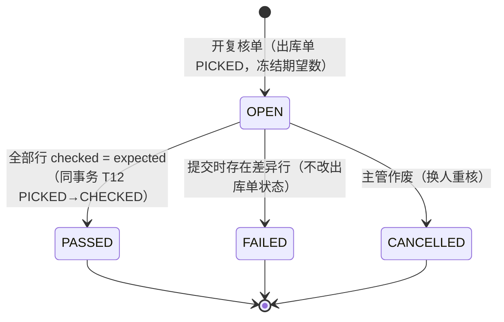
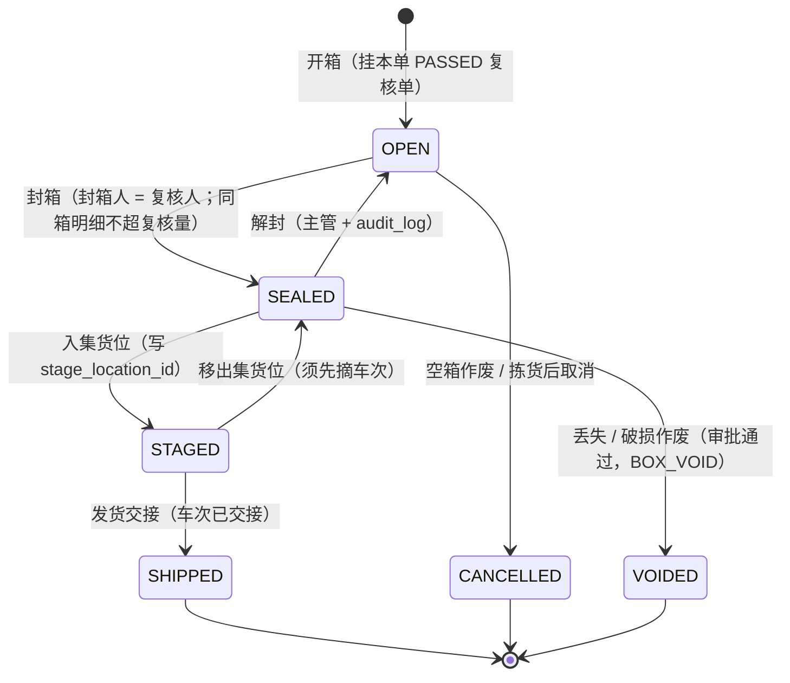
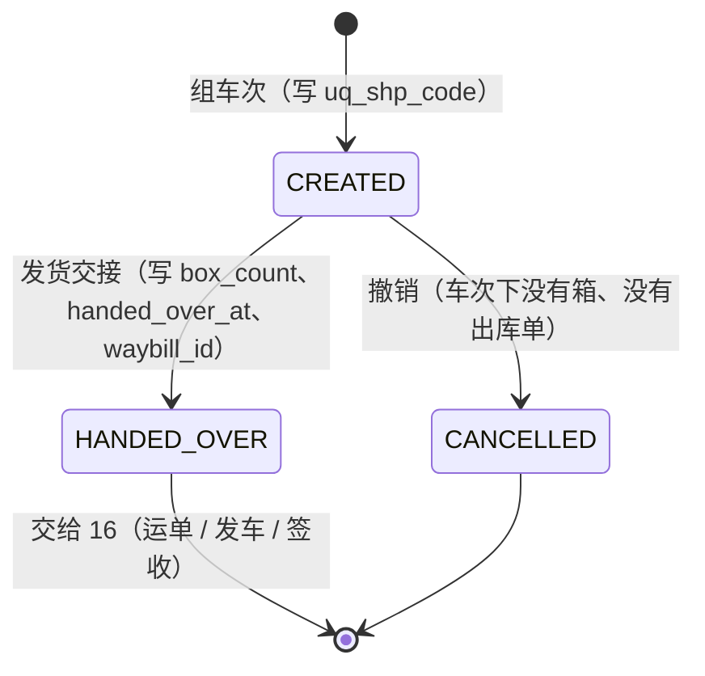
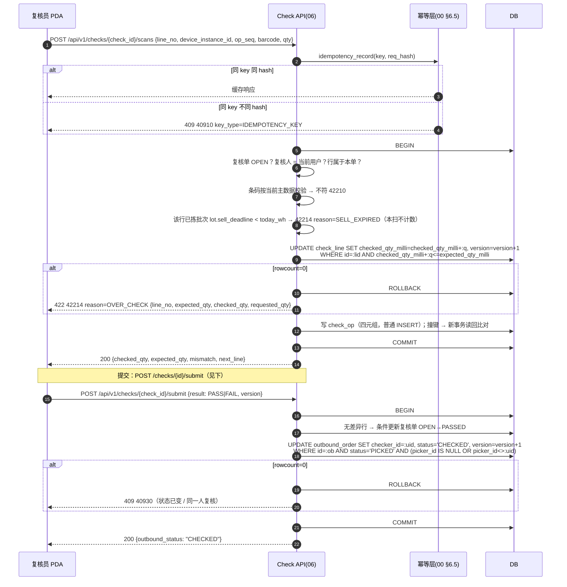
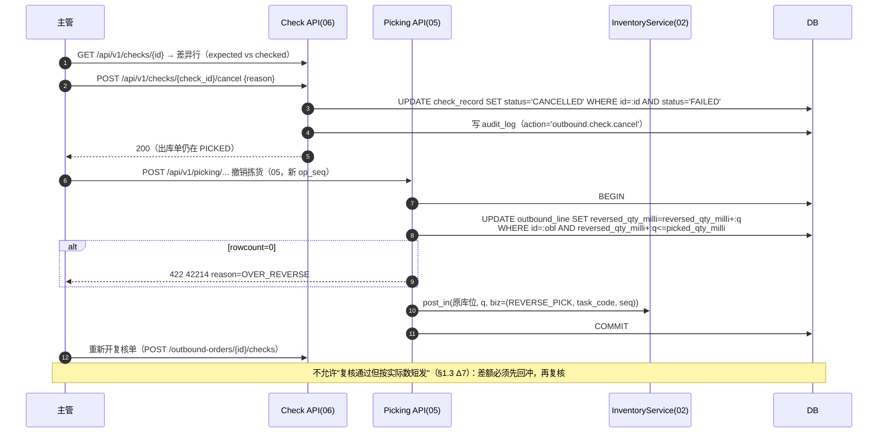
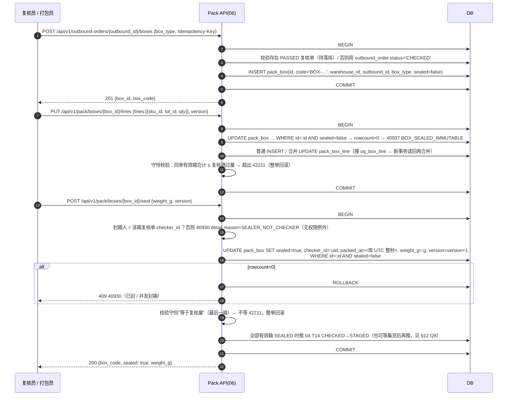
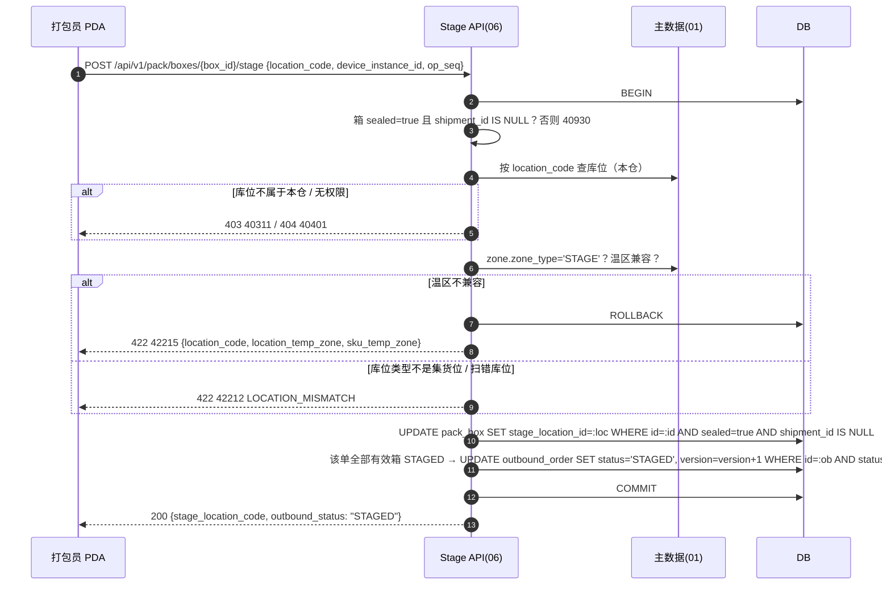
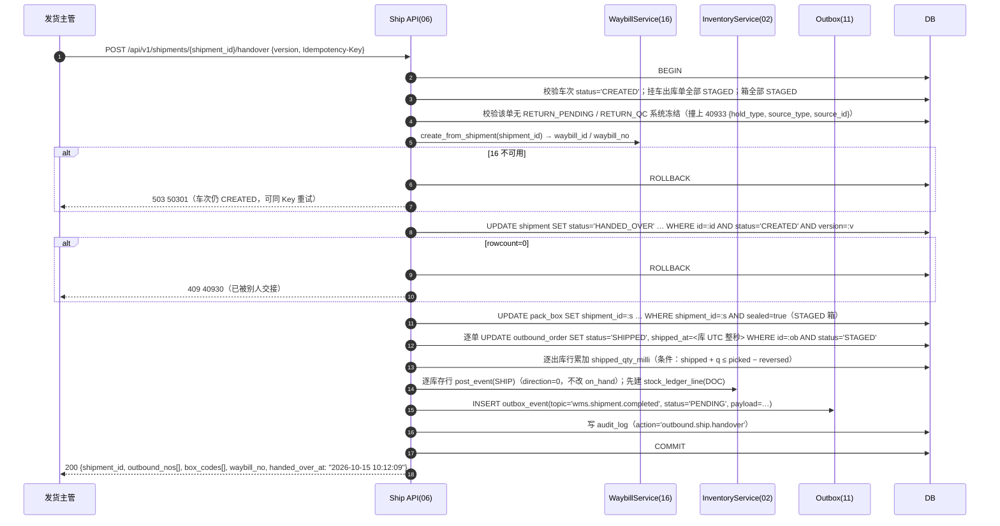
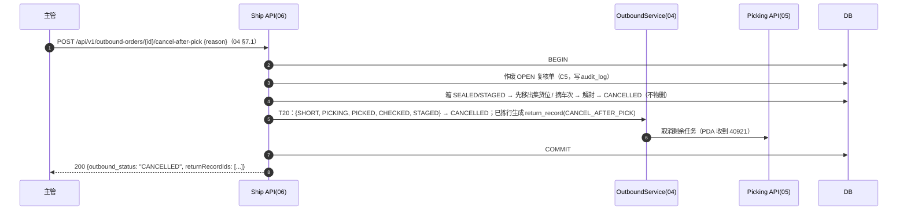

# 06 复核、装箱、发货 详细设计

| 项 | 内容 |
|---|---|
| 编号 | 06 |
| 作者 | 小李（本轮按 main 现状搬运重写：长流） |
| 评审 | 主审 小赵（对抗评审，§13）；第二评审 小吴 |
| 基线 | `docs/00-总体设计.md`、`docs/04-出库与分配.md`、`docs/05-波次与拣货.md` @ main `2349a15`；**表以 `wms-design/sql/schema/06_pack_ship.sql` 为准**（四张表：`pack_box` / `pack_box_line` / `shipment` / `shipment_order`） |
| 依赖 | 00（§5 R1–R12、§6.2 单号、§6.3 数量、§6.4 错误码、§6.5 幂等、§6.6 权限含 §6.6.1 `BOX_VOID`、§6.6.2 `paused_actions` 的 `CHECK`/`SHIP`、§6.7 状态机、§6.8 时间、§6.9 search_path、§6.10 防 REPLACE、§8 索引表第 6 篇范围）；02（`post_event`、`check_code` 巡检码、系统冻结 40933）；04（`outbound_order` / `outbound_line`、T12–T16、T20、`ck_obo_sod`、§7.3 待回库、§10 权限）；05（拣货确认、四元组、撤销拣货、`return_record` 边界、42214 各 reason）；07（补货）；09（`SELL_EXPIRED` 损耗、`lot.sell_deadline`）；11（outbox）；12（`audit_log`）；16（`WaybillService.create_from_shipment(shipment_id)`，**待落库/待定稿**） |
| 状态 | 落库：四张表 + `uq_box_code` / `uq_box_line` / `ck_box_line_qty` / `uq_shp_code` / `ix_shp_driver` + `GRANT`（本 PR 未改任何 DDL）。**未落库**：`check_record / check_line / check_op / check_picker / box_void_request`、`pack_box` 的状态列族、`shipment` 的交接列族，见 §4.5、§12 |
| 上游素材 | 旧稿 `origin/docs/06-check-pack-ship:docs/06-复核装箱发货.md`（分支同名）。**该稿新增的表与列在当前 main 上都没有落库**，本篇只引用其设计意图，一律标"待落库"，不得当现状读 |
| 全局口径 | 数量一律 `BIGINT *_qty_milli`（00 §5 R2），接口出参是三位小数字符串（`"3.000"`），入参只收字符串、超 3 位小数返回 400 `40010` 不四舍五入。**时间硬规则**：所有时间示例一律 `YYYY-MM-DD HH:MM:SS`（UTC 整秒），业务日期一律 `YYYY-MM-DD`；不出现带 `T`、带时区后缀或带小数秒的写法。仓库编码示例 `WHSH01` |

## 1. 职责与边界

### 1.1 负责

1. **复核**：出库单 `PICKED`（04 T10）后，由**非拣货人**逐行扫码核数，通过推进 04 T12 `PICKED→CHECKED`，不通过走 T13 退回。
2. **装箱**：复核通过后开箱、装明细、封箱、打印箱码（`pack_box` / `pack_box_line`）；装箱数量守恒由本篇保证。
3. **集货**：封好的箱入集货位（`stage_location_id`），全部有效箱入位后推进 04 T14 `CHECKED→STAGED`；异常退回 T15。
4. **发货出库（交接）**：组车次（`shipment`）、挂单（`shipment_order`）、把 STAGED 箱挂上车次、交接确认：箱 `SHIPPED`、出库单 T16 `STAGED→SHIPPED`、逐库存行 `post_event(SHIP)`（direction=0，不改 `on_hand`）、写 outbox 通知 11 回传上游、调用 16 `create_from_shipment(shipment_id)` 生成运单。
5. **箱作废申请 / 审批**（00 §6.6.1 `BOX_VOID`）：已封箱丢失或破损的作废路径，`pack.box.void.request` / `pack.box.void.approve`。
6. **复核记录读接口**：列表与详情（§7.1），供管理后台复核台账页与现场争议回溯。

### 1.2 不负责（边界写死）

| 不做 | 归属 |
|---|---|
| 装车扫码、缺箱放行、发车、在途、到站、签收（POD）、拒收回仓、签收更正 | **16**。本篇在**发货交接**（箱 `SHIPPED` + 出库单 T16 + 车次交接）处交出，**到发货出库为止** |
| 司机、车辆、发车时间、签收时间等字段的权威存储 | **16**（运单）。`shipment` 现有这些列与 00 §8 的范围冲突，进 §12 Q1 待裁决 |
| 出库单 `SHIPPED→DELIVERED→COMPLETED` | 16 签收事件驱动（04 T17 / T18） |
| 库存扣减 | 05 拣货确认时 `consume` 已完成（02 UC5）；本篇发货只写 `post_event(SHIP)`，不改 `on_hand` |
| FEFO 排序、预占、`PICKED` 之前的出库单状态守卫 | 04（§5.1 T1–T11、T19） |
| 波次、拣货任务、四元组记账、撤销拣货、待回库记录的表与 PDA 交互 | 05（`return_record` 表尚未落库） |
| `return_record` 的 confirm / resolve / putback-ack 契约 | **04 §7.3**；本篇只在 T20 与交接守卫里引用 |
| 报损单本体、`SELL_EXPIRED` 转损耗 | 09（本篇只把 `sell_deadline` 判定的结果转成 42214 `SELL_EXPIRED` 并按 04 T20 处理） |
| 补货任务执行 | 07 |
| 盘点冻结库位、期间流水口径 | 08 / 02 |
| PDA / 后台页面、离线队列、红条交互 | 13 / 14 |

### 1.3 与原文档（旧稿）的差异

| # | 旧稿 / 原说明书 | 本篇（按 main 现状） | 原因 |
|---|---|---|---|
| Δ1 | `shipment.status` 收窄为 `CREATED / HANDED_OVER / CANCELLED`，删司机车辆发车签收列、加 `waybill_id / box_count / handed_over_at / handed_over_by / dock_location_id` | **当前 DDL 没有这些改动**：`status` 默认 `CREATED`、列注释是 `CREATED/LOADING/DEPARTED/DELIVERING/SIGNED/CLOSED`，司机车辆发车签收列与 `ix_shp_driver` 都还在 | 旧稿是分支设计，未合入 main；差异进 §12 Q1 待裁决 |
| Δ2 | `pack_box` 加 `status / check_id / shipped_at / voided_at / version / created_at`，`weight_g` 改整数克 | **当前 DDL 只有 `sealed BOOLEAN`**，没有 `status`，没有 `created_at`，`weight_g` 仍是 `NUMERIC(10,2)` | 同上，进 §12 Q3 |
| Δ3 | `shipment_order` 加 `uq_sho_outbound UNIQUE (outbound_id)` 保证"一单只挂一个车次" | **当前 DDL 只有主键 `(shipment_id, outbound_id)`**：一单挂两个车次不会被库层拦住 | `outbound_id` 不在任何唯一键里，只能应用层守卫（§5.3 S5） |
| Δ4 | 复核结果只记在 `outbound_order.checker_id`，加 `check_record / check_line / check_op / check_picker` | 本轮**沿用 main**：库层只有 `checker_id` + `ck_obo_sod` + T12；逐扫、差异、SoD 留痕**待落库** | 新表要连带 no-REPLACE 守卫、冻结基线登记与两库用例，单独增量（00 §6.10） |
| Δ5 | 装箱守恒只在"封最后一箱"校验 | 改为**每次改动箱明细后**增量校验（同单有效箱合计 ≤ 复核通过量），封最后一箱再核"等于" | 避免把不一致留到最后一刻才发现 |
| Δ6 | outbox payload 的 `handed_over_at` 用带 `Z` 的写法 | 一律 `YYYY-MM-DD HH:MM:SS`（UTC 整秒） | 00 §6.8 第 1–2 条 + 本轮时间硬规则 |
| Δ7 | 复核少货可以"按实际数发货" | 不允许：先 05 撤销拣货回冲，再重新复核（旧稿 Q3 已定，维持） | 库层 `ck_obl_sum` 的 `shipped ≤ picked − reversed` 口径 |

## 2. 用例

| 编号 | 用例 | 角色 | 权限点 | 动库存原语 | 可离线 |
|---|---|---|---|---|---|
| CP1 | 开复核单（冻结期望数） | 复核员 | `outbound.check.execute` | 无（只读 `outbound_line.picked_qty_milli`） | 否（需在线取冻结期望数） |
| CP2 | 复核扫码 / 撤销一扫 / 提交（通过、不通过） | 复核员 PDA | `outbound.check.execute` | 无（复核不动库存） | 扫码是（四元组去重）；提交否 |
| CP3 | 复核作废（换人重核） | 主管 | `outbound.check.cancel` | 无 | 否 |
| CP4 | 开箱 / 改明细 / 封箱 / 打印箱码 | 复核员、打包员 | `outbound.pack.execute` | 无 | 否 |
| CP5 | 解封（封箱后发现装错） | 主管 | `outbound.pack.unseal` | 无 | 否 |
| CP6 | 箱作废申请 / 审批 | 复核员、仓主管 / 仓主管、CENTER_OPS | `pack.box.void.request` / `pack.box.void.approve` | 无（`LOST` 走 10 异常、`DAMAGED` 走 `convert_hold` 转 `SCRAP_PENDING`，**由 09/10 落单时执行**） | 否 |
| CP7 | 箱查询（列表 / 详情） | 有单据查看权限者 | `outbound.order.view` | 无 | — |
| CP8 | 集货入位 / 移出集货位 | 打包员 | `outbound.stage.execute` | 无 | 是（扫箱码 + 库位码） |
| CP9 | 组车次、挂单、摘单、撤销车次 | 发货员 | `outbound.ship.plan` | 无 | 否 |
| CP10 | 发货交接（出库） | 发货主管 | `outbound.ship.handover` | `post_event(SHIP)` | 否 |
| CP11 | 拣货后取消（复核 / 集货阶段） | 主管 | `outbound.order.cancel_after_pick`（04 T20） | 待回库（04/05） | 否 |
| CP12 | 复核记录读（列表 / 详情） | 仓经理、客服、主管 | `outbound.order.view`（13 §6.3-6） | 无 | — |

## 3. 领域模型

### 3.1 复核

- **`CheckRecord`（概念，待落库）**：一张出库单同一时刻至多一张 `OPEN` 复核单（旧稿 `uq_chk_open`，部分唯一）。开单时**冻结期望数**：`picker_id` 取 `outbound_order.picker_id`，每行 `expected_qty_milli` = 该出库行当时的 `picked_qty_milli`。之后拣货侧再变（撤销拣货）不影响本单。
- **库层当前只有两件东西**（main 现状，必须按此写代码）：
  1. `outbound_order.checker_id BIGINT`（复核人）；
  2. `CONSTRAINT ck_obo_sod CHECK (checker_id IS NULL OR picker_id IS NULL OR picker_id <> checker_id)`：**复核人 ≠ 拣货人**，库层兜底，应用层命中时返回 **40312** `detail.reason='CHECK_SOD'`（00 §6.4）。
  3. 出库单状态 `PICKED→CHECKED`（04 T12）与 `CHECKED→PICKED`（T13）。
- **SoD 是"任一拣货人"口径**：拣货任务可能被改派过（05 T-reassign、交接任务），`outbound_order.picker_id` 只是主拣货人。旧稿用 `check_picker` 表登记该单全部拣货人（含改派前持有人、拣货流水上出现过的操作人），**该表未落库**；落库前用 05 的 `pick_task.assigned_to` + `pick_task.handover_from_task_id` 追溯链 + 02 `stock_movement.operator_id` 在开单时算一次并写入复核单快照（§12 Q4）。
- **逐行扫码记录 `CheckOp`（待落库）**：与 05 的 `pick_op` 同构，PDA 四元组 `(check_id, line_no, device_instance_id, op_seq)`，`op_type ∈ {SCAN, UNDO}`，逐件模式另有 `scan_event_id`。复核不动库存，`check_op` 是这条操作的**唯一账**（02 流水里没有复核的痕迹）——这也是 §9 里"复核逐扫明细读不到"的根因。
- **复核判定**：`checked_qty_milli ≠ expected_qty_milli` 的行即差异行。`PASSED` 要求没有差异行（旧稿把这条写在库层触发器 `check_state` 里，表未落库时由应用层同事务断言，漏写撞 CHECK 报 50010）。

### 3.2 装箱

- **`pack_box`（已落库）**：`outbound_id` 单值 → **一箱不跨单**（冷链接单配送，跨单拼箱不做，旧稿 Q5 已定）。`box_type ∈ {CARTON, TURNBOX}`（周转筐），`sealed BOOLEAN NOT NULL DEFAULT false`，`checker_id`（封箱人）、`packed_at`、`weight_g`、`stage_location_id`（集货位）、`shipment_id`（车次）。
- **`pack_box_line`（已落库）**：`uq_box_line (box_id, sku_id, lot_id)`，`qty_milli > 0` 且为整数（`ck_box_line_qty`）。`lot_id NOT NULL DEFAULT 0`，0 表示未记批次（注释说明：不可空，否则 `uq_box_line` 含 NULL 会失效）。
- **装箱数量守恒**（应用层，`CHECKED` 阶段每次改动后校验）：某出库单所有**非作废**箱的明细合计，按 `(sku_id, lot_id)` 必须等于复核通过量；不足或超出都返回 **42211** `CHECK_QTY_MISMATCH`，`detail = {outbound_lines: [{sku_id, lot_id, checked_qty, packed_qty}]}`。库层没有这条约束（`pack_box_line` 只为单箱明细服务），所以这是**纯应用层不变量**。
- **封箱人 = 复核人**：`pack_box.checker_id` 必须等于该箱所属复核单的 `checker_id`，否则 **40930** `detail.reason='SEALER_NOT_CHECKER'`，**没有权限例外**（主管也不能代封；换人只能作废复核单重新复核）。库层当前**没有**这条触发器（旧稿的 `sealer_not_checker` 未落库），靠应用层守卫 + §11 用例。
- **设计态箱状态**（待落库）：`OPEN / SEALED / STAGED / SHIPPED / CANCELLED / VOIDED`。当前库层只有 `sealed` 布尔，是这套状态的**降级投影**；映射见 §5.2。

### 3.3 车次

- **`shipment`（已落库）**：`warehouse_id`、`carrier_code`、`code`（`uq_shp_code`）、`status`、`created_at / updated_at`；司机车辆发车签收列见 §1.3 Δ1。
- **`shipment_order`（已落库）**：`PRIMARY KEY (shipment_id, outbound_id)`。一个车次装多张出库单，多个箱（`pack_box.shipment_id`）。
- **一单只能挂一个车次**：库层**没有** `uq_sho_outbound`，只能应用层守卫——挂单前 `SELECT 1 FROM shipment_order WHERE outbound_id=:id`（读到的行必须属于同一车次）；`wms_app` **没有 DELETE 授权**，所以"摘单"落地为"车次未交接待整批替换"（不是逐行删），并在 §8 用"普通 INSERT 撞主键 → 新事务读回比对"兜重复提交（§12 Q2）。
- **交接时冻结箱清单**：交接事务里把"本车次 STAGED 箱"数量与箱码写进 outbox payload，作为 16 生成运单的箱码白名单。

### 3.4 数量与时间

- 量纲：复核行 `expected / checked`、装箱行 `qty_milli`、装箱守恒合计都是基本单位 milli（`sku.base_uom` 的千分之一）。
- 时间列一律 UTC、不带时区、精度到秒（00 §6.8 第 1–2 条）。**本篇已把 `shipment.created_at / updated_at` 的默认值收口为库时钟整秒 UTC**（PG `DEFAULT (date_trunc('second', now() AT TIME ZONE 'UTC'))`，SQLite 由翻译器生成 `datetime('now')`，00 §6.8 第 3 条）；`pack_box.packed_at`、交接时间由服务端在状态迁移的同一语句里写库时钟值，**不收客户端时间**；SQLite 侧的整秒格式 + ±300 s 窗口 CHECK（失败 → 40003）与其余事件时间的"由库写"触发器仍待专项增量（§12）。
- 接口入参 / 出参时间一律 `YYYY-MM-DD HH:MM:SS`；业务日期 `work_date` 一律 `YYYY-MM-DD`，按 `warehouse.timezone` 计算（R3），不按浏览器或服务器时区。
- 作业日切换（`warehouse.day_switch_time`，默认 `00:30`）时丢弃内存里的旧作业日号段（00 §6.2）。

## 4. 涉及的表

约束名与索引名**以 `wms-design/sql/schema/06_pack_ship.sql` 为准**，文档与脚本逐列对齐。四张表的 `wms_app` 授权是同一条语句（`-- @pg-only` 行）：

```sql
GRANT SELECT, INSERT, UPDATE ON pack_box, pack_box_line, shipment, shipment_order TO wms_app;  -- @pg-only
```

`pack_box_line` / `shipment_order` **没有 DELETE**：摘箱明细、摘车次都走应用层写"作废/摘除"语义（明细用数量改 0 或整箱作废，挂单用"车次未交接才允许整单替换"），不物删。SQLite 无角色，这段授权不生效。

### 4.1 `pack_box`（已落库，逐列）

| 列 | 类型 / 约束 | 说明 |
|---|---|---|
| `id` | `BIGINT PRIMARY KEY` | 雪花 ID（00 §6.1），应用层生成 |
| `code` | `VARCHAR(64) NOT NULL` | 箱码，司机端逐箱扫；`CONSTRAINT uq_box_code UNIQUE (code)`。单号格式 `BOX-{仓前缀}-{节点号}-{yyyyMMdd}-{序号}`（00 §6.2；旧稿未定前缀，本篇登记建议，见 §12 Q6） |
| `warehouse_id` | `BIGINT NOT NULL` | 数据权限；**不信任请求体**，服务端按资源查。`fk_box_wh` → `warehouse(id)` |
| `outbound_id` | `BIGINT NOT NULL` | 所属出库单；一箱不跨单。`fk_box_outbound` → `outbound_order(id)` |
| `shipment_id` | `BIGINT` | 挂的车次；未挂为空。`fk_box_shipment` → `shipment(id)` |
| `stage_location_id` | `BIGINT` | 集货位（`location.id`，应是 `zone.zone_type='STAGE'` 的库位）。`fk_box_stage` → `location(id)` |
| `box_type` | `VARCHAR(24) NOT NULL DEFAULT 'CARTON'` | `CARTON` / `TURNBOX`（周转筐）；`ck_box_type` 值域 CHECK |
| `weight_g` | `NUMERIC(10,2)` | 整箱重量（克）。`ck_box_weight`：空或 `>= 0`。**仍违反 00 §5 R2**（重量是数量语义，应 `BIGINT`；且 `NUMERIC` 在 SQLite 实际存 REAL），见 §12 Q3 |
| `sealed` | `BOOLEAN NOT NULL DEFAULT false` | 封箱标志；`ck_box_sealed`：`sealed = false` 或 `packed_at` 与 `checker_id` 均非空。R9 要求布尔用 `SMALLINT 0/1` + `is_xxx` 命名，本表两处都不符；**现阶段以脚本为准**，收口随 §12 Q3 |
| `checker_id` | `BIGINT` | 封箱人；应用层保证 = 复核单复核人（40930 `SEALER_NOT_CHECKER`） |
| `packed_at` | `TIMESTAMP` | 封箱时间，服务端库时钟 |

约束与索引（现状全量）：`uq_box_code UNIQUE (code)`、`ck_box_type`、`ck_box_weight`、`ck_box_sealed`、四个外键 `fk_box_wh` / `fk_box_outbound` / `fk_box_shipment` / `fk_box_stage`。**没有** `status`、`created_at`、`version`、`voided_at`、`check_id`，**没有**状态 CHECK，**没有**除箱码外的索引（查询 `outbound_id` / `shipment_id` 仍全表扫，索引随装箱状态机增量一起提）。

### 4.2 `pack_box_line`（已落库，逐列）

| 列 | 类型 / 约束 | 说明 |
|---|---|---|
| `id` | `BIGINT PRIMARY KEY` | |
| `box_id` | `BIGINT NOT NULL` | 归属箱 |
| `sku_id` | `BIGINT NOT NULL` | |
| `lot_id` | `BIGINT NOT NULL DEFAULT 0` | 0 = 未记批次；**不可空**（`uq_box_line` 含 NULL 会失效，R11 哨兵值） |
| `qty_milli` | `BIGINT NOT NULL` | 基本单位 milli |
| `uom` | `VARCHAR(16) NOT NULL` | 作业单位，仅展示 |

约束与索引（现状全量）：

| 名称 | 内容 |
|---|---|
| `ck_box_line_qty` | `CHECK (qty_milli > 0 AND qty_milli = CAST(qty_milli AS BIGINT))`：正数且为整数（SQLite 防 REAL 混入） |
| `uq_box_line` | `UNIQUE (box_id, sku_id, lot_id)`：同箱同 SKU 同批次一行，追加先合并数量 |

**有** `fk_bxl_box` → `pack_box(id)`、`fk_bxl_sku` → `sku(id)`；`lot_id` 因 0 是"未记批次"哨兵值（R11）**不加**外键。**没有**封箱后不可改的触发器（旧稿 `box_sealed` 未落库）→ 封箱后改明细当前**库层拦不住**，只能应用层返回 **40937** `BOX_SEALED_IMMUTABLE`（§9）。

### 4.3 `shipment`（已落库，逐列）

| 列 | 类型 / 约束 | 说明 |
|---|---|---|
| `id` | `BIGINT PRIMARY KEY` | |
| `code` | `VARCHAR(64) NOT NULL` | `CONSTRAINT uq_shp_code UNIQUE (code)`；单号 `SHP-{仓前缀}-{节点号}-{yyyyMMdd}-{序号}`（建议，§12 Q6） |
| `warehouse_id` | `BIGINT NOT NULL` | |
| `carrier_code` | `VARCHAR(32)` | 承运商；自提为空 |
| `vehicle_no` | `VARCHAR(24)` | 车牌。**与 00 §8 范围冲突**，见 §12 Q1 |
| `driver_id` / `driver_name` / `driver_phone` | `BIGINT` / `VARCHAR(64)` / `VARCHAR(32)` | 司机。同上 |
| `status` | `VARCHAR(16) NOT NULL DEFAULT 'CREATED'` | `ck_shp_status`：`CREATED/HANDED_OVER/CANCELLED`（**本轮按 00 §8 收窄**，见 §5.3）。列注释里原来的 `LOADING/DEPARTED/DELIVERING/SIGNED/CLOSED` 已作废，发车与签收归 16 篇 |
| `planned_depart_at` / `departed_at` / `signed_at` | `TIMESTAMP` | 计划发车 / 发车 / 签收。同上 |
| `temp_log_ref` | `VARCHAR(128)` | 温控记录对象存储 key |
| `created_at` / `updated_at` | `TIMESTAMP NOT NULL` | 库默认 `date_trunc('second', now() AT TIME ZONE 'UTC')`（本轮收口，00 §6.8 第 3 条） |

约束与索引（现状全量）：`uq_shp_code`、`ck_shp_status`、`fk_shp_wh` → `warehouse(id)`、`ix_shp_driver ON shipment(driver_id, status, planned_depart_at)`。**没有** `version`、**没有** `waybill_id`、**没有** `box_count`、**没有** `handed_over_at` / `handed_over_by`。

### 4.4 `shipment_order`（已落库，逐列）

| 列 | 类型 / 约束 | 说明 |
|---|---|---|
| `shipment_id` | `BIGINT NOT NULL` | 车次 |
| `outbound_id` | `BIGINT NOT NULL` | 出库单 |

约束与索引（现状全量）：`PRIMARY KEY (shipment_id, outbound_id)`、`fk_sho_shipment` → `shipment(id)`、`fk_sho_outbound` → `outbound_order(id)`。**没有** `uq_sho_outbound`，"一单只挂一个车次"仍靠应用层守卫（§12 Q2）。摘挂 = `DELETE` + `INSERT`，而 `wms_app` **没有 DELETE 授权** → 当前的摘单只能靠"未交接车次允许整批替换 + 应用层校验"。

### 4.5 引用的 02 / 04 / 11 / 12 表

| 表 | 本篇用法 |
|---|---|
| `outbound_order` | 状态由 04 T12–T16 推进（本篇触发 T12/T13/T14/T15/T16）；`checker_id` 由本篇写；`ck_obo_sod` 兜 SoD；`version` 做状态条件更新；`shipped_at` 由 T16 写 |
| `outbound_line` | `picked_qty_milli` = 复核期望数来源；`reversed_qty_milli` 由 05 撤销 / 04 T20 累加；`shipped_qty_milli` 由 T16 累加（`ck_obl_sum` 要求 `shipped ≤ picked − reversed`） |
| `pick_task` / `pick_task_line` | 开复核单时算"该单全部拣货人"（`assigned_to` + `handover_from_task_id` 追溯链）；`expected_qty_milli` 可交叉核对 `confirmed_qty_milli` |
| `stock_movement` / `stock_movement_key` | T16 逐库存行 `post_event(SHIP)`：`biz_type='SHIP'`、`direction=0`（纯事件，不改 `on_hand`）、`src_kind='DOC'`、`op_no≥1`、`leg=1`；幂等键 `{出库单号}:{line_no}:D{op_no}:1` 受 `uq_mvk_biz_line` 约束 |
| `stock_ledger_line` | `post_event` 前必须已存在 `(biz_no=出库单号, line_no, src_kind='DOC')` 的记账来源行，否则被 `trg_mvk_line_kind` 拒（`ledger_line_owner_mismatch`）。**写法：先查再插**（`INSERT … SELECT … WHERE NOT EXISTS`），不用 `ON CONFLICT`（00 §6.10 第 8 条） |
| `stock_recon_alert` | 巡检写 `CHECK_BOX_MISMATCH`（SHIPPED 单的箱明细合计 ≠ 复核通过量）、`SHIP_EVENT_MISSING`（SHIPPED 单没有 `SHIP` 事件）。两码已在 02 `ck_recon_code` |
| `outbox_event` | 交接成功写 `wms.shipment.completed`（**topic 名以 11 篇登记表为准**，统一用这个；`status='PENDING'` 由非属主写入，`trg_outbox_insert_pending` 兜）；投递重试由 11 负责 |
| `idempotency_record` | 接口层去重，24h，只缓存 2xx / 400xx / 409xx |
| `audit_log` | 复核作废、解封、箱作废申请与审批、发货交接、车次撤销写审计（`action='outbound.check.cancel'` 等） |
| `zone` / `location` | 集货位校验：`location.zone_id → zone.zone_type='STAGE'`、温区比对用 `zone.temp_zone` |

### 4.6 待落库 / 待裁决（本 PR 不含，登记在 §12）

| 对象 | 规格出处 | 为什么单独提 |
|---|---|---|
| `check_record` / `check_line` / `check_op` / `check_picker` | 旧稿 §4.1–§4.3、§4.1a；00 §6.6.1 的 SoD 口径 | 新表要连带 no-REPLACE 守卫（`uq_chk_open` 是部分唯一索引）、触发器（`check_state` / `check_sod` / `check_closed` / `check_immutable`）、`REPLACE_TODO` 基线登记与两库正反用例（00 §6.10）；缺它时 §7.1 的详情接口**读不到逐扫明细**，只能降级 |
| `box_void_request` | 00 §6.6.1 `BOX_VOID` 行（权限点与两个接口已登记）；旧稿 §4.4a | 同上；`uq_bvr_pending` 是部分唯一索引，`ck_bvr_self`（不能自批）、`ck_bvr_decided` 都要两库落地 |
| `pack_box.status / check_id / shipped_at / voided_at / version / created_at` | 旧稿 §4.4；本篇 §5.2 | 现状只有 `sealed` 布尔，设计态 6 个状态无处安放；`ck_box_status` / `ck_box_sealed` / `ck_box_staged` / `ck_box_shipped` / `ck_box_voided` 一并提 |
| `shipment.waybill_id / box_count / handed_over_at / handed_over_by / dock_location_id / version`，并删 `vehicle_no / driver_* / planned_depart_at / departed_at / signed_at / temp_log_ref` 与 `ix_shp_driver` | 旧稿 §4.6；牵涉 16 篇 | **与 00 §8 范围冲突**，先裁决再落库（§12 Q1） |
| `shipment_order.uq_sho_outbound UNIQUE (outbound_id)`、两个外键 | 旧稿 §4.6a；本篇 §3.3 | "一单只挂一个车次"目前库层无守卫（§12 Q2） |
| 四张表的 no-REPLACE 守卫 | 00 §6.10 第 5 条 `REPLACE_TODO`，责任人"06" | `pack_box.code`、`pack_box_line.(box_id,sku_id,lot_id)`、`shipment.code`、`shipment_order` 主键各一个守卫 + 2z3b 实打样本 |
| 时间约定剩余部分 | 00 §6.8 第 4 条 | `created_at` / `updated_at` 的 DEFAULT 本轮已收口；SQLite 侧整秒格式 + ±300 s 窗口 CHECK 与事件时间的库写触发器待专项增量 |
| 四张表的 FK 补充 | 00 §6.10 第 9 条（"其余各篇子表缺的外键记在 #14"） | **本轮已落库 9 个外键**：`fk_shp_wh`、`fk_sho_shipment`、`fk_sho_outbound`、`fk_box_wh` / `fk_box_outbound` / `fk_box_shipment` / `fk_box_stage`、`fk_bxl_box` / `fk_bxl_sku`（`pack_box_line.lot_id` 是哨兵值，不加） |

**当前 DDL 的可见缺口（评审请按此核对）**：四张表**没有**状态迁移触发器、**没有** `version` 乐观锁列、**没有** no-REPLACE 守卫。库层兜住：`uq_box_code`、`ck_box_type` / `ck_box_weight` / `ck_box_sealed`、`ck_box_line_qty`、`uq_box_line`、`uq_shp_code`、`ck_shp_status`、9 个外键。**状态迁移全部靠应用层条件更新 + `rowcount` 判定**（§5、00 §6.7），这与 00 现行口径一致，不是遗漏。

## 5. 状态机

### 5.1 复核（设计态，含未落库说明）



| # | from → to | 触发者 | 守卫（写进条件更新的 WHERE） | 副作用（同事务） | 错误码 |
|---|---|---|---|---|---|
| C1 | — → OPEN | 复核员 | 出库单 `status='PICKED'`；无其他 `OPEN` 复核单；复核人 ∉ 该单拣货人 | 写 `check_record`（`picker_id`、`checker_id`、各行 `expected_qty_milli` 快照）；写 `check_picker`（全部拣货人，待落库） | 40930（状态不对 / 已有 OPEN 单）；40312 `CHECK_SOD` |
| C2 | OPEN → OPEN（扫码 / 撤销一扫） | 复核员 PDA | 四元组 `(check_id, line_no, device_instance_id, op_seq)` 未用过；`checked + q ≤ expected`；批次 `sell_deadline ≥ today_wh` | 写 `check_op`；累加 `check_line.checked_qty_milli`；`OVER_CHECK` / `SELL_EXPIRED` 时把 `check_op.result_code` 落成失败码 | 42210 / 42214（`OVER_CHECK`、`SELL_EXPIRED`、`OVER_REVERSE`） |
| C3 | OPEN → PASSED | 复核员 | 无差异行（`NOT EXISTS (checked <> expected)`）；至少一个拣货人登记 | 条件更新出库单 T12：`SET checker_id=:uid, status='CHECKED', version=version+1 WHERE id=:id AND status='PICKED' AND (picker_id IS NULL OR picker_id <> :uid)`；`rowcount=0` → 40930 | 40930；40312 `CHECK_SOD`（`ck_obo_sod` 兜底，撞上是 50010） |
| C4 | OPEN → FAILED | 复核员 | 存在差异行 | 只关复核单，**不改出库单状态**（留在 `PICKED`）；差异交主管决定走 05 撤销拣货还是 T20 | 42211（`detail.lines[]`） |
| C5 | OPEN → CANCELLED | 主管 | `WHERE status='OPEN'`；必填 `reason` | 写 `audit_log`；单据回可重开状态 | 40930；40002（缺原因） |

- 复核期间**出库单停在 `PICKED`**，拣货侧要撤销拣货必须先作废复核单（C5）——否则复核期望数与实际账面会脱钩。
- **库层没有迁移触发器**：`check_record` 未落库，`outbound_order` 只有 `ck_obo_status` 值域。每一条 from 判断都在应用层条件更新里，`rowcount=0` → **40930**（`detail` 带当前状态），与 00 §6.7 一致。
- 终态（`PASSED` / `FAILED` / `CANCELLED`）之后不再迁移；复核人开单后不可改。

### 5.2 箱 `pack_box`



**当前库层的降级投影（评审重点）**：库里只有 `sealed BOOLEAN`，`stage_location_id` / `shipment_id` / `checker_id` / `packed_at` 四列**兼任状态标志**。落库 `status` 之前，应用层按下面的映射读状态，**不要**在代码里假设存在 `status` 列：

| 设计态 | 现状判据（`sealed` + 列的空/非空） |
|---|---|
| `OPEN` | `sealed = false` |
| `SEALED` | `sealed = true AND shipment_id IS NULL AND stage_location_id IS NULL` |
| `STAGED` | `sealed = true AND stage_location_id IS NOT NULL AND shipment_id IS NULL` |
| `SHIPPED` | `sealed = true AND shipment_id IS NOT NULL` + 车次已交接（**箱上没有 `shipped_at`，要靠车次侧判断**） |
| `CANCELLED` / `VOIDED` | **无法表达**：当前 DDL 既没有状态位也没有 `voided_at` → 只能整行删除（`wms_app` 无 DELETE）或留残留行。这是 §12 Q3 必须落库的理由 |

| # | from → to | 触发者 | 守卫 | 副作用 | 错误码 |
|---|---|---|---|---|---|
| B1 | — → OPEN | 复核员 / 打包员 | 出库单有 `PASSED` 复核单；`outbound_id` 属本仓 | `INSERT pack_box(code, outbound_id, warehouse_id, box_type, sealed=false)` | 40930（无 PASSED 复核单） |
| B2 | OPEN → OPEN（装 / 改明细） | 复核员 / 打包员 | `sealed=false`；守恒校验：同单有效箱合计 ≤ 复核通过量 | 普通 `INSERT` 或 `UPDATE qty_milli`（`uq_box_line` 撞键 = 先合并再写，见 §8） | 40937（`sealed=true`）；42211（超复核量） |
| B3 | OPEN → SEALED | 复核员（**必须是该箱复核人**） | `sealed=false`；`checker_id = 复核单.checker_id`；守恒校验通过 | `SET sealed=true, checker_id=:uid, packed_at=<库 UTC 整秒>, weight_g=:g` | 40930 `SEALER_NOT_CHECKER`；42211 |
| B4 | SEALED → OPEN（解封） | 主管 | `sealed=true`；无 `PENDING` 作废申请；必填 `reason` | `SET sealed=false, packed_at=NULL, weight_g=NULL`；写 `audit_log` | 40930；40002 |
| B5 | SEALED → STAGED | 打包员 | `sealed=true`；扫到的库位 `zone_type='STAGE'` 且温区兼容；车次未挂 | `SET stage_location_id=:loc`；全部有效箱 STAGED 后推 04 T14 `CHECKED→STAGED` | 42215（温区不符）；42212（库位不对）；40930 |
| B6 | STAGED → SEALED（移出集货位） | 主管 | 未挂车次（`shipment_id IS NULL`） | `SET stage_location_id=NULL`；有箱退回时推 04 T15 `STAGED→CHECKED` | 40930 |
| B7 | SEALED → VOIDED | 申请人 + 审批人（不能自批） | 有 `APPROVED` 作废申请（`box_void_request.status='APPROVED'`） | 同事务写 `voided_at`；`LOST` 转 10 异常按库存损失、`DAMAGED` 走 `convert_hold` 到 `SCRAP_PENDING`；写 `audit_log` | 40312 `BOX_VOID_SELF_APPROVE`；40930（`BOX_NOT_SEALED` / `VOID_PENDING_EXISTS` / `VOID_ALREADY_DECIDED`） |
| B8 | STAGED → SHIPPED | 发货主管（交接事务内） | 车次已交接（`status='HANDED_OVER'`） | `SET shipped_at`（待落库列）；箱明细冻结 | 40930 |
| B9 | {OPEN, SEALED, STAGED} → CANCELLED | 系统 / 主管（04 T20） | 箱内货物已由 04/05 走待回库 | 明细冻结；`audit_log` | 40930 |

- `SHIPPED` 是**终态**：箱子一旦出库，任何"改箱／解封／改明细"都返回 40937 或 40930；交接后发现装错车不撤回（由 16 改派处理）。
- 作废后：该箱明细**不计入**装箱守恒（与 `CANCELLED` 一起从合计里排除），出库单回到"差装箱"——重新拣货补装（05 新任务）或主管按缺货走 04 拣后取消；本文不改库存。

### 5.3 车次 `shipment`



**当前库层的 3 个状态（本轮已收窄）**：`CREATED / HANDED_OVER / CANCELLED`（`ck_shp_status` 值域 CHECK）。这是按 00 §8「本篇范围到发货出库为止」落的口径：**发车、在途、签收在 16 篇的运单表**，本篇不再有 `LOADING / DEPARTED / DELIVERING / SIGNED / CLOSED` 这 5 个状态。`vehicle_no / driver_* / planned_depart_at / departed_at / signed_at / temp_log_ref` 这几列**本轮先留在表里不动**（删列会动到 16 篇的读取面），去留与 `waybill_id / box_count / handed_over_at / handed_over_by` 的补列一起等 16 篇拍板（§12 Q1）。

| # | from → to | 触发者 | 守卫 | 副作用 | 错误码 |
|---|---|---|---|---|---|
| S1 | — → CREATED | 发货员 | `uq_shp_code`；仓一致 | `INSERT shipment(status='CREATED')` | 50010（撞 `uq_shp_code`，服务端缺陷） |
| S2 | CREATED → CREATED（挂单 / 摘单） | 发货员 | 车次 `status='CREATED'`；出库单 `STAGED`；该单未挂别的车次 | 写 / 换 `shipment_order(shipment_id, outbound_id)`；**库层无 `uq_sho_outbound`**，靠应用层守卫 | 40930；40931（单据锁定） |
| S3 | CREATED → CREATED（挂箱 / 摘箱） | 发货员 | 箱 `STAGED`；车次 `CREATED` | `SET pack_box.shipment_id=:s`（摘箱 `=NULL`，须先移出集货位） | 40930 |
| S4 | CREATED → HANDED_OVER | 发货主管 | 车次 `CREATED`；挂车出库单全部 `STAGED`；箱全部 `STAGED`；该单无待回库 / 系统冻结 | ① 校验 → ② `create_from_shipment` 建运单（16）→ ③ 条件更新车次 → ④ 箱 `STAGED→SHIPPED` → ⑤ 逐单 T16 → ⑥ 逐库存行 `post_event(SHIP)` → ⑦ 写 outbox `OUTBOUND_SHIPPED`。**全在同一事务** | 40930（任一 `rowcount` 与预期不符）；50301（16 不可用 → 整单回滚）；40933（撞系统冻结） |
| S5 | CREATED → CANCELLED | 发货主管 | 车次下**没有箱、没有出库单**；必填 `reason` | 写 `audit_log` | 40930；40002 |

- **一单只能挂一个车次**（库层守卫缺，见 §4.4）：挂单前 `SELECT shipment_id FROM shipment_order WHERE outbound_id=:id`；查到且不是本车次 → 40930 `detail.reason='OUTBOUND_ALREADY_SHIPPED_IN_ANOTHER'`（**reason 由本篇登记，不是 00 §6.4 的错误码**，只作为 40930 的 detail 字段）。
- 交接后不能撤回；要退回走 06 红冲（补发货 / 反向单据），本期不做在线改单（§12 Q7）。

## 6. 核心流程

### 6.1 复核扫码与提交



要点：

- **复核不动库存**：全程没有 02 原语，只有 04 的状态迁移和 `checker_id` 写入。这也是"复核期间账面与实物可能不一致"的唯一来源（§9）。
- `SELL_EXPIRED` 命中时本扫**不计数**（`check_line.checked_qty_milli` 不变），`check_op.result_code='42214'`；该行后续按 04 T20 拣后取消处理，货物由 09 按 `SELL_EXPIRED` 转损耗（`uq_scr_source` + `source_date=work_date` 保证"同一批次同一天一张"）。
- 差异行存在时 `submit` 走 C4：复核单 `FAILED`，出库单**留在 `PICKED``**，返回 42211，`detail.lines[]` 带 `{line_no, expected_qty, checked_qty}`。422 不进幂等缓存，同 Key 重提会重新判定。

### 6.2 复核不通过的处理（撤销拣货回冲，05）



- 撤销拣货累加的是**同一个** `outbound_line.reversed_qty_milli`（05 §6.5 与 04 §6.3 共用），所以"复核差异回冲"和"拣货后取消回冲"不会互相虚增，`ck_obl_reversed` 兜底，超量一律 42214 `OVER_REVERSE`。
- `REVERSE_PICK` 不受库位盘点锁限制，计入盘点快照之后的期间流水（04 Q8 / 08）。

### 6.3 开箱 / 装箱 / 封箱



- 封箱后改明细 / 改重量 / 改封箱人 → **40937** `BOX_SEALED_IMMUTABLE`；库层当前**没有**该触发器，靠 `WHERE sealed=false` 条件更新 + 应用层断言。
- 要改只能主管解封（B4，`outbound.pack.unseal` + `audit_log`）。
- 拆箱语义：把某行数量改为 0（**不删行**，`pack_box_line` 无 DELETE 授权、`qty_milli > 0` 也不允许 0）→ 有 DELETE 需求的场合一律整箱 `CANCELLED` 后重开一箱（§12 Q3）。

### 6.4 集货



- 温区取该箱全部 SKU 的**最严**一档（冷冻 < 冷藏 < 常温）与 `zone.temp_zone` 比对；不符 **42215**（不借用 42213，旧稿 Q9 已定）。
- 有箱移出集货位（B6）时走 04 T15 `STAGED→CHECKED`，出库单回到可重装状态。

### 6.5 发货交接



- **交接事务里一并写 outbox**（payload 见 §7.4 的交显示例）：`topic='wms.shipment.completed'`（与 11 篇登记表一致）、`biz_key=出库单号`、`status='PENDING'`。
- 任一条件更新 `rowcount` 与预期不符 → **整体回滚** + 40930（`detail = {entity, id, from, expected}`）。
- **交接顺序不能变**：校验 → 建运单 → 车次交接 → 箱 SHIPPED → 出库单 T16 → `post_event`。箱 `STAGED→SHIPPED` 要求车次已交接，出库单 T16 要求箱都已 SHIPPED。
- `post_event(SHIP)` 的幂等键 `{出库单号}:{line_no}:D{op_no}:1`（`src_kind='DOC'`）受 `uq_mvk_biz_line` 约束；同一单交接重试不会重复写事件。

### 6.6 拣货后取消（04 T20）在本篇要做的部分



- 本篇负责的只有"复核单作废 + 箱回退到可作废态"；`return_record` 本体、`RETURN_PENDING` 冻结（`CANCEL_AFTER_PICK` **不写**冻结，货已 `consume`）、回冲键 `(RR 单号, 1, op_no=1, leg=1)` 全在 **04 §6.3 / §7.3 与 05**，本篇不重复定义、不重复建记录。
- 已 `SHIPPED` 不能取消，只能红冲（04 §5.1）。

## 7. 接口清单与契约

前缀 `/api/v1`（下表已含）。所有写请求带 `Idempotency-Key` + `X-Warehouse-Id`；带四元组的写请求另带 `(task_id/util 上文, line_no, device_instance_id, op_seq)`。**所有响应统一信封 `{code, message, trace_id, data}`**（00 §6.4；成功 `code="0"`），列表统一 `data: {items[], next_cursor}`（13 篇硬契约）——下面示例只写 `data`，信封省略。`50303 STALE_WRITE_NODE` 时 PDA 重取写地址，用**原 Key、原四元组**按 `op_seq` 顺序重提，不标红。

### 7.1 复核

| 方法 | 路径 | 说明 | 权限点 | 幂等 |
|---|---|---|---|---|
| GET | `/api/v1/checks` | **复核记录读**：列表。入参 `outbound_code`、`status`、`checker_id`、`created_from`、`cursor`、`size`（**逐项按 13 §6.3-6**） | `outbound.order.view` | — |
| GET | `/api/v1/checks/{code}` | **复核记录读**：详情，按**复核单号**取（13 §6.3-6）；带行 `{line_no, sku_id, expected_qty, checked_qty}` 与箱 `{box_code, status, weight_g}` | `outbound.order.view` | — |
| POST | `/api/v1/outbound-orders/{outbound_id}/checks` | 开复核单（C1，冻结期望数） | `outbound.check.execute` | Idempotency-Key |
| POST | `/api/v1/checks/{code}/scans` | 复核扫码 / 撤销一扫（C2） | `outbound.check.execute`（且为当前复核人） | Idempotency-Key + 四元组 |
| POST | `/api/v1/checks/{code}/submit` | 提交（PASS / FAIL，C3 / C4） | `outbound.check.execute` | Idempotency-Key + version |
| POST | `/api/v1/checks/{code}/cancel` | 复核作废（C5），必填 `reason` | `outbound.check.cancel`（主管） | Idempotency-Key + version |

> 读接口按 `code`（13 §6.3-6）；写接口 13/14 未定稿，**统一也用 `code`**，不再出现 `{check_id}`（评审 P28-3）。

**列表 `GET /api/v1/checks`** —— 200，`data`（13 §6.3-6 的字段一个不少；多带的是**加法字段**，前端可忽略）：

```json
{ "items": [
    { "id": "881720011", "code": "CHK-SH01-0003-20261015-000007",
      "outbound_id": "881700045", "status": "PASSED", "checker_id": 2088,
      "picker_ids": [2077, 2091], "version": 3,
      "created_at": "2026-10-15 09:41:02",
      "closed_at": "2026-10-15 09:52:37",
      "line_count": 3, "mismatch_count": 0,
      "total_expected_qty": "18.500", "total_checked_qty": "18.500",
      "detail_available": true } ],
  "next_cursor": "eyJpZCI6ODgxNzIwMDExfQ==" }
```

**详情 `GET /api/v1/checks/{code}`** —— 200，`data`（行用 13 的 `expected_qty` / `checked_qty`；数量均为三位小数字符串）：

```json
{ "id": "881720011", "code": "CHK-SH01-0003-20261015-000007",
  "outbound_id": "881700045", "outbound_code": "OBT-SH01-0003-20261015-000842",
  "outbound_status": "PICKED",
  "status": "FAILED", "checker_id": 2088, "picker_ids": [2077, 2091], "version": 3,
  "created_at": "2026-10-15 09:41:02", "closed_at": null,
  "lines": [ { "line_no": 1, "sku_id": "88031", "lot_id": 303, "location_id": 31,
               "expected_qty": "12.500", "checked_qty": "11.000", "mismatch": true } ],
  "boxes": [ { "box_id": "881740002", "box_code": "BOX-SH01-0003-20261015-000101",
               "status": "SEALED", "weight_g": 1500.00, "stage_location_code": null } ],
  "detail_available": false,
  "degraded": { "reason": "CHECK_OP_NOT_PERSISTED",
                "message": "逐扫明细表 check_op 未落库，本响应只给按行的汇总（checked_qty 来自 check_line 快照）；扫码时间线、错码记录、设备号与 op_seq 均不可用，待 §12 Q4 落库后补齐" } }
```

**与 13 §6.3-6 的差异说明（13:273 要求逐条写，评审 P28-3）**：

| 项 | 13 §6.3-6 要求 | 本篇落地 | 说明 |
|---|---|---|---|
| 列表 / 详情路径 | `/checks`、`/checks/{code}` | 一致（写接口也统一成 `{code}`） | 已对齐 |
| 列表入参 | `outbound_code` / `status` / `checker_id` / `created_from` / `cursor` | 一致（多带可选 `size`） | 已对齐；`warehouseId` 不再作为显式查询参数，改用 `X-Warehouse-Id` + 数据权限 |
| 列表出参 | `{id, code, outbound_id, status, checker_id, picker_ids[], version, created_at}` | 一致 + 加法字段 `closed_at / line_count / mismatch_count / total_* / detail_available` | 加法不改前端既有渲染 |
| 分页 | `next_cursor` | 一致（`data.next_cursor`） | 已对齐；不用 `page/size/total` |
| 详情行 | `{line_no, sku_id, expected_qty, checked_qty}` | 一致 + 加法 `lot_id / location_id / mismatch` | 已对齐字段名（对外不再用 `expected` / `checked`） |
| 详情箱 | `{box_code, status, weight_g}` | 一致 | `status` 由 §5.2 的**降级投影**给出（库里只有 `sealed`，投影为 `OPEN/SEALED/STAGED/SHIPPED`）；`weight_g` 直接读列 |
| 权限 | `outbound.order.view` | 一致 | **原 `outbound.check.view` 废弃**（§10、§12 Q14 同步），读不再新增权限点 |
| 降级 | 13 未规定 | 保留 `degraded.reason` / `detail_available` | 13 允许形状有变（13:273）；这是**加法**，不破坏 13 契约 |
| `picker_ids[]` | 硬需求 | 落库前由 `pick_task.assigned_to`（含改派链）推导 | `check_picker` 未落库，推导值标在 `degraded` 里 |
| `version` | 硬需求 | 落库前取 `outbound_order.version` | `check_record.version` 未落库；语义是"复核单版本"，落库后切回 |

**降级口径（前端本轮点名，必须按此实现）**：

1. **`check_op` 未落库** → 列表页与详情页只给**按行汇总**（`expected` / `checked` / `mismatch`）与单据级计数（`line_count` / `mismatch_count`）；不返回逐扫时间线、错码（42210 / 42214）记录、`device_instance_id`、`op_seq`、`scan_event_id`。
2. 响应固定带 `degraded.reason = "CHECK_OP_NOT_PERSISTED"`，前端**必须**在"扫码明细"页签展示占位提示（"该单据的逐扫记录尚未落库，仅显示汇总"），**不要**渲染空表格冒充"无异常"。
3. `detail_available` = 是否返回了行级快照。`check_line` 也未落库时该字段为 `false`，此时 `lines[]` **省略**（不是空数组），列表页的 `mismatch_count` 取 `outbound_order` 与箱明细的**推导值**并同样带 `degraded`；只用 `outbound_order.checker_id` / `status` / `status_changed_at` 能给出的字段（复核人、状态、时间）。
4. 权限点用 **`outbound.order.view`**（与 13 §6.3-6 对齐；原 `outbound.check.view` 已废弃）：数据权限按 `warehouse_id` 过滤（40311），不因为能看复核记录就能提交复核（提交要 `outbound.check.execute`）。

**扫码请求**：

```json
{ "line_no": 1, "device_instance_id": "DEV-C", "op_seq": 18,
  "barcode": "6900000000001", "qty": "5.000", "uom": "KG", "scan_event_id": null }
```

**200**：`{ line_no, checked_qty, expected_qty, mismatch, next_line, closed: false }`。

**40930 `SEALER_NOT_CHECKER` / 42214 的 detail**：

```json
{ "code": "42214", "message": "数量超上限",
  "detail": { "reason": "OVER_CHECK", "check_id": "881720011", "line_no": 1,
              "expected_qty": "12.500", "checked_qty": "10.000", "requested_qty": "5.000" } }
```

### 7.2 装箱与集货

| 方法 | 路径 | 说明 | 权限点 | 幂等 |
|---|---|---|---|---|
| POST | `/api/v1/outbound-orders/{outbound_id}/boxes` | 开箱（B1） | `outbound.pack.execute` | Idempotency-Key |
| PUT | `/api/v1/pack/boxes/{box_id}/lines` | 整体替换箱明细（仅未封箱；B2） | `outbound.pack.execute` | Idempotency-Key + version |
| POST | `/api/v1/pack/boxes/{box_id}/seal` | 封箱（B3） | `outbound.pack.execute`（且为复核人） | Idempotency-Key + version |
| POST | `/api/v1/pack/boxes/{box_id}/unseal` | 解封（B4），必填 `reason` | `outbound.pack.unseal`（主管） | Idempotency-Key + version |
| POST | `/api/v1/pack/boxes/{box_id}/stage` | 集货入位（B5，带四元组） | `outbound.stage.execute` | Idempotency-Key + 四元组 |
| POST | `/api/v1/pack/boxes/{box_id}/unstage` | 移出集货位（B6），必填 `reason` | `outbound.stage.execute` / 主管 | Idempotency-Key + version |
| GET | `/api/v1/pack/boxes?order_id=&status=` | **箱列表**（00 §6.6.1 原文路径） | `outbound.order.view` | — |
| GET | `/api/v1/pack/boxes/{box_id}` | **箱详情**（含明细；`box_void_request` 为最新一条申请或 `null`） | `outbound.order.view` | — |

`PUT …/lines` 请求（`lines` 是**全量**，缺的行按 0 处理；数量三位小数字符串）：

```json
{ "version": 3,
  "lines": [ { "sku_id": "88012", "lot_id": "LOT-1008", "qty": "10.000", "uom": "KG" },
             { "sku_id": "88031", "lot_id": 0, "qty": "2.500", "uom": "KG" } ] }
```

**40937**：

```json
{ "code": "40937", "message": "箱已封箱，不可再加减明细或改箱号",
  "detail": { "box_id": "881740002", "box_code": "BOX-SH01-0003-20261015-000101",
              "sealed": true, "packed_at": "2026-10-15 09:58:11" } }
```

**箱详情 200**（`box_void_request` 字段以 00 §6.6.1 为准，表未落库时为 `null`）：

```json
{ "box_id": "881740002", "box_code": "BOX-SH01-0003-20261015-000101",
  "outbound_id": "881700045", "outbound_no": "OBT-SH01-0003-20261015-000842",
  "warehouse_id": 1, "box_type": "CARTON", "sealed": true, "weight_g": "4200.00",
  "checker_id": 2088, "packed_at": "2026-10-15 09:58:11",
  "stage_location_code": "STAGE-A01", "shipment_id": "881750001",
  "lines": [ { "sku_code": "APL-80-5KG", "lot_code": "LOT20261012-SH", "qty": "10.000", "uom": "KG" } ],
  "box_void_request": null }
```

### 7.3 箱作废申请 / 审批（00 §6.6.1 原文路径与权限点）

| 方法 | 路径 | 说明 | 权限点 | 幂等 |
|---|---|---|---|---|
| POST | `/api/v1/pack/boxes/{box_id}/void-request` | 申请作废；只对 `SEALED` 箱；`reason_code ∈ {LOST, DAMAGED}` | `pack.box.void.request` | Idempotency-Key |
| POST | `/api/v1/pack/boxes/{box_id}/void-request/approve` | 审批：`APPROVE` 时同事务 `SEALED→VOIDED`（B7） | `pack.box.void.approve` | Idempotency-Key + version |

申请 / 审批请求（同一 `photo_ids` 只在申请里给）：

```json
// 申请
{ "reason_code": "DAMAGED", "remark": "箱体被叉车压破", "photo_ids": ["obj/2026/1015/box-881740002-1.jpg"] }
// 审批
{ "decision": "APPROVE", "remark": "已现场确认", "version": 2 }
```

- **不能自批**：审批人 = 申请人 → **40312** `detail.reason='BOX_VOID_SELF_APPROVE'`（库层 `ck_bvr_self` 待落库兜底）。
- 非 `SEALED` 箱申请、已有 `PENDING` 申请、申请已处理再批 → **40930**，`detail.reason` 分别为 `BOX_NOT_SEALED` / `VOID_PENDING_EXISTS` / `VOID_ALREADY_DECIDED`。
- `LOST` 转 10 篇异常按库存损失、`DAMAGED` 走 02 `convert_hold` 到 `SCRAP_PENDING`；**转换动作由 09/10 的单据落单时执行**，本篇只改箱状态与写审计。

### 7.4 车次与发货交接

| 方法 | 路径 | 说明 | 权限点 | 幂等 |
|---|---|---|---|---|
| POST | `/api/v1/shipments` | 组车次（S1） | `outbound.ship.plan` | Idempotency-Key |
| GET | `/api/v1/shipments`、`/api/v1/shipments/{id}` | 列表 / 详情（含挂单与箱码） | `outbound.order.view` | — |
| PUT | `/api/v1/shipments/{shipment_id}/orders` | 挂单 / 摘单，**全量替换**（S2） | `outbound.ship.plan` | Idempotency-Key + version |
| POST | `/api/v1/shipments/{shipment_id}/boxes` | 挂箱 / 摘箱（S3，单箱幂等） | `outbound.ship.plan` | Idempotency-Key |
| POST | `/api/v1/shipments/{shipment_id}/handover` | 发货交接（S4） | `outbound.ship.handover`（主管） | Idempotency-Key + version |
| POST | `/api/v1/shipments/{shipment_id}/cancel` | 撤销车次（S5），必填 `reason` | `outbound.ship.plan`（主管） | Idempotency-Key + version |

**挂单请求 / 交接请求 / outbox payload（交接事务内写，时间一律 `YYYY-MM-DD HH:MM:SS`）**：

```json
// 挂单：全量替换
{ "version": 1, "outbound_nos": ["OBT-SH01-0003-20261015-000842", "OBT-SH01-0003-20261015-000843"] }
// 交接
{ "version": 2 }
// outbox_event.payload
{ "outbound_no": "OBT-SH01-0003-20261015-000842", "source_order_no": "SO-778812",
  "lines": [ { "line_no": 1, "sku_code": "APL-80-5KG", "shipped_qty": "12.500", "uom": "KG",
               "lot_code": "LOT20261012-SH" } ],
  "box_codes": ["BOX-SH01-0003-20261015-000101"],
  "waybill_no": "WB-SH01-20261015-0007", "handed_over_at": "2026-10-15 10:12:09" }
```

**交接 200**：

```json
{ "shipment_id": "881750001", "status": "HANDED_OVER",
  "outbound_nos": ["OBT-SH01-0003-20261015-000842"],
  "box_codes": ["BOX-SH01-0003-20261015-000101"],
  "waybill_no": "WB-SH01-20261015-0007", "handed_over_at": "2026-10-15 10:12:09" }
```

### 7.5 错误码（本篇使用，全部取自 00 §6.4）

| 码 | 名称 | 场景 |
|---|---|---|
| 40001 / 40002 | PARAM_INVALID / REASON_REQUIRED | 参数校验；作废、解封、撤销车次、复核作废缺 `reason` |
| 40003 | CLIENT_TIME_INVALID | 客户端提交的时间不是整秒 UTC，或与库时钟相差超 ±300 s |
| 40010 | QTY_FORMAT_INVALID | 数量非字符串、超 3 位小数、换算后非整数 milli（不舍入） |
| 40310 / 40311 | PERMISSION_DENIED / WAREHOUSE_FORBIDDEN | 无权限点 / `X-Warehouse-Id` 不在数据权限内或与资源所属仓不一致 |
| **40312** | SOD_VIOLATION | `detail.reason='CHECK_SOD'`（复核人是该单任一拣货人）；`BOX_VOID_SELF_APPROVE`（作废申请自批） |
| 40910 | IDEMPOTENCY_CONFLICT | `key_type=IDEMPOTENCY_KEY`（同 Key 不同体）、`PDA_OP`（同四元组不同数量或改操作类型） |
| **40930** | ILLEGAL_STATE_TRANSITION | 复核 / 箱 / 车次条件更新影响 0 行；`detail.reason='SEALER_NOT_CHECKER'`（封箱人不是复核人，无权限例外）；`BOX_NOT_SEALED` / `VOID_PENDING_EXISTS` / `VOID_ALREADY_DECIDED` / `OUTBOUND_ALREADY_SHIPPED_IN_ANOTHER` |
| 40931 | DOC_LOCKED | 单据已锁定（已进交接事务的车次 / 箱） |
| 40933 | SYSTEM_HOLD_NOT_RELEASABLE | 交接或取消时撞系统冻结（`RETURN_PENDING` / `SCRAP_PENDING` / `RETURN_QC`），`detail={hold_type, source_type, source_id}` |
| **40937** | BOX_SEALED_IMMUTABLE | 箱已封，不可加减明细、改重量、改封箱人 |
| 42210 | BARCODE_MISMATCH | 复核扫到的条码与行期望不符（按**当前**主数据校验） |
| **42211** | CHECK_QTY_MISMATCH | 复核差异提交；装箱守恒（有效箱合计 ≠ 复核通过量），`detail.lines[]` |
| 42212 | LOCATION_MISMATCH | 集货扫错库位（与 05、`putback-ack` 同一个码） |
| **42214** | OVER_QTY | `detail.reason` 必带：`OVER_CHECK`（复核超已拣量）、`SELL_EXPIRED`（批次过 `sell_deadline`）、`OVER_REVERSE`（撤销一扫超可撤销量）。缺失 / 未知 reason 客户端标红交人，不自动重试 |
| **42215** | STAGING_TEMP_ZONE_MISMATCH | 集货位温区与货品温区不符，`detail={location_code, location_temp_zone, sku_temp_zone}` |
| 50010 | INVARIANT_VIOLATION | 撞 CHECK / 触发器（如 `ck_box_line_qty`、`ck_obo_sod`、`ck_obl_sum`），说明应用层条件更新漏写，回滚并告警 |
| 50301 | DEPENDENCY_UNAVAILABLE | 16 建运单不可用、SQLite 写锁超时（整单回滚） |
| 50303 | STALE_WRITE_NODE | 写节点 epoch 过期，原键重提 |
| 50304 | STALE_STOCK_PAUSED | `paused_actions` 含 **`CHECK` / `SHIP`** 时拒（00 §6.6.2 原文）：`CHECK` 与 `SHIP` 都是"离线超过 12 小时（`offline_deadline_at`）后服务端才加入"的那一档；`paused` 为真期间这两个动作**即返回 50304**。客户端不重试、不重取写地址，按 `/me` / 心跳的 `paused` 恢复 |

`4094x` 属第 4 篇、`4095x` 属第 16 篇、`42216+` 属 16/17/18，本篇不使用。

## 8. 并发与幂等

三层防线（00 §6.5），本篇用前两层 + 记账层（`post_event`）：

| 层 | 本篇落地 |
|---|---|
| 接口层 | `Idempotency-Key`：同 key 同 body 回放首次响应；同 key 不同 body → 40910 `IDEMPOTENCY_KEY`。只缓存 2xx / 400xx / 409xx，**不缓存 422 / 5xx / 429** |
| 业务层 | PDA 四元组 `(check_id, line_no, device_instance_id, op_seq)`；复核的记账路径**没有 02 流水**，所以撞键后只能靠 `check_op`（待落库）+ `check_line` 快照读回比对（§12 Q4 的边界） |
| 记账层 | 交接的 `post_event(SHIP)`：`uq_mvk_biz_line`（`biz_no, line_no, op_no, leg` WHERE `src_kind='DOC'`），撞约束整个事务回滚，绝不重复写事件 |

**写法规则（两库一致）**：一律**普通 `INSERT`**，不用 `ON CONFLICT DO NOTHING / DO UPDATE`、不用 `INSERT OR REPLACE / OR IGNORE`（00 §6.10 第 8 条：no-REPLACE 守卫会先报自己的错误名）。PG 撞唯一键会把事务置为 aborted，所以"撞键回放"必须在**新事务**（或 `SAVEPOINT`）里按键读回比对：

| 键 | 读回比对字段 | 相同 | 不同 |
|---|---|---|---|
| `pack_box.uq_box_code` | `outbound_id`、`box_type` | 回放首次结果（同一箱） | 40910 `IDEMPOTENCY_KEY` |
| `pack_box_line.uq_box_line` | `qty_milli`（**合并**语义：同键就累加，见下） | — | — |
| `shipment.uq_shp_code` | `warehouse_id`、`carrier_code` | 回放首次结果（同一车次） | 40910 `IDEMPOTENCY_KEY` |
| `shipment_order` 主键 | 整行（只有两列） | 回放首次结果（已挂该车次） | 40930（已挂别的车次） |
| `stock_movement_key.uq_mvk_biz_line` | `move_qty_milli`、`direction`、`stock_id` | 回放首次结果 | 40910 `IDEMPOTENCY_KEY` |

**装箱明细是唯一"合并语义"写入**：`uq_box_line` 命中时不要报错，而是 `UPDATE pack_box_line SET qty_milli = qty_milli + :q WHERE box_id=:b AND sku_id=:s AND lot_id=:l`（同事务内，先 `SELECT` 判断再决定 `INSERT` 还是 `UPDATE`；两库同文）。这也是 00 §6.10 第 8 条"依赖冲突的写法要改成先查再插"的用法。

| 场景 | 防线 |
|---|---|
| 两人同时对一张单开复核 | 部分唯一 `uq_chk_open`（待落库）；未落库时用 `outbound_order` 行上的条件更新 + `audit_log`，后到者 40930 |
| 复核人是任一拣货人 | 应用 40312 `CHECK_SOD` + 库层 `ck_obo_sod`（撞上 = 50010 告警） |
| 同一行并发扫码 | 条件更新 `checked + q ≤ expected` → 42214 `OVER_CHECK`；`ck_chkl_qty` 兜底（待落库） |
| 同四元组重放 | 普通 `INSERT` 撞键 → 新事务读回比对 `(op_type, barcode, qty_milli)`，同 → 回放、异 → 40910 `PDA_OP` |
| 封箱与改明细并发 | 改明细带 `version` + `WHERE sealed=false`；**库层当前没有封箱冻结触发器**，靠条件更新的 `rowcount` |
| 两人同时封同一箱 | `WHERE id=:id AND sealed=false`，只有一个 `rowcount=1`，另一个 40930 |
| 封箱与解封并发 | 同一条件更新链，先提交者生效 |
| 两个发货主管同时交接 | 车次 `version` 条件更新；箱 / 出库单的条件更新逐个判 `rowcount`，任一不符整体回滚 40930 |
| 交接与拣货后取消并发 | 交接要求出库单 `status='STAGED'`，T20 要求 `status IN (SHORT,PICKING,PICKED,CHECKED,STAGED)`——**两者都会先抢出库单的状态条件更新**，只有一个成功，输的一方 40930 |
| 一单挂两个车次 | 应用层守卫（库层无 `uq_sho_outbound`）+ 挂单整体替换带 `version`（§12 Q2） |
| 交接与挂单 / 挂箱并发 | 挂单 / 挂箱要求车次 `status='CREATED'`，交接要求 `status='CREATED'` 且同事务改成终态；先提交者胜 |
| 交接重试（同 Key / 16 超时后重试） | 车次已是终态 → 40930；同 Key 在 24h 内回放首次 200 |
| 跨仓操作 | 40311 |

**加锁顺序**：`outbound_order → pack_box → pack_box_line → shipment → shipment_order → stock（按 stock_id 升序）`。不用 `SELECT FOR UPDATE`（R7），一律条件更新 + `rowcount`，多行按主键升序更新。

## 9. 异常与补偿

| 场景 | 处理 |
|---|---|
| 交接中 16 建运单失败 / 超时 | 同一事务整单回滚，车次仍 `CREATED`、箱仍 `STAGED`、出库单仍 `STAGED`；客户端用**原 `Idempotency-Key`** 重试。16 侧若已建单，由 `create_from_shipment` 自己的幂等键 + 重试读回兜住（若 16 未实现幂等，本篇返回 50301 并告警，见 §12 Q5） |
| outbox 投递失败 | 不影响 `SHIPPED`：业务事务已提交，`outbox_event` 留在 `PENDING`，11 指数退避重试，超次进死信可人工重放（重放沿用原事件 id） |
| 业务事务提交前后进程崩溃 | 交接是全有或全无（单事务）；`post_event(SHIP)` 与状态迁移同事务，不会出现"已 SHIPPED 无事件"（除非有人绕过接口，见巡检） |
| 封箱后丢箱或破损 | **箱作废路径**：`pack.box.void.request` → `pack.box.void.approve`（不能自批）→ `SEALED→VOIDED`。`LOST` 转 10 异常按库存损失、`DAMAGED` 走 02 `convert_hold` 到 `SCRAP_PENDING`（不可手工解冻，40933）。作废后箱明细不计入装箱守恒，出库单回到"差装箱"：重新拣货补装或走 04 T20 |
| 复核期间撤销拣货 | 复核期望数在开单时已**冻结**，撤销拣货只改 `outbound_line.reversed_qty_milli` 与账面可用量 → 复核单与账面脱钩。**规则**：撤销拣货前必须先作废复核单（C5）；作废后才允许 05 撤销。PDA 侧撤销接口不做此守卫（属 05），由后台流程与 §11 用例保证 |
| 复核不通过但货已在箱里 | 箱明细已按复核量装过 → 撤销拣货后守恒必然不足；先把箱解封并改明细（或整箱 `CANCELLED` 重开），再重新复核 |
| 巡检 `CHECK_BOX_MISMATCH` | `SHIPPED` 出库单的箱明细合计 ≠ 复核通过量（箱被作废、或明细被绕过改写）→ 写 `stock_recon_alert(check_code='CHECK_BOX_MISMATCH')`，只告警不自动修 |
| 巡检 `SHIP_EVENT_MISSING` | `SHIPPED` 出库单没有对应的 `SHIP` 库存事件（有人直接改状态绕过接口）→ 写 `stock_recon_alert(check_code='SHIP_EVENT_MISSING')`，只告警不自动修 |
| 巡检调度 | 与 02 / 05 的巡检同一个调度（每 5 分钟）：本篇两项检查 + 05 的 `RR_HOLD_MISMATCH` 一起跑 |
| 交接时撞系统冻结 | 已拣行上有 `RETURN_PENDING` / `RETURN_QC` / `SCRAP_PENDING` → 40933，`detail={hold_type, source_type, source_id}`，前端按 `source_type`/`source_id` 跳待回库记录 / 质检单 / 报损单。**不放行、不自动解冻** |
| `50304 STALE_STOCK_PAUSED` 的口径 | 按 00 §6.6.2：`CHECK` 与 `SHIP` 都在"离线超 12h 后加入"的档位上，`paused_actions` 含它们时对应接口返回 50304。**已领到占用、只消费已拣货品的动作不受库存镜像过期影响**——所以装箱、集货本身不因为 `ALLOCATE` 暂停而停，但复核与发货这两个点名动作在暂停期**拒**。客户端停手等 `paused=false`，不重试、不重取写地址 |
| 库位被盘点冻结（40906） | 集货入库位只写 `stage_location_id`，**不写库存流水**，所以不返回 40906；若集货位被 `LOCKED`，应用层拦成 40930（`detail.reason='STAGE_LOCATION_LOCKED'`，本篇登记） |
| 撞 CHECK（50010） | 回滚并告警，说明条件更新漏写；不静默重试 |
| `pack_box_line` 撞 `uq_box_line` 但语义是"重复提交" | 按 §8 的合并语义处理；若合并后超复核量 → 42211 |

## 10. 权限

| 权限点 | 角色 | 说明 |
|---|---|---|
| `outbound.order.view` | 仓经理、客服、主管、客服 | 复核记录列表 / 详情（13 §6.3-6；**与出库单查询共用**，不新增 `outbound.check.view`——评审 P28-3 已按 13 对齐） |
| `outbound.check.execute` | 复核员 | 开单、扫码、撤销一扫、提交 |
| `outbound.check.cancel` | 主管 | 复核作废（写 `audit_log`） |
| `outbound.pack.execute` | 复核员、打包员 | 开箱、改明细、封箱、打印箱码、集货 |
| `outbound.pack.unseal` | 主管 | 解封（写 `audit_log`） |
| `outbound.stage.execute` | 打包员 | 集货入位 / 移出集货位 |
| `pack.box.void.request` | 复核员、仓主管 | 箱作废申请（00 §6.6.1 原文权限点） |
| `pack.box.void.approve` | 仓主管、CENTER_OPS | 箱作废审批；**不能自批**（40312 `BOX_VOID_SELF_APPROVE`），写 `audit_log` |
| `outbound.ship.plan` | 发货员、主管 | 组车次、挂单、挂箱、撤销车次 |
| `outbound.ship.handover` | 发货主管 | 发货交接（写 `audit_log`） |
| `outbound.order.view` | 客服、仓管 | **查箱**两个接口（00 §6.6.1 原文），以及出库单 |
| `outbound.order.cancel_after_pick` | 主管 | 04 T20（本篇负责复核单作废与箱回退） |

- **数据权限**：`X-Warehouse-Id` 必须 ① 在用户的仓库数据权限内，② 与路径 / 请求体所指资源的所属仓一致（服务端按资源查 `warehouse_id` 比对）。任一不满足 → 403 **40311**。**不信任请求体里的 `warehouse_id`**。
- **系统管理员不能做业务操作**；`outbound.check.execute` 只对当前复核人生效（`checker_id = 当前用户`），封箱还额外要求"封箱人 = 复核人"（40930 `SEALER_NOT_CHECKER`，**没有权限例外**）。
- **敏感操作全部写 `audit_log`**（12）：复核作废、解封、移出集货位、箱作废申请与审批、交接、撤销车次。`action` 用权限点或语义名（如 `outbound.check.cancel`），带 `target_type='CHECK'|'BOX'|'SHIPMENT'` + `target_id` + `reason`。
- 主管类操作（作废、解封、审批、交接、撤销车次）与"改派 / 关闭"同级：写审计、不能自批、不能自己给自己放行。

## 11. 测试要点

1. **数量与时间格式**：`"3.0001"` → 40010（不舍入）；`"3"`、`"3.000"` 等价；数字类型与非字符串一律 40010；`weight_g` 同样只收字符串。`shipment.created_at` 落库值必须是 UTC 整秒（会话 `TIME ZONE 'Asia/Shanghai'` 下经接口写入后断言）；客户端提交带 `T` / 带 `Z` / 带小数秒的时间 → 40003。
2. **复核 SoD**：复核人 = 主拣货人 → 40312 `CHECK_SOD`；复核人 = 改派前的原持有人（只在 `pick_task.handover_from_task_id` 链上，不在 `outbound_order.picker_id`）→ 也必须 40312（用 §3.1 的追溯链算）；绕过应用层直接写 `outbound_order.checker_id = picker_id` → 被 `ck_obo_sod` 拒（50010）。
3. **超复核与四元组**：同一行 50 并发扫码，`Σ checked = expected`，其余 42214 `OVER_CHECK` 且 `detail` 四字段齐全；同四元组同数量在 Key 过期后重放 → 同结果；同四元组不同数量 / 改 `op_type`（SCAN→UNDO）→ 40910 `PDA_OP`；同 Key 不同 body → 40910 `IDEMPOTENCY_KEY`。
4. **`SELL_EXPIRED`**：批次 `sell_deadline = 2026-10-14`、`today_wh = 2026-10-15` → 扫码 42214 `reason=SELL_EXPIRED`，`checked` **不增加**；复核单不能 `PASSED`；该行按 04 T20 生成 `CANCEL_AFTER_PICK`；09 侧只生成一张报损单（`uq_scr_source` + `source_date=work_date`）。
5. **装箱守恒**：同单两箱按 SKU 合计 = 复核量 → 通过；多装 1 milli → 42211；少装（封最后一箱）→ 42211；把一箱作废后合计不再计入，允许重新补装补足。
6. **封箱冻结与封箱人**：封箱后 `PUT /lines`、改 `weight_g`、改 `checker_id` → 40937；换一个复核员身份的账号封箱 → 40930 `detail.reason='SEALER_NOT_CHECKER'`（主管同样被拒）。库层当前**没有**这两条触发器，另加"直接 UPDATE `pack_box_line`"的反向用例，断言**当前会被放行**并登记为已知缺口（`REPLACE_TODO` 增量补触发器后该用例必须变红）。
7. **集货**：温区不符 → 42215 且 `detail` 三字段齐全；扫错库位 → 42212；集货位被盘点冻结 → 40930；全部有效箱 STAGED 后出库单转 `STAGED`（T14）；移出一箱 → T15 回 `CHECKED`。
8. **交接**：正常路径箱 `SHIPPED` + 出库单 T16 + 每库存行一条 `SHIP`（`direction=0`、`move_qty_milli` = 已拣量、`on_hand` **不变**）；16 失败注入 → 整单回滚，车次仍 `CREATED`；两个主管并发交接 200 轮只有一个成功；交接后发现箱码白名单与实际箱不一致 → 巡检 `CHECK_BOX_MISMATCH`。
9. **一单两车**：把同一 `outbound_id` 挂到第二个车次 → 应用层 40930 `OUTBOUND_ALREADY_SHIPPED_IN_ANOTHER`；库层当前**拦不住**（无 `uq_sho_outbound`）→ 反向用例登记为待落库缺口（§12 Q2）。
10. **拣货后取消与巡检**：`CHECKED` / `STAGED` 阶段 T20 → 复核单作废、箱回退并 `CANCELLED`、出库单 `CANCELLED`、已拣行生成 `CANCEL_AFTER_PICK`；交接与 T20 交错 200 轮只落一个终态。构造 `SHIPPED` 但箱明细被改小的单 → `CHECK_BOX_MISMATCH`；直接改 `outbound_order.status='SHIPPED'` → `SHIP_EVENT_MISSING`；两项只告警不自动修。
11. **50304**：`paused_actions` 含 `CHECK` → 复核扫码 / 提交 50304；含 `SHIP` → 交接 50304；都不在列表里时正常。装箱 / 集货在 `ALLOCATE` 暂停期间仍可执行。
12. **读接口降级**：`check_record` / `check_line` / `check_op` 未落库时，`GET /api/v1/checks` 与 `/{code}` 必须返回 `degraded.reason='CHECK_OP_NOT_PERSISTED'`，`lines[]` 按可用性省略而不是空数组；仓外用户 → 40311；无 `outbound.order.view` → 40310。
13. **箱作废**：非 `SEALED` 箱申请 → 40930 `BOX_NOT_SEALED`；已有 `PENDING` → 40930 `VOID_PENDING_EXISTS`；自批 → 40312；已决再批 → 40930 `VOID_ALREADY_DECIDED`；批准后同事务 `SEALED→VOIDED` 且写 `audit_log`。
14. **双库矩阵**：同一用例在 SQLite 与 PG 各跑一遍；四张表的 REPLACE 守卫落库后补 00 §6.10 的两段实打（造样本 + 去守卫变异必须变红）。

## 12. 待定问题

| # | 问题 | 建议 | 裁决人 |
|---|---|---|---|
| Q1 | `shipment` 的司机 / 车辆 / 发车 / 签收列与 `ix_shp_driver` 与 00 §8"范围到发货出库为止、配送签收归 16 篇"**冲突** | **`status` 本轮已收窄为 `CREATED / HANDED_OVER / CANCELLED`**（`ck_shp_status` + 两库正向断言）；**剩余待裁决**：`vehicle_no / driver_* / planned_depart_at / departed_at / signed_at / temp_log_ref` 与 `ix_shp_driver` 是否删、是否加 `waybill_id / box_count / handed_over_at / handed_over_by / version` —— 删列会动到 16 篇的读取面，等 16 篇拍板 | 大肥鱼 / Yuri（范围）/ 16 负责人 |
| Q2 | `shipment_order` 缺 `uq_sho_outbound UNIQUE (outbound_id)`，且 `wms_app` 无 DELETE → 一单挂两个车次库层拦不住，摘单只能整批替换 | **待落库**：加 `uq_sho_outbound`（旧稿口径：车次取消前必须先摘单，所以不需要部分唯一）与两个外键；摘挂改为应用层"整体替换 + version" | 大肥鱼 |
| Q3 | `pack_box` 缺 `status / check_id / shipped_at / voided_at / version / created_at`，只有 `sealed BOOLEAN`；`CANCELLED` / `VOIDED` 无处表达；`weight_g NUMERIC(10,2)` 与 `sealed BOOLEAN` 违反 R2 / R9 | **待落库**：`ck_box_status`（6 值）、`ck_box_sealed` / `ck_box_staged` / `ck_box_shipped` / `ck_box_voided`，`weight_g → BIGINT`（整数克）+ `ck_box_weight`，布尔收口成 `is_sealed SMALLINT`。**现阶段以脚本为准**，代码按 §5.2 的降级投影读状态 | 大肥鱼 |
| Q4 | `check_record / check_line / check_op / check_picker` 未落库：复核逐扫无账、SoD 只靠 `picker_id` 一个人、`GET /api/v1/checks` 读不到明细（§7.1 降级） | **待落库**：四张表 + `uq_chk_open`（部分唯一）+ `uq_check_op` + `uq_chk_op_scan`（部分唯一）+ 触发器（`check_state` / `check_sod` / `check_closed` / `check_immutable`），随 `REPLACE_TODO` 增量一起提。落库前 `check_op` 的"同四元组异量"无库层判据；`check_line` 落库后 `detail_available` 才可能为 `true` | 大肥鱼 |
| Q5 | 16 的 `create_from_shipment(shipment_id)` 签名、幂等键、失败语义都未定稿（16 篇不在 main） | **建议**：交接事务里同步调用，16 侧必须自带幂等键（`shipment_id` 或 `waybill` 业务键），否则"16 已建单 + 本篇回滚"会留孤儿运单。本篇按 50301 处理并告警 | 16 负责人 / 大肥鱼 |
| Q6 | `pack_box.code` / `shipment.code` 的单号前缀未登记 | **建议**：`BOX-{仓前缀}-{节点号}-{yyyyMMdd}-{序号}`、`SHP-{仓前缀}-{节点号}-{yyyyMMdd}-{序号}`（00 §6.2 格式，日期取 `work_date`） | 大肥鱼 |
| Q7 | 交接后发现装错车 / 发车前要改车次 | **已定**（旧稿 Q4）：交接后不撤回（车次与箱状态不回退），由 16 改派处理；真要退回走 06 红冲，本期不做在线改单 | PM / 小吴 |
| Q8 | 出库单 T14 `CHECKED→STAGED` 的时机：封完最后一箱就进 `STAGED`，还是等集货入位后进 | **建议**：等"全部有效箱 STAGED"再进（与 04 §5.1 的 `CHECKED --> STAGED: 入集货位` 一致）；封箱完成只把箱置 `SEALED` | 大肥鱼 |
| Q9 | 四张表的 no-REPLACE 守卫（`pack_box.code`、`pack_box_line.(box_id,sku_id,lot_id)`、`shipment.code`、`shipment_order` 主键） | **待落库**：与 00 §6.10 `REPLACE_TODO` 同步缩小，责任人"06"；含 2z3b 实打样本行 | 长流 |
| Q10 | 四张表的时间默认值（00 §6.8 第 8 条点名 06），`pack_box.packed_at` 无默认值 | **本轮已落库**：`shipment.created_at / updated_at` 改 `DEFAULT (date_trunc('second', now() AT TIME ZONE 'UTC'))`，SQLite 侧由翻译器生成 `datetime('now')`。**剩余**：SQLite 整秒格式 + ±300 s 窗口 CHECK、`packed_at` / 交接待时间的"由库写"触发器 | 大肥鱼 |
| Q11 | 四张表 0 个外键（`pack_box.outbound_id` / `shipment_id` / `stage_location_id`、`pack_box_line.box_id`、`shipment_order` 两列） | **本轮已落库 9 个**：`fk_shp_wh`、`fk_sho_shipment`、`fk_sho_outbound`、`fk_box_wh` / `fk_box_outbound` / `fk_box_shipment` / `fk_box_stage`、`fk_bxl_box` / `fk_bxl_sku`（`pack_box_line.lot_id` 是 0 哨兵值，按 R11 不加外键） | 大肥鱼 |
| Q12 | 集货位被盘点冻结（`location.status='LOCKED'`）时的错误码 | **建议**：40930 `detail.reason='STAGE_LOCATION_LOCKED'`（本篇登记；不借用 40906，因为集货不写库存流水） | 大肥鱼 / 小赵 |
| Q13 | 4 个新 `40930` 的 `detail.reason`（`BOX_NOT_SEALED` / `VOID_PENDING_EXISTS` / `VOID_ALREADY_DECIDED` / `OUTBOUND_ALREADY_SHIPPED_IN_ANOTHER`）00 §6.4 未登记 | **待登记**：补进 00 §6.4 的 40930 行 `detail.reason` 白名单 | 大肥鱼 |
| Q14 | 本篇 §10 的新权限点（`outbound.check.view/execute/cancel`、`outbound.pack.execute/unseal`、`outbound.stage.execute`、`outbound.ship.plan/handover`；`pack.box.void.request/approve` 已在 00 §6.6.1）未登记 | **待登记**：00 §6.6.1 契约位置 + 12 篇角色-权限矩阵（与 08 G22 同口径） | 大肥鱼 / 镜鉴 |
| Q15 | 复核记录读接口与 13 §6.3-6 的形状差异 | **已按 13 对齐**（路径 `/{code}`、入参 `outbound_code/status/checker_id/created_from/cursor`、行字段 `expected_qty/checked_qty`、箱带 `status/weight_g`、权限 `outbound.order.view`、信封 `{code,message,trace_id,data}` + `{items[],next_cursor}`）；差异与加法字段逐条见 §7.1 的差异说明表 | 界面 / 大肥鱼 |
| Q16 | 40937（`BOX_SEALED_IMMUTABLE`）、42211（`CHECK_QTY_MISMATCH`）在本篇的适用面比 00 §6.4 登记的更宽（还用于封箱后改重量 / 改封箱人、装箱守恒不足） | **待登记为扩展**：在 00 §6.4 的 40937 / 42211 行补上"装箱/复核共用"的适用范围 | 大肥鱼 |

### 12.1 下一轮增量：缺表 + 守卫（本轮不实现）

| 对象 | 规格 | 依赖 / 为什么单独一轮 |
|---|---|---|
| `check_record` / `check_line` / `check_op` / `check_picker` | 旧稿 §4.1–§4.3、§4.1a；`uq_chk_open`（部分唯一）、`uq_check_op`、`uq_chk_op_scan`（部分唯一）+ `check_state` / `check_sod` / `check_closed` / `check_immutable` | 新表 + 守卫 + 2z3b 样本；落库前 §7.1 读接口必须走降级 |
| `box_void_request` | 00 §6.6.1 `BOX_VOID`；`uq_bvr_pending`（部分唯一）、`ck_bvr_self`、`ck_bvr_decided` + 状态守卫 | 同上 |
| `pack_box` 状态列与装箱状态机约束 | §5.2、§12 Q3（`status` / `check_id` / `shipped_at` / `voided_at` / `version` / `created_at` + `ck_box_status` / `ck_box_staged` / `ck_box_shipped` / `ck_box_voided`） | 需先裁决 Q3；与 Q9 的守卫一起提 |
| `shipment` 收窄 + 交接列 | §12 Q1（收窄成 `CREATED / HANDED_OVER / CANCELLED`，删司机 / 车辆 / 发车 / 签收列，加 `waybill_id` / `box_count` / `handed_over_at` / `handed_over_by` / `version`） | **需 16 篇拍板**（镜鉴），破坏性 DDL，本轮只按现状加 `ck_shp_status` |
| 四张表 no-REPLACE 守卫 + 2z3b 样本 | 00 §6.10 `REPLACE_TODO`（责任人 06） | 同 05 |

## 13. 对抗评审攻击面（给小赵 / 小吴）

| # | 攻击面 | 打法 | 防线 |
|---|---|---|---|
| CP-A1 | 复核 SoD 被绕过 | 复核人 = 主拣货人；复核人 = 改派前持有人但 `picker_id` 已换人；直接写 `outbound_order.checker_id` | 40312 `CHECK_SOD` + 追溯链算全部拣货人 + 库层 `ck_obo_sod`（撞上 50010） |
| CP-A2 | 复核期间撤销拣货，期望数脱钩 | 开复核单后由 05 撤销拣货，再提交 `PASSED` | 开单冻结 `expected`；撤销前必须先作废复核单（C5）；约定 + 用例，**库层当前无守卫**（`check_record` 未落库，已登记 Q4） |
| CP-A3 | 超复核 | 同一行 50 并发扫码；换 `device_instance_id` 报同一行；同四元组改量重放 | 条件更新 `checked + q ≤ expected` → 42214 `OVER_CHECK`；40910 `PDA_OP`；`ck_chkl_qty` 待落库 |
| CP-A4 | 过可售期货被复核放行 | 批次 `sell_deadline` 已过仍扫进来，或改主数据 `sku.sell_days` 后重扫 | 42214 `SELL_EXPIRED`（本扫不计数）；`lot.sell_deadline` 建档后不可改（01 `trg_lot_sell_deadline`） |
| CP-A5 | 封箱人不是复核人 | 用主管账号代封；改 `pack_box.checker_id` | 40930 `SEALER_NOT_CHECKER`（无权限例外）；**库层当前无触发器** → 直接 UPDATE 能改，已登记 Q3 |
| CP-A6 | 封箱后改明细 / 改重量 | 封箱后 `PUT /lines`；直接 UPDATE `pack_box_line`；SQLite `OR REPLACE` 换 id 重写 | 40937 + `WHERE sealed=false` 条件更新；**库层当前无冻结触发器**，写入 §11 第 7 条的反向用例并登记为已知缺口 |
| CP-A7 | 装箱守恒被绕过 | 一箱装到 200%，或把明细挪到另一单的箱；作废箱后再装重复计入 | 每次改明细后增量校验 + 封最后一箱核"等于" → 42211；单箱 `outbound_id` 单值（一箱不跨单）；守恒合计排除 `CANCELLED` / `VOIDED` |
| CP-A8 | 箱作废洗货 | 自批作废；对未封箱申请；同一箱连开两张 `PENDING`；已决再批 | 40312 `BOX_VOID_SELF_APPROVE`；`uq_bvr_pending`（待落库）；三种 `detail.reason` 的 40930；`audit_log` |
| CP-A9 | 一单挂两个车次（重复发运） | 把同一 `outbound_id` 挂到第二个车次；并发挂单 | 应用层守卫 + `detail.reason='OUTBOUND_ALREADY_SHIPPED_IN_ANOTHER'`；**库层当前无 `uq_sho_outbound`**（Q2），并发下靠挂单整体替换的 `version` |
| CP-A10 | 交接偷跑 | 车次未交接就把箱置 SHIPPED；箱未 STAGED 就交接；挂车出库单里混一张 `CHECKED` | 交接前置校验（全部 STAGED）+ 逐条条件更新 `rowcount`；任一不符整体回滚 40930 |
| CP-A11 | 两个主管同时交接 | 并发 `POST /handover`；一个用旧 `version` | 车次 `version` + `status='CREATED'` 条件更新，输方 40930；箱 / 出库单各自条件更新 |
| CP-A12 | 交接重放造成重复发运 / 重复事件 | 24h 后原 Key 重放；16 超时后重试 | 车次已终态 → 40930；`uq_mvk_biz_line` 挡同一 `(biz_no, line_no, op_no, leg)` 的 `SHIP` 重复入账 |
| CP-A13 | `post_event` 缺来源行 | 跳过 `stock_ledger_line(DOC)` 直接写 `SHIP` 事件 | 先查再插建来源行；`trg_mvk_line_kind` 拒（`ledger_line_owner_mismatch`） |
| CP-A14 | 直接改状态绕过接口 | 手写 `UPDATE outbound_order SET status='SHIPPED'`；手写 `UPDATE pack_box SET sealed=true` | 巡检 `SHIP_EVENT_MISSING` / `CHECK_BOX_MISMATCH` 告警；`ck_obo_status` 只兜值域（**设计如此**，00 §6.7：迁移合法性由 `transit()` + 条件更新保证） |
| CP-A15 | 交接后才发现结构性问题（已 SHIPPED 的单要取消） | 调 T20；调复核作废 | 终态不可迁移（04 §5.1：`SHIPPED` 之后不允许取消，只能红冲）→ 40930 |
| CP-A16 | 越权 | 非复核人提交复核；非原复核人封箱；原拣货人给自己开复核单；跨仓 `X-Warehouse-Id`；无 `outbound.check.view` 却拉复核台账 | §10；40310 / 40311 / 40312；`checker_id = 当前用户` 校验；封箱人 = 复核人 |
| CP-A17 | 数量精度与伪造 | `"1.0005"`、`1.5`（数字）、`"1e3"`、负数、`"0"` | 40010；`ck_box_line_qty`（`> 0` 且整数）；装箱入参不四舍五入 |
| CP-A18 | 时间伪造 | 提交带 `T` / `Z` / 小数秒的时间；把 `packed_at` 写成未来时间 | 40003（SQLite 侧 GLOB + `strftime` 校验）；`packed_at` / 交接时间由服务端库时钟写，**不收客户端值** |
| CP-A19 | 写节点脑裂 / 暂停期硬写 | 旧 epoch 提交；`paused_actions` 含 `CHECK` / `SHIP` 时硬提交 | 50303（原键重提）；50304（客户端停手等 `paused=false`，不重试） |
| CP-A20 | 箱码 / 车次号撞号 | 两台设备离线各生成了同一个 `code` | 00 §6.2：节点号不同 → 天然不撞；`uq_box_code` / `uq_shp_code` 兜底，撞键走新事务读回比对 |
| CP-A21 | 库层无迁移触发器被当成漏洞 | 直接 UPDATE `shipment.status` 跳到 `SIGNED`；直接 UPDATE `pack_box.sealed` | **设计如此**：迁移由应用条件更新 + `rowcount` 判定（00 §6.7 + §4.6）；库层只兜值域与列联动，评审请按 §4.6"当前 DDL 的可见缺口"逐条核对 |
| CP-A22 | 读接口降级被用来掩盖异常 | 用 `degraded` 掩盖真实的扫码失败记录；空 `lines[]` 被前端当"无差异" | 响应固定带 `degraded.reason` 与 `detail_available`；前端必须显示占位提示（§7.1 降级口径第 2 条）；`mismatch_count` 有来源标注 |
