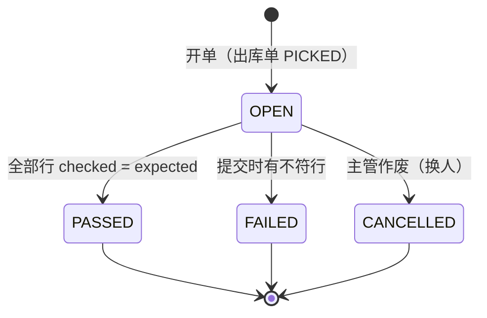
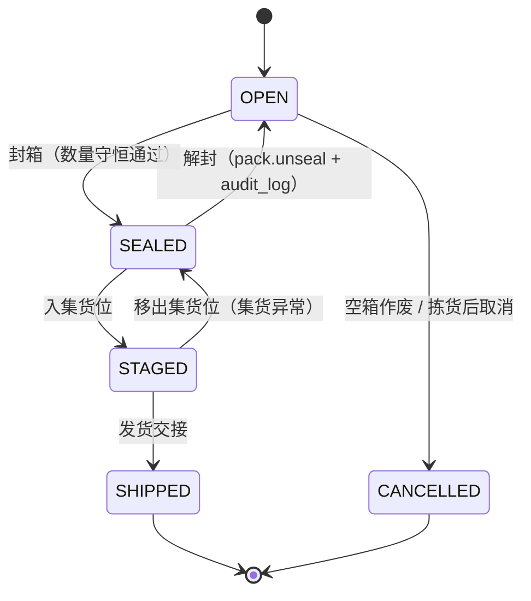
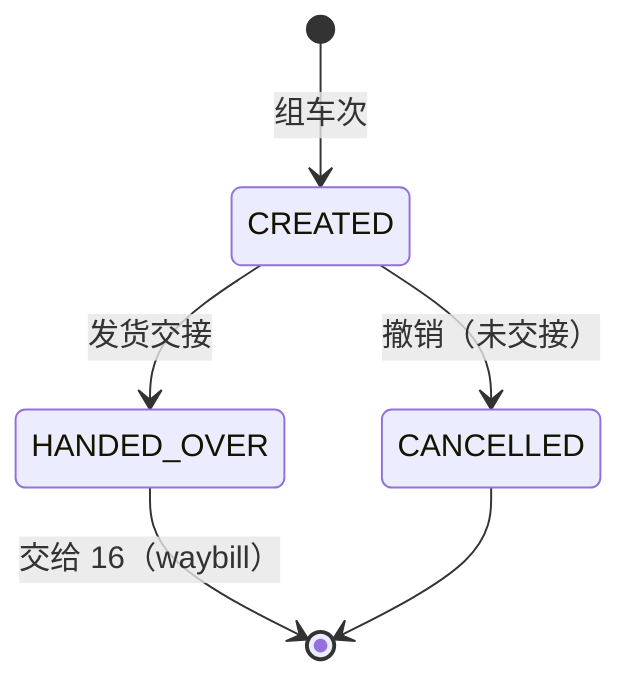
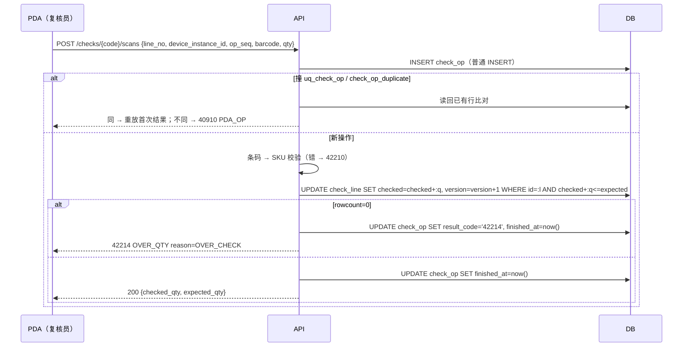
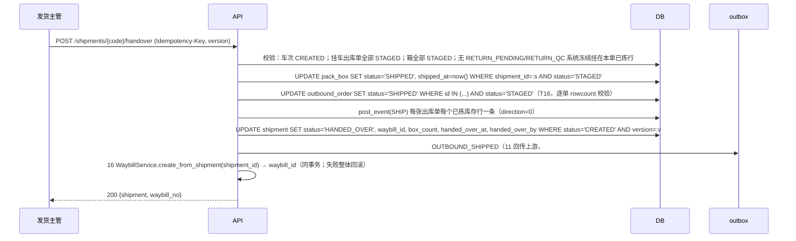

# 06 复核、装箱、发货

| 项 | 内容 |
|---|---|
| 作者 | 小李 |
| 评审 | 小赵（主）、小吴（副） |
| 状态 | 草稿 |
| 依赖 | 00 全局约定（ID、单号、数量 R2、时区 R3、错误码 §6.4、幂等 §6.5）；02 库存核心（`post_event`、冻结、40933）；04 出库单状态机（T12–T16、T20）与待回库 §7.3；05 波次与拣货（`pick_op` 去重写法、`return_record`，PR #7）；11 上游回传（outbox）；12 权限与审计；16 配送与签收（`waybill` 由 `shipment` 1:1 生成，PR #10） |

> 本篇只写服务端。全局约定不重复定义。数量一律 `BIGINT *_qty_milli`，接口用 3 位小数字符串，超过 3 位小数返回 40010。所有时间列存 UTC，作业日按 `warehouse.timezone` 计算。测试数据和示例中的仓库编码遵循 `^[A-Z0-9]{2,16}$`（如 `WHSH01`），审批单号遵循 `APR-{仓库编码}-{yyyyMMdd}-{6位数字}`。

## 1. 职责与边界

### 1.1 负责
1. **复核**：出库单拣货完成（04 `PICKED`）后，由**非拣货人**逐行扫码核数。通过后推进 04 T12 `PICKED → CHECKED`；不通过则走 T13（退回拣货差异处理）。
2. **装箱**：复核通过后把货装入箱（`pack_box`）或周转筐，封箱打印箱码。
3. **集货**：封箱的箱放入集货位，推进 04 T14 `CHECKED → STAGED`。
4. **发货出库（交接）**：按车次组 `shipment`，把 STAGED 箱挂上车次，主管/发货员确认交接：箱 `SHIPPED`、出库单 T16 `STAGED → SHIPPED`、`post_event(SHIP)`，写 outbox 通知 11 回传上游，调用 16 `WaybillService.create_from_shipment(shipment_id)` 生成运单。

### 1.2 不负责
- 装车扫码、缺箱放行、发车、在途、签收、拒收回仓：全部归 **16**（`waybill`、`waybill_stop`、`pod`、`pod_op`）。本篇在 `shipment.status = HANDED_OVER` 处交出。司机、车辆、发车时间、签收都只在 16 的 `waybill` / `waybill_stop` / `pod` 上；签收（POD）按**出库单**粒度记在 16（16 Δ1），`shipment` 不存这些列，只用 `waybill_id` 指向 16 的运单。
- `outbound_order.delivery_result` 由 04/16 维护；拒收货经 10 退货入库。
- 库存扣减：已在拣货确认时由 05 `consume` 完成（02 UC5）。本篇发货只写 `post_event(SHIP)`（direction=0，不改 `on_hand`，02 UC7）。
- 签收更正：只走 12 审批，本篇不涉及。

### 1.3 与原文档的差异
| # | 原文档 | 本篇 | 原因 |
|---|---|---|---|
| Δ1 | `shipment.status` 含 `LOADING/DEPARTED/DELIVERING/SIGNED/CLOSED` | 本篇只有 `CREATED / HANDED_OVER / CANCELLED`，后续状态在 16 `waybill` | 与 16 Δ1 一致，避免两边重复维护状态 |
| Δ2 | 复核结果只记在 `outbound_order.checker_id` | 新增 `check_record / check_line / check_op` | 需要逐扫去重、差异留痕、SoD 在库层兜底 |
| Δ3 | `pack_box.sealed` 布尔 | 增加 `status`，`sealed` 保留并由 CHECK 约束与状态一致 | 箱有集货、发货阶段，封箱后要冻结明细 |

## 2. 用例

| # | 用例 | 角色 | 权限点 | 动库存 | PDA 可离线 |
|---|---|---|---|---|---|
| UC1 | 开复核单 | 复核员 | `outbound.check.execute` | 否 | 否（需在线取冻结期望数） |
| UC2 | 复核扫码 / 撤销一扫 | 复核员 | `outbound.check.execute` | 否 | 是（四元键去重） |
| UC3 | 复核提交（通过 / 不通过） | 复核员 | `outbound.check.execute` | 否 | 否 |
| UC4 | 复核作废（换人重复核） | 主管 | `outbound.check.cancel` | 否 | 否 |
| UC5 | 开箱、装箱、封箱、打印箱码 | 复核员 / 打包员 | `outbound.pack.execute` | 否 | 否 |
| UC6 | 解封（封箱后发现装错） | 主管 | `outbound.pack.unseal` | 否 | 否 |
| UC7 | 集货入位 | 打包员 | `outbound.stage.execute` | 否 | 是 |
| UC8 | 组车次、挂箱 | 发货员 | `outbound.ship.plan` | 否 | 否 |
| UC9 | 发货交接（出库） | 发货主管 | `outbound.ship.handover` | `post_event(SHIP)` | 否 |
| UC10 | 拣货后取消（复核/集货阶段） | 主管 | `outbound.order.cancel_after_pick`（04 T20） | 待回库 | 否 |

## 3. 领域模型

### 3.1 复核单 `CheckRecord`
一张出库单同一时刻至多一张 `OPEN` 复核单（`uq_chk_open`，部分唯一）。开单时冻结：`picker_id`（取 `outbound_order.picker_id`）、各行 `expected_qty_milli`（= 出库行 `picked_qty_milli`）。之后拣货侧再变（如撤销拣货）不影响本单；04 状态守卫保证复核期间出库单停在 `PICKED`，撤销拣货需先作废复核单。

### 3.2 复核扫描 `CheckOp`
与 05 `pick_op` 同构：PDA 四元键 `(check_id, line_no, device_instance_id, op_seq)`，`op_type ∈ {SCAN, UNDO}`。逐件模式另有 `scan_event_id`。条码按 SKU 主数据（`sku_barcode`）现场校验，错码返回 42210，`check_op.result_code='42210'`。复核不动库存，所以 `check_op` 是这条操作的唯一账。

### 3.3 箱 `PackBox`
箱属于一张出库单（`outbound_id`），挂在一张 `PASSED` 复核单上（`check_id`，应用层校验）。一单多箱；同一箱不跨单（冷链按单配送，跨单拼箱见 Q5）。箱明细 `pack_box_line(box_id, sku_id, lot_id)` 唯一。

**装箱数量守恒**（应用层，提交封箱时校验）：某出库单所有非 `CANCELLED` 箱的明细合计，按 `(sku_id, lot_id)` 等于复核通过量。不等返回 42211 `CHECK_QTY_MISMATCH`，`detail = {sku_id, lot_id, checked_qty, packed_qty}`。

### 3.4 车次 `Shipment`
一个车次装多张出库单（`shipment_order`），多个箱（`pack_box.shipment_id`）。交接时冻结 `box_count`，16 据此生成运单的箱码白名单。

## 4. 涉及的表

### 4.1 `check_record`（新增）
| 列 | 说明 |
|---|---|
| id / code | 雪花 ID；单号 `CHK-{仓}-{节点}-{作业日}-{序号}`（00 §6.2），`uq_chk_code` |
| warehouse_id / outbound_id | |
| picker_id / checker_id | `ck_chk_sod`：`picker_id IS NULL OR picker_id <> checker_id`（与 `outbound_order.ck_ob_sod` 同口径） |
| device_instance_id | 开单设备 |
| status | `OPEN / PASSED / FAILED / CANCELLED`（`ck_chk_status`） |
| mismatch_count | 不符行数；`ck_chk_pass`：PASSED 时必须为 0 |
| closed_by / closed_at | `ck_chk_closed`：OPEN 时两者为空，非 OPEN 时两者非空 |
| version | 乐观锁 |

触发器 `trg_chk_*`：关单后任何列不可改（`check_closed`）；`outbound_id / checker_id / picker_id / code` 不可改，不可删（`check_immutable`）。SQLite 另有 `BEFORE INSERT`，id、code 已存在或同一出库单已有 OPEN 单时报 `check_duplicate`，挡住 `INSERT OR REPLACE` 和 UPSERT。

### 4.2 `check_line`（新增）
`uq_chkl_line(check_id, line_no)`、`uq_chkl_obl(check_id, outbound_line_id)`；`ck_chkl_qty`：`0 ≤ checked ≤ expected`，均为整数 milli。多扫在应用层返回 42214 `OVER_QTY`，`detail.reason = OVER_CHECK`（新增 reason 取值，见 Q2），库层 CHECK 兜底。复核单 OPEN 时才能插入或更新（`check_closed`）；`expected_qty_milli` 等身份列不可改，不可删（`check_immutable`）。

### 4.3 `check_op`（新增）
| 列 | 说明 |
|---|---|
| check_id, line_no, device_instance_id, op_seq | 四元键，`uq_check_op` |
| op_type | `SCAN / UNDO`（`ck_check_op_type`） |
| barcode / qty_milli | `ck_check_op_qty`：`> 0` 整数 |
| scan_event_id | 逐件模式；`uq_check_op_scan(check_id, scan_event_id)` 部分唯一 |
| result_code / finished_at | 成功为 NULL，失败为 5 位码（`ck_check_op_result`）；`ck_check_op_finish`：未完成不能有 result_code；只写一次 |

`trg_check_op_*`：`finished_at` 非空后整行冻结，身份列不可改，不可删，PG 不可 TRUNCATE（`check_op_immutable`）。SQLite `BEFORE INSERT` 报 `check_op_duplicate`。`wms_app` 只有 `SELECT, INSERT` 加列级 `UPDATE (result_code, finished_at)`。

### 4.4 `pack_box`（改）
新增 `check_id`、`status`、`shipped_at`、`version`、`created_at`。
- `ck_box_status`：`OPEN / SEALED / STAGED / SHIPPED / CANCELLED`
- `ck_box_sealed`：`OPEN / CANCELLED ⇔ sealed=false`；`SEALED / STAGED / SHIPPED ⇒ sealed=true` 且 `packed_at`、`checker_id` 非空
- `ck_box_staged`：`STAGED / SHIPPED` 必须有 `stage_location_id`
- `ck_box_shipped`：`SHIPPED` 必须有 `shipment_id`、`shipped_at`
- `trg_box_*`：状态只能按 §5.2 的边走（`box_state`）；`code / outbound_id / warehouse_id` 不可改，不可删，PG 不可 TRUNCATE（`box_immutable`）；SQLite `BEFORE INSERT` 报 `box_duplicate`
- 新索引 `ix_box_outbound(outbound_id, status)`、`ix_box_shipment(shipment_id)`
- `weight_g` 改为 `BIGINT` 整数克，`ck_box_weight`：`>= 0`（Q6 已定）

### 4.5 `pack_box_line`（改：加触发器）
`trg_box_line_*`：所属箱不是 `OPEN` 时，INSERT / UPDATE / DELETE 都报 `box_sealed`；不能把行挪到别的箱。

### 4.6 `shipment`（改）
状态收窄为 `CREATED / HANDED_OVER / CANCELLED`（`ck_shp_status`）；新增 `dock_location_id`、`waybill_id`（→ 16 `waybill.id`，1:1）、`box_count`、`handed_over_at`、`handed_over_by`、`version`。**删除** `vehicle_no`、`driver_id / driver_name / driver_phone`、`planned_depart_at`、`departed_at`、`signed_at` 及索引 `ix_shp_driver`（Q7 已定，这些在 16 `waybill`）。
- `ck_shp_handover`：`HANDED_OVER` 时 `handed_over_at / handed_over_by / waybill_id` 非空且 `box_count > 0`
- `trg_shp_*`：只允许 `CREATED → HANDED_OVER / CANCELLED`（`shipment_state`）；终态后 `status / box_count / waybill_id / handed_over_at` 冻结（`shipment_closed`）；不可删（`shipment_immutable`）；SQLite `BEFORE INSERT` 报 `shipment_duplicate`

### 4.7 授权（`wms_app`，最小权限）
| 表 | 授权 |
|---|---|
| check_record, check_line | SELECT, INSERT, UPDATE |
| check_op | SELECT, INSERT, UPDATE(result_code, finished_at) |
| pack_box, pack_box_line, shipment, shipment_order | 沿用 SELECT, INSERT, UPDATE；无 DELETE / TRUNCATE（箱明细删除只能在箱 OPEN 时由应用以"数量改 0"之外的方式处理，见 Q8） |

verify 的 `EXPECT_PRIVS` 已同步，按 pg_class 逐表核对，多给少给都失败。

### 4.8 写法规则（两库一致）
所有本篇新表和 `pack_box`、`shipment` 都用**普通 INSERT**，不用 `ON CONFLICT` / `INSERT OR REPLACE / OR IGNORE`。撞唯一键后在新事务里按键读回比对：`check_op` 比 `(op_type, barcode, qty_milli)`，全同 → 重放首次结果；不同 → 40910 `key_type=PDA_OP`。PG 撞键会中止当前事务，需要同事务时用 `SAVEPOINT` 包住这条 INSERT。

## 5. 状态机

### 5.1 复核单

- PASSED 同事务推进 04 T12 `PICKED → CHECKED`（条件更新 `WHERE status='PICKED'`，rowcount=0 → 40930）。
- FAILED 不改出库单状态；出库单留在 `PICKED`，差异按 04 T13/05 撤销拣货处理后重新开单。（04 T13 是 `CHECKED → PICKED`，用于集货前发现问题退回，见 §5.2。）
- 状态迁移依赖应用层条件更新 `WHERE id=:id AND status='OPEN' AND version=:v`；库层触发器只保证终态不可变。

### 5.2 箱

出库单全部有效箱 STAGED 后推进 04 T14 `CHECKED → STAGED`；有箱退回 SEALED 时走 T15 `STAGED → CHECKED`。拣货后取消时，箱若非 OPEN，先由主管解封再作废（应用层在同事务里完成）。

### 5.3 车次

交接后不能撤回。16 Q-B 已定：发车前不撤运单，只改派；真要退回走 06 红冲（见 Q4）。

## 6. 核心流程

### 6.1 复核扫码

UNDO 一扫：`checked = checked - :q WHERE checked >= :q`，不足返回 42214 `reason=OVER_REVERSE`。

### 6.2 复核提交
1. 复核单条件更新到 PASSED 或 FAILED（`mismatch_count` = checked ≠ expected 的行数）。
2. PASSED：同事务推进出库单 T12，`outbound_order.checker_id = checker_id`（库层 `ck_ob_sod` 再兜一次）。
3. FAILED：响应 42211 `CHECK_QTY_MISMATCH`，`detail.lines[] = {line_no, expected, checked}`；不自动动库存，由主管选择：撤销拣货（05）或按实际数重新开单。

### 6.3 装箱、封箱
开箱 → 装明细（只在 OPEN）→ 封箱：校验 §3.3 数量守恒，`status='SEALED', sealed=true, packed_at, checker_id`，打印箱码。封箱后改明细被库层 `box_sealed` 拦，接口返回 **40930**（新码见 Q1）。

### 6.4 集货
扫箱码 + 集货位码：`SEALED → STAGED`，写 `stage_location_id`。集货位温区与 SKU 温区不符返回 42213（沿用 04 口径，见 Q9）。出库单全部有效箱 STAGED 后推进 T14。

### 6.5 发货交接

任一条件更新 rowcount 与预期不符 → 整体回滚，40930（`detail = {entity, id, from, expected}`）。

### 6.6 拣货后取消、短发
- **CHECKED / STAGED 阶段取消**：走 04 T20。本篇负责：作废 OPEN 复核单；箱 `SEALED/STAGED → (解封) OPEN → CANCELLED`；把已拣数量交给 04/05 生成 `return_record(source_type='CANCEL_AFTER_PICK')`，四个 PDA 字段为空（`ck_rr_source`），同事务建 `RETURN_PENDING` 冻结（02，系统冻结，手工解冻返回 40933，`detail = {hold_type, source_type, source_id}`）。
- **复核少货（短发）**：复核 FAILED 后，主管选择按实际数发货时，差额由 05 撤销拣货回冲（`REVERSE_PICK`），出库行 `picked_qty_milli` 下调，然后重新开复核单；**不在本篇直接改库存**。是否允许"复核通过但短发"见 Q3。
- 已 `SHIPPED` 不能取消，只能红冲（04）。

### 6.7 上游回传
交接成功写 outbox `OUTBOUND_SHIPPED`，payload：出库单号、上游单号、每行发货量（3 位小数字符串）、批次、箱码列表、`waybill_no`、`handed_over_at`（车牌、司机由 16 在发车事件里回传）（ISO 8601，带 `Z`）。投递、重试、对账由 11 负责（#6）。

## 7. 接口清单与契约

前缀 `/api/v1`，写接口一律带 `Idempotency-Key`；PDA 接口另带四元键。

| 方法 | 路径 | 说明 | 权限点 | 幂等 |
|---|---|---|---|---|
| POST | `/outbound-orders/{code}/checks` | 开复核单 | `outbound.check.execute` | Idempotency-Key |
| POST | `/checks/{code}/scans` | 复核扫码 / UNDO | `outbound.check.execute` | 四元键 |
| POST | `/checks/{code}/submit` | 提交 | `outbound.check.execute` | Idempotency-Key + version |
| POST | `/checks/{code}/cancel` | 作废 | `outbound.check.cancel` | Idempotency-Key |
| POST | `/outbound-orders/{code}/boxes` | 开箱 | `outbound.pack.execute` | Idempotency-Key |
| PUT | `/boxes/{code}/lines` | 整体替换箱明细（仅 OPEN） | `outbound.pack.execute` | Idempotency-Key + version |
| POST | `/boxes/{code}/seal` / `/unseal` | 封箱 / 解封 | `pack.execute` / `pack.unseal` | Idempotency-Key + version |
| POST | `/boxes/{code}/stage` | 集货 | `outbound.stage.execute` | 四元键 |
| POST | `/shipments` / `PUT /shipments/{code}/orders` | 组车次 / 挂单 | `outbound.ship.plan` | Idempotency-Key |
| POST | `/shipments/{code}/handover` | 发货交接 | `outbound.ship.handover` | Idempotency-Key + version |

扫码请求示例（仓库 `WHSH01`）：
```json
{ "line_no": 1, "device_instance_id": "DEV-C", "op_seq": 18, "barcode": "6900000000001", "qty": "5.000" }
```

### 7.1 错误码（只用 00 §6.4 已登记的）
| 码 | 场景 |
|---|---|
| 40001 / 40010 | 参数 / 数量格式 |
| 40310 / 40311 | 无权限点；复核人 = 拣货人暂用 40310（`detail.reason=SOD_VIOLATION`，见 Q1）；仓权限 |
| 40910 | Idempotency-Key 或 PDA 四元键冲突（`key_type=PDA_OP`） |
| 40930 | 非法状态迁移；封箱后改明细（暂用，见 Q1） |
| 40931 | 单据锁定 |
| 40933 | 交接或取消时碰到系统冻结 |
| 42210 | 条码不匹配 |
| 42211 | 复核 / 装箱数量不符 |
| 42213 | 集货位温区不符（见 Q9） |
| 42214 | `OVER_QTY`，`reason ∈ {OVER_CHECK, OVER_REVERSE}` |
| 50010 | 撞 CHECK / 触发器（库层兜底被触发说明应用层守卫漏了） |
| 50301 / 50303 | 依赖不可用 / 写节点过期 |

## 8. 并发与幂等
| 场景 | 手段 |
|---|---|
| 两人同时对一张单开复核 | `uq_chk_open`；后到者读回已有 OPEN 单，复核人不同 → 40930 |
| 复核员与拣货员同一人 | 应用 40310 + `ck_chk_sod` + `ck_ob_sod` |
| PDA 重传 | `uq_check_op` 普通 INSERT + 读回比对 |
| 多扫 | 条件更新 `checked+:q<=expected` + `ck_chkl_qty` |
| 封箱与改明细并发 | 改明细带 `version`；库层 `box_sealed` |
| 两个发货主管同时交接 | `shipment.version` + 各条件更新 rowcount |
| 交接与拣货后取消并发 | 取消要求出库单 `status IN (...STAGED)`，交接要求 `status='STAGED'`，先提交者赢，后者 40930 |

## 9. 异常与补偿
| 异常 | 处理 |
|---|---|
| 交接中途 16 建运单失败 | 同事务回滚，车次仍 CREATED，可重试（同 Idempotency-Key 重放） |
| outbox 投递失败 | 11 重试；不影响 SHIPPED |
| 封箱后丢箱或破损 | 无法解封重装，作废走 Q8 流程 |
| 巡检 | `CHECK_BOX_MISMATCH`：SHIPPED 出库单箱明细合计 ≠ 复核通过量；`SHIP_EVENT_MISSING`：SHIPPED 单无 SHIP 事件。码值需加入 `ck_recon_code`（见 Q10） |

## 10. 权限
新增权限点：`outbound.check.execute / cancel`、`outbound.pack.execute / unseal`、`outbound.stage.execute`、`outbound.ship.plan / handover`。`unseal`、`check.cancel`、`ship.handover` 写 `audit_log`。全部受仓数据权限约束（40311）。

## 11. 测试要点
- 两库 verify（本 PR：PG 229/229、SQLite 226/226，见 PR 描述）：复核 SoD、OPEN 唯一、关单必填、PASSED 无差异、行超量、身份列不可改、关单后冻结；`check_op` 四元键、REPLACE/UPSERT/删除/TRUNCATE、结果只写一次；箱状态边、封箱后明细冻结、集货位、SHIPPED 必须挂车次；车次状态边、交接必填、终态冻结、交接后 waybill_id 冻结、箱重量非负、不可删。
- 并发：50 并发扫同一行，`checked` 不超 `expected`；交接与取消交错 200 轮，出库单只落在一个终态。
- 对抗面（给小赵）：换 id 重放、SQLite `OR REPLACE`、复核期间撤销拣货、解封后改量再封、交接后改箱数、跨单装箱。

## 12. 待定问题
| # | 问题 | 建议 | 决策人 |
|---|---|---|---|
| Q1 | 封箱后改明细、复核 SoD 没有专用码 | 先用 40930 / 40310（带 `detail.reason`）。另申请两个新码，**不预填号码**：40934/40935（12 审批撤回/过期，16 签收更正也引用）、40936 均已占用，40951 属 16，号段 4093x 的下一个空号由 大肥鱼 在 00 §6.4 / #9 统一分配 | 大肥鱼 |
| Q2 | 42214 新增 `reason=OVER_CHECK` | 00 §6.4 / 02 码表补这个取值 | 大肥鱼 / 小钱 |
| Q3 | 是否允许"复核通过但按实际数短发" | 不允许；先撤销拣货回冲再复核 | PM |
| Q4 | 交接后发现装错车 | 不撤回，16 改派或 06 红冲；红冲流程在 04 | PM / 小吴 |
| Q5 | 允许跨出库单拼箱吗（同门店多单） | 一期不允许 | PM |
| Q6 | `pack_box.weight_g NUMERIC` 违反 R2 | **已定**：`weight_g BIGINT` 整数克，`ck_box_weight >= 0`，两库正反断言 | PM |
| Q7 | `shipment` 上的司机、车辆、发车、签收列 | **已定**：全部删除，`shipment.waybill_id` 指向 16 `waybill`；签收按出库单记在 16 | PM |
| Q8 | 已封箱丢失或损坏的作废路径 | 主管强制作废 `SEALED → CANCELLED` 需新边 + 审批（12） | PM |
| Q9 | 集货位温区不符用 42213 是否合适（42213 现为就近放回） | 扩 42213 场景描述，或申请新码 | 大肥鱼 |
| Q10 | 新巡检码 `CHECK_BOX_MISMATCH / SHIP_EVENT_MISSING` | 加入 02 `ck_recon_code` | 小钱 |
| Q11 | 依赖 #7（`return_record`、`pick_op` 写法）与 #10（`create_from_shipment` 签名） | 本 PR 不引用 #7 的表；合并顺序 #7 → #10 → 本 PR | PM |
