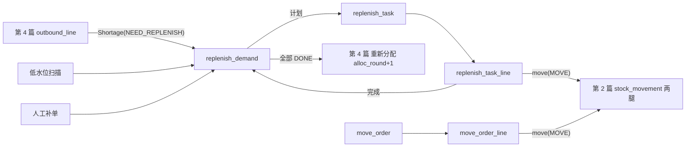
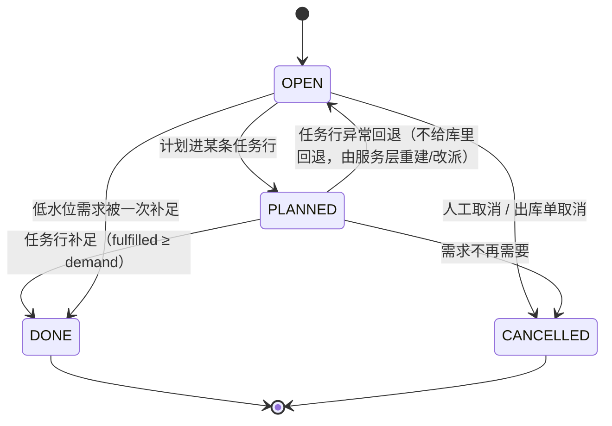
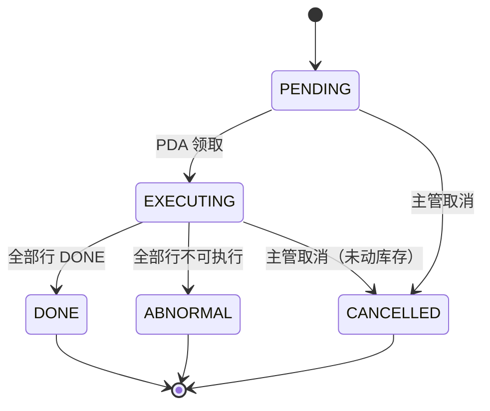
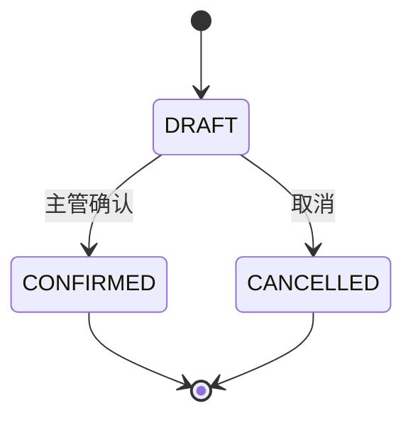
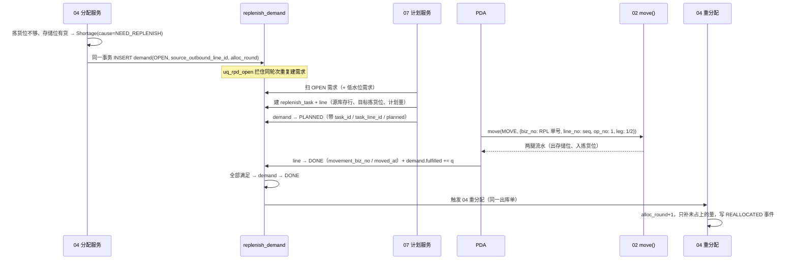
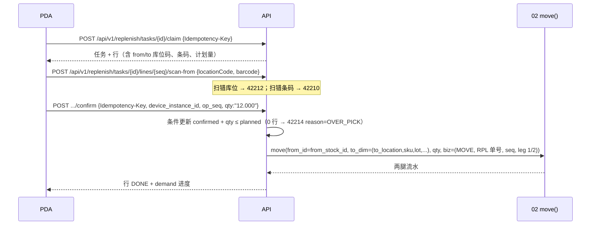

# 07 补货与移库 详细设计

> 作者：磐石 ｜ 基线：`origin/main`（分文件 schema）+ `wms-design/sql/schema/07_replenishment.sql` ｜ 评审：待定（至少 2 名：1 测试 + 1 非作者）
> 全局约定以第 0 篇为准：数量 milli（R2）、错误码与段位（§6.4）、幂等（§6.5）、时间 UTC 整秒（§6.8）、防 REPLACE（§6.10）、单仓单写库（§6.1a）。本篇只写本模块特有的部分。

## 1. 职责与边界

### 1.1 负责

- **补货需求**（`replenish_demand`）：把"拣货位不够"变成可执行的补货需求。三种来源：① 第 4 篇分配产生的 `Shortage(cause=NEED_REPLENISH)`；② 低水位扫描（拣货位可用量 < `location.min_level_milli` 且存储位有同 SKU 货）；③ 人工补单。
- **补货任务与任务行**（`replenish_task` / `replenish_task_line`）：按库区聚合、PDA 可领取，行上有**源存储位 + 目标拣货位**，执行时调用第 2 篇 `move()` 产生 MOVE 两腿流水。
- **补货闭环**：补货完成 → 需求 `DONE` → 触发第 4 篇对原出库单**重新分配**（新 `alloc_round`），把缺货量占上。
- **独立移库**（`move_order` / `move_order_line`）：整理、换位、并批、库区调整；同样只经 `move()`。
- **库位推荐算法**（上架与补货共用）：第 3 篇只规定了三条约束（温区一致、库位未锁定、`max_lots`），本篇给出完整候选过滤 + 排序，并落成库层视图 `v_location_sku_candidate`。

### 1.2 不负责

| 内容 | 归属 |
|---|---|
| 库存记账、占用、冻结、流水（`move()` 原语本体） | 第 2 篇 |
| 分配的贪心/FEFO 策略与 `Shortage` 的产生、`alloc_round` 的递增 | 第 4 篇 |
| 上架（入库后第一次放置）的单据与 SoD | 第 3 篇（本篇只提供推荐算法） |
| 波次、拣货任务、任务领取队列 | 第 5 篇 |
| 库位主数据、`min_level_milli` / `max_level_milli` 水位维护 | 第 1 篇 |
| 盘点冻结 `location.status='LOCKED'` 的写入 | 第 8 篇 |

### 1.3 与旧稿的差异（关键设计取舍）

| 项 | 做法 | 理由 |
|---|---|---|
| 补货任务是否复用第 5 篇 `pick_task` | **不复用**，本篇自建 `replenish_task` / `replenish_task_line` | 05 `pick_task.wave_id BIGINT NOT NULL`（补货任务不属于任何波次），且 `pick_task_line` 只有一个 `location_id`，装不下「源存储位 + 目标拣货位」。复用需对别人的两张表 ALTER 加列，并会把它们推进 00 §6.10 受锁集合（要补 no-REPLACE 守卫），代价大于收益。05 里 `task_type='REPLENISH'` 的注释作废，见 §12 Q1 |
| 移库粒度 | 一次移库 = 一条移库行 = 一次 `move()`；要分次就拆行 | 免掉"行的第几次操作 `op_no`"计数器，`op_no` 恒为 1，重放一定落在同一个 `idempotency_key` 上（00 §6.5、02 §4.4） |
| 补货需求去重 | 一个出库行在同一 `alloc_round` 上只允许一条未完结需求（`uq_rpd_open` 部分唯一索引） | 04 的分配是"每次重分配 +1 轮"，同一轮重复触发补货会重复建需求、重复补货 |
| 水位语义 | `min_level_milli` 是**触发线**，`max_level_milli` 是**目标线**，不是硬上限 | 补货量 = `min(max_level - 当前可用, 需求缺量, 源位可用)`；超过目标线只告警不拦（现场存在包装单位取整） |

## 2. 用例

| 用例 | 角色 | 入口 |
|---|---|---|
| 分配发现拣货位不够 → 自动建补货需求 | 系统（04 分配事务内触发） | 服务内 |
| 低水位扫描生成补货需求 | 系统任务 | 调度器 |
| 生成补货任务（按库区聚合） | 系统 / 主管 | 调度器 / 后台 |
| PDA 领取补货任务、扫源位、扫目标位、确认 | 仓管员 / 理货员 | PDA |
| 补货完成后重分配（新 `alloc_round`） | 系统 | 服务内（调 04） |
| 处理补货异常（源位不足、目标位被锁、目标已满） | 理货员 / 主管 | PDA / 后台 |
| 建独立移库单并在 PDA 执行 | 主管建单、作业员执行 | 后台 + PDA |
| 库位整理 / 换位 / 并批 | 主管 | 后台 |

## 3. 领域模型

### 3.1 对象关系



### 3.2 一个补货需求的生命周期

`OPEN`（产生）→ `PLANNED`（被某条任务行带走）→ `DONE`（补足）/ `CANCELLED`（不再需要）。
需求不带执行细节（源位、批次、源库存行都在任务行上），任务行才是作业对象。

### 3.3 补货量与目标

- 拣货位目标：`target_location_id` 就是需求上的拣货位（补货**不换目标位**，位置由 04 的分配结果或低水位扫描决定）。
- 补货量：`planned = min(max_level_milli − 拣货位可用量, demand_qty_milli − fulfilled_qty_milli, 源库存行可用量)`，结果 ≤ 0 不建行。
- 源位：同 SKU 同批次的存储位优先（避免拆批、避免批次位超 `max_lots`），再按 FEFO（`lot.expiry_date` 最早）→ 动线（`location.pick_sequence`）→ `location.id` 升序。
- 目标位可用性：`location.status='AVAILABLE'`（`LOCKED` 时行转 `ABNORMAL`，原因 `LOCATION_LOCKED`，等盘点结束由主管重排）。

## 4. 涉及的表

### 4.1 `replenish_task`（补货任务）

| 列 | 说明 |
|---|---|
| `id` / `code` / `warehouse_id` / `zone_id` / `work_date` | `code` 唯一（`RPL-{仓编码}-{yyyyMMdd}-{6 位}`，走 11 篇号段）；`zone_id` 是库区，PDA 按库区领任务 |
| `status` | `PENDING` / `EXECUTING` / `DONE` / `ABNORMAL` / `CANCELLED` |
| `priority` / `assigned_to` / `claimed_at` / `started_at` / `finished_at` | 优先级与领取信息；`ck_rt_claim`：`assigned_to` 与 `claimed_at` 要么都有、要么都没有 |
| `line_count` / `done_count` | `ck_rt_count`：`0 ≤ done ≤ line` |
| `version` / `created_by` / `created_at` / `updated_at` | 条件更新与审计；时间库写 UTC 整秒 |

索引：`uq_rt_code`、`ix_rt_claim (warehouse_id, status, zone_id) WHERE status='PENDING'`（领取队列）、`ix_rt_mine (assigned_to, status)`。
守卫：`trg_rt_forward`（终态不可回退；`EXECUTING` 不能退回 `PENDING`）。

### 4.2 `replenish_task_line`（补货任务行）

| 列 | 说明 |
|---|---|
| `task_id` / `seq` | `uq_rtl (task_id, seq)`；`seq` 是动线顺序 |
| `from_location_id` / `to_location_id` | 源存储位 / 目标拣货位；`ck_rtl_route`：两者不能相同 |
| `sku_id` / `lot_id` / `from_stock_id` | 作业对象：SKU、批次、**源库存行**（`move()` 的 `from_id`） |
| `planned_qty_milli` / `confirmed_qty_milli` | `ck_rtl_qty`：`planned > 0`、`0 ≤ confirmed ≤ planned`（确认用条件更新，0 行 → 42214） |
| `status` | `PENDING` / `DONE` / `ABNORMAL` / `CANCELLED` |
| `abnormal_reason` | `SOURCE_SHORT` / `LOCATION_LOCKED` / `TARGET_FULL`；`ck_rtl_abnormal`：只有 `ABNORMAL` 才允许有、且必须有 |
| `movement_biz_no` / `moved_at` / `moved_by` | 记账凭据；`ck_rtl_done`：`DONE` ⇔ 流水号与时间都有 |
| `uom` / `barcode_expected` / `version` | 展示与扫码校验 |

守卫：`trg_rtl_forward`（`DONE` / `ABNORMAL` / `CANCELLED` 是终态；`DONE` 后源位、目标位、源库存行、批次、计划量都锁死 → `replenish_line_done_locked`）。

### 4.3 `replenish_demand`（补货需求）

| 列 | 说明 |
|---|---|
| `code` | `RPD-...`，唯一 |
| `cause` | `OUTBOUND_SHORTAGE` / `LOW_LEVEL` / `MANUAL` |
| `target_location_id` / `sku_id` / `lot_id` | `lot_id` 可空（计划阶段未定批次，由源位选择决定） |
| `demand_qty_milli` / `planned_qty_milli` / `fulfilled_qty_milli` | `ck_rpd_qty`：`demand > 0`、两个中间量都 ≤ `demand`、`planned ≤ demand` |
| `status` | `OPEN` / `PLANNED` / `DONE` / `CANCELLED`；`ck_rpd_done`：`DONE` ⇔ `fulfilled ≥ demand` |
| `source_outbound_id` / `source_outbound_line_id` / `source_alloc_round` / `source_doc_no` | 缺货来源；`ck_rpd_short`：`cause='OUTBOUND_SHORTAGE'` ⇔ 前三列都非空 |
| `task_id` / `task_line_id` | 被哪条任务行带走；`ck_rpd_task`：要么都有、要么都没有 |
| `priority` / `version` / `created_by` / 时间列 | — |

唯一键：`uq_rpd_code`、`uq_rpd_open (source_outbound_line_id, source_alloc_round) WHERE cause='OUTBOUND_SHORTAGE' AND status IN ('OPEN','PLANNED')`。
索引：`ix_rpd_open (warehouse_id, status, priority, work_date)`、`ix_rpd_task (task_id) WHERE task_id IS NOT NULL`、`ix_rpd_loc (target_location_id, status)`。
守卫：`trg_rpd_forward`（只前进；`fulfilled_qty_milli` 单调不减）。

`uq_rpd_open` 是 04 ↔ 07 的**闭环守卫**：同一出库行同一轮次重复产生缺货时，第二条需求被拒 → 04 的分配服务遇到它就按已有需求处理（幂等），不会再补一次。

### 4.4 `move_order` / `move_order_line`（独立移库）

`move_order`：`code`（`MV-...`）、`warehouse_id`、`move_type`（`LOCATION_TRANSFER` / `ZONE_TRANSFER` / `PICK_FACE_SWAP` / `CONSOLIDATE`）、`status`（`DRAFT` / `CONFIRMED` / `CANCELLED`）、`reason_code`、`remark`、`line_count` / `done_count`、确认人与时间。
`ck_mo_confirm`：`CONFIRMED` ⇔ `confirmed_at` 非空；`trg_mo_forward`：只有 `DRAFT` 能改状态。

`move_order_line`：`line_no`（`uq_mol (move_order_id, line_no)`）、`from_location_id` / `to_location_id`（`ck_mol_route`：不相同）、`sku_id` / `lot_id` / `from_stock_id`、`qty_milli`（`> 0`）、`uom`、`status`（`PENDING` / `DONE` / `CANCELLED`）、`movement_biz_no` / `moved_at` / `moved_by`。
`ck_mol_done`：`DONE` ⇔ 流水号与时间都有；`trg_mol_forward`：终态锁死，`DONE` 行不能再改路由与数量（`move_line_done_locked`）。
索引：`uq_mo_code`、`ix_mo_wh`、`uq_mol`、`ix_mol_order`、`ix_mol_stock`。

### 4.5 `v_location_sku_candidate`（上架 / 补货共用候选视图）

视图按 `(库位, SKU)` 出候选行，硬约束全部在视图里：

1. **温区一致**：`sku.temperature_required = zone.temp_zone`；
2. **库位未锁定**：`location.status = 'AVAILABLE'`（`LOCKED` 的盘点冻结位、`DISABLED` 的停用位都不出现）；
3. **未软删**：`location.deleted_at IS NULL`；
4. **SKU 在售**：`sku.status = 'ACTIVE'`；
5. **混放规则**：`mix_sku = true`，或库位为空，或库位里已有的就是本 SKU。

视图另外给出 `lot_cnt` / `sku_cnt` / `on_hand_qty_milli` / `has_same_sku` / `has_lot_slot`，供调用方判 `max_lots`（第 3 条约束）：**新批次要 `has_lot_slot = 1`；已在库位里的批次复用它**（追加量不新增批次位，即使 `lot_cnt = max_lots` 也放行）。

### 4.6 时间与口径

- 所有时间列 `TIMESTAMP`，库写 UTC 整秒（`DEFAULT (date_trunc('second', now() AT TIME ZONE 'UTC'))`，SQLite 经翻译器写成 `datetime('now')`）；本篇没有客户端提交的时间列。
- 所有数量列是 `BIGINT *_qty_milli`（R2），带 `CAST(x AS BIGINT)` 兜底。
- 防 REPLACE：五张表的每个唯一键都有 SQLite 守卫（00 §6.10），错误名见 00 §6.4。

## 5. 状态机

### 5.1 补货需求



| from → to | 触发者 | 守卫 | 副作用 |
|---|---|---|---|
| `OPEN` → `PLANNED` | 计划服务 | 任务行建立成功 | 写 `task_id` / `task_line_id` / `planned_qty_milli` |
| `OPEN` / `PLANNED` → `DONE` | 补货确认 | `fulfilled_qty_milli ≥ demand_qty_milli`（`ck_rpd_done`） | 触发 04 重分配 |
| `OPEN` / `PLANNED` → `CANCELLED` | 主管 / 出库单取消 | 必须带 `cancelled_reason` | `uq_rpd_open` 释放，同轮次可再建需求 |
| `PLANNED` → `OPEN` | — | **不提供**（库层 `trg_rpd_forward` 也拦不住同状态改动） | 服务层把旧需求 `CANCELLED` 后按新轮次重建 |

> 说明：`PLANNED → OPEN` 在图上画出是为了说明"任务行异常"的去向，实现上走 `CANCELLED` + 新建，避免在库里回退造成 `uq_rpd_open` 与新需求打架。

### 5.2 补货任务与任务行



任务行：`PENDING → DONE`（一次 `move()` 记账，`op_no = 1`）/ `PENDING → ABNORMAL`（源位不足、目标位锁定、目标已满，必须给 `abnormal_reason`）/ `PENDING → CANCELLED`。

### 5.3 移库单



### 5.4 库位冻结与补货的交互

- 目标拣货位被盘点冻结（`status='LOCKED'`）：补货行转 `ABNORMAL`（`LOCATION_LOCKED`），`move()` 也会被第 2 篇的库位条件拦下（40906），两层一致。
- 源存储位被冻结：同上，换源位（服务层重新选 `from_stock_id` 后改行，仍在 `PENDING`）。
- 库区温区改主数据不影响已在执行的行；新计划按当前温区重算。

## 6. 核心流程

### 6.1 04 缺货 → 补货 → 重分配（硬闭环）



重分配的**触发口径**（与 04 §6 一致）：
- 一条出库行的需求从 `OPEN`/`PLANNED` 变 `DONE`，且该出库单状态是 `SHORT`（或仍在待分配池）时，服务调用 04 的分配入口 `POST /api/v1/outbound-orders/{id}/allocate` 的服务实现，带 `reason=REPLENISH_DONE`；
- 04 负责 `alloc_round+1`、`reserve_batch`（新 `op_key` 含新轮次）、写 `REALLOCATED` 事件；
- 07 不直接写 `outbound_line.alloc_round`，也不碰占用表。
- 部分补货：`demand` 仍 `PLANNED`，等下一次补货或主管接受缺发（04 的 `allow_short`）。

### 6.2 库位推荐算法（上架与补货共用）

**输入**：`warehouse_id`、`sku_id`、`lot_id`、`qty_milli`、用途（`PUTAWAY` 上架 / `REPLENISH` 补货目标 / `MOVE` 移库目标）。

**步骤 1：硬过滤**（用 `v_location_sku_candidate`）

```sql
SELECT * FROM v_location_sku_candidate
 WHERE warehouse_id = :wh AND sku_id = :sku
   AND (:purpose <> 'REPLENISH' OR pickable = true)      -- 补货目标必须是拣货位
   AND (:purpose <> 'PUTAWAY'    OR location_type <> 'LIVE_TANK')  -- 活鲜池只由 18 篇入池
   AND (has_lot_slot = 1 OR has_same_sku = 1)             -- max_lots：新批次要空位，同批次复用
```

**步骤 2：排序**（确定性，最后一项保证全序）

| 用途 | 排序键（优先级从高到低） |
|---|---|
| `PUTAWAY`（选目标位） | ① 已含本 SKU **且已含本批次**（`has_same_sku=1` 且该 lot 在库位）② 已含本 SKU、批次数少 ③ 空库位 ④ `pick_sequence` 动线近 ⑤ `location.id` 升序 |
| `REPLENISH`（选**源**位） | ① 同 SKU 同批次（避免拆批）② `lot.expiry_date` 早（FEFO）③ `location.pick_sequence` 动线近 ④ `location.id` 升序 |
| `MOVE`（选目标位） | ① 同 SKU 同批次 ② 空库位 ③ 动线近 ④ `location.id` 升序 |

**步骤 3：容量与水位**
- 目标位 `max_lots`：由 `has_lot_slot` / `has_same_sku` 判定（见 §4.5）。
- 容量（`capacity_weight` / `capacity_volume` / `used_*`）：第 1 篇口径是**规划用 NUMERIC，不入账**，所以只做提示与告警，**不做硬拦**（拦了会和"账实以 milli 为准"打架）。
- 补货目标位水位：补到不超过 `max_level_milli`；超过只记告警（§1.3）。

**步骤 4：落库**
- 上架：由第 3 篇写 `inbound_putaway` + `move(PUTAWAY)`；本篇只提供候选与排序函数（`domain/location_pick.py`）。
- 补货：计划服务把选中的源库存行写进 `replenish_task_line.from_stock_id`。

### 6.3 PDA 补货执行



- `move()` 的 `biz`：`biz_type='MOVE'`、`biz_no` = 补货任务单号（`RPL-...`）、`line_no` = 行的 `seq`、`op_no = 1`（一次行一次操作）、`leg` 由 02 决定（1 出、2 入）。
- 幂等：`idempotency_key = {biz_no}:{line_no}:D1:{leg}`（02 §4.4.2 格式）；PDA 重传同一四元组按 02 的去重表回放，不二次记账。
- 目标位温区必须与 SKU 一致（视图已过滤）；服务端再校验一次，不符 → 42219。

### 6.4 独立移库执行

后台建单（`DRAFT`）→ 主管确认（`CONFIRMED`，`ck_mo_confirm`）→ PDA/后台逐行执行：`move(MOVE, biz_no=MV 单号, line_no, op_no=1)` → 行 `DONE` + `done_count+1` → 全部完成则单 `DONE`（自动关单）。

## 7. 接口清单与契约

前缀：补货 `/api/v1/replenish`，移库 `/api/v1/move-orders`。写接口要求 `Idempotency-Key`（00 §6.5）；数量是 3 位小数字符串；`X-Warehouse-Id` + 数据权限（40311）。

| 方法 | 路径 | 权限点 | 说明 |
|---|---|---|---|
| GET | `/replenish/demands?status=OPEN` | `picking.replenish.view` | 需求列表（按优先级 / 库区） |
| POST | `/replenish/demands` | `picking.replenish.plan` | 人工补单（`cause=MANUAL`） |
| POST | `/replenish/demands/{id}/cancel` | `picking.replenish.plan` | 取消（必填 `reason`） |
| POST | `/replenish/plan` | `picking.replenish.plan` | 按库区生成补货任务（幂等键 `PLAN:{warehouse}:{work_date}:{zone}`） |
| GET | `/replenish/tasks?status=PENDING&zoneId=` | `picking.replenish.view` | 领取队列 |
| POST | `/replenish/tasks/{id}/claim` | `picking.replenish.claim` | 领取；并发被抢 → 40923 |
| GET | `/replenish/tasks/{id}` | `picking.replenish.view` | 任务 + 行（PDA 主界面） |
| POST | `/replenish/tasks/{id}/lines/{seq}/scan-from` | `picking.replenish.confirm` | 扫源位 + 源批次条码 |
| POST | `/replenish/tasks/{id}/lines/{seq}/confirm` | `picking.replenish.confirm` | 记账（`move()`）+ 行 DONE |
| POST | `/replenish/tasks/{id}/lines/{seq}/abnormal` | `picking.replenish.confirm` | 行转 `ABNORMAL`（必填 `reason_code`） |
| POST | `/replenish/tasks/{id}/cancel` | `picking.replenish.plan` | 未动库存时取消整单 |
| GET | `/move-orders` / `/move-orders/{id}` | `inventory.move.view` | 列表 / 详情 |
| POST | `/move-orders` | `inventory.move.create` | 建单（含行） |
| POST | `/move-orders/{id}/confirm` | `inventory.move.confirm` | 确认（`DRAFT → CONFIRMED`） |
| POST | `/move-orders/{id}/cancel` | `inventory.move.cancel` | 取消（`DRAFT` 才可） |
| POST | `/move-orders/{id}/lines/{lineNo}/execute` | `inventory.move.confirm` | 执行一行（`move()` 记账） |
| GET | `/locations/candidates?skuId=&lotId=&qty=&purpose=` | `master.location.view` | 上架 / 补货 / 移库共用的候选库位（`v_location_sku_candidate` + 排序） |

### 7.1 错误码（复用 00 §6.4 已有码，只有一个新码）

| 码 | HTTP | 名称 | 场景 |
|---|---|---|---|
| 42219 | 422 | TEMP_ZONE_MISMATCH | 上架 / 补货 / 移库的目标库区温区与 SKU 温区不符（**本增量新登记**；03 篇 §6.3 目前用 `40001 detail.reason=PUTAWAY_TEMP_ZONE_MISMATCH` 占位，从此可换成 42219） |
| 40906 | 409 | LOCATION_LOCKED | 源位 / 目标位被盘点冻结（`move()` 也会拦） |
| 40902 | 409 | STOCK_INSUFFICIENT | 源库存不足（`move()` 的 `available < q`） |
| 40904 | 409 | AVAILABLE_INSUFFICIENT | 预留冲突（重分配时新占用量不足） |
| 40905 | 409 | OVER_RELEASE | 量超占用余量 |
| 40920 / 40921 / 40922 / 40923 | 409 | TASK_REASSIGNED / TASK_CANCELLED / TASK_CLOSED / TASK_ALREADY_CLAIMED | 补货任务与 05 任务同段位同语义（改派、已取消、已关闭、已被领取） |
| 40930 | 409 | ILLEGAL_STATE_TRANSITION | 状态机条件更新 0 行；库层 `replenish_task_forward_only`、`replenish_line_forward_only`、`replenish_demand_forward_only`、`move_order_forward_only`、`move_line_forward_only`；REPLACE 守卫 `*_duplicate` 也映射到本码（`detail.reason`） |
| 40931 | 409 | DOC_LOCKED | `replenish_line_done_locked`（已 DONE 的补货行改路由/数量）、`move_line_done_locked` |
| 42210 / 42212 | 422 | BARCODE_MISMATCH / LOCATION_MISMATCH | 扫错条码 / 扫错库位 |
| 42214 | 422 | OVER_QTY | 确认量超过计划量（`detail.reason=OVER_PICK`，与 05 拣货同一口径：对 REPLENISH 行同样表示"确认超过计划"）；补货超过目标水位只用告警不用本码 |
| 40001 | 400 | PARAM_INVALID | `planned` 为 0、`move_type` / `cause` / `status` 取值非法、`from_location_id = to_location_id`、`reason_code` 缺失 |

## 8. 并发与幂等

- **单仓单写库**（00 §6.1a）：本篇所有唯一性与记账都只在一个权威库内成立。
- **需求去重**：`uq_rpd_open` 部分唯一索引 + 服务层先查再插（撞到说明 04 重放了分配）。
- **任务领取**：`UPDATE replenish_task SET assigned_to=:u, claimed_at=…, status='EXECUTING', version=version+1 WHERE id=:id AND status='PENDING'`，0 行 → 40923。
- **行确认**：`UPDATE replenish_task_line SET confirmed_qty_milli = confirmed_qty_milli + :q WHERE id=:id AND status='PENDING' AND confirmed_qty_milli + :q <= planned_qty_milli`，0 行 → 42214；同一事务里调 `move()`。
- **记账幂等**：`move()` 的 `idempotency_key` 由 `(biz_no, line_no, op_no=1, leg)` 决定（02 §4.4.2），重放落在同一个键上；库层 `uq_mvk_biz_line` / `uq_mvk_idem` 兜底。
- **计划并发**：两个计划进程同时扫同一库区，用 `PLAN:{warehouse}:{work_date}:{zone}` 作幂等键（`idempotency_record`），后到者回放第一次结果。
- **重分配并发**：`demand → DONE` 的条件更新（`WHERE status='PLANNED' AND fulfilled_qty_milli >= demand_qty_milli`）0 行表示别人已处理；04 的 `alloc_round+1` 是条件更新，天然串行。

## 9. 异常与补偿

| 异常 | 处理 |
|---|---|
| 源位库存不足 | 行 → `ABNORMAL`（`SOURCE_SHORT`），需求回 `OPEN`（服务层取消原 demand + 按当前 `alloc_round` 新建）；`move()` 的 40902 兜底 |
| 目标拣货位被盘点冻结 | 行 → `ABNORMAL`（`LOCATION_LOCKED`），需求保留 `PLANNED`；盘点结束后主管重排（改 `to_location_id` 必须新建行，`DONE` 行锁死） |
| 目标位已满（`max_lots`） | 行 → `ABNORMAL`（`TARGET_FULL`），计划服务换位（同温区、有 `has_lot_slot` 的拣货位） |
| 补货后仍缺货 | 需求保持 `PLANNED`，04 的下一轮分配继续产生缺货 → 新 `alloc_round` 新需求 |
| 出库单在补货途中取消 | 04 侧取消 → 07 收到通知把 `OPEN`/`PLANNED` 需求置 `CANCELLED`（`reason=DOC_CANCELLED`）；已在执行的行继续记账（货已移到拣货位，不算损失） |
| 已 `DONE` 的行写错 | 只能反向移库（新建 `move_order` 移回），不改历史行（库层锁 `replenish_line_done_locked`） |
| 移库执行一半 | 单行粒度，未执行的行仍 `PENDING`；单头 `done_count` 反映进度，不会出现"记了流水但行没完成"（同一事务） |

## 10. 权限

| 权限点 | 说明 | 默认角色 |
|---|---|---|
| `picking.replenish.view` | 需求 / 任务 / 行只读 | 仓内作业角色、主管 |
| `picking.replenish.plan` | 人工补单、生成计划、取消需求 / 未执行任务 | 仓库主管 |
| `picking.replenish.claim` | 领取补货任务 | 理货员 / 仓管员 |
| `picking.replenish.confirm` | 扫源位、确认记账、报异常 | 理货员 / 仓管员 |
| `inventory.move.view` | 移库单只读 | 仓内角色、主管 |
| `inventory.move.create` | 建移库单 | 仓库主管 |
| `inventory.move.confirm` | 确认移库单、执行移库行 | 主管（确认）/ 作业员（执行） |
| `inventory.move.cancel` | 取消未执行的移库单 | 仓库主管 |

`picking.` 前缀与第 5 篇一致（00 §6.6.3 的命名裁决）；`inventory.` 是本篇首次使用的模块前缀（第 2 篇只有服务内接口，没有对外权限点）。全部受仓数据权限约束（40311）。主管类动作（取消、改派、异常处置）写 `audit_log`。

## 11. 测试要点（双库可证伪）

校验脚本：`verify.sh`（PostgreSQL 16）与 `verify_sqlite.py`（SQLite），两库跑同一套断言。

| 断言组 | 内容 |
|---|---|
| 任务行 | `ck_rtl_route`（源 = 目标）、`ck_rtl_qty`（计划 0 / 确认超计划）、`ck_rtl_done`（DONE 缺流水号）、`ck_rtl_abnormal`（ABNORMAL 缺原因）；`trg_rtl_forward`：DONE 行改源位 / 数量 / 批次 → `replenish_line_done_locked`；DONE → CANCELLED → 拒 |
| 任务 | `ck_rt_claim`（只填 `assigned_to`）、`ck_rt_count`（`done > line`）；`trg_rt_forward`：EXECUTING → PENDING 拒、DONE → EXECUTING 拒 |
| 需求 | `ck_rpd_short`（`OUTBOUND_SHORTAGE` 缺列 / 非缺货来源带列）、`ck_rpd_done`（DONE 但 `fulfilled < demand`）、`ck_rpd_task`（只有 `task_id`）、`ck_rpd_qty`（`planned > demand`、`demand = 0`）；`trg_rpd_forward`（DONE → OPEN 拒、`fulfilled` 回退拒） |
| 闭环守卫 | 同 `(source_outbound_line_id, source_alloc_round)` 第二条 `OPEN` 被 `uq_rpd_open` 拦；`CANCELLED` 后可再建；新 `alloc_round` 可再建 |
| 移库 | `ck_mol_route`、`ck_mol_qty`、`ck_mol_done`；`ck_mo_confirm`（CONFIRMED 没有确认时间）、`ck_mo_count`、`ck_mo_status`；`trg_mo_forward`（CONFIRMED → DRAFT 拒）、`trg_mol_forward`（DONE 行改数量拒） |
| 候选视图 | 温区不符的库位不出现在候选；`LOCKED` / `DISABLED` 库位不出现；`mix_sku=false` 且库位里有别的 SKU 不出现；`has_lot_slot` 随 `lot_cnt` 与 `max_lots` 变化；`has_same_sku` 正确 |
| 时间与口径 | 本篇时间列默认值都是 UTC 整秒；数量列都是整数（`CAST` 兜底） |
| 回归 | 表数 / 视图数 / 索引数基线；`v_stock_available` 不受影响；00 §6.10 的 `REPLACE_OK` 仍是 `sku_unit` 一个 |

**通过数**（本分支实测，0 失败）：见 PR 描述。

## 12. 待定问题

| # | 问题 | 建议 | 决策人 |
|---|---|---|---|
| Q1 | 05 `pick_task.task_type='REPLENISH'` 的注释作废，是否同意 | 同意作废并请 05 篇 owner 把该列注释改成只用 `PICK`。理由见 §1.3：`wave_id NOT NULL` + 行只有一个 `location_id`；复用要 ALTER 加列并给 05 两张表补 no-REPLACE 守卫（推进 00 §6.10 受锁集合） | Chief / 05 篇 owner |
| Q2 | 新错误码 `42219 TEMP_ZONE_MISMATCH` | 已在 00 §6.4 登记（42200–42219 段第一个空号）。03 篇 §12 Q7 的专用码随之解决，03 §6.3 可从 `40001 detail.reason=PUTAWAY_TEMP_ZONE_MISMATCH` 切到 42219 | Chief |
| Q3 | 容量（`capacity_weight` / `capacity_volume` / `used_*`）是否要做硬约束 | 建议不做：第 1 篇口径是规划用 NUMERIC、不入账，硬拦会与"账实以 milli 为准"打架。只做提示与告警 | Chief |
| Q4 | 补货工作量分配是否要按人/按动线平衡（task 的 `priority` 只有 5 档） | 一期不做，靠 `pick_sequence` 动线；二期再评 | Chief |
| Q5 | 移库是否需要审批（跨温区移库、大批量移库） | 建议跨温区移库走第 12 篇审批单（`approval_request`），一期先只记 `reason_code` + 审计 | Chief |
| Q6 | 低水位扫描周期与"抖动"抑制 | 建议默认 5 分钟、同一 `(拣货位, SKU)` 的 `OPEN` 需求存在时不再重复建（`uq` 之外的幂等键 `LOW:{location}:{sku}:{work_date}`） | Chief |

## 13. 对抗评审攻击面（请评审逐条打）

| # | 攻击 / 异常 | 防线 | 验证 |
|---|---|---|---|
| A1 | 04 一轮分配重复触发补货，重复补货把拣货位堆满 | `uq_rpd_open`（同出库行同轮次只一条未完结需求） | verify ✓（第二条被拦、`CANCELLED` 后可再建） |
| A2 | 补货任务悄悄改到别的目标位（补错地方） | `trg_rtl_forward`：`DONE` 行锁死 `from`/`to`/`lot`/`planned`；改目标只能新建行 | verify ✓ |
| A3 | 同一条任务行重复确认 → 二次记账 | `move()` 的 `idempotency_key`（`op_no=1` 固定）+ 02 去重表 + `uq_mvk_biz_line`；行 `DONE` 后锁死 | verify ✓（行锁）+ 02 回归 |
| A4 | 确认量超过计划量（多搬货） | 条件更新 `confirmed + q ≤ planned` → 42214；`ck_rtl_qty` 兜底 | verify ✓ |
| A5 | 补货/移库绕开库存原语直接改 `stock` | 本篇不写 `stock`；所有库存效果只由 `move()` 产生两腿流水 | 代码评审 + 02 回归 |
| A6 | 目标库位盘点冻结时补货，账实不符 | `move()` 的库位条件 + 40906；行转 `ABNORMAL` | verify ✓（40906 由 02 覆盖） |
| A7 | 目标库区温区与 SKU 不符（冷链货放常温区） | 候选视图温区一致过滤 + 服务层 42219 | verify ✓（视图）+ 接口测试 |
| A8 | 库里静默回退需求状态，让同轮次再建需求绕过 `uq_rpd_open` | `trg_rpd_forward`（终态 + `fulfilled` 单调） | verify ✓ |
| A9 | 用 REPLACE 整行改写我的五张表（去重键被"抢"） | 每张表每个唯一键都有 no-REPLACE 守卫（00 §6.10） | verify ✓（2z3 静态 + 2z3b 逐键实打） |
| A10 | 移库行执行完再改数量/路由（历史账被改） | `trg_mol_forward` + `ck_mol_done` | verify ✓ |
| A11 | `max_lots` 被绕过，一个拣货位塞进过多批次 | 候选视图的 `has_lot_slot` / `has_same_sku`；服务层按第 3 条约束过滤 | verify ✓（视图行为） |
| A12 | 补货任务被两个 PDA 同时领取 | `status='PENDING'` 条件更新 → 40923 | verify ✓（条件更新口径）+ 并发测试 |
| A13 | 出库单取消后需求还在，补了没人要的货 | 04 取消 → 通知 07 置 `CANCELLED`；已在执行的行记账后成为正常库存 | 集成测试 |

## 14. 上下游引用点

| 方向 | 内容 |
|---|---|
| 上游（本篇依赖） | 01（`location` / `zone` / `sku` / `lot`、水位、`max_lots`、`pickable`）；02（`move()` 原语、`stock`、`stock_movement`）；04（`alloc_round`、`Shortage(NEED_REPLENISH)`、`outbound_line` 的 `reserved/allocated/picked/short` 口径） |
| 下游（依赖本篇） | 03（上架候选算法与 `v_location_sku_candidate`）；04（补货完成后的重分配触发）；05（拣货位缺货时的补货需求，若 05 也要触发）；13 管理后台（补货与移库页面）；14 PDA（领取、扫位、确认） |
| 给 03 的接口 | `GET /api/v1/locations/candidates`（`purpose=PUTAWAY`）与 `domain/location_pick.py` 的排序函数 |
| 给 04 的接口 | 04 调 07 建需求（服务内 `create_shortage_demand()`）；07 调 04 重分配（`POST /outbound-orders/{id}/allocate`，`reason=REPLENISH_DONE`） |
