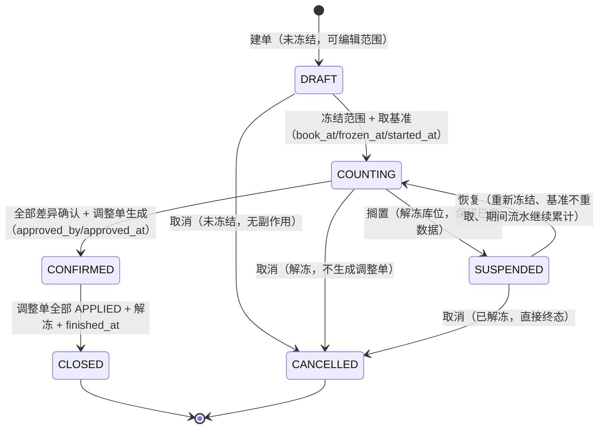
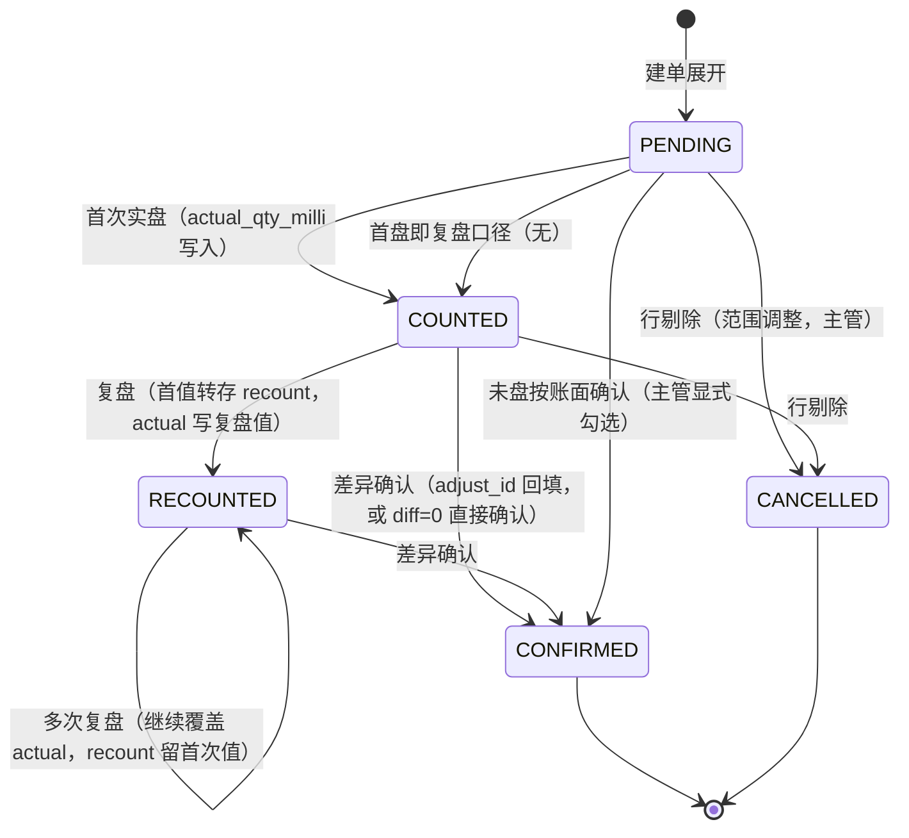
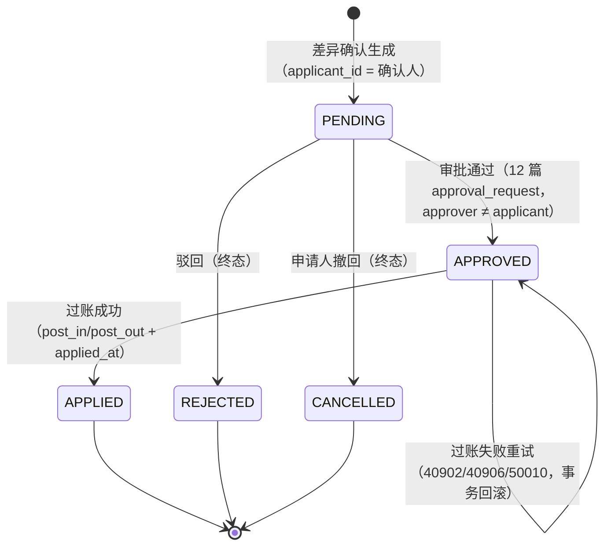
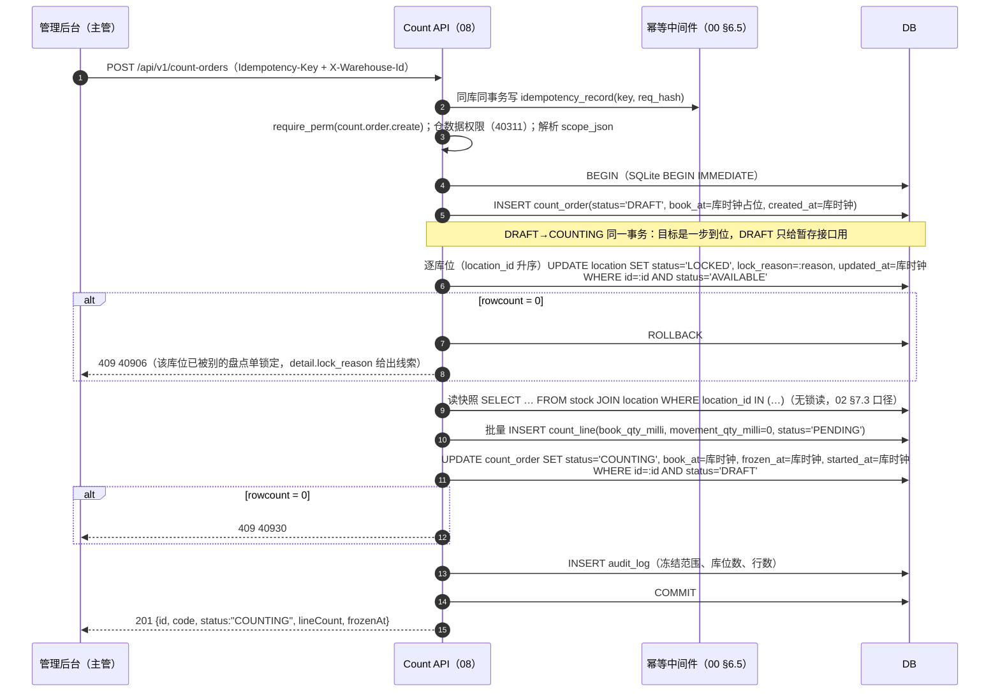
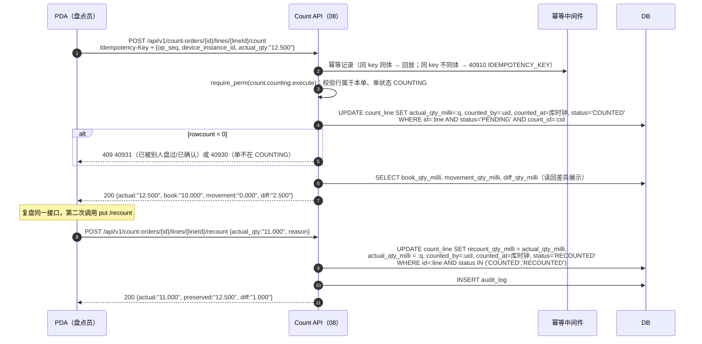
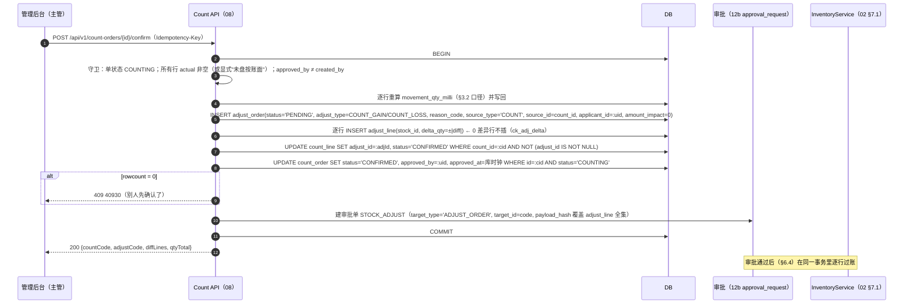
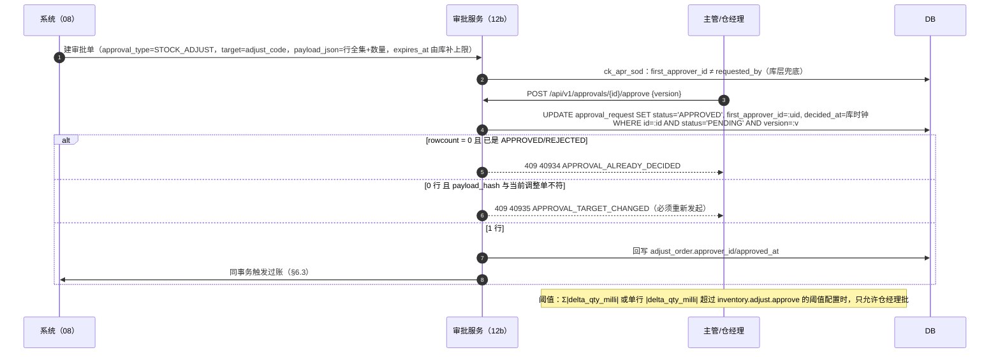
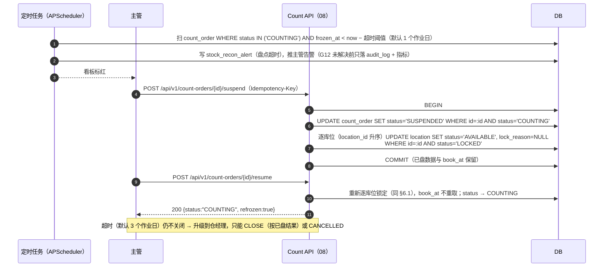

# 08 盘点

| 项 | 内容 |
|---|---|
| 编号 | 08 |
| 作者 | 小李 |
| 评审 | 小吴（对抗性评审）、非作者开发 1 名 |
| 基线 | `08_count.sql`（本分支已落库）、00 §5 R1–R12、§6.2 单号、§6.3 数量、§6.4 错误码、§6.5 幂等、§6.6 权限、§6.7 状态机、§6.8 时间、§6.10 防 REPLACE、§8 模板、§9.1 |
| 依赖 | 02 §3.2/§4.3/§4.4/§6.1/§7.1/§8.1（库存原语、冻结、库位锁、期间流水）；01 `location`/`sku`/`lot`；03 §4.5（超窗收货更正转本篇）；04 §7.3/§9（待回库、`REVERSE_PICK`）；09 §1.1（报损来源）；10 §3.2/§9（异常单处置 `ADJUST`）；12/12b（审批单、审计） |
| 状态 | 草稿。表结构以 `08_count.sql` 为准；与 DDL 冲突时以 DDL 和双库 verify 断言为准 |

> 本篇范围内的**数量列一律 milli**（R2）：库层 BIGINT，接口层 3 位小数字符串。`adjust_line.delta_qty` 的 `NUMERIC(14,3)` 遗留缺口**本轮已修**——改成 `delta_qty_milli BIGINT` + `ck_adj_int`（§4.4、§12.2 G1–G6）。

---

## 1. 职责与边界

### 1.1 本模块负责

1. **盘点建单与范围**：`count_order`/`count_line` 的建单、范围解析（`scope_json`）、行展开；全盘 `FULL` / 循环盘 `CYCLE` / 动碰盘 `DYNAMIC` / 抽盘 `SAMPLE` 四种作业形态。
2. **库位冻结与解冻**：以 `location.status='LOCKED'` + `lock_reason` 为**主闸**冻结范围库位（02 §8.1 的库位锁条件、`90_available_view.sql` 的 `l.status='AVAILABLE'` 都按它拦）。
3. **账面基准**：`book_at`（账面基准时点，UTC 整秒，由库写）、每行 `book_qty_milli`（快照账面量，口径见 §3.2）。
4. **期间流水**：每行 `movement_qty_milli` = `book_at` 之后该库存行的净流水（口径见 §3.2），供差异公式加回。
5. **实盘与复盘**：`actual_qty_milli`、`recount_qty_milli`、`diff_qty_milli`（库层 GENERATED STORED）、`counted_by`/`counted_at`。
6. **差异生成调整单**：`adjust_order`/`adjust_line` 的生成（`count_line.adjust_id` 回指行）。
7. **审批与过账**：调整单审批（申请人不能自批，走 12 篇审批单）、过账（调 02 §7.1 原语 `post_in`/`post_out`，写 `COUNT`/`ADJUST` 流水）。
8. **超时、搁置与解冻**：`SUSPENDED`/`CLOSED`/`CANCELLED` 的收尾与库位解锁。

### 1.2 本模块不负责

| 不负责的事 | 归属 | 本篇只做什么 |
|---|---|---|
| 流水与余额的实现、可用量口径、库位锁的 WHERE 条件 | 02 §4.4、§8.1 | 传 `biz_type`、`stock_dim`、`source`，读返回值 |
| 冻结/解冻的原子性、`stock_hold` 的落库与约束 | 02 §4.3、§7.1 | 调 `hold`/`unhold`（当前 v1 不启用，见 §3.5） |
| 效期与损耗判定、`SELL_EXPIRED` 报损 | 09 §1.1 | 差异超容差的部分按 `NATURAL_LOSS`/`SCRAP` 语义出调整单，不建报损单 |
| 出库分配、FEFO 排序 | 04 §3.3、02 §7.3 | 只依赖"LOCKED 库位不进 FEFO 候选"这一事实 |
| 拣货任务、改派、待回库闭环 | 05、04 §7.3 | 盘点期间拣货撞锁返回 40906，由 05 处置 |
| 收货更正单（关单后正/反向 ADJUST 流水） | 03 §4.5 | 超窗（>7d）或已对账的更正转本篇**库存调整**入口（03 §4.5 表末两行） |
| 财务损失核算 | ERP（00 §1） | 只记 `amount_impact`（分），且当前无成本价列，见 §12 G14 |

### 1.3 与原文档 / 相邻篇的差异（评审重点）

1. **库位锁是主闸，`stock_hold` 加固冻结 v1 不启用**。`stock_hold.hold_type` **没有**独立的盘点类型；02 §4.3 用 `hold_type='QUALITY'` + `reason_code='COUNT_LOCK'` 表达盘点冻结（`ck_hold_reason` 已含 `COUNT_LOCK`），但缺三条配套：① 没有 `ck_hold_count` 约束（`source_type='COUNT'`、`source_id>0`、`operator_id=0` 未被强制；`source_type` 在 DDL 里只是注释，无 CHECK）；② 02 §7.1 的人工 `unhold` 白名单放行 `QUALITY`，盘点冻结可被 `/inventory/unfreeze` 静默解掉；③ `hold` 的条件是 `available ≥ q`（02 §7.1），已分配/已预占的库存行必然冻不进去，同一张盘点单会部分冻结、口径不一致。所以 v1 只用库位锁；启用加固冻结的前置条件登记在 §12 G11。
2. **02 §12 Q4 由本篇裁决**（该行裁决人写的就是"第 8/9 篇作者"）：盘亏/调整遇到已预占或已冻结的货，**不强制释放**。盘亏过账只要求 `on_hand` 够（02 §7.1 `post_out` 的条件），预占与冻结**原样保留**，由 04/09 各自的单据显式释放；盘点单不允许隐式 `release`/`unhold` 别人的占用。
3. **`RETURN_PENDING` 不参与差异调整**（02 §4.3 盘点口径、04 §9 最后一行）：这部分货实物在分拣员手上，`book_qty_milli` 先扣掉它的余量，否则会先盘亏、回库后又账少实多。
4. **`REVERSE_PICK` 与盘点自身的过账放行库位锁**（02 §8.1 第 2 段）：两者都计入 `movement_qty_milli`，不会被算成盘盈（04 Q8 已定）。
5. **盘亏过账与库位锁：措辞歧义（评审 P27-2 纠正，重要 · 非阻塞）**：02 §8.1 第 1 行的 `post_out` WHERE 只写"库位未锁定"，**但同节第 2 段与 §7.1 已写明"盘点自己的 `COUNT` 调整入账不带这个条件"**——所以盘亏在 LOCKED 库位上是**可以过账的**，"盘亏永远过不了账"不成立。残余问题是**措辞歧义**（只读 §8.1 第 1 行会误判）。修法：02 在 §8.1 表格的 `post_out` 行**对称写明** `biz_type IN ('COUNT','ADJUST')` 例外（`post_in` 同款），登记 §12.2 G19（已由阻塞降为重要）。本篇**不使用**任何"临时解锁"过渡方案。
6. **盘点单本身不写库存流水**：`post_in`/`post_out` 都由调整单过账时调用（02 §2 UC11），盘点单只做快照、实盘、差异与调整单生成。

---

## 2. 用例

| # | 用例 | 角色 / 触发者 | 权限点 | 库存原语 | on_hand |
|---|---|---|---|---|---|
| UC1 | 建盘点单（草稿） | 主管 / 仓管 | `count.order.create` | — | 0 |
| UC2 | 冻结范围并开始盘点（快照基准） | 主管 | `count.order.create`（同 UC1 同事务）/ `count.order.suspend` 恢复 | — | 0 |
| UC3 | PDA 实盘录入 | 盘点员 | `count.counting.execute` | — | 0 |
| UC4 | 复盘（recount） | 盘点员 / 主管 | `count.counting.recount` | — | 0 |
| UC5 | 差异确认、生成调整单 | 主管 | `count.diff.confirm` | — | 0 |
| UC6 | 调整单审批 | 主管 / 仓经理（≠申请人） | `inventory.adjust.approve` | — | 0 |
| UC7 | 调整单过账 | 系统（审批通过后） | — | `post_in` / `post_out` | ±q |
| UC8 | 查盘点单 / 行 / 差异 | 后台、PDA | `count.order.view` | — | 0 |
| UC9 | 取消盘点单 | 主管 | `count.order.cancel` | — | 0 |
| UC10 | 搁置 / 恢复（解冻 / 重新冻结） | 主管 | `count.order.suspend` | — | 0 |
| UC11 | 关闭盘点单（收尾解冻） | 主管 | `count.order.close` | — | 0 |
| UC12 | 动碰盘点（切换/RPO 后对账，00 §9.1） | 系统 + 主管 | `count.order.create` | — | 0 |
| UC13 | 循环盘调度（按 zone / ABC 轮转） | 定时任务 | `count.order.create`（系统身份） | — | 0 |

**角色分工**：盘点员（PDA）只做 UC3/UC4；主管做 UC2/UC5/UC6/UC9/UC10/UC11；仓经理只做 UC6 与超阈值裁决；系统身份做 UC7/UC12/UC13。系统管理员不能做业务操作（00 §2）。

---

## 3. 领域模型

### 3.1 盘点单 `CountOrder`

- `count_type ∈ {FULL, CYCLE, DYNAMIC, SAMPLE}`（`08_count.sql` 列注释口径）；不落 CHECK，登记 §12 G1。
- `scope_json`（TEXT，R4 禁 JSONB）是**范围 DSL**，本篇定义（应用层解析，解析失败 40001）：

```json
{ "location_codes": ["A02-01-03"], "zone_codes": ["A02"], "location_types": ["SHELF","PALLET"],
  "abc_classes": ["A"], "sku_codes": ["APL-80-5KG"], "lot_ids": [],
  "include_zero_book": true, "freeze_locations": true,
  "sample_ratio_pct": 20, "recount_tolerance_pct": 5 }
```

- `warehouse_id` 由服务端按 `X-Warehouse-Id` 校验后写入，**不采信请求体与 `scope_json` 里的仓**（00 §6.6）。
- `book_at`：账面基准时点，UTC 整秒（00 §6.8 第 1/3 条）。因为列是 `NOT NULL`，`DRAFT` 期先写库时钟占位，**冻结时条件更新覆盖一次**（`WHERE id=:id AND status='DRAFT'`），冻结后不可改（应用层断言；不引入库层触发器）。
- `frozen_at` / `started_at` / `finished_at` / `approved_at`：都由库写（00 §6.8 第 3 条），语义见 §5.1。

### 3.2 账面基准与期间流水口径

对每个 `(location_id, sku_id, lot_id)` 维度：

```
book_qty_milli      = stock.on_hand_qty_milli(book_at 时刻)
                      − Σ(RETURN_PENDING 冻结余量)            -- 02 §4.3 盘点口径、04 §9
movement_qty_milli  = Σ(stock_movement.move_qty_milli × direction)   -- direction ∈ {−1,+1}
                      其中 stock_id = 该行库存，stock_seq > 该行 book 水位线
diff_qty_milli      = actual_qty_milli − book_qty_milli − movement_qty_milli   （库层 GENERATED STORED）
```

判定口径固定四条：

1. **水位线**：优先用 `stock_seq > book_ledger_seq`（`stock_seq` 就是 `stock.ledger_seq` 的写后值，02 §4.4.1、§3.5 I5'）。`count_line` 目前没有 `book_ledger_seq` 列，登记 §12 G8；过渡实现用 `occurred_at > count_order.book_at`（`occurred_at` 是库强制的过账时间，00 §6.8 第 7 条），代价是同秒边界要靠 `book_at` 由库写来保证，且 SQLite 侧必须按整数秒比较（00 §6.8 第 5 条）。
2. **只算 `direction <> 0`**：`SHIP` 是纯事件（direction=0），不进期间流水（02 §3.4）。
3. **`hold_qty_milli` 里的 `MANUAL`/`SCRAP_PENDING` 不从账面扣**（货还在库位）；`PROCESSING`/`LIVE_HOLD` 是否扣**待与第 17/18 篇确认**（加工领料的实物已离开原库位、活鲜在暂养池是另一个库位），登记 §12 G20。`RETURN_PENDING` 已定扣（上一条公式）。
4. **零账面行也要有行**：`scope` 内 `include_zero_book=true` 时，对"历史上出现过、当前 `on_hand=0`"的维度也展开 `count_line`（`book_qty_milli=0`），否则零库存行的盘盈无处录。

### 3.3 差异量 `diff_qty_milli`（GENERATED STORED）

- 库层表达式：`actual_qty_milli - book_qty_milli - movement_qty_milli`，`STORED`。两库一致（SQLite 需 ≥ 3.31，`08_count.sql` 第 46 行注明低版本改应用层计算 + 普通列）。
- **不可写**：PG 报"cannot insert a non-DEFAULT value into column"，SQLite 报"cannot INSERT into generated column"。服务端与 PDA 都不能把差异当入参（§11 用例）。
- `actual_qty_milli` 为 NULL（未盘）时整个表达式为 NULL，**未盘行不进差异汇总**，也不能生成调整行（守卫：`actual_qty_milli IS NOT NULL`）。
- 符号：`> 0` 盘盈（走 `post_in`，`adjust_type='COUNT_GAIN'`），`< 0` 盘亏（走 `post_out`，`adjust_type='COUNT_LOSS'`），`= 0` 无差异、只确认不建调整行。
- **复盘的落法**：库层 GENERATED 列不可能被改写，所以"最终采用的实盘量"必须落在 `actual_qty_milli`：首次实盘写 `actual_qty_milli`；复盘时把首次值**转存**到 `recount_qty_milli`（留档），再把复盘值写入 `actual_qty_milli`。两个列都有，diff 永远反映最终量（`recount_qty_milli` 非空 ⇔ 该行盘过两次）。

### 3.4 调整单 `AdjustOrder` / 调整行 `AdjustLine`

- `adjust_type ∈ {COUNT_GAIN, COUNT_LOSS, SCRAP, MANUAL, REVERSE_PICK}`（列注释口径；库层 `ck_adj_type` 本轮已落库）。本篇只产 `COUNT_GAIN`/`COUNT_LOSS`；`MANUAL` 留给对账差异与超窗收货更正转入（§1.2）；`REVERSE_PICK` 在 `adjust_type` 里的用途**待与第 4/5 篇确认**（04 §6.3 的拣后取消回冲走 04 自己的单据 + `post_in(REVERSE_PICK)`，不建 `adjust_order`）。
- `reason_code` 是**应用层枚举**（库层无 CHECK）：本篇登记 `COUNT_DIFF`（范围差异）、`NATURAL_LOSS`（差异在 `sku.natural_loss_pct` 容差内，与 09 `ck_scr_reason` 同名便于报表对齐）、`RECON_DIFF`（对账差异人工确认）、以及从 03 §4.5 `ck_irc_reason` 原样沿用的 `COUNT_ERROR`/`WEIGHT_ERROR`/`WRONG_SKU`/`WRONG_BATCH`/`QUALITY_FOUND`/`OTHER`（`OTHER` 必填备注，对齐 03 写法）。新增取值先在本篇登记。
- `source_type`/`source_id`：盘点差异写 `('COUNT', count_order.id)`；异常单转入写 `('EXCEPTION', exception_case.id)`（10 §3.2：处置 `ADJUST` 必须带生成单号）；对账告警转入写 `('RECON_ALERT', stock_recon_alert.id)`。
- `amount_impact`（分）：当前 `sku` **没有成本价列**（01 `01_master.sql`），无法计算，只能写 0；金额阈值审批待 §12 G14 解决后启用。
- `delta_qty_milli`（正入负出）：`COUNT_GAIN` 行 `delta_qty_milli = +|diff|`，`COUNT_LOSS` 行 `delta_qty_milli = −|diff|`；`ck_adj_delta` 拒 0，所以 `diff_qty_milli = 0` 的行**不生成** `adjust_line`。
- 盘点单的 `approved_by`/`approved_at` 是**盘点结果确认人**（≠ `created_by`），调整单的 `applicant_id`/`approver_id` 是**调整单审批**，两层不是一回事（§5.1/§5.3）。

### 3.5 不变量

| # | 内容 | 库层 | 应用层断言 |
|---|---|---|---|
| C1 | `book_qty_milli`、`movement_qty_milli`、`actual_qty_milli`、`recount_qty_milli` 都是整数 milli | `ck_cnt_int`（已落库） | `Quantity` |
| C2 | `diff_qty_milli = actual − book − movement` | GENERATED STORED（已落库） | 只读校验 |
| C3 | 未盘行（`actual_qty_milli IS NULL`）不能生成调整行 | 不能 | 确认流程守卫 |
| C4 | `adjust_line.delta_qty_milli <> 0` | `ck_adj_delta`（已落库） | 生成前过滤 0 差异行 |
| C5 | `COUNT_GAIN` 行全为正、`COUNT_LOSS` 行全为负，且与 `diff_qty_milli` 同号同量 | 不能 | 过账前逐行核对（不平 → 50010） |
| C6 | 一个 `count_line` 最多挂一个 `adjust_id`，一张盘点单最多生成一张调整单 | 不能（无索引，G18） | `count_line.adjust_id` 条件更新 + `source_type/source_id` 查重 |
| C7 | 盘点期间的范围库位保持 `LOCKED`，除非本单走过 `SUSPENDED/CANCELLED/CLOSED` | 不能（`location.status` 无 CHECK） | 解锁前核对本单状态与 `count_lock_id`（G10） |
| C8 | 冻结的库存行不再进入 FEFO 候选 | 视图 `v_stock_available` 的 `l.status='AVAILABLE'` | — |
| C9 | 调整单过账后 `applied_at` 非空且不可回退；红冲只能新开一张反向单 | 不能 | 状态机守卫（§5.3） |
| C10 | `hold_qty_milli` 只在 02 原语里变，本篇不改 `stock`（v1 不启用加固冻结，§1.3） | 02 §4.4.4 | 代码层：本篇不出现 `UPDATE stock` |

---

## 4. 涉及的表（字段、约束、索引）

以下四张表**已在 `08_count.sql` 落库**，逐列抄录；标「待落库」的是本次评审提出的缺口（§4.6 汇总）。`GRANT` 已落库：`GRANT SELECT, INSERT, UPDATE ON count_order, count_line, adjust_order, adjust_line TO wms_app;  -- @pg-only`（无 DELETE/TRUNCATE，符合 02 §4.4.4 的最小权限矩阵）。

### 4.1 `count_order`（盘点单，已落库）

| 列 | 类型 | 约束 / 语义 | 状态 |
|---|---|---|---|
| `id` | BIGINT | PK，雪花 ID（R1） | 已落库 |
| `code` | VARCHAR(64) | NOT NULL，`uq_cnt_code` UNIQUE | 已落库 |
| `warehouse_id` | BIGINT | NOT NULL，`fk_cnt_wh` → `warehouse(id)` | 已落库（本轮补 FK） |
| `count_type` | VARCHAR(24) | NOT NULL，`ck_cnt_type`：`FULL/CYCLE/DYNAMIC/SAMPLE` | 已落库（本轮补 CHECK） |
| `scope_json` | TEXT | NOT NULL，范围 DSL（§3.1），R4 不用 JSONB | 已落库 |
| `status` | VARCHAR(16) | NOT NULL DEFAULT `'DRAFT'`，`ck_cnt_status`：`DRAFT/COUNTING/SUSPENDED/CONFIRMED/CLOSED/CANCELLED`（§5.1） | 已落库（本轮补 CHECK） |
| `frozen_at` | TIMESTAMP | 冻结时刻（库写） | 已落库 |
| `book_at` | TIMESTAMP | NOT NULL，账面基准时点（库写，冻结时定稿） | 已落库 |
| `started_at` | TIMESTAMP | 开始实盘 | 已落库 |
| `finished_at` | TIMESTAMP | 关闭时刻 | 已落库 |
| `approved_by` | BIGINT | 结果确认人（≠ `created_by`） | 已落库 |
| `approved_at` | TIMESTAMP | 确认时刻 | 已落库 |
| `created_by` | BIGINT | 建单人 | 已落库 |
| `created_at` / `updated_at` | TIMESTAMP | NOT NULL，库默认 `date_trunc('second', now() AT TIME ZONE 'UTC')`（00 §6.8 第 3 条） | 已落库（本轮 G15 落地） |
| `version` | BIGINT | NOT NULL DEFAULT 0，状态条件更新时 +1（00 §6.7） | 已落库（本轮 G2 落地） |

约束：`uq_cnt_code (code)`、`ck_cnt_type`、`ck_cnt_status`、`ck_cnt_approved`（`approved_by` 与 `created_by` 同非空时不得相等）、`fk_cnt_wh`。索引：`ix_cnt_wh (warehouse_id, status, created_at)`（本轮 G5 落地）。

### 4.2 `count_line`（盘点行，已落库）

| 列 | 类型 | 约束 / 语义 | 状态 |
|---|---|---|---|
| `id` | BIGINT | PK | 已落库 |
| `count_id` | BIGINT | NOT NULL，`fk_cntl_count` → `count_order(id)` | 已落库（本轮补 FK） |
| `location_id` | BIGINT | NOT NULL，`fk_cntl_loc` → 01 `location(id)` | 已落库（本轮补 FK） |
| `sku_id` | BIGINT | NOT NULL，`fk_cntl_sku` → 01 `sku(id)` | 已落库（本轮补 FK） |
| `lot_id` | BIGINT | NOT NULL，`fk_cntl_lot` → 01 `lot(id)` | 已落库（本轮补 FK） |
| `book_qty_milli` | BIGINT | NOT NULL，基准账面（§3.2） | 已落库 |
| `movement_qty_milli` | BIGINT | NOT NULL DEFAULT 0，期间净流水 | 已落库 |
| `actual_qty_milli` | BIGINT | 可空，**NULL = 未盘**；复盘后写最终值 | 已落库 |
| `diff_qty_milli` | BIGINT | `GENERATED ALWAYS AS (actual − book − movement) STORED`（§3.3） | 已落库 |
| `recount_qty_milli` | BIGINT | 可空，复盘时存放**首次**实盘量（留档） | 已落库 |
| `status` | VARCHAR(16) | NOT NULL DEFAULT `'PENDING'`，`ck_cntl_status`：`PENDING/COUNTED/RECOUNTED/CONFIRMED/CANCELLED`（§5.2） | 已落库（本轮补 CHECK） |
| `counted_by` | BIGINT | 实盘人 | 已落库 |
| `counted_at` | TIMESTAMP | 实盘时刻（库写） | 已落库 |
| `adjust_id` | BIGINT | 可空，`fk_cntl_adjust` → `adjust_order(id)` | 已落库（本轮补 FK） |

约束：`ck_cnt_int`（四列整数同行判定，两库语义一致）、`ck_cntl_status`、`ck_cntl_counted`（非 `PENDING` 必须已有 `actual_qty_milli` 与 `counted_at`）、`ck_cntl_recount`（有复盘值时必须有实盘值）、`uq_cnt_line (count_id, location_id, sku_id, lot_id)`（同一单同一维度只有一行，兼作实盘录入的业务唯一键）、五个外键。
索引：`ix_cnt_line_count (count_id, status)`、`ix_cnt_line_loc (location_id)`（本轮 G5 落地）。

### 4.3 `adjust_order`（调整单，已落库）

| 列 | 类型 | 约束 / 语义 | 状态 |
|---|---|---|---|
| `id` | BIGINT | PK | 已落库 |
| `code` | VARCHAR(64) | NOT NULL，`uq_adj_code` UNIQUE。建议前缀 `ADJ-`（02 §4.4.2 示例已用） | 已落库 |
| `warehouse_id` | BIGINT | NOT NULL，`fk_adj_wh` → `warehouse(id)` | 已落库（本轮补 FK） |
| `adjust_type` | VARCHAR(24) | NOT NULL，`ck_adj_type`：`COUNT_GAIN/COUNT_LOSS/SCRAP/MANUAL/REVERSE_PICK` | 已落库（本轮补 CHECK） |
| `reason_code` | VARCHAR(24) | NOT NULL，应用层枚举（§3.4），库层无 CHECK | 已落库 |
| `source_type` | VARCHAR(24) | 可空，`COUNT/EXCEPTION/RECON_ALERT/MANUAL` | 已落库（无 CHECK） |
| `source_id` | BIGINT | 可空 | 已落库 |
| `status` | VARCHAR(16) | NOT NULL DEFAULT `'PENDING'`，`ck_adj_status`：`PENDING/APPROVED/REJECTED/CANCELLED/APPLIED`（§5.3） | 已落库（本轮补 CHECK） |
| `amount_impact` | BIGINT | NOT NULL DEFAULT 0，单位**分**（R2）；当前无成本价可算（G14） | 已落库 |
| `applicant_id` | BIGINT | NOT NULL，申请人（= 差异确认人） | 已落库 |
| `approver_id` | BIGINT | 审批通过后回写；必须 ≠ `applicant_id` | 已落库 |
| `approved_at` | TIMESTAMP | 审批时刻（库写） | 已落库 |
| `applied_at` | TIMESTAMP | 过账时刻（库写） | 已落库 |
| `created_at` / `updated_at` | TIMESTAMP | NOT NULL，库默认 `date_trunc('second', now() AT TIME ZONE 'UTC')` | 已落库（本轮 G15 落地） |
| `version` | BIGINT | NOT NULL DEFAULT 0，状态条件更新时 +1 | 已落库（本轮 G2 落地） |

约束：`uq_adj_code (code)`、`ck_adj_type`、`ck_adj_status`、`ck_adj_sod`（`approver_id ≠ applicant_id`）、`fk_adj_wh`。索引：`ix_adj_wh (warehouse_id, status, created_at)`、`ix_adj_src (source_type, source_id)`（本轮 G5 落地；`uq_adj_src` 部分唯一仍待定 G18）。

### 4.4 `adjust_line`（调整行，已落库）

| 列 | 类型 | 约束 / 语义 | 状态 |
|---|---|---|---|
| `id` | BIGINT | PK | 已落库 |
| `adjust_id` | BIGINT | NOT NULL，`fk_adjl_order` → `adjust_order(id)` | 已落库（本轮补 FK） |
| `line_no` | SMALLINT | NOT NULL，过账流水行号；`uq_adjl (adjust_id, line_no)` | 已落库（本轮补列，G7） |
| `stock_id` | BIGINT | NOT NULL，指向 02 `stock.id`（**未加 FK**：零账面盘盈可能先建 0 在库行，见 G7） | 已落库（FK 待定） |
| `delta_qty_milli` | BIGINT | NOT NULL，正入负出，基本单位 milli；`ck_adj_delta CHECK (delta_qty_milli <> 0)` + `ck_adj_int` 整数判定 | 已落库（本轮按 00 §5 R2 从 `delta_qty NUMERIC(14,3)` 改名改型，G6） |

约束：`ck_adj_delta`、`ck_adj_int`、`uq_adjl (adjust_id, line_no)`、`fk_adjl_order`。索引：`uq_adjl` 兼作 `adjust_id` 前缀索引，不再单建。

### 4.5 引用的别篇表（只读/原语间接写）

| 表 | 篇 | 本篇怎么用 |
|---|---|---|
| `location` | 01 | `status='LOCKED'` + `lock_reason` 冻结/解冻；`zone_id`、`location_type`、`pick_sequence` 展开范围；`status` 无 CHECK（DDL 注释只有 `AVAILABLE/LOCKED/DISABLED`），且无 `version` 列 → 冻结用 `WHERE id=:id AND status='AVAILABLE'` 条件更新 |
| `sku` | 01 | `base_uom`（接口出参单位）、`natural_loss_pct`（容差口径）、`abc_class`（循环盘范围）、`status`；**无成本价列**（G14） |
| `lot` | 01 | `lot_code`、`expiry_date`、`quality_status`（范围与展示） |
| `warehouse` | 01 | `timezone`（作业日与展示，R3）、`code`（单号仓前缀） |
| `stock` | 02 | 读 `on_hand_qty_milli`/`hold_qty_milli`/`ledger_seq` 做基准；**不 UPDATE**（C10） |
| `stock_hold` | 02 | 读 `RETURN_PENDING` 余量扣基准；v1 不写（§1.3） |
| `stock_movement` / `stock_movement_key` | 02 | 读期间流水（`stock_seq`、`direction`、`move_qty_milli`）；过账时由原语写 |
| `stock_ledger_line` | 02 | 过账时由原语的"先查再插"占位（02 §4.4.3），本篇不直接写 |
| `stock_recon_alert` | 02 | 复核冻结失败等异常要写告警，但 `ck_recon_code` 无盘点码（G12） |
| `v_stock_available` | 02 / `90_available_view.sql` | 范围候选读（`l.status='AVAILABLE'`，LOCKED 自动排除） |
| `approval_request` | 12b | 调整单审批载体（`target_type='ADJUST_ORDER'`、`target_id=code`、`payload_hash`）；`ck_apr_type` 无库存调整类型（G13） |
| `audit_log` | 11/12 | 建单、冻结、解冻、确认、审批、过账、取消、搁置全写（只追加） |
| `numbering_segment` | 11 | `CNT`、`ADJ` 两个 `doc_type` 取号（00 §6.2） |
| `idempotency_record` | 11 | 所有 POST 的 `Idempotency-Key` |
| `exception_case` | 10 | 无法定位的差异转异常单；处置 `ADJUST` 时回填 `resolution_doc = adjust_order.code` |

### 4.6 已落库 vs 待落库（明确区分）

**已落库**（`08_count.sql`，本分支）：四张表 + `uq_cnt_code` / `uq_cnt_line` / `uq_adjl` / `uq_adj_code` / `ck_cnt_int` / `ck_cnt_type` / `ck_cnt_status` / `ck_cnt_approved` / `ck_cntl_status` / `ck_cntl_counted` / `ck_cntl_recount` / `ck_adj_type` / `ck_adj_status` / `ck_adj_sod` / `ck_adj_delta` / `ck_adj_int` + `diff_qty_milli` GENERATED STORED + 8 个外键 + `ix_cnt_wh` / `ix_cnt_line_count` / `ix_cnt_line_loc` / `ix_adj_wh` / `ix_adj_src` + `count_order.version` / `adjust_order.version` / `updated_at` + `adjust_line.line_no` / `delta_qty_milli` + `GRANT SELECT, INSERT, UPDATE`（无 DELETE / TRUNCATE）。

**本轮已落地**（长流，评审请对照编号看旧缺口）：G1（五组 CHECK 与 SoD）、G2（两张单表的 `version`）、G3（`updated_at`）、G4（8 个外键：`fk_cnt_wh`、`fk_cntl_count/adjust/loc/sku/lot`、`fk_adj_wh`、`fk_adjl_order`；`adjust_line.stock_id` 除外，见 G7）、G5（5 个索引；不再单建 `ix_adj_line_adj`，由 `uq_adjl` 的 `adjust_id` 前缀覆盖）、G6（`delta_qty` → `delta_qty_milli BIGINT` + `ck_adj_int`）、G7 前半（`adjust_line.line_no` + `uq_adjl`）、G15 的 DEFAULT 部分（`created_at` / `updated_at` 改库时钟整秒 UTC）。

**仍待落库 / 待登记**：

| 编号 | 缺口 | 落点（谁改） | 影响 |
|---|---|---|---|
| G7 | `adjust_line` 的 `line_no` + `uq_adjl` **本轮已补**；仍无维度列，`stock_id NOT NULL` 在"零账面、无 `stock` 行"的盘盈上无处取 | 本篇（四维列或 `stock_id=0` 哨兵，R11） | 02 §4.4.2 的 `idempotency_key = {biz_no}:{line_no}:D{op_no}:{leg}` 的**行号已可用**；盘盈到新维度仍过不了账 |
| G8 | `count_line` 无 `book_ledger_seq`（期间流水水位线） | 本篇 | 见 §3.2 第 1 条 |
| G9 | `count_line` 无实盘/复盘的来源键（设备、`op_seq`、轮次），离线补传的业务唯一键无处落库 | 本篇（建议追加表 `count_record`，`uq_cnt_rec`，只追加） | PDA 离线实盘只能靠 `Idempotency-Key`（24h），过期后无兜底 |
| G10 | `location` 无结构化盘点锁回指（`count_lock_id`/`count_locked_at`），`lock_reason` 是自由文本、`status` 无 CHECK | 本篇 `08_count.sql` ALTER + `README.md`「跨篇加列」登记 | 40906 时无法告诉调用方是哪张盘点单锁的；解冻无法核对归属 |
| G11 | `stock_hold` 侧缺 `ck_hold_count`（`QUALITY`+`COUNT_LOCK` 未绑定 `source_type='COUNT'`/`source_id>0`/`operator_id=0`）；02 §7.1 人工 `unhold` 放行 `QUALITY`；`hold` 的 `available ≥ q` 条件在已分配行上必失败 | 02（小钱） | 加固冻结 v1 不能启用（§1.3 第 1 条） |
| G12 | `stock_recon_alert.ck_recon_code` 无盘点码（如 `COUNT_HOLD_MISMATCH`、`COUNT_BOOK_MISMATCH`） | 02（小钱）+ 00 §6.4 登记 | 复核失败等只能写 50010 告警，落不进对账表 |
| G13 | `approval_request.ck_apr_type` 无库存调整类型（建议 `STOCK_ADJUST`），00 §6.6.1 未登记；`ck_apr_dual` 只允许 `UNPLANNED_FAILOVER` 有第二审批人 | 12/12b + 00 §6.6.1 | 调整单审批无类型可落；两级审批落不了库（v1 单级） |
| G14 | `sku` 无成本价列 → `adjust_order.amount_impact` 算不出来 | 01（大肥鱼） | 金额阈值审批不可用，v1 只用数量阈值 |
| G15 | 四表 `created_at DEFAULT now()` 与 00 §6.8 第 3/8 条不符（08 被点名）；SQLite 缺整秒格式 + ±300 s 窗口 CHECK；`frozen_at`/`book_at`/`started_at`/`finished_at`/`approved_at`/`applied_at` 的"由库写"未落库 | 本篇 | 时间约定不合规，双库不一致 |
| G16 | 00 §6.10 第 5 条把 08 四表列在 `REPLACE_TODO`；追加性质的行表还需只追加锁 | 本篇（两库 no-REPLACE 触发器 + `trg_adjl_immutable` 类） | REPLACE 能整行改写；已过账行可被改 |
| G17 | 单号前缀 `CNT-` 未在 00 §6.2 登记（`ADJ-` 已在 02 §4.4.2 示例出现） | 00 §6.2（大肥鱼）+ 本篇 | 取号 `doc_type` 无权威登记 |
| G18 | 无"一张盘点单只生成一张调整单"的库层唯一键（`uq_adj_src (source_type, source_id)` 部分唯一） | 本篇 | 并发两次确认会建两张调整单 |
| G19 | 02 §8.1 第 1 行的 `post_out` WHERE 只写"库位未锁定"，`COUNT` 例外只写在第 2 段与 §7.1 → **措辞歧义**（只读第 1 行会误判盘亏过不了账；实际 02 已给例外） | 02（小钱） | **重要**（原判"阻塞"已按评审 P27-2 纠正）：修法是 §8.1 表格 `post_out` 行对称写明 `biz_type IN ('COUNT','ADJUST')` 例外 |
| G20 | 盘点冻结是否扣除 `PROCESSING`/`LIVE_HOLD` 未定（02 §4.3 只写了 `RETURN_PENDING`） | 02 + 17/18 | 加工/活鲜在途货会被算成盘亏 |

---

## 5. 状态机

**库层现状**：四张表的 `status` 已有值域 CHECK（`ck_cnt_status` / `ck_cntl_status` / `ck_adj_status`，取值就是本节各表列出的状态），两张单表还有 `version`；**没有迁移触发器**，所以迁移全靠应用层：`transit()` 查 `domain/state_machines.py` 的迁移表，再执行 00 §6.7 的条件更新

```sql
UPDATE count_order SET status = :to, version = version + 1 WHERE id = :id AND status = :from;   -- rowcount = 0 → 40930（带当前状态）
```

`rowcount = 0` 一律 **409 40930 ILLEGAL_STATE_TRANSITION**，`detail` 带 `{from_expected, current_status, entity}`；并发抢同一行时后到方就是这条路径。加了 G2 的 `version` 后，同一条 UPDATE 再带 `version = version + 1`（并对客户端回传的 `version` 做乐观提示，**不参与判断**，同 02 §7.2 的 `version` 口径）。

### 5.1 `count_order`（默认 `DRAFT`）



| from → to | 触发者 | 守卫 | 副作用 | 失败码 |
|---|---|---|---|---|
| `DRAFT → COUNTING` | 主管（`count.order.create`） | 范围解析成功；范围内库位条件更新 `AVAILABLE→LOCKED` 全部命中；至少展开 1 行 | 写 `frozen_at`/`book_at`/`started_at`；写 `count_line` 快照；写 `audit_log` | 40906（库位已被别的盘点单锁）、40001（范围为空/非法）、40311 |
| `COUNTING → SUSPENDED` | 主管（`count.order.suspend`） | 无未决调整单 | 解冻范围库位（`LOCKED→AVAILABLE`，逐条按 `location_id` 升序）；`audit_log` | 40930（当前不是 COUNTING） |
| `SUSPENDED → COUNTING` | 主管（`count.order.suspend`） | 重新冻结全部命中；`book_at` **不重取**（基准不变） | 重新锁库位，期间流水继续累计到 `movement_qty_milli` | 40906 |
| `COUNTING → CONFIRMED` | 主管（`count.diff.confirm`） | 每行 `actual_qty_milli IS NOT NULL`（或显式"未盘行按账面无差异确认"）；差异行已生成 `adjust_line`；`approved_by ≠ created_by` | 写 `approved_by`/`approved_at`；`count_line.adjust_id` 回填；建 `adjust_order(PENDING)` | 40930、40931（已锁定/已确认）、40312（自批） |
| `CONFIRMED → CLOSED` | 主管或系统（`count.order.close`） | 本单关联的 `adjust_order` 全部 `APPLIED` 或 `REJECTED/CANCELLED`（驳回的不再等待） | 解冻库位；写 `finished_at`；`audit_log` | 40930、40931 |
| `DRAFT → CANCELLED` | 主管（`count.order.cancel`） | — | 无 | 40930 |
| `COUNTING → CANCELLED` | 主管 | — | 解冻；已盘数据留档；不生成调整单 | 40930 |
| `SUSPENDED → CANCELLED` | 主管 | — | 无（已解冻） | 40930 |
| 其余组合（含 `CLOSED/CANCELLED` 之后再迁） | — | — | — | 40930（终态不可迁，00 §6.7） |

### 5.2 `count_line`（默认 `PENDING`）



| from → to | 触发者 | 守卫 | 副作用 | 失败码 |
|---|---|---|---|---|
| `PENDING → COUNTED` | 盘点员（`count.counting.execute`） | 行属于本单；单状态 `COUNTING`；数量是 3 位小数以内字符串 | 写 `actual_qty_milli`、`counted_by`、`counted_at` | 40010、40930（单不在 COUNTING）、40931（行已确认） |
| `COUNTED → RECOUNTED` | 盘点员/主管（`count.counting.recount`） | 单状态 `COUNTING`；复盘人与首盘人不同或主管强制（`recount_tolerance_pct` 超差时**必须**换人） | `recount_qty_milli` ← 原 `actual_qty_milli`；`actual_qty_milli` ← 复盘值；`counted_by/counted_at` 更新 | 40930、40931、40312（超差未换人） |
| `COUNTED/RECOUNTED → CONFIRMED` | 主管（`count.diff.confirm`） | `diff_qty_milli = 0` 直接确认；`≠ 0` 必须已生成 `adjust_line` 并回填 `adjust_id` | 写 `adjust_id` | 40931、50010（调整行与原语不平） |
| `PENDING → CONFIRMED` | 主管 | 显式"未盘按账面确认"，记审计原因 | 无 | 40002（缺原因） |
| `PENDING/COUNTED → CANCELLED` | 主管 | 该行未参与已生成的调整单 | 无 | 40930 |

### 5.3 `adjust_order`（默认 `PENDING`）



| from → to | 触发者 | 守卫 | 副作用 | 失败码 |
|---|---|---|---|---|
| `PENDING → APPROVED` | 主管/仓经理（`inventory.adjust.approve`） | 审批单 `PENDING`；`approver_id ≠ applicant_id`；审批对象 `payload_hash` 未变 | 回写 `approver_id`/`approved_at`；**同事务**执行过账（下一步） | 40934（审批已决）、40935（对象已变）、40312（自批） |
| `PENDING → REJECTED` | 同上 | 同上 | 回写审批结果；`count_line` 保持 `COUNTED`，允许重新确认（重开一张新调整单） | 40934、40935 |
| `PENDING → CANCELLED` | 申请人（`count.diff.confirm`） | 审批单仍在 `PENDING` | 撤回审批单 | 40934 |
| `APPROVED → APPLIED` | 系统 | 逐行 `post_in`/`post_out` 全部 rowcount=1 | 写 `applied_at`；流水 `biz_type='COUNT'`、`biz_no=adjust_order.code`、`line_no=` 调整行号、`op_no=1`、`leg=1`；`audit_log` | 40902（盘亏超过在库）、40906（G19）、40904/40905、50010（`ck_stock_*` 被撞=条件写漏） |
| `APPROVED → APPLIED` 重试 | 系统 | `applied_at IS NULL` | 幂等靠 02 记账唯一键（`uq_mvk_biz_line`）读回原流水，**不二次扣减** | — |
| `APPROVED → CANCELLED` | — | **不允许** | 需红冲：新开一张反向 `adjust_order`（`source_type='ADJUST_REVERSAL'`，登记 §12） | 40930 |
| 终态之后 | — | — | — | 40930 |

---

## 6. 核心流程

### 6.1 ① 建单冻结范围（快照基准）



要点：冻结在库位粒度、按 `location_id` 升序（R7 禁 `SELECT FOR UPDATE`，用条件 UPDATE + `rowcount`）；快照在锁之后读，所以锁后不再有 `consume`/`reserve`/`move`（全被 40906 拦），只可能有 `REVERSE_PICK` 与报损过账（02 §8.1），它们进期间流水。

### 6.2 ② 实盘录入（含复盘 recount）



复盘把首次值转存 `recount_qty_milli` 再覆盖 `actual_qty_milli`（§3.3）：库层 GENERATED 列不可写，diff 必须跟着最终的 `actual` 走。**超差强制换人**：两次实盘量之差超过 `scope_json.recount_tolerance_pct` 时，复盘人必须 ≠ 首盘人（应用层 SoD，40312，`detail.reason` 待第 12 篇给规则名，§12 G21）；否则记 `RECOUNT_SAME_OPERATOR` 异常。

### 6.3 ③ 差异确认与调整单生成（走 02 原语过账）



**过账（`PENDING → APPROVED → APPLIED`）**：审批通过那次事务里，按 `stock_id` 升序逐行调 02：

- 盘盈 `diff > 0`：`post_in(stock_dim, qty, biz=(COUNT, adjust_code, line_no, 1))`；库位锁按 **02 §8.1 第 2 段的"盘点自己的 `COUNT` 调整"例外**放行（不是 `REVERSE_PICK` 那条）。
- 盘亏 `diff < 0`：`post_out(stock_id, qty, biz=(COUNT, adjust_code, line_no, 1))`；条件 `available ≥ q`，库位锁同样按上面那条 `COUNT` 例外放行（02 §8.1 第 2 段 / §7.1 已写明；措辞歧义见 §12.2 G19）。

### 6.4 ④ 审批（金额/数量阈值，申请人不能自批）



阈值：v1 只有**数量阈值**（`|delta_qty|` 与整单合计，阈值放配置项）；**金额阈值待 G14**（`sku` 无成本价，`amount_impact` 恒为 0）。“申请人不能自批”在三层同时落：接口层校验（40312）、`approval_request` 的 `ck_apr_sod`（12b 已落库）、过账前再断言一次 `approver_id ≠ applicant_id`（不平 → 40312 且不进账）。两级审批（仓经理）受 `ck_apr_dual` 限制**不落库**（G13），v1 单级。

### 6.5 ⑤ 超时 / 搁置与解冻



搁置即解冻，恢复即重锁；`book_at` 与已盘数据都保留，期间流水继续累计（`movement_qty_milli` 在确认时重算，所以搁置期发生的 `REVERSE_PICK`/报损过账不会被算成盘盈）。`SUSPENDED` 超过阈值未处理时，允许主管直接 `CLOSE`（未盘行按账面确认）或 `CANCELLED`。

---

## 7. 接口清单与契约

统一约定：所有 POST 必须带 `Idempotency-Key`（00 §6.5）；数量出参固定 3 位小数字符串，入参只收字符串、最多 3 位小数（超 3 位 → 400 `40010`，不四舍五入）；`X-Warehouse-Id` 必须在用户数据权限内且与资源所属仓一致，否则 403 `40311`；**时间一律 `YYYY-MM-DD HH:MM:SS`（UTC 整秒）、业务日期一律 `YYYY-MM-DD`，不接受带 `T`、带时区后缀（`Z`、`+08:00`）或小数秒的写法**（00 §6.8；SQLite 侧撞上返回 400 `40003`）。

### 7.1 盘点单（前缀 `/api/v1/count-orders`，按 13 §6.3-9 对齐）

| 方法 | 路径 | 说明 | 权限点 |
|---|---|---|---|
| POST | `/api/v1/count-orders` | 建单并冻结（默认一步到 `COUNTING`；`"draft": true` 只建草稿） | `count.order.create` |
| POST | `/api/v1/count-orders/{id}/freeze` | 草稿 → 冻结开始（取基准） | `count.order.create` |
| GET | `/api/v1/count-orders` | 列表，入参 `status`、`plan_id`、`warehouse_code`、`cursor`（+ 可选 `size`、`count_type`）；出参 `{items[], next_cursor}` | `count.order.view` |
| GET | `/api/v1/count-orders/{id}` | 详情；`?diff_only=true` 只返回差异行（13 §6.3-9 的硬契约） | `count.order.view` |
| GET | `/api/v1/count-orders/{id}/lines` | 行列表（`?status=&diff_only=true`）——13 未要求，作为**扩展**保留，前端可只用详情 | `count.order.view` |
| POST | `/api/v1/count-orders/{id}/lines/{lineId}/count` | 实盘录入 | `count.counting.execute` |
| POST | `/api/v1/count-orders/{id}/lines/{lineId}/recount` | 复盘（首值转存 `recount_qty_milli`） | `count.counting.recount` |
| POST | `/api/v1/count-orders/{id}/lines/bulk-count` | 批量实盘（PDA 离线队列一次补传，逐行同事务） | `count.counting.execute` |
| POST | `/api/v1/count-orders/{id}/confirm` | 差异确认 + 生成调整单 | `count.diff.confirm` |
| POST | `/api/v1/count-orders/{id}/approve` | **13 的审批入口**：入参 `{decision, reason, version}`；批准 = 该盘点单生成的**调整单**转 `APPROVED` 并同事务过账 | `inventory.adjust.approve`（13 口径；原 `inventory.adjust.approve` 废弃） |
| POST | `/api/v1/count-orders/{id}/reject` | 驳回（入参同上；调整单转 `REJECTED`，盘点行保持 `COUNTED` 可重新确认） | `inventory.adjust.approve` |
| POST | `/api/v1/count-orders/{id}/suspend` / `/resume` | 搁置（解冻）/ 恢复（重锁） | `count.order.suspend` |
| POST | `/api/v1/count-orders/{id}/close` | 关闭 + 收尾解冻（响应字段 `closed_at`） | `count.order.close` |
| POST | `/api/v1/count-orders/{id}/cancel` | 取消（必填 `reason`） | `count.order.cancel` |

### 7.2 调整单（前缀 `/api/v1/adjust-orders`，**本篇扩展**，13 未要求）

| 方法 | 路径 | 说明 | 权限点 |
|---|---|---|---|
| GET | `/api/v1/adjust-orders` | 列表（`?status=&sourceType=&cursor=&size=`） | `count.adjust.view` |
| GET | `/api/v1/adjust-orders/{id}` | 详情（行、审批状态、过账结果） | `count.adjust.view` |
| POST | `/api/v1/adjust-orders/{id}/approve` | 与 §7.1 的 `/count-orders/{id}/approve` **同一张调整单的两个入口**（入参 `{decision, reason, version}`） | `inventory.adjust.approve` |
| POST | `/api/v1/adjust-orders/{id}/reject` | 驳回 | `inventory.adjust.approve` |
| POST | `/api/v1/adjust-orders/{id}/withdraw` | 申请人撤回（仅 `PENDING`） | `count.diff.confirm` |

审批也可直接走 12 篇的 `POST /api/v1/approvals/{id}/approve`（`approval_type=STOCK_ADJUST`），多个入口指向同一张审批单。

**与 13 §6.3-9 的差异说明（Chief 已拍保留本篇语义）**：

| 项 | 13 §6.3-9 | 本篇 | 处置 |
|---|---|---|---|
| 路径 | `/count-orders`、`/{id}?diff_only=true`、`/{id}/approve|reject` | 一致 | 已对齐（原 `/counts` 废弃） |
| 权限 | `count.order.view` / `inventory.adjust.approve` | 一致 | 已对齐；原 `count.adjust.approve` **废弃**，12 篇按 `inventory.adjust.approve` 登记 |
| 单头字段 | `{id, code, status, plan_id, count_type, created_at, closed_at}` | `plan_id` 恒为 `null`（盘点范围在 `scope_json`，没有独立的"盘点计划"对象）；`closed_at` 对外即库列 `finished_at` | **保留差异**：请前端确认是否需要"盘点计划"；若需要则另起增量加 `count_plan` + `plan_id` |
| 差异行 | `{line_no, sku_id, lot_id, location_id, book_qty, counted_qty, diff_qty}` | 一致（行号 `line_no` 由 `count_line` 展开顺序给出，当前无库列 → 用 `ROW_NUMBER()` 生成） | 已对齐字段名；`line_no` 的稳定性待 `count_line.line_no` 落库（§12.3） |
| 审批对象 | 盘点单 | **调整单**（一张盘点单可生成一张调整单；`count_line.adjust_id` 回填） | **保留差异**，见上表；`/count-orders/{id}/approve` 只是入口转发 |
| 审批入参 | `{decision, reason, version}` | 一致 | 已对齐（原文档写 `remark`，改为 `reason`） |

### 7.3 契约示例

**建单**

```http
POST /api/v1/count-orders
Idempotency-Key: 9c2f…
X-Warehouse-Id: 1
```
```json
{ "count_type": "CYCLE",
  "scope": { "zone_codes": ["A02"], "abc_classes": ["A"], "include_zero_book": true,
             "freeze_locations": true, "recount_tolerance_pct": 5 },
  "remark": "A02 循环盘（周度）" }
```
200：
```json
{ "code": "0", "data": { "id": 70012, "code": "CNT-WHSH01-0003-20261015-000842",
  "status": "COUNTING", "book_at": "2026-10-15 02:00:00",
  "lineCount": 132, "frozenLocations": 24 } }
```
失败：范围为空或 `scope` 解析失败 → 400 `40001`；库位已被别的盘点单锁定 → 409 `40906`，`detail: {"location_id": 3312, "location_code": "A02-01-03", "lock_reason": "盘点已锁定"}`。

**实盘**

```json
{ "actual_qty": "12.500", "device_instance_id": "PDEV-7f3a", "op_seq": 7 }
```
200：
```json
{ "code": "0", "data": { "lineId": 88121, "uom": "KG", "book": "10.000", "movement": "0.000",
  "actual": "12.500", "diff": "2.500", "status": "COUNTED" } }
```
失败：`"actual_qty": "12.5001"` → 400 `40010`；行已被别人盘过 → 409 `40931`；单不在 `COUNTING` → 409 `40930`。

**差异确认**

```json
{ "confirmUncountedAsBook": false, "remark": "A02 周度循环盘" }
```
200：
```json
{ "code": "0", "data": { "countCode": "CNT-WHSH01-0003-20261015-000842",
  "adjustCode": "ADJ-WHSH01-0003-20261015-000012", "diffLineCount": 6,
  "gainQty": "3.500", "lossQty": "2.000", "amountImpact": 0,
  "approval": { "approval_type": "STOCK_ADJUST", "status": "PENDING" } } }
```
失败：有未盘行且 `confirmUncountedAsBook=false` → 422 不适用（无对应码，用 400 `40001` + `detail.uncountedLines`）；确认人与建单人相同 → 403 `40312`；并发重复确认 → 409 `40930`。

**审批**

```json
{ "decision": "APPROVE", "remark": "已现场复核", "version": 3 }
```
200：`{ "code": "0", "data": { "status": "APPLIED", "appliedAt": "2026-10-15 03:12:09", "postedLines": 6 } }`
失败：已决 → 409 `40934`；对象已变 → 409 `40935`；自批 → 403 `40312`；盘亏超过在库 → 409 `40902`，`detail: {"stock_id": 8812, "on_hand": "1.000", "required": "2.000"}`。

### 7.4 本篇用到的错误码（全部取自 00 §6.4）

| 码 | 名称 | 本篇场景 |
|---|---|---|
| 40001 | PARAM_INVALID | `scope_json` 非法/范围为空、阈值配置缺失、`count_type` 非法 |
| 40002 | REASON_REQUIRED | 取消盘点、未盘按账面确认、复盘超差未填原因 |
| 40010 | QTY_FORMAT_INVALID | 实盘数量不是字符串、超 3 位小数、换算后非整数 milli |
| 40310 | PERMISSION_DENIED | 缺权限点 |
| 40311 | WAREHOUSE_FORBIDDEN | 跨仓、`X-Warehouse-Id` 与资源不符 |
| 40312 | SOD_VIOLATION | 自批、确认人 = 建单人、复盘超差未换人（`detail.reason` 待 12 篇给名，G21） |
| 40401 | STOCK_NOT_FOUND | 调整行指向的库存行不存在（盘盈到新维度时见 G7） |
| 40902 | STOCK_INSUFFICIENT | 盘亏过账 `on_hand` 不足 |
| 40904 | AVAILABLE_INSUFFICIENT | 盘盈/盘亏过账时可用量条件不满足（02 §7.1） |
| 40905 | OVER_RELEASE | 过账重复或余量不足（正常路径由幂等分支兜住） |
| 40906 | LOCATION_LOCKED | 库位被盘点冻结：建单时库位已被锁、盘点期间的拣货/收货/移库、**盘亏过账（G19）** |
| 40910 | IDEMPOTENCY_CONFLICT | 同 `Idempotency-Key` 不同请求体（`key_type=IDEMPOTENCY_KEY`） |
| 40930 | ILLEGAL_STATE_TRANSITION | 状态迁移 `rowcount=0`；`APPROVED → CANCELLED` 被拒 |
| 40931 | DOC_LOCKED | 行已确认/单据已确认后改实盘、重复实盘 |
| 40933 | SYSTEM_HOLD_NOT_RELEASABLE | 人工解冻碰到系统冻结（加固冻结启用后才可能出现，见 §1.3） |
| 40934 | APPROVAL_ALREADY_DECIDED | 审批已决（12 篇，同一张审批单） |
| 40935 | APPROVAL_TARGET_CHANGED | 审批对象在申请后变化（12 篇） |
| 50010 | INVARIANT_VIOLATION | 撞 `ck_stock_*`/`ck_cnt_int`（条件写漏）、调整行与原语不平 |
| 50301 | DEPENDENCY_UNAVAILABLE | SQLite 写锁超时（退避后仍失败），同 key 重试 |
| 50303 | STALE_WRITE_NODE | 写节点 epoch 过期，重取 `write-endpoint` 后重提 |
| 50304 | STALE_STOCK_PAUSED | 该仓镜像过期且 `PAUSE`：**不**暂停盘点冻结与实盘（本仓内作业），但暂停与库存移动相关的动作时按 00 §9.1 |

**不用 42214 OVER_QTY**：00 §6.4 规定它的 `detail.reason` 只能是 `OVER_PICK`/`OVER_CHECK`/`SELL_EXPIRED`/`OVER_REVERSE`，都不覆盖盘点场景；实盘数量超出合理上限一律走 400 `40001`。

---

## 8. 并发与幂等

| 场景 | 防线 |
|---|---|
| 同一库位重复建盘点单 | 库位条件更新 `WHERE status='AVAILABLE'`，输的一方 rowcount=0 → 40906；**没有**库层唯一键（G18） |
| 同一盘点单重复提交确认 | `count_order.status='COUNTING'` 条件更新；输的一方 40930；`uq_adj_src` 待补（G18） |
| 并发实盘同一行 | `count_line` 条件更新 `WHERE id=? AND status='PENDING'` → 后到 40931；`uq_cnt_line` 保证行唯一 |
| 实盘重试（网络重发） | `Idempotency-Key`（同 key 同体回放）；Key 过期后靠 `uq_cnt_line` 定位行本身（但**无法**区分"同一动作重发"与"重新盘一次"，见 G9） |
| PDA 离线补传 | 每次实盘带 `{device_instance_id, op_seq}` 落库（G9 未落库前只进 `idempotency_record`，Key 24h 过期后无兜底） |
| 复盘与确认并发 | 复盘 `WHERE status IN ('COUNTED','RECOUNTED')`；确认 `WHERE status='COUNTING'` 且逐行 `adjust_id IS NULL`，两者互斥 |
| 并发审批同一调整单 | 12 篇 `approval_request.status='PENDING'` + `version` 条件更新 → 后到 40934；对象变化 40935 |
| 并发过账（同单两个审批请求） | `adjust_order.status='APPROVED'` 条件更新 + 02 记账唯一键 `uq_mvk_biz_line (biz_no, line_no, op_no, leg)`，撞键读回原流水，**绝不二次扣减**（02 §8.3） |
| 过账与出库/入库并发 | 同一 `stock_id` 上的条件 UPDATE 串行；多行按 `stock_id` 升序（02 §8.2）；盘点范围库位被 LOCKED，出库侧 `consume`/`post_out` 直接被 40906 拦 |
| 冻结与出库并发 | 建单锁库位与出库 `consume` 竞争同一条 `stock` 行：02 §8.1 说明 PG `READ COMMITTED` 下可能读到锁前状态，但差异公式加回期间流水（`movement_qty_milli`）所以结果仍然正确 |
| 解锁（搁置/取消/关闭）与实盘并发 | 先 `count_order.status` 条件更新，再解冻；实盘在单状态非 `COUNTING` 时被拒（40930） |
| 禁止 `SELECT FOR UPDATE` | R7：全部用条件 UPDATE + `rowcount`；逐库位/逐行按 `location_id`/`stock_id` 升序，避免死锁（02 §8.2） |
| 幂等键 | 所有 POST 带 `Idempotency-Key`；只缓存 2xx 与 400xx/409xx（00 §6.5）；422/5xx/429 不缓存，重试重新执行 |

---

## 9. 异常与补偿

| 场景 | 现象 | 处理 |
|---|---|---|
| 复盘超差（两次实盘差 > `recount_tolerance_pct`） | 复盘值与首盘值差得离谱 | 强制换人复盘（40312）；仍超差则主管裁定，`recount_qty_milli` 留首次值、`actual_qty_milli` 写裁定值，写 `audit_log`；差异行 `reason_code='COUNT_DIFF'` |
| 账实不符无法定位（差异集中在无库存行的维度、或与流水回放矛盾） | 差异量对不上任何单据 | 不生成调整单：转第 10 篇异常单（`exception_case`，10 §3.2 处置 `ADJUST` 必带生成单号），主管查明后回填 `resolution_doc = adjust_order.code`；`source_type='EXCEPTION'` |
| 建单时库位已被别的盘点单锁定 | `location` 条件更新 0 行 | 整单回滚，40906；`detail` 给 `location_code` 与 `lock_reason`；两张单的合集必须人工拆分（G10 落库后可直接给 `count_lock_id`） |
| 冻结部分成功 | 解冻时发现某库位 `status` 已被别的流程改过 | 解冻逐条条件更新，0 行的写 `audit_log` + 告警，**不**把整单回滚（冻结是建单期的事，收尾必须做完）；`location.status` 无 CHECK（G1/G10） |
| 盘点期间拣货 | PDA 拣货确认撞 `location LOCKED` | 02 §8.1 条件 0 行 → 40906；05 侧提示"库位盘点中"并按改派处理（04 §13 B-A3：`allocate` 不看库位，拣货时才校验） |
| 盘点中撤销拣货 / 拣后取消回冲 | `post_in(REVERSE_PICK)` 放行库位锁 | 02 §8.1 第 2 段（04 Q8 已定）→ 计入 `movement_qty_milli`，**不算盘盈**；`movement_qty_milli` 在确认时重算，实盘当时的展示值与最终值可能不同，PDA 提示"以确认为准" |
| 盘点期间报损过账 | `release_scrap_hold` 不拦库位锁（02 §7.1.2） | 计入期间流水；`SCRAP_PENDING` 的量不从 `book_qty_milli` 扣（§3.2 第 3 条） |
| 盘点期间收货入暂存位 | `post_in(RECEIVE)` 撞锁 | 40906（03 §9）→ 换暂存位；若是本单范围内的库位，应把它排除在范围外再盘点 |
| 盘亏过账撞库位锁 | `post_out` 返回 0 行 → 40906 | **G19 阻塞项**：过渡方案见 §6.3 注；正式修法是 02 加 `biz_type IN ('COUNT','ADJUST')` 例外 |
| 盘亏超过在库 | `post_out` 的 `available ≥ q` 不满足 | 40902，`detail` 给 `{stock_id, on_hand, required}`；整单事务回滚，调整单留在 `APPROVED`，人工排因（是否漏记期间流水/漏盘盘盈行）后重试 |
| 过账中途崩溃 | 事务原子 | 03/02 的单事务语义：要么全部行入账，要么都不入；`applied_at` 为空时按同一 `biz_no/line_no/op_no` 重试，撞 `uq_mvk_biz_line` 读回原流水 |
| 盘点跨越作业日 | `book_at` 是 UTC 时刻，不随作业日切 | 差异按 `book_at` + 期间流水算，不依赖 `stock_snapshot_daily`；报表归属作业日由 `book_at` + `warehouse.timezone` 推导（R3，不新增列） |
| 单号取段失败 / 时钟回拨 | — | 50302（时钟回拨）、50301（写锁超时）：事务不开始，客户端同 key 重试（5xx 不缓存） |
| 中心镜像落后 `PAUSE`（00 §9.1） | 该仓可售量不可信 | 盘点冻结、实盘、确认、过账都是本仓权威库内作业，**不暂停**；但 `ALLOCATE`/`TRANSFER`/`WAVE_RELEASE` 被暂停时，盘点范围内的分配本就不会发生（库位 LOCKED） |

---

## 10. 权限

权限点命名 `{模块}.{资源}.{动作}`（00 §6.6），本篇全部新增，登记项见 §12 G22。

| 权限点 | 说明 | 建议角色 | 审计 |
|---|---|---|---|
| `count.order.view` | 查盘点单/行/差异 | 仓管、主管、财务 | 否 |
| `count.order.create` | 建单、冻结（含动碰盘/循环盘的系统身份） | 主管、仓管；系统任务 | **是** |
| `count.counting.execute` | 实盘录入（PDA） | 盘点员、仓管 | 否（作业流水留 `counted_by/counted_at`） |
| `count.counting.recount` | 复盘 | 盘点员、主管 | **是**（超差复盘必记） |
| `count.diff.confirm` | 差异确认 + 生成调整单 + 撤回 | 主管 | **是** |
| `inventory.adjust.approve` | 调整单审批（审批人 ≠ 申请人） | 主管；超阈值时仓经理 | **是** |
| `count.adjust.view` | 查调整单 | 仓管、主管、财务 | 否 |
| `count.order.suspend` | 搁置/恢复（解冻/重锁） | 主管 | **是** |
| `count.order.close` / `count.order.cancel` | 关闭 / 取消 | 主管 | **是** |

- **数据权限**：所有查询由服务端全局注入 `count_order.warehouse_id IN (user.warehouses)`；PDA 侧按 `location` 的仓过滤（`count_line` 自己**没有** `warehouse_id`，必须 join `count_order`）。跨仓或不一致 → 403 `40311`。
- **职责分离**：`approved_by ≠ created_by`（盘点结果确认）；`adjust_order.approver_id ≠ applicant_id`（调整审批，库层由 `approval_request.ck_apr_sod` 兜底）；复盘超差时复盘人 ≠ 首盘人（40312）。小仓放宽走配置并记审计（00 §2）。
- **敏感操作写 `audit_log`**（只追加，11/12 篇）：建单与冻结范围、解冻、复盘（含超差裁定）、差异确认、调整单审批（含驳回/撤回）、过账结果、取消/关闭/搁置。金额与数量阈值超限的审批另记 `approval_request`。
- **系统管理员不能做业务操作**（00 §2）；02 的库存原语**没有 HTTP 入口**（02 §10），所以盘盈盘亏只能经本篇的调整单审批链路入账，没有"直接改库存"的后门。

---

## 11. 测试要点

1. **双库矩阵**：所有 repository/service 用例在 SQLite 与 PG 各跑一遍（00 §10）。特别覆盖 GENERATED STORED 列在两库的行为、`ck_cnt_int` 对 REAL/TEXT 的拦截（SQLite 侧写 `12.5`）。
2. **四类盘点形态**：`FULL`（全仓）、`CYCLE`（按 zone/ABC，多次轮转，断言两次循环盘不重叠库位）、`DYNAMIC`（00 §9.1 非计划切换后 RPO 窗口内动碰库位，断言范围来自流水而不是全仓）、`SAMPLE`（抽盘比例，断言 `count_line` 行数 = ceil(候选 × ratio)，且抽盘差异仍按全量口径调整）。
3. **零库存行**：`book_qty_milli=0` 且**无 `stock` 行**的维度 → `actual > 0` 断言能生成 `COUNT_GAIN` 调整行（当前会在 G7 上失败：`adjust_line.stock_id NOT NULL`）；`actual = 0` 断言 `diff = 0` 且**不**生成 `adjust_line`（`ck_adj_delta` 只兜底，正常路径不该撞）。
4. **GENERATED 列不可写**：`INSERT`/`UPDATE` 直接写 `diff_qty_milli` 两库都必须被拒；未盘行（`actual IS NULL`）的 `diff_qty_milli` 是 NULL 且不进差异合计。
5. **数量边界**：`"0.000"`（合法，`diff` 可能非 0）、`"-0.000"`（按 0 处理，不得变成 −0 差异）、超 3 位小数（40010）、JSON number（40010）、max BIGINT milli 附近的加法不溢出。
6. **`ck_adj_delta` 拒 0**：构造 `delta_qty_milli = 0` 的插入 → 两库都被 CHECK 拒；同时断言服务层在生成前就过滤了 0 差异行（正向路径不撞 CHECK）。
7. **账面基准与期间流水**：建单后注入 `REVERSE_PICK`（放行）、`RECEIVE`（40906 拦住）、`SCRAP` 报损过账（放行）、`SHIP`（direction=0 不进），断言 `movement_qty_milli` 只含前两者与报损，`diff` 不为它们记账；`RETURN_PENDING` 冻结的量从 `book_qty_milli` 扣除（造一个待回库冻结，断言不产生盘亏行）。
8. **并发**：同一库位并发建两张盘点单（只允许一张 → 另一张 40906）；同一行 50 并发实盘（只 1 次成功，其余 40931，最终 `actual` 等于胜者）；确认与复盘并发（确认后复盘 40931）；两个审批请求并发（一个 40934）；过账与出库 `consume` 并发（多行 `stock_id` 升序，无死锁，无二次扣减）。
9. **状态机穷举**：按 `COUNT_TRANSITIONS`/`ADJUST_TRANSITIONS` 穷举 `(from, to)`，非法组合一律 40930；终态之后不可迁；`APPROVED → CANCELLED` 被拒。
10. **时间与单号**：`book_at` 由库写、与调用方时区无关（PG 在 `Asia/Shanghai`/UTC 会话下相同）；SQLite 侧 `frozen_at` 等列拒小数秒/`T`/时区后缀（G15 落库后）；`CNT-`/`ADJ-` 单号跨作业日切换时作废旧号段（00 §6.2）。
11. **审计**：建单/冻结/解冻/复盘/确认/审批/过账/取消/搁置各写一行 `audit_log`，且 UPDATE/DELETE `audit_log` 被拒（11/12 篇已有断言，本篇复用）。
12. **§13 攻击面转自动化用例**：每条攻击面至少一条用例，评审人逐条打。

---

## 12. 待定问题

### 12.1 关键决策与待裁决

| # | 问题 | 本篇建议 | 裁决人 |
|---|---|---|---|
| Q1 | 盘点冻结用库位锁还是 `stock_hold`（02 §12 Q4 的下半场） | **v1 只用库位锁**（§1.3 第 1 条给了三条理由）；G11 补齐后再评估加固冻结 | 本篇作者 + 小钱（02） |
| Q2 | 盘亏/调整遇到已预占/已冻结的货（02 §12 Q4 上半场） | **不强制释放**：盘亏只要求 `on_hand` 够，占用与冻结原样保留，由 04/09 各自显式释放 | **本篇裁决**（02 指定裁决人为本篇/第 9 篇） |
| Q3 | 盘点差异与 09 报损来源 `COUNT` 的分工 | 盘点差异一律走 `adjust_order`（`COUNT_GAIN`/`COUNT_LOSS`），**不建报损单**；09 §1.1 登记的 `COUNT` 来源若保留，需明确谁写（本篇不写） | 小钱（09）/ 本篇 |
| Q4 | `adjust_type='REVERSE_PICK'` 的用途 | 04 §6.3 的拣后取消回冲走 04 自己的单据 + `post_in(REVERSE_PICK)`，不建 `adjust_order`；该取值在 08 里暂无使用者，建议标注保留 | 大肥鱼（04）+ 本篇 |
| Q5 | 差异容差内的盘亏是否免审批 | 仍要审批，`reason_code='NATURAL_LOSS'` 便于与 09 口径对齐 | 大肥鱼 |
| Q6 | 复盘超差阈值与是否强制换人 | 阈值放 `scope_json.recount_tolerance_pct`（默认 5），超差必须换人（40312） | 本篇 + 仓经理 |
| Q7 | 盘点超时/搁置的时限 | 超时告警 1 个作业日；搁置上限 3 个作业日，之后只能 CLOSE/CANCELLED | 仓经理 |
| Q8 | 两级审批（仓经理） | v1 单级主管；两级需 12b 扩 `ck_apr_dual`（G13） | 大肥鱼 |
| Q9 | 单号前缀 `CNT-` 是否与 09/10 的 `SCR-`/`EXC-` 冲突 | 无冲突，登记 00 §6.2 | 大肥鱼 |
| G21 | 复盘超差未换人的 `40312 detail.reason` 规则名 | 由第 12 篇登记（如 `RECOUNT_SOD`）；本篇不自行命名 | 第 12 篇 |
| G22 | 本篇 9 个权限点未登记 | 登记到 00 §6.6.1 的权限点表 + 第 12 篇角色-权限矩阵（审批点已按 13 统一成 `inventory.adjust.approve`） | 大肥鱼 |
| G23 | 与 13 §6.3-9 的差异：`plan_id` 恒为 `null`（没有独立"盘点计划"对象）、审批对象是**调整单**而不是盘点单、`closed_at` 对应库列 `finished_at`、差异行 `line_no` 由 `ROW_NUMBER()` 生成 | **保留差异并请前端确认**（差异表逐条见 §7.1）；若前端确实要"盘点计划"，另起增量加 `count_plan` + `plan_id` | 界面 / 大肥鱼 |

### 12.2 本轮发现的 DDL 缺口（汇总，详见 §4.6）

| 编号 | 缺口一句话 | 落点 | 阻塞级别 |
|---|---|---|---|
| G1–G6 | **本轮已落地**：五组 CHECK（状态 / 类型 / SoD / 整数）、两张单表 `version`、`updated_at`、8 个外键、5 条二级索引、`delta_qty` → `delta_qty_milli BIGINT`（含 `ck_adj_int`）；`adjust_line.stock_id` 外键按 G7 暂缓 | 本篇（`08_count.sql`） | 已解决 |
| G7 | `adjust_line` 仍无维度列（`line_no` + `uq_adjl` 本轮已补）；`stock_id NOT NULL` 在"零账面、无 `stock` 行"的盘盈上无处取 | 本篇 | **阻塞**（盘盈过不了账） |
| G8 | `count_line` 无 `book_ledger_seq` | 本篇 | 重要 |
| G9 | 实盘/复盘无来源键（设备、`op_seq`、轮次）→ 离线补传无兜底 | 本篇（建议 `count_record` 追加表） | 重要 |
| G10 | `location` 无盘点锁结构化回指（`count_lock_id`/`count_locked_at`）；`lock_reason` 自由文本、`status` 无 CHECK | 本篇 ALTER + README「跨篇加列」登记 | 重要 |
| G11 | `stock_hold` 缺 `ck_hold_count`；人工 `unhold` 放行 `QUALITY`；`hold` 的可用量条件挡住已分配行 | 02 | 重要（决定 Q1） |
| G12 | `ck_recon_code` 无盘点码 | 02 + 00 §6.4 | 重要 |
| G13 | `ck_apr_type` 无 `STOCK_ADJUST`；`ck_apr_dual` 挡两级审批 | 12b + 00 §6.6.1 | **阻塞**（审批落不了库） |
| G14 | `sku` 无成本价列 → `amount_impact` 恒 0 | 01 | 重要（金额阈值不可用） |
| G15 | 四表 `created_at` / `updated_at` 的 DEFAULT 本轮已改库时钟整秒 UTC（00 §6.8 第 3 条）；**剩余**：SQLite 侧整秒格式 + ±300 s 窗口 CHECK，以及 `frozen_at`/`book_at`/`started_at`/`finished_at`/`approved_at`/`applied_at` 由库写的触发器 | 本篇 | 重要 |
| G16 | 08 四表在 00 §6.10 的 `REPLACE_TODO` 名单里，无 no-REPLACE 触发器、无只追加锁 | 本篇 | 重要 |
| G17 | 单号前缀 `CNT-` 未登记（`ADJ-` 有先例） | 00 §6.2 | 建议 |
| G18 | 无 `uq_adj_src`（`source_type, source_id` 部分唯一）→ 并发确认会建两张调整单 | 本篇 | 重要 |
| G19 | 02 §7.1 与 §8.1 对 `post_out` 的库位锁条件自相矛盾，盘亏过不了账 | 02 | **阻塞** |
| G20 | 冻结是否扣 `PROCESSING`/`LIVE_HOLD` 未定 | 02 + 17/18 | 重要 |

### 12.3 下一轮增量：缺表 + 守卫（本轮不实现）

| 对象 | 规格 | 为什么单独一轮 |
|---|---|---|
| `count_record` | `(count_id, line_id, device_instance_id, op_seq)` 唯一，只追加（G9） | 新表 + 守卫 + 2z3b 样本；落库前离线实盘只能靠 `Idempotency-Key` |
| `location` 盘点锁回指 | 本篇 `08_count.sql` ALTER 加 `count_lock_id` / `count_locked_at` + README「跨篇加列」登记（G10） | 跨篇加列 + 两库正反用例 |
| 四张表 no-REPLACE 守卫 + 只追加锁 | 00 §6.10 `REPLACE_TODO`（责任人 08） | 守卫 + 2z3b 样本行 |
| `uq_adj_src`（部分唯一）、`adjust_line.stock_id` 外键、`count_line.book_ledger_seq` | G18 / G7 / G8 的收尾 | 依赖盘盈口径与并发确认的裁决 |

---

## 13. 对抗评审攻击面

请按"想办法把它打坏"的思路评审，每条给出复现步骤或推演。

| # | 攻击面 | 打法 | 防线 |
|---|---|---|---|
| C-A1 | **伪造账面基准** | 建单后改 `book_at`/`book_qty_milli`，把盘亏做成 0；改 `movement_qty_milli` 抵消差异 | `book_at` 由库写、冻结后应用层断言不可改；`book_qty_milli` 只在建单事务写；`movement_qty_milli` 在确认时**重算**覆盖客户端值；`audit_log` 留痕（G2 加 `version` 后再加一层条件更新） |
| C-A2 | **绕过 GENERATED 列改差异** | 直接写 `diff_qty_milli`；或先写 `actual` 再改 `book`/`movement` 让 diff 变形 | GENERATED STORED 两库都拒写（§11 用例 4）；`book`/`movement` 只在受控事务里写 |
| C-A3 | **冻结不全** | 只锁部分库位就开始盘；盘完再偷偷解锁以放行出库；`scope_json` 里漏库位 | 冻结逐库位条件更新并断言命中数 = 范围库位数，否则整单回滚；解锁只走 `SUSPENDED/CANCELLED/CLOSED` 并写审计；G10 落库后可核对 `count_lock_id` |
| C-A4 | **超卖** | 盘点期间 FEFO 分到 LOCKED 库位；`reserve` 绕过库位锁；拣货确认在锁定库位上成功 | `v_stock_available` 的 `l.status='AVAILABLE'`；02 §8.1 的 `reserve`/`post_out`/`consume` 条件都带库位锁 → 40906；04 §13 B-A3 |
| C-A5 | **盘亏过账被静默跳过** | `post_out` rowcount=0（库位锁/可用量不足）却照样把单标 `APPLIED` | 过账在**同一事务**里逐行断言 rowcount=1，任一 0 行整单回滚，`applied_at` 不写；返回 40902/40906（G19） |
| C-A6 | **重复过账** | 同一 `Idempotency-Key` 重放；Key 过期后重放；并发两个审批请求都过账 | `adjust_order.status='APPROVED'` 条件更新；02 `uq_mvk_biz_line (biz_no, line_no, op_no, leg)`；撞键读回原流水按幂等成功 |
| C-A7 | **重复实盘 / 覆盖别人结果** | 同一行两人同时盘，后到者覆盖先到者；复盘无限次覆盖掩盖差异 | 行条件更新 `WHERE status='PENDING'`（后到 40931）；复盘把首值转存 `recount_qty_milli`（留档不可清），超差必须换人（40312） |
| C-A8 | **自批 / 越权审批** | 申请人自己批；建单人自己确认；普通盘点员调审批接口 | 接口层权限点 + `ck_apr_sod`（12b 已落库）+ 过账前再断言 `approver_id ≠ applicant_id` → 40312；`audit_log` |
| C-A9 | **跨仓** | 改请求体 `warehouse_id`、拿 A 仓的盘点单号盘 B 仓库位、PDA 越范围实盘 | 不信任请求体，按 `X-Warehouse-Id` + 资源所属仓校验（40311）；实盘校验行属于本单且 `count_order.warehouse_id` 有权限 |
| C-A10 | **状态机漏洞** | 直接写非法 `status` 值；`CLOSED` 后再改实盘；`CANCELLED` 后过账 | 应用层迁移表穷举 + 条件更新 → 40930；G1 的 `ck_*_status` 落库后库层也拦；`CANCELLED` 不关联调整单 |
| C-A11 | **数量与单位** | 用 JSON number 传数量；`"12.5001"`；作业单位换算成非整数 milli；`"-0.000"`；极大值溢出 | `Quantity` 只收字符串、超 3 位返回 40010；换算非整数 40010；`ck_cnt_int` 拦 REAL/TEXT（SQLite）；`-0.000` 归一为 0 |
| C-A12 | **零差异造单** | 用 `delta_qty=0` 的行让调整单"看起来有内容"或撞 CHECK 制造 500 | `ck_adj_delta` 拒 0；服务层生成前过滤 0 差异行；撞 CHECK 一律 50010 + 告警（说明条件写漏） |
| C-A13 | **孤儿/悬挂** | 调整行指向不存在的 `stock_id`；`count_line.adjust_id` 指向别的仓的调整单；删盘点单留下已锁库位 | G4 外键落库前靠应用层校验（40401/40001）；删单不在接口里（只有 CANCELLED/CLOSED），解冻在取消/关闭流程收尾 |
| C-A14 | **时间玩耍** | 客户端传 `book_at`/`frozen_at`/`counted_at`；把 `counted_at` 倒填以制造"先盘后动" | 时间列全部由库写（G15 落库后 SQLite 另有 ±300 s 窗口）；`counted_at` 不参与差异计算，倒填不影响账面口径（差异靠 `movement_qty_milli`） |
| C-A15 | **期间流水构造** | 盘点期间刷 `REVERSE_PICK` 把盘亏洗成盘盈；用 `direction=0` 的事件骗过净流水 | `REVERSE_PICK` 有真实来源单据（04 §6.3/05 的四元组 + 记账唯一键），每次入账都留流水与来源，可人工核对；`direction=0` 明确不进净流水（§3.2 第 2 条） |
| C-A16 | **REPLACE 整行改写** | SQLite 用 `INSERT OR REPLACE` 换掉 `count_line`/`adjust_order` 主键，绕过 UPDATE 守卫、把已确认单打回 `PENDING` | G16 落库前库层无守卫 → 评审必须打这条；落库后 no-REPLACE 触发器按 00 §6.10 第 2 条逐唯一键覆盖 |
