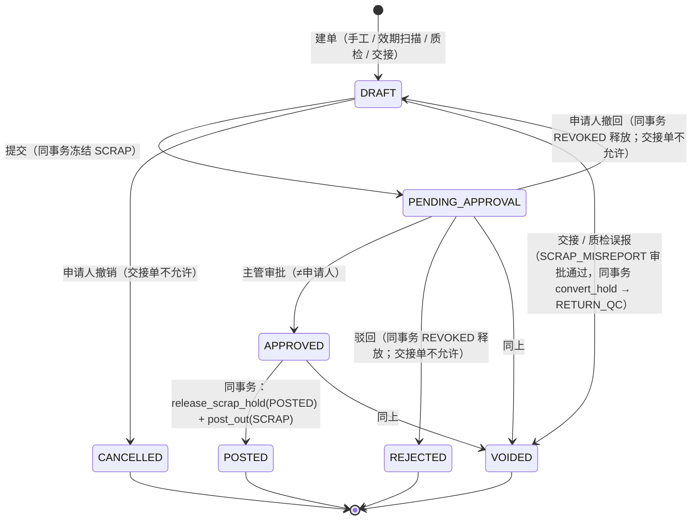
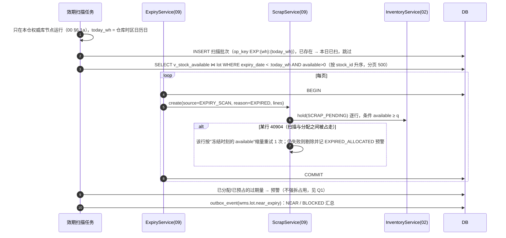
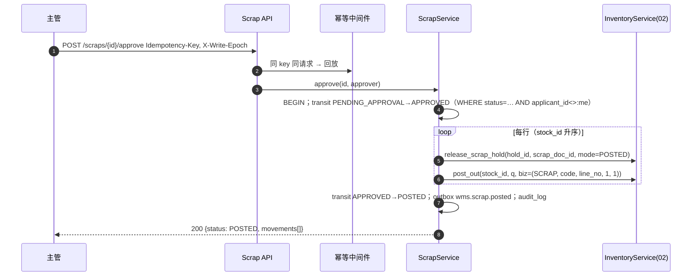
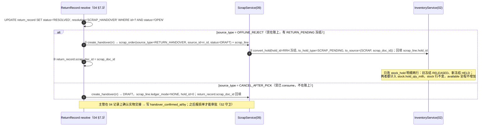

# 09 效期与损耗 详细设计

| 项 | 内容 |
|---|---|
| 模块编号 | 09 |
| 作者 | 小钱（后端） |
| 评审 | 小吴（测试，对抗性评审，见 §13）、非作者开发 1 名 |
| 基线 | `docs/first-design@b896a1d`，《[WMS详细设计说明书](archive/WMS详细设计说明书.md)》§3.3 lot、§3.5 报损单、§5.7 效期与临期管理、§6.2 `/inventory/expiry-alert`、`/scraps` |
| 依赖 | 00（R2/R3 数量与时区、§6.4 错误码、§6.5 幂等、§9.1 部署形态与写节点）；02（原语、`stock_hold`、`hold_qty_milli`、`stock_movement_key`）；04（禁发期、待回库 `SCRAP_HANDOVER`）；08 盘点（自然损耗容差）；10 退货质检不合格；12 审批与审计 |
| 状态 | 草稿，从 `docs/first-design` 拉出，单独 PR |

> 本篇写：效期分级与每日扫描、临期/过期的自动动作、报损单（SCR）全流程、`SCRAP_HANDOVER` 的交接报损、自然损耗容差。所有库存变化只通过第 2 篇原语。

---

## 1. 职责与边界

### 1.1 本模块负责

1. **效期计算**：`expiry_date`（`DATE`）与"仓库今天" `today_wh`（按 `warehouse.timezone` 的日历日，00 R3）的天数差，分级规则见 §3.2。
2. **每日效期扫描**：06:00（仓库时区）+ 手工触发；对过期库存自动建报损单草稿并冻结；对临期、禁发生成预警。
3. **效期预警查询**：`GET /inventory/expiry-alert`（02 §7.2 指定归本篇）及看板汇总。
4. **报损单 SCR**：建单 → 提交（同事务冻结 `SCRAP_PENDING`）→ 审批（同事务解冻 + `post_out(SCRAP)`）→ 已过账；驳回/取消同事务解冻。
5. **交接报损**：第 4 篇待回库 resolve 为 `SCRAP_HANDOVER` 时，本篇提供"建报损单 + 冻结转移"的服务内接口，保证无可用量空窗（04 §6.2 顺序要求）。
6. **已出库待报损**：`CANCEL_AFTER_PICK` + `SCRAP_HANDOVER`（04 Q6）的记法。
7. **损耗台账**：报损金额、按 SKU/供应商/原因汇总，供看板和财务回传（第 11 篇 topic `wms.scrap.posted`）。
8. **自然损耗容差**配置（RK7）：按 SKU 的容差比例，供第 8 篇盘点判断"容差内直接调整 / 超出转报损单"。

### 1.2 本模块不负责

| 不做 | 归属 |
|---|---|
| FEFO 排序与禁发期过滤本身 | 第 4 篇 `domain/fefo.py`（本篇只提供共用的 `domain/expiry.py` 纯函数） |
| 盘点差异计算与审批 | 第 8 篇（超容差部分调本篇建报损单） |
| 待回库记录的表、状态机和 confirm/resolve/putback-ack 接口 | 第 4 篇 §7.3（本篇只被它在同一事务里调用） |
| 退货质检流程 | 第 10 篇（不合格时调本篇建报损单） |
| 折价促销、转赠品 | 系统外（ERP/商城），本篇只推临期事件 |
| 审批流引擎、`audit_log` | 第 12 篇 |

### 1.3 与原文档的差异（评审重点）

| # | 原文档 | 本篇 | 原因 |
|---|---|---|---|
| Δ1 | `expiry_date TIMESTAMP`，`DATEDIFF(expiry_date, CURRENT_DATE)` | `DATE`，剩余天数 = `expiry_date − today_wh`，`today_wh` 按仓库时区 | 04 I5：UTC 比较会差一天（实测 9 天/10 天） |
| Δ2 | `remaining_life_days` 冗余列由定时任务刷新，作为判断依据 | **只作索引辅助，不作任何判断依据**；判断一律用 `expiry_date` 现算 | lot 不带仓库，同一批次在不同时区的仓"今天"不同；刷新延迟会让过期货多卖一个班次 |
| Δ3 | 过期"强制 `quality_hold`" | 过期 → 自动建报损单草稿并提交，冻结类型 `SCRAP_PENDING`（计入 `hold_qty_milli`） | `QUALITY` 冻结的语义是"待检、可放行"；过期不可能放行。统一走报损单留审批痕迹 |
| Δ4 | 报损单只写"需审批" | 提交即冻结、审批即出账、驳回即解冻，三处都与单据状态同事务 | 防止审批期间被分配走；防止"批了但没扣" |
| Δ5 | `adjust_order.adjust_type = SCRAP` 与 `scrap_order` 并存 | 报损**只走** `scrap_order`；`adjust_type=SCRAP` 不再新建（第 8 篇同步） | 一种业务一种单据 |

---

## 2. 用例

| 编号 | 用例 | 触发者 | 原语（第 2 篇） | `on_hand` | 流水 |
|---|---|---|---|---|---|
| UC1 | 每日效期扫描 | 定时任务（权威库所在节点） | 只读 + 建报损单（UC4） | 0 | 否 |
| UC1b | **可售天数到期下架转损耗**（对标盒马「日日鲜」） | 定时任务（同 UC1，同一批次一起跑） | 建报损单 `source_type=SELL_EXPIRED`，系统提交即冻结（下架） | 0 | 否 |
| UC2 | 效期预警查询 / 看板 | 主管、运营 | 只读 | — | — |
| UC3 | 手工建报损单（破损、变质） | 仓管 | — | 0 | 否 |
| UC4 | 提交报损单 | 仓管 / 系统 | `hold(SCRAP_PENDING)` 每行 | 0 | 否 |
| UC5 | 审批通过并过账 | 主管（≠申请人） | `release_scrap_hold(mode=POSTED)` + `post_out(SCRAP)` 同事务 | −q | `SCRAP` −1 |
| UC6 | 驳回 / 撤回 / 取消（**交接单不允许**，40930） | 主管 / 申请人 | `release_scrap_hold(mode=REVOKED)` | 0 | 否 |
| UC7 | 待回库交接报损（`OFFLINE_REJECT`） | 04 resolve 同事务：先建 DRAFT 报损单，再 `convert_hold` | `convert_hold(RETURN_PENDING → SCRAP_PENDING, source_id=报损单 id)` | 0 | 否 |
| UC8 | 已出库待报损（`CANCEL_AFTER_PICK`） | 04 resolve 同事务调用 | 无（货已 `consume`） | 0 | 否，只记损耗台账 |
| UC9 | 退货质检不合格报损 | 10 | `create_from_qc`：**先建 DRAFT 报损单（`source_type=RETURN_QC`），再 `convert_hold(QUALITY/RETURN_QC → SCRAP_PENDING, source=(SCRAP, 报损单 id))`**（跨列挪量，02 §7.1.1 新版）；审批时 `release_scrap_hold(POSTED)` + `post_out` | 0 | 否（审批时 −q） |
| UC10 | 盘点超容差转报损 | 08 | 同 UC3/UC4 | 0 | 否 |

---

## 3. 领域模型

### 3.1 日期口径（`domain/expiry.py`，与第 4 篇共用）

```python
def today_wh(now_utc: datetime, tz: ZoneInfo) -> date          # 仓库当地日历日
def remaining_days(expiry: date, today: date) -> int            # expiry - today，可为负
def is_expired(expiry, today) -> bool:      return expiry < today   # 到期日当天仍可用
def ship_blocked(expiry, today, ship_min_shelf_life: int) -> bool:
    return expiry < today + timedelta(days=ship_min_shelf_life)     # 与 04 I5 同一个式子
```

- `expiry_date` 语义 = **最后可用日**（包装上的"保质期至"）。当天 23:59（仓库时区）前仍可出库，次日起过期。
- 测试固定 04 §11 的边界：`expiry=2026-10-25`、`today_wh=2026-10-15`、禁发 10 天 → 可发；北京时间 2026-10-15 23:30（UTC 15:30）与 2026-10-16 00:30（UTC 16:30）两个时刻 `today_wh` 分别为 15 日、16 日。
- **禁止**在 SQL 里用 `CURRENT_DATE`/`date('now')`：`today_wh` 由应用层算好作为参数绑定，两库一致。

### 3.2 分级

`life = sku.shelf_life_days`，`r = remaining_days`：

| 分级 | 条件（按顺序取第一个命中） | 自动动作 |
|---|---|---|
| `EXPIRED` 过期 | `r < 0` | 自动建报损单并提交（UC1→UC4），冻结后 FEFO 分不到 |
| `BLOCKED` 禁发 | `r < ship_min_shelf_life` | 不冻结（第 4 篇 FEFO 已剔除）；进预警，推 `wms.lot.near_expiry` |
| `NEAR` 临期 | `r < life / 3` | 预警，推运营 |
| `WATCH` 关注 | `r < life × 2 / 3` | 只在看板展示 |
| `NORMAL` | 其余 | — |

`life` 为空或 0（不管效期的 SKU）不参与分级。

### 3.3 报损单

`ScrapOrder(code, source_type, source_id, reason_code, status, lines[])`，`ScrapLine(stock_id, scrap_qty_milli, hold_id, ledger_mode)`：

- `ledger_mode = POST_OUT`：货在库，审批时出账。
- `ledger_mode = NONE`：货已经不在账上（UC8），审批只确认损失金额，不调原语。
- 金额 `cost_amount` 为分（R2），来自批次成本，本篇只记录。

### 3.4 不变量

| # | 内容 | 防线 |
|---|---|---|
| E1 | `PENDING_APPROVAL/APPROVED` 的 `POST_OUT` 行，必有一条 `HELD` 的 `SCRAP_PENDING` 冻结，数量相等 | 提交与冻结同事务；对账任务每 5 分钟 |
| E2 | `POSTED` 的 `POST_OUT` 行有且仅有一条 `SCRAP` 流水，冻结已 `RELEASED` | `uq_mvk_biz_line` + 同事务 |
| E3 | 同一来源（效期扫描批次、待回库记录、质检行）最多一张有效报损单 | `uq_scr_source` |
| E4 | 审批人 ≠ 申请人 | `ck_scr_sod` + 应用层 |
| E5 | 报损只扣**已冻结**的量，不能借报损扣掉别人的占用 | 冻结走 `available ≥ q` 条件（02 Q4：拒绝，先 release） |

---

## 4. 涉及的表

### 4.1 `scrap_order`（新增）

| 字段 | 说明 |
|---|---|
| code | `SCR-{仓}-{节点}-{作业日}-{序号}`（00 §6.2），`uq_scr_code` |
| source_type / source_id | `EXPIRY_SCAN`（扫描批次 id）/ `SELL_EXPIRED`（可售天数到期扫描批次 id，§6.1a）/ `MANUAL`（0）/ `RETURN_QC`（第 10 篇质检行 id）/ `RETURN_HANDOVER`（origin=待回库交接，`source_id` = 待回库记录 id；04 记录上存 `scrap_doc_id` 反查本单）/ `COUNT`（盘点单行 id） |
| reason_code | `EXPIRED / NEAR_EXPIRY / DAMAGED / QC_REJECT / NATURAL_LOSS / OTHER` |
| status | `ck_scr_status`：`DRAFT / PENDING_APPROVAL / APPROVED / POSTED / REJECTED / CANCELLED / VOIDED`（VOIDED = 交接误报作废，不是 REVOKED） |
| void_approval_no | `SCRAP_MISREPORT` 审批单号（第 12 篇）；`ck_scr_void`：`status='VOIDED'` ⇔ 非空 |
| work_date | 仓库作业日 |
| amount_impact | 分 |
| applicant_id / approver_id | `ck_scr_sod` |
| version | 条件更新 |

索引：`ix_scr_wh_status`；`uq_scr_source (source_type, source_id) WHERE source_id <> 0 AND status NOT IN ('REJECTED','CANCELLED')`。被驳回后同一来源可以重新建单。

> 说明：`APPROVED` 在正常路径上与 `POSTED` 在同一事务里连续迁移，库里不会停留；保留它是为了将来"审批与过账分离"（例如财务复核）时不改状态集。见 Q3。

### 4.2 `scrap_line`（新增）

`scrap_id`（**外键 → `scrap_order(id)`**）, `line_no (uq_scr_line), stock_id, sku_id, lot_id, scrap_qty_milli`（按 R2 改名；`ck_scrl_int` 的 CAST 只在 SQLite 起作用、`ck_scrl_qty > 0`）, `hold_id (0 = 无冻结), ledger_mode (ck_scrl_mode), cost_amount`。触发器 `trg_scrl_draft_only`（PG）/ `trg_scrl_draft_ins`+`trg_scrl_draft_upd`（SQLite）：**只有 DRAFT 单下能新增行或改量/改库存行**，提交后（含 POSTED）插 `POST_OUT` 且 `hold_id=0` 的行报 `scrap_line_locked`。

**`scrap_order` 库层约束（小赵 I3）**：`ck_scr_src_type`（`EXPIRY_SCAN / MANUAL / RETURN_QC / RETURN_HANDOVER / COUNT / EXCEPTION`）、`ck_scr_reason`（`EXPIRED / NEAR_EXPIRY / DAMAGED / QC_REJECT / NATURAL_LOSS / OTHER`）；触发器 `trg_scr_forward`：状态只能按 §5.1 迁移表前进（POSTED / REJECTED / CANCELLED 终态，POSTED 不能回 DRAFT），来源不可改；`RETURN_HANDOVER` 单不能进入 `DRAFT`（撤回）、`CANCELLED`、`REJECTED`（报 `scrap_handover_no_revoke`）。**PG 授权（I4）**：`GRANT SELECT, INSERT, UPDATE ON scrap_order, scrap_line TO wms_app`，不给 DELETE/TRUNCATE；S4 权限矩阵已加两表。

**库层守卫（小赵复评 K1–K4、S1，两库各一份触发器）**：

| 守卫 | 规则 | 报错 |
|---|---|---|
| K1 锁定来源 | `RETURN_HANDOVER`、`RETURN_QC` 单不许 → DRAFT / CANCELLED / REJECTED；只能 → VOIDED（S7） | `scrap_handover_no_revoke` → 40930 |
| 状态白名单 | 见 §5.1；终态 POSTED / REJECTED / CANCELLED / VOIDED 不能离开 | `scrap_state_forward_only` |
| K3 单头 | `code / warehouse_id / source_type / source_id / applicant_id` 建单后不可改；`approver_id / approved_at / posted_at` 只能从 NULL 写一次；终态单 `reason_code / amount_impact / void_approval_no / work_date` 也不可改 | `scrap_immutable` |
| K3 行 | 单据离开 DRAFT 后整行只读（含 `hold_id`、`ledger_mode`、`cost_amount`） | `scrap_line_locked` |
| K4 冻结行 | `hold_id≠0` 的行建行 / 首次写 `hold_id` 时数量 = 冻结余量、库存一致；锁定来源的行此后数量、库存、`hold_id` 不可改 | `scrap_line_hold_mismatch` / `scrap_line_hold_locked` |
| S1 建单 | INSERT 只能是 DRAFT；`ck_scr_appr`（APPROVED/POSTED 必有审批人和审批时间）、`ck_scr_posted`（POSTED 必有过账时间） | `scrap_insert_draft_only` / CHECK |
| K2 删除 | 两表 `BEFORE DELETE` 一律拒；PG 另拦 `TRUNCATE`（兜超级用户、迁移脚本）；SQLite 另拦 `INSERT OR REPLACE` / `REPLACE`（`id` 已存在即拒，同 02 `trg_hold_no_replace`） | `scrap_no_delete` / `scrap_duplicate` |

S1 提交时手工单的行先写 `hold_id`（单据仍是 DRAFT），再改单头状态；撤回（S5，只限手工单）先把单头改回 DRAFT，再把行 `hold_id` 清 0。

### 4.3 改动的已有表

| 表 | 改动 | 原因 |
|---|---|---|
| `stock_hold.ck_hold_type` | 本 PR **不改**：`SCRAP_PENDING` 独立系统冻结类型（计入 `hold_qty_milli`，人工解冻 40933）已由 #2 落 DDL，本篇只引用 | 避免两个 PR 同改 `stock_hold` 约束 |
| `lot.remaining_life_days` | 不改 DDL，改语义：只作 `ix_lot_aging` 索引辅助 | Δ2 |

报损冻结（`SCRAP_PENDING`）：`source_type = 'SCRAP'`、**`source_id` = 报损单 id**（04 N2，一律是报损单 id，不用待回库记录 id、也不用行 id）；`op_key = SCRH:{scrap_line_id}` 区分同一单的多行。

### 4.4 配置（主数据，第 1 篇落表）

`sku.shelf_life_days`、`sku.ship_min_shelf_life`（已有）；**可售天数 `sku.sell_days` 由第 1 篇（大肥鱼）定义（本篇对第 1 篇的需求，见下）**；自然损耗容差 `sku.natural_loss_tolerance_ppm` **由第 1 篇（大肥鱼）定义**，本篇只引用，不在本 PR 定义或加列。

---

## 5. 状态机

### 5.1 报损单



| # | from → to | 触发者 | 守卫 | 副作用（同事务） |
|---|---|---|---|---|
| S1 | DRAFT → PENDING_APPROVAL | 申请人 / 系统 | 至少一行；每行 `qty > 0` | 每个 `POST_OUT` 行 `hold(stock_id, SCRAP_PENDING, q, op_key=SCRH:{line_id}, operator=SYSTEM)`，按 `stock_id` 升序；任一 40904 整单回滚 |
| S2 | PENDING_APPROVAL → APPROVED | 主管 | `approver ≠ applicant`；`RETURN_HANDOVER` 来源要求 04 记录 `handover_confirmed_at IS NOT NULL` | 无 |
| S3 | APPROVED → POSTED | 系统（紧随 S2） | — | 每行 `release_scrap_hold(hold_id, scrap_doc_id, mode=POSTED)` → `post_out(stock_id, q, biz=(SCRAP, code, line_no, op_no=1, leg=1))`；`ledger_mode=NONE` 行跳过；写 `outbox_event(wms.scrap.posted)` |
| S4 | PENDING_APPROVAL → REJECTED | 主管 | 必填原因；**`source_type ≠ RETURN_HANDOVER`**（否则 40930） | 每行 `release_scrap_hold(hold_id, scrap_doc_id, mode=REVOKED)` |
| S5 | PENDING_APPROVAL → DRAFT（撤回） | 申请人 | 尚未审批；**`source_type ≠ RETURN_HANDOVER`**（否则 40930） | 每行 `release_scrap_hold(hold_id, scrap_doc_id, mode=REVOKED)`，`hold_id` 置 0 |
| S7 | DRAFT / PENDING_APPROVAL / APPROVED → **VOIDED** | 系统（`SCRAP_MISREPORT` 审批通过回调） | **只限锁定来源 `source_type ∈ {RETURN_HANDOVER, RETURN_QC}`**（K1）；审批人 ≠ 发起人；必须带审批单号（`ck_scr_void`） | 见 §6.5：同一事务 `convert_hold(SCRAP_PENDING → RETURN_QC, approval_type=SCRAP_MISREPORT, approval_no)` + 新建第 10 篇质检单（来源 `SCRAP_MISREPORT`）+ 本单 VOIDED。**不调用 `release_scrap_hold`**，不走 REVOKED |
| S6 | DRAFT → CANCELLED | 申请人 / 主管 | **`source_type ∉ {RETURN_HANDOVER, RETURN_QC}`**（否则 40930，K1）；手工 / 扫描 DRAFT 无冻结 | 无释放 |

- **锁定来源只进不退**（小赵 I1/I2、复评 K1，大肥鱼定案）：`RETURN_HANDOVER`（待回库交接）和 `RETURN_QC`（质检不合格，含门店退货）两类单从诞生起就带 `SCRAP_PENDING` 冻结，REVOKED 释放会让未经质检放行的货回到可售。所以这两类单**只允许 DRAFT → PENDING_APPROVAL → APPROVED → POSTED**，或经 `SCRAP_MISREPORT` 审批走 S7 → VOIDED；撤回、取消、驳回一律 40930（服务层先拦，库层 `trg_scr_forward` 兜底，报 `scrap_handover_no_revoke`）。`release_scrap_hold(mode=REVOKED)` 对这两类来源也拒绝（02 `f802a41`：条件更新带 `AND EXISTS (… source_type NOT IN ('RETURN_HANDOVER','RETURN_QC'))`，0 行 → 40930）。**质检或交接判错只能走 S7**（§6.5）。

- **交接单（`source_type=RETURN_HANDOVER`）**：由第 4 篇 resolve 在同一事务里建出，起点同样是 `DRAFT`，但行上已有 `SCRAP_PENDING` 冻结（`hold_id ≠ 0`）；S1 提交时对 `hold_id ≠ 0` 的行**不再 hold**，只做状态迁移。
- 迁移统一 `UPDATE scrap_order SET status=:to, version=version+1 WHERE id=:id AND status=:from`，`rowcount=0` → `40930`（00 §6.7）。
- S3 中先 `release_scrap_hold(POSTED)` 再 `post_out`：`post_out` 的条件是 `available ≥ q`，冻结着的量不在可用量里。两步在同一事务，中间不提交，外部看不到空窗。
- `EXPIRY_SCAN` 来源的单据 S1 由系统做（`applicant_id = 0` 记为系统），S2 仍需人工。

### 5.2 `SCRAP_PENDING` 冻结的释放路径（只有两条）

`SCRAP_PENDING` 是**系统冻结类型**（PM 定论）：来源只有三种——报损单提交时直接 `hold` 创建（S1）、待回库 `SCRAP_HANDOVER` 时由 `convert_hold` 从 `RETURN_PENDING` 转入、质检不合格时由 `convert_hold` 从 `QUALITY/RETURN_QC` 转入（UC9）（§6.3）。`/inventory/unfreeze` 和人工 `unhold` 一律返回 **409 `40933`**。释放**只有**下面两条路径（另有 S7 误报回转：不是释放，而是 `convert_hold` 转成 `RETURN_QC`，见 §6.5），都与报损单状态迁移在同一事务里：

| 路径 | 迁移 | 释放动作 | 库存结果 |
|---|---|---|---|
| ① **报损完成** | S2+S3：PENDING_APPROVAL → APPROVED → POSTED | 每行 `release_scrap_hold(hold_id, scrap_doc_id, mode=POSTED)` → 紧接 `post_out(SCRAP)` | `hold_qty −q`、`on_hand −q`，`available` 不变（不出现空窗）；一条 `SCRAP` 流水 |
| ② **报损撤销** | S4 驳回、S5 撤回（PENDING_APPROVAL → REJECTED / DRAFT）、只对手工 / 扫描 / 盘点 / 异常来源；**交接单、质检单不走这条**（K1） | 每行 `release_scrap_hold(hold_id, scrap_doc_id, mode=REVOKED)` | `hold_qty −q`，货回到可用量；无流水 |

- `release_scrap_hold(hold_id, scrap_doc_id, mode=POSTED|REVOKED)` 是**第 2 篇将新增**的专用释放入口（与 `release_return_hold` 对称；签名以第 2 篇为准）：校验 `stock_hold.source_type='SCRAP' AND source_id=:scrap_doc_id`，且必须在报损单状态条件更新的同一事务里调用；`POSTED` 后紧跟 `post_out`，`REVOKED` 只释放。其他调用方拿不到。
- 交接 / 质检转入的冻结**不能走路径 ②**：这两类单不可撤回 / 取消 / 驳回，`release_scrap_hold(REVOKED)` 对它们返回 40930；判错走 S7：货经 `convert_hold` 回到 `RETURN_QC` 重新质检。
- 手工 / 扫描建的 DRAFT 还没有冻结，S6 不涉及释放；交接和质检不合格生成的 DRAFT 从诞生起就带 `SCRAP_PENDING` 冻结（§6.3、UC9），**行数量必须等于冻结余量**（`scrap_line_hold_mismatch`），写定后数量、库存、`hold_id` 都不能改（`scrap_line_hold_locked`，K4）。

---

## 6. 核心流程

### 6.1 每日效期扫描（UC1）



- **只扫可用量**：已经被分配的过期货不在此强拆，原因是强拆会让在途波次现场缺货；改为预警到主管，由其取消或改派（Q1）。第 4 篇的 FEFO 在分配时已经用同一个 `ship_blocked` 剔除，正常情况下不会把过期货分出去。
- 扫描与分配并发：`hold` 是条件 UPDATE，与 `reserve_batch` 抢同一可用量时只有一方成功，不会超冻结。
- 一页一个事务：大仓几千行时避免长事务（SQLite 长写事务会阻塞所有 PDA 写入）。

### 6.1a 可售天数到期下架转损耗（UC1b，大肥鱼定案，对标盒马日日鲜）

**对第 1 篇 / 第 2 篇的需求（本篇不改 `sku`、`lot` 表结构，由表主人落 DDL）**：

| 字段 | 类型 | 约束 | 含义 |
|---|---|---|---|
| `sku.sell_days`（第 1 篇） | `INTEGER`，可空 | `CHECK (sell_days IS NULL OR (sell_days BETWEEN 1 AND shelf_life_days))`；**冷藏 / 冷冻品必填**：`CHECK (temperature_required NOT IN ('CHILLED','FROZEN') OR sell_days IS NOT NULL)` | 可售天数，与保质期并列。例：叶菜 `shelf_life_days=3、sell_days=1` |
| `lot.sell_deadline`（批次表主人） | `DATE`，可空（SKU 无 `sell_days` 时为空） | 建批次时服务端写入 = `COALESCE(production_date, receive_date 的仓库本地日) + sell_days`；**只能往前改**（触发器：`NEW.sell_deadline <= OLD.sell_deadline`，NULL 不可回写） | 可售截止日（仓库本地日历日，00 §6.1a） |

**与保质期规则并列，谁先到期按谁处理**：有效截止 = `min(sell_deadline, expiry_date)`。口径以 00 §6.4（16e640c）为准。

1. **分配时拦截**：第 4 篇 FEFO 分配 / 预占实时剔除 `sell_deadline < 作业日（仓库本地）` 的批次，与 `ship_blocked` 同一处判断，不等跑批（Q9）。
2. **00:05 跑批（仓库本地时间，只在本仓权威库节点，00 §6.1a）只冻结未分配余量**：选 `sell_deadline < today_wh AND available > 0` 的批次，逐批次一个事务：
   - 建 DRAFT 报损单 `source_type=SELL_EXPIRED`、`reason_code=SELL_EXPIRED`、`source_id=lot_id`、`work_date=today_wh`、`applicant_id=0`（系统）；来源键 `SELL_EXPIRED:{lot_id}:{date}`，由 `uq_scr_sell(source_id, work_date)` 去重（00 写的 `uq_scr_source` 去重在库里落成这条按日的部分唯一索引，`uq_scr_source` 对 SELL_EXPIRED 不生效，否则同一批次第二天的余量建不了单），同一批次同一天只一张；
   - 用 **`convert_hold`** 把该批次**可用量**冻结为 `SCRAP_PENDING`（source=(SCRAP, 报损单行 id)），冻结 op_key `SELLEXP:{lot_id}:{date}`，重跑命中跳过；冻结即下架。
   - 草稿由主管照常 S1 提交、S2 审批（审批人 ≠ 申请人 0，`ck_scr_sod`）、S3 过账转损耗。
3. **已分配未拣**：跑批同时把这些批次上的未拣分配撤销（第 4 篇撤销分配），出库行回到待分配后重新分配；重新分配时第 1 条已拦掉过期批次，换批或缺货。撤销出来的量下一轮（或同批次补跑）进第 2 条冻结。
4. **已拣出**：复核时返回 **42214 `OVER_QTY`、`detail.reason=SELL_EXPIRED`**（00 §6.4 已登记，不新开码），随后走第 4 篇**拣后取消**；回库的量再进第 2 条。
5. 保质期先到的批次由 UC1（`EXPIRY_SCAN`）处理；两条规则抢同一可用量时 `hold` 条件更新只有一方成功，不会重复冻结。

### 6.2 报损审批过账（UC5）



失败：任一行 `post_out` 40902/40904（理论上不会，量已冻结）→ 整单回滚、保持 `PENDING_APPROVAL`、`50010` 告警（说明冻结与余额对不上）。

### 6.3 交接报损 `SCRAP_HANDOVER`（UC7/UC8，被第 4 篇 resolve 在同一事务调用）



**为什么不能"先 hold 再 unhold"**：`hold` 的条件是 `available ≥ q`，而这部分量正被 `RETURN_PENDING` 冻结着、不在可用量里，"先 hold"在 `available = 0` 时必然 40904，有别的可用量时又会冻到别的货上；"先 unhold"则留出空窗。所以交接报损**只调第 2 篇 §7.1.1 的 `convert_hold(hold_id, to_hold_type, to_source)`**（04 §6.2 同口径）：

- 同一事务关闭 `RETURN_PENDING` 明细剩余量、新建同量 `SCRAP_PENDING` 明细，`source_type = 'SCRAP'`、`source_id = 报损单 id`（04 N2；**不用待回库记录 id**）；`stock` 行一列不改，`available` 全程不变；
- 退货质检不合格（UC9，小吴 #5 A1）**与交接同一套写法**：`create_from_qc` 同事务 ① 建 DRAFT 报损单（`source_type=RETURN_QC`，`source_id=inbound_line.id`，门店退货 STORE_RETURN 同样）→ ② `convert_hold(qc_hold_id, to=SCRAP_PENDING, source=(SCRAP, 报损单 id))`，02 新版允许 `QUALITY/RETURN_QC → SCRAP_PENDING` 跨列挪量（同事务 `quality_hold −q、hold_qty +q`，可用量与冻结总量不变）。不再让报损行挂 `QUALITY` 冻结（QUALITY 可被人工解冻，即原 MANUAL 漏洞）；
- 本篇自己提交报损单（UC4）的冻结同样用 `SCRAP_PENDING`、`source_type='SCRAP'`，与交接转入的明细同构，审批时统一处理。

### 6.4 已出库待报损（UC8，04 Q6 的回答）

`CANCEL_AFTER_PICK` 的货已 `consume`（`on_hand` 已扣、有 `PICK` 流水），实物在拣货员/集货位手上。交接报损时：

- **不调任何库存原语**：账上已经没有这批货，再 `post_out` 就是重复扣减；也不能 `post_in(REVERSE_PICK)` 再 `post_out(SCRAP)`，那会凭空多出两条流水、且中间可被分配。
- 报损单行 `ledger_mode = NONE`，审批后只记损耗台账与金额，推 `wms.scrap.posted`（`ledger=false`），ERP 侧按"销售出库后报损"冲减。
- 对账：该行库存的 `on_hand` 回放不受影响（I4 成立）；订单侧由第 4 篇 T20 记录已拣量未发出。

---

### 6.5 交接误报作废（S7，Q8 定案，大肥鱼）

交接生成的报损单（`RETURN_HANDOVER`）实物其实完好或数量不对时：

1. **仓库主管**（`scrap.misreport.request`）发起第 12 篇审批 `POST /api/v1/approvals`，`type = SCRAP_MISREPORT`，`payload = {scrap_doc_id, reason}`。审批单号 `approval_no = APR-{仓库编码}-{yyyyMMdd}-{6位序号}`（所有审批类型共用，Q17）；本表 `void_approval_no` 加格式 CHECK `ck_scr_apr_fmt`（仓库编码 `[A-Z0-9]{2,16}`，与 02 `ck_hold_approval_no` 一致；PG 正则，SQLite 长度 22–36 + GLOB）。
2. **质量主管或中心运维**（`scrap.misreport.approve`）审批通过，**发起人不能自己审批**（SoD，第 12 篇）；在**同一事务**里：
   ```sql
   BEGIN;
   -- ① 第 10 篇新建质检单（RTN 型，source_system='SCRAP_MISREPORT'，source_order_no=审批单号；不 post_in，货已在库）
   -- ② 对本单每条 SCRAP_PENDING 冻结：convert_hold(hold_id, to=RETURN_QC, source_type='QC', source_id=质检单 id,
   --      approval_type='SCRAP_MISREPORT', approval_no=:approval_no)   -- 02 2d1609c：新明细 op_key = CVT:{原 hold_id}，
   --      hold_qty −q / quality_hold +q（ck_hold_approval 要求带审批两列）
   UPDATE scrap_order SET status='VOIDED', void_approval_no=:approval_no, version=version+1
    WHERE id=:id AND source_type='RETURN_HANDOVER' AND status IN ('DRAFT','PENDING_APPROVAL','APPROVED');
   -- 0 行 → 回滚 + 40930（已 POSTED / 已作废 / 非交接单）
   COMMIT;
   ```
3. 之后由第 10 篇质检：合格 `release_qc_hold` 回可售；不合格按 10 §6.3 重新建报损单（来源 `RETURN_QC`）。
4. 只能作废没有过账的单；已 POSTED 的货已出账，误报只能走第 10 篇异常单 + 盘盈补录。
5. 重放：`CVT:{原 hold_id}` 唯一（`uq_hold_op`）+ 状态条件更新，重复回调 0 行，按幂等返回首次结果；审批撤回 / 过期 / 已处理按第 12 篇 40934 / 40935。

## 7. 接口清单与契约

### 7.1 HTTP（`/api/v1`）

所有 POST 带 `Idempotency-Key`、`X-Warehouse-Id`、`X-Write-Epoch`（00 §9.1）。

| 方法 | 路径 | 说明 | 权限点 |
|---|---|---|---|
| GET | `/inventory/expiry-alert?grade=EXPIRED,BLOCKED,NEAR&zoneId=&skuId=&cursor=` | 效期预警列表（现算分级，含 `remaining_days`、`grade`、`available`、`allocated`） | `inventory.expiry.view` |
| GET | `/inventory/expiry-alert/summary` | 看板：各级金额、按 SKU/供应商 TOP N、近 30 天报损趋势 | `inventory.expiry.view` |
| POST | `/inventory/expiry-scan` | 手工触发当日扫描（同日幂等） | `inventory.expiry.scan` |
| POST | `/scraps` | 建报损单（DRAFT） | `scrap.order.create` |
| GET | `/scrap-orders?status=&source_type=&warehouse_code=&created_from=&created_to=&cursor=` | 报损单列表。`source_type` 取 `ck_scr_src_type` 枚举（`SELL_EXPIRED / EXPIRY_SCAN / MANUAL / RETURN_QC / RETURN_HANDOVER / COUNT / EXCEPTION`），可多选逗号分隔；`created_from / created_to` 为 UTC ISO 8601，左闭右开；数据权限按仓 | `scrap.view` |
| GET | `/scrap-orders/{id}` | 报损单详情（含行、冻结、流水、来源；`SELL_EXPIRED` 带 `lot_id / sell_deadline`） | `scrap.view` |
| POST | `/scraps/{id}/submit` | 提交（冻结） | `scrap.order.create` |
| POST | `/scraps/{id}/withdraw` | 撤回到 DRAFT（`release_scrap_hold(REVOKED)`）；`RETURN_HANDOVER` 单返回 **40930** | `scrap.order.create`（仅申请人） |
| POST | `/scraps/{id}/approve` | 审批并过账 | `scrap.order.approve` |
| POST | `/scraps/{id}/reject` | 驳回，必填 `reason` | `scrap.order.approve` |
| POST | `/scraps/{id}/cancel` | 撤销 DRAFT | `scrap.order.create` |

**契约 `POST /scraps`**

```json
{ "reason_code": "DAMAGED", "remark": "叉车碰撞外箱破损",
  "lines": [ { "stock_id": 8812, "qty": "2.500" } ] }
```

201：`{ "code":"0", "data": { "id": 7001, "code": "SCR-WHSH01-0003-20261015-000012", "status": "DRAFT", "lines": [ { "line_no":1, "stock_id":8812, "qty":"2.500", "uom":"KG" } ] } }`

**契约 `GET /inventory/expiry-alert`**（单行）

```json
{ "stock_id": 8812, "location_code": "A01-02-03", "sku_code": "APL-80-5KG", "lot_code": "LOT-1008",
  "expiry_date": "2026-10-25", "today_wh": "2026-10-15", "remaining_days": 10, "grade": "NEAR",
  "on_hand": "30.000", "available": "17.500", "allocated": "10.000", "hold_qty": "2.500", "uom": "KG",
  "open_scrap_code": null }
```

`expiry_date`、`today_wh` 是 `YYYY-MM-DD` 业务日期，前端原样显示（第 13 篇 §3）。

### 7.2 服务内接口

```python
class ScrapForReturnRecord(Protocol):          # 只给 04 的 resolve 用，调用方已开事务
    def create_handover(self, rr: ReturnRecordRef, *, reason_code: str, operator_id: int) -> ScrapRef: ...
class ScrapForQc(Protocol):                    # 给 10 的质检不合格
    def create_from_qc(self, qc_line_id: int, stock_id: int, qty_milli: int, qc_hold_id: int, op_key: str) -> ScrapRef:
        """10 质检不合格调用，与 qc_failed 累加同事务：① 建 DRAFT（source_type=RETURN_QC, source_id=qc_line_id）
        ② convert_hold(qc_hold_id, qty, to=SCRAP_PENDING, source=(SCRAP, scrap_doc_id), op_key=CVT:{qc_line_id}:{op_seq})"""
class ScrapForCount(Protocol):                 # 给 08 的超容差
    def create_from_count(self, count_line_id: int, stock_id: int, qty_milli: int) -> ScrapRef: ...
def natural_loss_within_tolerance(sku_id: int, book_milli: int, diff_milli: int) -> bool: ...   # 给 08
```

`GET /return-records/{id}` 的 `handover_confirmed_at/by` 由第 4 篇写；本篇只读它作为 S2 守卫，PDA 删红条的依据同样是这两个字段（回答第 14 篇 Q14）。

### 7.3 错误码（全部取自 00 §6.4，本篇不新增）

| 码 | 场景 |
|---|---|
| 40001 / 40002 | 参数非法 / 驳回、手工报损缺原因 |
| 40010 | 数量格式 |
| 40311 | `X-Warehouse-Id` 与报损单/库存行所属仓不一致 |
| 40401 | 库存行不存在 |
| 40904 | 提交时可用量不足（被占用或冻结的货不能直接报损，02 Q4：先 release） |
| 40905 | 冻结已被释放（并发撤回 + 审批） |
| 40910 | 同 `Idempotency-Key` 不同请求体，`key_type=IDEMPOTENCY_KEY` |
| 40930 | 非法状态流转（含审批人 = 申请人时的条件更新失败，`detail.hint=SOD`） |
| 40933 | 试图通过 `/inventory/unfreeze` 解 `SCRAP_PENDING` 系统冻结 |
| 50010 | 冻结与余额不一致、撞 CHECK |
| 50301 / 50303 | 依赖不可用（含切换中）/ `STALE_WRITE_NODE`：重新取 write-endpoint，用原 `Idempotency-Key` 重提 |

---

## 8. 并发与幂等

| 场景 | 防线 |
|---|---|
| 提交与审批/撤回并发 | 状态条件更新，后到方 40930 |
| 撤回与审批并发 | 同上；冻结只会被释放一次（`release_scrap_hold` 的 `status='HELD'` 条件 + 报损单状态条件更新，二者同事务） |
| 扫描与分配抢同一可用量 | `hold` 条件 UPDATE，输的一方 40904（扫描缩量重试 1 次） |
| 同一天扫描跑两次（手工 + 定时、或两个 worker） | 扫描批次 `op_key=EXP:{wh}:{today_wh}` 唯一 + `uq_scr_source` |
| 同一待回库记录交接报损两次 | 04 `WHERE status='OPEN'` + `uq_scr_source(RETURN_HANDOVER, rr_id)` |
| 审批重复点击 / 响应丢失 | 幂等中间件回放；`Idempotency-Key` 过期后：`uq_mvk_biz_line (SCR 单号, line_no, 1, 1)` 拦重复过账 |
| 跨作业日 | 单号日期取提交时的作业日（00 §6.2 号段丢弃规则）；扫描 `today_wh` 在任务开始时算一次，整个批次一致 |
| 写节点切换（形态 B） | 扫描任务只在权威库运行；收到 `50303` 停止本批，新节点按 `EXP:{wh}:{today_wh}` 判断是否已扫 |

多行操作按 `stock_id` 升序（02 §8.2）。

---

## 9. 异常与补偿

| 场景 | 处理 |
|---|---|
| 过期货已被分配 | 不强拆，预警 `EXPIRED_ALLOCATED` 给主管（Q1） |
| 扫描中途崩溃 | 已提交的页保留；重跑时 `uq_scr_source` + 每行冻结 `op_key` 去重，继续未完成的页 |
| 审批时 `post_out` 失败 | 整单回滚，`50010` 告警，单据停在 `PENDING_APPROVAL` |
| 报损单长期 `PENDING_APPROVAL` | 冻结一直保留（宁可少卖）；超 1 个作业日推主管，超 3 天升级仓经理 |
| `SCRAP_HANDOVER` 交接迟迟不确认 | 报损单不能审批；看板按 `handover_confirmed_at IS NULL` 标红 |
| 盘点遇到 `SCRAP` | 与 `RETURN_PENDING` 不同：货仍在货架上，**参与盘点**；差异先调整、再按调整后的量过账报损（第 8 篇口径，Q5） |
| 冻结对账 E1 不平 | 写 `stock_recon_alert(check_code=SCR_HOLD)`，只告警 |

---

## 10. 权限

| 权限点 | 角色 |
|---|---|
| inventory.expiry.view | 主管、运营、仓管 |
| inventory.expiry.scan | 主管 |
| scrap.view（报损单列表 / 详情）、scrap.order.create | 仓管、主管 |
| scrap.order.approve | 仓经理 / 主管（≠ 申请人，SoD） |
| scrap.misreport.request | 仓库主管（发起交接误报审批，Q17） |
| scrap.misreport.approve | 质量主管 / 中心运维（≠ 发起人，SoD，Q17） |

- 审批、驳回、交接报损写 `audit_log`；金额超过阈值（配置，默认 ¥5,000）需二级审批（第 12 篇审批流，Q6）。
- 系统管理员没有任何 `scrap.*` 权限（00 §2）。
- 数据权限：报损单与每一行库存的 `warehouse_id` 都必须等于 `X-Warehouse-Id`，否则 `40311`。

---

## 11. 测试要点

1. **日期**：`ship_blocked`/`is_expired` 边界（等于、差 1 天）；仓库时区 Asia/Shanghai 在 UTC 15:59/16:00 两侧；两个不同时区的仓共享同一 lot 时各自的分级；`remaining_life_days` 被故意写错时分级仍正确（Δ2）。
2. **状态机**：穷举 `SCRAP_TRANSITIONS` 所有 `(from, to)`；SoD；`RETURN_HANDOVER` 来源未确认交接时 approve 返回 40930；交接 / 质检 DRAFT 取消、撤回、驳回都返回 40930（K1，S2 修正：原写的「取消后冻结 RELEASED」与只进不退矛盾，已删）。
3. **库存口径**：提交后 `available` 减少、FEFO 候选不含该量；撤回/驳回后恢复；过账后 `on_hand −q`、恰好一条 `SCRAP` 流水、冻结 RELEASED；`ledger_mode=NONE` 无流水。
4. **交接无空窗**：`convert_hold` 前后及事务中途（另一连接读）`available` 不增加；`stock` 行 `ledger_seq` 不变。
5. **并发**：扫描与 `reserve_batch` 交错 200 轮，最后 I2/I3d 成立；撤回与审批并发只有一个成功。
6. **幂等**：同一天两次扫描只有一批单据；删掉 `idempotency_record` 后重放 approve，流水仍只有一条。
7. **双库矩阵**；验证脚本断言见下。

### 11.1 本 PR 的验证脚本结果

| 脚本 | 环境 | 结果 |
|---|---|---|
| `verify_sqlite.py` | 本机 Linux，Python 3 + SQLite 3.46 | **259 / 259 通过**（base 16e640c）。45 表 / 45 手工索引 / 1 视图 |
| `verify.sh` | 本机 PG 16（/home/box/tools/pg16，临时实例 `/tmp/qian-pg9` 端口 5445，新建空库） | **256 / 256 通过**（base 16e640c，45 表 / 126 索引）；实测 **45 表 / 125 索引 / 1 视图**，与手算一致 |

新增断言：报损单建单；可售到期（SELL_EXPIRED）报损单放行、同批次同日重复（`uq_scr_sell`）、次日余量再建、与 EXPIRY_SCAN 同 source_id 互不干扰、来源 / 原因拼错、系统提交放行、系统单审批 SoD；同一来源重复建有效单（`uq_scr_source`）；审批 SoD（`ck_scr_sod`）；非法状态（`ck_scr_status`）；行数量非整数 / 为 0（`ck_scrl_int`、`ck_scrl_qty`）。Q8 误报：交接单作废缺审批单号（`ck_scr_void`）、手工单不能作废（`scrap_state_forward_only`）、回转缺审批（`ck_hold_approval`）、同事务回转 + VOIDED 通过、审批单号格式三条反例（`ck_scr_apr_fmt`）、跨列挪量 `2000/2000`、VOIDED 终态、回转后 RETURN_QC 人工解冻 0 行。`SCRAP_PENDING` 冻结类型本身的断言在 #2。 复评 K1–K4 / S1 / S2：质检单取消 / 撤回 / 驳回（`scrap_handover_no_revoke`）、`release_scrap_hold(REVOKED)` 对质检单 0 行、质检判错 VOIDED 放行；建行数量 ≠ 冻结量、锁定行改数量 / 摘冻结；POSTED 行改 `hold_id`/`ledger_mode`/成本；换申请人、审批人、改过账时间、终态改原因码、改仓库；建单直接写终态；审批缺 `approved_at`；DELETE 两表；SQLite `INSERT OR REPLACE` / `REPLACE`；PG `TRUNCATE`；审批号六条格式反例（仓库编码 [A-Z0-9]{2,16}，与 02 92e1477 一致；统一 `APR-WHSH01-20261015-000001` 格式）。

---

## 12. 待定问题

| # | 问题 | 建议 | 裁决人 |
|---|---|---|---|
| Q1 | 已分配/已预占的过期货：强拆占用还是只预警 | 只预警给主管，由其取消/改派；FEFO 已有同口径剔除，正常不会出现 | 大肥鱼 |
| Q2 | ~~报损冻结能否人工解冻~~ | **已定（PM）**：`SCRAP_PENDING` 是系统冻结类型，人工解冻 40933；唯一释放途径见 §5.2。DDL 与断言已在 #2 | 已定 |
| Q3 | 审批与过账是否分离（财务复核） | 一期同事务连续迁移，保留 `APPROVED` 状态 | 大肥鱼 |
| Q4 | ~~自然损耗容差字段~~ | **已定**：`sku.natural_loss_tolerance_ppm` 归第 1 篇（大肥鱼），本篇只引用 | 已定 |
| Q5 | 盘点遇到 `SCRAP` 冻结的口径 | 参与盘点（货在架上）；第 8 篇确认 | 小李 |
| Q6 | 报损金额分级审批阈值 | 默认 ¥5,000 二级审批，可按仓配置 | 大肥鱼 / 第 12 篇 |
| ~~Q8~~ | 交接单误报 | **已关闭（大肥鱼）**：第 12 篇审批类型 `SCRAP_MISREPORT`，同一事务 `convert_hold` → RETURN_QC + 第 10 篇质检单 + 报损单 VOIDED（§6.5） | — |
| Q9 | `sell_days` / `sell_deadline` 字段与 FEFO 剔除 | **对第 1 篇的需求**：`sku.sell_days INTEGER`，1～`shelf_life_days`，冷藏 / 冷冻必填；**对批次表主人**：`lot.sell_deadline DATE` 只能往前改；第 4 篇分配实时剔除过期批次（§6.1a） ；第 4 篇：分配剔除、跑批撤销未拣分配、复核 42214 `SELL_EXPIRED` → 拣后取消 | 大肥鱼（第 1 篇）/ 第 2、4 篇 |
| Q7 | 两个 PR 都改了 `verify.sh`/`verify_sqlite.py` 的表数期望值（09：44；10：44；11：43） | 后合的 PR 合并时按累计值改（三篇都合后为 47 表），合并冲突只在这两行 | 大肥鱼 |

---

## 13. 对抗评审攻击面（给小吴）

| # | 攻击面 | 打法 | 防线 | 我认为最可能出问题的地方 |
|---|---|---|---|---|
| E-A1 | **时区差一天** | 服务器 UTC、仓库 UTC+8，在 UTC 15:30–16:30 之间跑扫描和分配；跨时区多仓共用 lot | `today_wh` 应用层算、绑定参数；`DATE` 列 | 有人在 SQL 里写 `CURRENT_DATE` 或用 `remaining_life_days` 判断 |
| E-A2 | **过期货被卖出** | 扫描前一刻分配；扫描后补货入同批次；扫描任务失败没人发现 | FEFO 同一个 `ship_blocked`；扫描批次缺失告警 | 扫描当天 06:00 前截单分配的单 |
| E-A3 | **报损空窗** | 撤回→重新提交之间分配（交接单已禁止撤回）；`SCRAP_HANDOVER` 中途读 `available` | 同事务；`convert_hold` 不改 `stock` | 有人把交接或质检报损实现成 unhold+hold |
| E-A4 | **重复扣减** | 审批重放；`Idempotency-Key` 过期后重放；`CANCEL_AFTER_PICK` 的货再 `post_out` | `uq_mvk_biz_line`；`ledger_mode=NONE` | `ledger_mode` 被前端传入（必须服务端按来源决定） |
| E-A5 | **借报损扣别人的占用** | 对已分配的行建报损单 | `hold` 条件 `available ≥ q` → 40904 | — |
| E-A6 | **SoD 绕过** | 申请人换账号审批；系统建单（applicant=0）谁能批 | `ck_scr_sod`、权限点 | applicant=0 时任何主管都能批，是否需要二级 |
| E-A7 | **扫描并发 / 节点切换** | 两个 worker 同时扫；扫描中途切换写节点 | 批次 op_key、`uq_scr_source`、`50303` | 切换后旧节点继续扫（应被 epoch 栅栏拦住） |
| E-A8 | **冻结对账** | 手工改 `stock_hold` 状态；`SCRAP` 走人工解冻接口 | I3d、E1 对账、40933 | `release_scrap_hold` 被报损单以外的路径调用 |

评审结论请按 **阻塞 / 重要 / 建议** 标注，有分歧的写进 §12。
