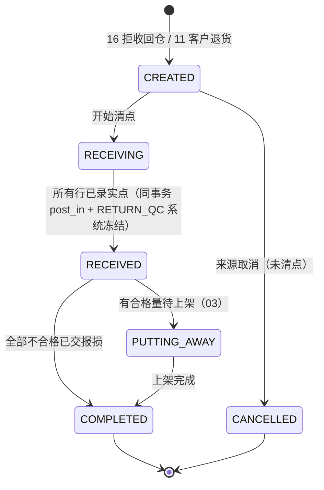
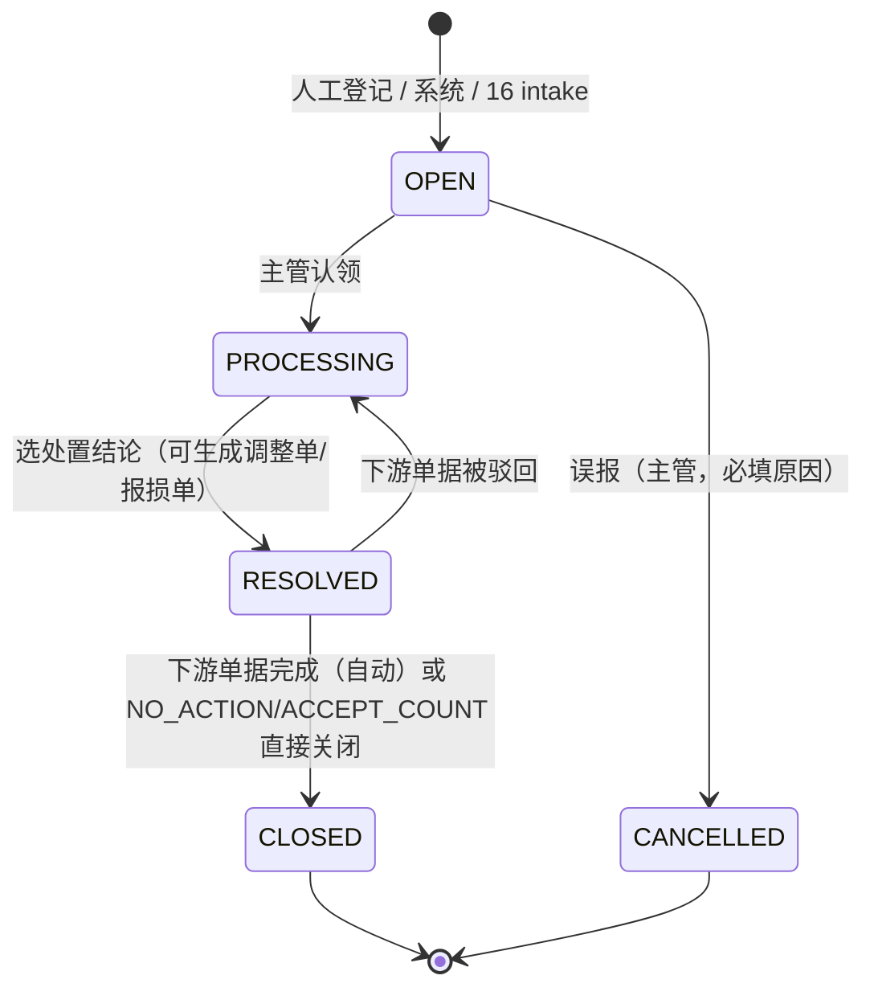
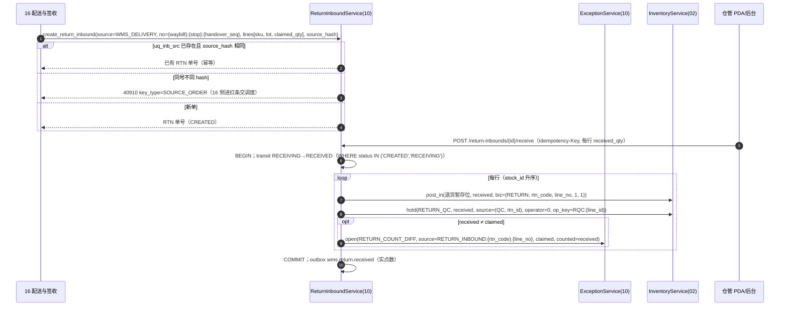
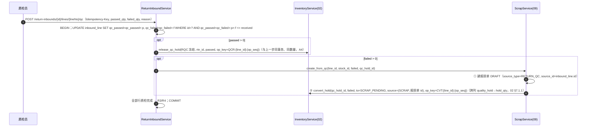

# 10 退货与异常 详细设计

| 项 | 内容 |
|---|---|
| 模块编号 | 10 |
| 作者 | 小钱（后端） |
| 评审 | 小吴（测试，对抗性评审，见 §13）、非作者开发 1 名 |
| 基线 | `docs/first-design@a93f6f3`，《[WMS详细设计说明书](archive/WMS详细设计说明书.md)》§3.5（退货入库单 RTN）、§5.8 退货与异常处理 |
| 依赖 | 00（§6.4 错误码、§6.5 幂等、§6.6 权限、§9.1 部署形态与写节点）；02（`post_in(RETURN)`、`hold(RETURN_QC)` 系统冻结、`release_qc_hold`、`convert_hold`、`release_scrap_hold`；以 02 新版 §7.1.1/§7.1.3 为准）；03 入库（上架）；04（待回库 §7.3，本篇只引用）；09（不合格报损）；11（商城/ERP 退货推送、FAILOVER_GAP）；16 配送与签收（拒收回仓） |
| 状态 | 草稿，从 `docs/first-design` 拉出，单独 PR |

> 本篇写两件事：① **退货入库**（RTN）：接收第 16 篇的拒收回仓单和商城/ERP 的客户退货，收货、强制质检、合格上架或不合格报损；② **异常单**（EXC）：统一的异常登记、责任归属、处置与升级闭环，其中最重要的来源是第 16 篇的**拒收回仓清点差异**（司机登记数 ≠ 仓库实点数，**以仓库实点为准**）。
>
> **待回库记录（`return_record`）的表、状态机和 confirm / resolve / putback-ack 接口全部归第 4 篇 §7.3**，本篇不定义、不重复，只在 §1.2 列出边界。

---

## 1. 职责与边界

### 1.1 本模块负责

1. **退货入库单 RTN**：复用 `inbound_order(order_type='RETURN')` / `inbound_line`，来源：
   - 第 16 篇**拒收回仓**（`source_system='WMS_DELIVERY'`，`source_order_no='{waybill_no}:{stop_no}:{handover_seq}'`）；
   - 商城 / ERP **客户退货**（经第 11 篇入站，`source_system='MALL'/'ERP'`）。
2. **收货清点**：按行录实点数（milli），`post_in(RETURN)` 入退货暂存位，同事务 `hold(RETURN_QC)`：**系统冻结**，`source_type='QC'`、`source_id` = RTN 单 id（退货入库单即质检单）、`operator_id=0`（02 `ck_hold_retqc`）。
3. **退货质检**：合格 → `release_qc_hold`（与 `qc_passed` 累加同事务、同操作键，A4），交第 3 篇上架；不合格 → 同事务由第 9 篇 `create_from_qc` **先建 DRAFT 报损单，再 `convert_hold(RETURN_QC → SCRAP_PENDING, source=(SCRAP, 报损单 id))`**（A1，09 §6.3）。`RETURN_QC` 不能手工解冻（40933，A3）。
4. **清点差异**：实点 ≠ 对方声称数时生成异常单 `RETURN_COUNT_DIFF`，**入账一律按实点**。
5. **异常单 EXC**：异常码字典 `exception_code`、异常单 `exception_case` 的建单（人工 / 系统 / 第 16 篇推送）、认领、处置（生成调整单/报损单/索赔）、关闭、超时升级。
6. **接收第 16 篇的异常单推送**：司机拒收登记数与仓库清点数不一致时，第 16 篇调用本篇 `intake`，同一来源键幂等。
7. **其他模块的异常队列入口**：第 4 篇 `hold_failed`、第 11 篇 `FAILOVER_GAP`、第 5 篇现场异常（缺货、串货、破损）都落 `exception_case`，按异常码路由。

### 1.2 本模块不负责

| 不做 | 归属 |
|---|---|
| 待回库记录 `return_record` 的表、`GET/confirm/resolve/putback-ack` 接口、`RETURN_PENDING` 冻结与释放、40932 | **第 4 篇 §7.3**（第 5 篇建表） |
| 运单、站点签收、拒收登记、筐箱交接 | 第 16 篇（本篇只接收它生成的 RTN 和异常单） |
| 报损单审批与过账 | 第 9 篇 |
| 上架推荐 | 第 3 篇 |
| 调整单审批 | 第 8 篇（盘点调整同一套） |
| 承运商 / 客户索赔结算 | 财务（本篇只推事件 `wms.exception.closed`） |

### 1.3 与原文档的差异（评审重点）

| # | 原文档 | 本篇 | 原因 |
|---|---|---|---|
| Δ1 | 退货"收货 → 强制质检"，未说数量以谁为准 | **仓库实点为准**；与对方声称数不一致必须开异常单，不允许静默按声称数入账 | PM 定论；司机登记在冷库门口、常有误差 |
| Δ2 | 异常码字典只列码 | 字典带 `action / liability / escalate_minutes`；异常单有状态机和超时升级 | 原文档"必须闭环、超时升级"需要落库 |
| Δ3 | 退货不合格直接 `SCRAP` | 不合格 → 第 9 篇报损单（审批），不在本篇直接出账 | 报损只有一条路径（09 Δ5） |
| Δ4 | 无来源幂等 | RTN 走 `uq_inb_src (source_system, source_order_no)` + `source_hash`；异常单走 `uq_exc_src (source_type, source_key)` + `source_hash`；同键不同内容 **40910 `SOURCE_ORDER`** | 00 §6.5 |

---

## 2. 用例

| 编号 | 用例 | 触发者 | 原语（第 2 篇） | `on_hand` | 流水 |
|---|---|---|---|---|---|
| UC1 | 接收拒收回仓单 | 第 16 篇（同库服务调用） | — | 0 | 否 |
| UC2 | 接收客户退货单 | 第 11 篇入站 | — | 0 | 否 |
| UC3 | 退货收货清点 | 仓管（PDA/后台） | `post_in(RETURN)` + `hold(RETURN_QC)`（系统冻结） | +q（实点） | `RETURN` +1 |
| UC4 | 清点差异开异常单 | 系统（UC3 同事务） | — | 0 | 否 |
| UC5 | 第 16 篇推送清点差异异常 | 第 16 篇 | — | 0 | 否 |
| UC6 | 质检合格 | 质检员 | `release_qc_hold`（op_key `QCR:{line_id}:{op_seq}`） | 0 | 否 |
| UC7 | 质检不合格 | 质检员 | 无（交第 9 篇，报损行挂原冻结） | 0（审批时 −q） | 否 |
| UC8 | 人工登记异常 | 任意作业员 | — | — | — |
| UC9 | 认领 / 处置 / 关闭异常 | 主管 | 视处置：调整单（08）/ 报损单（09） | 由下游单据决定 | 由下游单据决定 |
| UC10 | 超时升级 | 定时任务 | — | — | — |

---

## 3. 领域模型

### 3.1 退货入库单

- 单头：`code = RTN-{仓}-{节点}-{作业日}-{序号}`、`source_system`、`source_order_no`、`source_hash`（规范化内容 SHA-256，第 4 篇同算法）、`status`、`related_outbound_id`、`waybill_no/stop_no`（拒收时）。
- 单行：`sku_id, lot_id`（拒收回仓**必须带原出库批次**，由第 16 篇从运单装车明细带出；客户退货批次未知时按 SKU 收货、批次由质检员现场指定）、`claimed_qty_milli`（对方声称）、`received_qty_milli`（实点）、`qc_passed_qty_milli`、`qc_failed_qty_milli`。
- 行不变量：`qc_passed + qc_failed ≤ received`；单头完成要求所有行 `qc_passed + qc_failed = received`。

> 单据表数量列改 `*_qty_milli`（00 R2，小赵 I3）：本 PR 在 `inbound_line` **加** `claimed / received / qc_passed / qc_failed _qty_milli` 四列，退货只读写这四列；原 NUMERIC 列归第 3 篇按「加列 → 双写 → 删旧」（00 §9.2）迁移，本 PR 不删。

### 3.2 异常单

`ExceptionCase(code, exception_code, source_type, source_key, source_hash, claimed, counted, diff, liability, status, due_at, resolution, resolution_doc)`：

- `diff = counted − claimed`（库层 `ck_exc_diff`）。负数 = 仓库实收少于声称（可能司机少交、途中丢失），正数 = 多交。
- `liability`：默认取字典；处置时可改，改动写 `audit_log`。
- `due_at = created_at + exception_code.escalate_minutes`；过期未关闭 → 升级（`escalated=1`，推仓经理）。

### 3.3 异常码字典（种子，可在后台维护）

| code | 名称 | action | liability | 升级（分钟） | 主要来源 |
|---|---|---|---|---|---|
| `RETURN_COUNT_DIFF` | 拒收回仓清点差异 | ADJUST | CARRIER | 240 | 16 推送 / 本篇 UC3 |
| `CUSTOMER_REJECT` | 客户拒收 | NONE | CUSTOMER | 1440 | 16 |
| `SHORT_STOCK` | 库存不足/实物少 | ADJUST | WAREHOUSE | 120 | 05 |
| `DAMAGED` | 破损 | SCRAP | WAREHOUSE | 240 | 05/10 |
| `EXPIRED` | 过期/临期不可发 | SCRAP | SUPPLIER | 240 | 09 |
| `WRONG_LOC` / `WRONG_SKU` | 库位无货 / 串货 | ADJUST | WAREHOUSE | 120 | 05 |
| `WEIGHT_OVER` / `WEIGHT_UNDER` | 超重 / 欠重 | NONE | SUPPLIER | 240 | 06 |
| `TEMP_BREACH` | 温控异常 | NOTIFY_PURCHASE | CARRIER | 60 | 16 / IoT |
| `RR_HOLD_FAILED` | 待回库冻结未生效 | ADJUST | WAREHOUSE | 240 | 04 §9 |
| `FAILOVER_GAP` | 故障切换后上游单据对不上 | NONE | UNKNOWN | 60 | 11 §6.4 |

---

## 4. 涉及的表

### 4.1 `inbound_order` / `inbound_line`（复用，加 milli 列）

- `order_type = 'RETURN'`，`uq_inb_src (source_system, source_order_no)` 就是来源幂等键。
- 新增 `claimed_qty_milli`、`received_qty_milli`、`qc_passed_qty_milli`、`qc_failed_qty_milli`（BIGINT，默认 0）；`ck_inbl_int`（整数 milli，CAST 写法只在 SQLite 起作用，PG 恒真）、`ck_inbl_qc`（非负，`qc_passed + qc_failed ≤ received`）。
- `inbound_order.source_hash` 仍随第 3 篇（Q1），本篇 RTN 的 `source_hash` 暂存于 `inbound_message`/服务层比对。

### 4.2 `exception_code`（新增）

`code PK, name, action, liability (ck_exc_liab), escalate_minutes, is_active`。`exception_case.exception_code` 外键引用 `exception_code(code)`（I1）。字典只停用（`is_active=0`），不删。

### 4.3 `exception_case`（新增）

| 字段 | 说明 |
|---|---|
| code | `EXC-…`，`uq_exc_code` |
| source_type / source_key | `ck_exc_src_type`（I1）限定取值：`DELIVERY_RETURN`（16，键 **`POD:{pod_id}:{correct_seq}`**，`pod_id` 为首次签收 id，首签 `correct_seq=0`，每次审批通过的更正 +1，A2）/ `RETURN_INBOUND`（键 `{rtn_code}:{line_no}`）/ `RR_HOLD_FAILED`（键 `{return_record_id}`）/ `FAILOVER_GAP`（键 **`FG:{failover_id}:{source_system}:{source_order_no}`**，带故障切换批次号，同一单两次故障各一张）/ `PICK` / `COUNT` / `MANUAL`（键为单号）。**`uq_exc_src` 唯一，不变**：已取消的旧键继续占位，更正后用新的 `correct_seq` 建单，不复用旧键 |
| source_hash | 规范化内容 SHA-256（`ck_exc_hash`：64 位小写 hex，写法同 04 `ck_obo_hash`）。同键同内容 → 返回已有单；同键不同内容 → 40910 `SOURCE_ORDER` |
| claimed / counted / diff | `*_qty_milli`，`ck_exc_int`、`ck_exc_diff` |
| status | `ck_exc_status`：`OPEN / PROCESSING / RESOLVED / CLOSED / CANCELLED`；**触发器 `trg_exc_forward`（两库各一份，I2）**：只能沿 §5.2 迁移表前进，`CLOSED / CANCELLED` 是终态不能离开；进入 `RESOLVED` 后 `claimed / counted / diff / source_key / source_hash` 不可改（违者 `exc_state_forward_only` → 50010） |
| resolution / resolution_doc | `ACCEPT_COUNT / ADJUST / SCRAP / CLAIM_CARRIER / CLAIM_CUSTOMER / NO_ACTION`；生成的单号 |
| closed_by / closed_at | `ck_exc_close`：RESOLVED/CLOSED 必须有结论和处理人 |

索引：`ix_exc_wh_status (warehouse_id, status, due_at)`（看板与升级扫描）。

---

## 5. 状态机

### 5.1 退货入库单



| # | from → to | 触发者 | 守卫 | 副作用（同事务） |
|---|---|---|---|---|
| R1 | CREATED → RECEIVING | 仓管 | — | 无 |
| R2 | RECEIVING → RECEIVED | 仓管提交清点 | 每行 `received_qty` 已录（可为 0） | 每行 `received > 0`：`post_in(暂存位, q, biz=(RETURN, rtn_code, line_no, op_no=1, leg=1))` + `hold(RETURN_QC, source=(QC, rtn_id), operator=0, op_key=RQC:{line_id})`；`received ≠ claimed` → 建异常单（§6.2） |
| R3 | RECEIVED → PUTTING_AWAY | 系统 | 有 `qc_passed > 0` 且质检全部完成 | 通知第 3 篇生成上架任务 |
| R4 | RECEIVED → COMPLETED | 系统 | 全部行 `qc_failed = received` | 无 |
| R5 | PUTTING_AWAY → COMPLETED | 03 | 上架完成 | outbox `wms.return.completed` |
| R6 | CREATED → CANCELLED | 来源方 / 主管 | 未清点 | 无 |

- 质检是**行级**动作，不单独设单头状态：`qc_passed/qc_failed` 由条件更新累加，`WHERE qc_passed + qc_failed + :q <= received`，超了 `40930`。
- **A4 合格解冻与计数同一事务、同一数量、同一操作键**：`UPDATE inbound_line SET qc_passed_qty_milli = qc_passed_qty_milli + :p …` 与 `release_qc_hold(hold_id, rtn_id, op_key=QCR:{line_id}:{op_seq}, qty=:p)` 在同一事务里，`:p` 是同一个值；`op_seq` 由质检提交生成、重试不变。重放（含 `Idempotency-Key` 过期后）撞 02 `stock_hold_release.uq_hr_op`，**整个事务回滚**，`qc_passed` 也不会多记，返回首次结果（回执查询）。不会出现「解冻两次、只记一次」或反过来。
- 清点**一次提交**（R2），不支持分批：拒收回仓量小、一次点完；若现场要改数，在 RECEIVED 后走异常单 + 调整单，不改原流水。

### 5.2 异常单



| # | from → to | 守卫 | 副作用 |
|---|---|---|---|
| X1 | OPEN → PROCESSING | 认领人有 `exception.case.handle` | `assignee_id` |
| X2 | PROCESSING → RESOLVED | 结论必填；`ADJUST/SCRAP` 必须同事务建出下游单据 | `resolution_doc` |
| X3 | RESOLVED → CLOSED | `resolution_doc` 已过账，或结论不产生单据 | outbox `wms.exception.closed` |
| X4 | RESOLVED → PROCESSING | 下游单据 REJECTED | 清 `resolution_doc` |
| X5 | OPEN → CANCELLED | 必填原因 | audit |

`escalated` 是标志位而不是状态：升级不改变处理流程，只改通知对象。

**库层兜底（I2，触发器 `trg_exc_forward`，PG plpgsql / SQLite `BEFORE UPDATE … WHEN`）**：只允许上表 X1–X5 方向；`CLOSED`、`CANCELLED` 不能离开；`PROCESSING → OPEN`、`RESOLVED → OPEN` 拒绝；进入 `RESOLVED` 以后 `claimed / counted / diff / source_key / source_hash` 不可改。违反时报 `exc_state_forward_only`（应用层映射 50010，正常路径不会触发，因为 `transit()` 已按 `WHERE status=:from` 条件更新）。

---

## 6. 核心流程

### 6.1 拒收回仓 → 退货入库（UC1 + UC3）



- **入账永远按实点**：`post_in` 的数量是 `received_qty`，与声称数无关；差异只在异常单里体现。
- 实点为 0 的行不入账，但如果声称数 > 0，同样开异常单（司机说有、仓库没收到）。
- `post_in` 与 `hold` 同事务：退货货物入账瞬间就不可用，FEFO 分不到未检的退货。

### 6.2 第 16 篇推送清点差异（UC5）

第 16 篇在回仓交接时已经有"司机登记数"和"交接员实点数"两个数字（第 15 篇 `pages/container/handover` 逐行清点）。不一致时第 16 篇**同事务**调用：

```python
ExceptionIntake.intake(
    source_type="DELIVERY_RETURN",
    source_key=f"POD:{root_pod_id}:{correct_seq}",   # A2：首签 correct_seq=0；行明细在 payload，claimed/counted 存合计（16 Q-D）
    exception_code="RETURN_COUNT_DIFF",
    claimed_qty_milli=driver_reported, counted_qty_milli=warehouse_counted,
    payload={...}, reporter_id=handover_user)
```

| 情况 | 结果 |
|---|---|
| 新键 | 建 OPEN 异常单，`liability=CARRIER`，返回 `exception_id` |
| 同键、同 `source_hash` | 返回已有单（幂等，司机端补传或第 16 篇重试） |
| 同键、不同 `source_hash` | **40910 `SOURCE_ORDER`**（同一次签收的内容不应变化，交人工） |
| 第 16 篇 `POD_CORRECT` 审批通过后重推 | 第 16 篇同事务：先取消旧单（X5，`POD:{pod_id}:{n}`），再用 **新键 `POD:{pod_id}:{n+1}`** 建单；`uq_exc_src` 不变，旧键继续占位，新键不撞（A2） |
| 异常单已 CLOSED 后又推同键不同内容 | 同上 40910，人工处理 |

**仓库实点为准**：第 16 篇生成的 RTN 单行 `claimed_qty` = 司机登记数；本篇收货时以**仓管清点**为入账数。如果第 16 篇交接实点和本篇收货实点又不一致（交接后到收货之间丢失），本篇 R2 会再开一张 `RETURN_INBOUND` 来源的异常单，两张单的 `source_key` 不同、互不覆盖，责任分别归承运商和仓库。

### 6.3 退货质检（UC6 / UC7）



不合格的量**从 `RETURN_QC` 转入 `SCRAP_PENDING`**（来源 = 报损单），只能由第 9 篇 `release_scrap_hold(hold_id, scrap_doc_id, mode=POSTED|REVOKED)` 释放；任何人工解冻路径返回 **40933**（A1/A3）。第 9 篇驳回时冻结保留，异常单回到 PROCESSING 由主管决定（转合格或重开报损）。

### 6.3a 门店退货回仓（STORE_RETURN）

门店把退货送回仓，来源 `source_system='STORE_RETURN'`（`ck_inb_rtn_src`），`source_order_no` 为门店退货单号，同号同 hash 幂等、不同 hash 40910 `SOURCE_ORDER`。

| 步骤 | 规则 |
|---|---|
| 收货 | 同 R2：`post_in(RETURN)` 按实点入账；**同事务 `hold(RETURN_QC)` 系统冻结**，`source_type='QC'`、`source_id` = 这张 RTN（质检单来源即 STORE_RETURN）、`operator_id=0`。**不走 `RETURN_PENDING`**（那是待回库记录专用，`ck_hold_return` 会拦） |
| 合格 | `release_qc_hold`，与 `qc_passed` 累加同事务、同 op_key（A4） |
| 不合格 | 第 9 篇 `create_from_qc`：先建 DRAFT 报损单，再 `convert_hold(RETURN_QC → SCRAP_PENDING, source=(SCRAP, 报损单 id))`（A1） |
| 清点差异 | 门店声称 ≠ 仓库实点：`intake(source_type='STORE_RETURN', source_key='{rtn_code}:{line_no}', RETURN_COUNT_DIFF)`，责任默认 `CUSTOMER` |
| 主数据 | SKU / 库位处于 `PENDING_DISABLE`（第 1 篇，待停用）时，**STORE_RETURN 入库放行**（货已在门口，不能拒收）；`DISABLED` 仍拒绝（40001）。状态值归第 1 篇，见 Q8 |

### 6.4 异常处置（UC9）

- `ADJUST`：同事务建调整单（第 8 篇 `adjust_order`，`source_type='EXCEPTION'`、`source_id=exception_id`），审批过账后回调关闭（X3）。
- `SCRAP`：同事务建报损单（第 9 篇，`source_type='MANUAL'` 或对应来源）。
- `ACCEPT_COUNT`：清点差异专用——确认以仓库实点为准，库存已经按实点入账，**不再产生库存变化**，直接关闭；推 `wms.exception.closed{liability, diff}` 给财务对承运商/客户索赔。
- `CLAIM_CARRIER / CLAIM_CUSTOMER`：只推事件。

### 6.5 超时升级（UC10）

每 5 分钟扫 `ix_exc_wh_status`：`status IN ('OPEN','PROCESSING') AND due_at < now AND escalated = 0` → 条件更新 `escalated = 1 WHERE escalated = 0`，推仓经理。只在本仓权威库节点运行。

---

## 7. 接口清单与契约

所有 POST 带 `Idempotency-Key`、`X-Warehouse-Id`、`X-Write-Epoch`（00 §9.1）。

### 7.1 退货入库

| 方法 | 路径 | 说明 | 权限点 |
|---|---|---|---|
| POST | `/api/v1/return-inbounds` | 后台手工建客户退货单（正常由第 11 篇入站建） | `returns.inbound.create` |
| GET | `/api/v1/return-inbounds?status=&source=&waybillNo=` | 列表 | `returns.inbound.view` |
| GET | `/api/v1/return-inbounds/{id}` | 详情（行、实点、质检、异常单、流水） | `returns.inbound.view` |
| POST | `/api/v1/return-inbounds/{id}/receive` | 提交清点（一次性） | `returns.inbound.receive` |
| POST | `/api/v1/return-inbounds/{id}/lines/{lineNo}/qc` | 行质检 | `returns.inbound.qc` |
| POST | `/api/v1/return-inbounds/{id}/cancel` | 取消未清点的单 | `returns.inbound.cancel` |

服务内（同库、同事务）：`ReturnInboundService.create_return_inbound(...)`（给第 16 篇）；第 11 篇入站处理调用同一函数。

**契约 `POST /return-inbounds/{id}/receive`**

```json
{ "lines": [ { "line_no": 1, "received_qty": "4.000", "location_code": "RTN-STAGE-01" },
             { "line_no": 2, "received_qty": "0.000" } ] }
```

200：

```json
{ "code": "0", "data": { "code": "RTN-SH01-0003-20261015-000031", "status": "RECEIVED",
  "lines": [ { "line_no": 1, "claimed_qty": "5.000", "received_qty": "4.000", "uom": "KG",
               "quality_hold": "4.000", "exception_code": "EXC-SH01-0003-20261015-000007" },
             { "line_no": 2, "claimed_qty": "0.000", "received_qty": "0.000", "uom": "PCS", "exception_code": null } ] } }
```

### 7.2 异常单

| 方法 | 路径 | 说明 | 权限点 |
|---|---|---|---|
| POST | `/api/v1/exceptions` | 人工登记 | `exception.case.create` |
| GET | `/api/v1/exceptions?status=&code=&escalated=&sourceType=` | 看板 | `exception.case.view` |
| GET | `/api/v1/exceptions/{id}` | 详情 | `exception.case.view` |
| POST | `/api/v1/exceptions/{id}/claim` | 认领 | `exception.case.handle` |
| POST | `/api/v1/exceptions/{id}/resolve` | 处置，必填 `resolution`、`reason`；`ADJUST/SCRAP` 带行 | `exception.case.handle` |
| POST | `/api/v1/exceptions/{id}/cancel` | 误报取消 | `exception.case.handle` |
| GET | `/api/v1/exception-codes` / PUT `/{code}` | 字典 | `exception.code.manage` |

服务内：`ExceptionIntake.intake(...)`（第 4/5/11/16 篇）。

### 7.3 错误码（全部取自 00 §6.4，本篇不新增）

| 码 | 场景 |
|---|---|
| 40001 / 40002 | 参数非法 / 处置、取消缺原因 |
| 40010 | 数量格式 |
| 40311 | `X-Warehouse-Id` 与单据所属仓不一致 |
| 40904 | 质检合格解冻时冻结余量不足（并发） |
| 40905 | 冻结已释放 |
| 40910 | `IDEMPOTENCY_KEY`；`SOURCE_ORDER`：RTN 来源单号或异常单来源键同键不同内容 |
| 40930 | 非法状态流转；质检数量超过实点 |
| 42212 | 清点时扫的不是退货暂存位 |
| 50010 | 不变量失败 |
| 50301 / 50303 | 依赖不可用 / `STALE_WRITE_NODE`：重新取 write-endpoint，原业务键重提 |

---

## 8. 并发与幂等

| 场景 | 防线 |
|---|---|
| 第 16 篇重复推 RTN | `uq_inb_src` + `source_hash` |
| 第 16 篇重复推异常 | `uq_exc_src` + `source_hash` |
| 清点提交重复 / Key 过期 | 状态条件更新（只有一次 R2）；`uq_mvk_biz_line (rtn_code, line_no, 1, 1)` 拦重复入账 |
| 两个质检员同时质检同一行 | 行条件更新 `qc_passed + qc_failed + q ≤ received`；解冻 `op_key` 含 `qc_seq` |
| 质检合格解冻与报损同一冻结 | 都是对同一 `stock_hold` 的条件更新，余量不够的一方 40905 |
| 异常认领并发 | `WHERE status='OPEN'` |
| 升级扫描多 worker | `WHERE escalated=0` |
| 写节点切换 | 所有写带 `X-Write-Epoch`，旧节点 `50303`；第 16 篇同库调用不跨节点（同一仓同一权威库） |

### 8.1 离线差异（引用 00 §9.1）

- 形态 B：第 16 篇与本篇都在边缘节点，`intake` 是同库同事务调用，不经网络。
- 商城/ERP 退货在中心 `inbound_message` 排队，联网后下发（00 §9.1②）；本篇按 `uq_inb_src` 幂等应用。

---

## 9. 异常与补偿

| 场景 | 处理 |
|---|---|
| 拒收回仓单缺批次 | 拒绝建单（40001），第 16 篇必须从装车明细带批次；客户退货允许无批次、质检员指定 |
| 退货暂存位满 / 锁定 | `post_in` 遇 LOCKED → 40906，换暂存位重提 |
| 质检合格但上架失败 | 不影响本篇，第 3 篇重试；单据停在 PUTTING_AWAY |
| 报损被驳回 | 冻结保留，异常单回 PROCESSING（X4） |
| 异常单长期未闭环 | 升级；看板按 `due_at` 排序 |
| 下游单据建失败 | X2 整个事务回滚，异常单保持 PROCESSING |

---

## 10. 权限

| 权限点 | 角色 |
|---|---|
| returns.inbound.view / create / receive / cancel | 仓管、主管 |
| returns.inbound.qc | 质检员（≠ 清点人，SoD，可配置放宽） |
| exception.case.view / create | 所有作业角色 |
| exception.case.handle | 主管 |
| exception.code.manage | 系统管理员（只改字典，不处理异常） |

- 异常处置、责任方修改、取消写 `audit_log`。
- **PG 授权（I4）**：`GRANT SELECT, INSERT, UPDATE ON exception_code, exception_case TO wms_app`（不给 DELETE / TRUNCATE：字典停用、异常单取消都走状态）；`inbound_line` 新列沿用 base 的整表授权。`verify.sh` 的通用检查逐表核对 `wms_app` 授权。
- 处置人 ≠ 登记人（`ACCEPT_COUNT` 涉及索赔金额）。

---

## 11. 测试要点

1. **以实点为准**：声称 5、实点 4 → 入账 4000 milli、异常单 diff = −1000、流水 +4000；声称 0、实点 2 → 入账 2000、diff +2000；实点 0 → 无流水、有异常单。
2. **幂等**：第 16 篇同号同内容重推 → 同一 RTN；不同内容 → 40910 `SOURCE_ORDER`；intake 同键同 hash → 同一异常单。
3. **两段差异**：16 交接差异单 + 10 收货差异单同时存在、键不冲突。
4. **质检**：并发质检同一行 200 轮，`passed + failed ≤ received` 成立；不合格转报损后 `available` 不增加；报损驳回后冻结仍在。
5. **状态机**：穷举 RTN 与 EXC 迁移表；关闭缺结论被 `ck_exc_close` 拦。
6. **FEFO**：未检退货 `quality_hold` 计入，FEFO 候选不含。
7. **双库矩阵**。

### 11.1 本 PR 的验证脚本结果

| 脚本 | 环境 | 结果 |
|---|---|---|
| `verify_sqlite.py` | 本机 Linux，Python 3 + SQLite 3.46 | **177 / 177 通过**（base a93f6f3）。45 表 / 1 视图 |
| `verify.sh` | 本机 PG 16（/home/box/tools/pg16，临时实例端口 5445，新建空库） | **174 / 174 通过**（base a93f6f3）；实测 **45 表 / 123 索引 / 1 视图**，与手算期望一致（base 43 / 118 + 本篇 2 表 / 5 索引；外键在 PG 不建索引） |

本轮新增反向断言（两库同一张用例表）：I1 外键（未知异常码）、`ck_exc_src_type`、`ck_exc_hash`（短串、大写）；I2 `RESOLVED` 后改实点、`RESOLVED/CLOSED/CANCELLED → OPEN`、`CLOSED` 后改声称数；A2 取消后旧键仍占位、`correct_seq+1` 新键可建；FAILOVER_GAP 同单两次故障不撞键、同次重复被拦；I3 `ck_inbl_qc`（超实点、负数）、`ck_inbl_int`（SQLite）；A3 `ck_hold_retqc`、人工解冻 RETURN_QC rowcount=0；A4 合格解冻与计数同事务、重放被 `uq_hr_op` 拦且只记一次（`1000/1000/3000`）；A1 `SCRAP_PENDING` 挂质检来源被 `ck_hold_scrap` 拦、挂报损单可转且总量不变、人工解冻 rowcount=0；STORE_RETURN 来源 CHECK、不走 RETURN_PENDING、非人工冻结、差异单来源。原有：拒收回仓清点差异异常单可写；同来源键重复（`uq_exc_src`）；差异列 = 实点 − 声称（`ck_exc_diff`）；关闭需结论和处理人（`ck_exc_close`）；非法状态（`ck_exc_status`）；按 `ACCEPT_COUNT` 关闭；字典责任方取值（`ck_exc_liab`）。

---

## 12. 待定问题

| # | 问题 | 建议 | 裁决人 |
|---|---|---|---|
| Q1 | `inbound_line` 旧 NUMERIC 列何时删、`inbound_order.source_hash` 放哪个 PR | 本 PR 已加四个 milli 列（I3）；旧列与 `source_hash` 归第 3 篇按「加列→双写→删旧」处理 | 大肥鱼 / 小李 |
| Q8 | `PENDING_DISABLE`（SKU/库位待停用，第 1 篇）对 STORE_RETURN 入库放行的落点 | 第 1 篇定状态值后，在入库校验的放行名单里加 `source_system='STORE_RETURN'`；本 PR 不建该状态列 | 大肥鱼 |
| Q9 | 第 16 篇差异单是签收级键 `POD:{pod_id}:{correct_seq}`，一签收多行差异只能一张单 | 一张单，`claimed/counted` 存合计、行明细在 `payload`（回小吴 S2）；需要按行追责再加 `exception_case_line` | 小吴 / 大肥鱼 |
| Q2 | 拒收回仓的退货暂存位是否按温区分（冷冻/冷藏） | 按温区各设一个暂存位，第 1 篇主数据配置 | 大肥鱼 |
| Q3 | 清点差异责任方默认承运商还是待定 | 默认 `CARRIER`，主管可改 | 大肥鱼 |
| Q4 | 商城退货申请（第 15 篇 `/returns/new`）在 WMS 侧是否需要"预约"单据 | 一期不做预约，商城侧审核通过后经第 11 篇推 RTN | Yuri（范围） |
| Q5 | 第 4 篇 `hold_failed` 目前写 `stock_recon_alert(RR_HOLD_FAILED)`，是否统一改落 `exception_case` | 建议改：异常闭环统一在本篇；对账告警只留差异 | 大肥鱼 |
| Q6 | 质检员 ≠ 清点人 SoD 是否默认开启 | 默认开启，小仓可配置放宽（00 §2） | 大肥鱼 |
| Q7 | 与第 9、11 篇 PR 都改了验证脚本的表数期望值 | 后合并的 PR 按累计值改 | 大肥鱼 |

---

## 13. 对抗评审攻击面（给小吴）

| # | 攻击面 | 打法 | 防线 | 我认为最可能出问题的地方 |
|---|---|---|---|---|
| R-A1 | **按声称数入账** | 前端只传 claimed 不传 received；received 字段缺失 | 接口必填 received；入账只读 received | 第 16 篇与本篇共用一个 DTO 时字段混用 |
| R-A2 | **重复入账** | 清点提交重放、Key 过期后重放、第 16 篇重复推 RTN | 状态条件更新 + `uq_mvk_biz_line` + `uq_inb_src` | — |
| R-A3 | **未检退货被分配** | 清点提交后、冻结写入前分配 | `post_in` 与 `hold` 同事务 | 有人把 hold 放到异步任务里 |
| R-A4 | **质检超量** | 两个质检员并发；合格 + 不合格 > 实点 | 行条件更新 | 不合格转报损时数量再被改 |
| R-A5 | **异常单被吞** | 第 16 篇更正后同键再推；关闭后再推 | 键带 `correct_seq`（A2）+ `source_hash` → 40910 | 第 16 篇取消旧单与新建不在同一事务；或 `correct_seq` 未 +1 |
| R-A6 | **差异两次计入** | 16 交接差异与 10 收货差异叠加索赔 | 两个 `source_key` + 责任方分开 | 财务侧对同一批货重复索赔 |
| R-A7 | **越权** | 登记人自己处置 `ACCEPT_COUNT`；跨仓 | SoD + 40311 | — |
| R-A8 | **写节点切换** | 清点提交中途切换 | epoch 栅栏 50303、原 Key 重提 | 新节点上 `idempotency_record` 已随库迁移（00 §9.1），重提应回放 |

评审结论请按 **阻塞 / 重要 / 建议** 标注，有分歧的写进 §12。
