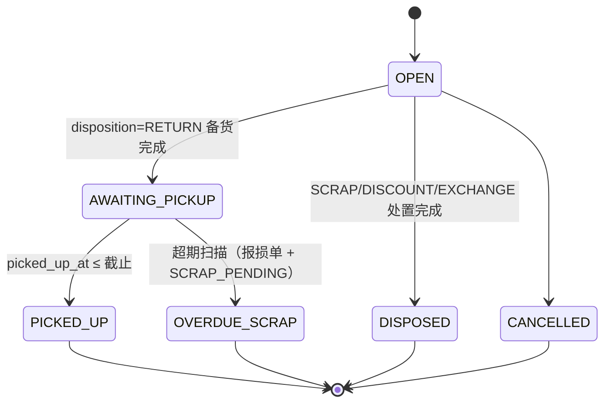
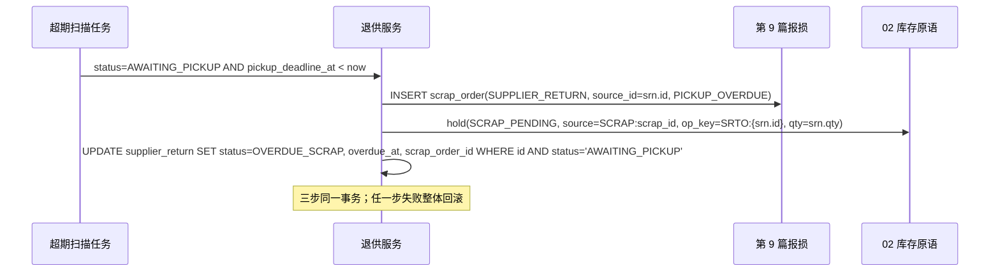

# 10 退货与异常

| 项 | 内容 |
|---|---|
| 作者 | 米雪儿（接手 #5） |
| 评审 | 小玛丽（主）、小企鹅（副） |
| 状态 | 草稿（首次成文：此前第 10 篇只有 DDL `wms-design/sql/schema/10_returns.sql`；本稿补退供应商，Alex 定案、Doro 定细则） |
| 依赖 | 00 全局约定（ID、单号 §6.2、数量 R2、时间 R3、错误码 §6.4、幂等 §6.5、状态机 §6.7）；02 库存核心（`stock_hold`、`hold` / `convert_hold` / `release_qc_hold` / `post_in` / `post_out`）；03 入库（`inbound_order` / `inbound_line`）；09 报损（`scrap_order`、`hold(SCRAP_PENDING)`）；11 集成（outbox）；12 审批与审计；16 配送签收（拒收回仓） |

> 本篇只写服务端。数量一律 `BIGINT *_qty_milli`；时间存 UTC，SQLite 时间列 `'YYYY-MM-DD HH:MM:SS'`。表结构以 `10_returns.sql` 为准（PG 源，SQLite 由 `verify_sqlite.py` 生成），本文与 DDL 冲突时以 DDL + `verify.sh` / `verify_sqlite.py` 的断言为准，并回改本文。

## 1. 职责与边界

### 1.1 负责
1. **客户/门店退货入库**：退货入库单复用 `inbound_order(order_type='RETURN')`，来源白名单 `ck_inb_rtn_src`（WMS_DELIVERY / STORE_RETURN / STORE_BLIND / SCRAP_MISREPORT / MALL / ERP）；收货挂 `RETURN_QC` 冻结，质检通过走 02 `release_qc_hold`。
2. **退货预约与盲收**：`return_reservation(_line)`、`return_blind_receipt`。
3. **异常单**：`exception_code` 字典、`exception_case`（状态白名单、只进不退、去重键永不释放）。
4. **退供应商（本稿新增）**：`supplier_return`，原因白名单、处置必填、食安限制、提货时限、超期转第 9 篇报损。

### 1.2 不负责
- 报损单本身（第 9 篇）；退供的财务结算、供应商对账（ERP，经第 11 篇）；采购退货单在上游的生成（ERP）。

### 1.3 与原设计（archive）的差异
- 原文“退供随时可退”改为 Alex 定案的四条规则（§3.4）。

## 2. 用例
| # | 用例 | 触发者 |
|---|---|---|
| UC1 | 门店退货预约 → 仓库收货 → RETURN_QC → 质检 | 门店 / 收货员 / 质检 |
| UC2 | 盲收（无预约），同事务生成 RTN + 异常单（48h 关联截止） | 收货员 |
| UC3 | 异常登记、处置、关闭 | 各岗位 / 主管 |
| UC4 | **建退供单**：选库存行、原因、处置、食安标记 | 采购/品控 |
| UC5 | **退供待提货 → 供应商提货** | 仓管 |
| UC6 | **超期扫描**：过截止未提 → 第 9 篇报损单 + `hold(SCRAP_PENDING)` | 系统任务 |

## 3. 领域模型

### 3.1 退货入库与质检
见 DDL 注释 ①–③：退货只读写 `*_qty_milli` 三列；`qc_passed + qc_failed ≤ received`。

### 3.2 异常单
状态 OPEN → PROCESSING → RESOLVED → CLOSED（另可 → CANCELLED）；处置 ADJUST / SCRAP 必须带生成单号。

### 3.3 退货预约 / 盲收
预约 CREATED → RECEIVED / CANCELLED；盲收记录只追加。

### 3.4 退供应商规则（Alex 定案，Doro 细则）
| # | 规则 | 库层落点 |
|---|---|---|
| R1 | 原因只限 `QUALITY` 质量 / `RECALL` 召回 / `WRONG_DELIVERY` 错送；`SLOW_MOVING` 滞销不退，**合同另有约定**的除外（`contract_ref` 必填） | `ck_srtn_reason`、`ck_srtn_slow` |
| R2 | 处置必填：`RETURN` / `SCRAP` / `DISCOUNT` / `EXCHANGE`；食安（`food_safety`）只能 `RETURN` / `SCRAP` | `disposition NOT NULL`、`ck_srtn_disp`、`ck_srtn_fsafe` |
| R2a | **召回一律食安**（因此只能退或报废） | `ck_srtn_recall_fs` |
| R2b | **合同滞销一律非食安**，四种处置都可以 | `ck_srtn_slow_fs` |
| R3 | 提货时限（只对 `RETURN`）：T = `ready_at`；生鲜 `FRESH` T+24h、冷冻 `FROZEN` T+7d、常温 `STANDARD` T+15d；按时提货 `picked_up_at ≤ pickup_deadline_at` | `ck_srtn_deadline`、`ck_srtn_picked` |
| R4 | 超期未提 → 第 9 篇报损单（`SUPPLIER_RETURN` / `PICKUP_OVERDUE`）+ 02 原语 `hold(SCRAP_PENDING)`，op_key `SRTO:{supplier_return.id}` | `ck_srtn_overdue`、`trg_srtn_overdue`（09 跨篇）、`uq_scr_srtn`、`uq_srtn_scrap` |

### 3.5 温区 → 提货时限类别（Doro 定）

| `sku.temperature_required` | `sku.return_as_fresh` | `temp_class` | 提货时限 |
|---|---|---|---|
| `FROZEN` 冷冻 | —（只能 false） | `FROZEN` | T+7d |
| `CHILLED` 冷藏 | —（只能 false） | `FRESH` | T+24h |
| `AMBIENT` 常温 | false | `STANDARD` | T+15d |
| `AMBIENT` 常温 | **true**（常温生鲜，如香蕉、常温果蔬） | `FRESH` | T+24h |
| 其他值 | — | 拒绝建单（`srtn_temp_class_mismatch` → 40930，`detail.reason = SRTN_TEMP_CLASS_MISMATCH`，已登记 00 §6.4），先在主数据补映射 | — |

- `return_as_fresh` 是对第 1 篇 `sku` 的跨篇 ALTER（README 登记），默认 false；`ck_sku_rtn_fresh` 只允许常温 SKU 置真。
- 服务端按上表填 `temp_class`；库层 `trg_srtn_temp`（PG 固定 search_path；SQLite `trg_srtn_temp_ins` / `_upd`）在建单及改 `sku_id` / `temp_class` 时按 SKU 当前值复核，不一致即拒。
- `temp_class` 是建单时快照：SKU 主数据之后改温区或改标记，不回溯已建的退供单与已写定的截止时间。

`QUALITY` 是否食安由品控在建单时判定（`food_safety`）；`WRONG_DELIVERY` 默认非食安，若错送的是温控失效等食安问题，同样标 `food_safety`。

### 3.6 时间约定（Doro 定，对齐小玛丽 pr03 同类问题）
- 服务端时间 `ready_at`、`picked_up_at`、`overdue_at`、`created_at`（以及由 `ready_at` 推出的 `pickup_deadline_at`）由库时钟决定，调用方传的值不可信：
  - **PG**：BEFORE 触发器 `trg_srtn_zclock` 对非属主写入强制改写为 `date_trunc('second', now() AT TIME ZONE 'UTC')`（00 时间约定，Doro：不用裸 `now()`）。列一律 `TIMESTAMP`（无时区），不用 timestamptz，结果与会话 TimeZone 无关（verify 在 `SET TIME ZONE 'Asia/Shanghai'` 下断言仍是 UTC）。`created_at` 的缺省值同样是 UTC 整秒。退供单的 `pickup_deadline_at` 按改写后的 `ready_at` 重算（+24h/+7d/+15d）。表属主（迁移/种子）豁免，同 11 `trg_outbox_insert_pending` 口径。
  - **SQLite**（不能改 NEW）：`ck_srtn_ts` 先拒非 ISO，`trg_srtn_clock_ins` / `_upd` 再要求与 `datetime('now')` 相差 ≤ 300 秒，否则 `srtn_clock_skew`。`strftime` 为 NULL 的值也走这个错误码，不能借 NULL 绕过。
- 格式：五个时间列（含 `created_at`）只收整秒的 `YYYY-MM-DD HH:MM:SS`（`ck_srtn_ts`）。小数秒两库都拒（PG 用 `= date_trunc('second')`，SQLite 要求长度 19 且 `datetime(x) IS x`）。`T` 分隔、偏移量、斜杠、不存在的日期（如 02-30）在 SQLite 都拒。
- 时区：所有时间存 UTC，不带偏移。PG `TIMESTAMP` 会**丢弃**输入里的偏移（`+08:00` 存成原字面时间），这一行为由 verify 固化。非属主写入本来就会被改写成库时钟，所以偏移进不来；属主写入要自己保证用 UTC。
- 比较：一律按整秒。PG 是原生 TIMESTAMP 比较；SQLite 一律 `CAST(strftime('%s', x) AS INTEGER)`，不按文本序比较。
- 只写一次：`ready_at` / `pickup_deadline_at` / `created_at` 建单后、`picked_up_at` 提货后，任何人都不能改（`srtn_time_immutable`）。非属主只能以 `OPEN` 建单（`srtn_insert_open_only`）。
- search_path（小玛丽终审 B1）：本增量新增或改动的 PG 函数（`trg_srtn_temp`、`trg_srtn_zclock`、`trg_srtn_forward`、`trg_scr_srtn`、`trg_srtn_overdue`）一律 `SET search_path = pg_catalog, public, pg_temp`，pg_temp 显式放最后。`wms_app` 有库级 TEMP 权限，不显式放最后时，临时表会被先查到，可以冒充 `stock_hold` / `sku` / `supplier_return`。主干上其余 49 个函数由 Doro 在 #2 统一改。
- 边界：`picked_up_at = 截止` 允许，`overdue_at = 截止` 拒绝（必须严格晚于截止）。

## 4. 涉及的表

### 4.1–4.6 既有表
`inbound_order` / `inbound_line` 的 ALTER、`exception_code`、`exception_case`、`return_reservation(_line)`、`return_blind_receipt`：字段与约束见 `10_returns.sql`，README 跨篇登记表已列 03 的 ALTER。

### 4.7 `supplier_return`（新增）
| 列 | 说明 |
|---|---|
| `code` | `SRN-{仓}-{节点}-{作业日}-{序号}`，UK `uq_srtn_code` |
| `stock_id` / `sku_id` / `lot_id` / `qty_milli` | 被退库存行与数量（> 0，整数） |
| `reason_code` / `contract_ref` | R1 |
| `food_safety` / `disposition` | R2 |
| `temp_class` / `ready_at` / `pickup_deadline_at` | R3；`temp_class ∈ {FRESH, FROZEN, STANDARD}`，按 §3.5 由 SKU 推出并由 `trg_srtn_temp` 核对；非 RETURN 截止必须为空 |
| `status` | `OPEN / AWAITING_PICKUP / PICKED_UP / OVERDUE_SCRAP / DISPOSED / CANCELLED`；待提货、已提、超期三态只允许 `RETURN` |
| `picked_up_at` / `overdue_at` / `scrap_order_id` | 与状态双向一致（`ck_srtn_picked`、`ck_srtn_overdue`）；`overdue_at > pickup_deadline_at` |

索引：`ix_srtn_due (warehouse_id, status, pickup_deadline_at)`（超期扫描）；`uq_srtn_scrap`（09 建，一张报损单只挂一张退供单）。
外键与守卫在 `09_scrap.sql`（scrap_order 在 10 之后建），见 README 跨篇登记。授权：`wms_app` SELECT / INSERT + 列级 UPDATE（见 §10），不给 DELETE。

## 5. 状态机（退供）

允许的迁移（库层 `trg_srtn_forward`，同 09 `trg_scr_forward` 口径，对所有角色生效，包括表属主；其余一律 `srtn_state_forward_only`）：

| 从 | 到 | 条件 |
|---|---|---|
| OPEN | AWAITING_PICKUP | `disposition = RETURN`（`ck_srtn_st_disp`） |
| OPEN | DISPOSED | `disposition ≠ RETURN` |
| OPEN | CANCELLED | — |
| AWAITING_PICKUP | PICKED_UP | `picked_up_at ≤ 截止`；之后 `picked_up_at` 不可改（`srtn_time_immutable`） |
| AWAITING_PICKUP | OVERDUE_SCRAP | 已过截止 + 报损单 + `SCRAP_PENDING` 冻结（`trg_srtn_overdue`） |
| PICKED_UP / OVERDUE_SCRAP / DISPOSED / CANCELLED | — | 终态 |

例：PICKED_UP → AWAITING_PICKUP（连同清空 `picked_up_at`）、CANCELLED → OPEN、DISPOSED → AWAITING_PICKUP、RETURN 单 OPEN → DISPOSED、OPEN → PICKED_UP 都拒。

| from → to | 触发者 | 守卫 | 副作用 |
|---|---|---|---|
| OPEN → AWAITING_PICKUP | 仓管 | disposition = RETURN | 通知供应商（outbox） |
| AWAITING_PICKUP → PICKED_UP | 仓管 | `picked_up_at ≤ pickup_deadline_at` | 02 `post_out` |
| AWAITING_PICKUP → OVERDUE_SCRAP | 系统 | 过截止；同事务已有报损单与 `SCRAP_PENDING` 冻结（库层 `trg_srtn_overdue`） | 09 报损单走审批出账 |
| OVERDUE_SCRAP → * | — | 终态；`status / scrap_order_id / overdue_at / stock_id / qty_milli` 不可改（`srtn_overdue_immutable`） | — |

库层只守 R1–R4 与超期这一条迁移；其余迁移按 00 §6.7 由 `transit()` 条件更新保证（见 §12 Q3）。

## 6. 核心流程：超期转报损（UC6）

## 7. 接口清单与契约

### 7.1 退供（前缀 `/api/v1/returns/supplier`）
| 方法 | 路径 | 说明 |
|---|---|---|
| POST | `/` | 建单，入参 `{stock_id, qty, reason_code, contract_ref?, food_safety, disposition, ready_at}`；`temp_class`（§3.5）、`pickup_deadline_at` 服务端算，客户端不传 |
| POST | `/{id}/await-pickup` | OPEN → AWAITING_PICKUP |
| POST | `/{id}/pickup` | 登记提货 |
| POST | `/{id}/dispose` | 非 RETURN 处置完成 |
| GET | `/?status=&due_before=` | 查询 |

错误：库层 CHECK 名映射到 00 §6.4 的校验类错误；退供守卫的对外码已登记 00 §6.4（#2 第九轮）：`srtn_state_forward_only`、`srtn_insert_open_only`、`srtn_overdue_no_scrap_hold`、`srtn_scrap_not_awaiting`、`srtn_scrap_orphan` → 40930 ILLEGAL_STATE_TRANSITION；`srtn_overdue_immutable` → 40931 DOC_LOCKED；`srtn_time_immutable` → 40004 TIME_FIELD_IMMUTABLE；`srtn_clock_skew` → 40003 CLIENT_TIME_INVALID。`srtn_temp_class_mismatch` → 40930，`detail.reason = SRTN_TEMP_CLASS_MISMATCH`。库层名只进日志和 `detail.db_rule`。

### 7.2 退货预约（前缀 `/api/v1/returns/reservations`；13 §6.3-8 = 14 §6.2-B = 15 §6.2，表 1 第 8 / 16 条）

| 方法 | 路径 | 权限点 | 说明 |
|---|---|---|---|
| GET | `/` | `returns.reservation.view` | 列表：筛选 `status / store_id / pickup_before`；标准信封 `{code,message,trace_id,data:{items[],next_cursor}}` |
| POST | `/` | `returns.reservation.create` | 门店创建预约：入参 `{store_id, expect_arrive_at, lines:[{sku_id, lot_id?, qty_milli, reason_code}]}`（数量 3 位小数字符串，00 R2）；`code` 走 00 §6.2 单号服务；返回 `{id, code, status}` |
| GET | `/{id}` | `returns.reservation.view` | 详情：预约行 + 关联 `return_reservation_line` 与收货进度 |
| POST | `/{id}/receive` | `returns.reservation.receive` | 仓库端收货（PDA，14 §6.2-B）：按 03 §7 的收货记录口径写入，`op_key` / PDA 四元组幂等；失败码 40906（库位盘点锁）、42212（扫错库位）、40930（状态条件更新 0 行）、40003（客户端时间） |

单号与来源：预约单 `code` 前缀按 00 §6.2 登记值；收货复用退货入 `inbound_order(order_type='RETURN')` 与 03 的收货记录，不在本篇另建流水。

### 7.3 异常单（前缀 `/api/v1/exceptions`；13 §6.3-7，表 1 第 7 条）

| 方法 | 路径 | 权限点 | 说明 |
|---|---|---|---|
| GET | `/` | `exception.case.view` | 列表：筛选 `status / liable_party / due_before`（截止前）；盲收异常带倒计时（`link_deadline_at`）；标准信封 |
| GET | `/{id}` | `exception.case.view` | 详情：`liable_party` 四值（`WAREHOUSE` / `CARRIER` / `STORE` / `SUPPLIER`）；`link_deadline_at` **只读**（服务端写 = 创建 + 48 h，UTC；13:559 前端只读） |
| POST | `/{id}/link` | `exception.link` | 关联原单：入参 `{source_type, source_id}`，指向退供单 / 报损单 / 盲收单等；写 `audit_log` |
| POST | `/{id}/extend-deadline` | `exception.deadline.extend` | 延期：入参 `{extend_to, reason}`，只延长不缩短；写 `audit_log` |

**命名冲突（请在 12 篇收口）**：12 篇登记的是 `exception.case.view` / `.create` / `.handle`（`12:177`），13 篇前端用的是 `exception.view`（`13:104`、`13:382`）；本表按 12 篇的角色矩阵写，请镜鉴在 12 篇统一后回填 13 篇（或反向），别两套并存。`exception.case.create` / `.handle` 是盲收自动建单与主管处置内部路径，不在本篇对外清单。

## 8. 并发与幂等
- 超期迁移用条件更新 `WHERE status='AWAITING_PICKUP'`，重放影响 0 行（verify 断言）。
- `hold(SCRAP_PENDING)` 的 op_key 固定 `SRTO:{id}`，守卫按 `'SRTO:' || id` 精确比较（大小写敏感、无前导零、无空白）；重放撞 02 `uq_hold_op`（SQLite 先由 `trg_hold_no_replace` 拦）。
- 并发转超期：`uq_scr_srtn`（`scrap_order(source_id) WHERE source_type='SUPPLIER_RETURN'`，不论状态）+ `uq_scr_source` 保证一张退供单只有一张报损单；`uq_srtn_scrap` 保证反向唯一。verify 有两会话实测。
- **0 行静默成功（pr03 同类）**：转超期的条件更新若影响 0 行（并发下已被提货或取消），服务端必须检查 rowcount，返回 40930 并回滚整笔事务。库层兜底 `trg_scr_srtn`：给不在 `AWAITING_PICKUP` 的退供单开报损单拒（`srtn_scrap_not_awaiting`）；报损单要前进到 CANCELLED / REJECTED 以外的状态，退供单必须已是 `OVERDUE_SCRAP` 且 `scrap_order_id` 指回本单，否则拒（`srtn_scrap_orphan`）。孤儿单只能取消（取消时同事务 `release_scrap_hold`）。

## 9. 异常与补偿
- **超期报损单被驳回或取消（Doro 定）**：退供单停在 `OVERDUE_SCRAP` 终态，**不能再开第二张报损单**——`uq_scr_srtn` 对 `source_type='SUPPLIER_RETURN'` 的同一 `source_id` 不论状态唯一，驳回/取消的旧单也占位（`uq_scr_source` 会放过它们，本索引不放）。处理方式只有一种：转本篇异常单（`exception_case`，source_type=MANUAL，payload 引用退供单号与报损单号），由主管人工处置（如与供应商另行协商、走调整单）；`SCRAP_PENDING` 冻结由第 9 篇 `release_scrap_hold` 随驳回/取消释放。
- 供应商在超期后到场：不能再 `PICKED_UP`，按报损单流程处理或走误报回转审批（第 9 篇 SCRAP_MISREPORT）。

## 10. 权限
建单 `returns.supplier.create`（采购/品控）；提货登记 `returns.supplier.pickup`（仓管）；超期任务系统身份（operator_id = 0）。权限点登记待第 12 篇（§12 Q5）。

本轮（03+10 增量）补两段契约位置，**不在 12 篇新增权限点**：`returns.reservation.create` / `.view` / `.receive`（§7.2，**复数**口径，Chief 已裁决 → 12 篇 `12:176` 的 ⚠ 可摘）与 `exception.case.view` / `exception.link` / `exception.deadline.extend`（§7.3 → 12 篇 `12:177` 的 ⚠ 可摘）；`exception.case.view` 与 13 篇用的 `exception.view` 名称不一致，见 §7.3 末的收口请求。

库授权（PG）：`wms_app` 对 `supplier_return` 只有 `SELECT, INSERT` 和列级 `UPDATE (status, picked_up_at, overdue_at, scrap_order_id, version)`，不授整表 UPDATE。`ready_at`、截止、温区、SKU、数量、原因、食安、处置等受守卫的列不能直接改，改错的单只能取消后重建。SQLite 没有角色，不适用（N/A）。

## 11. 测试要点（已落在 `verify.sh` §2s/§2s2/§2s3/§2s4/§2s-sp、`verify_sqlite.py` 同名段）
- R1–R4 每条：正向、拒绝、变异（去掉约束/触发器/索引后原被拒语句通过）。
- 食安：召回 + 折价/换货、质量食安 + 换货、滞销标食安、UPDATE 改处置/去食安标记都拒；合同滞销四种处置都通过。
- 超期绕过：op_key 小写/前导零/尾随空格/别的 id、冻结量不符、别的库存行、已释放、挂别的报损单、报损单已取消、OPEN 直接跳超期、建单直接写超期、超期后换挂/回退/改数量都拒。
- 重放：hold 撞唯一、条件更新 0 行、同值重放 no-op。
- 并发：两会话同时开报损单只成一张。
- 温区映射（§3.5）：四种组合正向；冷藏/冷冻/常温标错类别、覆盖标记 SKU 标 STANDARD、未定义温区、SKU 不存在、建单后 UPDATE 改类别或换 SKU 都拒；冷藏 SKU 置 `return_as_fresh` 拒；各自变异；PG `trg_srtn_temp` 目录 + 同名 `sku` 劫持 + RESET 变异。
- 时间（§3.6）：两库都测小数秒、`zzzz`、偏移；SQLite 另测斜杠、`T`、02-30、倒签/预签 ±1d、容差 ±300 s 内外、提货/超期倒签预签；PG 测改写成库时钟（含倒签/预签）、属主豁免、`wms_app` 改 `ready_at` / 去食安被拒（变异：GRANT 回来后通过）、建单后平移时间拒。每条都有变异。
- 边界：提货 = 截止通过；变异 `<=`→`<` 后同一语句被拒（变红）；超期 = 截止被拒；变异 `>`→`>=` 后通过。
- 状态机（§5）：PICKED_UP 回退、CANCELLED 复活、DISPOSED 复活、RETURN 单直接 DISPOSED、跳过待提货、PICKED_UP 后改 `picked_up_at` 都拒，两库各有变异；PG 还验证表属主也拒。
- `created_at`：PG 被覆盖为库时钟（变异：去掉 zclock 后 1999 原样落库）、小数秒拒、事后改拒、`wms_app` 无列权限；SQLite 倒签/预签/`zzzz`/`T` 分隔拒、事后改拒，各有变异。会话时区为上海时 PG 写出的仍是 UTC（变异：改成裸 `now()` 后变红）；五个时间列都是 `TIMESTAMP`。
- pg_temp 劫持（PG）：`wms_app` 建 TEMP `stock_hold` / `sku` / `supplier_return` 的三种攻击都被拦；变异：三个函数去掉 pg_temp 后三种攻击全部得逞。
- 0 行：复现条件更新影响 0 行；孤儿报损单提交拒、取消通过、正常单提交通过；给 OPEN 退供单开报损单拒；各自变异。
- PG：`trg_srtn_zclock`、`trg_scr_srtn` 固定 search_path 目录断言；伪造 `statement_timestamp()` / 同名 `supplier_return` 的劫持测试；RESET 后变红。
- PG：`trg_srtn_overdue` 固定 search_path 目录断言 + 同名 `stock_hold` 劫持 + RESET 变异。

## 12. 待定问题
| # | 问题 | 当前做法 |
|---|---|---|
| Q1 | 00 §6.4 登记报损来源 `SUPPLIER_RETURN`、原因 `PICKUP_OVERDUE` 与 §3.6/§8 的错误码 | 已登记 00 §6.4（#2 第九轮），README 状态已改 |
| Q2 | 活鲜（第 18 篇）等其他温区值是否退供、按哪类时限 | 目前未定义映射，建单即拒 |
| Q3 | 退供完整状态白名单是否下沉库层 | 本稿只守超期迁移与终态 |
| Q4 | ~~超期报损单被驳回后怎么办~~ | 已定（Doro）：不开第二张，转异常单人工处理，见 §9 |
| Q5 | 权限点登记 | 待第 12 篇 |
| Q6 | SQLite 的 ±300 s 容差（小玛丽终审 N2）：`picked_up_at` 可以比真实时间早最多 5 分钟写入，截止后 5 分钟内的晚提货因此可能被记成按时；`overdue_at` 同理 | Doro 定的容差，PG 不受影响（强制库时钟）；SQLite 仅作开发/离线对等库，暂接受，待定是否收紧 |
| Q7 | `created_by` 由调用方写（小玛丽终审 N3） | 不在本增量修，Doro 在 #2 统一做服务端注入 |

## 13. 对抗评审攻击面
1. 能否不建 `SCRAP_PENDING` 冻结就转 `OVERDUE_SCRAP`（含 UPDATE 换挂报损单、先回退再转）？
2. op_key 变体（大小写、前导零、空白、别的 id）能否骗过守卫？重放是否会多冻一份？
3. 食安单能否经 INSERT 或 UPDATE 得到 DISCOUNT / EXCHANGE？召回能否去掉食安标记？
4. 并发转超期能否开出两张报损单（含旧单取消后）？
5. 截止时间能否写成非规则值、或超期后补登提货？温区类别能否与 SKU 不符（含建单后改 SKU / 类别、给冷藏 SKU 打 `return_as_fresh`）？
7. 调用方能否倒签/预签 `ready_at`、提货、超期时间，或用非 ISO / 小数秒 / 偏移 / NULL-strftime 的值绕过比较？能否建单后改时间，或直接以非 OPEN 建单？
8. 条件更新 0 行后照样提交，留下的孤儿报损单能否被审批过账？
9. `wms_app` 能否直接 UPDATE 受守卫的列？
10. `wms_app` 能否用同名临时表（pg_temp）冒充真表骗过触发器？
11. 状态能否回退或从终态复活？`created_at` 能否倒签？
6. PG 触发器能否被调用方 search_path 的同名表劫持？
