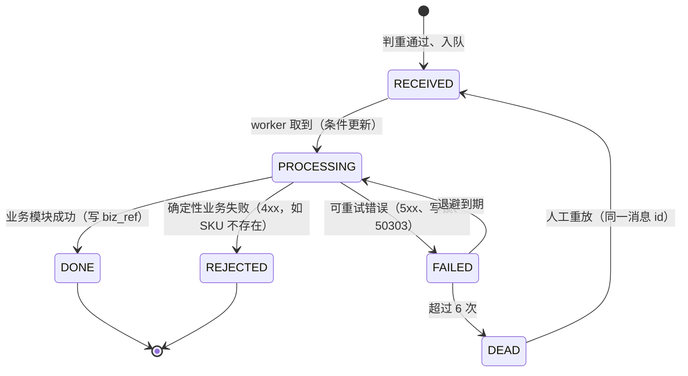
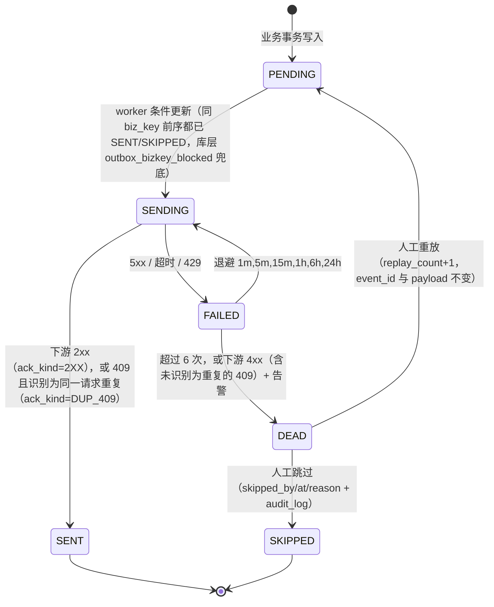
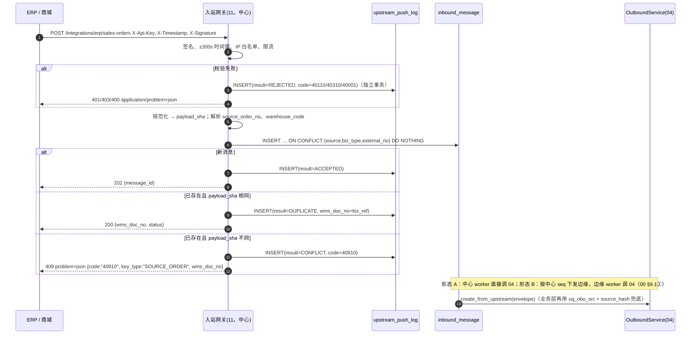
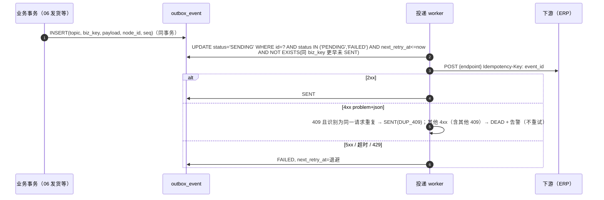
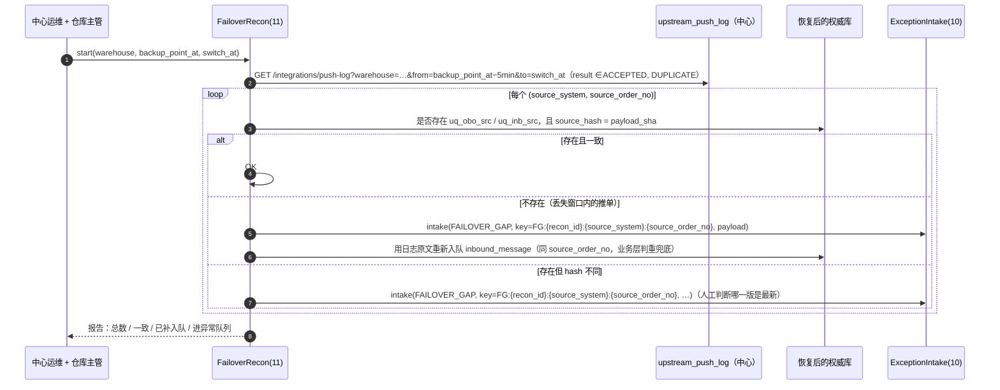

# 11 接口集成 详细设计

| 项 | 内容 |
|---|---|
| 模块编号 | 11 |
| 作者 | 小钱（后端） |
| 评审 | 小吴（测试，对抗性评审，见 §13）、非作者开发 1 名 |
| 基线 | `docs/first-design@5e44905`，《[WMS详细设计说明书](archive/WMS详细设计说明书.md)》§7 集成设计、§6.2"集成与管理"、§10.5 密钥 |
| 依赖 | 00（§6.4 错误码、§6.5 幂等、§7 集成全景、§9.1 部署形态 / 写节点 / 非计划切换 / 镜像重建 / `stale_stock_policy`）；04（上游建单 `source_hash`、40910 `SOURCE_ORDER`）；09/10/16（出站事件来源）；10（异常队列 `FAILOVER_GAP`）；12（凭证与审计）；13（接口日志、死信页面） |
| 状态 | 草稿，从 `docs/first-design` 拉出，单独 PR |

> 本篇写 WMS 与外部系统（ERP、商城、TMS、财务）之间的**入站**（推单、取消、主数据）和**出站**（事件回传、库存快照），以及支撑 00 §9.1 故障恢复的**上游入站推送日志**。业务处理本身归各模块，本篇只到"把报文可靠地交给哪个模块的哪个函数"为止。

---

## 1. 职责与边界

### 1.1 本模块负责

1. **入站网关**：`POST /api/v1/integrations/{source}/{biz_type}`，HMAC 签名、时间窗、IP 白名单、限流；报文规范化与 `source_hash`。
2. **上游入站推送日志** `upstream_push_log`（中心侧，只追加）：每一次推送（含重推、被拒）都记来源系统、来源单号、报文摘要和原文、接收时间、处理结果。保留期 ≥ 90 天（库层 `ck_upl_retain` 落地），且 ≥ 全量备份周期 + 1 天；提供按时间窗查询，供 00 §9.1 非计划切换后的单据核对。
3. **入站消息** `inbound_message`：按 `(source, biz_type, external_no)` 判重，异步交给业务模块；形态 B 仓在中心排队、联网后下发边缘（00 §9.1②）。
4. **上游重推判重**：同来源单号同内容 → 200 + 已有 WMS 单号；同号不同内容 → **409 `40910`，`key_type=SOURCE_ORDER`**（00 §6.5、04 §7.1）。
5. **出站 outbox**：业务事务内写 `outbox_event`，投递 worker 按 `biz_key` 串行、指数退避、死信、人工重放（重放沿用原事件 id）。形态 B 下边缘节点按 `(node_id, seq)` 单调排队回传中心。
6. **错误格式**：集成接口（入站响应、以及对下游返回的解析）统一 `application/problem+json`（RFC 9457），扩展字段带 WMS 业务码。
7. **库存快照 / 可售量推送**给商城与 ERP，含镜像过期时的 `stale_stock_policy`（00 §9.1）和镜像重建后的推送规则。
8. **故障恢复对账**：按时间窗比对推送日志与恢复后的权威库，对不上的进第 10 篇异常队列 `FAILOVER_GAP`。
9. **集成监控**：接口日志、死信列表、最老未发送事件年龄告警（第 13 篇 `/integration/logs`、`/integration/dead-letters`）。

### 1.2 本模块不负责

| 不做 | 归属 |
|---|---|
| 出库单建单、取消的业务规则与状态机 | 第 4 篇（本篇调用 `OutboundService.create_from_upstream`） |
| 采购入库单 | 第 3 篇 |
| 客户退货入库 | 第 10 篇（本篇调用 `ReturnInboundService.create_return_inbound`） |
| 主数据版本与下发内容 | 第 1 篇（本篇只负责通道） |
| 权威库登记、`write_epoch`、镜像重建本身 | 00 §9.1（本篇只定义集成层在其中的动作） |
| 凭证管理页面、审计 | 第 12、13 篇 |

### 1.3 与原文档的差异（评审重点）

| # | 原文档 | 本篇 | 原因 |
|---|---|---|---|
| Δ1 | 入站只落 `inbound_message`，按 `external_no` 唯一 | 增加中心侧**只追加**的 `upstream_push_log`，每次推送一行（不唯一）；判重仍在业务层 `(source_system, source_order_no)` + `source_hash` | 00 §9.1：权威库丢失窗口后要能逐单核对；`inbound_message` 在权威库里，会随故障一起丢 |
| Δ2 | 同号重推直接返回已有 | 同号**不同内容** → 40910 `SOURCE_ORDER`，不静默吞 | 小赵 04 I1 |
| Δ3 | outbox 只有全局 id | 加 `warehouse_id / node_id / seq`，`uq_outbox_seq (node_id, seq)` | 00 §9.1 边缘回传严格顺序、缺口暂停 |
| Δ4 | 错误码 `WMS-xxxxx`，自定义 JSON | 业务接口沿用 00 §6.1 响应体；**集成接口**用 `application/problem+json`，`code` 作为扩展字段 | 对接方多为第三方，problem+json 是通用约定 |
| Δ5 | 死信"重放按钮" | 重放沿用原 `event_id` 作为下游幂等键（回答第 13 篇 Q10：用原 Key） | 下游按事件 id 去重 |

---

## 2. 用例

| 编号 | 用例 | 方向 | 触发者 |
|---|---|---|---|
| UC1 | ERP/商城推销售订单 | 入站 | 上游 |
| UC2 | 上游取消订单 | 入站 | 上游 |
| UC3 | ERP 推采购单 / 客户退货 | 入站 | 上游 |
| UC4 | 主数据下发（SKU、客户） | 入站 | ERP |
| UC5 | 回传事件：入库完成、发货、签收、报损、退货收货、异常关闭 | 出站 | 业务事务 |
| UC6 | 库存快照 / 可售量 | 出站 | 定时（每分钟增量，每日全量） |
| UC7 | 死信查看与重放 | 运维 | 系统管理员 |
| UC8 | 非计划切换后的单据核对 | 运维 | 中心运维 + 仓库主管 |
| UC9 | 推送日志按时间窗查询 | 运维 / 对账 | 中心运维 |

---

## 3. 领域模型

### 3.1 入站报文

`InboundEnvelope(source_system, biz_type, source_order_no, warehouse_code, payload, payload_sha)`：

- **规范化**：JSON 键排序、去空白；数量统一为 3 位小数字符串；行按 `line_no` 排序；时间戳统一 UTC ISO-8601。`payload_sha = SHA-256(规范化报文)`，**与业务侧 `source_hash` 同一算法**（共用 `integration/canonical.py`，第 4、10 篇调用）。
- `source_order_no` 从报文里按 `biz_type` 的字段映射取出（如 `SALES_ORDER → order_no`），映射表在代码里，不由上游传头部。

### 3.2 出站事件

```json
{ "event_id": "7329981234567168", "topic": "wms.shipment.completed", "occurred_at": "2026-10-15T01:12:09Z",
  "warehouse_code": "SH01", "node_id": 3, "seq": 18822, "biz_key": "OBT-SH01-0003-20261015-000842",
  "schema_version": 1, "data": { … } }
```

- `event_id` = `outbox_event.id`（雪花 ID），下游幂等键；HTTP 头 `Idempotency-Key: {event_id}`。
- `(node_id, seq)`：形态 B 回传中心的顺序号（边缘 SQLite 单写者，业务事务内取号，连续）；形态 A 中心直连时 `node_id` 为中心节点号，`seq` 由 relay 在提交后补（§4.3），同样连续。
- **顺序承诺（小吴 C3）**：只保证**同一 `biz_key` 内**按事件产生顺序投递；**不承诺全仓全局有序**——两个不相干的单据，`id`（或业务时间）小的那条可能拿到更大的 `seq`，下游不得依赖跨 `biz_key` 的先后。
- 同一 `biz_key` 严格串行：前一条未 `SENT`/`SKIPPED` 不发后一条；前一条进了 `DEAD`，后面全部停在 `PENDING`/`FAILED`，直到它重放成功或被人工跳过（小吴 C1，§5.2）。

| topic | 来源模块 | 触发 |
|---|---|---|
| `wms.inbound.completed` | 03 | 入库完成 |
| `wms.shipment.completed` | 06 | 发货出库 |
| `wms.delivery.signed` | 16 | 有效签收 / 更正 |
| `wms.return.received` / `wms.return.completed` | 10 | 退货收货（实点）/ 质检上架完成 |
| `wms.scrap.posted` | 09 | 报损过账（`ledger=false` 表示已出库待报损） |
| `wms.exception.closed` | 10 | 异常关闭（责任方、差异） |
| `wms.lot.near_expiry` | 09 | 每日扫描 |
| `wms.stock.snapshot` / `wms.stock.sellable` | 11 | 快照 / 可售量 |
| `wms.order.command_result` | 04 | 上游命令被权威库拒绝（如已拣后取消 40930），00 §9.1③ |

### 3.3 推送日志保留期

`retain_until = received_at + max(push_log_retention_days, full_backup_cycle_days + 1)`：

- 配置 `push_log_retention_days` 默认 **90**（与长期 requestNo 去重 TTL 一致）。**库层下限**：`ck_upl_retain` 要求 `retain_until ≥ received_at + 90 天`，PG 用 `INTERVAL '90 days'`，SQLite 用 `julianday` 差值 ≥ 90（并要求两列都能被解析）。**启动自检**再兜一条：配置小于 90 或小于 `full_backup_cycle_days`（00 §9.1：每天全量，即 1）+ 1 天 → 拒绝启动。
- **清理只能由专用归档角色做**：PG 上只能经 `purge_push_log()`（SECURITY DEFINER，属主 `wms_purge_owner`，只授 `wms_cleaner` EXECUTE，与 02 `purge_expired` 同一套），触发器 `trg_upl_append_only` 只放行 `wms_purge_owner` 删除 `retain_until < now()`（UTC）的行；`wms_app` 只有 `SELECT, INSERT`；UPDATE 与 TRUNCATE 对任何角色都拦。SQLite（边缘节点，schema 存在但不写）上 UPDATE/DELETE 一律拦，清理同流水表：维护脚本导出后 DROP 触发器→删到期行→重建，全程审计。
- 清理任务**跳过**正在进行故障核对的仓（`failover_recon` 运行中）。

---

## 4. 涉及的表

### 4.1 `upstream_push_log`（新增，中心侧）

| 字段 | 说明 |
|---|---|
| id | 雪花 ID |
| source_system / biz_type / source_order_no | 来源 |
| warehouse_id | 目标仓（解析失败为 0） |
| payload_sha / payload | 规范化报文摘要（`ck_upl_sha`：64 位小写十六进制，同 D6 / `ck_obo_hash` 写法）/ 原文（签名头、个人信息脱敏后） |
| received_at | 中心接收时间（UTC） |
| result_status | `ck_upl_result`：`ACCEPTED`（新单入队）/ `DUPLICATE`（同号同内容）/ `CONFLICT`（40910）/ `REJECTED`（签名、参数、权限失败）/ `FAILED`（入队前系统错误） |
| result_code | 返回给上游的业务码（`"0"`、`"40910"` …） |
| wms_doc_no | 已生成的 WMS 单号（`DUPLICATE` 时为已有单号） |
| inbound_message_id | 关联入站消息，0 = 未入队 |
| retain_until | `ck_upl_retain`：≥ `received_at` + 90 天（两库都在库层校验） |

- **只追加（库层落地，小赵 B1）**：PG `wms_app` 只授 `SELECT, INSERT`、REVOKE `UPDATE, DELETE, TRUNCATE`；`trg_upl_append_only` 拦 UPDATE/DELETE（仅放行 `purge_push_log()` 删已过期行），`trg_upl_no_truncate` 拦 TRUNCATE；SQLite `trg_upl_no_update` / `trg_upl_no_delete`。不建唯一键（重推也要记）。
- 索引：`ix_upl_time (warehouse_id, received_at)`——按仓按时间窗查询；`ix_upl_src (source_system, source_order_no, received_at)`——按来源单号查历史。
- **部署位置**：只在中心库建（边缘节点 schema 里存在但不写）。写入**先于**业务判重，并且在独立事务里提交：即使后续入队失败，日志也在。

### 4.2 `inbound_message`（改）

- 新增 `biz_ref`（处理成功后的 WMS 单号）、`ck_in_msg_status`（`RECEIVED / PROCESSING / DONE / FAILED / DEAD / REJECTED`）。
- `uq_in_msg (source, biz_type, external_no)` 不变：同一来源单号只有一条消息；重推同内容不新建、不同内容 40910。

### 4.3 `outbox_event`（改）

- 新增 `warehouse_id`、`node_id`、`seq`、`replay_count`、`ack_kind`、`skipped_by / skipped_at / skip_reason`；`ck_outbox_status`（`PENDING / SENDING / SENT / FAILED / DEAD / SKIPPED`）、`ck_outbox_seq`。
- `uq_outbox_seq (node_id, seq) WHERE seq > 0`：同一节点 seq 唯一。
- **seq 怎么来（小吴 C3）**：
  - **形态 B（边缘 SQLite）**：业务事务内取 `numbering_segment(OUTBOX:{node_id})`，**不用号段缓存**（缓存会在崩溃时留下缺口，中心会因缺口暂停）。SQLite 单写者（`BEGIN IMMEDIATE`），取号顺序 = 提交顺序，不会出现"小 seq 后提交"。
  - **形态 A（中心 PG 直连）**：业务事务**只写 `seq = 0`，不再更新 `numbering_segment(OUTBOX:{node_id})`**，消掉"全仓写事务排队等同一行锁"的热点。提交后由 relay（每个 node 一个，`pg_advisory_xact_lock(node_id)` 互斥）按 `id` 顺序给已提交的 `seq = 0` 行补号：`UPDATE outbox_event SET seq = m.b + r.rn FROM (SELECT id, row_number() OVER (ORDER BY id) rn FROM outbox_event WHERE node_id=? AND seq=0) r, (SELECT COALESCE(MAX(seq),0) b FROM outbox_event WHERE node_id=?) m WHERE outbox_event.id = r.id`。未提交的行 relay 看不见，下一轮再补，所以 seq 连续、无缺口；代价是**`id` 小的事务若后提交，会拿到更大的 seq**（verify 有用例），只保证 `biz_key` 内有序（同一单据的事件由单据行锁串行产生，`id` 与提交顺序一致）。
  - 库层守卫 `outbox_seq_immutable`：`seq` 只能从 0 补成正数一次，之后不可改、不可清零重补（两库）。部分索引 `ix_outbox_noseq (node_id, id) WHERE seq = 0` 支撑 relay 扫描。
- **死信阻塞（小吴 C1）**：
  - `outbox_bizkey_blocked`（两库触发器）：事件进 `SENDING` 时，同 `biz_key` 中 `id` 更小的事件必须都已 `SENT` 或 `SKIPPED`，否则拒绝——worker 的条件更新漏写 `NOT EXISTS` 也发不出去。
  - `uq_outbox_dead_bizkey (biz_key) WHERE status='DEAD'`：同一 `biz_key` 同时最多一条死信（后面的事件被阻塞，不可能再进死信）。
  - 解除只有两条路：**重放**（`DEAD → PENDING`，`replay_count+1`，`event_id` 与 payload 不变）成功；或**人工跳过**（`DEAD → SKIPPED`）。`ck_outbox_skip`：`SKIPPED` 必须同时带 `skipped_by`、`skipped_at`、`skip_reason`（去空白后 ≥ 4 字符），非 `SKIPPED` 行不得带这三列；`outbox_illegal_transition`：只有 `DEAD` 能转 `SKIPPED`，`SENT`/`SKIPPED` 是终态。跳过在同一事务写 `audit_log(action='integration.outbox.skip')`。
  - 死信页对每条 DEAD 显示被它阻塞的条数：`SELECT count(*) FROM outbox_event WHERE biz_key=? AND id>? AND status IN ('PENDING','FAILED')`（走 `ix_outbox_bizkey`）。
- **SENT 的依据（小吴 C2）**：`ck_outbox_ack`：`SENT` 必须带 `ack_kind ∈ {2XX, DUP_409}`，非 `SENT` 行必须为空。识别规则见 §6.2。
- 中心镜像侧另有"已应用水位" `(node_id, applied_seq)`，归 00 §9.1 镜像，不在本 PR。

### 4.4 `offline_paper_record`（新增，Q1 定案）

离线纸质单事后补录（00 §6.6.1 `PAPER_BACKFILL`、§6.6.2 `backfill_deadline_at`），一行一张纸质单。主要字段：`warehouse_id`、`device_id`、`action_type`（`PICK_CONFIRM` / `RECEIVE_REGISTER` / `POD_SIGN`）、`biz_key`、`occurred_at`、`operator_id`（纸面上的作业人）、`payload`、`photo_ids`、`approval_type`（固定 `PAPER_BACKFILL`）、`applicant_id`、`approver_id`、`approved_at`、`status`（`PENDING / APPROVED / REJECTED / EXPIRED`）、`offline_since`、`reconnected_at`、`backfill_deadline_at`、`submitted_at`、`exception_case_id`。时间一律 UTC。

| 约束 | 规则 |
|---|---|
| `uq_paper_bizkey (warehouse_id, biz_key)` | 同一张纸质单不能补录两次 |
| `ck_paper_type` | `approval_type = 'PAPER_BACKFILL'` |
| `ck_paper_deadline` | `backfill_deadline_at = reconnected_at + 24h`（PG 用 `interval`，SQLite 用 `datetime(…, '+24 hours')`） |
| `ck_paper_window` | `offline_since < reconnected_at`，`occurred_at` 落在离线期间内，`submitted_at ≥ reconnected_at` |
| `ck_paper_expired` | 提交晚于 `backfill_deadline_at` 只能落 `EXPIRED` 且必须挂 `exception_case_id`（第 10 篇异常单）；没过期不能是 `EXPIRED` |
| `ck_paper_sod` | `approver_id ≠ applicant_id`（申请人不能自批） |
| `ck_paper_approve` | `APPROVED / REJECTED` 必须有审批人和审批时间；`PENDING / EXPIRED` 不能有 |

`wms_app` 授 `SELECT, INSERT, UPDATE`，没有 DELETE。审批人是否持有 `offline.paper.approve` 由接口层 `require_perm` 校验。

---

## 5. 状态机

### 5.1 `inbound_message`



`REJECTED` 会产生出站事件 `wms.order.command_result` 通知上游；`DEAD` 只告警。

### 5.2 `outbox_event`



- `SENDING` 超时（worker 崩溃）：超过 5 分钟的 `SENDING` 回到 `FAILED`，下次重发同一 `event_id`，下游去重。
- **作废事件**（00 §9.1 镜像重建）：被标作废的是**中心镜像里**备份点之后回传的事件，它们已在镜像侧归档，**不再向下游重发**（见 §6.5）。

---

## 6. 核心流程

### 6.1 上游推单（UC1）



- 推送日志先写：保证"上游推过什么"在中心永远可查，与权威库是否存活无关。
- 两层判重：网关 `uq_in_msg` 挡大部分重推；业务层 `uq_obo_src + source_hash` 兜住"消息被清理后重推"和"边缘恢复后重新下发"。两层结论一致（同一 `canonical.py`）。
- 改单：本期只支持取消重下（04 Q4）；取消是独立 `biz_type=SALES_ORDER_CANCEL`，按 `(source, biz_type, source_order_no)` 判重。

### 6.2 出站投递（UC5）



- 下游错误按 **problem+json** 解析：`status`、`type`、扩展 `code`。无法解析的 4xx 视为契约错误 → `DEAD` + 告警，不盲目重试。
- **409 的判定（小吴 C2）**：只有同时满足以下两条才视为"同一请求重复"并标 `SENT(ack_kind=DUP_409)`：
  1. `problem.code` 在该下游对接清单登记的 `duplicate_codes` 里（例：本系统自己的 `40910` 且 `key_type=IDEMPOTENCY_KEY`；商城 `DUPLICATE_REQUEST`；ERP 由对接时确认），**且**
  2. 响应能证明是**同一个请求**：回显的 `Idempotency-Key`（或 `detail.event_id`）等于本事件 `event_id`；下游另回显请求摘要时，摘要也要一致。
  
  其他 409（同键不同内容、状态冲突、未登记的 code、缺回显）一律 `DEAD` + 告警，不当成功，以免事件被悄悄丢掉。对接清单（每个下游一行：`duplicate_codes`、回显字段）随第 11 篇附录维护，新下游接入时必填。
- 死信重放只改状态，**不得改 payload 和 `event_id`**；需要改内容的，走补偿事件（新 `event_id`，同 `biz_key` 排在其后）（小吴 S2）。
- 最老未发送事件年龄 > 10 分钟告警（原文档必配告警）。

### 6.3 形态 B：边缘回传与写节点（引用 00 §9.1）

- 边缘节点的 outbox 先投"中心镜像"这一个下游，严格按 `(node_id, seq)`；中心发现缺口就暂停该节点的应用并请求补发，不跳号。对外部下游（ERP、商城）的投递**只由中心发起**，事件以中心镜像已应用的为准。
- 中心 → 边缘下发（新单、取消、主数据）：调用前取 `GET /api/v1/warehouses/{warehouse_code}/write-endpoint` 得到 `{endpoint, epoch}`，写请求带 `X-Write-Epoch`。返回 **`50303 STALE_WRITE_NODE`** 或 `50301` 时重新取地址，用**同一个 `inbound_message.id` 作为 `Idempotency-Key`**、同一业务键重提；幂等记录随权威库迁移（00 §9.1），新节点能识别已处理过的消息。

### 6.4 非计划切换后的单据核对（UC8，00 §9.1"单据核对"）



- 时间窗从备份点**前 5 分钟**开始（覆盖时钟误差和入队延迟），到切换完成为止。
- 补入队用日志里的原文，重新经过业务层判重；上游此后再重推同一单号，仍按来源单号判重（同内容 200，不同内容 40910），不会重复建单。
- `FAILOVER_GAP` 异常单的 `source_key` = `FG:{recon_id}:{source_system}:{source_order_no}`（`recon_id` 为本次核对批次号）。同一批次重放仍被第 10 篇 `uq_exc_src` 以 40910 去重；同一单在下一次故障里再缺失，换了批次号，不会撞键（小赵建议项，与第 10 篇 A2 `POD:{pod_id}:{correct_seq}` 同一思路，`uq_exc_src` 不变）。
- 核对完成才允许进入镜像重建（00 §9.1 N2），本篇在核对结束时写一条 `failover_recon` 完成标记（中心配置服务，归 00）。

### 6.5 镜像重建后的出站规则（00 §9.1 N2）

1. 中心把该仓镜像中**备份点之后**回传的事件标记作废（归档保留）。这些事件**不重发**：如果它们已经投递给下游，由下游按 `event_id` 保留，WMS 不发"撤销"事件；对账差异通过后面的全量快照修正。
2. 新节点号之后产生的事件按正常流程投递；`event_id`、`(node_id, seq)` 都与作废事件不重复（新节点号，00 §9.1④）。
3. **重建完成后第一时间推一次全量 `wms.stock.snapshot` 和 `wms.stock.sellable`**，内容**以重建结果为准**，`snapshot_reason = "MIRROR_REBUILD"`；下游必须用它覆盖本地库存，而不是叠加增量。重建完成前，该仓可售量按 `stale_stock_policy` 处理（§6.6）。
4. 丢失窗口内已发给下游、但恢复后的库里不存在的业务事件（例如一次发货），由单据核对进 `FAILOVER_GAP` 人工处理，通常需要上游/财务红冲。

### 6.6 可售量与 `stale_stock_policy`（UC6）

- 增量：每分钟按仓推 `wms.stock.sellable`（SKU 级 `available` 汇总，来自 `v_stock_available`，扣除禁发批次）。
- 中心镜像落后超过阈值（默认 5 分钟，00 §9.1）→ 该仓可售量标记不可信：
  - `PAUSE`：向商城推 `sellable=0, stale=true`，商城停止对该仓接单；
  - `DEGRADE`：推 `镜像值 × r`（`r` 可配置，向下取整到 milli），`stale=true`。
  - 两种都实现，默认值见下面 Q1 定案。
- 恢复同步后立即推一次全量并清 `stale`。

### 6.7 离线与 `stale_stock_policy=PAUSE` 的处理（Q1 定案，00 §9.1、§6.6.1、§6.6.2）

1. **暂停范围**：`stale_stock_policy=PAUSE` 时暂停**新分配**（商城、上游新单对该仓的占用）、**跨仓调拨**和**波次释放**。被暂停的操作返回 **503 `50304 STALE_STOCK_PAUSED`**，`detail.action ∈ paused_actions`（00 §6.4 `7dbd566`；`50301` 只表示写库不可用，`50302` 是 `ID_CLOCK_BACKWARD`，`50303` 是 `STALE_WRITE_NODE`，均不用于暂停）。客户端停止该操作、不自动重试、不重取写地址。终端从 `GET /api/v1/me` 和心跳里的 `paused`、`paused_actions` 置灰，不写死清单、不自己按 12h 计时（00 §6.6.2）。`paused_actions` 共 8 个值：`ALLOCATE` / `TRANSFER` / `WAVE_RELEASE`（PAUSE 期间即下发），`PICK_CONFIRM` / `CHECK` / `SHIP` / `RECEIVE` / `POD`（离线超过 12h、过了 `offline_deadline_at` 后由服务端加入）。
2. **可离线继续**：已经下发到终端的**拣货、收货登记、签收**可以离线继续，按各自业务键离线补传（第 4、5、14、16 篇）。**离线超过 12h**（`offline_deadline_at = offline_since + 12h`）后，终端不再接受新的离线操作；服务端对 `occurred_at > offline_deadline_at` 的离线补传一律拒绝，这部分只能走纸质单。
3. **重连后的顺序**：先**重放**（终端 outbox 按原业务键依次重提交，幂等保证不重复入账），再**对账**（02 §3.5 对账，以及 §6.3 回传水位）。冲突（命令和当前状态不符、对账差异）**进异常队列**（第 10 篇），不自动修。
4. **纸质单兜底**：`POST /api/v1/offline/paper-records`，入参 `{action_type, occurred_at, operator_id, payload, photo_ids[]}`，审批类型 `PAPER_BACKFILL`。
   - 申请权限 `offline.paper.backfill`，主管审批权限 `offline.paper.approve`；**申请人不能自批**（`ck_paper_sod`）。
   - 必须在 `backfill_deadline_at`（恢复联网时间 + 24h，服务端下发）之前提交。过期提交落 `EXPIRED`，并在同一事务里建异常单（第 10 篇），`exception_case_id` 必填（`ck_paper_expired`）。
   - 审批通过后，补录产生的库存事件走本篇现有的事件和对账链路：同事务调用 02 `post_event`，写 outbox 回传。`biz_key` 与在线事件**用同一规则**生成（例如拣货是 `{pick_task_line_id}:{pda_op_id}`），由 02 `uq_mvk_biz_line` 去重：在线已经入账的，纸质单补录撞键后按"已入账"返回，不重复记账。同一张纸质单重复补录由 `uq_paper_bizkey` 拦。

---

## 7. 接口清单与契约

### 7.1 入站（上游 → WMS，中心）

| 方法 | 路径 | biz_type | 业务处理 |
|---|---|---|---|
| POST | `/api/v1/integrations/{source}/sales-orders` | `SALES_ORDER` | 04 建单 |
| POST | `/api/v1/integrations/{source}/sales-orders/{no}/cancel` | `SALES_ORDER_CANCEL` | 04 取消（权威库裁决） |
| POST | `/api/v1/integrations/{source}/purchase-orders` | `PURCHASE_ORDER` | 03 |
| POST | `/api/v1/integrations/{source}/customer-returns` | `CUSTOMER_RETURN` | 10 RTN |
| POST | `/api/v1/integrations/{source}/master-data/{type}` | `MD_{type}` | 01（版本号高者生效） |

头部：`X-Api-Key`、`X-Timestamp`（±300s）、`X-Signature = base64(HMAC_SHA256(secret, method\npath\ntimestamp\nsha256(body)))`。不要求上游带 `Idempotency-Key`：来源单号就是幂等键。

成功：`202 {"code":"0","data":{"message_id":"…"}}`；重推同内容：`200 {"code":"0","data":{"wms_doc_no":"OBT-…","status":"ALLOCATED"}}`。

**错误（`Content-Type: application/problem+json`）**：

```json
{ "type": "https://wms.example/errors/40910", "title": "IDEMPOTENCY_CONFLICT", "status": 409,
  "detail": "同一来源单号已存在且内容不同", "instance": "/api/v1/integrations/erp/sales-orders",
  "code": "40910", "key_type": "SOURCE_ORDER", "wms_doc_no": "OBT-SH01-0003-20261015-000842",
  "trace_id": "8f2c…" }
```

| HTTP / code | 场景 | 上游应对 |
|---|---|---|
| 400 / 40001、40010 | 报文非法、数量格式 | 修正后重推（同单号） |
| 401 / 40110 | 签名或时间窗不对 | 校时、检查密钥 |
| 403 / 40310、40311 | 凭证无此 biz_type / 无该仓权限 | 联系管理员 |
| 409 / 40910 `SOURCE_ORDER` | 同号不同内容 | 走取消重下 |
| 429 | 限流 | 退避重推 |
| 503 / 50301 | 中心依赖不可用 | 退避重推（同单号） |

### 7.2 出站（WMS → 下游）

WMS 以 `POST {subscriber_endpoint}`、`Idempotency-Key: {event_id}` 推送 §3.2 信封；要求下游：2xx 表示已接收（含重复），错误用 problem+json。订阅配置 `POST /api/v1/integrations/webhook/subscriptions`（原文档 §6.2），权限 `integration.subscription.manage`。

### 7.3 运维接口（中心）

| 方法 | 路径 | 说明 | 权限点 |
|---|---|---|---|
| GET | `/api/v1/integrations/push-log?warehouse=&from=&to=&sourceSystem=&sourceOrderNo=&result=&cursor=` | **推送日志按时间窗查询**（`from/to` 必填，最大跨度 7 天，游标分页） | `integration.log.view` |
| GET | `/api/v1/integrations/push-log/{id}` | 单条原文 | `integration.log.payload`（含原文，单独授权） |
| GET | `/api/v1/integrations/inbound-messages?status=` | 入站消息 | `integration.log.view` |
| POST | `/api/v1/integrations/inbound-messages/{id}/replay` | DEAD 重放 | `integration.deadletter.replay` |
| GET | `/api/v1/integrations/outbox?status=DEAD&topic=` | 死信列表 | `integration.deadletter.view` |
| POST | `/api/v1/integrations/outbox/{id}/replay` | 死信重放（`event_id` 不变，`Idempotency-Key` 为原值） | `integration.deadletter.replay` |
| GET | `/api/v1/integrations/health` | 待发送数、失败数、最老事件年龄、各节点回传水位 | `integration.log.view` |
| POST | `/api/v1/integrations/failover-recon` | 发起故障核对（§6.4），双人确认 | `integration.failover.recon` |
| POST | `/api/v1/offline/paper-records` | 离线纸质单补录（§6.7，`PAPER_BACKFILL`），截止 `backfill_deadline_at` | 申请 `offline.paper.backfill`；审批 `offline.paper.approve`（主管，不能自批） |

运维接口也是 POST 带 `Idempotency-Key`，按 00 §6.5 缓存规则。

### 7.4 错误码

全部取自 00 §6.4，本篇不新增：40001、40010、40110、40310、40311、40910（`SOURCE_ORDER` / `IDEMPOTENCY_KEY`）、40930、50000、50301（写库不可用）、50303、50304（`STALE_STOCK_PAUSED`，§6.7）。

---

## 8. 并发与幂等

| 场景 | 防线 |
|---|---|
| 上游并发推同一单 | `uq_in_msg` `ON CONFLICT DO NOTHING`，只有一个 `ACCEPTED`，其余 `DUPLICATE`/`CONFLICT` |
| 消息清理后重推 / 切换后补入队 | 业务层 `uq_obo_src`、`uq_inb_src` + `source_hash` |
| 两个 worker 抢同一消息 / 事件 | `WHERE status IN (…)` 条件更新 |
| 同 `biz_key` 乱序 | 前序未 SENT/SKIPPED 不发（`outbox_bizkey_blocked` 库层兜底）；前序 DEAD 时后续全部暂停（C1） |
| 下游 409 被当成功吞掉 | 只认登记的重复码 + 回显同一 `event_id` → `DUP_409`；其他 409 → DEAD + 告警（`ck_outbox_ack`，C2） |
| 形态 A seq 单行热点 / 小 seq 后提交 | 业务事务只写 `seq=0`，relay 提交后补号（C3）；只承诺 `biz_key` 内有序 |
| 投递成功但未落 SENT（崩溃） | 重发同 `event_id`，下游去重 |
| 边缘 seq 缺口 | `uq_outbox_seq` + 不用号段缓存；中心发现缺口暂停该节点 |
| 写节点切换中下发 | `X-Write-Epoch`，`50303` 重取地址，原 `Idempotency-Key` 重提 |
| 推送日志写失败 | 日志独立事务先写；写失败直接 503 给上游（不接收不记录的报文，避免日志缺口） |

---

## 9. 异常与补偿

| 场景 | 处理 |
|---|---|
| 下游长时间不可用 | 退避到 DEAD；最老事件 > 10 分钟告警；恢复后人工批量重放 |
| 下游返回非 problem+json 4xx | DEAD + 告警（契约问题） |
| 死信阻塞同 `biz_key` | 死信页显示被阻塞条数；重放成功或人工跳过（审计）后自动继续 |
| 入站报文在 ±300 秒窗内被重放（小吴 S1） | `requestNo` 去重在**网关层**做（`idempotency_record`，TTL 90 天），不依赖 `inbound_message` 是否已被清理 |
| 上游推了不存在的 SKU | `REJECTED` + `wms.order.command_result`；主数据补齐后人工重放 |
| 边缘断网 | 边缘 outbox 积压；中心标注"数据截至"；超过 1 小时或 10 万条告警（00 §9.1③） |
| 非计划切换 | §6.4 核对 → 00 §9.1 镜像重建 → §6.5 全量快照 |
| 推送日志保留期配置过短 | 启动自检拒绝启动 |
| 密钥泄露 | 凭证吊销（`api_credential.status`），推送日志可按 `X-Api-Key` 回查（Q4） |

---

## 10. 权限

| 权限点 | 角色 |
|---|---|
| integration.log.view | 系统管理员、运维 |
| integration.log.payload | 运维（原文含客户地址、电话，单独授权、访问写 `audit_log`） |
| integration.deadletter.view / replay | 系统管理员（重放不改业务数据，00 §2 允许） |
| integration.subscription.manage | 系统管理员 |
| integration.failover.recon | 中心运维 + 仓库主管双人确认 |

- 入站凭证按 `source_system` 绑定允许的 `biz_type` 和仓库范围，越界 403。
- `secret` AES-GCM 加密存储，密钥来自环境变量/KMS（原文档 §10.5）。

---

## 11. 测试要点

1. **签名**：时间窗边界 ±300s；body 改一个字节；重放旧签名。
2. **判重**：同号同内容 → 200 + 同单号；字段顺序不同、空白不同 → 视为同内容；数量 `"12.5"` 与 `"12.500"` → 同内容；任一行数量变化 → 40910 `SOURCE_ORDER`；每次推送都多一行日志。
3. **outbox**：同 `biz_key` 乱序不发；同一单 3 个事件中间那个 DEAD → 第 3 个发不出去，重放成功或人工跳过（带审计）后才放行；下游 409 只有登记的重复码 + 回显同一 `event_id` 才算 SENT；worker 崩溃在 SENDING 后重发同 `event_id`；DEAD 重放 `event_id` 与 payload 不变。
4. **seq**：形态 B 边缘并发写 outbox，`(node_id, seq)` 连续无缺口、无重复，事务回滚不占号；形态 A 并发业务事务只写 `seq=0`，relay 补号后连续无重复，`id` 小而后提交的事务拿到更大的 seq。
5. **故障核对**：构造"推送日志有、恢复库无"的 3 单 → 3 张 `FAILOVER_GAP` + 重新入队、业务层不重复建单；上游再重推 → 200。
6. **镜像重建**：作废事件不出现在投递队列；重建后首个快照 `snapshot_reason=MIRROR_REBUILD`。
7. **stale_stock_policy**：PAUSE / DEGRADE 两种值下商城收到的可售量；PAUSE 下新分配、调拨、波次释放返回 50304 `STALE_STOCK_PAUSED` 且 `detail.action` 分别为 `ALLOCATE`/`TRANSFER`/`WAVE_RELEASE`；离线超 12h 后 `paused_actions` 增加 `PICK_CONFIRM`/`CHECK`/`SHIP`/`RECEIVE`/`POD` 共 8 值，对应操作同样返回 50304；离线 12h 后的离线补传被拒；纸质单补录的自批、过期、截止期计算错误、重复补录都被拒（§4.4）。
8. **写节点**：下发遇 `50303` 重取 endpoint 后用原 Key 成功，业务不重复。
9. **双库矩阵**。

### 11.1 本 PR 的验证脚本结果

| 脚本 | 环境 | 结果 |
|---|---|---|
| `verify_sqlite.py` | 本机 Linux，Python 3 + SQLite 3.46 | **188 / 188 通过**（base a93f6f3）。44 表 / 1 视图 |
| `verify.sh` | 本机 PG 16（/home/box/tools/pg16，临时实例端口 5447，新建空库） | **193 / 193 通过**（base a93f6f3）；实测 **44 表 / 124 索引 / 1 视图**；S4 权限矩阵 45 个对象逐表一致（含 `upstream_push_log:SELECT,INSERT`） |

新增断言：outbox 写入；同节点 seq 重复被 `uq_outbox_seq` 拦；不同节点同 seq 合法；outbox 非法状态；入站报文落库；同源同单号重复（`uq_in_msg`）；入站非法状态；推送日志同单号多行合法；推送日志结果取值（`ck_upl_result`）。

**合并 docs/first-design 6906310 + Q1 定案后**（PG 在 5444 新建空库）：SQLite **247 / 247**（45 表 / 48 手工索引 / 1 视图），PG **253 / 253**（**45 表 / 127 索引 / 1 视图**；S4 权限矩阵含 `offline_paper_record:SELECT,INSERT,UPDATE`）。
- **合并 02 的改动**：outbox 的 UTC 默认值、`ck_outbox_sent`、R1（变成 SENT 时 `sent_at` 必须是当前 UTC）、应用只能以 PENDING 插入。本篇用例相应调整：
  - SENT 的写入改用当前 UTC；02 的 P3/P2/R1 用例补 `ack_kind='2XX'`。
  - SQLite 的 DEAD 种子走 02 的种子路径。
  - 「C2 SENT 是终态」现在先由 02 的 SENT 终态守卫拦，期望值改为 `expiry_backdate`。
- **Q1 纸质单**：正向 3 条（窗口内提交 PENDING、主管审批通过、过期落 EXPIRED 并挂异常单）；反向 7 条：
  - 自批 → `ck_paper_sod`；
  - 截止期写成 +12h → `ck_paper_deadline`；
  - 过期仍以 PENDING 提交、过期不挂异常单 → `ck_paper_expired`；
  - 审批类型不对 → `ck_paper_type`；
  - APPROVED 不带审批人 → `ck_paper_approve`；
  - 同仓同 biz_key 重复补录 → `uq_paper_bizkey`。
  - 另有 1 条检查反向用例全部回滚、没有残留。

小吴主审整改新增（两库正反向，C3 并发两库各一套）：
- **C1 死信阻塞**：同一单 3 个事件，中间 DEAD → 第 3 个进 SENDING 被 `outbox_bizkey_blocked` 拦（验收用例）；同 biz_key 第二条 DEAD 被 `uq_outbox_dead_bizkey` 拦；跳过不带审计、原因过短、非 SKIPPED 行带审计字段被 `ck_outbox_skip` 拦；PENDING→SKIPPED、SKIPPED→PENDING 被 `outbox_illegal_transition` 拦；正向：带齐审计跳过后第 3 个放行；另一单重放成功（DEAD→PENDING→SENDING→SENT）后后续放行。
- **C2 409**：SENT 不带 `ack_kind`、`ack_kind='409'`、非 SENT 行带 `ack_kind` 被 `ck_outbox_ack` 拦；SENT→PENDING 被拦；正向：`SENT(DUP_409)`。
- **C3 relay 补号**：业务事务写 `seq=0` 放行，relay 按 id 补成 1..3、重跑幂等；已补 seq 改值或清零被 `outbox_seq_immutable` 拦；`numbering_segment` 无 `OUTBOX` 行。并发：PG 上"id 小的事务后提交"→ 拿到更大的 seq（`9401:2,9402:1`）；PG 40 个并发事务 + 5 个并发 relay → `seq` 连续 1..42、无重复、无漏补；SQLite 40 线程 + 5 个 relay → 连续 1..40。
- **推送日志清理改为函数**：与 02 `purge_expired` 同一套，`purge_push_log()` 属主 `wms_purge_owner`、只授 `wms_cleaner` EXECUTE；`wms_cleaner` 直删、`wms_app` 调函数被拒；函数只删掉 1 条已过 `retain_until` 的日志。原 `wms_archiver` 角色取消。

小赵二评整改新增（两库正反向）：
- **B1 只追加**：UPDATE、DELETE 被 `append_only_violation` 拦（两库）；PG 另测 TRUNCATE、超级用户删已过期行被拦；`wms_app` UPDATE/DELETE/TRUNCATE → permission denied；超级用户删已过期行被拦（清理只能经 `purge_push_log()`，见上）；SQLite 删已过期行也拦（边缘无角色）；绕过尝试后未到期行数不变。
- **I1 保留期下限**：等于接收时间、1 秒、7 天、90 天差 1 秒均被 `ck_upl_retain` 拦；恰好 90 天放行；SQLite 另测 ISO `T` 写法 90 天放行 / 89 天拦，以及不可解析的时间字符串被拦。
- **I2 授权**：PG `wms_app` 可 INSERT、SELECT。
- **建议 D6**：`payload_sha` 大写、长度 63、非 hex 被 `ck_upl_sha` 拦。

---

## 12. 待定问题

| # | 问题 | 建议 | 裁决人 |
|---|---|---|---|
| Q1 | `stale_stock_policy` 默认值与离线处理 | **已定**：`PAUSE` 暂停新分配、跨仓调拨、波次释放（503 `50304` `STALE_STOCK_PAUSED`，`paused_actions` 8 值见 §6.7）；已下发的拣货、收货登记、签收可离线继续，超过 12h 不再接受；重连后先重放再对账，冲突进异常队列；纸质单 `PAPER_BACKFILL` 兜底，截止 `backfill_deadline_at`。见 §6.7、§4.4 | Yuri |
| Q2 | 推送日志保留天数 | **已定（大肥鱼）**：≥ 90 天，与长期 requestNo 去重 TTL 一致，两库 CHECK 落地 | 大肥鱼 |
| Q3 | 推送日志原文是否需要加密存储 | 建议脱敏 + 单独权限，不加密（核对时要可读） | 大肥鱼 / 第 12 篇 |
| Q4 | `upstream_push_log` 是否记 `api_key` | 建议记（密钥泄露回查），加一列，本 PR 未加 | 大肥鱼 |
| Q5 | 作废事件已到达下游时是否发撤销事件 | 不发，以重建后全量快照覆盖；业务事件差异走 `FAILOVER_GAP` 人工红冲 | 大肥鱼 |
| Q6 | `outbox_event.seq` 取号热点 | **已改（小吴 C3）**：形态 A 改为 relay 提交后补号；形态 B 边缘单写者，每事务一次条件更新 | 小钱 |
| Q7 | `FAILOVER_GAP` 依赖第 10 篇 `exception_case`（#5） | 两个 PR 合并顺序：10 先合 | 大肥鱼 |
| Q8 | 与第 9、10 篇 PR 都改了验证脚本表数期望值 | 后合并的按累计值改 | 大肥鱼 |

---

## 13. 对抗评审攻击面（给小吴）

| # | 攻击面 | 打法 | 防线 | 我认为最可能出问题的地方 |
|---|---|---|---|---|
| I-A1 | **重推吞改单** | 同单号改数量重推；改行顺序重推；`"12.5"` vs `"12.500"` | `source_hash` 规范化 → 40910 | 规范化漏了某个字段（如备注、地址）导致误判冲突或漏判 |
| I-A2 | **推送日志缺口** | 日志写失败但报文已入队；清理任务在核对期间删日志 | 日志先写、独立事务；核对期间跳过清理 | 日志写成功、响应超时，上游重推 → 两行日志（预期行为） |
| I-A3 | **故障核对漏单** | 推送落在备份点前几秒但入队滞后；时钟误差 | 时间窗前推 5 分钟 | 上游推单到下发边缘之间的排队延迟超过 5 分钟 |
| I-A4 | **事件乱序 / 重复** | 同 biz_key 并发投递；SENDING 崩溃 | 串行条件 + event_id 去重 | 下游不按 `Idempotency-Key` 去重 |
| I-A5 | **作废事件重发** | 镜像重建后重放死信里的旧事件 | 作废事件归档、不进投递队列；重放接口拒绝作废事件 | 死信重放接口没检查作废标记 |
| I-A6 | **seq 缺口卡死回传** | 事务回滚、进程崩溃、号段缓存 | 不用号段缓存、seq 随事务回滚 | SQLite 长事务下 seq 行成为热点 |
| I-A7 | **脑裂写入** | 旧边缘节点恢复后继续接收中心下发 | `X-Write-Epoch` + 50303 | 中心 worker 缓存旧 endpoint 不刷新 |
| I-A8 | **签名重放 / 越权** | 旧报文 300s 内重放；用 A 仓凭证推 B 仓 | 时间窗 + 来源单号判重 + 凭证仓范围 | — |
| I-A9 | **可售量失真** | 镜像落后时商城超卖 | `stale_stock_policy` | 已定（Q1，§6.7）；纸质单补录的去重与截止期由 `uq_paper_bizkey`、`ck_paper_expired` 落库 |

评审结论请按 **阻塞 / 重要 / 建议** 标注，有分歧的写进 §12。
