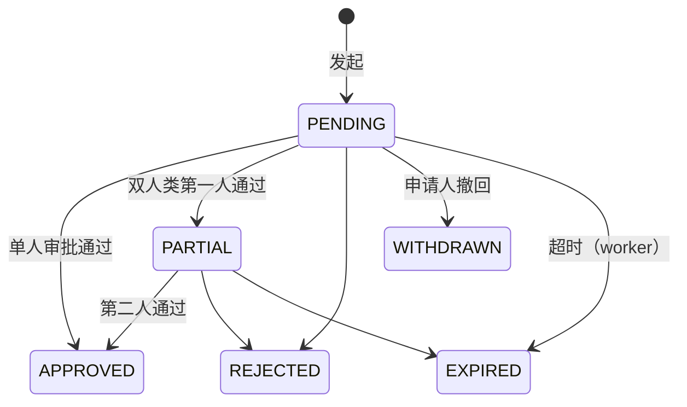

# 12 权限与审计 详细设计

> 作者：镜鉴 ｜ 正文素材取自 `fca9ae8:docs/12-权限与审计.md`（455 行，`7241e9f` 在 main 上删掉了正文），DDL 对齐 `wms-design/sql/schema/12_auth.sql` + `12b_auth_audit.sql`，基线 `origin/main@13ffef8` ＋ PR #29（第二轮时间加固）。
> 全局约定以第 0 篇为准（数量 milli、错误码表、雪花 ID、幂等、§6.4 码表、§6.6 权限模型、§6.8 时间约定、§9.1 部署形态、`X-Write-Epoch`）；本篇只写本模块特有的部分，与 DDL 冲突时以 DDL 和双库 verify 断言为准。

## 0. 与旧稿（`fca9ae8`）的差异

| # | 旧稿 | 本篇 | 原因 |
|---|---|---|---|
| **Δ1** | §3.3：`POST /auth/offline-token` 返回 `exp`（**ISO 8601，带时区**）和 `ttl_seconds` | **`exp` 为 `YYYY-MM-DD HH:MM:SS`（UTC 整秒）**，`ttl_seconds` 保留 | 违反 00 §6.8「客户端/接口时间一律整秒 UTC」；带 `T`/时区后缀在 SQLite 侧撞 `40003 CLIENT_TIME_INVALID`。界面在 13 篇 §6.4 表 4 挖出、Chief 实测确认为阻塞项 |
| Δ2 | §5.2 列 9 种审批类型 | **12 种**，补 `PROCESS_REWORK`、`INBOUND_CORRECTION`、`INBOUND_SOD_WAIVER` | 对齐 `ck_apr_type` 现网取值（12 个） |
| Δ3 | §5.3 称「`ck_apr_code` 两库同一条 CHECK，不用 PG 的 `~` / SQLite 的 GLOB」 | **两库两套**：PG `ck_apr_code` 用 `~ '^APR-…$'`；SQLite 用 GLOB + 总长 22–36 | 旧稿描述与 DDL 恰好相反，按 DDL 更正 |
| Δ4 | §8 无权限映射函数 | **补 §8.2 六个 SECURITY DEFINER 函数**与会话变量契约（`wms.actor_id` / `wms.actor_perm_version` / `wms.node_id`）、`uq_audit_rbac_once` 审计单次消费 | DDL 已实现，正文缺失 |
| Δ5 | §7 数据模型缺 `device_reconnect` | 补（11 篇纸单补录的服务端证据） | DDL 已有 |
| Δ6 | 无时间加固专节 | **补 §3.5 / §5.5**（两轮 `*_zclock` 覆盖 + 整秒 CHECK） | 自查 B2/B3 一轮 + 镜鉴实测缺口二轮（PR #29） |
| Δ7 | 权限点 `delivery.pod.tolerance.manage` | **`pod.tolerance.manage`** | 13 / 15 两篇统一用后者；本篇改回并作为唯一定名 |
| Δ8 | §4.2 用 ⚠ 标注未合分支 | 保留 ⚠，新增 §4.4「13/14/15 篇回核清单」 | 三篇前端对抗评审（PR #22/#23/#24）的结论 |
| Δ9 | §5.3「过期后不能再审：服务层条件更新 + 库层 `approval_expired` 兜底」 | 明确：**PG 由 `trg_apr_final` 第 22 行兜底，SQLite 由 `trg_apr_expired` 兜底**，且 `expires_at` 两库均 NOT NULL | 旧稿只提了 SQLite 侧的触发器名，PG 侧落在业务守卫里 |

## 1. 职责与边界

### 1.1 负责
- 账号、角色、权限点、数据权限（按仓隔离，`40311`）。
- 角色与权限点矩阵：**汇总**各篇已定义的权限点；各篇新增权限点必须回填到本篇 §4，否则不合入。
- 职责分离（SoD）规则与系统冻结豁免。
- 主管审批 `approval_request`：12 种类型（§5.2），含双人确认的非计划切换。
- 审计日志：只追加、保留期、边缘节点回传、审计单次消费。
- 设备与账号认证：PDA / 司机端 `device_instance_id` 绑定、离线令牌、写入 epoch。
- 时间加固：本篇自有表的时间列一律由库写（§3.5、§5.5）。

### 1.2 不负责
- 设备台账、节点号登记 → 第 1 篇（`device`、`node_registry`）。
- 报损金额分级审批、盘点差异审批 → 第 9、8 篇（复用本篇 `require_perm` 与审计，不走 `approval_request`，Q4）。
- 对接系统的 API 签名 → 第 11 篇（`api_credential` 沿用）。
- `delivery_order` / `pod_*` 的表结构 → 第 16 篇；本篇只定 `POD_CORRECT` 的事务边界。

## 2. 用例

| # | 用例 | 角色 |
|---|---|---|
| AU1 | 账号密码登录（后台）/ 账号 + 设备绑定登录（PDA、司机端） | 全部 |
| AU2 | 设备实例绑定、解绑、挂失 | 仓库主管 |
| AU3 | 签发离线令牌，断网时在边缘节点本地校验 | 系统 |
| AU4 | 配置角色、授权、分配仓 | 系统管理员 |
| AU5 | 发起审批 → 主管审批 → 原命令执行 | 申请人 / 主管 |
| AU6 | 非计划切换三人确认 | 发起人 + 仓库主管 + 中心运维 |
| AU7 | 审计查询、导出 | 审计员 / 仓库主管（本仓） |
| AU8 | 边缘审计回传中心 | 系统 |
| AU9 | 权限映射变更（授/撤角色、权限点、仓） | 系统管理员 / 中心运维 |

## 3. 认证

### 3.1 后台与接口令牌
- 登录换取访问令牌（JWT，15 分钟）+ 刷新令牌（8 小时，作业班次）。载荷 `{sub, wh: [...], perm_version, client_type, device_instance_id?, node_id}`。
- **`perm_version`**（`sys_user.perm_version`，两库触发器 `trg_user_perm_ver` 保证只升不降）：用户的角色、权限、仓分配任何变化都在同一事务里 `+1`；`status` / `deleted_at` 变化同样 `+1`（`trg_user_status_bump`）。请求载荷里的版本低于库中当前值 → `401 40110`，`reason=PERM_VERSION_CHANGED`。保证「撤权立刻生效」不依赖令牌过期。
- **`40110` 必带 `detail.reason`**：

| reason | 含义 | 前端处理 |
|---|---|---|
| `TOKEN_EXPIRED` | 访问令牌过期 | 用刷新令牌静默刷新；刷新也失败才回登录页 |
| `PERM_VERSION_CHANGED` | 权限已变 | 刷新令牌后**重新拉 `GET /me`** 重建菜单/按钮，不必重登 |
| `DEVICE_UNBOUND` | 该实例的绑定已被吊销（换人、挂失、主管解绑） | 清本地令牌，回登录页；**outbox 不清** |

缺失或未知 `reason` 一律按重登处理（同 `40910 key_type` 规则）。
- 无权限点 `403 40310`；仓不在数据权限内或与资源不符 `403 40311`（00 §6.6）。
- 后台账号只停用不物删：`sys_user` 禁 DELETE / TRUNCATE（属主也拒，`append_only_violation: sys_user`），登录名 `username` 唯一且不可改、停用后不复用。

### 3.2 PDA / 司机端设备绑定

- `device_instance_id`：App 首次安装生成的 UUID，存设备安全存储，**重装即变**。它同时是 PDA 四元组、司机端业务键的组成部分（00 §6.5），所以必须可信：**服务端以令牌里的值 为准，忽略请求体中的同名字段**。
- **首次绑定 = 在线审批**：
  1. 设备登录（`POST /auth/device-login`）时该实例没有未吊销绑定 → 服务端同事务建 `user_device_binding(status=PENDING)` + `approval_request(type=DEVICE_BIND, target_type='DEVICE_BINDING', target_id=绑定 id)`，返回 `401 40111`，`detail {reason: BINDING_PENDING, approval_id, binding_id}`；端上展示「等待主管确认」引导页并轮询 `GET /approvals/{id}`（未登录也可凭 `binding_id + device_instance_id` 查本条，只返回状态）。
  2. 主管在管理后台（`GET /devices/bindings?status=PENDING`）通过：同一事务把 `approval_request → APPROVED`，并
     `UPDATE user_device_binding SET status='ACTIVE', approval_id=?, activated_at=<库写> WHERE id=? AND status='PENDING'`（0 行 → `40935`）。驳回则绑定 `REVOKED`。
     **`activated_at` 不由客户端传**：`trg_udb_zclock` 在 PENDING→ACTIVE 时由库写入。
  3. 之后再登录即通过。PENDING 未确认时登录一律 `40111 BINDING_PENDING`；重复登录不再新建（`uq_udb_active` 覆盖 PENDING + ACTIVE）。
- **库层（两库）**：INSERT 只能是 PENDING 且不带 `approval_id`（`binding_insert_not_pending`）；PENDING→ACTIVE 必须引用**本绑定**的已通过 `DEVICE_BIND` 审批且**审批人 ≠ 绑定使用人**（`binding_approval_invalid`）；REVOKED 是终态、ACTIVE 不能退回 PENDING；`device_instance_id` / `user_id` / `warehouse_id` / `client_type` / `device_id` / `bound_at` 与已写入的 `approval_id` 不可改（`binding_immutable`）；`trg_0_key_lock('id','device_instance_id')` 兜主键键列；SQLite 防 REPLACE（`user_device_binding_duplicate`）；两库禁 DELETE，PG 另禁 TRUNCATE。
- `40111 detail.reason ∈ {BINDING_PENDING, NOT_BOUND（审批被驳回/过期，需重新申请）, WAREHOUSE_MISMATCH}`；绑定的 `warehouse_id` 不在用户仓权限内 → `40311`。
- 同一实例换人登录：旧绑定 REVOKED、新绑定重新审批；前端要求上一账号 outbox 已清空或已交主管。
- 第 1 篇 `device.status = LOST` → 该设备所有绑定立即 REVOKED、所有离线令牌吊销；之后的在线请求返回 `40110 DEVICE_UNBOUND`。
- **司机登录方式**：`device-login` 支持 `login_type ∈ {PASSWORD, SMS}`，SMS 为手机号 + 验证码（`POST /auth/sms-code`，5 分钟有效、60 秒限频）。微信授权只用于商城端门店账号（第 15 篇），司机端不用（Q8）。两种方式走同一套设备绑定。

### 3.3 离线令牌（形态 B 断网 + 终端短时离线）

- 在线登录时额外签发离线令牌（签名 Ed25519，中心私钥；公钥随主数据下发到边缘节点）。载荷 `{jti, uid, device_instance_id, wh, perm_version, perms_hash, iat, exp}`。
- 使用场景：①边缘节点与中心断网时，边缘本地验签放行；②终端与边缘/中心短时失联时本地操作入队，联网后按业务键补传。
- **有效期默认 12 小时**（覆盖一个班次，Q2），库层上限同为 12 小时：`ck_offline_max_ttl`（`expires_at <= issued_at + interval '12 hours'`，SQLite 侧按整数秒 `<= 43200`）。
- **`POST /auth/offline-token` 响应**：

```json
{ "token": "eyJ…", "exp": "2026-10-16 02:31:00", "ttl_seconds": 43200 }
```

  `exp` 为 `YYYY-MM-DD HH:MM:SS`（**UTC 整秒**，Δ1）；`issued_at` / `expires_at` 由库写（`trg_offline_zclock`），端上据此在剩余 1 小时时提醒。端上**不得**用设备本地时区换算 `exp`，也不得把 `exp` 当成带时区的 ISO 串解析。
- 吊销只能写一次：`revoked_at` 写入后不可清空、令牌其余列不可改（`trg_offline_guard` → `offline_token_immutable`；`trg_0_key_lock('id','jti')`；SQLite 另有防 REPLACE `offline_token_duplicate`；`revoked_at` 由库写）。已吊销的令牌不可恢复。
- 吊销传播：中心吊销后随主数据（`USER_PERM`，第 1 篇 §6）下发到边缘；**断网期间吊销无法到达**，风险由有效期兜底，并在审计里标 `offline=true`（对抗面 B4）。
- 校验失败（过期、吊销、`perm_version` 落后、实例不符）→ `401 40112 OFFLINE_TOKEN_INVALID`，`detail.reason ∈ {EXPIRED, REVOKED, PERM_STALE, DEVICE_MISMATCH}`。
- 断网期间不能做的事：所有需要审批的操作（§5）、绑定新设备、改权限。返回 `503 50301`。
- **令牌过期后端上仍可记 outbox**：本地作业不因令牌过期而停（00 §9.1 ②），条目照常入队、照常显示「待上传」；联网后先重新登录（必要时重新绑定），再按原业务键补传。服务端以补传时的在线令牌鉴权，审计同时记录操作时间与上传时间，并标 `offline=true`。补传时权限已被撤销 → 该条 `403 40310`，端上标红交主管，不自动重试。
- 离线令牌本身**不参与** `paused_actions` 判断（那由 `/me` 与心跳下发，00 §6.6.2）。

### 3.4 写入的 epoch

所有写接口还要过 00 §9.1 的 `X-Write-Epoch` 栅栏（`50303`），在权限校验**之后**、业务校验之前执行；认证失败的请求不消耗任何幂等记录。

### 3.5 时间加固（库层强制，00 §6.8）

本篇自有表的每一个时间列都由库写，客户端传什么都被忽略或拒绝：

| 表 | 列 | PG（非属主 wms_app） | SQLite（应用连接） |
|---|---|---|---|
| `approval_request` | `created_at` | INSERT 由 `trg_apr_zclock` 覆盖为 `date_trunc('second', now() AT TIME ZONE 'UTC')` | `trg_apr_clock_ins`：与 now 相差 > 300 s 即 ABORT（`approval_request_clock_skew`） |
| | `first_approved_at` / `second_approved_at` / `decided_at` | UPDATE 时按「审批人首次写入 / 进入终态」覆盖 | `trg_apr_clock_upd` 同样按 300 s 窗校验 |
| | `expires_at` | INSERT 时若为 NULL 由库按类型上限补算；`ck_apr_ttl` 兜上限；UPDATE 不可改（`trg_apr_final`） | `trg_apr_ttl_fill` AFTER INSERT 补算；`trg_apr_expires_null` 拒 NULL |
| `user_device_binding` | `bound_at` / `activated_at` / `revoked_at` | `trg_udb_zclock` 按状态迁移覆盖；已写入的 `activated_at` 不可改（`user_device_binding_time_immutable`） | `trg_udb_clock_ins/_upd` + `trg_udb_time_lock` |
| `offline_token` | `issued_at` / `revoked_at` | `trg_offline_zclock` 覆盖 | `trg_offline_clock_ins` / `trg_offline_clock_upd` |
| `device_reconnect` | `occurred_at` | `trg_drc_guard` 覆盖 | `trg_drc_clock` |
| `sys_user` | `created_at` / `last_login_at` / `deleted_at` | `trg_user_zclock`：INSERT 覆盖 `created_at`；`last_login_at` 变化时覆盖；`deleted_at` 变化时覆盖；`created_at` 不可改（`sys_user_created_at_immutable`）、`deleted_at` 不可清空（`sys_user_deleted_at_immutable`） | `trg_user_clock_ins` / `trg_user_created_immutable` / `trg_user_clock_upd` / `trg_user_deleted_immutable` |
| `api_credential` | `last_used_at` | `trg_api_zclock` 覆盖 | `trg_api_clock_upd` |

配套规则：
- **INSERT 时 `last_login_at` / `deleted_at` / `last_used_at` 必须为 NULL**（新用户没登录过、不是停用态、凭证没用过），两库一致（`sys_user_insert_time_set` / `api_credential_insert_time_set`）。
- **整秒格式校验**：`ck_user_ts`、`ck_api_ts`、`ck_apr_ts`、`ck_udb_ts`、`ck_offline_ts`、`ck_drc_ts` 两库各一份（PG 用 `= date_trunc('second', …)`，SQLite 用 GLOB + `datetime(x) IS x` + 小时 ≤ 23）。
- **表属主（迁移/种子角色）豁免「库覆盖」**，但仍受整秒 CHECK 约束；属主可倒填 `created_at` 是**有意设计**，不是漏洞。应用角色一律走非属主路径。
- 新增错误名按 00 §6.8 口径映射：`*_clock_skew` → `40003`，`*_immutable` → `40004`，`*_insert_time_set` → `40001`。

## 4. 角色与权限点矩阵

### 4.1 内置角色

| 代码 | 角色 | 数据范围 |
|---|---|---|
| `SYS_ADMIN` | 系统管理员 | ALL；**只管账号权限，不能做业务操作**（00 §6.6） |
| `CENTER_OPS` | 中心运维 | ALL；节点号、非计划切换第二确认人 |
| `MD_ADMIN` | 主数据管理员 | ALL（全局主数据） |
| `WH_SUPERVISOR` | 仓库主管 | WAREHOUSE |
| `QC_SUPERVISOR` | 质检主管 | WAREHOUSE；报损误报回转审批 |
| `WH_KEEPER` | 库管 / 仓管 | WAREHOUSE |
| `PICKER` | 拣货员 | WAREHOUSE |
| `CHECKER` | 复核员 | WAREHOUSE |
| `DISPATCHER` | 调度 | WAREHOUSE |
| `DRIVER` | 司机 | SELF（只看自己的运单） |
| `CS` | 客服 | WAREHOUSE |
| `FINANCE` | 财务 | ALL（只读 + 对账） |
| `AUDITOR` | 审计员 | ALL（只读审计） |
| `MALL_CUSTOMER` | 商城客户（门店账号） | SELF（自己门店） |

### 4.2 矩阵（● 默认授予；⚠ 该篇尚未合 main，合入时回填）

| 权限点 | 来源 | 主管 | 库管 | 拣货 | 复核 | 调度 | 司机 | 客服 | 财务 | 备注 |
|---|---|---|---|---|---|---|---|---|---|---|
| `inventory.stock.view` / `.movement.view` / `.reservation.view` / `.hold.view` | 02 | ● | ● | | | | | ● | ● | |
| `inventory.move.execute` | 02 | ● | ● | | | | | | | |
| `inventory.hold.freeze` / `inventory.hold.unfreeze` | 02 | ● | | | | | | | | SoD-2 |
| `inventory.recon.view` / `.handle` | 02 | ● | | | | | | | ● | |
| `inventory.adjust.approve` | 08 ⚠ | ● | | | | | | | | |
| `inventory.expiry.view` / `.scan` | 09 ⚠ | ● | ● | | | | | | | |
| `dashboard.view` | 12 | ● | | | | ● | | ● | ● | 驾驶舱 |
| `report.inventory.view` / `.outbound.view` / `.inbound.view` / `.loss.view` | 12 | ● | ●(inv/inb) | | | ●(out) | | ●(out) | ● | 按仓隔离 |
| `outbound.order.view` / `.create` / `.allocate` / `.cancel` | 04 | ● | ● | | | | | ● | | |
| `outbound.order.cancel_after_pick` / `.approve` | 04 / 12 | ● | | | | | | | | 申请 / 审批（§5.2） |
| `outbound.allocation.override` | 04 | ● | | | | | | | | 写 `allocation_override` |
| `picking.return_record.view` / `.resolve` | 04 | ● | | | | | | | | SoD-3 |
| `picking.task.*`、`picking.wave.*` | 05 ⚠ | ● | | ● | | ● | | | | |
| `picking.wave.capacity.view` / `.edit` | 05 ⚠ / 12 | ● | | | | ●(view) | | | | 定名带 `picking.` 前缀（Chief 已裁决） |
| `outbound.check.execute` / `.cancel` | 06 ⚠ | ●(cancel) | | | ● | | | | | SoD-1 |
| `outbound.pack.execute` / `.unseal`、`outbound.stage.execute` | 06 ⚠ | ●(unseal) | | | ● | | | | | |
| `pack.box.void.request` / `.approve` | 00 / 06 ⚠ | ● | | | ●(request) | | | | | 申请人不能自批（`BOX_VOID_SELF_APPROVE`） |
| `offline.paper.backfill` / `.approve` | 00 / 11 | ● | ●(backfill) | | | | | | | 申请人 ≠ 审批人 |
| `inbound.order.view`、`inbound.putaway.view` / `.execute`、`inbound.receive` | 03 | ● | ● | | | | | | | |
| `inbound.return.blind` | 10 ⚠ | ● | ● | | | | | | | 门店退货盲收（13/14 篇依赖，本节登记） |
| `count.order.view` | 08 ⚠ | ● | ● | | | | | | | |
| `scrap.order.view` / `.create` / `.approve` | 09 ⚠ | ● | ●(create) | | | | | | | SoD-4；**13 篇 §6.3-5 的 `scrap.view` 即本权限点** |
| `scrap.misreport.request` / `.approve` | 09 ⚠ / 12 | ●(req) | | | | | | | | 审批口径见 §5.2 注 |
| `returns.inbound.view` / `.create` / `.receive` / `.qc` / `.cancel` | 10 ⚠ | ● | ● | | | | | ● | | |
| `returns.reservation.create` / `.view` / `.receive` | 10 / 14 / 15 | ●(receive) | ●(receive) | | | | | ●(view) | | **复数**（Chief 已裁决）；**契约位置已落**：10 §7.2/§7.3（PR #40 已合 main），⚠ 已摘 |
| `exception.view` / `.create` / `.handle`、`exception.link`、`exception.deadline.extend` | 10 | ● | ●(view/create) | | | | | ● | | **命名收口**：统一两段式，全库以本行为准（`exception.view`，**不再有 `exception.case.view`**，PR #41 已合 main）；**契约位置已落**：10 §7.3（PR #40 已合 main），⚠ 已摘 |
| `integration.log.view` / `.log.payload`、`.deadletter.view` / `.replay`、`.subscription.manage`、`.failover.recon` | 11 | ●(view) | | | | | | | | 中心运维 |
| `master.*.view` / `master.*.edit` | 01 | ● | view | view | view | view | | view | view | 主数据管理员 edit |
| `master.delete.request` / `.cancel` | 01 ⚠ | | | | | | | | | 软删两段式（`40936`） |
| `system.user.view` / `.edit`、`system.role.view` / `.edit` | 12 | ●(主管看本仓) | | | | | | | | 系统管理员 |
| `system.dict.view` | 12 | ● | | | | | | | | 13 篇 §6.3-10 依赖 |
| `system.audit.view` / `.audit.export` | 12 | ●(本仓) | | | | | | | | 审计员导出 |
| `system.approval.view` | 12 | ● | | | | | | | | 审批中心全量查看 |
| `system.failover.confirm` | 12 / 11 | ● | | | | | | | | 非计划切换确认（§8.2 登记在 11 篇） |
| `system.node.manage` | 01 | | | | | | | | | 中心运维 |
| `device.binding.view` / `.approve` / `.revoke` | 12 | ● | | | | | | | | 绑定列表 / 确认 / 解绑挂失 |
| `delivery.waybill.view_own`、`delivery.pod.submit`、`delivery.load.scan`、`delivery.container.handover` | 16 ⚠ | | | | | | ● | | | |
| `delivery.load.release_short`、`delivery.outbox.takeover` | 16 ⚠ | ● | | | | ● | | | | |
| `delivery.pod.correct.request` / `.approve` | 16 ⚠ | ●(approve) | | | | | ●(request) | | | §5.2 |
| `delivery.waybill.reassign` | 16 ⚠ | ● | | | | ● | | | | |
| `pod.tolerance.manage` | 16 ⚠ | ● | | | | | | | | 签收更正容差（Δ7：不用 `delivery.` 前缀） |
| `mall.goods.view`、`mall.order.create` / `.view_own`、`mall.return.view_own`、`mall.statement.view_own` | 15 ⚠ | | | | | | | | | 商城客户；退货走 `returns.reservation.create` |
| `process.bom.view` / `.manage`、`process.order.view` / `.create` / `.release` / `.issue` / `.report` / `.reverse` / `.cancel`、`process.yield.approve`、`process.trace.view` | 17 ⚠ | ● | ●(view) | | | ●(plan) | | | ●(trace) | 计划员 → 调度，加工员 → 库管，组长 → 主管 |
| `live.tank.view` / `.edit`、`live.param.edit`、`live.inspect.submit`、`live.weigh.submit`、`live.death.report` / `.approve` | 18 | ● | ● | ● | | ●(view) | | | | §10 已合 main（7 个） |

规则：
- 权限点在代码里是枚举（00 §6.6），启动时与 `sys_permission` 对齐；**表里有、代码里没有的权限点视为不存在**（防手工插表提权）。
- 新篇新增权限点必须在本表登记后才能合入（CI 检查各篇 §权限表 ⊆ 本表）。
- `SYS_ADMIN` 不授予任何业务权限点；同一账号不能同时持有 `SYS_ADMIN` 与业务角色（授权时校验，`40312`）。
- 矩阵标 ⚠ 的权限点来自尚未合 main 的分支，合入时由该篇作者回填，`12b_auth_audit.sql` 的 `sys_permission` 种子与代码枚举同步。

### 4.3 按仓隔离

- `sys_user_warehouse` 决定用户可访问的仓；`data_scope=ALL` 的角色不受限。
- 每个请求：`X-Warehouse-Id` ∈ 用户仓集合，且等于**服务端按资源查出的** `warehouse_id`，否则 `403 40311`。请求体里的 `warehouse_id` 一律忽略。
- 数据层：仓库 ORM 会话全局注入 `warehouse_id = :ctx` 过滤；跨仓报表只走中心镜像的只读接口。
- 形态 B 边缘节点只持有本仓用户的权限副本（第 1 篇 `USER_PERM` 下发，按 `sys_user_warehouse` 过滤）。**下发一律「先 UPDATE，0 行再 INSERT」，禁止 REPLACE / UPSERT**：SQLite 上 `sys_user` 有防 REPLACE 触发器（`sys_user_duplicate`），否则 REPLACE 会把 `perm_version` 打回 1，让旧离线令牌重新通过校验；`perm_version` 只升不降。

### 4.4 13 / 14 / 15 篇回核清单（三篇前端对抗评审结论）

| 项 | 归口 | 状态 |
|---|---|---|
| `exp` 整秒 UTC（14 篇 §9.7） | 本篇 Δ1 | 本文已定 |
| `/me` 补 `paused` / `paused_actions[]` / `offline_deadline_at` / `backfill_deadline_at`（13 篇 §6.4 S10、14 篇 §9.7 Q1） | 本篇 §8 | 本文已定 |
| `inbound.return.blind`、`inventory.expiry.view`、`scrap.order.view`、`exception.*`、`dashboard.view`、`report.*.view`、`system.dict.view`、`master.delete.request/.cancel`、`system.failover.confirm`、`device.binding.*`、`pod.tolerance.manage`、`mall.*`、`delivery.*` | 本篇 §4.2 | 本文已登记 |
| `system.failover.confirm` 的接口侧由 11 篇 §7 承载（`POST /api/v1/failover/{warehouse_code}/confirm`） | 11 篇（增量） | 待 11 篇增量 PR |
| `SCRAP_MISREPORT` 审批口径：权限点 vs 角色 | 本篇 §5.2 注 | 本文已定：**收敛为权限点口径**（Chief 裁决），DDL 同步改造（`ck_apr_scrap_roles` 退化为格式兜底） |

## 5. SoD 与主管审批

### 5.1 职责分离规则

| # | 规则 | 落点 | 豁免 |
|---|---|---|---|
| SoD-1 | 拣货人 ≠ 复核人 | 库层 `ck_obo_sod` + 应用层 `outbound.check.execute` | — |
| SoD-2 | 解冻人 ≠ 冻结人 | 应用层（02 §冻结） | **所有系统冻结**（`operator_id = 0`：`RETURN_PENDING`、`SCRAP_PENDING`、`RETURN_QC`、`PROCESSING`、`LIVE_HOLD`）不适用——它们本来就不能手工解冻（`40933`），只由各自流程释放 |
| SoD-3 | 待回库 resolve 人 ≠ 原拣货人 | 应用层（04 §10） | — |
| SoD-4 | 报损审批人 ≠ 报损申请人 | 第 9 篇 | — |
| SoD-5 | 审批人 ≠ 申请人；双人确认的两人互不相同且都 ≠ 申请人（`SoD-5`） | 库层 `ck_apr_sod`、`ck_apr_dual` | — |
| SoD-6 | `SYS_ADMIN` 不能做业务操作，也不能给自己授权 | 应用层 + `rbac_self_change` | — |

违反 → `403 40312 SOD_VIOLATION`，**只用 `detail.reason`**（取值 `CHECK_SOD`、`SoD-2`…`SoD-5`、`BOX_VOID_SELF_APPROVE`，以 00 §6.4 为准；不再使用 `detail.rule`）。

### 5.2 审批类型与权限（`ck_apr_type` 全 12 种）

| 类型 | 申请（权限点） | 审批（权限点 / 角色） | 执行（与审批通过同一事务） |
|---|---|---|---|
| `POD_CORRECT` | 司机 `delivery.pod.correct.request`，在线发起，带被更正的 `corrected_pod_id` | 主管 `delivery.pod.correct.approve`，1 人 | 见下 §5.2.1 |
| `CANCEL_AFTER_PICK` | `outbound.order.cancel_after_pick` | 仓库主管或中心运维 `outbound.order.cancel_after_pick.approve`，1 人 | 04 拣货后取消 |
| `UNPLANNED_FAILOVER` | 发起人（`system.failover.confirm`） | **第一确认人 `WH_SUPERVISOR`、第二确认人 `CENTER_OPS`（库层查 `sys_user_role` 核对真持有，不看权限点）** | 两人确认后 epoch +1 与新节点号分配 |
| `DEVICE_BIND` | 设备首次登录自动发起（§3.2） | 主管 `device.binding.approve`，1 人；**审批人 ≠ 使用人** | 绑定 PENDING → ACTIVE |
| `SCRAP_MISREPORT` | 仓库主管 `scrap.misreport.request`（09 篇报损单被判误报）；库层 `trg_apr_insert` 核对发起人**经 `sys_role_perm` 真持有本仓 `scrap.misreport.request`** | `scrap.misreport.approve`，1 人；**库层 `trg_apr_final` 核对审批人经 `sys_role_perm` 真持有该权限点**（`CENTER_OPS` 数据范围 ALL，免仓校验） | 09 篇同事务 `convert_hold`（`SCRAP_PENDING → RETURN_QC`）+ 新建质检单 + 作废原报损单；任一步失败整体回滚、审批置 `REJECTED`（`40935`） |
| `PAPER_BACKFILL` | `offline.paper.backfill`（`POST /offline/paper-records`） | `offline.paper.approve`，1 人；申请人 ≠ 审批人 | 11 篇补录入账 |
| `BOX_VOID` | `pack.box.void.request`（`POST /pack/boxes/{box_id}/void-request`） | `pack.box.void.approve`，1 人；不能自批 | 06 篇作废箱（不入审批中心列表，在箱详情审批） |
| `PROCESS_YIELD_DEVIATION` | `process.order.report` | `process.yield.approve`，1 人；不能自批 | 17 篇得率偏离放行；最长 12 h |
| `PROCESS_REWORK` | `process.order.reverse` | `process.rework.approve`，1 人；不能自批 | 17 篇产出返工 |
| `INBOUND_CORRECTION` | 第 3 篇 | `inbound.receipt.adjust.approve` | 第 3 篇收货更正 |
| `INBOUND_SOD_WAIVER` | 第 3 篇 | `inbound.sod.waive` | 第 3 篇收货 / 上架同一人的豁免 |
| `LIVE_DEATH_OVER` | `live.death.report`（18 篇，`40938`） | `live.death.approve`，1 人；不能自批 | 18 篇活鲜死亡 / 失重超阈值 |

**注（`SCRAP_MISREPORT` 口径，13 篇评审重要项 I-1 → Chief 裁决）**：**以权限点为准**。发起校验走 `scrap.misreport.request`、审批校验走 `scrap.misreport.approve`，两者都在库层经 `sys_role_perm ⋈ sys_permission` 核对真持有（`CENTER_OPS` 数据范围 ALL，免 `sys_user_warehouse` 校验）；`ck_apr_scrap_roles` 退化为格式兜底（只要求 `first_approver_role` 非空），不再限定 `QC_SUPERVISOR` / `CENTER_OPS`。理由：00 §6.6 是三层校验（权限点 + 数据权限 + 强制边界），13 篇前端也按权限点渲染按钮，只走角色会让「前端渲染 vs 后端拒绝」永远对不上。13 篇 §8.7 的写法保留。

**非计划切换三人**（00 §9.1）：发起人 + 仓库主管 + 中心运维。角色在库层核对：第一确认人必须真持有 `WH_SUPERVISOR` 且在该仓 `sys_user_warehouse` 里，第二确认人必须真持有 `CENTER_OPS`；只写角色字符串不够（`approval_role_not_held`）。库层另有 `ck_apr_sod`（第一确认人 ≠ 发起人）、`ck_apr_dual`（第二确认人 ≠ 发起人、≠ 第一确认人）、`ck_apr_failover_roles`（两位确认人角色固定）、`ck_apr_done`（APPROVED 必须两人齐全）。该仓只有一位主管时，由中心运维以外的另一中心人员或上级仓主管发起（Q3）。

#### 5.2.1 `POD_CORRECT` 执行（只走在线审批，不进 outbox）

主管通过时在**同一事务**里：

```sql
UPDATE approval_request SET status='APPROVED', first_approver_id=:me, first_approver_role='WH_SUPERVISOR',
       decided_at=<库写由 trg_apr_zclock>, version=version+1
 WHERE id=:approval_id AND status='PENDING' AND version=:v;              -- 0 行 → 40934
UPDATE delivery_order SET valid_pod_id=:corr_id, correct_seq=correct_seq+1, version=version+1
 WHERE outbound_id=:outbound_id AND status='DELIVERED' AND valid_pod_id=:corrected_pod_id;   -- 0 行 → 整体回滚，审批另起事务置 REJECTED，返回 40935
UPDATE pod_correction SET status='APPLIED', approver_id=:me, decided_at=:decided
 WHERE id=:corr_id AND status='PENDING';
INSERT INTO pod_line (pod_id=:corr_id, ...);
```

- `correct_seq` 由服务端在执行时分配（该签收已有更正数 + 1，同事务内取），客户端不传；写回 `approval_request.result_ref`。
- 判重键：`40910 key_type=POD_CORRECT`，业务键 `(corrected_pod_id, approval_id)`，**长期去重**（不随幂等记录过期）；两台设备并发更正同一签收时 `uq_apr_open` 只允许一条待审批，执行时条件更新只有一条成功。
- 表结构（`delivery_order`、`pod_correction`、`pod_line`）归第 16 篇，本篇只定事务边界。

### 5.3 状态机



| 迁移 | 守卫 | 副作用 |
|---|---|---|
| → `APPROVED` | `ck_apr_done`；审批人持有该类型的审批权限点（§5.2）且在目标仓（`approval_perm_not_held`） | 同事务执行 `payload_json` 对应命令；命令失败（目标状态已变）则整体回滚，审批置 `REJECTED` 并带 `40935` |
| 任意 → 终态 | 条件更新 `WHERE id=? AND status=? AND version=?` | 写 `audit_log`（`approval_id`）；终态后不可再改（`trg_apr_final`） |

**库层状态约束（两库）**：
- INSERT 只能是 `PENDING`，且不带审批人、`decided_at`、`result_ref`（`approval_insert_not_pending`）；审批单号里的仓库编码段必须等于 `warehouse.code`（`approval_code_warehouse_mismatch`）。
- 迁移只允许 `PENDING → PARTIAL`（仅 `UNPLANNED_FAILOVER`，`ck_apr_partial`）、`PENDING`/`PARTIAL → APPROVED`/`REJECTED`/`EXPIRED`/`WITHDRAWN`（`approval_transition_invalid`）；终态不可再改（`approval_final`）；单号、目标、载荷、仓、`expires_at`、`created_at` 不可改。
- 审批人三列（id、role、时间）成组（`ck_apr_pair`），写入后不可改（`approval_approver_immutable`）；`APPROVED`/`REJECTED` 必有 `decided_at`，未决不能有（`ck_apr_decided`）。
- **过期后不能再审**：服务层条件更新带 `AND expires_at > now() AT TIME ZONE 'UTC'`；库层 PG 由 `trg_apr_final` 兜底（`NEW.status IN ('PARTIAL','APPROVED')` 且状态变化时校验 `OLD.expires_at > now()`，NULL 视为已过期），SQLite 由 `trg_apr_expired` 兜底（`COALESCE(CAST(strftime('%s', OLD.expires_at) AS INTEGER) > CAST(strftime('%s','now') AS INTEGER), 0)`），错误名统一 `approval_expired`。
- `approval_request.version` 只增（`trg_apr_version`）；`trg_0_key_lock('id','code','approval_type','target_type','target_id')` 锁键列。
- SQLite 防 REPLACE / UPSERT：`id`、`code` 已存在或同目标已有未决审批即 ABORT（`approval_request_duplicate`）。审批与绑定表两库禁 DELETE，PG 另禁 TRUNCATE。
- **`expires_at` 两库均 NOT NULL**（PG 由 `ALTER TABLE … SET NOT NULL`，SQLite 由 `trg_apr_expires_null` + `trg_apr_ttl_fill` 保证）。

- `approval_request.code` 是审批单号（`uq_apr_code`），**所有类型共用一种格式 `APR-{warehouse_code}-{yyyyMMdd}-{6 位序号}`**，如 `APR-WH01-20261015-000123`；序号按仓 + 日由服务端发号。02 `stock_hold.approval_no` 存的就是这个 code（外键 `fk_hold_approval_no`）。
- `ck_apr_code`（**两库两套写法**，Δ3）：PG `code ~ '^APR-[A-Z0-9]{2,16}-[0-9]{4}(0[1-9]|1[0-2])(0[1-9]|[12][0-9]|3[01])-[0-9]{6}$'`；SQLite `length(code) BETWEEN 22 AND 36` + 前缀 `APR-` + 中段 `NOT GLOB '*[^A-Z0-9]*'` + 尾部 `-yyyyMMdd-NNNNNN` 定长 16 位 + 月 01–12 / 日 01–31。仓库编码本身不得含 `-`。
- `uq_apr_open`：同一 `(approval_type, target_type, target_id)` 同时只有一条待审批；重复发起返回已有的那条（幂等）。
- 审批人看到的是 `payload_json` 原文；执行时校验 `payload_hash` 未变。申请人在审批期间不能改内容，要改就撤回重提。

### 5.4 默认有效期（`ck_apr_ttl`，两库同一条口径）

| 类型 | 上限 | 备注 |
|---|---|---|
| `UNPLANNED_FAILOVER` | 1 小时 | 切换必须快 |
| `CANCEL_AFTER_PICK` | 2 小时 | 货已拣出在暂存区 |
| `PROCESS_YIELD_DEVIATION` | 12 小时 | 过期转第 10 篇异常单 |
| 其余（含 `POD_CORRECT`、`DEVICE_BIND`） | 24 小时 | |

`expires_at` 允许**缩短**、不许超上限，且必须 `> created_at`；不传时 PG 由 `trg_apr_zclock`、SQLite 由 `trg_apr_ttl_fill` 按上表补算。过期后由 worker 置 `EXPIRED`（条件更新）。

### 5.5 审批的时间与不可改落点

- 非属主写入时，`created_at` / `first_approved_at` / `second_approved_at` / `decided_at` 一律由 `trg_apr_zclock` 覆盖为 UTC 整秒；属主（迁移 / 种子）豁免覆盖但同样受 `ck_apr_ts` 整秒 CHECK。
- 审批人三列一旦写入不可改（`approval_approver_immutable`）；`expires_at` 不可改（`approval_final`）。
- 5.2.1 的 SQL 里出现的 `<库写由 trg_apr_zclock>` 即指此：服务层**不传** `decided_at`，由库落时间。

## 6. 审计日志

### 6.1 写什么

- 必写：所有主管类操作（改派、resolve、越权分配、解冻、审批）、主数据写、**权限与绑定变更**（§8.2）、登录失败 5 次以上、离线令牌签发与吊销、导出审计。`live.tank.edit`、`live.param.edit`、`live.death.approve` 写审计。
- 字段：`actor_id`、`actor_name`、`client_type`、`device_instance_id`、`action`（= 权限点或 `{模块}.{动作}`）、`target_type` / `target_id`、`before_json` / `after_json`（全量快照）、`reason`、`warehouse_id`、`trace_id`、`approval_id`、`node_id`、`node_seq`、`occurred_at`、`client_occurred_at`。
- `occurred_at` **由库写**（`trg_11_recv_server_time` 对非属主覆盖为 UTC 整秒；设备原始时间放 `client_occurred_at`，只供展示排障，不参与任何 CHECK / 比较）。
- `node_id` / `node_seq` 必填且 > 0（`trg_audit_node_required`，`audit_node_required`），`uq_audit_node_seq` 去重。
- 与业务写**同一事务**；审计写失败则业务回滚（宁可不做，不能做了没记录）。

### 6.2 只追加

- PG：行级 UPDATE / DELETE 触发器 + 语句级 TRUNCATE 触发器（`append_only_violation: audit_log`），`wms_app` 只授 SELECT / INSERT。
- SQLite：UPDATE / DELETE 触发器 + **BEFORE INSERT 防 REPLACE / UPSERT**（`recursive_triggers=OFF` 时 REPLACE 删旧行不触发 DELETE 触发器；`audit_log` 的 `id` 或 `(node_id, node_seq)` 已存在即 ABORT）。
- 归档只能在维护窗口由专用角色导出后按月分区 DETACH（PG）或维护脚本重建（SQLite），全程本身也写审计。

### 6.3 保留期

| 数据 | 在线 | 归档 |
|---|---|---|
| 审计（中心） | 18 个月 | 再保留 5 年（冷存储，压缩 + SHA-256 清单） |
| 审计（边缘节点） | 回传中心确认后保留 30 天 | 不在边缘归档 |
| 审批记录 `approval_request` | 同审计 | 同审计 |
| 离线令牌 | 过期后 30 天 | 删除（不是审计数据） |

依据：食品追溯一般要求保质期后 6 个月以上、财务凭证 5 年以上，取其大（Q1）。

### 6.4 边缘节点回传

- 边缘写审计时 `node_id` = 本节点号、`node_seq` = 本节点单调序号（与 outbox 同一计数器，保证顺序一致）。
- 回传走 00 §9.1 ③ 的 `(node_id, seq)` 顺序通道；中心以 `uq_audit_node_seq` 去重，重放安全；缺口暂停并请求补发。
- 非计划切换：新节点用新节点号，旧节点号的审计序列在备份点之后的部分可能丢失——在中心标记该区间 `AUDIT_GAP` 并纳入 `FAILOVER_GAP` 核对（00 §9.1）。

### 6.5 审计单次消费（权限映射专用）

`uq_audit_rbac_once ON audit_log(action, target_type, target_id, trace_id) WHERE action LIKE 'sys.%'`：同一个 `(权限点, 目标, 请求号)` 只能成功落一条。§8.2 的函数在事务里先查重（`audit_log_rbac_replay`），唯一索引兜底，保证「授权请求重放」不会重复变更映射。

## 7. 数据模型

| 表 | 新增 / 改动 | 关键约束 |
|---|---|---|
| `sys_user` | 本篇建表（`12_auth.sql`）；`perm_version BIGINT NOT NULL DEFAULT 1` | `uq_user_name`、`ck_user_perm_ver`、`ck_user_ts`（整秒）、`trg_user_perm_ver`（只升不降）、`trg_user_status_bump`（`status` / `deleted_at` 变则版本 +1）、`trg_user_zclock`、`trg_0_key_lock('id','username')`、禁 DELETE / TRUNCATE |
| `sys_role` / `sys_permission` / `sys_user_role` / `sys_role_perm` / `sys_user_warehouse` | 本篇建表 | 各自唯一键 + SQLite 防 REPLACE；键列不可改（`trg_0_key_lock`） |
| `api_credential` | 本篇建表 | `uq_api_key`、`ck_api_ts`、`trg_api_zclock`、`trg_0_key_lock('id','api_key')` |
| `approval_request` | 新增 | 见 §5.3 全部约束 + `ck_apr_ttl` + `trg_apr_zclock` |
| `user_device_binding` | 新增 | `uq_udb_active`（同实例最多一条 PENDING/ACTIVE）、`ck_udb_status`（ACTIVE 必须有审批）、`ck_udb_client`、`ck_udb_ts`、`trg_udb_guard`、`trg_udb_zclock`、`trg_0_key_lock('id','device_instance_id')` |
| `offline_token` | 新增 | `uq_offline_jti`、`ck_offline_ttl`、`ck_offline_max_ttl`（≤ 12 h）、`ck_offline_ts`、`trg_offline_guard`、`trg_offline_zclock`、`trg_0_key_lock('id','jti')` |
| `device_reconnect` | 新增（`Δ5`） | `uq_drc_id_binding`、`ck_drc_ts`、`fk_drc_jti`、`trg_drc_guard`（绑定的仓 / 令牌必须同一绑定）、只追加（含 TRUNCATE） |
| `audit_log` | 加 `node_id`、`node_seq`、`device_instance_id`、`approval_id`；加 `ix_audit_wh`、`uq_audit_node_seq`、`uq_audit_rbac_once`、`fk_audit_actor`、`fk_audit_approval` | 只追加触发器（含 TRUNCATE）；SQLite 防 REPLACE |

**`wms_app` 授权**（已登记进 verify 的 `EXPECT_PRIVS`）：`user_device_binding` SELECT/INSERT + 列级 UPDATE（`status, approval_id, activated_at, revoked_at, revoked_by, revoke_reason`）；`offline_token` SELECT/INSERT + `UPDATE(revoked_at)`；`approval_request` SELECT/INSERT + 决策相关列 UPDATE；`device_reconnect` SELECT/INSERT；均不给 DELETE / TRUNCATE。三张映射表 `sys_user_role` / `sys_role_perm` / `sys_user_warehouse` **REVOKE INSERT / UPDATE**，wms_app 只有 SELECT，变更只能走 §8.2 的函数。

DDL 见 `wms-design/sql/schema/12_auth.sql`（表与 CHECK）与 `12b_auth_audit.sql`（触发器、权限映射函数、时间加固）。

## 8. 接口

前缀 `/api/v1`。写接口要求 `Idempotency-Key` + `X-Write-Epoch`。

### 8.1 接口清单

| 方法 | 路径 | 权限点 | 说明 |
|---|---|---|---|
| POST | `/auth/login` | — | 后台登录 |
| POST | `/auth/device-login` | — | `{login_type: PASSWORD\|SMS, username\|phone, password\|sms_code, device_instance_id, client_type}`；无绑定 / 待确认 → `40111` |
| POST | `/auth/sms-code` | — | 司机端发验证码，限频 |
| POST | `/auth/refresh`、`/auth/logout` | — | |
| POST | `/auth/offline-token` | 已登录 | 签发离线令牌，返回 `{token, exp, ttl_seconds}`，`exp` 为 **UTC 整秒**（§3.3） |
| GET | `/me` | 已登录 | 当前用户、可访问仓库、权限点、`perm_version`、暂停动作（§8.3） |
| GET | `/devices/bindings?warehouse_id=&status=&user_id=&page=` | `device.binding.view` | 绑定列表，主管看本仓；`status=PENDING` 即待确认 |
| POST | `/devices/bindings/{id}/revoke` | `device.binding.revoke` | 解绑、挂失（同时吊销该设备全部离线令牌） |
| GET | `/devices/{device_instance_id}/op-seq-hwm` | `device.binding.view` | 设备序号高水位（16 篇用，`as_of` 为 UTC 整秒） |
| GET / POST / PUT | `/system/users`、`/system/roles`、`/system/users/{id}/warehouses` | `system.user.*` / `system.role.*` | 变更走 §8.2 的函数，`perm_version+1` |
| POST | `/approvals` | 按类型的申请权限点（§5.2） | 发起；返回 `202 {approval_id, status}`，同目标已有待审批则返回那一条 |
| GET | `/approvals?status=&type=&mine=true&todo=true&warehouse_id=&page=` | 登录即可（`mine=true` 只看自己发起的）；`todo=true` / 全量需 `system.approval.view` | `todo=true` = 我有权审批且尚未处理（含 `PARTIAL` 中我可作为第二人） |
| GET | `/approvals/{id}` | 申请人本人，或持有该类型审批权限且在目标仓 | 详情：`payload_json`、状态、审批人、`result_ref`、`version`；PDA 待绑定页凭 `binding_id + device_instance_id` 可查本条状态 |
| POST | `/approvals/{id}/approve`、`/reject`、`/withdraw` | 按类型的审批权限点；`withdraw` 仅申请人 | 带 `version`；SoD 违反 `40312`；已决 `40934`；目标已变 `40935` |
| GET | `/warehouses/{code}/wave-capacity` | `picking.wave.capacity.view` | 返回该仓 `wave_capacity_config` 全部行及各行 `version`（表归第 5 篇） |
| PUT | `/warehouses/{code}/wave-capacity` | `picking.wave.capacity.edit` | 按 `wave_type` 整体替换：`{wave_type, max_order_count, max_pick_lines, version}`；条件更新 `WHERE warehouse_id=? AND wave_type=? AND version=?`；首建带 `version=0` 走 `INSERT … DO NOTHING`。0 行 → `40930`，`detail` 固定 `{reason: "VERSION_MISMATCH", wave_type, current_version}`；成功 `version+1`，写 `audit_log` |
| GET | `/audit-logs?target_type=&target_id=&actor_id=&from=&to=` | `system.audit.view` | 主管只看本仓 |
| POST | `/audit-logs/export` | `system.audit.export` | 异步导出；导出本身写审计 |

### 8.2 权限映射函数（PG，`Δ4`）

`wms_app` 对三张映射表只有 SELECT，**增删只能走函数**；函数属主是 `wms_rbac_owner`（NOLOGIN、NOSUPERUSER、NOINHERIT，只有必要的对象权限），`SECURITY DEFINER` + `SET search_path = pg_catalog, public, pg_temp`：

| 函数 | 作用 |
|---|---|
| `public.rbac_mapping_change(p_kind, p_op, p_a, p_b, p_request_id, p_reason)` | 核心实现（`p_kind ∈ {USER_ROLE, ROLE_PERM, USER_WAREHOUSE}`、`p_op ∈ {GRANT, REVOKE}`），`REVOKE ALL … FROM PUBLIC` |
| `public.sys_user_role_grant` / `sys_user_role_revoke` | 授 / 撤用户-角色，`GRANT EXECUTE … TO wms_app` |
| `public.sys_role_perm_grant` / `sys_role_perm_revoke` | 授 / 撤角色-权限点 |
| `public.sys_user_warehouse_grant` / `sys_user_warehouse_revoke` | 授 / 撤用户-仓 |

同一事务内的校验顺序与副作用：

1. **调用人取自会话变量**：`wms.actor_id`（未设 → `rbac_actor_unset`）、`wms.node_id`（未设或 ≤ 0 → `rbac_actor_unset`）；会话里的 `wms.actor_perm_version` 必须等于库里当前值，否则 `rbac_actor_stale`（令牌签发后权限变过）。
2. 调用人**持有对应权限点**且 `status='ACTIVE'` 且 `deleted_at IS NULL`，否则 `rbac_perm_not_held`（`40310`）。权限点 = `sys.` + `{user.role|role.perm|user.warehouse}` + `.{grant|revoke}`。
3. **不能改自己**（含给自己所在角色加减权限），否则 `rbac_self_change`。
4. 变更映射表；受影响用户 `perm_version + 1`。
5. 写 `audit_log`：`id`、`node_seq` 由库分配（应用不能传），`node_id` 取 `wms.node_id`；`(action, target_type='SYS_'+kind, target_id='a:b', trace_id=request_id)` 已存在 → `audit_log_rbac_replay`，`uq_audit_rbac_once` 兜底。
6. 收回不存在的映射 → `sys_user_role_absent` / `sys_role_perm_absent` / `sys_user_warehouse_absent`（`40930`，`detail.reason=MAPPING_ABSENT`）。

**SQLite（边缘库）**：三张映射表只读，应用连接上任何 INSERT / UPDATE / DELETE 都被 `*_edge_read_only` 触发器拦（`40312`）；同步进程用自己的连接（`edge_sync_active()=1`）落库。边缘不本地递增 `perm_version`、不写审计，两者都以中心为准随同步下发。

### 8.3 `GET /api/v1/me` 响应

```json
{ "user": { "id": "7311…", "username": "sup01", "real_name": "王主管", "roles": ["WH_SUPERVISOR"] },
  "warehouses": [ { "id": "1", "code": "WHSH01", "name": "上海青浦仓" } ],
  "current_warehouse_id": "1",
  "permissions": ["dashboard.view", "outbound.order.view", "pod.tolerance.manage"],
  "perm_version": 12,
  "device": { "device_instance_id": "…", "binding_status": "ACTIVE" },
  "stale_policy": "PAUSE",
  "paused": false,
  "offline_since": null,
  "offline_deadline_at": null,
  "paused_actions": [],
  "backfill_deadline_at": "2026-10-16 02:31:00" }
```

- 后五项按 00 §6.6.2 下发（13 篇 §6.4 S10 / 14 篇 §9.7 Q1 的待补项，本节关闭）：`paused_actions` 是**九个值**的枚举，`offline_deadline_at` = `offline_since + 12h`，`backfill_deadline_at` = 恢复联网时间 + 24h；时间一律 UTC 整秒。
- 前端以 `permissions` 渲染菜单和按钮（仅展示，不是安全边界），收到 `40110 PERM_VERSION_CHANGED` 时重新拉取。

### 8.4 错误码（本篇引用与新增）

| 码 | HTTP | 名称 | 场景 |
|---|---|---|---|
| `40003` | 400 | `CLIENT_TIME_INVALID` | 时间不合 §6.8 约定；本篇 `*_clock_skew`（`sys_user_clock_skew`、`api_credential_clock_skew`、`approval_request_clock_skew`、`user_device_binding_clock_skew`、`offline_token_clock_skew`、`device_reconnect_clock_skew`）映射此码 |
| `40004` | 400 | `TIME_FIELD_IMMUTABLE` | 只能写一次的时间列被改：`sys_user_created_at_immutable`、`sys_user_deleted_at_immutable`、`user_device_binding_time_immutable`、`offline_token_immutable` |
| `40001` | 400 | `PARAM_INVALID` | `sys_user_insert_time_set`、`api_credential_insert_time_set`（INSERT 带只该由作业产生的时间列）、`rbac_change_invalid` |
| `40110` | 401 | `UNAUTHENTICATED` | `detail.reason ∈ {TOKEN_EXPIRED, PERM_VERSION_CHANGED, DEVICE_UNBOUND}` |
| `40111` | 401 | `DEVICE_NOT_BOUND` | `detail.reason ∈ {BINDING_PENDING, NOT_BOUND, WAREHOUSE_MISMATCH}`；`BINDING_PENDING` 另带 `approval_id`、`binding_id` |
| `40112` | 401 | `OFFLINE_TOKEN_INVALID` | `detail.reason ∈ {EXPIRED, REVOKED, PERM_STALE, DEVICE_MISMATCH}` |
| `40310` | 403 | `PERMISSION_DENIED` | 无权限点；`rbac_perm_not_held` |
| `40311` | 403 | `WAREHOUSE_FORBIDDEN` | 仓不在数据权限内或与资源不符 |
| `40312` | 403 | `SOD_VIOLATION` | `detail.reason ∈ {CHECK_SOD, SoD-2…SoD-5, BOX_VOID_SELF_APPROVE, sys_user_role_edge_read_only 等}` |
| `40910` | 409 | `IDEMPOTENCY_CONFLICT` | `detail.key_type` 必填；本篇相关值：`APPROVAL_REQUEST`、`USER_DEVICE_BINDING`、`OFFLINE_TOKEN`、`SYS_USER`、`DEVICE_RECONNECT`、`SYS_ROLE`、`SYS_PERMISSION`、`SYS_USER_ROLE`、`SYS_ROLE_PERM`、`SYS_USER_WAREHOUSE`、`API_CREDENTIAL`（各表同键重复写入） |
| `40930` | 409 | `ILLEGAL_STATE_TRANSITION` | `rbac_*_absent`（`detail.reason=MAPPING_ABSENT`）、`sys_user_key_immutable`、`sys_user_role_key_immutable` 等（`detail.reason=KEY_IMMUTABLE`） |
| `40931` | 409 | `DOC_LOCKED` | `append_only_violation: sys_user`（删 / 清空用户行） |
| `40934` | 409 | `APPROVAL_ALREADY_DECIDED` | 审批已被别人处理，`detail {status, decided_by, decided_at}` |
| `40935` | 409 | `APPROVAL_TARGET_CHANGED` | 执行时目标状态已变（如出库单已发货），审批置 `REJECTED` |
| `42501` | 403 | — | `rbac_self_change`；PG 权限不足（含 SQLite 无法表达的角色模型） |
| `23505` | 409 | — | `audit_log_rbac_replay`（审计单次消费） |

未使用新段；均落在 00 已有段内（400xx、401xx、403xx、4093x），与现有码不冲突。库层名只进日志与 `detail.db_rule`。

## 9. 并发与幂等

- 审批决策：条件更新 `status + version`，后到者 `40934`；双人确认两人同时点 → 一人 `PARTIAL`、另一人看到 `PARTIAL` 再确认，或撞版本后重读。
- 审批通过与执行同事务；执行命令沿用其自身的幂等键（`POD_CORRECT` 业务键、拣货后取消的 `Idempotency-Key`），重复审批不会重复执行。
- 设备绑定：PENDING / ACTIVE 合计一条（`uq_udb_active`），并发首次登录只建一条 PENDING + 一条 `DEVICE_BIND`；确认时条件更新 `status='PENDING'`。
- 权限映射：`uq_audit_rbac_once` + 事务内查重，同一请求号重放只成功一次；`perm_version` 在同一事务递增，避免「撤权与再用」竞态。
- 审计回传：`uq_audit_node_seq` 幂等。

## 10. 对抗评审攻击面

| # | 攻击 / 异常 | 防线 | 验证 |
|---|---|---|---|
| B1 | 伪造 `device_instance_id` 冒用他人 PDA 四元组 | 令牌里绑定实例，服务端用令牌值、忽略请求体 | 接口测试 |
| B2 | 同一实例两人同时登录 | `uq_udb_active` | verify ✓ |
| B3 | 撤权后旧令牌继续用 | `perm_version` 比对；离线令牌 `PERM_STALE` | 集成测试 |
| B4 | 断网期间被吊销的离线令牌仍可用 | 有效期 12 h 兜底；断网期间禁止审批类操作；审计标 `offline` | 演练 |
| B5 | 离线令牌签发 / 有效期被篡改 | Ed25519 验签；`ck_offline_ttl`、`ck_offline_max_ttl` | verify ✓ |
| B6 | 申请人自己审批 | `ck_apr_sod` + 应用层 `40312` | verify ✓ |
| B7 | 双人确认由同一人点两次 | `ck_apr_dual` | verify ✓ |
| B8 | 只一人确认就执行切换 | `ck_apr_done` | verify ✓ |
| B9 | 重复发起审批刷屏 / 绕过已拒绝 | `uq_apr_open`；已拒绝的重新发起要求新 reason，计数入审计 | verify ✓ |
| B10 | 审批后改内容再执行 | `payload_hash` 校验 | 单测 |
| B11 | 改 / 删审计掩盖操作 | 只追加触发器（含 TRUNCATE）+ 应用角色无 UPDATE / DELETE | verify ✓ |
| B12 | 审计重复回传或乱序 | `uq_audit_node_seq` + 缺口暂停 | verify ✓ |
| B13 | 改 `X-Warehouse-Id` 跨仓访问 | 资源反查仓比对，`40311` | 接口测试 |
| B14 | 手工插 `sys_permission` 提权 | 权限点以代码枚举为准 | 单测 |
| B15 | 系统冻结被当作 SoD 冲突卡死 / 被手工解冻 | SoD-2 豁免 `operator_id=0`；`40933` 拦手工解冻（五种冻结） | 02 已有 verify |
| B16 | SQLite REPLACE 覆盖审计 / 审批 / 绑定 / 令牌 / 用户 | 各表 BEFORE INSERT 防 REPLACE | verify ✓ |
| B17 | 审批倒退、换审批人、直接插 `APPROVED`、过期后审批 | 两库迁移 / 不可改 / 插入触发器 + CHECK（**跨事务**测过期，同事务 `now()` 是事务时间会假阳性） | verify ✓ |
| B18 | 用驳回 / 别类 / 不存在的审批或自己批的审批激活绑定；REVOKED 复活；换人 | `trg_udb_guard` / `trg_udb_activate` | verify ✓ |
| B19 | 不持有角色的人以角色字符串确认非计划切换 | `approval_role_not_held` 查 `sys_user_role` | verify ✓ |
| **B20** | **倒填时间列**（`created_at`、`last_login_at`、`deleted_at`、`last_used_at`、`occurred_at`、`issued_at`、`bound_at`） | `trg_*_zclock` 由库覆盖（非属主）＋ `ck_*_ts` 整秒 CHECK；SQLite 拒 now ± 300 s 之外 | 镜鉴实测（PR #29），两库各 13/16 用例 ✓ |
| **B21** | 只写 `sys_user.deleted_at` 不改 `status`，绕过「停用才失效令牌」 | `trg_user_zclock` 覆盖为库时间 + `trg_user_status_bump` 递增 `perm_version` | 镜鉴实测 ✓ |
| **B22** | 清空 `deleted_at` 让停用记录消失 | `sys_user_deleted_at_immutable` | 镜鉴实测 ✓ |
| **B23** | 直接 INSERT / UPDATE 三张映射表给自己提权 | `REVOKE INSERT, UPDATE … FROM wms_app` + `rbac_self_change` + 会话变量强校验 + `uq_audit_rbac_once` | verify ✓（含「去掉自改检查后自授角色成功」的变异断言） |
| **B24** | 用临时表冒充 `sys_user_role` / `warehouse` 等绕过函数内的角色与单号校验 | 所有 PG 函数 `SET search_path = pg_catalog, public, pg_temp`（pg_temp 显式在最后，86/86 函数合规） | verify ✓（pg_temp 劫持 + 变异） |
| **B25** | 表属主（迁移 / 种子角色）倒填 `created_at` | **有意豁免**：属主是受信角色，且仍受整秒 CHECK 约束；应用角色走非属主路径 | 镜鉴实测，口径已写明 |

## 11. 测试要点

- verify（SQLite / PG 两套同断言）：`uq_udb_active`、`ck_udb_status`、`ck_offline_ttl`、`ck_offline_max_ttl`、`uq_offline_jti`、`ck_apr_sod`、`ck_apr_dual`（两例）、`ck_apr_done`、`uq_apr_open`、`uq_audit_node_seq`、`uq_audit_rbac_once`、双人确认放行、`audit_log` UPDATE / DELETE（两库）与 TRUNCATE（PG）被拦。
- 时间加固（本篇新增断言，PR #29）：`sys_user` / `api_credential` 的四个时间列非属主写入由库覆盖；INSERT 带 `last_login_at` / `deleted_at` / `last_used_at` 被拒；`created_at` 不可改、`deleted_at` 不可清空；整秒 CHECK 拒小数秒；属主豁免覆盖但仍受 CHECK。
- 认证：未绑定设备 `40111`；换人登录旧绑定失效；挂失后离线令牌全部失效。
- 权限：矩阵每个权限点至少一例 `40310`；每个仓级接口一例 `40311`（含「请求头仓 ≠ 资源仓」）。
- 审批：并发审批 `40934`；执行时目标已变 `40935` 且整体回滚；超时 `EXPIRED`；**过期阻断必须跨事务测**（同一事务内 `now()` 不变，会得到假阴性）。
- 权限映射：未设 `wms.actor_id` → `rbac_actor_unset`；`perm_version` 落后 → `rbac_actor_stale`；自改 → `rbac_self_change`；重放同一 `p_request_id` → `audit_log_rbac_replay`；`pg_temp` 劫持无效。
- 断网：离线令牌本地验签通过；断网时发起审批 → `50301`；回传后中心审计按序且无重复。

## 12. 待定问题

| # | 问题 | 建议 | 决策人 |
|---|---|---|---|
| Q1 | 审计保留期 | 在线 18 个月 + 归档 5 年 | Yuri |
| Q2 | 离线令牌有效期 | 12 小时（一个班次）；更短更安全但断网超过即停工 | Yuri |
| Q3 | 非计划切换是否必须三人 | 是（SoD-5）；只有一位主管的仓由中心运维以外的另一中心人员发起 | Yuri |
| Q4 | 第 8/9 篇的盘点、报损审批是否也统一走 `approval_request` | 本期不统一（金额分级各篇自己定），只共用权限与审计 | Yuri / 第 9 篇 |
| Q5 | `perm_version` 位置 | **已定**：`sys_user` 加列 | 已定 |
| Q6 | 矩阵里标 ⚠ 的权限点来自尚未合 main 的分支 | 各篇合入时回填本表，CI 校验 | 各篇作者 |
| Q7 | 首次绑定是否主管确认 | **已定**：PENDING + `DEVICE_BIND` 审批；后台支持批量确认 | 已定 |
| Q8 | 司机端是否需要微信授权登录 | 不需要；司机端账号密码 + 短信验证码 | Yuri |
| Q9 | 第 16 篇表名与 `correct_seq` | **已关闭**：按 16 实表 `delivery_order.valid_pod_id` / `correct_seq` + `pod_correction` | 已关闭 |
| Q10 | `dashboard.view`、`report.*.view` 的默认授予 | 按 §4.2 建议 | Yuri |
| Q11 | `picking.wave.capacity.*` 中心运维跨仓修改是否也受 `X-Warehouse-Id` 约束 | 是，`data_scope=ALL` 仍按路径 `{code}` 反查仓比对 | Yuri |
| Q12 | `SCRAP_MISREPORT` 的双口径（权限点 + 角色）是否收敛为一套 | **已收敛为权限点口径**（Chief 裁决），DDL 同步改造（`trg_apr_insert` / `trg_apr_final` 改走 `sys_role_perm`）并跑双库 0 失败 | 已完成 |
| Q13 | `pod.tolerance.manage` 是否加 `delivery.` 前缀 | 不加（Δ7），13/15 篇写法为准 | 已完成 |

## 13. 修订记录

| 轮次 | 来源 | 处理 |
|---|---|---|
| 迁移 | `fca9ae8` 旧稿 | 正文重写：基线对齐 `origin/main@13ffef8` 的 `12_auth.sql` + `12b_auth_audit.sql` |
| 迁移 | 界面（13 篇 §6.4 表 4）、Chief | Δ1：`exp` 由 ISO 8601 改 UTC 整秒 |
| 迁移 | 13/14/15 篇对抗评审（PR #22/#23/#24） | Δ8 与 §4.4 回核清单；I-1 → §5.2 注（Q12） |
| 时间加固一轮 | 自查 B2/B3 | `trg_apr_expired`（SQLite）、`offline_token` TTL 整数秒比较等 |
| 时间加固二轮 | 镜鉴实测（PR #29） | Δ6：`sys_user` / `api_credential` 四个时间列由库写 + 整秒 CHECK；B20–B22、B25 |

