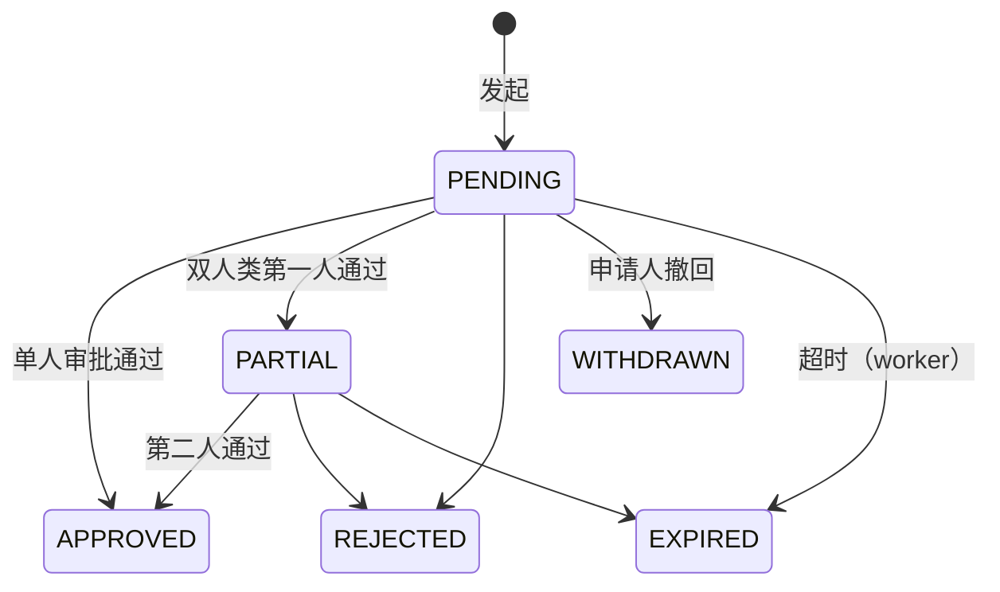

# 12 权限与审计 详细设计

> 作者：大肥鱼 ｜ 基线：docs/first-design 73a55d0（二轮：按 Yuri 群内决定 + 小周 #9 评论 8 条修订，见 §13） ｜ 全局约定以第 0 篇为准（数量 milli、错误码表、雪花 ID、幂等、§6.6 权限模型、§9.1 部署形态、X-Write-Epoch），本篇只写本模块特有的部分。

## 1. 职责与边界

### 1.1 负责
- 账号、角色、权限点、数据权限（按仓隔离，40311）。
- 角色与权限点矩阵：**汇总**各篇已定义的权限点，各篇新增权限点必须回填到本篇 §4。
- 职责分离（SoD）规则与系统冻结豁免。
- 主管审批：`POD_CORRECT`、拣货后取消、非计划切换（发起人 + 主管 + 中心运维三人）、PDA 首次绑定 `DEVICE_BIND`。
- 审计日志：只追加、保留期、边缘节点回传。
- 设备与账号认证：PDA / 司机端 `device_instance_id` 绑定、离线令牌。

### 1.2 不负责
- 设备台账、节点号登记 → 第 1 篇（`device`、`node_registry`）。
- 报损金额分级审批、盘点差异审批 → 第 9、8 篇（复用本篇 `require_perm` 与审计，不走 `approval_request`，见 Q4）。
- 对接系统的 API 签名 → 第 11 篇（`api_credential` 沿用）。

## 2. 用例
| # | 用例 | 角色 |
|---|---|---|
| AU1 | 账号密码登录（后台）/ 账号 + 设备绑定登录（PDA、司机端）| 全部 |
| AU2 | 设备实例绑定、解绑、挂失 | 仓库主管 |
| AU3 | 签发离线令牌，断网时在边缘节点本地校验 | 系统 |
| AU4 | 配置角色、授权、分配仓 | 系统管理员 |
| AU5 | 发起审批 → 主管审批 → 原命令执行 | 申请人 / 主管 |
| AU6 | 非计划切换双人确认 | 仓库主管 + 中心运维 |
| AU7 | 审计查询、导出 | 审计员 / 仓库主管（本仓）|
| AU8 | 边缘审计回传中心 | 系统 |

## 3. 认证

### 3.1 后台与接口令牌
- 登录换取访问令牌（JWT，15 分钟）+ 刷新令牌（8 小时，作业班次）。令牌载荷 `{sub, wh: [...], perm_version, client_type, device_instance_id?, node_id}`。
- **`perm_version`**（`sys_user.perm_version`，本 PR 已加列，两库触发器保证只升不降 `perm_version_rewind`）：用户的角色、权限、仓分配任何变化都在同一事务里 `+1`。请求时载荷里的版本低于库中当前值 → 401 `40110`（`reason=PERM_VERSION_CHANGED`）。保证"撤权立刻生效"不依赖令牌过期。
- **401 `40110` 必带 `detail.reason`**（小周 #5）：

| reason | 含义 | 前端处理 |
|---|---|---|
| `TOKEN_EXPIRED` | 访问令牌过期 | 用刷新令牌静默刷新；刷新也失败才回登录页 |
| `PERM_VERSION_CHANGED` | 权限已变 | 刷新令牌后**重新拉 `GET /me` 重建菜单/按钮**，不必重登 |
| `DEVICE_UNBOUND` | 该设备实例的绑定已被吊销（换人、挂失、主管解绑）| 清本地令牌，回登录页；outbox 不清 |
缺失或未知 `reason` 一律按重登处理（同 40910 `key_type` 规则）。
- 无权限点 403 `40310`；仓不在数据权限内或与资源不符 403 `40311`（00 §6.6）。

### 3.2 PDA / 司机端设备绑定
- `device_instance_id`：App 首次安装生成的 UUID，存在设备安全存储，**重装即变**。它同时是 PDA 四元组、司机端业务键的组成部分（00 §6.5），所以必须可信。
- **首次绑定 = 在线审批**（取代原"扫主管绑定码"，小周 #6）：
  1. 设备登录（§8 `/auth/device-login`）时该实例没有未吊销绑定 → 服务端同事务建 `user_device_binding(status=PENDING)` + `approval_request(type=DEVICE_BIND, target=该绑定)`，返回 401 **`40111`**，`detail {reason: BINDING_PENDING, approval_id, binding_id}`；端上展示"等待主管确认"引导页并轮询 `GET /approvals/{id}`（未登录也可凭 `binding_id + device_instance_id` 查询本条，只返回状态）。
  2. 主管在管理后台（`GET /devices/bindings?status=PENDING`）通过：同一事务 `approval_request → APPROVED` 且 `UPDATE user_device_binding SET status='ACTIVE', approval_id=?, activated_at=now() WHERE id=? AND status='PENDING'`（0 行 → 40935）。驳回则绑定 REVOKED。
  3. 之后再登录即通过。PENDING 未确认时登录一律 40111 `BINDING_PENDING`（重复登录不再新建，`uq_udb_active` 覆盖 PENDING+ACTIVE）。
  4. 库层：`ck_udb_status` 要求 ACTIVE 必须带 `approval_id` 和 `activated_at`，没有审批不可能变 ACTIVE。
- 40111 `detail.reason ∈ {BINDING_PENDING, NOT_BOUND（审批被驳回/过期，需重新申请）, WAREHOUSE_MISMATCH}`。绑定的 `warehouse_id` 不在用户仓权限内 → 40311。
- 同一实例换人登录：旧绑定 REVOKED、新绑定按上面流程重新审批（主管可在后台批量预绑定，Q7）。
- 第 1 篇 `device.status = LOST` → 该设备所有绑定立即 REVOKED，所有离线令牌吊销；之后的在线请求返回 40110 `DEVICE_UNBOUND`。
- 第 4/5 篇的"换设备实例不能直接记账"（`ledger_line_owner_mismatch`）依赖这里：只有当前 ACTIVE 绑定的实例能拿到令牌。
- **司机登录方式**（小周 #7）：`device-login` 支持 `login_type ∈ {PASSWORD, SMS}`，SMS 为手机号 + 验证码（`POST /auth/sms-code` 发码，5 分钟有效、60 秒限频）。微信授权只用于商城端门店账号（第 15 篇），司机端不用（Q8）。两种方式都走同一套设备绑定。

### 3.3 离线令牌（形态 B 断网 + 终端短时离线）
- 在线登录时额外签发离线令牌（签名 Ed25519，中心私钥；公钥随主数据下发到边缘节点）。载荷 `{jti, uid, device_instance_id, wh, perm_version, perms_hash, iat, exp}`，**有效期默认 12 小时**（覆盖一个班次，见 Q2）。
- 使用场景：①边缘节点与中心断网时，边缘本地验签放行；②终端与边缘/中心短时失联时本地操作入队，联网后按业务键补传。
- 吊销：`offline_token.revoked_at`。中心吊销后随主数据（`USER_PERM`，第 1 篇 §6）下发到边缘；**断网期间吊销无法到达**，风险由有效期兜底，并在审计里标 `offline=true`（对抗面 B4）。
- 校验失败（过期、吊销、`perm_version` 落后、实例不符）→ 401 **`40112 OFFLINE_TOKEN_INVALID`**，`detail.reason ∈ {EXPIRED, REVOKED, PERM_STALE, DEVICE_MISMATCH}`。
- 断网期间不能做的事：所有需要审批的操作（§5）、绑定新设备、改权限。返回 503 `50301`。
- **`POST /auth/offline-token` 响应返回 `exp`**（ISO 8601，带时区）和 `ttl_seconds`，端上据此在剩余 1 小时时提醒（小周 #8）。
- **令牌过期后端上仍可记 outbox**：本地作业不因令牌过期而停（00 §9.1 ②），条目照常入队、照常显示"待上传"；联网后先重新登录（必要时重新绑定），再按原业务键补传。服务端以补传时的在线令牌鉴权，审计同时记录操作时间（`op_at`）与上传时间，并标 `offline=true`。补传时权限已被撤销 → 该条 403 `40310`，端上标红交主管，不自动重试。

### 3.4 写入的 epoch
所有写接口还要过 00 §9.1 的 `X-Write-Epoch` 栅栏（50303），在权限校验**之后**、业务校验之前执行；认证失败的请求不消耗任何幂等记录。

## 4. 角色与权限点矩阵

### 4.1 内置角色
| 代码 | 角色 | 数据范围 |
|---|---|---|
| SYS_ADMIN | 系统管理员 | ALL；**只管账号权限，不能做业务操作**（00 §6.6）|
| CENTER_OPS | 中心运维 | ALL；节点号、非计划切换第二确认人 |
| MD_ADMIN | 主数据管理员 | ALL（全局主数据）|
| WH_SUPERVISOR | 仓库主管 | WAREHOUSE |
| WH_KEEPER | 库管/仓管 | WAREHOUSE |
| PICKER | 拣货员 | WAREHOUSE |
| CHECKER | 复核员 | WAREHOUSE |
| DISPATCHER | 调度 | WAREHOUSE |
| DRIVER | 司机 | SELF（只看自己的运单）|
| CS | 客服 | WAREHOUSE |
| FINANCE | 财务 | ALL（只读 + 对账）|
| AUDITOR | 审计员 | ALL（只读审计）|
| MALL_CUSTOMER | 商城客户（门店账号）| SELF（自己门店）|

### 4.2 矩阵（● 默认授予；来源篇号；⚠ 表示该篇尚在评审分支）
| 权限点 | 来源 | 主管 | 库管 | 拣货 | 复核 | 调度 | 司机 | 客服 | 财务 | 其他 |
|---|---|---|---|---|---|---|---|---|---|---|
| `inventory.stock.view` / `movement.view` / `reservation.view` / `hold.view` | 02 | ● | ● | | | | | ● | ● | |
| `inventory.move.execute` | 02 | ● | ● | | | | | | | |
| `inventory.hold.freeze` / `inventory.hold.unfreeze` | 02 | ● | | | | | | | | SoD-2 |
| `dashboard.view` | 12 | ● | | | | ● | | ● | ● | 驾驶舱（小周 #2）|
| `report.inventory.view` / `report.outbound.view` / `report.inbound.view` / `report.loss.view` | 12 | ● | ●(inventory/inbound) | | | ●(outbound) | | ●(outbound) | ● | 报表，按仓隔离 |
| `inventory.recon.view` / `inventory.recon.handle` | 02 | ● | | | | | | | ● | |
| `inventory.adjust.approve` | 08/09 ⚠ | ● | | | | | | | | |
| `inventory.expiry.view` / `inventory.expiry.scan` | 09 ⚠ | ● | ● | | | | | | | |
| `outbound.order.view` / `create` / `allocate` / `cancel` | 04 | ● | ● | | | | | ● | | |
| `outbound.order.cancel_after_pick` | 04 | ● | | | | | | | | 审批 §5 |
| `outbound.allocation.override` | 04 | ● | | | | | | | | 写 `allocation_override` |
| `outbound.pool.view` | 04/06 ⚠ | ● | ● | | | ● | | | | |
| `picking.return_record.view` / `resolve` | 04 | ● | | | | | | | | SoD-3 |
| `picking.task.view` / `claim` / `execute` | 05 ⚠ | ● | | ● | | | | | | |
| `picking.check.view` / `execute` | 05 ⚠ | ● | | | ● | | | | | SoD-1 |
| `wave.wave.view` / `wave.wave.revoke` | 06 ⚠ | ● | | | | ● | | | | |
| `inbound.order.view`、`inbound.putaway.view` / `execute` | 03 ⚠ | ● | ● | | | | | | | |
| `count.order.view` | 08 ⚠ | ● | ● | | | | | | | |
| `scrap.order.view` / `create` / `approve` | 09 ⚠ | ● | ●(create) | | | | | | | SoD-4 |
| `returns.inbound.view` / `create` / `receive` / `qc` / `cancel` | 10 ⚠ | ● | ● | | | | | ● | | |
| `exception.case.view` / `create` / `handle`、`exception.code.manage` | 10 ⚠ | ● | ●(view/create) | | | | | ● | | |
| `integration.log.view` / `log.payload`、`deadletter.view` / `replay`、`subscription.manage`、`failover.recon` | 11 ⚠ | ●(view) | | | | | | | | 中心运维 |
| `delivery.waybill.view_own`、`delivery.pod.submit`、`delivery.load.scan`、`delivery.container.handover` | 15/16 ⚠ | | | | | | ● | | | |
| `delivery.load.release_short`、`delivery.outbox.takeover` | 15/16 ⚠ | ● | | | | ● | | | | |
| `delivery.pod.correct.request` | 16 ⚠ | | | | | | ● | | | 司机发起签收更正（审批 §5.2）|
| `delivery.pod.correct.approve` | 16 ⚠ | ● | | | | | | | | 主管审批签收更正 |
| `mall.goods.view`、`mall.order.create` / `view_own`、`mall.return.create` / `view_own`、`mall.statement.view_own` | 15 ⚠ | | | | | | | | | 商城客户 |
| `master.*.view` / `master.*.edit` | 01 | ● | view | view | view | view | | view | view | 主数据管理员 edit |
| `system.user.view` / `role.view` / `dict.view` / `audit.view` | 12 | ●(audit 本仓) | | | | | | | | 系统管理员 / 审计员 |
| `system.user.edit` / `system.role.edit` | 12 | | | | | | | | | 系统管理员 |
| `device.binding.view` / `device.binding.approve` / `device.binding.revoke` | 12 | ● | | | | | | | | 绑定列表、确认（DEVICE_BIND）、解绑挂失 |
| `system.approval.view` | 12 | ● | | | | | | | | 审批中心列表；申请人看自己发起的不需要此权限 |
| （审批决策按类型用各自权限点，见 §5.2；不再有通用 按类型的审批权限点）| | | | | | | | | | |
| `system.failover.confirm` | 12 | ● | | | | | | | | 中心运维 |
| `system.node.manage` | 01 | | | | | | | | | 中心运维 |
| `system.audit.export` | 12 | | | | | | | | | 审计员 |

规则：
- 权限点在代码里是枚举（00 §6.6），启动时与 `sys_permission` 对齐，**表里有、代码里没有的权限点视为不存在**（防止手工插表提权）。
- 新篇新增权限点必须在本表登记后才能合入（CI 检查各篇 §权限表 ⊆ 本表）。
- SYS_ADMIN 不授予任何业务权限点；同一账号不能同时持有 SYS_ADMIN 与业务角色（授权时校验，40312）。

### 4.3 按仓隔离
- `sys_user_warehouse` 决定用户可访问的仓；`data_scope=ALL` 的角色不受限。
- 每个请求：`X-Warehouse-Id` ∈ 用户仓集合，且等于**服务端按资源查出的** `warehouse_id`，否则 403 `40311`。请求体里的 `warehouse_id` 一律忽略。
- 数据层：仓库 ORM 会话全局注入 `warehouse_id = :ctx` 过滤；跨仓报表只走中心镜像的只读接口。
- 形态 B 边缘节点只持有本仓用户的权限副本（第 1 篇 `USER_PERM` 下发，按 `sys_user_warehouse` 过滤）。

## 5. SoD 与主管审批

### 5.1 职责分离规则
| # | 规则 | 落点 | 豁免 |
|---|---|---|---|
| SoD-1 | 拣货人 ≠ 复核人 | 库层 `ck_obo_sod` + 应用层 | — |
| SoD-2 | 解冻人 ≠ 冻结人 | 应用层（02 §冻结）| **所有系统冻结**（`operator_id = 0`：`RETURN_PENDING`、`SCRAP_PENDING`、`RETURN_QC`）不适用——它们本来就不能手工解冻（40933），只由各自流程释放 |
| SoD-3 | 待回库 resolve 人 ≠ 原拣货人 | 应用层（04 §10）| — |
| SoD-4 | 报损审批人 ≠ 报损申请人 | 第 9 篇 | — |
| SoD-5 | 审批人 ≠ 申请人；双人确认的两人互不相同且都 ≠ 申请人 | 库层 `ck_apr_sod`、`ck_apr_dual` | — |
| SoD-6 | SYS_ADMIN 不能做业务操作；也不能给自己授权 | 应用层 | — |

违反 → 403 **`40312 SOD_VIOLATION`**，`detail.rule`（如 `SoD-2`）。

### 5.2 审批对象
| 类型 | 申请（权限点）| 审批（权限点 / 角色）| 执行（与审批通过同一事务）|
|---|---|---|---|
| `POD_CORRECT` | 司机 `delivery.pod.correct.request`，在线发起，带被更正的 `corrected_pod_id`（第 15/16 篇）| 主管 `delivery.pod.correct.approve`，1 人 | 见下 |
| `CANCEL_AFTER_PICK` | 客服/上游 `outbound.order.cancel`（04 T20）| 主管 `outbound.order.cancel_after_pick`，1 人 | 执行 04 拣货后取消 |
| `DEVICE_BIND` | 设备首次登录自动发起（§3.2）| 主管 `device.binding.approve`，1 人 | 绑定 PENDING → ACTIVE |
| `UNPLANNED_FAILOVER` | 发起人（仓库主管或中心运维）`system.failover.confirm` | **第一确认人 = 仓库主管（WH_SUPERVISOR）、第二确认人 = 中心运维（CENTER_OPS）**；三人互不相同，发起人不能兼任确认人 | 两人都确认后才执行 epoch +1 与新节点号分配 |

**非计划切换三人**（00 §9.1，Yuri 已定）：发起人 + 主管 + 中心运维。库层：`ck_apr_sod`（第一确认人 ≠ 发起人）、`ck_apr_dual`（第二确认人 ≠ 发起人、≠ 第一确认人）、`ck_apr_failover_roles`（两位确认人的角色固定，服务端写入 `first/second_approver_role`）、`ck_apr_done`（APPROVED 必须两人齐全）。该仓只有一位主管时，由中心运维以外的另一中心人员或上级仓主管发起（Q3 已定方向，人员名单运维配置）。

**`POD_CORRECT` 执行**（Yuri 已定）：更正**只走在线审批**，不进 outbox。主管通过时在**同一事务**里：
```sql
UPDATE approval_request SET status='APPROVED', first_approver_id=:me, first_approver_role='WH_SUPERVISOR',
       first_approved_at=now(), decided_at=now(), version=version+1
 WHERE id=:approval_id AND status='PENDING' AND version=:v;              -- 0 行 → 40934
UPDATE waybill_stop SET valid_pod_id=:new_pod_id, ...
 WHERE id=:stop_id AND status='DELIVERED' AND valid_pod_id=:corrected_pod_id;   -- 0 行 → 整体回滚，审批另起事务置 REJECTED，返回 40935（detail.target_code = 40950/40951）
INSERT INTO pod (id=:new_pod_id, corrects_pod_id=:corrected_pod_id, correct_seq=:seq, ...);
```
- **`correct_seq` 由服务端在执行时分配**（该签收已有更正数 + 1，同事务内取），客户端不传；写回 `approval_request.result_ref`。
- 判重键：40910 `key_type=POD_CORRECT`，键为 `(corrected_pod_id, approval_id)`；两台设备并发更正同一签收，`uq_apr_open` 只允许一条待审批，执行时条件更新只有一条成功。
- 表结构（`waybill_stop`、`pod`）归第 16 篇，本篇只定事务边界。

### 5.3 状态机

| 迁移 | 守卫 | 副作用 |
|---|---|---|
| → APPROVED | `ck_apr_done`；审批人持有该类型的审批权限点（§5.2）且在目标仓 | 同事务执行 `payload_json` 对应命令；命令失败（目标状态已变）则整体回滚，审批置 REJECTED 并带 40935 |
| 任意 → 终态 | 条件更新 `WHERE id=? AND status=? AND version=?` | 写 `audit_log`（`approval_id`）；终态后不可再改（触发器 `approval_final`）|

- `uq_apr_open`：同一目标同时只有一条待审批；重复发起返回已有的那条（幂等）。
- 审批人看到的是 `payload_json` 原文；执行时校验 `payload_hash` 未变。申请人在审批期间不能改内容，要改就撤回重提。
- 默认有效期：`POD_CORRECT` 24 小时、`CANCEL_AFTER_PICK` 2 小时（货已拣出在暂存区）、`UNPLANNED_FAILOVER` 1 小时、`DEVICE_BIND` 24 小时。

## 6. 审计日志

### 6.1 写什么
- 必写：所有主管类操作（改派、resolve、越权分配、解冻、审批）、主数据写、权限与绑定变更、登录失败 5 次以上、离线令牌签发与吊销、导出审计。
- 字段：`actor_id`、`client_type`、`device_instance_id`、`action`（= 权限点或 `{模块}.{动作}`）、`target_type/target_id`、`before_json/after_json`（全量快照）、`reason`、`warehouse_id`、`trace_id`、`approval_id`、`node_id`、`node_seq`。
- 与业务写**同一事务**；审计写失败则业务回滚（宁可不做，不能做了没记录）。

### 6.2 只追加
- PG：行级 UPDATE/DELETE 触发器 + 语句级 TRUNCATE 触发器（`append_only_violation: audit_log`），应用角色只授 SELECT/INSERT。SQLite：UPDATE/DELETE 触发器。
- 归档只能在维护窗口由专用角色导出后按月分区 DETACH（PG）或维护脚本重建（SQLite），全程本身也写审计（与 02 流水表同一套做法）。

### 6.3 保留期
| 数据 | 在线 | 归档 |
|---|---|---|
| 审计（中心）| 18 个月 | 再保留 5 年（冷存储，压缩 + SHA-256 清单）|
| 审计（边缘节点）| 回传中心确认后保留 30 天 | 不在边缘归档 |
| 审批记录 `approval_request` | 同审计 | 同审计 |
| 离线令牌 | 过期后 30 天 | 删除（不是审计数据）|
默认值依据：食品追溯一般要求保质期后 6 个月以上、财务凭证 5 年以上，取其大（见 Q1）。

### 6.4 边缘节点回传
- 边缘节点写审计时 `node_id` = 本节点号、`node_seq` = 本节点单调序号（与 outbox 同一个计数器，保证顺序一致）。
- 回传走 00 §9.1 ③ 的 `(node_id, seq)` 顺序通道；中心以 `uq_audit_node_seq` 去重，重放安全；缺口暂停并请求补发。
- 非计划切换：新节点用新节点号，旧节点号的审计序列在备份点之后的部分可能丢失——在中心标记该区间 `AUDIT_GAP` 并纳入 `FAILOVER_GAP` 核对（00 §9.1）。

## 7. 数据模型
| 表 | 新增/改动 | 关键约束 |
|---|---|---|
| `audit_log` | 加 `node_id`、`node_seq`、`device_instance_id`、`approval_id`，加索引 `ix_audit_wh` | `uq_audit_node_seq`；只追加触发器（含 TRUNCATE）|
| `user_device_binding` | 新增；`status ∈ {PENDING, ACTIVE, REVOKED}`、`approval_id`、`activated_at` | `uq_udb_active`（同实例最多一条 PENDING/ACTIVE）、`ck_udb_status`（ACTIVE 必须有审批）、`ck_udb_client` |
| `offline_token` | 新增 | `uq_offline_jti`、`ck_offline_ttl` |
| `approval_request` | 新增；类型含 `DEVICE_BIND`；`first/second_approver_role`、`result_ref` | `ck_apr_sod`、`ck_apr_dual`、`ck_apr_failover_roles`、`ck_apr_done`、`ck_apr_type`、`ck_apr_status`、`ck_apr_hash`、`uq_apr_open`；`approval_final` 触发器；索引 `ix_apr_wh`、`ix_apr_requester` |
| `sys_user` | 加 `perm_version BIGINT NOT NULL DEFAULT 1` | `ck_user_perm_ver`；`perm_version_rewind` 触发器 |

**wms_app 授权**（过 02 全表授权断言）：`user_device_binding` SELECT/INSERT/UPDATE；`offline_token` SELECT/INSERT + `UPDATE(revoked_at)`；`approval_request` SELECT/INSERT + 决策相关列 UPDATE；均不给 DELETE/TRUNCATE。
DDL 见 `wms-design/sql/schema_postgres.sql`（`docs/12` 段），SQLite 由 `verify_sqlite.py` 生成。

## 8. 接口
前缀 `/api/v1`。写接口要求 `Idempotency-Key` + `X-Write-Epoch`。

| 方法 | 路径 | 权限点 | 说明 |
|---|---|---|---|
| POST | `/auth/login` | — | 后台登录 |
| POST | `/auth/device-login` | — | `{login_type: PASSWORD\|SMS, username\|phone, password\|sms_code, device_instance_id, client_type}`；无绑定/待确认 → 40111 |
| POST | `/auth/sms-code` | — | 司机端发验证码，限频 |
| POST | `/auth/refresh`、`/auth/logout` | — | |
| POST | `/auth/offline-token` | 已登录 | 签发离线令牌，返回 `{token, exp, ttl_seconds}` |
| GET | **`/me`** | 已登录 | 当前用户、可访问仓库、权限点、`perm_version`（见下）|
| GET | **`/devices/bindings?warehouse_id=&status=&user_id=&page=`** | `device.binding.view` | 绑定列表，主管看本仓；`status=PENDING` 即待确认 |
| POST | `/devices/bindings/{id}/revoke` | `device.binding.revoke` | 解绑、挂失 |
| GET/POST/PUT | `/system/users`、`/system/roles`、`/system/users/{id}/warehouses` | `system.user.*` / `system.role.*` | 任何变更 `perm_version+1` |
| POST | `/approvals` | 按类型的申请权限点（§5.2）| 发起；返回 `202 {approval_id, status}`，同目标已有待审批则返回那一条 |
| GET | **`/approvals?status=&type=&mine=true&todo=true&warehouse_id=&page=`** | 登录即可（`mine=true` 只看自己发起的）；`todo=true` / 全量需 `system.approval.view` | `todo=true` = 我有权审批且尚未处理（含 PARTIAL 中我可作为第二人）；分页 |
| GET | **`/approvals/{id}`** | 申请人本人，或持有该类型审批权限且在目标仓 | 详情：`payload_json`、状态、审批人、`result_ref`、`version`；PDA 待绑定页凭 `binding_id + device_instance_id` 可查本条状态 |
| POST | `/approvals/{id}/approve`、`/reject` | 按类型的审批权限点（§5.2）| 带 `version`；SoD 违反 40312 |
| POST | `/approvals/{id}/withdraw` | 申请人 | |
| GET | `/audit-logs?target_type=&target_id=&actor_id=&from=&to=` | `system.audit.view` | 主管只看本仓 |
| POST | `/audit-logs/export` | `system.audit.export` | 异步导出；导出本身写审计 |

`GET /api/v1/me` 响应：
```json
{ "user": { "id": "7311...", "username": "sup01", "real_name": "王主管", "roles": ["WH_SUPERVISOR"] },
  "warehouses": [ { "id": "1", "code": "WH-SH-01", "name": "上海青浦仓" } ],
  "current_warehouse_id": "1",
  "permissions": ["dashboard.view", "outbound.order.view", "delivery.pod.correct.approve"],
  "perm_version": 12,
  "device": { "device_instance_id": "…", "binding_status": "ACTIVE" } }
```
前端以 `permissions` 渲染菜单和按钮（仅展示用，不是安全边界），收到 40110 `PERM_VERSION_CHANGED` 时重新拉取。

### 8.1 错误码（本篇新增，00 码表同步登记）
| 码 | HTTP | 名称 | 场景 |
|---|---|---|---|
| 40110 | 401 | UNAUTHENTICATED（已有，补 detail）| `detail.reason ∈ {TOKEN_EXPIRED, PERM_VERSION_CHANGED, DEVICE_UNBOUND}`（§3.1）|
| 40111 | 401 | DEVICE_NOT_BOUND | `detail.reason ∈ {BINDING_PENDING, NOT_BOUND, WAREHOUSE_MISMATCH}`；`BINDING_PENDING` 另带 `approval_id`、`binding_id` |
| 40112 | 401 | OFFLINE_TOKEN_INVALID | 离线令牌校验失败，`detail.reason ∈ {EXPIRED, REVOKED, PERM_STALE, DEVICE_MISMATCH}` |
| 40312 | 403 | SOD_VIOLATION | 违反职责分离，`detail.rule` |
| 40934 | 409 | APPROVAL_ALREADY_DECIDED | 审批已被别人处理（并发审批的后到者），`detail {status, decided_by, decided_at}` |
| 40935 | 409 | APPROVAL_TARGET_CHANGED | 执行时目标状态已变（如出库单已发货），审批置 REJECTED |
未使用新段；均落在 00 已有段内（401xx、403xx、4093x），与现有码不冲突。

## 9. 并发与幂等
- 审批决策：条件更新 `status + version`，后到者 40934；双人确认两人同时点 → 一人 PARTIAL、另一人看到 PARTIAL 再确认，或撞版本后重读。
- 审批通过与执行同事务；执行命令沿用其自身的幂等键（`POD_CORRECT` 业务键、拣货后取消的 `Idempotency-Key`），重复审批不会重复执行。
- 设备绑定：PENDING/ACTIVE 合计一条（`uq_udb_active`），并发首次登录只建一条 PENDING + 一条 DEVICE_BIND；确认时条件更新 `status='PENDING'`。
- 审计回传：`uq_audit_node_seq` 幂等。

## 10. 对抗评审攻击面（给小赵）
| # | 攻击/异常 | 防线 | 验证 |
|---|---|---|---|
| B1 | 伪造 `device_instance_id` 冒用他人 PDA 四元组 | 令牌里绑定实例，服务端用令牌值、忽略请求体 | 接口测试 |
| B2 | 同一实例两人同时登录 | `uq_udb_active` | verify ✓ |
| B3 | 撤权后旧令牌继续用 | `perm_version` 比对；离线令牌 `PERM_STALE` | 集成测试 |
| B4 | 断网期间被吊销的离线令牌仍可用 | 有效期 12h 兜底；断网期间禁止审批类操作；审计标 `offline` | 演练 |
| B5 | 离线令牌签发/有效期被篡改 | Ed25519 验签；`ck_offline_ttl` | verify ✓ |
| B6 | 申请人自己审批 | `ck_apr_sod` + 应用层 40312 | verify ✓ |
| B7 | 双人确认由同一人点两次 | `ck_apr_dual` | verify ✓ |
| B8 | 只一人确认就执行切换 | `ck_apr_done` | verify ✓ |
| B9 | 重复发起审批刷屏/绕过已拒绝 | `uq_apr_open`；已拒绝的重新发起要求新 reason，计数入审计 | verify ✓ |
| B10 | 审批后改内容再执行 | `payload_hash` 校验 | 单测 |
| B11 | 改/删审计掩盖操作 | 只追加触发器（含 TRUNCATE）+ 应用角色无 UPDATE/DELETE | verify ✓ |
| B12 | 审计重复回传或乱序 | `uq_audit_node_seq` + 缺口暂停 | verify ✓ |
| B13 | 改 `X-Warehouse-Id` 跨仓访问 | 资源反查仓比对，40311 | 接口测试 |
| B14 | 手工插 `sys_permission` 提权 | 权限点以代码枚举为准 | 单测 |
| B15 | 系统冻结被当作 SoD 冲突卡死 / 被手工解冻 | SoD-2 豁免 `operator_id=0`；40933 拦手工解冻 | 02 已有 verify |

## 11. 测试要点
- verify（SQLite/PG 两套同断言）：`uq_udb_active`、`ck_udb_status`、`ck_offline_ttl`、`uq_offline_jti`、`ck_apr_sod`、`ck_apr_dual`（两例）、`ck_apr_done`、`uq_apr_open`、`uq_audit_node_seq`、双人确认放行、`audit_log` UPDATE/DELETE（两库）与 TRUNCATE（PG）被拦。
- 认证：未绑定设备 40111；换人登录旧绑定失效；挂失后离线令牌全部失效。
- 权限：矩阵每个权限点至少一例 40310；每个仓级接口一例 40311（含"请求头仓 ≠ 资源仓"）。
- 审批：并发审批 40934；执行时目标已变 40935 且整体回滚；超时 EXPIRED。
- 断网：离线令牌本地验签通过；断网时发起审批 → 50301；回传后中心审计按序且无重复。

## 12. 待定问题
| # | 问题 | 建议 | 决策人 |
|---|---|---|---|
| Q1 | 审计保留期 | 在线 18 个月 + 归档 5 年 | Yuri |
| Q2 | 离线令牌有效期 | 12 小时（一个班次）；更短更安全但断网超过即停工 | Yuri |
| Q3 | 非计划切换是否必须"发起人 + 两位确认人"三人 | 是（SoD-5）；只有一位主管的仓由中心运维发起 | Yuri |
| Q4 | 第 8/9 篇的盘点、报损审批是否也统一走 `approval_request` | 本期不统一（金额分级各篇自己定），只共用权限与审计；ck_apr_type 预留扩展 | Yuri / 第 9 篇 |
| Q5 | ~~`perm_version` 位置~~ | **已定**：`sys_user` 加列（本 PR）| 已定 |
| Q6 | 矩阵里标 ⚠ 的权限点来自尚在评审的分支（03/05/06/08/09/10/11/15/16）| 各篇合入时回填本表，CI 校验 | 各篇作者 |
| Q7 | ~~首次绑定是否主管确认~~ | **已定**：PENDING + `DEVICE_BIND` 审批；建议后台支持批量确认 | 已定 |
| Q8 | 司机端是否需要微信授权登录 | 不需要；司机端账号密码 + 短信验证码，微信只给商城端 | Yuri |
| Q9 | 第 16 篇 `waybill_stop`/`pod` 表名与 `correct_seq` 列由第 16 篇建表，本篇的 SQL 只示意事务边界 | 第 16 篇作者确认列名 | 小钱 |
| Q10 | `dashboard.view`、`report.*.view` 的默认授予（矩阵中的 ●）| 按表中建议 | Yuri |

## 13. 二轮修订记录
| 来源 | 项 | 处理 |
|---|---|---|
| Yuri | `GET /me`、`GET /approvals`、`GET /approvals/{id}` | §8 |
| Yuri | `sys_user.perm_version` 列 | §7，只升不降触发器 |
| Yuri | `delivery.pod.correct` 拆 `.request` / `.approve`；在线审批同事务条件更新；`correct_seq` 执行时分配 | §4.2、§5.2 |
| Yuri | SoD-2 豁免全部系统冻结（含 RETURN_QC）| §5.1 |
| Yuri | 40110 `detail.reason` | §3.1、§8.1 |
| Yuri | 非计划切换三人、发起人不能兼确认人 | §5.2、`ck_apr_failover_roles` |
| Yuri | 新表授权 | §7 |
| Yuri | `dashboard.view`、`report.{inventory,outbound,inbound,loss}.view` | §4.2 |
| Yuri | `GET /devices/bindings`（`device.binding.view`）；首次绑定 PENDING + `DEVICE_BIND` 审批；40111 `BINDING_PENDING` | §3.2、§8 |
| 小周 1 | 缺读接口 | §8（/me、/approvals、/approvals/{id}、/devices/bindings）|
| 小周 2 | 缺权限点 | §4.2 |
| 小周 3 | pod.correct 授予矛盾 | 拆分 request（司机）/ approve（主管）|
| 小周 4 | SoD-2 缺 RETURN_QC | §5.1 |
| 小周 5 | 40110 区分过期与权限变化 | §3.1 |
| 小周 6 | 绑定码无流程 | 改为 DEVICE_BIND 在线审批，§3.2 |
| 小周 7 | 司机登录方式 | PASSWORD / SMS；微信只给商城（Q8）|
| 小周 8 | 离线令牌 exp、过期后 outbox | §3.3 |
