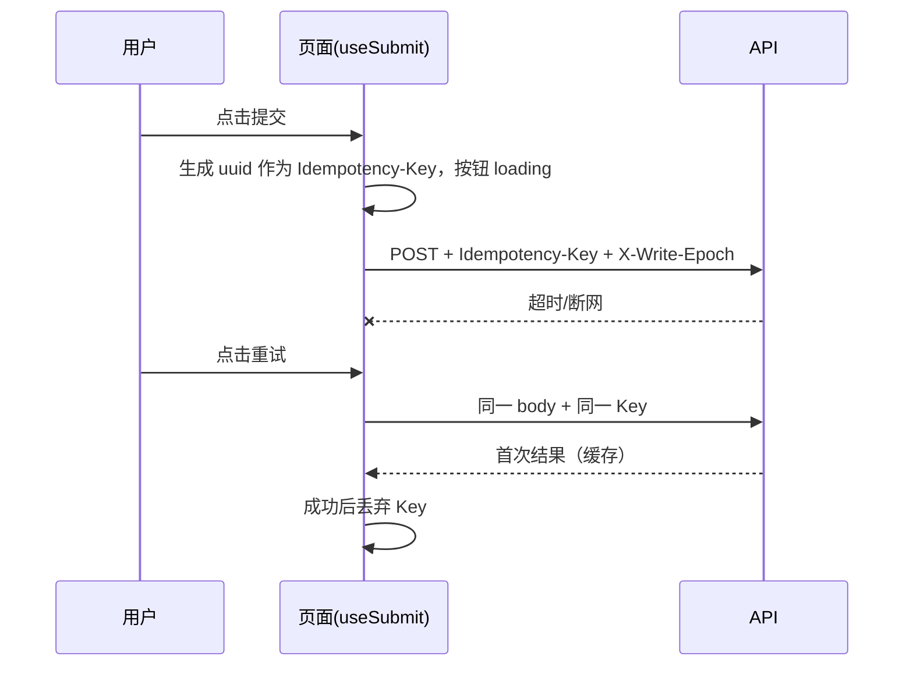

# 13 管理后台前端 详细设计

| 项 | 内容 |
|---|---|
| 编号 | 13 |
| 作者 | 界面（前端与端上） |
| 评审 | 待定：1 名测试 + 1 名非作者开发（§12 攻击面逐条打） |
| 基线 | `origin/main@5bfd335`（01 / 05 / 06 / 07 / 08 / 11 / 12 均已合入）；总体设计 §6.4 错误码、§6.5 幂等、§6.6.1 审批类型、§6.6.2 离线/暂停下发、§6.6.5 缺口登记、§6.8 时间、§8 前端模板、§9.1 写节点切换 |
| 依赖 | 01 主数据（**已合 main `@5bfd335`**：一期只建 7 张表，字典 / 停用挂起 / 软删两段式 / 伙伴车队设备台账均**未建**，见 §11 Q16）；02 库存核心（**已合 main**）；03 入库（**已合 main，读接口待 #40**）；04 出库与分配（**已合 main**）；05 波次与拣货（**已合 main**）；06 复核装箱发货（**已合 main**）；07 补货与移库（**已合 main**）；08 盘点（**已合 main**）；09 效期与损耗（**已合 main，仍无接口清单**）；10 退货与异常（**已合 main，只含退供应商，退货预约/异常单接口待 #40**）；11 集成（**已合 main**，含非计划切换发起/确认 §7.3）；12 权限与审计（**已合 main**：权限点矩阵 §4.2、`/me` 六字段 §8、`exp` 整秒 Δ1、`SCRAP_MISREPORT` 收敛权限点口径）；16 配送与签收（**草稿 `origin/docs/16-delivery-pod@b5f1ec1`**）；17 加工（草稿）；18 活鲜（**已合 main**） |
| 技术栈 | Vue 3 + TypeScript + Vite + Element Plus + Pinia + Vue Router |
| 状态 | 新稿（界面，2026-10-15）。从 `docs/frontend-detail-design` 搬运后按当前 main 逐条重核；**对齐轮第一批（2026-10-15）**：按 00 已定口径、12 篇、01 已合 main 的现状改 §1.3 / §3 / §6 / §7 / §8 / §11（等 05/06/08/16/17 接口形状与 09/10 读接口的第二批） |

> **引用口径**：接口路径、权限点、错误码以已合 main 的篇目和 00 为准；**本篇引用 00 §6.4 / §6.5 的权威定义**。篇目状态分两类：**已合 main**（01/02/03/04/05/06/07/08/09/10/11/12/18）、**草稿**（16/17，标「（草稿）」）。12 篇与 00 冲突处以 00 为准（12 已按 00 改 `exp` 整秒与 `/me` 六字段）。main 上还没有的后端接口，本篇在 §6.3 给出**前端消费契约**（路径、入参、出参、错误码、权限点），并在 §11 标注「后端侧待 XX 篇补登记」；**已合 main 的篇目明确声明一期不建的接口标「一期未建」**，前端不实现入口，等该篇增量。
>
> OpenAPI → TS 客户端生成及 CI 门禁（`gen:api` + `git diff --exit-code`）待后端 FastAPI 就绪后接入；在此之前 `api/` 下手写类型，目录结构按生成后的形态预留。

---

## 1. 职责与边界

### 1.1 负责

1. 仓管员、仓经理、主管、系统管理员使用的 PC 管理后台：主数据、入库、库存、出库、波次、拣货监控、复核装箱、盘点、异常、集成、审批、系统、报表的查询与操作页面。
2. 统一的列表 / 表单 / 选择器 / 状态标签组件；权限渲染；数量、金额、时间格式化；错误码分支与重试交互；幂等键管理。
3. 后台侧的端上行为：写节点地址缓存与切换（§8.2）、断网暂停置灰（§8.9）、`seed` 级联选择器的过滤策略（§8.6）。

### 1.2 不负责

| 事项 | 归属 |
|---|---|
| 安全边界：前端权限只防误操作，真正的校验在接口层和数据层 | 00 §6.6；前端隐藏按钮**不是**安全边界 |
| 现场扫码作业（拣货、复核扫码、装箱、集货、收货上架） | 14 篇 |
| 司机端 / 商城端 | 15 篇（前端）、16 篇（后端） |
| 业务规则计算（FEFO、可售量、状态迁移是否合法、审批层级） | 服务端；前端只按返回的 `status` 与权限点控制按钮 |
| 纸单补录的录入入口 | 14 篇；后台只做审批与记录查看 |

### 1.3 与旧稿（`docs/frontend-detail-design`）的差异

| # | 旧稿 | 新稿 | 原因 |
|---|---|---|---|
| Δ1 | 大量「待对齐：见第 N 篇」占位 | 用当前 main 与草稿的接口填上；仍无定义的标「待定」并登记 §11 | 02/03/04/05/06/07/08/11/12 已合 main，16/17 仍是草稿 |
| Δ2 | `40312` 提示显示 `detail.rule` | 只认 **`detail.reason`** | 00 §6.4 `SOD_VIOLATION` 明确不再使用 `detail.rule` |
| Δ3 | `paused_actions` 写「八个值」 | **九个值**（含 `LIVE_WEIGH_OUT`） | 00 §6.6.2 已登记 9 个 |
| Δ4 | `40933` 的系统冻结只列 `RETURN_PENDING` / `SCRAP_PENDING` / `RETURN_QC` 三种 | **五种**，加 `PROCESSING`（17）、`LIVE_HOLD`（18） | 00 §6.4 `SYSTEM_HOLD_NOT_RELEASABLE` 已扩值 |
| Δ5 | 「时间为 ISO8601 UTC」 | 时间 **UTC 整秒 `YYYY-MM-DD HH:MM:SS`**；业务日期 `YYYY-MM-DD` 原样显示 | 00 §6.8 第 1/2/4 条 |
| Δ6 | 异常单、报损单列表、报表、字典、驾驶舱、非计划切换确认、退货预约接口被当成已定 | 给出前端消费契约（§6.3），标「后端侧待登记」 | main 的 02/03/04/09/10/11 都没有这些路径 |
| Δ7 | 波次容量权限点写 `wave.capacity.*` | 统一为 **`picking.wave.capacity.view` / `.edit`**（Chief 裁决，12 篇侧同步改） | 05 §7/§10 与 12 篇 §8 曾冲突，已裁决 |
| Δ8 | 冻结页对系统冻结只提示三类 | 五类分别提示且都无手工解冻入口 | 同 Δ4 |
| Δ9 | 主数据停用写成「`PENDING_DISABLE` 挂起 + worker 置 `DISABLED`」，软删三项当已定 | 01 已合 main 的现状是**只能拒绝停用**（`40960` + `blockers`，实体保持 `ACTIVE`）：`PENDING_DISABLE`、`md_disable_action_policy`、软删两段式三项、字典接口全为**一期未建** | 01 §3.4 / §5.1 / §7「未建接口」/ §12 Q1、Q9 |
| Δ10 | 主数据表单带 `md_version` 做乐观锁 | 01 一期**没有版本列**，不做 `md_version` 乐观锁；并发以后到者覆盖 + `audit_log` 留痕，前端只提示「他人已修改」 | 01 §11「无乐观锁版本列」/ §12 Q1 |
| Δ11 | 权限点引用 12 草稿，`scrap.view` / `exception.view` / `delivery.pod.tolerance.manage` 三种写法 | 按 12 篇 §4.2 矩阵：`scrap.order.view`、`exception.case.view`、`pod.tolerance.manage`；`inbound.return.blind`、`system.dict.view`、`master.delete.*`、`device.binding.*`、`dashboard.view`、`report.*.view` 均已在 12 篇 §4.2 登记 | 12 篇 §4.2 / §4.4（Δ7） |

---

## 2. 用例

| 编号 | 角色 | 主要用例 |
|---|---|---|
| A1 | 仓管员 | 查入库单与收货/上架进度；库存查询（按 SKU 汇总 / 按库位明细）；查流水与占用；人工移库、人工冻结；收货更正单查询 |
| A2 | 仓管员 | 查待回库看板并提示现场放回（处理归主管）；查冻结明细（系统冻结只读） |
| A3 | 仓经理 | 看驾驶舱；管理订单池与波次（生成、释放、撤波、挂起、调单）；波次容量配置；处理缺货与异常 |
| A4 | 仓经理 / 主管 | 审批中心：拣后取消、箱作废（在箱详情）、非计划切换、设备绑定、报损误报转质检、纸单补录、加工得率偏离、活鲜死亡超阈值 |
| A5 | 主管 | 待回库 resolve（放回原位 / 就近放回 / 交接报损）；盘点差异与库存调整审批；异常单关联与延期 |
| A6 | 复核/箱管 | 箱查询、箱详情、箱作废申请与审批 |
| A7 | 中心运维 | 节点号分配/退役；写节点切换确认；跨仓波次容量编辑；接口日志与死信重放 |
| A8 | 系统管理员 | 维护仓库/库区/库位、SKU/单位/条码、供应商/客户、车辆/司机、设备、用户与角色、数据权限；查审计日志。**无改账类权限点** |

职责分离（SoD）由服务端校验；前端在提示文案里给出 `detail.reason`，**不自行判断**。

---

## 3. 页面与路由清单

路由 `meta.perm` 为进入权限点；无权限的路由不进菜单，直接访问跳 403。**权限点集合以 `GET /api/v1/me` 返回的 `permissions` 为准**，不按角色写死菜单。

| 路由 | 页面 | 进入权限点 | 依据 |
|---|---|---|---|
| `/login` | 登录 | — | 12 §8 |
| `/dashboard` | 作业驾驶舱（待拣 / 拣货中 / 待发 / 已发漏斗、缺货 TOP、异常、未闭环待回库数与 `RETURN_PENDING` 冻结量） | `dashboard.view`（12 篇 §4.2 已登记） | 前端契约见 §6.3-13 |
| `/picking/pending-returns` | 待回库看板（PDA 补交被拒产生，见 14 篇 §9.4.1）；查看、处理 | `picking.return_record.view`（处理另需 `picking.return_record.resolve`） | 04 §7.3 / §10（已合 main） |
| `/master/warehouses` | 仓库 / 库区（温区 `temp_zone` 与 `temp_min_c10` / `temp_max_c10`；**两列要么都为空（只允许 `temp_zone='AMBIENT'`），要么都有值且 `min_c10 < max_c10`；`CHILLED` / `FROZEN` / `FRESH` 必须给区间**） | `master.warehouse.view`（写 `master.warehouse.edit`） | 01 §7（已合 main）；`ck_zone_temp`（01 §4 / §7.1） |
| `/master/locations` | 库位（**批量生成为一期未建**，见 §6.3-11） | `master.location.view`（写 `master.location.edit`） | 01 §7（已合 main）；批量生成归 01 增量 |
| `/master/skus` | SKU（含保质期 `shelf_life_days`、可售天数 `sell_days`、损耗容差、称重容差、单位与条码、条码换绑） | `master.sku.view`（写 `master.sku.edit`） | 01 §7（已合 main） |
| `/master/suppliers`、`/master/customers` | 供应商、客户/门店 —— **一期未建** | `master.*.view` / `master.*.edit`（12 篇通配登记） | 01 §7 未列台账；归 01 增量 Q4 |
| `/master/fleet` | 车辆、司机 —— **一期未建** | `master.*.view` / `master.*.edit` | 同上级；司机证照 `42220` 亦未建 |
| `/master/devices` | 设备台账 —— **一期未建** | `master.*.view` / `master.*.edit` | 同上级 |
| `/inventory/stock` | 库存查询（汇总/明细切换） | `inventory.stock.view` | 02 §7（已合 main） |
| `/inventory/movements` | 库存流水（游标分页） | `inventory.movement.view` | 02 §7 |
| `/inventory/reservations` | 占用查询 | `inventory.reservation.view` | 02 §7 |
| `/inventory/holds` | 冻结明细（系统冻结只读，§8.4） | `inventory.hold.view` | 02 §7 |
| `/inventory/expiry` | 效期预警（批次 `sell_deadline`，已过可售期标红） | `inventory.expiry.view`（12 篇 §4.2 已登记） | 前端契约见 §6.3-4 |
| `/inventory/recon` | 对账差异列表、认领、填结论 | `inventory.recon.view` / `inventory.recon.handle` | 02 §7 |
| `/loss/scraps`、`/loss/scraps/:id` | 报损单列表/详情（`source_type` 含 `SELL_EXPIRED` / `LIVE_DEATH` / `LIVE_SHRINK` / `SUPPLIER_RETURN` / `PROCESS_LOSS`） | `scrap.order.view`（**12 篇 §4.2 明示本点即原 `scrap.view`**） | 09 已合 main 但**无接口清单**（Q3） |
| `/inbound/orders`、`/inbound/orders/:id` | 入库单列表/详情（计划-已收-已上架进度） | `inbound.order.view`（03 §10 / 12 篇 §4.2） | 03 §7（已合 main） |
| `/inbound/putaway` | 上架追踪 | `inbound.putaway.view` | 前端契约见 §6.3-2 |
| `/outbound/orders`、`/outbound/orders/:id` | 出库单列表/详情（状态时间线、占用明细、分配理由、缺货明细） | `outbound.order.view` | 04 §7（已合 main） |
| `/outbound/pool` | 订单池（触发分配、越权分配、取消、拣后取消） | `outbound.order.view` / `outbound.order.allocate` / `outbound.allocation.override` / `outbound.order.cancel` / `outbound.order.cancel_after_pick` | 04 §7 / §10 |
| `/wave/waves`、`/wave/waves/:id` | 波次管理/详情（`wave_type`、`pick_strategy`、释放、撤波、挂起、调单） | `picking.wave.view`（释放 `picking.wave.release`、管理 `picking.wave.manage`） | 05 §7/§10 |
| `/wave/capacity` | 波次容量配置（仓库 × `wave_type`） | `picking.wave.capacity.view`（编辑 `picking.wave.capacity.edit`） | 05 §7；**权限点已由 00 §6.6.3 登记、12 篇 §4.2 收录** |
| `/picking/tasks` | 拣货任务监控（列表、改派、强制关闭） | `picking.task.view`（改派 `picking.task.reassign`、关闭 `picking.task.close`） | 05 §7/§10 |
| `/picking/checks` | 复核记录 | `outbound.check.execute`（查看）/ `outbound.order.view` | 06 §7 |
| `/outbound/boxes`、`/outbound/boxes/:boxId` | 箱查询与详情（按出库单/状态；重量 `weight_g`）；SEALED 箱「申请作废」与审批 | `outbound.order.view`（申请 `pack.box.void.request`、审批 `pack.box.void.approve`） | 00 §6.6.1 / 06 §7.1 |
| `/returns/supplier` | 供应商退货（建单、待提货、提货登记、非 RETURN 处置完成） | `returns.supplier.create` / `returns.supplier.pickup` | 10 §7（已合 main） |
| `/returns/reservations` | 退货预约列表/详情（门店创建、仓库收货） | `returns.reservation.view` / `.receive`（12 篇 §4.2 按**复数**收录） | 前端契约见 §6.3-8 |
| `/count/plans`、`/count/orders/:id` | 盘点计划、盘点单（仅看差异） | `count.order.view` | 待第 8 篇（12 篇 §4.2 标 08 ⚠） |
| `/count/approvals` | 差异 / 调整审批 | `inventory.adjust.approve` | 待第 8 篇 |
| `/exceptions` | 异常单（状态 / 责任方 `liable_party` / 截止前筛选；盲收异常倒计时；关联原单；延期） | `exception.case.view`（关联 `exception.link`、延期 `exception.deadline.extend`；**12 篇 §4.2 明示本点即原 `exception.view`**） | 前端契约见 §6.3-7 |
| `/integration/logs` | 接口日志（入站/出站，含推送日志按时间窗查询） | `integration.log.view`（原文另需 `integration.log.payload`） | 11 §7（已合 main） |
| `/integration/dead-letters` | 死信列表与重放 | `integration.deadletter.view` / `integration.deadletter.replay` | 11 §7 |
| `/system/users`、`/system/roles` | 用户、角色与权限树、用户-仓映射 | `system.user.view` / `.edit`、`system.role.view` / `.edit` | 12 篇 §4.2 / §8 |
| `/system/dicts` | 字典 —— **一期未建（01 显式延期）** | `system.dict.view`（12 篇 §4.2 已登记） | 01 §7「显式延期」/ §12 Q9；消费契约见 §6.3-10 |
| `/system/audit` | 操作审计（按 `trace_id` 串联；主管只看本仓） | `system.audit.view`（导出 `system.audit.export`） | 12 篇 §4.2 / §8 |
| `/system/approvals`、`/system/approvals/:id` | 审批中心 | `system.approval.view`（`mine=true` 登录即可） | 12 篇 §4.2 / §8 |
| `/system/devices` | 设备绑定列表（筛选仓库/状态/用户）；解绑、挂失 | `device.binding.view`（确认 `device.binding.approve`、解绑/挂失 `device.binding.revoke`） | 12 篇 §4.2 / §8 |
| `/system/pod-tolerance` | 仓库签收更正容差配置 | `pod.tolerance.manage`（**不带 `delivery.` 前缀**，12 篇 Δ7） | 接口 16 草稿 §7；权限点 12 篇 §4.2 |
| `/system/nodes` | 节点号（仅中心运维）—— **一期未建** | `system.node.manage` | 01 §7 未列 `/nodes`；归 01 增量 Q1 |
| `/report/inventory`、`/report/outbound`、`/report/inbound`、`/report/loss` | 库存周转与库龄、出库人效与缺货归因、供应商履约、损耗 | `report.inventory.view` / `.outbound.view` / `.inbound.view` / `.loss.view`（12 篇 §4.2 已登记） | 前端契约见 §6.3-14 |
| `/403`、`/404` | 异常页 | — | — |

---

## 4. 组件拆分

```
web/src/
├── api/            # 后端接口就绪前手写；之后改为 generated/ + index.ts
├── components/
│   ├── ProTable/  ProForm/  DictSelect/  SkuPicker/  LocationPicker/
│   ├── WarehouseSwitcher/  StatusTag/  StateTimeline/
│   ├── QuantityText/  AmountText/  DateTimeText/
│   └── PermissionButton/  ApprovalAction/   # 同时提供 v-permission 指令
├── composables/    useTable  useSubmit  useDict  usePermission  useWarehouse  useWriteEndpoint
├── views/  stores/  router/  utils/(format.ts, qty.ts, idempotency.ts, http.ts)
```

| 组件 | 职责 | 关键约定 |
|---|---|---|
| **ProTable** | 筛选 + 表格 + 分页 + 行操作 | 见 §4.1 |
| ProForm | 配置式表单、校验、提交 | 提交走 `useSubmit`（防重 + 幂等键） |
| DictSelect / StatusTag | 字典下拉、状态彩色标签 | 数据来自 dict store |
| SkuPicker | 弹窗搜索 + 多选 SKU | 远程搜索防抖 300 ms；回传 `{id, code, name, uom}` |
| LocationPicker | 按库区/温区筛选库位 | 只列当前仓库库位 |
| WarehouseSwitcher | 顶栏切换当前仓库 | 切换时 abort 在途请求、清空列表并重新请求（§8.5） |
| StateTimeline | 单据状态时间线 | 状态枚举与各篇状态机对齐 |
| QuantityText | 展示数量 | 内部只调用 `formatQty` |
| PermissionButton / `v-permission` | 无权限**不渲染**（不是禁用） | — |
| ApprovalAction | 审批按钮组 | 按审批类型的权限点渲染；申请人本人与已确认过的人不渲染（服务端 40312 兜底）；提交带 `version` |

### 4.1 ProTable 能力

| 能力 | 说明 |
|---|---|
| 查询条件持久化到 URL query | 刷新/分享/回退不丢条件；含分页与排序 `sort=-a,b` |
| 空态 / 加载 / 错误三态 + 重试 | 错误态显示「重试」与可复制的 `trace_id` |
| 防重复提交 | 行操作/批量按钮 loading + 禁用，带 `Idempotency-Key` |
| 权限渲染 | 列/操作配置 `perm`，无权限不渲染 |
| 列设置（显示列、宽度） | 存 localStorage（按用户 + 页面） |
| 跨页批量选择 + 结果明细 | 保留跨页选中集；批量操作前二次确认，结果显示成功/失败条数与失败原因 |
| 异步导出 + 下载中心 | 后端异步任务，前端轮询状态，完成后下载（导出契约见 §6.3-14） |

### 4.2 格式化约定

- **数量**：库内存 `BIGINT`，单位是 SKU 基本单位的千分之一（`*_qty_milli`）；接口一律返回固定 3 位小数字符串（如 `"12.500"`），单位取 SKU 的 `base_uom`；写入接口只接受字符串、最多 3 位小数，超过返回 400 `40010`，**不四舍五入**。前端不接触 `*_qty_milli`。
- `formatQty(qty, base_uom)` 显示「数量 + 基本单位」（如 `12.500 kg`）；输入框校验正则 `^(0|[1-9]\d{0,11})(\.\d{1,3})?$`，超过直接提示、不截断；不接受负数与前导零（`0.5` 合法）；业务上限 `999999999999.999` 前后端一致（具体值待 02 确认，Q9）。
- **金额**为整数分，`formatAmount` 显示两位小数。
- **时间分两类**（00 §6.8）：
  - 时间戳：库内 UTC 整秒，接口用 `YYYY-MM-DD HH:MM:SS`（不带 `T`、不带时区后缀、不带小数秒），`formatDateTime` 按**仓库时区**显示（来自 warehouse store）。
  - 业务日期（生产日期、`expiry_date`、`sell_deadline`、作业日）：`DATE`，接口 `YYYY-MM-DD`，**原样显示，不做时区换算**；临期天数以仓库时区的「今天」计算。
- 所有格式化集中在 `utils/format.ts`：`formatQty`、`formatAmount`、`formatDate`、`formatDateTime`。
- **页面中禁止 `toFixed`、禁止用 `parseFloat` 处理数量**；需要比较或汇总时用 `decimal.js`，封装在 `utils/qty.ts`。ESLint 规则禁止 `views/**` 出现 `toFixed`。
- 单位换算（`base_qty_milli`）：SKU 单位表单录入 `base_qty`（3 位小数字符串，如 1 箱 = `"12.500"` KG），前端按单位换算展示用整数运算（`milli × base_qty_milli / 1000`），结果非整数时提示并阻止提交（后端 40010 为准），不取整。`base_uom` 有过库存或单据后不可改（`40960`），表单在服务端返回 blockers 后置灰该字段。

---

## 5. 状态管理

Pinia 只存**跨页共享且变化慢**的数据：

| store | 内容 | 失效 |
|---|---|---|
| `user` | 当前用户、token、`client_type=WEB` | 登出 / 401 |
| `perm` | 权限点集合、`perm_version` | 登录、切换仓库、收到 `40110 PERM_VERSION_CHANGED` 后重拉 |
| `dict` | 字典 + 版本号 | 按 `since=<version>` 增量刷新（字典契约见 §6.3-10） |
| `warehouse` | 可选仓库列表、当前仓库 id 与时区 | 切换时持久化到 localStorage |
| `writeEndpoint` | `{endpoint, epoch}` 缓存（内存） | 启动重取；`50301` / `50303` / `epoch` 变化时重取 |

- 列表、详情数据**不进 store**，每次进页面重新请求，避免脏数据。
- 当前仓库通过 `X-Warehouse-Id` 头传给服务端；**与资源所属仓库不一致时返回 403 `40311`**（例如从旧链接打开他仓单据）。
- 驾驶舱 30 s 轮询，页面不可见时（`visibilitychange`）暂停；是否改 SSE 见 Q8。

---

## 6. 页面 → 接口映射

标注：**main** = 已合 main；*斜体* = 草稿（未合 main）；「待定」= main 无定义，见 §11。

| 页面 | 动作 | 接口 | 幂等 / 备注 |
|---|---|---|---|
| 登录 | 登录 / 刷新 / 登出 | *`POST /api/v1/auth/login`*、*`/auth/refresh`*、*`/auth/logout`*（12 §8） | — |
| 登录 | 当前用户：用户、可访问仓库、权限点、`perm_version`、`paused` / `paused_actions[]` / `offline_deadline_at` / `backfill_deadline_at`（另含 `stale_policy`、`offline_since`，共六字段） | *`GET /api/v1/me`*（00 §6.6.2 为 400 级硬契约；12 篇 §8 已补全） | — |
| 全局 | 字典增量拉取 | 契约见 §6.3-10；**接口一期未建**（01 显式延期，归 01 增量） | 前端按 `since` 语义预留，一期不做入口 |
| 全局 | 取 / 重取写地址 | **`GET /api/v1/warehouses/{warehouse_code}/write-endpoint`** → `{endpoint, epoch}`（00 §9.1） | 每个写请求带 `X-Write-Epoch` |
| 驾驶舱 | 漏斗、缺货 TOP、异常、未闭环待回库数与 `RETURN_PENDING` 冻结量 | 契约见 §6.3-13；库存汇总可用 **`GET /api/v1/inventory/summary`**（02 §7） | — |
| 仓库 / 库区 / 库位 | 列表、增改、停用/启用 | **`GET/POST/PUT /api/v1/master/warehouses`**、**`/warehouses/{id}/zones`**、**`/zones/{id}/locations`**；**`POST /api/v1/master/{entity}/{id}/disable`** / **`enable`** → `{status, blockers}`（01 §7，已合 main） | **01 一期无 `md_version`**：不做乐观锁；停用有引用时**只拒绝**（`40960` + `blockers`），实体保持 `ACTIVE` |
| 库位批量生成 | 预览 / 提交 | 契约见 §6.3-11；**接口一期未建**（归 01 增量） | 前端只保留契约，不做入口 |
| SKU / 单位 / 条码 | 列表、增改 | **`GET /api/v1/master/skus`**、**`/skus/{id}`**、**`POST/PUT /skus`**、**`/skus/{id}/units`**、**`/skus/{id}/barcodes`**（01 §7，已合 main） | 无 `md_version` |
| SKU 条码换绑 | 一次操作换绑（旧码行消失 + 新码行出现，不显示中间态） | **`PUT /api/v1/master/skus/{id}/barcodes/rebind`**（01 §7 / §6.4，已合 main） | 权限 `master.sku.edit`；一次 `UPDATE` 命中 0 行 → `40930` / `40960` 带当前归属 |
| 往来方 / 车辆司机 / 设备 | 列表、增改 —— **一期未建** | *`/api/v1/master/suppliers`*、*`/customers`*、*`/vehicles`*、*`/drivers`*、*`/devices`*（01 §7 无；归 01 增量 Q4） | 前端不做入口；权限点按 12 篇 `master.*.view` / `.edit` |
| 主数据软删 | 申请 / 撤销 / 进度 —— **一期未建** | *`POST /api/v1/master/{entity}/{id}/delete-request`*、*`.../delete-request/cancel`*、*`GET .../pending-actions`*（01 §7「未建接口」；归 01 增量 Q1） | 前端**不提供直接删除入口**；`40936` 当前无实现处，前端仍按 00 §6.4 兜底提示 |
| 条码解析 | — | **`GET /api/v1/master/barcodes/{barcode}`**（01 §7，已合 main） | 权限 `master.sku.view`；端上不缓存条码表（01 §6.3） |
| 节点号 | 列表、分配、退役 —— **一期未建** | *`GET/POST /api/v1/master/nodes`*、*`POST /nodes/{node_id}/retire`*（01 §7 未列；归 01 增量 Q1） | `system.node.manage`；前端不做入口 |
| 库存 | 汇总/明细 | **`GET /api/v1/inventory`**（02 §7） | 游标分页 |
| 库存 | 看板汇总 | **`GET /api/v1/inventory/summary`** | — |
| 库存 | 流水 | **`GET /api/v1/inventory/movements`** | 游标分页 |
| 库存 | 占用 | **`GET /api/v1/inventory/reservations`** | — |
| 库存 | 冻结明细 | **`GET /api/v1/inventory/holds`** | — |
| 库存 | 人工移库 | **`POST /api/v1/inventory/move`** | `Idempotency-Key` |
| 库存 | 人工冻结 / 解冻 | **`POST /api/v1/inventory/freeze`** / **`/inventory/unfreeze`** | 解冻只接受 `QUALITY` / `MANUAL`；系统冻结 40933 |
| 对账 | 差异列表、认领、填结论 | **`GET /api/v1/inventory/recon`**、**`POST /inventory/recon/{id}/ack`** / **`/resolve`** | — |
| 效期预警 | 临期列表、批次 `sell_deadline` | 契约见 §6.3-4 | — |
| 报损单 | 列表 / 详情 | 契约见 §6.3-5；状态字段以 09 已合 main 的模型为准 | — |
| 入库单 | 列表 / 详情 | **`GET /api/v1/inbound/orders`**（03 §7 只列了写接口）；详情读契约见 §6.3-1 | — |
| 上架追踪 | 列表 | 契约见 §6.3-2 | — |
| 出库单 | 列表 / 详情 / 缺货明细 | **`GET /api/v1/outbound-orders`**、**`/{id}`**、**`/{id}/shortages`**（04 §7） | — |
| 出库单 | 手工触发分配 / 越权分配 | **`POST /api/v1/outbound-orders/{id}/allocate`** / **`/allocate-override`**（必填 `reason`、`lots`） | `Idempotency-Key` |
| 出库单 | 取消（拣货前 / 拣货后） | **`POST /api/v1/outbound-orders/{id}/cancel`**、**`/cancel-after-pick`**（必填 `reason`） | 拣后取消走 `CANCEL_AFTER_PICK` 审批 |
| 波次 | 生成 / 列表 / 详情 / 释放 / 挂起 / 恢复 / 取消 / 撤波 | *`POST /api/v1/waves`*、*`GET /waves`*`/{id}`、*`POST /waves/{id}/release`*、*`/hold`* / *`/resume`* / *`/cancel`* / *`/unrelease`*（05 §7） | `Idempotency-Key` |
| 波次容量 | 读取 / 保存 | *`GET/PUT /api/v1/warehouses/{code}/wave-capacity`*（05 §7） | 逐行 `version`；冲突 `40930` `detail{reason, wave_type, current_version}` |
| 拣货任务 | 列表 / 改派 / 关闭 | *`GET /api/v1/picking/tasks`*、*`POST /picking/tasks/{id}/reassign`*、*`/close`*（05 §7） | 必填 `reason`；写 `audit_log` |
| 复核记录 | 列表 / 详情 | **`GET /api/v1/checks`**、**`GET /api/v1/checks/{code}`**（06 §7.1，已合 main） | 权限 `outbound.order.view`；未落库时 `degraded.reason=CHECK_OP_NOT_PERSISTED` |
| 箱查询 | 列表 / 详情（含最近一张 `box_void_request`） | **`GET /api/v1/pack/boxes?order_id=&status=`**、**`GET /api/v1/pack/boxes/{box_id}`**（00 §6.6.1 / 06 §7.1） | `outbound.order.view` |
| 箱作废 | 申请 / 审批 | **`POST /api/v1/pack/boxes/{box_id}/void-request`**、**`.../void-request/approve`** | `{reason_code: LOST\|DAMAGED, remark, photo_ids[]}`；审批 `{decision, decision_remark, version}` |
| 待回库看板 | 列表 / 详情 / 处理 | **`GET /api/v1/return-records?status=OPEN&warehouseId=…`**、**`/{returnRecordId}`**、**`POST /{returnRecordId}/resolve`**（04 §7.3） | resolve 必填 `resolution`、`reason`；`NEARBY_PUTBACK` 必填 `targetLocationCode` |
| 供应商退货 | 建单 / 待提货 / 提货 / 处置 / 查询 | **`POST /api/v1/returns/supplier`**、**`/{id}/await-pickup`**、**`/{id}/pickup`**、**`/{id}/dispose`**、**`GET /returns/supplier?status=&due_before=`**（10 §7） | `Idempotency-Key` |
| 退货预约 | 列表 / 详情 / 收货 | 契约见 §6.3-8 | — |
| 异常单 | 列表 / 详情 / 关联 / 延期 | 契约见 §6.3-7 | — |
| 盘点 | 计划 / 差异 / 审批 | 契约见 §6.3-9（后端侧待第 8 篇） | — |
| 审批中心 | 发起 / 列表 / 详情 / 通过 / 驳回 / 撤回 | *`POST /api/v1/approvals`*、*`GET /approvals?status=&type=&mine=true&todo=true&warehouse_id=&page=`*、*`GET /approvals/{id}`*、*`POST /approvals/{id}/approve`* / *`/reject`* / *`/withdraw`*（12 §8） | `version`；并发 `40934`；目标已变 `40935` |
| 审批中心 | 设备绑定确认 | *审批类型 `DEVICE_BIND`，走 `POST /approvals/{id}/approve`* | 申请人不能自批（40312） |
| 审批中心 | 纸单补录审批 | *`PAPER_BACKFILL`，走审批接口*；记录提交在 14 篇 | 24 h 窗口 |
| 设备绑定 | 列表 / 解绑 / 挂失 | *`GET /api/v1/devices/bindings?warehouse_id=&status=&user_id=&page=`*、*`POST /devices/bindings/{id}/revoke`*（12 篇 §8） | `status=PENDING` 即待确认 |
| 用户 / 角色 / 数据权限 | 列表、授权、分配仓 | *`GET/POST/PUT /api/v1/system/users`*、*`/system/roles`*、*`/system/users/{id}/warehouses`*（12 篇 §8） | 变更使 `perm_version+1` |
| 审计 | 查询 / 导出 | *`GET /api/v1/audit-logs?target_type=&target_id=&actor_id=&from=&to=`*、*`POST /audit-logs/export`*（12 篇 §8） | 导出异步；`from` / `to` 为 UTC 整秒 |
| 接口日志 / 死信 | 列表、报文、重放、健康 | **`GET /api/v1/integrations/push-log?warehouse=&from=&to=&…=`**、**`/push-log/{id}`**、**`/inbound-messages?status=`**、**`/inbound-messages/{id}/replay`**、**`/outbox?status=DEAD&topic=`**、**`/outbox/{id}/replay`**、**`/health`**（11 §7） | 重放沿用原 `event_id` 与原 Key |
| 非计划切换 | 发起 / 确认 | *`POST /api/v1/failover/{warehouse_code}/confirm`*（**路径与权限点 `system.failover.confirm` 已由 00 §6.6.1 / §6.6.5 登记**；发起入口待 11 篇 §7 补）；审批类型 `UNPLANNED_FAILOVER` | **三人**：1 人发起 + 仓库主管与中心运维各确认一次，发起人不能兼任确认人；`ck_apr_ttl` 上限 1 h |
| 签收容差 | 读取 / 保存 | *`GET/PUT /api/v1/warehouses/{code}/pod-tolerance`*（16 草稿 §7） | 权限点**定名 `pod.tolerance.manage`**（12 篇 Δ7，不带 `delivery.` 前缀）；整页 `version`，任一不符整单回滚 `40930` |
| 断网状态 | 置灰与倒计时 | *`GET /api/v1/me`*（含 `paused` / `paused_actions[]` / `offline_deadline_at` / `backfill_deadline_at`） | 见 §8.9 |

---

### 6.3 后端待补登记接口的前端消费契约

以下接口是 13 篇的**前端消费契约**：已合 main 的（06 复核读、08 盘点、11 切换发起/确认）在「后端侧待登记」列注明，其余在 main 上尚无定义、待对应篇登记。**列出形状**：前端按此实现与 MSW mock，后端语义与落库由对应篇定；字段名以后端定稿为准，形状若有变化本篇同步对齐。通用约定：写接口带 `Idempotency-Key`、`X-Warehouse-Id`、`X-Write-Epoch`；数量一律 3 位小数字符串 + `base_uom`；时间 UTC 整秒 `YYYY-MM-DD HH:MM:SS`、业务日期 `YYYY-MM-DD`；列表分页统一 `?cursor=&size=`，响应 `{code, message, trace_id, data}`，列表 `data = {items[], next_cursor}`。

| # | 用途 | 方法与路径 | 入参 | 出参要点 | 权限点 | 主要错误码 | 后端侧待登记 |
|---|---|---|---|---|---|---|---|
| 1 | 入库单列表 / 详情 | `GET /api/v1/inbound/orders`、`GET /api/v1/inbound/orders/{id}` | `status`、`supplier_id`、`order_type`、`created_from`、`created_to`、`cursor`、`size` | 单头 `{id, code, order_type, source_system, source_order_no, supplier_id, status, planned_qty, received_qty, putaway_qty, version, created_at, closed_at}`；详情另带行（`line_no`、`sku_id`、`lot_code`、`planned_qty`、`received_qty`、`qc_passed_qty`、`qc_failed_qty`、`putaway_qty`，均 3 位小数字符串）、收货记录、上架记录、更正单、质量反馈 | `inbound.order.view` | 40001、40310、40311、404xx | 03 |
| 2 | 上架追踪 | `GET /api/v1/inbound/putaways`、`GET /api/v1/inbound/putaways/{id}` | `receipt_id`、`location_id`、`sku_id`、`operator_id`、`created_from`、`created_to`、`cursor` | `{id, receipt_id, line_no, sku_id, lot_id, qty, from_location_id, to_location_id, operator_id, created_at}` | `inbound.putaway.view` | 40001、40311 | 03 |
| 3 | 盲收登记 | 见 14 篇 §6.2（`POST /api/v1/inbound/returns/blind`） | — | — | `inbound.return.blind` | 40001、40910、50304 | 03 / 10（**权限点已由 00 §6.6 第 3 篇清单第 10 个登记**；路径待 03 篇 §7 补） |
| 4 | 效期预警 | `GET /api/v1/inventory/expiry` | `days_before`、`zone_id`、`sku_id`、`include_sell_expired`、`cursor` | `{items:[{stock_id, sku_id, lot_code, expiry_date, sell_deadline, location_id, on_hand_qty, available_qty, days_to_expiry, sell_expired}], next_cursor}` | `inventory.expiry.view` | 40001、40311 | 09 |
| 5 | 报损单列表 / 详情 | `GET /api/v1/scrap-orders`、`GET /api/v1/scrap-orders/{id}` | `status`、`source_type`、`warehouse_code`、`created_from`、`created_to`、`cursor` | 单头 `{id, code, source_type, source_id, source_date, reason_code, status, warehouse_id, created_at, posted_at}`；详情带行与冻结链接（`hold_id`） | `scrap.order.view` | 40001、40311、404xx | 09 |
| 6 | 复核记录读 | `GET /api/v1/checks`、`GET /api/v1/checks/{code}` | `outbound_code`、`status`、`checker_id`、`created_from`、`cursor` | `{id, code, outbound_id, status, checker_id, picker_ids[], version, created_at}`；详情带行（`line_no`、`sku_id`、`expected_qty`、`checked_qty`，3 位小数字符串）与箱列表（`box_code`、`status`、`weight_g`） | `outbound.order.view` | 40001、40311、404xx | 06（**已合 main §7.1**；未落库时返回 `degraded.reason=CHECK_OP_NOT_PERSISTED`） |
| 7 | 异常单 | `GET /api/v1/exceptions`、`GET /api/v1/exceptions/{id}`、`POST /api/v1/exceptions/{id}/link`、`POST /api/v1/exceptions/{id}/extend-deadline` | 列表 `status`、`liable_party`、`deadline_before`、`source_type`、`cursor`；link `{doc_type: OUTBOUND\|RESERVATION\|RTN, doc_id, liable_party?}`；extend `{link_deadline_at, reason, version}` | 列表 `{id, exception_no, status, source_type, source_id, liable_party, link_deadline_at, sku_id, qty, created_at}`；extend 的新截止必须晚于当前值 | `exception.case.view` / `exception.link` / `exception.deadline.extend` | 40001（新截止 ≤ 旧值）、40002（缺原因）、40930（终态或 `version` 不符）、40311 | 10 |
| 8 | 退货预约 | `GET /api/v1/returns/reservations`、`GET /api/v1/returns/reservations/{id}`、`POST /api/v1/returns/reservations`（商城端）、`POST /api/v1/returns/reservations/{id}/receive`（仓库侧，含 PDA） | 列表 `store_code`、`status`、`cursor`；创建 `{store_code, outbound_order_id, lines[{sku_id, qty, reason_code, container_code}]}`；收货 `{lines[{line_no, received_qty, location_code}]}` | 单头 `{id, reservation_no, store_code, outbound_order_id, status: CREATED\|RECEIVED\|CANCELLED, created_at}`；行 `{line_no, sku_id, qty, reason_code, container_code, received_qty}`；收货成功进入 `RETURN_QC` 冻结 | `returns.reservation.create` / `returns.reservation.view` / `returns.reservation.receive` | 40001（缺 `reason_code` / `container_code`）、40910、40930（非 `CREATED`）、40311 | 10 |
| 9 | 盘点 | `GET /api/v1/count-orders`、`GET /api/v1/count-orders/{id}?diff_only=true`、`POST /api/v1/count-orders/{id}/approve`、`POST /api/v1/count-orders/{id}/reject` | 列表 `status`、`plan_id`、`warehouse_code`、`cursor`；审批 `{decision, reason, version}` | 单头 `{id, code, status, plan_id, count_type, created_at, closed_at}`；差异行 `{line_no, sku_id, lot_id, location_id, book_qty, counted_qty, diff_qty}`（3 位小数字符串） | `count.order.view` / `inventory.adjust.approve` | 40002（缺原因）、40930、40312（自批） | 08（**已合 main §7.1**；`/approve` 转发到调整单过账） |
| 10 | 字典 | `GET /api/v1/master/dicts` | `since`（版本号增量）、`codes[]` | `{version, items:[{dict_code, value, label, sort, enabled}]}` | `system.dict.view` | 40001 | 01（**显式延期**，01 §7「显式延期」/ §12 Q9：归 01 增量，本篇形状即契约基线） |
| 11 | 库位批量生成 | `POST /api/v1/master/locations/batch` | `{zone_id, pattern, start, end, levels?, dry_run}`；`dry_run=true` 即预览 | `{preview:[{code, zone_id, temp_zone, status}], would_create, conflicts:[{code, reason}]}`；真正提交 `dry_run=false` + 二次确认 | `master.location.edit` | 40001、40961、40311 | 01（**一期未建**，归 01 增量；本篇形状即契约基线） |
| 12 | 两段式软删三项 | 见 §6 映射表（`delete-request` / `delete-request/cancel` / `pending-actions`） | 进度 `?history=true` | 进度每权威库一行 `{warehouse_id, node_id, action, requested_version, status, applied_version, prior_status, blockers, updated_at}` | `master.delete.request` / `master.delete.cancel` | 40930、40936、40960 | 01（**一期未建**，01 §7「未建接口」；`40936` 当前无实现处，归 01 增量 Q1） |
| 13 | 驾驶舱 | `GET /api/v1/dashboard/summary` | `warehouse_code`、`work_date`、`top_n` | `{funnel:{pending_pick, picking, pending_ship, shipped}, shortage_top:[{sku_id, qty, order_count}], exception_summary:{open, overdue}, pending_return:{open_count, frozen_qty}, paused:{paused, paused_actions[]}, as_of}` | `dashboard.view` | 40001、40311 | 02 / 04 |
| 14 | 报表四张 | `GET /api/v1/reports/inventory`、`GET /api/v1/reports/outbound`、`GET /api/v1/reports/inbound`、`GET /api/v1/reports/loss` | `warehouse_code`、`from`、`to`（必填，跨度 ≤ 31 天）、`group_by`、`cursor` | `{items[], next_cursor, generated_at}`；导出走异步任务 + 下载中心 | `report.inventory.view` / `report.outbound.view` / `report.inbound.view` / `report.loss.view` | 40001（时间跨度或时间格式）、40311 | 02 / 04 / 项目 |
| 15 | 非计划切换（发起 / 确认） | `POST /api/v1/failover/{warehouse_code}/request`、`POST /api/v1/failover/{warehouse_code}/confirm` | request `{reason, backup_point_at?, switch_reason_code?}`；confirm `{decision: APPROVE\|REJECT, approval_id, version, reason}` | request → `{approval_id, expires_at}`；confirm → `{status: PARTIAL\|APPROVED\|REJECTED, confirmed_by[], pending_roles[]}`；第一确认人真持 `WH_SUPERVISOR` 且在本仓、第二人 `CENTER_OPS`；发起人不能兼任确认人、同一人不能确认两次 | `system.failover.confirm` | 40002、40312、40934、40935 | 11（**已合 main §7.3**） |

补充：

- 所有列表接口默认按当前 `X-Warehouse-Id` 过滤；服务端仍按资源所属仓校验，不一致 `40311`。
- `404xx` 表示资源不存在（00 §6.4 的 404 段只用了 `40401 STOCK_NOT_FOUND`，其余码由各篇分配）。
- 本节的契约是前端实施与 MSW mock 的依据；后端定稿后形状有变，本篇按变更对齐，不另立路径。
- 标「**一期未建**」的三条（字典 §6.3-10、库位批量生成 §6.3-11、软删三项 §6.3-12）**前端不做页面入口**，只在 TS 类型与 MSW mock 里保留形状与错误码分支；后端落地后按本节契约接页面，不再改形状。
- **01 一期没有 `md_version`**（01 §11 / §12 Q1）：§6.3-11 / §6.3-12 出参里的 `requested_version` / `applied_version` 随 01 增量一起落地；一期不做乐观锁，表单不带版本字段。

---

### 6.4 契约对齐台账（三篇 × 后端篇）

本节是 13 篇 §6.3、14 篇 §6.2 与 15 篇 §6.1/§6.2 的前端消费契约对账基线，供后端篇定稿时逐条核对。**14/15 篇不再重复维护，向本节引用。**

状态四类：

- **一致**：main 上已有该接口且与本篇形状一致；
- **缺接口**：所属篇已合 main，但没有该接口（或只有最接近的写接口），需要补登记；
- **待定稿**：所属篇尚未合 main（16 / 17），定稿时按本节形状落地或说明为何不同；
- **一期未建**：所属篇已合 main，但**明确声明该接口一期不建**（显式延期到该篇的增量），前端不做入口（01 的字典 / 库位批量生成 / 软删三项）。

行号依据：`origin/main@5bfd335`；05/06/07/08/11/12 已合 main；16/17 草稿标其分支。

**表 1：13 篇 §6.3（15 条）、14 篇 §6.2（2 条）与 13 篇 §6 映射补充（1 条）**

| # | 契约（出处） | 契约路径 | 责任篇 | 状态 | main / 草稿现状（行号依据） | 需要补什么 / 差异 |
|---|---|---|---|---|---|---|
| 1 | 13 §6.3-1 入库单读 | `GET /inbound/orders`、`/{id}` | 03 | 缺接口 | 只有写：`03:247-255`（`/inbound/orders`、`/orders/{id}/arrive`、`/lines/{id}/receipts`、`/receipts/{id}/putaways`、`/receipts/{id}/adjustments`、`/quality-feedbacks`） | 补 2 个 GET：列表筛选 + 详情（进度三段量 + 行 + 收货/上架/更正/质量反馈） |
| 2 | 13 §6.3-2 上架追踪 | `GET /inbound/putaways`、`/{id}` | 03 | 缺接口 | 最接近 `POST /inbound/receipts/{id}/putaways`（`03:252`） | 补列表/详情 GET（按收货记录、库位、SKU、操作人、时间筛） |
| 3 | 13 §6.3-3 = **14 §6.2-A** 盲收 | `POST /inbound/returns/blind` | 03（语义）/ 10（来源） | 缺接口（**权限点已登记**） | 只有来源枚举 `ck_inb_rtn_src` 含 `STORE_BLIND`（`03:86`）；退货复用 `inbound_order(order_type='RETURN')`（`10:15`）；权限点 `inbound.return.blind` 已由 00 §6.6 第 3 篇清单第 10 个登记（`00:394`），00 §6.6.5 归口 03 篇 §7（`00:461`） | 补 POST 路径与契约；`reason_code` / `container_code` 必填；返回收货记录号 + 异常单号 + `link_deadline_at` |
| 4 | 13 §6.3-4 效期预警 | `GET /inventory/expiry` | 09 | 缺接口 | `09:54` 明确「超期转报损只由系统任务触发，不新增对外接口」，该篇 §7 无接口清单 | 补 GET：批次 `sell_deadline`、临期天数、已过可售期标记 |
| 5 | 13 §6.3-5 报损单 | `GET /scrap-orders`、`/{id}` | 09 | 缺接口 | `09:54`「报损单查询/审批沿用本篇既有接口」，但文档未给路径；来源枚举见 `09:15` | 补列表/详情；`source_type` 筛选含 `SELL_EXPIRED` / `LIVE_DEATH` / `LIVE_SHRINK` / `SUPPLIER_RETURN` / `PROCESS_LOSS` |
| 6 | 13 §6.3-6 复核记录读 | `GET /checks`、`/{code}` | 06 | **一致** | 06 §7.1（`06:522-523`）：两个 GET 都有，`{code}` 取复核单号；权限 `outbound.order.view`（原 `outbound.check.view` 废弃，`06:573`） | 与 13 §6.3-6 逐项对齐（`06:583`）；补 `degraded.reason='CHECK_OP_NOT_PERSISTED'` 分支（`06:818`） |
| 7 | 13 §6.3-7 异常单 | `GET /exceptions`、`/{id}`、`/{id}/link`、`/{id}/extend-deadline` | 10 | 缺接口 | 模型在 `10:41`（§3.2）；§7 只含 `returns/supplier`（`10:156-163`）；§10 只有 `returns.supplier.*`（`10:178`） | 补 4 个接口；`liable_party` 四值、`link_deadline_at` 只读；权限 `exception.*` 待 12 篇 |
| 8 | 13 §6.3-8 = **14 §6.2-B** = 15 §6.2 退货预约 | `GET/POST /returns/reservations`、`/{id}`、`/{id}/receive` | 10 | 缺接口 | 概念在 `10:44`（§3.3 退货预约 / 盲收）；§7（`10:156-163`）与 §10（`10:177-178`）均无 | 补创建/列表/详情/收货 4 个；权限用复数 `returns.reservation.*`（已裁决） |
| 9 | 13 §6.3-9 盘点 | `GET /count-orders`、`/{id}?diff_only=true`、`/{id}/approve`、`/{id}/reject` | 08 | **一致** | 08 §7.1（`08:523-524` 列表/详情、`08:530-531` approve/reject）；权限 `count.order.view` / `inventory.adjust.approve` | 与 13 §6.3-9 逐项对齐（`08:552`）；`/approve` 实际作用对象是**调整单**（`08:556`），前端文案按「审批调整」显示 |
| 10 | 13 §6.3-10 字典 | `GET /master/dicts` | 01 | **一期未建**（显式延期） | 01 §7「显式延期」（`01:375`）与 §12 Q9（`01:475`）：归 01 增量（Q1/Q4 同批），§7 不列该接口 | 不用再催 01 本篇；落增量时按本文形状给契约；`since` 增量 + `version` 是硬需求；权限点 `system.dict.view` 已由 12 篇 §4.2 登记（`12:182`） |
| 11 | 13 §6.3-11 库位批量生成 | `POST /master/locations/batch` | 01 | **一期未建** | 01 §7 只有单条 `POST/PUT /locations`（`01:364`），批量与下发同批 | 归 01 增量（Q1）；`dry_run` 预览 + `conflicts` 是硬需求；权限点 `master.location.edit` 已合 main |
| 12 | 13 §6.3-12 两段式软删三项 | `POST /master/{entity}/{id}/delete-request`、`/delete-request/cancel`、`GET …/pending-actions` | 01 | **一期未建** | 01 §7「未建接口」（`01:373`）：三项都不在；`40936` 已由 00 §6.4 登记但**无实现处**（`01:373`） | 归 01 增量 Q1；`prior_status` / `blockers` / `?history=true` 是硬需求；一期前端不提供直接删除入口 |
| 13 | 13 §6.3-13 驾驶舱 | `GET /dashboard/summary` | 02 / 04 | 缺接口（可部分替代） | `GET /inventory/summary`（看板汇总，`02:854`）；04 无汇总接口 | 漏斗 / 缺货 TOP / 异常 / 待回库冻结量需扩展 `/inventory/summary` 或新增 `/dashboard/summary` |
| 14 | 13 §6.3-14 报表四张 | `GET /reports/inventory`、`outbound`、`inbound`、`loss` | 02 / 04 / 项目 | 缺接口 | main 无任何报表接口 | 先定口径与骨架（周转/库龄、人效/缺货归因、履约、损耗） |
| 15 | 13 §6.3-15 非计划切换（发起 / 确认） | `POST /failover/{warehouse_code}/request`、`/{warehouse_code}/confirm` | 11 | **一致** | 11 §7.3（`11:405-406`）两个入口都在，权限点 `system.failover.confirm`；`POST /integrations/failover-recon`（`11:407`）明确只是**单据核对批次**、不是确认入口 | 与 13 §6.3-15 对齐；11 Q9（`11:570`）点名「13 篇前端按此接入」（本行即回填） |
| 16 | 14 §6.2-B 预约收货（端上） | `POST /returns/reservations/{id}/receive` | 10 | 缺接口 | 同第 8 条 | 同第 8 条；PDA 侧另用 `40906`、`42212`、`40930` |
| 17 | 14 §6.2-A 盲收（端上） | `POST /inbound/returns/blind` | 03 / 10 | 缺接口 | 同第 3 条 | 同第 3 条；PDA 侧离线入 outbox |
| 18 | 13 §6 映射 SKU 条码换绑 | `PUT /skus/{id}/barcodes/rebind` | 01 | **一致** | 01 §7（`01:368`）与 §6.4（`01:355`）：单条 `UPDATE`，不删行，命中 0 行 → `40930` / `40960` 带当前归属 | — |

**表 2：15 篇商城 / 退货条目**

| # | 契约（出处） | 契约路径 | 责任篇 | 状态 | 依据 | 差异 / 需要补什么 |
|---|---|---|---|---|---|---|
| S1 | 15 §6.2 可售量 | 待定 | 11 | 缺接口 | `11:388-396` 只有接口日志 / 死信 / 纸单补录 | 商城读缓存表（表名待后端定），带更新时间；不查 WMS 主表 |
| S2 | 15 §6.2 送达日期 / 截单试算 | 待定 | 11 / 04 | 缺接口 | 04 有 `CUTOFF` 状态但无试算接口（`04:379-385`） | 需只读试算接口，返回可选日期与截单时刻（仓库时区） |
| S3 | 15 §6.2 下单 | `POST /outbound-orders` | 04 | **一致** | `04:378`；`source_system=MALL` + `source_order_no` 幂等（`04:374` §7.1） | 商城前端是否直连见 15 篇 Q4 |
| S4 | 15 §6.2 客户订单列表 / 详情 | `GET /outbound-orders`、`/{id}` | 04 | 缺接口（视角裁剪） | `04:379-380`（仓库视角） | 需客户视角字段裁剪 + 只看自己（40310 或 404，见 15 篇 Q5） |
| S5 | 15 §6.2 缺货明细 | `GET /outbound-orders/{id}/shortages` | 04 | **一致** | `04:385` | — |
| S6 | 15 §6.2 对账 | 待定 | 10 / 财务 | 缺接口 | main 无 | 计费归财务（`00:21` 系统外），需明确是否由本团队做 |
| S7 | 15 §6.2 订单详情拒收 / 退货入库进度 | 待定 | 16 | 待定稿 | `16-草稿:344-352`（§7 接口表） | 定稿时给拒收结果与 RTN 进度 |
| S8 | 15 §6.1 文件预签名 | `POST /files/presign` | 12 / 16 | 待定稿 | `16-草稿:347` 已引用该路径；**12 篇 §8 仍无该接口**（12 篇只定审计保留期 18 个月 + 归档 5 年，`12:342`），属 16 篇 Q-M（`16-草稿:507`） | 16 篇（或 12 篇增量）补契约与保留期；截图 / 纸单照片都走它 |
| S9 | 15 §6.1 设备序号水位 | `GET /devices/{device_instance_id}/op-seq-hwm` | 16 | 待定稿 | `16-草稿:350`（契约示例 `16-草稿:393-397`） | — |
| S10 | 15 §6.1 / §6.2 `/me` 四项 | `GET /me` | 00（硬契约）+ 12 篇 | **已合 main** | `00:404-414`（§6.6.2 六字段 + 400 级硬契约）；12 篇 §8 示例（`12:435-447`） | 12 篇已按 00 补 `paused` / `paused_actions[]` / `offline_deadline_at` / `backfill_deadline_at`（另含 `stale_policy` / `offline_since`）；13/14/15 不再列缺口，只 |

**表 3：权限点命名与登记（登记口径 = 12 篇 §4.2）**

| 权限点 | 三篇用法 | 后端篇现状（依据） | 状态 |
|---|---|---|---|
| `returns.reservation.create` / `.view` / `.receive` | 13 / 14 / 15 用**复数** | 10 篇 §10 只有 `returns.supplier.create` / `.pickup`（`10:178`）；旧稿与草稿用单数 `return.reservation.*` | **已裁决（Chief）：复数**；**12 篇 §4.2 已按复数收录**（`12:176`） |
| `picking.wave.capacity.view` / `.edit` | 13 / 14 篇 | 00 §6.6.3 已登记并作废 `wave.capacity.*`（`00:445`）；05 §7/§10 已统一为 `picking.wave.capacity.*`（`05:477` / `05:600`） | **已裁决（Chief）：带 `picking.` 前缀**；**12 篇 §4.2 已收录**（`12:165`）；05 已合 main，对齐完成 |
| `inbound.return.blind` | 13 / 14 篇 | **00 §6.6 第 3 篇清单第 10 个已登记**（`00:394`），§6.6.5 归口 03 篇 §7（`00:461`）；12 篇 §4.2 已收录（`12:171`） | **已登记**，只等 03 篇 §7 补路径 |
| `inventory.expiry.view` | 13 篇 | 02 §7 无 expiry；**12 篇 §4.2 已登记 `inventory.expiry.view` / `.scan`**（`12:157`） | 已登记；读接口待 09 篇 |
| `scrap.order.view`（13 篇原写 `scrap.view`） | 13 篇 | **12 篇 §4.2 明确「13 篇 §6.3-5 的 `scrap.view` 即本权限点」**（`12:173`） | **已定名 `scrap.order.view`**，13 篇按此改 |
| `exception.case.view`（13 篇原写 `exception.view`）、`exception.link`、`exception.deadline.extend` | 13 篇 | 10 篇 §10 无（`10:177-178`）；**12 篇 §4.2 已登记，并注明 13 篇的 `exception.view` 即 `.case.view`**（`12:177`） | **已定名**，13 篇按此改；接口待 10 篇 |
| `count.order.view`、`inventory.adjust.approve` | 13 篇 | 12 篇 §4.2 标 08 ⚠（`12:156` / `12:172`） | 权限点已登记；接口**已合 main**（`08 §7.1`） |
| `dashboard.view`、`report.{inventory,outbound,inbound,loss}.view` | 13 篇 | **12 篇 §4.2 已登记**（`12:158` / `12:159`） | 已登记；接口待 02 / 04 或报表篇 |
| `system.dict.view`、`master.delete.request` / `.cancel`、`system.failover.confirm`、`device.binding.view` / `.approve` / `.revoke` | 13 篇 | **12 篇 §4.2 已登记**（`12:182` / `12:180` / `12:185` / `12:187`） | 已登记；接口侧字典与软删**一期未建**、confirm 待 11 篇 |
| `system.approval.view`、`system.user.view` / `.edit`、`system.role.view` / `.edit`、`system.audit.view` / `.audit.export` | 13 篇 | **12 篇 §4.2 已登记**（`12:181` / `12:183` / `12:184`） | 已登记 |
| `inbound.order.view`、`inbound.putaway.view`、`inbound.receive` | 13 / 14 篇 | 12 篇 §4.2（`12:170`）；03 §10 也已列 | 名称一致 |
| `pack.box.void.request` / `.approve` | 13 篇 | 00 §6.6.1（`00:386`）；12 篇 §4.2（`12:168`） | 一致（接口 06 §7.3，已合 main） |
| `pod.tolerance.manage`（**不带 `delivery.` 前缀**） | 13 / 15 篇 | **12 篇 Δ7 定名并收录**（`12:192` / `12:16`）；16 草稿 §10 原写 `delivery.pod.tolerance.manage`，16 篇定稿时改 | 已定名；接口待 16 篇定稿 |
| `delivery.*` | 15 篇 | 12 篇 §4.2 标 16 ⚠（`12:188-191`） | 待 16 篇定稿 |
| `picking.task.*`、`picking.wave.*` | 14 篇 | 12 篇 §4.2 标 05 ⚠（`12:164`）；05 §7 / §10 **已合 main** | 名称一致（`picking.wave.capacity.*` 见上一行） |
| `mall.*` | 15 篇 | 12 篇 §4.2 已登记（`12:193`） | 已登记；接口待 16 篇 / 商城后端 |
| `live.*`、`process.*` | 13 篇 | `18:273`（§10，已合 main）；12 篇 §4.2（`12:194-195`）；17 草稿 | 活鲜已定、加工待定稿 |

**表 4：其它命名与格式差异（非权限点）**

| 项 | 三篇用法 | 后端篇现状（依据） | 状态 |
|---|---|---|---|
| 时间格式 | 全篇 `YYYY-MM-DD HH:MM:SS` UTC 整秒，业务日期 `YYYY-MM-DD` | **12 篇 Δ1 已改为整秒 UTC**（`12:10`；`/auth/offline-token` 示例 `12:91-94`，并明令端上不得按带时区 ISO 串解析）；16 草稿 POD 示例 `client_created_at` 仍用 `…T…Z`（`16-草稿:365`），与 `00:486-496`（§6.8）冲突 | 12 篇**已闭合**；只剩 16 篇定稿时改整秒（Chief 裁定时间为硬约束） |
| 主数据乐观锁 | 三篇原按 `md_version` 做乐观锁 | 01 §11「无乐观锁版本列」：一期后到者覆盖，靠 `audit_log` 留痕（`01:414`）；`md_version` / `md_change_log` / `md_sync_state` 归 01 增量 Q1（`01:467`） | **一期不做 `md_version`**；`40930` 只用于状态条件更新（停用 / 启用）命中 0 行；等 01 增量补版本列 |
| `op_seq` 类型 | 字符串 | 16 草稿示例 `"op_seq": "12"`（`16-草稿:359`） | 一致 |
| 数量口径 | 3 位小数字符串 + `base_uom` | `00:81`（§5 R2） | 一致 |
| `Idempotency-Key` 缓存范围 | 只缓存 2xx / 400xx / 409xx | `00:361-362`（§6.5） | 一致 |
| 设备绑定 / 离线令牌码 | `40111` / `40112` 按 `detail.reason` | `00:172-173`；12 篇 §7（`12:392` 离线令牌接口、§3.3 `exp` 整秒） | 一致（字段以 12 篇为准） |

---

## 7. 权限点

- **前端隐藏不是安全措施**：按钮不渲染、路由拦截只防误操作；任何接口都可能被直接调用。前端收到 403 时按「无权限」处理并刷新权限缓存。
- 三层校验中前端只负责第一层：**路由守卫**（`meta.perm`）+ **`v-permission` / PermissionButton**（不渲染）。菜单由路由表 + 权限点过滤生成，不单独维护菜单数据。
- 权限点集合来自 `GET /api/v1/me` 的 `permissions`；**不按内置角色写死菜单**。系统管理员只持有 `system.*`，因此只看到系统菜单，界面不提供「新增权限点」入口（权限点来自代码枚举）。
- 高危操作单列权限点并二次确认：

| 操作 | 权限点 | 额外交互 |
|---|---|---|
| 取消出库单（拣货前） | `outbound.order.cancel`（04 §10） | 确认弹窗 |
| 拣后取消（申请） | `outbound.order.cancel_after_pick` | 必填原因；发起 `CANCEL_AFTER_PICK` 审批 |
| 拣后取消（审批） | `outbound.order.cancel_after_pick.approve` | 申请人本人不显示按钮（40312） |
| 越权分配 | `outbound.allocation.override` | 必填原因 + 批次明细 |
| 撤波 / 波次管理 | `picking.wave.manage`（05） | 确认弹窗 |
| 波次容量编辑（整行替换） | `picking.wave.capacity.edit` | 逐行带 `version`，冲突 `40930` |
| 冻结 / 解冻 | `inventory.hold.freeze` / `inventory.hold.unfreeze`（02 §7） | 解冻人 ≠ 冻结人（SoD-2）；**五种系统冻结**不显示解冻按钮（§8.4） |
| 人工移库 | `inventory.move.execute`（02 §7） | 确认弹窗 |
| 库存调整审批 | `inventory.adjust.approve` | 显示差异明细 |
| 死信重放 | `integration.deadletter.replay`（11 §7） | 显示报文摘要 |
| 审批通过 / 驳回 | 按类型：`POD_CORRECT` → `delivery.pod.correct.approve`（16 草稿）；`CANCEL_AFTER_PICK` → 同上；`DEVICE_BIND` → `device.binding.approve`；`PAPER_BACKFILL` → `offline.paper.approve`；`SCRAP_MISREPORT` → `scrap.misreport.approve`；`UNPLANNED_FAILOVER` → `system.failover.confirm`；`PROCESS_YIELD_DEVIATION` → `process.yield.approve`；`LIVE_DEATH_OVER` → `live.death.approve`（18 §10） | 申请人本人与已确认过的人不显示按钮（40312）。`SCRAP_MISREPORT` 双口径：**前端按权限点渲染**，**已收敛为权限点口径**（12 篇 §5.2 注，Chief 裁决）：前端按权限点渲染，库层经 `sys_role_perm` 核对真持有；`ck_apr_scrap_roles` 退化为格式兜底 |
| 设备解绑 / 挂失 | `device.binding.revoke` | 确认弹窗；挂失后该设备离线令牌全部失效 |
| 箱作废 | 申请 `pack.box.void.request` / 审批 `pack.box.void.approve`（00 §6.6.1） | 申请人不能自批（40312 `BOX_VOID_SELF_APPROVE`） |
| 主数据停用 / 启用 | 对应 `master.*.edit`（01 §7，已合 main） | 有引用时服务端**只拒绝**并返回 `40960` 的 `blockers`；页面显示后实体**保持 `ACTIVE`**，不出现「停用中」 |
| 主数据申请删除 / 撤销 | `master.delete.request` / `master.delete.cancel`（12 篇 §4.2 已登记） | **接口一期未建**（01 §7），前端不渲染入口；直接删除一律按 `40936` 兜底提示 |
| 签收容差配置 | `pod.tolerance.manage`（**不带 `delivery.` 前缀**，12 篇 Δ7；接口 16 草稿 §7） | 无权限只读，不渲染保存 |
| 异常单查看 / 关联 / 延期 | `exception.case.view` / `exception.link` / `exception.deadline.extend`（12 篇 §4.2） | 无权限不渲染；延期必填原因 |
| 退货预约查看 / 收货 | `returns.reservation.view` / `returns.reservation.receive`（创建 `returns.reservation.create` 归商城端 15 篇） | 仓库角色只看本仓；收货在 PDA 14 篇 |
| 报损单查看 | `scrap.order.view`（12 篇 §4.2 明示即原 `scrap.view`） | 无权限不显示菜单 |
| 节点号管理 | `system.node.manage`（01 §7 未列 `/nodes`） | 仅中心运维；**接口一期未建**，前端不渲染入口 |

> 权限点定义、角色矩阵与枚举登记口径 = **12 §4.2**；00 §6.6 是命名与授权规则的权威。上表已按 12 篇去斜体：`scrap.view` → `scrap.order.view`、`exception.view` → `exception.case.view`、`delivery.pod.tolerance.manage` → `pod.tolerance.manage`。`SCRAP_MISREPORT` 已在 12 篇 §5.2 收敛为权限点口径（库层经 `sys_role_perm` 核对真持有，`ck_apr_scrap_roles` 只做格式兜底），前端仍只按权限点渲染。

---

## 8. 交互与异常态

### 8.1 三态

- 加载：表格骨架 / `v-loading`，首屏 > 300 ms 才显示，避免闪烁。
- 空态：区分「暂无数据」与「筛选无结果（显示清空筛选）」。
- 错误：业务 `message` + 「重试」按钮 + `trace_id`（点击复制）。

### 8.2 请求与错误码处理

**统一拦截**（`utils/http.ts`）：

- `401` / `40110` → 清 token 跳登录并保留回跳地址。
- `40310`（无权限点）、`40311`（无该仓数据权限，含 `X-Warehouse-Id` 与资源所属仓不一致）→ 提示无权限；`40311` 提示「该单据属于其他仓库，请切换仓库后查看」，**不自动切换仓库**。
- `40930` 非法状态迁移 → 提示「单据状态已变化」并刷新当前行。
- `40902` 库存不足 → 提示「是否发起补货」（有权限时）。
- 不对 4xx 自动重试；网络错误与 5xx 只在用户点「重试」时重发（同 Key）。

**错误码规则**：5 位纯数字，前 3 位为 HTTP 状态码；`5xxxx` 只用于服务端错误。已废弃码（`40901`、`40907`、`50001`、`50002`、`50003`）数值不复用，前端不做专门分支，按未知码通用处理。

**写节点与暂停（大肥鱼裁定 + 00 §6.4/§9.1）**：

| 返回 | 含义 | 后台处理 |
|---|---|---|
| `50301 DEPENDENCY_UNAVAILABLE` | **只表示写库不可用**（含 SQLite 写锁超时） | 重新取 `write-endpoint`，用**原 `Idempotency-Key` 自动重发一次**；仍失败提示「服务切换中，请稍后重试」，由用户手动重试（手动重试仍用原 Key），**不无限重试**；带 `X-Write-Epoch` |
| `50303 STALE_WRITE_NODE` | 写节点 epoch 已过期 | 同上：重取 `write-endpoint`，原 Key 自动重发一次；仍失败提示；**不标红、不换 Key** |
| `epoch` 变化（`write-endpoint` 返回值变了） | 写节点已切换 | 主动重取并用原 Key 重发一次在途写请求 |
| `50302 ID_CLOCK_BACKWARD` | 发号时钟回拨 | 提示「服务暂不可用，请稍后重试」，**不自动重试、不重取写地址** |
| `50304 STALE_STOCK_PAUSED` | 该仓镜像过期且 `stale_stock_policy=PAUSE` | **停止该操作、不自动重试、不重取写地址**；提示「该仓暂停跨网点分配/移动」，按 `detail.action` 定位按钮，重拉 `/me`，等 `paused=false` 或 `paused_actions` 不再含该动作后恢复（§8.9） |

管理后台**没有 outbox 与重放队列**，所以只做「一次自动重发 + 手动重试」，不做离线排队。

**认证与权限码**：

- `40110` 按 `detail.reason` 分支：
  - `TOKEN_EXPIRED`：用刷新令牌刷新一次后重放原请求（同 Key）；刷新失败跳登录并保留回跳地址。
  - `PERM_VERSION_CHANGED`：刷新令牌后重拉 `GET /api/v1/me`，用新权限点重建菜单与按钮；当前页面已无权限则跳 403；**不自动重放原写请求**（权限可能已收回），提示用户重新操作。
  - `DEVICE_UNBOUND`：后台账号不会出现，按跳登录处理。
  - 缺失/未知：跳登录。
- `40312 SOD_VIOLATION`：提示「违反职责分离（`detail.reason`）」，不重试。已知 reason：`CHECK_SOD`、`BOX_VOID_SELF_APPROVE`、`RECEIVER_NOT_APPROVER`、`RBAC_SELF_CHANGE`、`INBOUND_CORRECTION_TIER` 等。
- `40111` / `40112` 是 PDA/司机端设备登录与离线令牌码，后台不会收到，按未知码处理。

**409 按业务码分支**（不只看 HTTP 状态）：

| 业务码 | 场景 | 前端处理 |
|---|---|---|
| `40910` | 幂等冲突，按 **`detail.key_type`** 分支 | `IDEMPOTENCY_KEY`：丢弃当前 Key，提示「内容已变化，请重新提交」；`PDA_OP` / `POD_OP` / `POD_CORRECT` / `SOURCE_ORDER`：提示对应 message 并刷新；`key_type` 缺失/未知：错误态 + `trace_id`，**不自动重试、不换新 Key**，提示联系管理员 |
| `40930` | 通用非法状态迁移 | 提示「单据状态已变化」并刷新 |
| `40931` | 单据已锁定 | 提示锁定原因，不重试 |
| `40932` | 待回库记录已被另一方闭环，`detail{status, resolution, target_location, closed_by, closed_at}` | 提示「已由 {closed_by} 于 {closed_at} 处理」（按仓库时区），刷新该行；`target_location` 仅 `NEARBY_PUTBACK` 时非空，否则忽略 |
| `40933` | 手工解冻系统冻结，`detail{hold_type, source_type, source_id}` | 不重试。按 `hold_type` 提示、按 `source_type` / `source_id` 生成链接（§8.4）；`hold_type` 未知或 `detail` 缺失 → 「系统冻结，不能手工解冻」，不带链接 |
| `40934` | 审批已被别人处理，`detail{status, decided_by, decided_at}` | 提示「已由 {decided_by} 于 {decided_at} 处理」，刷新审批详情 |
| `40935` | 审批执行时目标状态已变（审批已置 REJECTED） | 提示「目标单据状态已变化，审批未执行」，刷新 |
| `40936` | 一步 `DELETE` 被拒 | 提示「请先申请删除，并等待各仓确认」，引导到「申请删除」，不重试 |
| `40937` | 箱已封箱不可改 | 刷新箱详情，提示需主管解封，不重试 |
| `40920` / `40921` / `40922` | 任务改派 / 取消 / 已关闭 | 提示并刷新任务行 |
| 乐观锁（`version` 不符） | 并发修改（单据类，带 `version`） | 提示「数据已被他人修改」，刷新后重新编辑（`40930`） |
| 主数据并发修改（**无 `md_version`**） | 01 一期没有版本列（01 §11 / §12 Q1） | 不做乐观锁：保存成功后提示「主数据可能已被他人修改，请核对」，以服务端最新值为准；`40930` 只在停用 / 启用条件更新命中 0 行时出现（`detail` 带当前状态） |
| 其它未列出的 409 | — | 统一提示业务 message 并刷新 |

**主数据码（01 §7.1，已合 main）**：`40960 MASTER_IN_USE` 在表单内列出 `detail.blockers`（**停用有引用、改不可改字段、库层 REPLACE 守卫都归它**）；`40961 MASTER_CODE_DUPLICATE` 标红对应字段；`42222 LOSS_TOLERANCE_OUT_OF_RANGE` 标红损耗容差字段；`42223 SELL_DAYS_REQUIRED` 定位 SKU 表单 `sell_days` 必填项；`42224 SELL_DAYS_OUT_OF_RANGE` 定位 `sell_days` 并提示 `1..shelf_life_days`（两者都先于库层 CHECK，不走 `50010`）。**一期未建**的三个码（`40962 MASTER_READ_ONLY_NODE`、`42220 DRIVER_CERT_EXPIRED`、`42221 MASTER_DISABLED`）前端保留分支文案但不做可达入口：`40962` 提示「当前连的是边缘节点，主数据请到中心修改」（`detail.center_endpoint`）、`42220` 提示健康证过期、`42221` 提示「{entity_type} 已停用或停用中」（`detail {entity_type, entity_id, status}` + `action_code`），等 01 增量落地。`40963–40969`、`42225–42229` 预留，按未知码处理。

**损耗容差字段**：SKU 表单以百分比录入（最多 4 位小数），提交前换算为 `natural_loss_tolerance_ppm`（× 10 000，整数）；客户端限制 0–5 %（≤ 50 000 ppm），超出不提交，后端 `42222` 为准。

### 8.3 防重复提交与幂等



- 所有 `POST`（登录除外）都带 `Idempotency-Key`；单据类带版本的表单提交带 `version`。**主数据表单不带版本字段**（01 一期无 `md_version`，见 §8.6）。
- **Key 生命周期**：表单打开或首次提交时生成 → 存在组件内存（与本次提交的 body 快照绑定）→ 超时 / 5xx / 断网 / `50301` / `50303` 时保留，重试复用 → 收到**确定结果**（2xx 或业务 4xx）后丢弃。按表单维度（路由 + 表单标识 + 单据 id）把 `{key, body 快照}` 存 `sessionStorage`，刷新页面后 body 未变仍用同一 Key；关闭标签页后 Key 丢失，由业务层幂等（唯一约束、`version`）兜底。
- **幂等缓存范围**：服务端只缓存 2xx、400xx、409xx；422、5xx、429 不缓存，同一 Key 重试会被**重新执行**。因此 422 修正表单后（body 变了）**换新 Key**；body 未变的 5xx / 429 / `50301` / `50303` 重试沿用原 Key。
- **重复点击**：`useSubmit` 在请求未返回前忽略后续点击（按钮 loading + 禁用），同一 Key 只存在一个在途请求。
- 死信重放用原 Key 还是新 Key，与 11 篇对齐（11 §7 明确重放沿用原 `event_id` 与原 Key；Q10 保留）。

### 8.4 冻结与待回库看板

**冻结行（`/inventory/holds`）**：**五种系统冻结**都不显示手动解冻按钮，只能由各自流程释放；直接调解冻接口返回 `40933`，`detail` 固定 `{hold_type, source_type, source_id}`：

| `hold_type` | 释放路径 | 前端链接 |
|---|---|---|
| `RETURN_PENDING` | 待回库记录 confirm / resolve | 待回库记录（`source_type=RETURN_RECORD`） |
| `SCRAP_PENDING` | 第 9 篇 `release_scrap_hold`（报损完成或撤销） | 报损单（`source_type=SCRAP`） |
| `RETURN_QC` | 质检 `release_qc_hold` | 质检单（`source_type=QC`）；门店退货也走这一行（质检单来源 `STORE_RETURN`，冻结仍是 `source_type=QC`） |
| `PROCESSING` | 完工报工 `consume_process_hold`，发料撤销 `release_hold` | 加工单（`source_type=PROCESS`，17 篇） |
| `LIVE_HOLD` | 复检合格 `release_live_hold`（整池）或死亡/失重 `consume_live_hold` | 活鲜暂养池（`source_type=LIVE_TANK`，18 篇） |

其他 `hold_type` / `source_type` 组合不生成链接；未知 `hold_type` 或 `detail` 缺失 → 通用提示、无链接。

- **误报转质检**：`SCRAP_PENDING → RETURN_QC` 只有带 `SCRAP_MISREPORT` 审批单号才允许；其他跨类型转换 `40930`（不重试，刷新冻结行）。转换后冻结行显示不可变字段 `approval_type` / `approval_no`（只读，空则不显示），报损单显示「已作废」，冻结行链接改指向质检单。
- **报损单撤回**：来源为 `RETURN_QC`（质检不合格）或 `RETURN_HANDOVER`（待回库交接）的报损单不可撤回/驳回：按钮置灰，tooltip「该报损单不可撤回，如属误报请申请误报转质检（SCRAP_MISREPORT）」；服务端仍返回 `40930`（`detail.scrap_source_type`）时刷新详情，不重试。交接单草稿数量不可编辑，固定等于冻结量。
- `approval_no` 格式 `APR-{warehouseCode}-{yyyyMMdd}-{6 位序号}`，可点击跳审批详情；解析统一用 `^APR-([A-Z0-9]{2,16})-(\d{8})-(\d{6})$`，输入先转大写；解析出的仓库段**只用于搜索与展示**，不用来推断或切换当前仓库（所属仓以服务端返回的 `warehouse_id` 为准）。

**待回库看板（`/picking/pending-returns`）**：

- 列表：ProTable，默认 `status=OPEN`、当前仓库；列：记录 id、任务、库位、SKU、数量（`formatQty`）、原分拣员、产生时间、已等待时长。
- 每条 OPEN 记录在 `stock_hold` 有一条 `hold_type=RETURN_PENDING` 的冻结（`operator_id=0`，冻结量 = 被拒数量），不计可用量、不参与 FEFO，confirm/resolve 时同事务释放。看板与驾驶舱展示「待回库冻结量」（按仓库/库位/SKU 汇总）。
- 处理：「主管处理」需 `picking.return_record.resolve`（无权限不渲染）；表单必填原因；`resolution` 三选一：`RETURNED_TO_ORIGINAL` / `NEARBY_PUTBACK`（LocationPicker 选 `targetLocationCode`）/ `SCRAP_HANDOVER`。resolve 不能由记录的原拣货人自己做（SoD），提交带 `Idempotency-Key`。
- `42213`（原库位盘点冻结或目标温区不符）：提示具体原因，记录保持 OPEN，可改选库位或稍后处理。
- resolve 与 PDA confirm 并发，输方 `40932`，按 §8.2 处理并刷新。
- `40930` 一律按通用状态变化处理，**不当作闭环成功**（不隐藏红条、不删记录）。

### 8.5 切换仓库与在途请求

- 每个请求挂在当前仓库的 `AbortController` 上；切换仓库时 abort 全部在途读请求。
- 兜底：请求发出时记录 `warehouseId`，响应返回时与当前仓库比对，不一致直接丢弃，不渲染。
- 写操作在途时切换仓库：先提示「有提交未完成」，等待完成或用户确认后再切换（**不 abort 写请求**，避免结果未知）。

### 8.6 主数据状态与单位换算

**01 一期（已合 main）的真实状态**（依据 01 §3.4 / §5.1 / §5.2 / §5.3 / §7 / §11）：

- 主数据状态只有 `ACTIVE` / `DISABLED`；`location.status` 另有 `AVAILABLE` / `LOCKED` / `DISABLED`，作业语义与主数据语义**同列不拆**（01 §5.2）。列表 StatusTag 只有「启用」「停用」，**没有「停用中」**。
- **停用只能拒绝，不能挂起**：有引用（在库库存或未完结单据，01 §5.3）时服务端返回 `40960 MASTER_IN_USE` + `detail.blockers: [{type, id, count}]`，实体**保持 `ACTIVE`**。前端在表单/行内列出 blockers，失败后**不切换状态标签、不显示倒计时**；停用成功才变 `DISABLED`，`DISABLED → ACTIVE` 用 `enable`。
- 停用 / 启用用条件更新（`WHERE status='ACTIVE'`），命中 0 行 → `40930` + 当前状态：刷新该行，不自动重试。
- **`PENDING_DISABLE`、`md_disable_action_policy`、停用期间放行动作白名单：一期未建**（01 §3.4 / §5.1「未建」）。因此前端**没有**「撤销停用」按钮，也没有按策略表 `ref_effect` 过滤的依据。
- **两段式软删 `PENDING_DELETE → DELETED`：一期未建**（01 §7「未建接口」，归 01 增量 Q1）。前端一期**不渲染**「申请删除 / 撤销删除 / 删除进度」，列表状态筛选也没有这两项；一步 `DELETE` 被拒时的 `40936 MD_DELETE_REQUEST_REQUIRED` 仍按 00 §6.4 兜底提示（该码当前**无实现处**）。§6.3-12 的进度契约只保留在 TS 类型与 MSW mock 里，等 01 增量落地再接页面。
- **没有 `md_version`**：01 一期主数据表无版本列（01 §11 / §12 Q1），两个管理员并发改同一 SKU 是**后到者覆盖**。前端不提交版本字段、不做乐观锁，保存成功后提示「主数据可能已被他人修改，请核对」；服务端靠 `audit_log` 留痕。等 01 增量补版本列后再加并发保护。
- **`40962` / `42221` / `42220` 一期未建**（01 §7.1）：边缘只读由部署账号授权、无停用挂起生命周期、无司机台账；前端保留错误分支与文案但**不做可达入口**（§8.2）。
- **单位换算**：`base_qty` 3 位小数字符串 ↔ `base_qty_milli` 整数；`milli × base_qty_milli / 1000` 用整数运算，非整数阻止提交（后端 `40010`）；`base_uom`、已引用的换算比例、库区温区改不动 → `40960`；损耗容差百分比 ↔ ppm（`42222`，客户端限 0–5 %）；温区 `temp_min_c10` / `temp_max_c10` **要么都为空（只允许 `temp_zone='AMBIENT'`），要么都有值且严格 `min_c10 < max_c10`；`CHILLED` / `FROZEN` / `FRESH` 必须给区间**（否则 `40001`；库层 `ck_zone_temp`）。
- **条码换绑原子显示**（01 §6.4，已合 main）：一次 `PUT /api/v1/master/skus/{id}/barcodes/rebind` 是**一条 `UPDATE`**（不删行、不写「删旧 + 插新」两条日志；01 §6.4 已说明为何与旧稿不同）。SKU 条码页把换绑作为**一次操作**提交并展示：成功后旧码不再归原 SKU、失败（`40930` / `40960` 带当前归属）两者都不变。**端上不缓存条码表**（01 §6.3）。
- **选择器**：SkuPicker、LocationPicker 只过滤 `DISABLED`（一期）；`PENDING_DISABLE` / `PENDING_DELETE` 的过滤随 01 增量落地。查看已有单据时照常显示原值并带状态标签。

### 8.7 审批中心（`approval_request`）

- 类型与入口（00 §6.6.1 为登记口径）：`POD_CORRECT`（司机端签收更正，15/16 篇）、`CANCEL_AFTER_PICK`（拣后取消）、`UNPLANNED_FAILOVER`（非计划切换）、`DEVICE_BIND`（PDA/司机端首次绑定）、`SCRAP_MISREPORT`（报损误报转质检）、`PAPER_BACKFILL`（离线纸单补录）、`INBOUND_CORRECTION`（收货更正）、`INBOUND_SOD_WAIVER`（收货/上架 SoD 放宽）、`BOX_VOID`（箱作废，**不在审批中心**，在箱详情审批）、`PROCESS_YIELD_DEVIATION`（加工得率偏离）、`PROCESS_REWORK`（加工产出冲回）、`LIVE_DEATH_OVER`（活鲜死亡超阈值）。
- **审批单号** `APR-{warehouseCode}-{yyyyMMdd}-{6 位序号}`，服务端生成；列表、详情、待办及所有引用处都显示并可点击跳 `/system/approvals/{id}`。前端只展示不拼接。
- 状态：`PENDING / PARTIAL / APPROVED / REJECTED / WITHDRAWN / EXPIRED`；`PARTIAL` 只出现在双人确认类（非计划切换），显示已确认人与待确认人。
- 有效期：`UNPLANNED_FAILOVER` 1 h、`CANCEL_AFTER_PICK` 2 h、`PROCESS_YIELD_DEVIATION` 12 h、其余 24 h（00 §6.6.1 / 12 篇 `ck_apr_ttl`）；过期变 `EXPIRED`，页面显示剩余有效期。
- 详情只读展示 `payload_json` 原文；申请人只能撤回（`withdraw`），要改就撤回重提。
- 通过 / 驳回：按类型的审批权限点渲染；列表 `todo=true` 与全量查看需 `system.approval.view`，`mine=true` 登录即可；**申请人本人、已确认过的人不显示按钮**（服务端 40312 兜底）；提交带 `version`，并发后到者 `40934`。
- 各类型的详情要点：
  - `PAPER_BACKFILL`：展示 `action_type`、`occurred_at`（仓库时区）、`operator_id`、`payload` 原文与纸单照片；申请人不能自批。
  - `DEVICE_BIND`：展示账号、`device_instance_id`、仓库；通过后绑定转 ACTIVE（设备端重新登录即可），驳回则绑定作废。
  - `SCRAP_MISREPORT`：发起入口在**报损单详情**（`scrap.misreport.request`），必填原因 → `POST /approvals`（`type=SCRAP_MISREPORT`，payload 带报损单 id），返回 `202 {approval_id, status}`，同目标已有待审批时返回那一条；审批由 `scrap.misreport.approve` 持有者操作，发起人本人即使同时持有审批权限也不显示按钮；通过后服务端同事务 `convert_hold`（`SCRAP_PENDING → RETURN_QC`）并作废报损单。
  - `CANCEL_AFTER_PICK`：发起入口在出库单详情，必填原因；`202 {approval_id, status}`，同目标已有待审批时直接跳该审批。
  - `BOX_VOID`：不走审批中心，见 §8.9。
  - 非计划切换：**共 3 人**——1 名发起人（仓库主管或中心运维）+ 1 名仓库主管确认 + 1 名中心运维确认，**发起人不能担任任何一个确认人**；入口 `POST /api/v1/failover/{warehouse_code}/request`（发起）+ `/confirm`（确认，已由 11 §7.3 落地，见 §6.3-15）；第一确认人真持 `WH_SUPERVISOR` 且在本仓、第二人 `CENTER_OPS`；确认按钮只对「非发起人且尚未确认」的人显示，后端 40312 兜底。

### 8.8 波次与容量

- `wave_type`：`NORMAL / URGENT / REPLENISH_FIRST`，**必填**，决定取哪条容量配置；与拣货方式 `pick_strategy`（`DISCRETE / BATCH / ZONE / WAVE_AND_SPLIT`）是两个独立字段，不联动（05 §7.1，已合 main）。
- 订单池「生成波次 / 加入新波次」表单：`wave_type` 必选下拉、**无默认值**，未选不能提交；`pick_strategy` 单独下拉。
- 波次列表增加 `wave_type` 列和筛选（存 URL query）。
- **容量配置页 `/wave/capacity`**：按 `(warehouse_id, wave_type)` 唯一，页面按当前仓库列出三行，字段 `max_order_count`、`max_pick_lines`。
  - 无配置行显示「未配置」（灰色标签，输入框预填默认值 **200 单 / 1500 行**），该行 `version=0`；保存带 `version=0` 首建，成功后取返回 `version`。
  - 校验：两个上限都必须是大于 0 的整数，前端拦截，后端为准。
  - 乐观锁：PUT 是**整行替换**（body `[{wave_type, max_order_count, max_pick_lines, version}]`，`wave_type` 必填）；任一条 `version` 与库内不符返回 `40930`，`detail {reason: "WAVE_CAPACITY_VERSION", wave_type, current_version}`，**整次不生效**（不是只失败那一行）：**不自动重试**，刷新整页后由用户重填；`reason` 缺失/未知同样刷新整页。（05 §7.1 契约）
  - 中心运维编辑其他仓时页面带仓库选择器，`{code}` 取所选仓（路径参数，不靠 `X-Warehouse-Id` 推断）。
  - 权限：查看 `picking.wave.capacity.view`（调度、主管、中心运维）；编辑 `picking.wave.capacity.edit`（主管、中心运维）。
- 调度只读：不渲染保存按钮、输入框只读。

### 8.9 箱作废、异常责任方、盲收异常、签收容差、断网暂停

- **箱作废**（06 §7.1 / 00 §6.6.1）：只对 SEALED 箱；箱详情点「申请作废」→ `POST /api/v1/pack/boxes/{box_id}/void-request` `{reason_code: LOST|DAMAGED, remark, photo_ids[]}`（带 `Idempotency-Key`；一箱同时只能有一张待审申请）。审批在箱详情：`POST .../void-request/approve` `{decision: APPROVE|REJECT, decision_remark, version}`。权限：发起 `pack.box.void.request`，审批 `pack.box.void.approve`；申请人不显示审批按钮，服务端 `40312` `detail.reason=BOX_VOID_SELF_APPROVE` 兜底。批准后箱变 **`VOIDED`**（「已作废」，整行只读），箱内货不再计入装箱守恒：`LOST` → 第 10 篇异常单按库存损失；`DAMAGED` → `convert_hold` 转 `SCRAP_PENDING`（冻结行链接报损单）。非 SEALED 申请、已有 PENDING、已处理再批 → `40930`（`detail.reason` 分别为 `BOX_NOT_SEALED` / `VOID_PENDING_EXISTS` / `VOID_ALREADY_DECIDED`）。
- 封箱后改明细返回 `40937 BOX_SEALED_IMMUTABLE`：刷新，提示需主管解封，不重试。不允许跨单混箱；交接后装错车不提供撤回。
- **异常单责任方**：`liable_party ∈ WAREHOUSE / CARRIER / STORE / UNKNOWN`（默认 `UNKNOWN`「未判定」）；列表增加该列与筛选（存 URL query）。签收更正超窗（`40951` `POD_CORRECT_WINDOW_EXPIRED`）由司机端转入的异常单也在这里处理；`detail.exception_no` 可直接打开。
- **异常单页 `/exceptions`**（契约见 §6.3-7）：盲收自动生成的异常单带 `link_deadline_at`（UTC，= 创建 + 48 h，服务端写入），列表与详情按仓库时区显示截止时刻与倒计时；剩余 < 4 h 标橙，超截止标红并显示「已升级主管」；**前端只读该字段，不自行推算**。关联单据、延期（仅主管，`reason` 必填，日期选择器禁选早于等于当前截止的时刻；服务端新值 ≤ 旧值返回 `40001` 字段提示，`version` 不符 `40930` 刷新不重试）。
- **签收更正容差配置 `/system/pod-tolerance`**（16 草稿 §7，`pod.tolerance.manage`）：表 `pod_tolerance_config {warehouse_id, sku_category, max_abs_qty, max_pct_bp, version}`；`sku_category` 为空表示全部品类（页面首行「全部品类」）。`max_abs_qty` 为最小单位整数，`max_pct_bp` 为基点整数，**页面以百分比显示与录入**（`bp / 100`，最多 2 位小数），提交时换算回整数基点，不接受负数。接口 `GET/PUT /api/v1/warehouses/{code}/pod-tolerance`：PUT 一次提交整页 `{items:[{sku_category?, max_abs_qty, max_pct_bp, version}]}`，逐条按 `version` 条件更新，**任一条不符整单回滚 `40930`**：整页刷新，不重试。两项都不超过才算容差内（免审批），否则走 `POD_CORRECT`。
- **断网暂停**（00 §6.6.2）：`GET /api/v1/me` 返回 `{stale_policy: PAUSE|DEGRADE, paused, offline_since, offline_deadline_at, paused_actions[], backfill_deadline_at}`。**置灰只由 `paused_actions[]` 驱动**，不在前端写死清单、不用本地计时；`paused_actions` 是**九个值**：

  | 枚举值 | 管理后台置灰 |
  |---|---|
  | `ALLOCATE` | 订单池「生成波次 / 加入波次」中的分配、手工分配、缺货重新分配 |
  | `TRANSFER` | 调拨单新建 / 下发 |
  | `WAVE_RELEASE` | 波次「下发 / 释放」 |
  | `LIVE_WEIGH_OUT` | 后台无直接入口；库存/池位页显示「该池出池称重暂停」（18 篇） |
  | `PICK_CONFIRM` / `CHECK` / `SHIP` / `RECEIVE` / `POD` | 后台无对应现场按钮，仅在驾驶舱标「该仓现场作业暂停」（离线超过 12 h 时服务端下发） |

  未知值不映射、上报日志。被暂停操作仍提交 → `50304`（`detail.action` ∈ `paused_actions`），按 §8.2 处理：提示「该仓暂停跨网点分配/移动」，**不自动重试、不重取写地址**，重拉 `/me`；`paused=false` 或 `paused_actions` 不再含该动作后按钮恢复。`paused=true` 时顶栏显示 `offline_since` 与 `offline_deadline_at`（仓库时区）。
- **SKU 可售天数 `sell_days`**（09 已合 main，00 §6.4）：
  - SKU 表单：冷藏 / 冷冻温区的 SKU `sell_days` **必填**，取值 `1..shelf_life_days` 的整数；其他温区可空。编辑已有 SKU 时字段旁提示「只对新批次生效」（`lot.sell_deadline` 建批次时固定，不回填已有批次）。
  - 批次可售截止 `lot.sell_deadline`（`DATE`，建批次时服务端写入 =（生产日期，无则收货日期）+ `sell_days`）；库存明细、批次、效期预警页显示该列（仓库时区日期），已过标红。
  - 已过可售期的批次不参与分配；每日 00:05（仓库时区）把未分配余量冻结为 `SCRAP_PENDING` 并生成来源 `SELL_EXPIRED` 的报损草稿；已分配未拣的自动取消分配并重新分配；已拣的在复核时被 `42214` `detail.reason=SELL_EXPIRED` 拦下，转拣后取消。

### 8.10 加工中心与活鲜暂存

加工（17 草稿）与活鲜（18 已合 main）纳入范围；库存状态新增 `PROCESSING`、`LIVE_HOLD`，**都是系统锁定、不计可用量、无手工释放入口**（§8.4 表）。

**加工中心页面（接口见 17 草稿 §7.2）**

| 路由 | 内容 | 接口 |
|---|---|---|
| `/processing/orders`、`/processing/orders/:id` | 加工单列表/详情：状态时间线、领用、报工、产出、冲回、审批单号 | *`GET /process/orders`*、*`/process/orders/{id}`* |
| `/processing/boms` | BOM 与得率配置 | *`GET/POST /process/boms`*、*`/{id}/lines`*、*`/{id}/activate`*、*`/{id}/retire`* |
| `/processing/trace` | 批次追溯（成品 ↔ 原料，多对多双向） | *`GET /process/trace?lot_id=&direction=&depth=`* |

- 原料投入 = 成品 + 副产品 + 损耗（服务端校验）；得率超界**不拦截**，转 `PROCESS_YIELD_DEVIATION` 审批，页面只提示。
- 冲销上限为已领料净量（超出 `42214` `reason=OVER_REVERSE`，`detail` 带 `{process_order_id, line_id, max_reversible_qty_milli}`）；成品已发货不可冲销（按钮不渲染）。
- 成品保质期与 `sell_days` 按加工时间重算，且不晚于原料中最早的到期日；详情同时显示「重算到期」与「受限于原料批次 X」。
- `42217 WEIGH_OUT_OF_TOLERANCE`（定量装产出称重超差，`detail {expected, actual, tolerance_bp}`）、`42218 PROCESS_BALANCE_MISMATCH`（守恒差超容差，`detail {net_issued, output, byproduct, loss, diff, tolerance}`）标红对应字段，不自动重试。

**活鲜暂存页面（接口见 18 §7）**

| 路由 | 内容 | 接口 |
|---|---|---|
| `/live/tanks` | 池位主数据（`location_type=LIVE_TANK`，水体积、控温），走主数据停用/删除两段式口径 | *`GET/PUT /live/tanks/{location_code}`*、*`GET /live/tanks`* |
| `/live/params` | SKU 活鲜参数 | *`GET/PUT /live/sku-params/{sku_code}`* |
| `/live/stock` | 活鲜库存：重量 + 尾数双单位显示 | 库存查询 + `/live/tanks/{code}/ledger` |
| `/live/inspections` | 巡检 / 复检记录与超限告警 | *`GET /live/inspections`* |
| `/live/deaths` | 死亡报损（来源 `LIVE_DEATH`，对接 09） | 报损单 |
| `/live/weighs` | 出池称重记录 | *`GET /live/weighs`* |

- 双数量同时显示：`qty_milli`（重量，驱动分配/出库/计价，走 `formatQty`）与 `qty_count`（尾数，整数，用于盘点与复核校验）。死亡报损两者都扣；出池称重扣实际重量与实际尾数；自然减重只扣重量（来源 `LIVE_SHRINK`，每日 `shrink_tolerance_bp` 以内，超出转盘亏）。
- 称重容差：SKU 级 `weigh_tolerance_bp`（默认 300 = 3 %，表单按百分比显示）；超差 `42217`，不自动重试。入账为净重，毛重与皮重留痕，详情三项都显示。
- 死亡报损：单池单日死亡率超 SKU 阈值（默认 5 %）需审批 `LIVE_DEATH_OVER`（18 §10 `live.death.approve`，不能自批）；未带有效审批返回 `40938`；**只用 40938，不写入 40930 的 `detail.reason`**。池位锁定期间仍可报死亡。
- 巡检：超限告警；连续 2 次超限或严重超限 → 整池 `LIVE_HOLD`，**无手工解锁按钮**（40933），复检合格后自动解除；已分配未称重的订单自动取消分配并重新分配。

### 8.11 其它

- 单据详情页以服务端返回的 `status` 决定可用按钮；按钮的 `show` 条件与状态机文档一致，最终合法性以服务端为准。
- 离开有未保存修改的表单时提示。

---

## 9. 多端适配与离线

- **在线专用**：管理后台不做离线能力。断网时全局顶栏提示「网络已断开」，提交按钮仍可点但会进入错误态并提供重试（沿用同一幂等键）；管理后台**没有 outbox**。
- **屏幕**：设计基准 1920×1080，最小支持 1366×768；侧边栏可折叠；表格横向滚动，关键列（单号、状态、操作）固定。不做手机适配，手机访问提示使用分拣端。
- **浏览器**：最新两个大版本的 Chrome / Edge / Firefox，以及 Safari 16+；不支持 IE。构建目标 `es2020`。
- **打印**：箱码、面单打印在复核台（06 / 14 篇），后台提供单据打印预览。

---

## 10. 测试要点

| 层 | 工具 | 覆盖重点 |
|---|---|---|
| 单元 | Vitest | `formatQty` / `formatAmount` / `formatDateTime` 边界（`"0.000"`、负数、空值、大数、带 `base_uom`）；数量输入校验（`"10"`、`"10.5"`、`"0.5"` 合法；`"1.2345"`、`"-1"`、`"007"`、超上限拒绝且不舍入）；`formatDate` 不做时区换算（UTC-x、UTC+14 环境下 `2026-10-15` 原样显示）、`formatDateTime` 按仓库时区；409 业务码分支表逐项；URL query ↔ 查询条件序列化；幂等键生成与复用；权限判断 |
| 组件 | Vitest + @vue/test-utils | ProTable 三态与重试、URL 恢复、权限不渲染；PermissionButton；`useSubmit` 重复点击只发一次、重试 Key 不变、刷新后从 sessionStorage 恢复同一 Key、body 改变后换 Key；WarehouseSwitcher 切换时 abort 在途读请求、迟到的旧仓库响应被丢弃、写请求在途时先提示 |
| 写节点 / 暂停 | Vitest + MSW | `50301` 与 `50303`：重取 `write-endpoint` 后用原 Key 自动重发**恰好一次**（断言最多 2 次请求），仍失败提示「服务切换中」，手动重试仍用原 Key；`epoch` 变化触发一次重取；`50302` 不重取、不自动重试；`50304` 提示暂停、**不重试、不重取写地址**、重拉 `/me` 后按 `paused=false` 恢复；九个 `paused_actions` 值各自置灰对应按钮、未知值不映射、空数组不置灰、无本地计时置灰 |
| 错误码 | Vitest | `40312` 显示 `detail.reason` 不重试；`40910` 五种 `key_type` 分支（缺失/未知不自动重试、不换 Key）；`40932` 五字段齐全且非 `NEARBY_PUTBACK` 时不显示 `target_location`；`40933` **五种** `hold_type` 分别提示与生成链接，未知/缺失无链接；`40934` 显示 `decided_by`/`decided_at`；`40935` 刷新；`40936` 引导申请删除（一期按 00 §6.4 兜底文案）；`40937` 刷新不重试；`40960` 列 blockers；`40961` 字段标红；`42222` 损耗容差字段标红、客户端 > 5 % 拦截、百分比 ↔ ppm 换算；`42223` 定位 `sell_days` 必填项、`42224` 定位并提示 `1..shelf_life_days`（都不走 `50010`）；**一期未建的 `40962` / `42220` / `42221` 仍各有文案单测**（可达入口不测，防文案丢失）；`50000` 通用提示含 `trace_id` 可手动重试、`50010` 无重试按钮；跨仓资源 `40311` 提示不自动切仓 |
| 待回库 / 冻结 | Vitest | 看板默认 `OPEN`、无权限不渲染处理按钮、resolve 必填原因、`NEARBY_PUTBACK` 必填目标库位、`42213` 后记录仍 OPEN、并发 `40932` 提示并刷新、`40930` 不当成闭环成功；三种 resolution 表单校验；`RETURN_PENDING` / `SCRAP_PENDING` / `RETURN_QC` / `PROCESSING` / `LIVE_HOLD` 冻结行均无手动解冻按钮；`SCRAP_PENDING → RETURN_QC` 带 `SCRAP_MISREPORT` 成功后显示 `approval_type`/`approval_no`、链接指向质检单；不带审批号或其他跨类型转换 `40930` 不重试；报损单作废显示「已作废」而非撤销；`RETURN_QC` / `RETURN_HANDOVER` 来源报损单撤回按钮置灰且 tooltip 指向 SCRAP_MISREPORT；交接单草稿数量只读 |
| 审批中心 | Vitest | 列表 `mine=true` / `todo=true` 筛选；申请人看不到通过按钮；非计划切换发起人对两个确认位都看不到按钮、同一人不能确认两次；`PARTIAL` 显示两位确认人；`202` 返回已有审批时跳转；按类型的审批权限点渲染（各类型各一例）；`PAPER_BACKFILL` 详情展示纸单照片与仓库时区 `occurred_at`；`DEVICE_BIND` 通过后状态；`SCRAP_MISREPORT` 发起人兼审批角色时仍不显示按钮；APR 单号解析（小写转大写、仓库段 1 位/17 位/含 `_` 不匹配走关键字搜索）、不用于切换仓库 |
| 波次 / 容量 | Vitest | 生成波次表单 `wave_type` 必选且无默认值、`pick_strategy` 不联动；波次列表 `wave_type` 列与筛选（URL 恢复）；容量页未配置行显示「未配置」+ 默认值 200/1500、上限 ≤ 0 拦截、保存带 `version=0` 首建、`40930 WAVE_CAPACITY_VERSION` 整次不生效、刷新整页、不自动重试；调度只读无保存按钮；中心运维切换仓库时 PUT 路径 `{code}` 为所选仓 |
| 箱作废 / 异常 / 容差 | Vitest | 箱作废请求体只接受 `LOST`/`DAMAGED`、走 `void-request` 与 `/approve`；自批 `40312 BOX_VOID_SELF_APPROVE`；批准后 `VOIDED` 只读；`box_void_request` 为 `null` 显示「申请作废」、`PENDING` 隐藏申请且申请人不见审批按钮、`APPROVED`/`REJECTED` 显示审批人意见与仓库时区时间；箱列表按 `order_id`/`status` 过滤、无 `outbound.order.view` 不显示箱查询；`liable_party` 四值渲染与筛选（URL 恢复）、空值显示 `UNKNOWN`「未判定」；盲收异常倒计时取 `link_deadline_at`、< 4 h 橙、超时红并显示已升级；延期不能早于原截止且原因必填；容差页 `max_pct_bp` 150 显示 1.50 %、录入 2.5 % 提交 250、负数与 > 2 位小数拦截、`sku_category` 空显示全部品类、任一版本冲突整页刷新、无 `pod.tolerance.manage` 只读 |
| 主数据（一期口径） | Vitest | 停用有引用 → `40960` + `blockers` 列表、**状态标签仍是「启用」**、不出现「停用中」、不渲染「撤销停用」；停用成功 → 「停用」；`enable` 恢复；条件更新 0 行 → `40930` 刷新不自动重试；**一期不渲染**申请删除 / 撤销删除 / 删除进度，也没有 `PENDING_DELETE` / `DELETED` 状态筛选；直接 `DELETE` 命中 `40936` 按兜底文案提示；**无 `md_version`**：表单不提交版本字段、保存后提示「可能已被他人修改」；条码换绑一次 `UPDATE` 成功即切换、失败（`40930` / `40960` 带当前归属）两者不变；库区温度 °C 1 位小数 ↔ `temp_*_c10` 整数、`min_c10 < max_c10` 严格小于、**两列都空只允许 `AMBIENT`、控温库区全空或只填一端 → `40001`**；SKU 冷藏/冷冻 `sell_days` 必填（`42223`）且 `1..shelf_life_days`（`42224`）、常温可空、编辑时提示「只对新批次生效」；仓库编码 1/17 位、含 `_`、含 `-` 报错，2/16 位通过，小写自动转大写 |
| 加工 / 活鲜 | Vitest | `PROCESSING`、`LIVE_HOLD` 显示系统锁定、不计可用量、无释放按钮；活鲜重量与尾数同时显示；称重详情显示净重/毛重/皮重、`weigh_tolerance_bp` 300 显示 3.00 %；`42217`、`42218` 标红不重试；报损来源可筛 `LIVE_DEATH`、`LIVE_SHRINK`、`SUPPLIER_RETURN`、`PROCESS_LOSS`；审批中心渲染 `PROCESS_YIELD_DEVIATION`、`LIVE_DEATH_OVER`；巡检锁池后无手工解锁；已发货成品无冲销按钮、冲销超量 `42214 OVER_REVERSE` 带 `max_reversible_qty_milli`；`40938` 提示待审批；成品到期显示受原料最早到期限制；追溯双向查询 |
| 静态 | ESLint + vue-tsc | 禁止 `views/**` 出现 `toFixed`；类型检查 |
| E2E | Playwright | 登录、出库单取消、审批、待回库处理主流程 |

- 覆盖率目标：`utils/`、`composables/`、`components/` 行 ≥ 80 %、分支 ≥ 70 %；页面级不设硬指标。
- 接口用 MSW mock，mock 按接口文档 examples 维护。

---

## 11. 待定问题

| # | 问题 | 依赖 | 影响 |
|---|---|---|---|
| Q1 | ~~12 篇 md 不在 main~~ **已合 main**：权限点矩阵 §4.2、`/me` 六字段 §8、`exp` 整秒 Δ1、`SCRAP_MISREPORT` 权限点口径都已闭合 | 已关闭 | 全站菜单、按钮、置灰按 12 §4.2；12 与 00 冲突以 00 为准 |
| Q2 | 01 一期不建：字典接口、库位批量生成、两段式软删三项、版本号机制（`md_version`）、停用挂起生命周期 | **01 增量**（01 §12 Q1/Q4/Q9，Chief 已归口） | 前端契约见 §6.3-10 / §6.3-11 / §6.3-12，**一期不做入口**；增量落地后再接页面 |
| Q3 | 读接口缺口：**入库单读 / 上架追踪（03）**、效期预警 / 报损单（09）、退货预约与异常单（10） | 03 / 09 / 10 篇（#40 长流） | 复核读与盘点已在 06 §7.1 / 08 §7.1 落地（§6.3-6 / -9 关闭）；其余见 §6.3-1 / -2 / -4 / -5 / -7 / -8 |
| Q4 | 驾驶舱与四张报表的接口、字段、是否 SSE | 02 / 04 / 05 / 项目 | 前端契约见 §6.3-13 / §6.3-14；报表归「下一轮独立篇（19 报表）」（00 §6.6.5） |
| Q5 | ~~波次容量权限点冲突~~ **已裁决（Chief）**：统一 `picking.wave.capacity.view` / `.edit`，**00 §6.6.3 已登记、12 篇 §4.2 已收录、05 §7/§10 已合 main 对齐** | 已关闭 | `/wave/capacity` |
| Q6 | 异常单（列表/详情/关联/延期）与退货预约（列表/详情/收货）的路径在 main 的 10 篇里没有 | 10 篇 | 权限点已由 12 篇 §4.2 登记；接口待 10 篇补登记 |
| Q7 | ~~非计划切换「发起」入口~~ **已闭合**：11 §7.3 给出 `/request` + `/confirm`（权限点 `system.failover.confirm`），`failover-recon` 明确只是单据核对批次 | 已关闭 | §6.3-15 / §8.7 |
| Q8 | 驾驶舱轮询 vs SSE | 05 / 项目 | §5 |
| Q9 | 数量输入业务上限的具体值（当前建议 12 位整数 + 3 位小数） | 02 篇 | §4.2 |
| Q10 | 死信重放使用原 `Idempotency-Key` 还是新 Key（11 §7 写沿用原 `event_id` 与原 Key，需与 12 篇审批/审计口径合并确认） | 11 / 12 篇 | `/integration/dead-letters` |
| Q11 | 前端日志/错误上报（是否接 Sentry）与 `trace_id` 透传方式 | 项目 | §8.1 |
| Q12 | ~~token 刷新方案~~ **已定**：12 篇 §8 给出 `POST /auth/refresh`；`exp` 整秒与离线令牌 12 h 上限在 12 篇 §3.3 | 已关闭 | §8.2 |
| Q13 | 共享 `utils/format.ts` / `utils/qty.ts` 的方式（monorepo 包 / 复制） | 工程结构 | 13/14/15 共用 |
| Q14 | ~~仓库时区字段来源~~ **已定**：`warehouse.timezone`（`VARCHAR(32)`，默认 `Asia/Shanghai`，01 §4 已合 main） | 已关闭 | §4.2 / §8.1 |
| Q15 | 加工（17）与活鲜（18）的后台页面接口与权限点 | 17 / 18 篇 | §8.10；活鲜已合 main，加工待定稿 |
| Q16 | **01 增量（`md_version`、停用挂起、软删两段式、字典、伙伴/车队/设备台账、节点号、主数据下发）何时落地** | 磐石 / Chief | 一期前端按本批标注实现「不做入口」；增量落地后按 §6.3-10 / -11 / -12 形状接页面，并给主数据表单补并发保护 |

---

## 12. 对抗评审攻击面

| # | 攻击面 | 打法 |
|---|---|---|
| B-A1 | 前端权限当边界 | 直接调接口绕过 `v-permission`；改 `X-Warehouse-Id` 访问他仓资源（应 `40311`，且不自动切仓）；用 SYS_ADMIN 调改账接口 |
| B-A2 | 幂等键 | body 变了仍复用旧 Key（应 `40910 IDEMPOTENCY_KEY`）；422 修正后复用旧 Key（应换新 Key）；`50301`/`50303` 自动重发时换了 Key（应原样） |
| B-A3 | 写节点切换 | `50303` 后无限重试；把 `50304` 当切换去重取地址；`50302` 也去重取地址；epoch 变化不重取 |
| B-A4 | 系统冻结 | 五种系统冻结中出现手工解冻入口；`40933` 后按钮仍可点；把 `hold_type` 未知当「已解冻」 |
| B-A5 | 待回库闭环 | `40932` 时把记录当成功隐藏；`40930` 时误判为闭环；resolve 由原拣货人自己执行（服务端应拒） |
| B-A6 | 数量与时间 | `toFixed` / `parseFloat` 处理数量；日期做时区换算导致差一天；用 `T`/`Z`/小数秒提交时间；用浏览器时区显示仓库时间 |
| B-A7 | 主数据状态 | 一期没有 `PENDING_DISABLE` / `PENDING_DELETE`，重点改成：把 `40960`（有引用拒绝停用）当停用成功、状态标签变「停用中」；把 `40962` / `42221` 当可达错误处理；前端自己拼「撤销停用」「申请删除」入口；`DISABLED` 主数据仍出现在增加引用的选择器里；主数据并发修改后**静默以本地值覆盖**（01 一期无 `md_version`，前端只提示、不做乐观锁） |
| B-A8 | 审批 | 申请人给自己审批（应 `40312`）；`40934` 后重复提交；过期审批仍可点；APR 单号仓库段被用来切换当前仓库 |
| B-A9 | 箱作废 | 非 SEALED 箱申请；一箱两张待审；申请人自批；`VOIDED` 箱仍可编辑明细 |
| B-A10 | 容差配置 | 百分比 ↔ 基点换算错误（150 bp 显示成 150 %）；任一条版本冲突时部分生效；无权限仍渲染保存 |
| B-A11 | 断网暂停 | 本地按 12 h 自行禁用/解禁；未知 `paused_actions` 值导致全部按钮置灰；`50304` 触发重取写地址 |
| B-A12 | 批量与异步 | 跨页选中集在筛选变化后错位；批量结果不显示失败明细；异步导出完成后越权下载他仓文件 |
