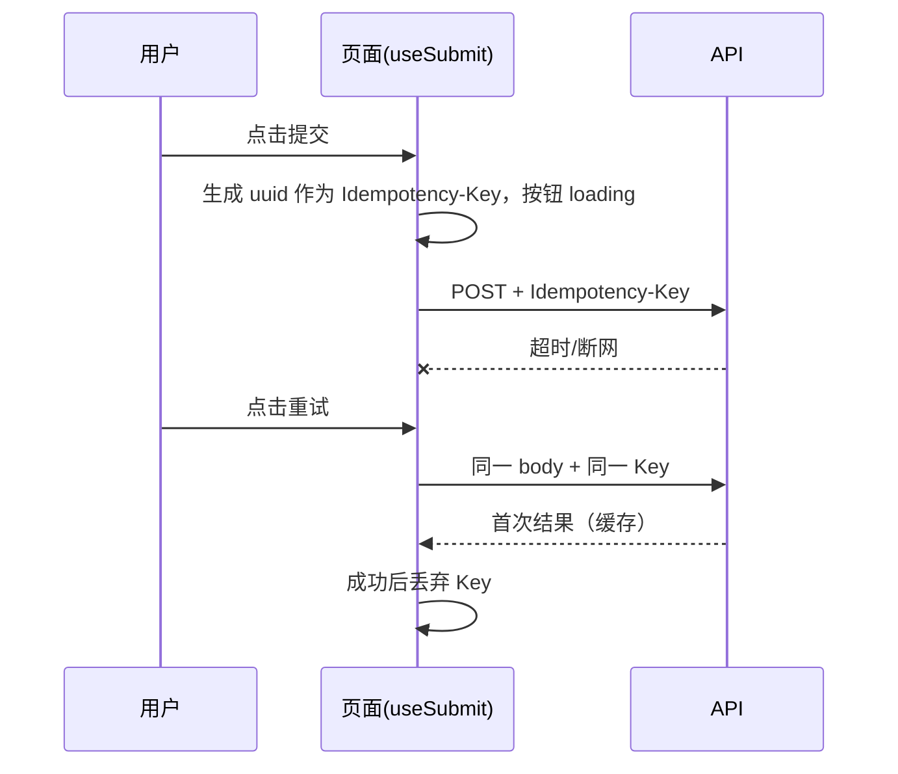

# 13 管理后台前端 详细设计

> 依据：原《WMS详细设计说明书》§2.2、§2.3、§4.6、§5、§6.1、§6.4、§8。接口路径一律以后端模块文档（第 1–12 篇）为准，本文只写「待对齐」占位，不自行定义路径。

## 1. 职责与边界

**负责**
- 仓管员、仓经理、系统管理员使用的 PC 管理后台：主数据、入库、库存、出库、波次、盘点、集成、系统、报表的查询与操作页面。
- 统一的列表、表单、选择器组件；权限渲染；数量/金额/时间格式化；错误与重试交互。

**不负责**
- 安全边界：前端权限只用来防误操作，真正的校验在接口层和数据层（§6.4）。
- 现场扫码作业：在第 14 篇分拣 H5/PDA 端。
- 司机端、商城端：**二期（M2 之后）**，本期不设计，见第 15 篇概要。
- 业务规则计算（FEFO、可售量、状态迁移是否合法）：全部以服务端为准，前端只按返回的状态控制按钮显隐。

**技术栈**：Vue 3 + TypeScript + Vite + Element Plus + Pinia + Vue Router。

**一期范围**：管理后台 + 分拣 H5。OpenAPI → TS 客户端生成及其 CI 门禁（`gen:api` + `git diff --exit-code`）等后端有 FastAPI 接口后再加；在此之前 `api/` 下手写类型，目录结构按生成后的形态预留。

## 2. 用例

| 角色 | 主要用例 |
|---|---|
| 仓管员 | 查入库单与收货进度、库存查询（按 SKU 汇总/按库位明细）、查流水、发起移库/补货 |
| 仓经理 | 看驾驶舱、管理订单池与波次、处理缺货与异常、审批盘点差异和库存调整、看报表 |
| 系统管理员 | 维护 SKU/库位/仓库/供应商/客户、用户与角色、字典、接口凭证；查审计日志、重放死信。**无改账类权限** |

职责分离（SoD）：拣货人与复核人、收货人与上架人不同由服务端校验；前端在提示文案中给出原因（业务码），不自行判断。

## 3. 页面与路由清单

路由 `meta.perm` 为进入权限点；无权限的路由不进菜单，直接访问跳 403 页。权限点命名遵循 `{模块}.{资源}.{动作}`，下表为前端建议值，最终以第 12 篇权限点枚举为准。

| 路由 | 页面 | 进入权限点 | 期次 |
|---|---|---|---|
| `/login` | 登录 | — | 一期 |
| `/dashboard` | 作业驾驶舱（待拣/拣货中/待发/已发漏斗、缺货 TOP、异常） | `dashboard.view` | 一期 |
| `/picking/pending-returns` | 主管看板：未闭环的「待回库」记录（PDA 补交被拒产生，见第 14 篇 §9.4.1），可查看、指派、主管处理 | `picking.return_record.view`（处理按钮另需 `picking.return_record.resolve`） | 一期 |
| `/master/warehouses` | 仓库/库区 | `master.warehouse.view` | 一期 |
| `/master/locations` | 库位（含批量生成+预览） | `master.location.view` | 一期 |
| `/master/skus` | SKU | `master.sku.view` | 一期 |
| `/master/suppliers`、`/master/customers` | 供应商、客户 | `master.partner.view` | 一期 |
| `/inbound/orders`、`/inbound/orders/:code` | 入库单列表/详情（计划-已收-已上架三段进度） | `inbound.order.view` | 一期 |
| `/inbound/putaway` | 上架追踪 | `inbound.putaway.view` | 一期 |
| `/inventory/stock` | 库存查询（汇总/明细切换） | `inventory.stock.view` | 一期 |
| `/inventory/movements` | 库存流水 | `inventory.movement.view` | 一期 |
| `/inventory/reservations` | 占用查询 | `inventory.reservation.view` | 一期 |
| `/inventory/expiry` | 效期预警 | `inventory.expiry.view` | 一期 |
| `/outbound/orders`、`/outbound/orders/:code` | 出库单列表/详情（状态时间线） | `outbound.order.view` | 一期 |
| `/outbound/pool` | 订单池 | `outbound.pool.view` | 一期 |
| `/wave/waves`、`/wave/waves/:code` | 波次管理/详情 | `wave.wave.view` | 一期（拖拽调单二期） |
| `/picking/tasks` | 拣货任务监控 | `picking.task.view` | 一期 |
| `/picking/checks` | 复核记录 | `picking.check.view` | 一期 |
| `/count/plans`、`/count/orders/:code` | 盘点计划、盘点单（仅看差异） | `count.order.view` | 二期 |
| `/count/approvals` | 差异/调整审批 | `inventory.adjust.approve` | 二期 |
| `/integration/logs` | 接口日志（入站/出站） | `integration.log.view` | 一期 |
| `/integration/dead-letters` | 死信重放 | `integration.deadletter.view` | 一期 |
| `/system/users`、`/system/roles` | 用户、角色与权限树 | `system.user.view` / `system.role.view` | 一期 |
| `/system/dicts` | 字典 | `system.dict.view` | 一期 |
| `/system/audit` | 操作审计（按 trace_id 串联） | `system.audit.view` | 一期 |
| `/report/*` | 人效、缺货归因、损耗、周转等 | `report.*.view` | 二期 |
| `/403`、`/404` | 异常页 | — | 一期 |

> 盘点、报表是否进一期，取决于 M0 拆分，见待定问题 Q5。

## 4. 组件拆分

```
web/src/
├── api/            # 一期手写；后端就绪后改为 generated/ + index.ts
├── components/
│   ├── ProTable/  ProForm/  DictSelect/  SkuPicker/  LocationPicker/
│   ├── WarehouseSwitcher/  StatusTag/  StateTimeline/
│   ├── QuantityText/  AmountText/  DateTimeText/
│   └── PermissionButton/   # 同时提供 v-permission 指令
├── composables/    useTable  useSubmit  useDict  usePermission  useWarehouse
├── views/  stores/  router/  utils/(format.ts, idempotency.ts, http.ts)
```

| 组件 | 职责 | 关键约定 |
|---|---|---|
| **ProTable** | 筛选+表格+分页+行操作 | 见 4.1 |
| ProForm | 配置式表单，校验、提交 | 提交走 `useSubmit`（防重+幂等键） |
| DictSelect / StatusTag | 字典下拉、状态彩色标签 | 数据来自 dict store |
| SkuPicker | 弹窗搜索 + 多选 SKU | 远程搜索防抖 300ms；回传 `{id, code, name, uom}` |
| LocationPicker | 按库区/温区筛选库位 | 只列当前仓库库位 |
| WarehouseSwitcher | 顶栏切换当前仓库 | 切换时 abort 所有在途请求，清空列表并重新请求；见 §8.5 |
| StateTimeline | 单据状态时间线 | 状态枚举与第 4 篇状态机对齐 |
| QuantityText | 展示数量 | 内部只调用 `formatQty` |
| PermissionButton / `v-permission` | 无权限**不渲染**（不是禁用） | — |

### 4.1 ProTable 一期能力

| 能力 | 一期 | 说明 |
|---|---|---|
| 查询条件持久化到 URL query | ✅ | 刷新/分享/回退不丢条件；含分页与排序 `sort=-a,b` |
| 空态/加载/错误三态 + 重试 | ✅ | 错误态显示「重试」与可复制的 `trace_id` |
| 防重复提交 | ✅ | 行操作/批量按钮 loading+禁用，带 `Idempotency-Key` |
| 权限渲染 | ✅ | 列/操作配置 `perm`，无权限不渲染 |
| 列设置（显示列、宽度） | 二期 | |
| 跨页批量选择 + 结果明细 | 二期 | 一期仅支持当前页选择 |
| 异步导出 + 下载中心 | 二期 | |

### 4.2 格式化约定

- **数量口径（已定）**：库内存 `BIGINT`，单位为 SKU 基本单位的千分之一，字段后缀 `*_qty_milli`；接口一律返回固定 3 位小数字符串（如 `"12.500"`），单位取 SKU 的 `base_uom`；写入接口接受最多 3 位小数的字符串，超过返回 400，**不舍入**。金额为整数分，时间为 ISO8601 UTC。
- 前端：`formatQty(qty, base_uom)` 显示「数量 + 基本单位」（如 `12.500 kg`）；数量输入框在客户端校验最多 3 位小数（正则 `^(0|[1-9]\d{0,11})(\.\d{1,3})?$`），超过直接提示、不自动截断，后端校验仍是最终依据。前端不接触 `*_qty_milli`。
- 输入规则：**不接受负数**（盘点差异等负数只展示不输入）；不接受前导零（`007` 拒绝，`0.5` 合法）；业务上限 `999999999999.999`（12 位整数，乘 1000 后远低于 BIGINT 上限），前后端一致，具体值待第 2 篇确认（Q9）。
- 所有格式化集中在 `utils/format.ts`：`formatQty`、`formatAmount`、`formatDate`、`formatDateTime`。
- **时间与日期分开**：`formatDateTime` 用于时间戳（接口 ISO8601 UTC），按**仓库时区**显示（当前仓库配置的时区，来自 warehouse store），不按浏览器时区；`formatDate` 用于业务日期（生产日期、效期 `expiry_date`、作业日），库内为 `DATE`、接口用 `YYYY-MM-DD`，**原样显示，不做任何时区换算**。临期天数以仓库时区的「今天」计算。
- **页面中禁止 `toFixed`、`parseFloat` 数量后再展示**；需要比较或汇总时用 `decimal.js`，封装在 `utils/qty.ts`。ESLint 规则禁止 `views/**` 出现 `toFixed`。

## 5. 状态管理

Pinia 只存**跨页共享且变化慢**的数据：

| store | 内容 | 失效 |
|---|---|---|
| `user` | 当前用户、token、`client_type=WEB` | 登出/401 |
| `perm` | 权限点集合、`features` 开关 | 登录、切换仓库后重拉 |
| `dict` | 字典 + 版本号 | 按 `since=<version>` 增量刷新 |
| `warehouse` | 可选仓库列表、当前仓库 id 与时区 | 切换时持久化到 localStorage |

- 列表、详情数据**不进 store**，每次进页面重新请求，避免脏数据。
- 当前仓库通过 `X-Warehouse-Id` 头传给服务端，服务端仍会校验权限；**`X-Warehouse-Id` 与资源所属仓库不一致时返回 403 `40311`**（例如从旧链接打开他仓单据）。
- 看板 30s 轮询，页面不可见时（`visibilitychange`）暂停。

## 6. 页面 → 接口映射

| 页面 | 动作 | 接口 |
|---|---|---|
| 登录 | 登录、获取 `me`（权限点/features/仓库） | 待对齐：见第 12 篇 |
| 全局 | 字典增量拉取 | 待对齐：见第 1 篇 |
| 驾驶舱 | 漏斗、缺货 TOP、异常汇总、未闭环待回库数与 RETURN_PENDING 冻结量 | 待对齐：见第 2、4 篇 |
| 仓库/库区/库位/SKU/伙伴 | 列表、增改、库位批量生成预览/提交 | 待对齐：见第 1 篇 |
| 入库单 | 列表、详情、收货记录 | 待对齐：见第 3 篇 |
| 上架追踪 | 列表 | 待对齐：见第 3 篇 |
| 库存查询/流水/占用 | 汇总、明细、流水、占用 | 待对齐：见第 2 篇 |
| 效期预警 | 临期列表 | 待对齐：见第 9 篇 |
| 出库单 | 列表、详情、取消、拣后取消（需原因） | 待对齐：见第 4 篇 |
| 订单池 | 列表、触发分配、加入波次 | 待对齐：见第 4、5 篇 |
| 波次 | 列表、详情、释放、撤波 | 待对齐：见第 5 篇 |
| 拣货任务/复核记录 | 列表 | 待对齐：见第 5、6 篇 |
| 待回库看板 | 列表（分页） | `GET /api/v1/return-records?status=OPEN&warehouseId=…`（见第 14 篇 §9.4.2） |
| 待回库看板 | 详情（`scrap_doc_id` 非空时显示跳转报损单链接） | `GET /api/v1/return-records/{returnRecordId}` |
| 待回库看板 | 主管处理（必填原因，可选「就近放回」+ 目标库位） | `POST /api/v1/return-records/{returnRecordId}/resolve` |
| 盘点/审批（二期） | 计划、差异、审批 | 待对齐：见第 8 篇 |
| 接口日志/死信 | 列表、报文查看、重放 | 待对齐：见第 11 篇 |
| 用户/角色/审计 | 列表、授权、审计查询 | 待对齐：见第 12 篇 |

## 7. 权限点

- **前端隐藏不是安全措施。** 按钮不渲染、路由拦截只防误操作；任何接口都可能被直接调用，权限、数据权限（仓库范围）和 SoD 一律由后端校验。前端收到 403 时按「无权限」处理并刷新权限缓存，不假设本地权限一定正确。
- 三层校验中前端只负责第一层：**路由守卫**（`meta.perm`）+ **`v-permission`/PermissionButton**（不渲染）。
- 菜单由路由表 + 权限点过滤生成，不单独维护菜单数据。
- 高危操作单列权限点并二次确认，例如：

| 操作 | 权限点（建议） | 额外交互 |
|---|---|---|
| 取消出库单（拣货前） | `outbound.order.cancel` | 确认弹窗 |
| 拣后取消 | `outbound.order.cancel_after_pick` | 必填原因 |
| 撤波 | `wave.wave.revoke` | 确认弹窗 |
| 库存调整审批 | `inventory.adjust.approve` | 显示差异明细 |
| 死信重放 | `integration.deadletter.replay` | 显示报文摘要 |

- 系统管理员角色不分配改账类权限点；界面不提供「新增权限点」入口（权限点来自代码枚举）。

## 8. 交互与异常态

### 8.1 三态
- 加载：表格骨架/`v-loading`，首屏 >300ms 才显示，避免闪烁。
- 空态：区分「暂无数据」与「筛选无结果（显示清空筛选）」。
- 错误：显示业务 `message` + 「重试」按钮 + `trace_id`（点击复制）。

### 8.2 请求与错误码
- `utils/http.ts` 统一拦截：401 → 清 token 跳登录并保留回跳地址；401 / `40110` 同上；403 / `40310`（无权限点）、`40311`（无该仓数据权限，含 `X-Warehouse-Id` 与资源所属仓库不一致）→ 提示无权限；`40311` 时提示「该单据属于其他仓库，请切换仓库后查看」，不自动切换仓库；`40930` 非法状态迁移 → 提示「单据状态已变化」并刷新当前行；`40902` → 弹「是否发起补货」（若有权限）。
- **错误码规则**：纯 5 位数字，前 3 位为 HTTP 状态码（如 `40902`、`42210`），`5xxxx` 只用于服务端错误（如 `50301` 服务不可用，可提示稍后重试）。
- `50000` 内部错误、`50010` 不变量违反：通用错误提示 + 可复制 `trace_id`；`50010` **不提供自动重试**（手动重试按钮也隐藏，提示联系管理员）；`50000` 可手动重试（同 Key）。
- 已废弃码（`50001`、`50002`、`50003`、`40901`、`40907`）数值不复用，前端不做专门分支，按未知码通用处理。
- **409 按业务码分支，不只看 HTTP 状态码**：

| 业务码 | 场景 | 前端处理 |
|---|---|---|
| `40910` | 幂等冲突，按 `detail.key_type` 分支：`IDEMPOTENCY_KEY`（同 Key 不同 body）；`PDA_OP`（PDA 同四元组不同数量）、`POD_OP` / `POD_CORRECT`（司机端，二期）、`SOURCE_ORDER`（上游同单号不同内容，集成日志页可见） | `IDEMPOTENCY_KEY`：丢弃当前 Key，提示「内容已变化，请重新提交」；`PDA_OP`/`POD_OP`/`POD_CORRECT`/`SOURCE_ORDER`：提示对应 message 并刷新；`key_type` 缺失/未知：错误态 + `trace_id`，**不自动重试、不换新 Key**，提示联系管理员 |
| `40930` | 通用非法状态迁移 | 提示「单据状态已变化」并刷新 |
| `40933` | 手工解冻系统冻结（`RETURN_PENDING`、`SCRAP_PENDING`） | 提示「系统冻结不可手工解冻」：`RETURN_PENDING` 指向待回库记录，`SCRAP_PENDING` 指向第 9 篇报损单；不重试 |
| `40932` | 待回库记录已被另一方闭环，`detail{status, resolution, target_location, closed_by, closed_at}`（`target_location` 仅 `NEARBY_PUTBACK` 时非空，否则忽略） | 提示「已由 {closed_by} 于 {closed_at} 处理」（时间按仓库时区），刷新该行 |
| `40931` | 单据已锁定 | 提示锁定原因，不重试 |
| 乐观锁（`version` 不符，码见第 2/4 篇） | 并发修改 | 提示「数据已被他人修改」，刷新后重新编辑 |
| `40920` / `40921` / `40922` | 任务改派/取消/已关闭 | 提示并刷新任务行 |
| 其它未列出的 409 | — | 统一提示业务 message 并刷新 |
- 不对 4xx 做自动重试；网络错误与 5xx 只在用户点「重试」时重发。

### 8.3 防重复提交与幂等

- **Key 持久化**：按表单维度（路由 + 表单标识 + 单据 id）把 `{key, body 快照}` 存进 `sessionStorage`，刷新页面后若 body 未变仍用同一 Key 重试；收到确定结果后删除。
- **幂等缓存范围**：服务端只缓存 2xx、400xx、409xx；422、5xx、429 等不缓存，这些响应后用同一 Key 重试会被重新执行；因此 422 修正表单后（body 变了）换新 Key，body 未变的 5xx/429 重试沿用原 Key。
- 死信重放用原 Key 还是新 Key，与第 11 篇对齐（Q10）。
- 一次「操作意图」一个 Key：表单打开时或首次提交时生成，重试沿用；表单内容被修改则重新生成（否则服务端返回 `40910`）。
- 所有 `POST`（登录除外）都带 Key；`PATCH` 带 `version`。
- **Key 生命周期**：生成 → 存在组件内存（与本次提交的 body 快照绑定）→ 超时/5xx/断网时保留，重试复用 → 收到**确定结果**（2xx 或业务 4xx）后丢弃。后台不做离线队列；刷新后从 `sessionStorage` 恢复 Key（见下）。关闭标签页后 Key 丢失，由业务层幂等（单据唯一约束、`version`）兜底。
- **重复点击**：`useSubmit` 在请求未返回前忽略后续点击（按钮 loading+禁用），同一 Key 只会同时存在一个在途请求。

### 8.4 待回库看板（`/picking/pending-returns`）
- 列表：ProTable，默认 `status=OPEN`、当前仓库；列：记录 id、任务、库位、SKU、数量（`formatQty`）、原分拣员、产生时间、已等待时长。
- **`SCRAP_PENDING` 同为系统冻结**（计入 `hold_qty_milli`；冻结来源为 `(SCRAP, 第 9 篇报损单 id)`，冻结行显示跳转该报损单的链接）：同样不显示手动解冻按钮，手工解冻返回 `40933`，处理同下；只能由第 9 篇报损完成或报损取消释放。
- **RETURN_PENDING 冻结是系统冻结**：在库存冻结/占用页面和看板中**不显示手动解冻按钮**，只能通过待回库记录的 confirm/resolve 释放。若有人直接调解冻接口，服务端返回 409 `40933 SYSTEM_HOLD_NOT_RELEASABLE`；前端提示「系统冻结只能通过待回库处理释放」并跳转对应待回库记录（若有），不重试。
- 处理：「主管处理」需 `picking.return_record.resolve`（无权限不渲染，后端仍校验）；表单必填原因；选择 `resolution`：放回原位（`RETURNED_TO_ORIGINAL`）/ 就近放回（`NEARBY_PUTBACK`，用 LocationPicker 选 `targetLocationCode`）/ 交接报损（`SCRAP_HANDOVER`）；resolve 不能由记录的原拣货人自己做（SoD，后端校验），提交后后端记一笔移库。提交带 `Idempotency-Key`，按 §8.3 规则复用。
- resolve 返回 422 `42213`（原库位因盘点冻结、或目标库位温区不符）：提示具体原因，记录保持 OPEN，可改选库位或稍后处理。
- resolve 与 PDA confirm 并发，输方收到 `40932`（`detail{status, resolution, target_location, closed_by, closed_at}`（`target_location` 仅 `NEARBY_PUTBACK` 时非空，否则忽略））：提示「已由 {closed_by} 于 {closed_at} 处理」并刷新。
- **数量影响（已定）**：每条 OPEN 记录在 `stock_hold` 有一条冻结，`hold_type=RETURN_PENDING`（系统冻结，`operator_id=0`），冻结量 = 被拒数量；该数量不计入可用量、不参与 FEFO 分配，并在 confirm/resolve 的同一事务中释放。看板与驾驶舱展示「待回库冻结量」（按仓库/库位/SKU 汇总，`formatQty` 显示）。

### 8.5 切换仓库与在途请求
- 每个请求挂在当前仓库的 `AbortController` 上；切换仓库时 abort 全部在途请求。
- 兜底：请求发出时记录 `warehouseId`，响应返回时与当前仓库比对，不一致直接丢弃，不渲染。
- 写操作在途时切换仓库：先提示「有提交未完成」，等待完成或用户确认后再切换（不 abort 写请求，避免结果未知）。

### 8.6 其它
- 单据详情页以服务端返回的 `status` 决定可用按钮；按钮的 `show` 条件与状态机文档保持一致，但最终合法性以服务端为准。
- 离开有未保存修改的表单时提示。

## 9. 多端适配与离线

- **在线专用**：管理后台不做离线能力，断网时全局顶栏提示「网络已断开」，提交按钮仍可点但会进入错误态并提供重试（沿用同一幂等键）。
- **屏幕**：设计基准 1920×1080，最小支持 1366×768；侧边栏可折叠；表格横向滚动，关键列（单号、状态、操作）固定。不做手机适配，手机访问提示使用分拣端。
- **浏览器**：最新两个大版本的 Chrome / Edge / Firefox，以及 Safari 16+；不支持 IE。构建目标 `es2020`。
- **打印**：箱码、面单打印在复核台（第 14 篇/第 6 篇），后台只做单据打印预览（二期）。

## 10. 测试要点

| 层 | 工具 | 覆盖重点 |
|---|---|---|
| 单元 | Vitest | `formatQty`/`formatAmount`/`formatDateTime` 边界（`"0.000"`、负数、空值、大数、带 `base_uom` 显示）；数量输入校验（`"10"`、`"10.5"`、`"0.5"` 合法；`"1.2345"` 拒绝且不舍入；`"-1"`、`"007"`、超上限拒绝）；`formatDate` 不做时区换算（UTC-x、UTC+14 环境下 `2026-10-15` 原样显示）；`formatDateTime` 按仓库时区；409 业务码分支表逐项；URL query ↔ 查询条件序列化；幂等键生成与复用；权限判断 |
| 组件 | Vitest + @vue/test-utils | ProTable 三态与重试、URL 恢复、权限不渲染；PermissionButton；useSubmit 重复点击只发一次、重试 Key 不变、刷新后从 sessionStorage 恢复同一 Key、body 改变后换 Key；WarehouseSwitcher 切换时 abort 在途请求、迟到的旧仓库响应被丢弃；待回库看板：列表默认 OPEN、无权限不渲染处理按钮、resolve 必填原因、就近放回需选目标库位、`42213`（冻结/温区不符）后记录仍 OPEN、并发 `40932` 提示「已由 {closed_by} 于 {closed_at} 处理」并刷新；`40930` 只按通用状态变化处理；`40910` 按 `key_type` 分支（缺失/未知不自动重试不换 Key）；`50000`/`50010` 通用提示含 trace_id，`50010` 无重试按钮；跨仓资源返回 `40311` 提示无该仓权限、RETURN_PENDING 冻结量按 `formatQty` 显示、RETURN_PENDING / SCRAP_PENDING 冻结行均无手动解冻按钮（普通人工冻结行仍显示）、SCRAP_PENDING 冻结行渲染报损单链接、待回库详情 `scrap_doc_id` 有值显示链接/为空不显示、`40932` 提示在非 NEARBY_PUTBACK 时不显示 target_location、直接调用解冻返回 `40933` 时提示且不重试、resolve 三种 resolution 表单校验（NEARBY_PUTBACK 必填目标库位）、40910 五种 key_type 分支、`expiry_date` 原样显示、confirm/resolve 后刷新归零 |
| 路由 | Vitest | 无权限跳 403、菜单过滤、401 回跳 |
| 静态 | ESLint + vue-tsc | 禁止 views 中 `toFixed`；类型检查 |

- 覆盖率目标：`utils/`、`composables/`、`components/` 行覆盖 ≥ 80%、分支 ≥ 70%；页面级不设硬指标。
- 接口用 MSW mock，mock 数据按接口文档 examples 维护；E2E（Playwright）放二期。

## 11. 待定问题

| # | 问题 | 依赖 |
|---|---|---|
| Q1 | 全部接口路径、分页/游标参数、响应字段名 | 第 1–12 篇接口清单 |
| Q2 | 权限点最终枚举与前端建议值的映射 | 第 12 篇 |
| Q3 | 字典接口形态与版本号机制 | 第 1 篇 |
| Q4 | ~~数量口径~~ **已定**：库内 `*_qty_milli`（基本单位千分之一），接口固定 3 位小数字符串 + `base_uom`，输入超 3 位小数返回 400 不舍入，见 §4.2 | 已关闭 |
| Q5 | 盘点、报表页面是否纳入一期 | M0 拆分 / Yuri |
| Q6 | 驾驶舱是否需要 SSE，还是一期只做 30s 轮询 | 第 5 篇 |
| Q7 | 前端日志/错误上报（是否接 Sentry 等）与 trace_id 透传方式 | 总体设计 §可观测性 |
| Q8 | token 刷新方案（refresh token 或静默重登） | 第 12 篇 |
| Q9 | 数量输入业务上限的具体值（当前建议 12 位整数 + 3 位小数） | 第 2 篇 |
| Q10 | 死信重放使用原 Idempotency-Key 还是新 Key | 第 11 篇 |
| Q11 | ~~待回库看板接口~~ **已定**：见第 14 篇 §9.4.2 | 已关闭 |
| Q12 | 仓库时区字段来源（仓库主数据） | 第 1 篇 |
| Q13 | ~~待回库数量是否冻结~~ **已定**：`stock_hold`（`hold_type=RETURN_PENDING`）冻结被拒数量，不计可用/不参与 FEFO，confirm/resolve 同事务释放，看板展示，见 §8.4 | 已关闭 |
| Q14 | ~~系统冻结手工解冻拒绝码~~ **已定**：`40933 SYSTEM_HOLD_NOT_RELEASABLE`，见 §8.4 | 已关闭 |
