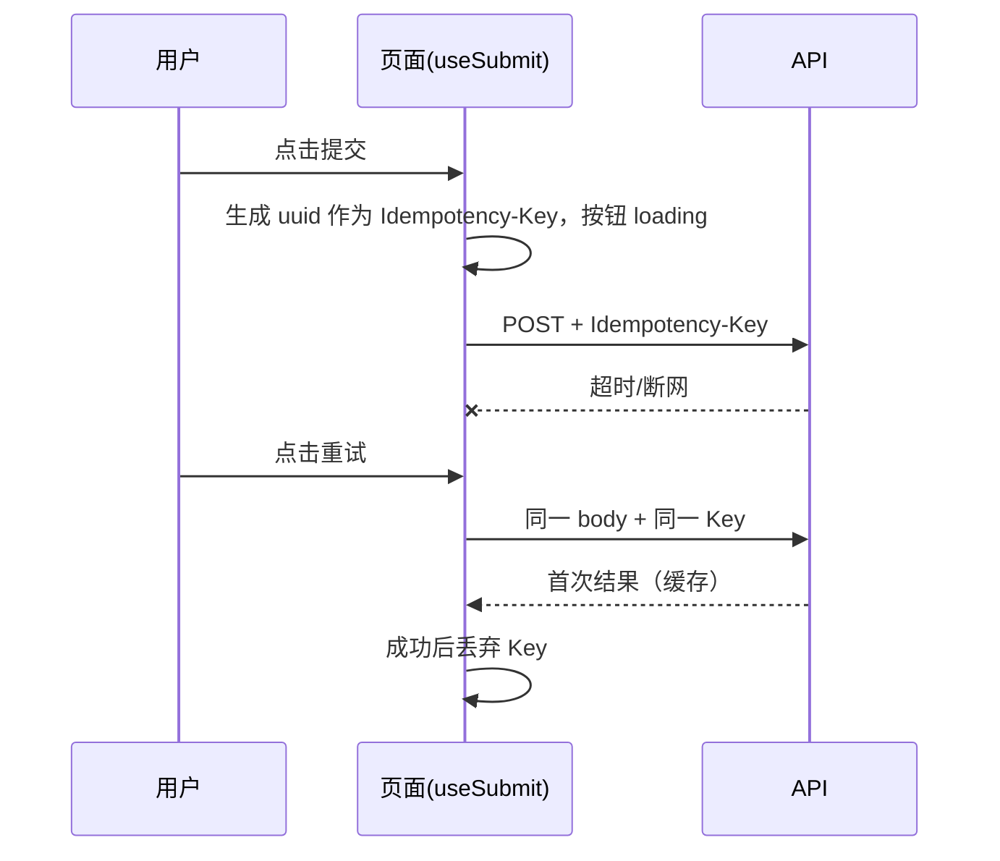

# 13 管理后台前端 详细设计

> 依据：原《WMS详细设计说明书》§2.2、§2.3、§4.6、§5、§6.1、§6.4、§8。接口路径一律以后端模块文档（第 1–12 篇）为准，本文只写「待对齐」占位，不自行定义路径。

## 1. 职责与边界

**负责**
- 仓管员、仓经理、系统管理员使用的 PC 管理后台：主数据、入库、库存、出库、波次、盘点、集成、系统、报表的查询与操作页面。
- 统一的列表、表单、选择器组件；权限渲染；数量/金额/时间格式化；错误与重试交互。

**不负责**
- 安全边界：前端权限只用来防误操作，真正的校验在接口层和数据层（§6.4）。
- 现场扫码作业：在第 14 篇分拣 H5/PDA 端。
- 司机端、商城端：见第 15 篇。
- 业务规则计算（FEFO、可售量、状态迁移是否合法）：全部以服务端为准，前端只按返回的状态控制按钮显隐。

**技术栈**：Vue 3 + TypeScript + Vite + Element Plus + Pinia + Vue Router。

**范围**：本篇为管理后台；分拣 H5/PDA 见第 14 篇，司机端/商城端见第 15 篇。所有文档写完再开发。OpenAPI → TS 客户端生成及其 CI 门禁（`gen:api` + `git diff --exit-code`）等后端有 FastAPI 接口后再加；在此之前 `api/` 下手写类型，目录结构按生成后的形态预留。

## 2. 用例

| 角色 | 主要用例 |
|---|---|
| 仓管员 | 查入库单与收货进度、库存查询（按 SKU 汇总/按库位明细）、查流水、发起移库/补货 |
| 仓经理 | 看驾驶舱、管理订单池与波次、处理缺货与异常、审批盘点差异和库存调整、看报表 |
| 系统管理员 | 维护 SKU/库位/仓库/供应商/客户、用户与角色、字典、接口凭证；查审计日志、重放死信。**无改账类权限** |

职责分离（SoD）：拣货人与复核人、收货人与上架人不同由服务端校验；前端在提示文案中给出原因（业务码），不自行判断。

## 3. 页面与路由清单

路由 `meta.perm` 为进入权限点；无权限的路由不进菜单，直接访问跳 403 页。权限点**以第 12 篇 §4.2 矩阵为准**（#9 评审中）；`dashboard.view`、`report.*.view`、`device.binding.view` 为大肥鱼裁决新增，待 #9 落表。

| 路由 | 页面 | 进入权限点 |
|---|---|---|
| `/login` | 登录 | — |
| `/dashboard` | 作业驾驶舱（待拣/拣货中/待发/已发漏斗、缺货 TOP、异常） | `dashboard.view` |
| `/picking/pending-returns` | 主管看板：未闭环的「待回库」记录（PDA 补交被拒产生，见第 14 篇 §9.4.1），可查看、指派、主管处理 | `picking.return_record.view`（处理按钮另需 `picking.return_record.resolve`） |
| `/master/warehouses` | 仓库/库区（仓库编码校验 `^[A-Z0-9]{2,16}$`（#8 @af99520），输入时自动转大写；`_`、`-`、长度不在 2–16 均报错不可提交，`-` 禁用因其嵌入审批单号 `APR-{warehouseCode}-…`；后端为准） | `master.warehouse.view` |
| `/master/locations` | 库位（含批量生成+预览） | `master.location.view` |
| `/master/skus` | SKU（列表与详情显示保质期 `shelf_life_days` 与可售天数 `sell_days`，见 §8.10） | `master.sku.view` |
| `/master/suppliers`、`/master/customers` | 供应商、客户/门店 | `master.partner.view` |
| `/master/fleet` | 车辆、司机 | `master.fleet.view` |
| `/master/devices` | 设备台账 | `master.device.view` |
| `/inventory/holds` | 冻结查询（系统冻结只读，见 §8.4） | `inventory.hold.view` |
| `/inbound/orders`、`/inbound/orders/:code` | 入库单列表/详情（计划-已收-已上架三段进度） | `inbound.order.view` |
| `/inbound/putaway` | 上架追踪 | `inbound.putaway.view` |
| `/inventory/stock` | 库存查询（汇总/明细切换） | `inventory.stock.view` |
| `/inventory/movements` | 库存流水 | `inventory.movement.view` |
| `/inventory/reservations` | 占用查询 | `inventory.reservation.view` |
| `/inventory/expiry` | 效期预警（批次列显示 `sell_deadline` 可售截止日，已过可售期标红） | `inventory.expiry.view` |
| `/loss/scraps` | 报损单列表/详情（筛选状态、来源 `source_type` 含 `SELL_EXPIRED`、仓库、创建时间） | `scrap.view` |
| `/outbound/orders`、`/outbound/orders/:code` | 出库单列表/详情（状态时间线） | `outbound.order.view` |
| `/outbound/pool` | 订单池 | `outbound.pool.view` |
| `/wave/waves`、`/wave/waves/:code` | 波次管理/详情（含 `wave_type` 列与筛选、拖拽调单，见 §8.9） | `wave.wave.view` |
| `/wave/capacity` | 波次容量配置（仓库 × `wave_type`，见 §8.9） | `wave.capacity.view`（编辑另需 `wave.capacity.edit`） |
| `/picking/tasks` | 拣货任务监控 | `picking.task.view` |
| `/picking/checks` | 复核记录 | `picking.check.view` |
| `/outbound/boxes` | 箱查询（按出库单 / 状态 `OPEN / SEALED / STAGED / SHIPPED / CANCELLED`，重量 `weight_g`）；SEALED 箱「申请作废」（`BOX_VOID`，§8.10） | `outbound.order.view`（00 §6.6.1） |
| `/offline/paper` | 纸单补录审批入口跳审批中心（`PAPER_BACKFILL`）；补录记录列表 | `offline.paper.approve` |
| `/exceptions` | 异常单（第 10 篇）：状态 / 责任方 `liable_party` / 截止前筛选，盲收异常 48h 倒计时、关联原出库单、延期（§8.10） | `exception.view`（关联 `exception.link`，延期 `exception.deadline.extend`） |
| `/system/pod-tolerance` | 仓库签收更正容差配置（§8.10） | `pod.tolerance.manage` |
| `/returns/reservations` | 退货预约列表/详情（门店创建，仓库收货；仓库角色只看本仓） | `return.reservation.view` |
| `/count/plans`、`/count/orders/:code` | 盘点计划、盘点单（仅看差异） | `count.order.view` |
| `/count/approvals` | 差异/调整审批 | `inventory.adjust.approve` |
| `/integration/logs` | 接口日志（入站/出站） | `integration.log.view` |
| `/integration/dead-letters` | 死信重放 | `integration.deadletter.view` |
| `/system/users`、`/system/roles` | 用户、角色与权限树 | `system.user.view` / `system.role.view` |
| `/system/dicts` | 字典 | `system.dict.view` |
| `/system/audit` | 操作审计（按 trace_id 串联；主管只看本仓） | `system.audit.view` |
| `/system/approvals` | 审批中心（`approval_request`，见 §8.7） | `system.approval.view` |
| `/system/devices` | 设备绑定列表（筛选仓库/状态/用户）；解绑、挂失；首次绑定的审批在审批中心（`DEVICE_BIND`） | `device.binding.view`（解绑/挂失另需 `device.binding.revoke`，确认绑定需 `device.binding.approve`） |
| `/system/nodes` | 节点号（仅中心运维） | `system.node.manage` |
| `/report/inventory` | 库存报表（周转、库龄） | `report.inventory.view` |
| `/report/outbound` | 出库报表（人效、缺货归因） | `report.outbound.view` |
| `/report/inbound` | 入库报表（供应商履约） | `report.inbound.view` |
| `/report/loss` | 损耗报表 | `report.loss.view` |
| `/403`、`/404` | 异常页 | — |


## 4. 组件拆分

```
web/src/
├── api/            # 后端接口就绪前手写；之后改为 generated/ + index.ts
├── components/
│   ├── ProTable/  ProForm/  DictSelect/  SkuPicker/  LocationPicker/
│   ├── WarehouseSwitcher/  StatusTag/  StateTimeline/
│   ├── QuantityText/  AmountText/  DateTimeText/
│   └── PermissionButton/   # 同时提供 v-permission 指令
├── composables/    useTable  useSubmit  useDict  usePermission  useWarehouse
├── views/  stores/  router/  utils/(format.ts, idempotency.ts, http.ts)
```

| 组件 | 职责 | 关键约定 |
|---|---|---|
| **ProTable** | 筛选+表格+分页+行操作 | 见 4.1 |
| ProForm | 配置式表单，校验、提交 | 提交走 `useSubmit`（防重+幂等键） |
| DictSelect / StatusTag | 字典下拉、状态彩色标签 | 数据来自 dict store |
| SkuPicker | 弹窗搜索 + 多选 SKU | 远程搜索防抖 300ms；回传 `{id, code, name, uom}` |
| LocationPicker | 按库区/温区筛选库位 | 只列当前仓库库位 |
| WarehouseSwitcher | 顶栏切换当前仓库 | 切换时 abort 所有在途请求，清空列表并重新请求；见 §8.5 |
| StateTimeline | 单据状态时间线 | 状态枚举与第 4 篇状态机对齐 |
| QuantityText | 展示数量 | 内部只调用 `formatQty` |
| PermissionButton / `v-permission` | 无权限**不渲染**（不是禁用） | — |

### 4.1 ProTable 能力

| 能力 | 说明 |
|---|---|
| 查询条件持久化到 URL query | 刷新/分享/回退不丢条件；含分页与排序 `sort=-a,b` |
| 空态/加载/错误三态 + 重试 | 错误态显示「重试」与可复制的 `trace_id` |
| 防重复提交 | 行操作/批量按钮 loading+禁用，带 `Idempotency-Key` |
| 权限渲染 | 列/操作配置 `perm`，无权限不渲染 |
| 列设置（显示列、宽度） | 存 localStorage（按用户 + 页面） |
| 跨页批量选择 + 结果明细 | 保留跨页选中集；批量操作前二次确认，结果显示成功/失败条数与失败原因 |
| 异步导出 + 下载中心 | 后端异步任务，前端轮询任务状态，完成后在下载中心下载 |

### 4.2 格式化约定

- **数量口径（已定）**：库内存 `BIGINT`，单位为 SKU 基本单位的千分之一，字段后缀 `*_qty_milli`；接口一律返回固定 3 位小数字符串（如 `"12.500"`），单位取 SKU 的 `base_uom`；写入接口接受最多 3 位小数的字符串，超过返回 400，**不舍入**。金额为整数分，时间为 ISO8601 UTC。
- 前端：`formatQty(qty, base_uom)` 显示「数量 + 基本单位」（如 `12.500 kg`）；数量输入框在客户端校验最多 3 位小数（正则 `^(0|[1-9]\d{0,11})(\.\d{1,3})?$`），超过直接提示、不自动截断，后端校验仍是最终依据。前端不接触 `*_qty_milli`。
- 输入规则：**不接受负数**（盘点差异等负数只展示不输入）；不接受前导零（`007` 拒绝，`0.5` 合法）；业务上限 `999999999999.999`（12 位整数，乘 1000 后远低于 BIGINT 上限），前后端一致，具体值待第 2 篇确认（Q9）。
- 所有格式化集中在 `utils/format.ts`：`formatQty`、`formatAmount`、`formatDate`、`formatDateTime`。
- **时间与日期分开**：`formatDateTime` 用于时间戳（接口 ISO8601 UTC），按**仓库时区**显示（当前仓库配置的时区，来自 warehouse store），不按浏览器时区；`formatDate` 用于业务日期（生产日期、效期 `expiry_date`、作业日），库内为 `DATE`、接口用 `YYYY-MM-DD`，**原样显示，不做任何时区换算**。临期天数以仓库时区的「今天」计算。
- **页面中禁止 `toFixed`、`parseFloat` 数量后再展示**；需要比较或汇总时用 `decimal.js`，封装在 `utils/qty.ts`。ESLint 规则禁止 `views/**` 出现 `toFixed`。

## 5. 状态管理

Pinia 只存**跨页共享且变化慢**的数据：

| store | 内容 | 失效 |
|---|---|---|
| `user` | 当前用户、token、`client_type=WEB` | 登出/401 |
| `perm` | 权限点集合、`features` 开关 | 登录、切换仓库后重拉 |
| `dict` | 字典 + 版本号 | 按 `since=<version>` 增量刷新 |
| `warehouse` | 可选仓库列表、当前仓库 id 与时区 | 切换时持久化到 localStorage |

- 列表、详情数据**不进 store**，每次进页面重新请求，避免脏数据。
- 当前仓库通过 `X-Warehouse-Id` 头传给服务端，服务端仍会校验权限；**`X-Warehouse-Id` 与资源所属仓库不一致时返回 403 `40311`**（例如从旧链接打开他仓单据）。
- 看板 30s 轮询，页面不可见时（`visibilitychange`）暂停。

## 6. 页面 → 接口映射

| 页面 | 动作 | 接口 |
|---|---|---|
| 登录 | 登录、刷新、登出 | `POST /api/v1/auth/login`、`/auth/refresh`、`/auth/logout`（第 12 篇 §8） |
| 登录 | 当前用户：用户信息、可访问仓库、权限点列表、`perm_version`（存于 `sys_user`） | `GET /api/v1/me` |
| 全局 | 字典增量拉取 | 待对齐：见第 1 篇 |
| 驾驶舱 | 漏斗、缺货 TOP、异常汇总、未闭环待回库数与 RETURN_PENDING 冻结量 | 待对齐：见第 2、4 篇 |
| 仓库/库区/库位 | 列表、增改 | `GET/POST/PUT /api/v1/master/warehouses`、`/zones`、`/locations`（第 1 篇 §7） |
| 库位批量生成预览/提交 | — | 待对齐：见第 1 篇（#8 未列） |
| SKU/单位/条码 | 列表、增改 | `GET/POST/PUT /api/v1/master/skus`、`/skus/{id}/units`、`/skus/{id}/barcodes` |
| 往来方 / 车辆司机 / 设备 | 列表、增改 | `/api/v1/master/suppliers`、`/customers`、`/vehicles`、`/drivers`、`/devices` |
| 主数据通用 | 停用 / 启用 | `POST /api/v1/master/{entity}/{id}/disable`、`/enable`（返回 `{status, blockers}`） |
| 主数据软删 | 申请 / 撤销 / 进度 | `POST /api/v1/master/{entity}/{id}/delete-request`、`/delete-request/cancel`、`GET .../pending-actions` |
| 节点号 | 列表、分配、退役 | `GET/POST /api/v1/master/nodes`、`/nodes/{node_id}/retire` |
| 审批中心 | 发起 / 通过 / 驳回 / 撤回 | `POST /api/v1/approvals`、`/approvals/{id}/approve`、`/reject`、`/withdraw`（第 12 篇 §8） |
| 审批中心 | 列表（`status`、`type`、`mine=true` 我发起的、`todo=true` 待我审批、`warehouse_id`、`page`） | `GET /api/v1/approvals` |
| 审批中心 | 详情 | `GET /api/v1/approvals/{id}` |
| 箱查询 | 列表 / 详情（`outbound.order.view`） | `GET /api/v1/pack/boxes?order_id=&status=`、`GET /api/v1/pack/boxes/{box_id}` |
| 箱作废 | 发起 `BOX_VOID`（`{reason_code: LOST\|DAMAGED, remark, photo_ids[]}`） | `POST /api/v1/pack/boxes/{box_id}/void-request` |
| 箱作废 | 审批 | `POST /api/v1/pack/boxes/{box_id}/void-request/approve` |
| 纸单补录 | 审批（`PAPER_BACKFILL`，主管） | 审批中心 `POST /api/v1/approvals/{id}/approve` / `reject`；补录提交 `POST /api/v1/offline/paper-records`（PDA/司机端） |
| 异常单 | 列表（`status`、`liable_party`、`deadline_before`） | `GET /api/v1/exceptions?status=&liable_party=&deadline_before=` |
| 异常单 | 关联原出库单 | `POST /api/v1/exceptions/{id}/link` |
| 异常单 | 延期（`{new_deadline_at, reason}`，只能往后） | `POST /api/v1/exceptions/{id}/extend-deadline` |
| 签收容差 | 读取 / 保存（带 `version`，不一致 `40930`） | `GET/PUT /api/v1/warehouses/{code}/pod-tolerance` |
| 退货预约 | 列表 / 详情 | `GET /api/v1/returns/reservations?store_code=&status=`、`GET /api/v1/returns/reservations/{id}` |
| 退货预约 | 收货 | `POST /api/v1/returns/reservations/{id}/receive` |
| 断网状态 | `{stale_policy, paused, offline_since, offline_deadline_at, paused_actions[]}` | `GET /api/v1/me` |
| 拣后取消审批 | 通过 / 驳回（需 `outbound.order.cancel_after_pick.approve`，申请人不可审批，`40312`） | `POST /api/v1/approvals/{id}/approve` / `reject`（带 `version`） |
| 非计划切换 | 确认 | `POST /api/v1/failover/{warehouse_code}/confirm` |
| 设备绑定 | 首次绑定确认 | 审批中心 `DEVICE_BIND`：`POST /api/v1/approvals/{id}/approve` / `reject` |
| 设备绑定 | 解绑、挂失 | `POST /api/v1/devices/bindings/{id}/revoke` |
| 设备绑定 | 列表（`warehouse_id`、`status`、`user_id`、`page`；`status=PENDING` 即待确认） | `GET /api/v1/devices/bindings` |
| 入库单 | 列表、详情、收货记录 | 待对齐：见第 3 篇 |
| 上架追踪 | 列表 | 待对齐：见第 3 篇 |
| 库存查询/流水/占用 | 汇总、明细、流水、占用 | 待对齐：见第 2 篇 |
| 效期预警 | 临期列表 | 待对齐：见第 9 篇 |
| 报损单 | 列表 | `GET /api/v1/scrap-orders?status=&source_type=&warehouse_code=&created_from=&created_to=` |
| 报损单 | 详情 | `GET /api/v1/scrap-orders/{id}` |
| 出库单 | 列表、详情、取消、拣后取消（需原因） | 待对齐：见第 4 篇 |
| 订单池 | 列表、触发分配、加入波次 | 待对齐：见第 4、5 篇 |
| 波次 | 列表、详情、释放、撤波 | 待对齐：见第 5 篇 |
| 拣货任务/复核记录 | 列表 | 待对齐：见第 5、6 篇 |
| 待回库看板 | 列表（分页） | `GET /api/v1/return-records?status=OPEN&warehouseId=…`（见第 14 篇 §9.4.2） |
| 待回库看板 | 详情（`scrap_doc_id` 非空时显示跳转报损单链接） | `GET /api/v1/return-records/{returnRecordId}` |
| 待回库看板 | 主管处理（必填原因，可选「就近放回」+ 目标库位） | `POST /api/v1/return-records/{returnRecordId}/resolve` |
| 盘点/审批 | 计划、差异、审批 | 待对齐：见第 8 篇 |
| 波次容量配置 | 读取 | `GET /api/v1/warehouses/{code}/wave-capacity` |
| 波次容量配置 | 保存（按 `wave_type` 整行替换，带 `version`；未配置行 `version=0` 首建；冲突 `40930 detail{reason, wave_type, current_version}`） | `PUT /api/v1/warehouses/{code}/wave-capacity` |
| 接口日志/死信 | 列表、报文查看、重放 | 待对齐：见第 11 篇 |
| 用户/角色 | 列表、授权、分配仓 | `GET/POST/PUT /api/v1/system/users`、`/system/roles`、`/system/users/{id}/warehouses` |
| 审计 | 查询、导出 | `GET /api/v1/audit-logs?target_type=&target_id=&actor_id=&from=&to=`、`POST /api/v1/audit-logs/export`（异步） |

## 7. 权限点

- **前端隐藏不是安全措施。** 按钮不渲染、路由拦截只防误操作；任何接口都可能被直接调用，权限、数据权限（仓库范围）和 SoD 一律由后端校验。前端收到 403 时按「无权限」处理并刷新权限缓存，不假设本地权限一定正确。
- 三层校验中前端只负责第一层：**路由守卫**（`meta.perm`）+ **`v-permission`/PermissionButton**（不渲染）。
- 菜单由路由表 + 权限点过滤生成，不单独维护菜单数据。
- 高危操作单列权限点并二次确认，例如：

| 操作 | 权限点（建议） | 额外交互 |
|---|---|---|
| 取消出库单（拣货前） | `outbound.order.cancel` | 确认弹窗 |
| 拣后取消（申请） | `outbound.order.cancel_after_pick` | 必填原因；发起 `CANCEL_AFTER_PICK` 审批（§8.7），审批通过后执行 |
| 拣后取消（审批） | `outbound.order.cancel_after_pick.approve` | 仓库主管 + CENTER_OPS（CENTER_OPS 数据范围 ALL，可审批其他仓的单）；申请人本人不显示通过/驳回（即使持有 `.approve`），后端 `ck_apr_sod` / `40312 SOD_VIOLATION`（`detail.rule`）兜底 |
| 撤波 | `wave.wave.revoke` | 确认弹窗 |
| 库存调整审批 | `inventory.adjust.approve` | 显示差异明细 |
| 死信重放 | `integration.deadletter.replay` | 显示报文摘要 |
| 人工冻结 / 解冻 | `inventory.hold.freeze` / `inventory.hold.unfreeze` | 解冻人 ≠ 冻结人（SoD-2，后端 40312）；SoD-2 豁免全部系统冻结（`RETURN_PENDING`、`SCRAP_PENDING`、`RETURN_QC`），它们不显示解冻按钮、只能由各自流程释放（40933） |
| 审批通过 / 驳回 | 按类型：`POD_CORRECT` → `delivery.pod.correct.approve`；`CANCEL_AFTER_PICK` → `outbound.order.cancel_after_pick.approve`（申请用 `outbound.order.cancel_after_pick`）；`DEVICE_BIND` → `device.binding.approve`；`BOX_VOID` → `pack.box.void.approve`；`PAPER_BACKFILL` → `offline.paper.approve`；`SCRAP_MISREPORT` → `scrap.misreport.approve`（QC_SUPERVISOR 或 CENTER_OPS；发起需 `scrap.misreport.request`，仅 WH_SUPERVISOR；发起人即使同时是 CENTER_OPS 也不能审批自己的单）；`UNPLANNED_FAILOVER` → `system.failover.confirm` | 申请人本人不显示按钮（SoD-5，后端 40312） |
| 设备解绑 / 挂失 | `device.binding.revoke` | 确认弹窗；挂失后该设备离线令牌全部失效 |
| 非计划切换确认 | `system.failover.confirm` | 共 3 人：1 名发起人 + 1 名仓库主管确认 + 1 名中心运维确认；发起人不能担任任何一个确认人，见 §8.7 |
| 主数据停用 / 启用 | 对应 `master.*.edit` | 显示 `blockers` |
| 箱作废（`BOX_VOID`） | 发起 `pack.box.void.request`（复核员、仓库主管）/ 审批 `pack.box.void.approve`（仓库主管、CENTER_OPS） | 必填原因与处置（丢失 / 损坏）；申请人不能审批自己的单，本人不显示审批按钮（`40312`） |
| 纸单补录审批（`PAPER_BACKFILL`） | 申请 `offline.paper.backfill`（PDA/司机端）/ 审批 `offline.paper.approve`（主管） | 申请人不显示审批按钮（`40312`）；详情显示纸单照片、`occurred_at`（仓库时区）、`action_type`、`payload` |
| 签收容差配置 | `pod.tolerance.manage`（仓库主管、CENTER_OPS） | 无权限只读不渲染保存 |
| 异常单查看 / 关联 / 延期 | `exception.view` / `exception.link` / `exception.deadline.extend`（主管） | 无权限不渲染按钮；延期必填原因 |
| 退货预约查看 | `return.reservation.view` | 仓库角色只看本仓；门店只看本店（商城端） |
| 报损单查看 | `scrap.view` | 无权限不显示菜单 |
| 主数据申请删除 / 撤销删除 | `master.delete.request` / `master.delete.cancel` | 确认弹窗；直接删除无入口（`40936`） |

**内置角色**（第 12 篇 §4.1）：SYS_ADMIN、CENTER_OPS、MD_ADMIN、WH_SUPERVISOR、QC_SUPERVISOR（质检主管，按仓库授权；#9 @83b5681 新增）、WH_KEEPER、PICKER、CHECKER、DISPATCHER、DRIVER、CS、FINANCE、AUDITOR、MALL_CUSTOMER。前端不按角色写死菜单，只按 `me` 返回的权限点集合渲染；SYS_ADMIN 只有 `system.*` 权限点，因此只看到系统菜单。PICKER/CHECKER/DRIVER/MALL_CUSTOMER 不使用后台（无对应菜单权限）。

- 系统管理员角色不分配改账类权限点；界面不提供「新增权限点」入口（权限点来自代码枚举）。

## 8. 交互与异常态

### 8.1 三态
- 加载：表格骨架/`v-loading`，首屏 >300ms 才显示，避免闪烁。
- 空态：区分「暂无数据」与「筛选无结果（显示清空筛选）」。
- 错误：显示业务 `message` + 「重试」按钮 + `trace_id`（点击复制）。

### 8.2 请求与错误码
- `utils/http.ts` 统一拦截：401 → 清 token 跳登录并保留回跳地址；401 / `40110` 同上；403 / `40310`（无权限点）、`40311`（无该仓数据权限，含 `X-Warehouse-Id` 与资源所属仓库不一致）→ 提示无权限；`40311` 时提示「该单据属于其他仓库，请切换仓库后查看」，不自动切换仓库；`40930` 非法状态迁移 → 提示「单据状态已变化」并刷新当前行；`40902` → 弹「是否发起补货」（若有权限）。
- **错误码规则**：纯 5 位数字，前 3 位为 HTTP 状态码（如 `40902`、`42210`），`5xxxx` 只用于服务端错误（如 `50301` 服务不可用，可提示稍后重试）。
- `50000` 内部错误、`50010` 不变量违反：通用错误提示 + 可复制 `trace_id`；`50010` **不提供自动重试**（手动重试按钮也隐藏，提示联系管理员）；`50000` 可手动重试（同 Key）。
- 已废弃码（`50001`、`50002`、`50003`、`40901`、`40907`）数值不复用，前端不做专门分支，按未知码通用处理。
- **认证与权限码（第 12 篇 §8.1）**：
  - `40110` 按 `detail.reason` 分支：
    - `TOKEN_EXPIRED`：用刷新令牌刷新一次后重放原请求（同 Key）；刷新失败跳登录并保留回跳地址。
    - `PERM_VERSION_CHANGED`：刷新令牌后重新拉 `GET /api/v1/me`，用新权限点重建菜单与按钮；当前页面已无权限则跳 403；**不自动重放**原写请求（权限可能已收回），提示用户重新操作。
    - `DEVICE_UNBOUND`：后台账号不会出现，按跳登录处理（PDA/司机端清本地令牌回登录页，见第 14 篇）。
    - reason 缺失/未知：跳登录。
  - `40312 SOD_VIOLATION`：提示「违反职责分离（{detail.rule}）」，不重试。
  - `40111` / `40112` 是 PDA/司机端设备登录与离线令牌码，后台不会收到，按未知码处理。
- **主数据码（第 1 篇 §7.1）**：`40960 MASTER_IN_USE` 在表单内列出 `detail.blockers`（类型、id、数量）；`40961 MASTER_CODE_DUPLICATE` 标红对应字段；`40962 MASTER_READ_ONLY_NODE` 提示「当前连的是边缘节点，主数据请到中心修改」并显示 `detail.center_endpoint`；`42220 DRIVER_CERT_EXPIRED` 提示健康证过期；`42221 MASTER_DISABLED` 提示「{entity_type} 已停用或停用中」；`40010` 数量格式（含单位换算非整数）标红数量字段。`42222 LOSS_TOLERANCE_OUT_OF_RANGE` 标红 SKU 表单的损耗容差字段；`40963–40969`、`42223–42229` 为预留，按未知码处理。
- **损耗容差字段**：SKU 表单以百分比录入（最多 4 位小数），提交前换算为 `natural_loss_tolerance_ppm`（× 10 000，整数）；客户端限制 0–5%（≤ 50 000 ppm），超出不提交，后端 `42222` 为准。
- **409 按业务码分支，不只看 HTTP 状态码**：

| 业务码 | 场景 | 前端处理 |
|---|---|---|
| `40910` | 幂等冲突，按 `detail.key_type` 分支：`IDEMPOTENCY_KEY`（同 Key 不同 body）；`PDA_OP`（PDA 同四元组不同数量）、`POD_OP` / `POD_CORRECT`（司机端）、`SOURCE_ORDER`（上游同单号不同内容，集成日志页可见） | `IDEMPOTENCY_KEY`：丢弃当前 Key，提示「内容已变化，请重新提交」；`PDA_OP`/`POD_OP`/`POD_CORRECT`/`SOURCE_ORDER`：提示对应 message 并刷新；`key_type` 缺失/未知：错误态 + `trace_id`，**不自动重试、不换新 Key**，提示联系管理员 |
| `40930` | 通用非法状态迁移 | 提示「单据状态已变化」并刷新 |
| `40934` | 审批已被别人处理，`detail{status, decided_by, decided_at}` | 提示「已由 {decided_by} 于 {decided_at} 处理」，刷新审批详情 |
| `40935` | 审批执行时目标状态已变（审批已置 REJECTED） | 提示「目标单据状态已变化，审批未执行」，刷新 |
| `40933` | 手工解冻系统冻结，`detail{hold_type, source_type, source_id}` | 不重试。按 `detail.hold_type` 提示、按 `source_type/source_id` 生成链接：`RETURN_PENDING`（`RETURN_RECORD`）→「只能由待回库处理释放」+ 待回库记录；`SCRAP_PENDING`（`SCRAP`）→「只能由报损完成或撤销释放」+ 第 9 篇报损单；`RETURN_QC`（`QC`）→「只能由质检释放」+ 第 10 篇质检单（门店退货也走这一行：第 10 篇为其建质检单、质检单来源字段为 `STORE_RETURN`，冻结仍是 `source_type=QC`；质检页显示来源 `STORE_RETURN`）。其他 `hold_type`/`source_type` 组合不生成链接。`hold_type` 未知或 `detail` 缺失 →「系统冻结，不能手工解冻」，**不带链接** |
| `40932` | 待回库记录已被另一方闭环，`detail{status, resolution, target_location, closed_by, closed_at}`（`target_location` 仅 `NEARBY_PUTBACK` 时非空，否则忽略） | 提示「已由 {closed_by} 于 {closed_at} 处理」（时间按仓库时区），刷新该行 |
| `40931` | 单据已锁定 | 提示锁定原因，不重试 |
| 乐观锁（`version` 不符，码见第 2/4 篇） | 并发修改 | 提示「数据已被他人修改」，刷新后重新编辑 |
| `40920` / `40921` / `40922` | 任务改派/取消/已关闭 | 提示并刷新任务行 |
| 其它未列出的 409 | — | 统一提示业务 message 并刷新 |
- 不对 4xx 做自动重试；网络错误与 5xx 只在用户点「重试」时重发。

### 8.3 防重复提交与幂等

- **Key 持久化**：按表单维度（路由 + 表单标识 + 单据 id）把 `{key, body 快照}` 存进 `sessionStorage`，刷新页面后若 body 未变仍用同一 Key 重试；收到确定结果后删除。
- **幂等缓存范围**：服务端只缓存 2xx、400xx、409xx；422、5xx、429 等不缓存，这些响应后用同一 Key 重试会被重新执行；因此 422 修正表单后（body 变了）换新 Key，body 未变的 5xx/429 重试沿用原 Key。
- 死信重放用原 Key 还是新 Key，与第 11 篇对齐（Q10）。
- 一次「操作意图」一个 Key：表单打开时或首次提交时生成，重试沿用；表单内容被修改则重新生成（否则服务端返回 `40910`）。
- 所有 `POST`（登录除外）都带 Key；`PATCH` 带 `version`。
- **Key 生命周期**：生成 → 存在组件内存（与本次提交的 body 快照绑定）→ 超时/5xx/断网时保留，重试复用 → 收到**确定结果**（2xx 或业务 4xx）后丢弃。后台不做离线队列；刷新后从 `sessionStorage` 恢复 Key（见下）。关闭标签页后 Key 丢失，由业务层幂等（单据唯一约束、`version`）兜底。
- **重复点击**：`useSubmit` 在请求未返回前忽略后续点击（按钮 loading+禁用），同一 Key 只会同时存在一个在途请求。

### 8.4 待回库看板（`/picking/pending-returns`）
- 列表：ProTable，默认 `status=OPEN`、当前仓库；列：记录 id、任务、库位、SKU、数量（`formatQty`）、原分拣员、产生时间、已等待时长。
- **`RETURN_QC` 同为系统冻结**：退货待质检冻结，不显示手动解冻按钮，手工解冻返回 `40933`；只能由第 10 篇质检释放，冻结行链接对应质检单/退货入库单。
- **`SCRAP_PENDING` 同为系统冻结**（计入 `hold_qty_milli`；冻结来源为 `(SCRAP, 第 9 篇报损单 id)`，冻结行显示跳转该报损单的链接）：同样不显示手动解冻按钮，手工解冻返回 `40933`，处理同下；只能由第 9 篇报损完成或报损取消释放。
  - **误报转质检**（第 2 篇 `convert_hold` @2d1609c）：`SCRAP_PENDING → RETURN_QC` 只在带 `SCRAP_MISREPORT` 审批单号时允许；其他跨类型转换返回 `40930`（不重试，刷新冻结行）。转换后冻结行显示不可变字段 `approval_type` / `approval_no`（只读，空则不显示）；同一事务内第 9 篇报损单被**作废**，报损单状态显示「已作废」（不是撤销/REVOKED），冻结行链接改指向质检单。
  - **报损单撤回**：来源 `source_type` 为 `RETURN_QC`（质检不合格）或 `RETURN_HANDOVER`（待回库交接）的报损单**不可撤回/驳回**：撤回按钮置灰，tooltip「该报损单不可撤回，如属误报请申请误报转质检（SCRAP_MISREPORT）」；服务端若仍返回 `40930`（`detail.scrap_source_type`），刷新详情，不重试。交接单草稿数量**不可编辑**，固定等于冻结量。
  - 冻结行的 `approval_no`（APR 格式）可点击，跳转对应审批详情 `/system/approvals/{id}`；`SCRAP_MISREPORT` 发起与审批见 §8.7。
- **RETURN_PENDING 冻结是系统冻结**：在库存冻结/占用页面和看板中**不显示手动解冻按钮**，只能通过待回库记录的 confirm/resolve 释放。若有人直接调解冻接口，服务端返回 409 `40933 SYSTEM_HOLD_NOT_RELEASABLE`；前端提示「系统冻结只能通过待回库处理释放」并跳转对应待回库记录（若有），不重试。
- 处理：「主管处理」需 `picking.return_record.resolve`（无权限不渲染，后端仍校验）；表单必填原因；选择 `resolution`：放回原位（`RETURNED_TO_ORIGINAL`）/ 就近放回（`NEARBY_PUTBACK`，用 LocationPicker 选 `targetLocationCode`）/ 交接报损（`SCRAP_HANDOVER`）；resolve 不能由记录的原拣货人自己做（SoD，后端校验），提交后后端记一笔移库。提交带 `Idempotency-Key`，按 §8.3 规则复用。
- resolve 返回 422 `42213`（原库位因盘点冻结、或目标库位温区不符）：提示具体原因，记录保持 OPEN，可改选库位或稍后处理。
- resolve 与 PDA confirm 并发，输方收到 `40932`（`detail{status, resolution, target_location, closed_by, closed_at}`（`target_location` 仅 `NEARBY_PUTBACK` 时非空，否则忽略））：提示「已由 {closed_by} 于 {closed_at} 处理」并刷新。
- **数量影响（已定）**：每条 OPEN 记录在 `stock_hold` 有一条冻结，`hold_type=RETURN_PENDING`（系统冻结，`operator_id=0`），冻结量 = 被拒数量；该数量不计入可用量、不参与 FEFO 分配，并在 confirm/resolve 的同一事务中释放。看板与驾驶舱展示「待回库冻结量」（按仓库/库位/SKU 汇总，`formatQty` 显示）。

### 8.5 切换仓库与在途请求
- 每个请求挂在当前仓库的 `AbortController` 上；切换仓库时 abort 全部在途请求。
- 兜底：请求发出时记录 `warehouseId`，响应返回时与当前仓库比对，不一致直接丢弃，不渲染。
- 写操作在途时切换仓库：先提示「有提交未完成」，等待完成或用户确认后再切换（不 abort 写请求，避免结果未知）。

### 8.6 主数据状态与单位换算
- **`PENDING_DISABLE`**：主数据（SKU、库位、往来方、车辆、司机）状态 `ACTIVE / PENDING_DISABLE / DISABLED`。列表用 StatusTag 显示「停用中」（橙色），悬浮提示按第 1 篇 `md_disable_action_policy`：**增加引用的动作被拦（`42221`）、减少引用的动作照常**（拣完、发完、释放冻结、报损转换、门店退货入质检等）。`42221` 的 `detail.action_code` 用于提示被拦的具体动作。停用操作返回 `{status, blockers}`：`PENDING_DISABLE` 时展示 blockers 列表；可「撤销停用」（`enable`）。
- **两段式软删 `PENDING_DELETE` → `DELETED`**（第 1 篇 §4.4/§5.3 @95037f9）：状态码表增加 `PENDING_DELETE`（StatusTag「删除中」，橙色）与 `DELETED`（「已删除」，灰色，终态）。主数据列表的状态筛选增加这两项（存 URL query），默认列表不显示 `DELETED`。
  - **接口与权限**（大肥鱼裁定 Q18）：申请删除 `POST /api/v1/master/{entity}/{id}/delete-request`（带 `md_version`，不一致 `40930`：刷新详情，不自动重试），按钮受 `master.delete.request` 控制；撤销 `POST /api/v1/master/{entity}/{id}/delete-request/cancel`（带 `md_version`，不一致 `40930`），退回申请前的状态（`prior_status`：ACTIVE 或 DISABLED），按钮受 `master.delete.cancel` 控制；进度 `GET /api/v1/master/{entity}/{id}/pending-actions`，每个权威库一行，字段 `{warehouse_id, node_id, action, requested_version, status, applied_version, prior_status, blockers, updated_at}`，默认只返回当前版本行，`?history=true` 返回全部。**`PENDING_DISABLE` 期间不显示「申请删除」按钮**（后端条件更新只接受 ACTIVE/DISABLED，命中 0 行返回 `40930`，库层 `md_delete_request_invalid` 兜底；前端收到时刷新、不重试）。无权限不渲染按钮（后端兜底）。
  - 申请删除（ACTIVE/DISABLED → `PENDING_DELETE`）后**立即**按 `PENDING_DISABLE` 同口径拦增加引用的动作（`42221`，`detail.status=PENDING_DELETE`），选择器同样过滤。
  - **确认进度**：详情页复用停用确认组件，按 `md_pending_disable` 每个权威库一行展示（库/节点、`action`、`requested_version`、`status` = `WAITING / APPLIED / CANCELLED`、`applied_version`）；组件按 `action` 区分标题：`DISABLE`「停用确认」/ `DELETE`「删除确认」，只显示当前状态对应 action 且 `requested_version` = 当前 `md_version` 的行，旧版本行折叠为历史。全部 `APPLIED` 后由 worker 置 `DELETED`，前端轮询/刷新看到状态变化，不提供「强制删除」按钮。`APPLIED`、`CANCELLED` 是终态，行只读。
  - 任一权威库回报有引用 → 实体退回申请前的状态（`prior_status`，可能是 DISABLED，不一定是 ACTIVE），剩余 WAITING 行变 `CANCELLED`，前端显示 `40960` 的 `detail.blockers`。
  - `PENDING_DELETE` 期间：编辑、删除、停用按钮置灰（tooltip「删除确认中」），只保留「撤销删除」（退回申请前的状态）；`DELETED` 只读，所有写按钮不渲染（库层 `md_deleted_final`）。
  - **一段式软删被拒**：直接 `DELETE /api/v1/master/{entity}/{id}` 一律返回 HTTP 409 `40936 MD_DELETE_REQUEST_REQUIRED`（`detail {entity_type, entity_id, status, request_path}`）：提示「请先申请删除，并等待各仓确认」，引导到「申请删除」按钮，不重试。前端不提供直接删除入口。
- **条码换绑原子显示**（M1）：中心一次换绑在同一批次（`batch_id`）写旧绑定 `DELETE` + 新绑定 `UPSERT`，边缘同事务应用。SKU 条码页把换绑作为**一次操作**提交并展示：成功后旧条码行消失、新条码行出现，不显示「已删旧、未建新」的中间态；失败（如 `40961`）则两者都不变。
- **选择器**：SkuPicker、LocationPicker 等在**增加引用**的场景（新建单据、分配、上架等，以策略表 `ref_effect=ADD` 为准）过滤掉 `PENDING_DISABLE` 与 `DISABLED`；查看已有单据时照常显示原值并带状态标签。
- **单位换算（`base_qty_milli`）**：SKU 单位表单录入 `base_qty`（3 位小数字符串，如 1 箱 = `"12.500"` KG），接口解析为 `base_qty_milli`；基本单位行固定 `1.000`。前端按单位换算显示时用 `utils/qty.ts` 的整数运算（`milli × base_qty_milli / 1000`），结果非整数时前端提示并阻止提交（后端 `40010` 为准），不取整。`base_uom` 有过库存或单据后不可改（`40960`），表单在后端返回 blockers 后置灰该字段。

### 8.7 审批中心（`approval_request`）
- 类型：`POD_CORRECT`（司机端签收更正）、`CANCEL_AFTER_PICK`（拣后取消）、`UNPLANNED_FAILOVER`（非计划切换）、`DEVICE_BIND`（PDA/司机端首次绑定设备）、`SCRAP_MISREPORT`（报损误报转质检）、`BOX_VOID`（已封箱作废，§8.10）、`PAPER_BACKFILL`（离线纸单事后补录：详情展示 `action_type`、`occurred_at`、`operator_id`、`payload` 原文与纸单照片；主管 `offline.paper.approve` 审批，申请人不能自批；必须在恢复联网后 24h 内提交，超时由服务端转异常单）。
- **审批单号**：所有类型统一 `approval_no` 格式 `APR-{warehouseCode}-{yyyyMMdd}-{6 位序号}`（如 `APR-SH01-20261015-000123`），由服务端生成；审批列表、详情、待办及所有引用审批的地方（冻结行、报损单、出库单等）都显示该单号，点击跳 `/system/approvals/{id}`。前端只展示不拼接；按单号搜索/解析统一用 `^APR-([A-Z0-9]{2,16})-(\d{8})-(\d{6})$`（仓库编码不含 `-`，因此按 `-` 切分唯一；搜索输入先转大写再匹配），不匹配的输入按普通关键字处理。解析出的仓库段只用于搜索和展示；服务端保证它等于审批单所属仓的 `warehouse.code`（#9 @d43f3c7 触发器 `approval_code_warehouse_mismatch`，`code`/`warehouse_id` 写入后不可改），前端**不**用单号仓库段推断或切换当前仓库，所属仓以 `warehouse_id` 为准。
- `SCRAP_MISREPORT`：仓库主管（`scrap.misreport.request`）在**报损单详情**点「申请误报转质检」，必填原因 → `POST /api/v1/approvals`（`type=SCRAP_MISREPORT`，payload 带报损单 id），返回 `202 {approval_id, status}`，同目标已有待审批时返回那一条；按钮无该权限不渲染。审批由 QC_SUPERVISOR 或 CENTER_OPS（`scrap.misreport.approve`）操作，**发起人本人不显示通过/驳回按钮（即使发起人同时持有 CENTER_OPS）**；发起人须真持有本仓 WH_SUPERVISOR，否则后端拒绝（后端 `40312` 兜底）。通过后服务端同事务执行 `convert_hold`（`SCRAP_PENDING → RETURN_QC`）并作废报损单，`stock_hold.approval_no` 记录该 APR 单号。
- `DEVICE_BIND`：设备首次登录后绑定处于 PENDING 并生成该审批；详情显示账号、`device_instance_id`、仓库、设备台账信息；主管通过后绑定变为 ACTIVE（设备端重新登录即可）；驳回则绑定作废（大肥鱼已确认）。
- 发起：拣后取消在出库单详情点「申请拣后取消」，必填原因 → `POST /approvals` 返回 `202 {approval_id, status}`；同目标已有待审批时返回那一条，前端直接跳到该审批。
- 状态：`PENDING / PARTIAL / APPROVED / REJECTED / WITHDRAWN / EXPIRED`，StatusTag 显示；`PARTIAL` 只出现在双人确认类（非计划切换），显示已确认人和待确认人。
- 详情只读展示 `payload_json` 原文；申请人只能撤回（`withdraw`），要改就撤回重提。
- 通过 / 驳回按钮：按类型的审批权限点（见 §7）；列表 `todo=true` 与全量查看需 `system.approval.view`，`mine=true` 登录即可；申请人本人、已确认过的人不显示（后端 40312 兜底）；提交带 `version`，并发后到者 `40934`。
- 显示剩余有效期（默认 `POD_CORRECT` 24h、`CANCEL_AFTER_PICK` 2h、`UNPLANNED_FAILOVER` 1h），过期变 `EXPIRED`。
- 非计划切换：**共 3 人**——1 名发起人（仓库主管或中心运维）、1 名仓库主管（第一确认）、1 名中心运维（第二确认）。**发起人不能担任任何一个确认人**，三人必须是不同账号（SoD-5）。确认入口 `POST /failover/{warehouse_code}/confirm`；确认按钮只对「非发起人且具备对应角色、尚未确认」的人显示，后端 `40312` 兜底。
- 断网（形态 B 与中心失联）时审批类操作返回 `50301`：提示「断网期间不能审批」，不自动重试。`50301` 且 `detail.reason=STALE_STOCK_PAUSED` 按 §8.10 暂停处理。

### 8.9 波次类型（第 5 篇）
- `wave_type`：`NORMAL / URGENT / REPLENISH_FIRST`，**必填**，决定取哪条容量配置；与拣货方式 `pick_strategy`（`DISCRETE / BATCH / ZONE / WAVE_AND_SPIT`）是两个独立字段。
- 订单池「生成波次 / 加入新波次」表单：`wave_type` 为必选下拉，**无默认值**，未选不能提交；`pick_strategy` 单独一个下拉（沿用第 5 篇默认 `BATCH`）。两者不联动。
- 波次列表：增加 `wave_type` 列（DictSelect/StatusTag 渲染）和筛选条件（存 URL query）；`pick_strategy` 列保持独立。
- **波次容量配置页 `/wave/capacity`**：`wave_capacity_config` 按 `(warehouse_id, wave_type)` 唯一，页面按当前仓库列出 `NORMAL / URGENT / REPLENISH_FIRST` 三行，字段 `max_order_count`、`max_pick_lines`。
  - 没有配置行的 `wave_type` 显示为**未配置**（灰色「未配置」标签，输入框预填默认值 **200 单 / 1500 行**），该行 `version=0`；保存走同一个 PUT，带 `version=0` 首建，成功后变为已配置并取返回的 `version`。
  - 校验：两个上限都必须是**大于 0** 的整数，前端拦截，后端为准。
  - 接口：`GET/PUT /api/v1/warehouses/{code}/wave-capacity`；PUT 按 `wave_type` 整行替换，每行带 `version`。`{code}` 默认取当前仓库；中心运维编辑其他仓时页面带仓库选择器，`{code}` 取所选仓（路径参数，不靠 `X-Warehouse-Id` 推断）。
  - 乐观锁：命中 0 行返回 `40930`，`detail {reason: "VERSION_MISMATCH", wave_type, current_version}`：只刷新 `detail.wave_type` 那一行，**不自动重试**。`current_version > 0` 提示「配置已被他人修改」；`current_version = 0`（仍未配置，如版本号本地状态有误）提示「该类型尚未配置，已刷新」。并发首建只有一方成功，另一方按前者处理。`reason` 缺失或未知时按通用 `40930` 刷新整页，不重试。
  - 权限：查看 `wave.capacity.view`（调度、主管、中心运维）；编辑 `wave.capacity.edit`（主管、中心运维）。调度只读：不渲染保存按钮、输入框只读。
  - 与 `pick_strategy` 无关，页面不出现拣货方式。

### 8.10 箱作废、异常责任方、盲收异常、签收容差、断网暂停
- **`BOX_VOID`（00 §6.6.1，第 6 篇新边 `SEALED → CANCELLED`）**：箱详情（SEALED）点「申请作废」→ `POST /api/v1/pack/boxes/{box_id}/void-request` `{reason_code: LOST|DAMAGED, remark, photo_ids[]}`（`reason_code` 必选：丢失 / 损坏），带 `Idempotency-Key`。审批 `POST /api/v1/pack/boxes/{box_id}/void-request/approve`，审批中心按 §8.7 展示。权限：发起 `pack.box.void.request`（复核员、仓库主管），审批 `pack.box.void.approve`（仓库主管、CENTER_OPS），申请人不显示审批按钮（`40312` 兜底）。通过后：`LOST` → 第 10 篇异常单按库存损失处理（详情链接到该异常单）；`DAMAGED` → `convert_hold` 转 `SCRAP_PENDING`（冻结行显示 `approval_type=BOX_VOID` 与 APR 单号，链接报损单）。箱状态显示「已作废」。箱查询 `GET /api/v1/pack/boxes?order_id=&status=`、`GET /api/v1/pack/boxes/{box_id}`。
- 封箱后改明细返回 `409` `40937 BOX_SEALED_IMMUTABLE`：刷新，提示需主管解封，不重试。不允许跨单混箱；交接后装错车不提供撤回。
- **异常单责任方**：第 10 篇异常单 `liable_party` ∈ `WAREHOUSE` 仓库 / `CARRIER` 承运 / `STORE` 门店 / `UNKNOWN` 未判定（默认 `UNKNOWN`），列表增加该列（StatusTag）与筛选（存 URL query）。签收更正超过 24h 窗口（`40951` `POD_CORRECT_WINDOW_EXPIRED`）由司机端转入的异常单也在这里处理。
- **异常单页 `/exceptions`**（`exception.view`）：`GET /api/v1/exceptions?status=&liable_party=&deadline_before=`，筛选存 URL query。盲收自动生成的异常单带 `link_deadline_at`（UTC，= 创建 + 48h，服务端写入），列表与详情按仓库时区显示截止时刻与倒计时；剩余 < 4 小时标橙，超过截止标红并显示「已升级主管」；前端只读该字段，不自行推算。
  - 「关联原出库单」（`exception.link`）：`POST /api/v1/exceptions/{id}/link`。
  - 「延期」（`exception.deadline.extend`，主管）：`POST /api/v1/exceptions/{id}/extend-deadline` `{new_deadline_at, reason}`，`reason` 必填；日期选择器禁选早于当前 `link_deadline_at` 的时刻（**只能往后延**，服务端为准）。
  - 签收更正超窗（`40951` `POD_CORRECT_WINDOW_EXPIRED`）生成的异常单按 `detail.exception_no` 可直接打开。
- **门店退货预约**：门店（`return.reservation.create`）通过 `POST /api/v1/returns/reservations` `{store_code, outbound_order_id, lines[{sku_id, qty, reason_code}]}` 创建（`reason_code` 必填）；仓库收货员（`return.reservation.receive`）`POST /api/v1/returns/reservations/{id}/receive`，到货进入 `RETURN_QC` 冻结（系统冻结，§8.4），只能由质检释放。后台展示预约单与原出库单链接。 列表/详情 `GET /api/v1/returns/reservations?store_code=&status=`、`GET .../{id}`（`return.reservation.view`，仓库角色只看本仓）。
- **签收更正容差配置 `/system/pod-tolerance`**（`pod.tolerance.manage`，仓库主管、CENTER_OPS）：表 `pod_tolerance_config {warehouse_id, sku_category, max_abs_qty, max_pct_bp, version}`；`sku_category` 为空表示全部品类（页面首行「全部品类」）。`max_abs_qty` 为最小单位整数，`max_pct_bp` 为基点整数，**页面以百分比显示与录入**（`bp / 100`，最多 2 位小数），提交时换算回整数基点，不接受负数。**两项都不超过**才算容差内（免审批），否则走 `POD_CORRECT`。接口 `GET/PUT /api/v1/warehouses/{code}/pod-tolerance`，带 `version`，不一致 `40930`：刷新该行，不重试。
- **断网暂停**：`GET /api/v1/me` 返回 `{stale_policy: PAUSE|DEGRADE, paused, offline_since, offline_deadline_at, paused_actions[]}`（00 §6.6.2；时间为 UTC 或 null）（`stale_policy` 默认 `PAUSE`）。按 `paused_actions[]` 置灰对应按钮（示例：生成波次 / 波次下发、新分配、调拨），tooltip「断网期间暂停跨站点分配」，不在前端写死清单；被暂停操作仍提交时返回 `503` `50301`，`detail.reason=STALE_STOCK_PAUSED`：提示「该仓暂停跨网点分配/移动」，不重试，重拉 `/me` 刷新置灰。`paused=true` 时顶栏显示断网起始 `offline_since` 与截止 `offline_deadline_at`（仓库时区）。
- **SKU 可售天数 `sell_days`**（小钱，第 9 篇；00 §6.4 @16e640c）：
  - SKU 表单：冷藏 / 冷冻温区的 SKU `sell_days` **必填**，取值 `1..shelf_life_days` 的整数；其他温区可空。前端校验，后端为准。列表与详情在保质期旁显示。
  - 批次可售截止 `sell_deadline` = （生产日期，无则收货日期）+ `sell_days`；库存明细、批次、效期预警页显示该列（仓库时区日期），已过标红。
  - 已过可售期的批次不参与分配；每日仓库本地 00:05 将未分配余量冻结为 `SCRAP_PENDING` 并生成来源 `SELL_EXPIRED` 的报损草稿（报损单列表 `GET /api/v1/scrap-orders` 按 `source_type=SELL_EXPIRED` 筛选）；已分配未拣的自动取消分配并重新分配（不足则缺货）；已拣的在复核时被 `42214` `detail.reason=SELL_EXPIRED` 拦下，转拣后取消。

### 8.11 加工中心与活鲜暂存（骨架，待第 17 / 18 篇）
加工中心（第 17 篇，小钱）与活鲜暂存（第 18 篇，小李）纳入范围；库存状态新增 `PROCESSING`（加工中）与 `LIVE_HOLD`（活鲜暂存），库存查询、冻结/占用、驾驶舱按状态显示与筛选（StatusTag），不计入可用量的口径以第 2 / 17 / 18 篇为准。以下页面、字段与接口均**待第 17 / 18 篇定义**，本节只列规划，不写接口路径。

**加工中心（第 17 篇）规划页面**

| 页面（暂定路由） | 内容 |
|---|---|
| `/processing/orders`、`/processing/orders/:id` | 加工单列表/详情：状态时间线、原料领用、成品入库、损耗、批次追溯入口 |
| `/processing/boms` | BOM 与得率配置：原料 → 成品、标准得率、得率容差 |
| `/processing/issues` | 原料领用记录（按加工单） |
| `/processing/receipts` | 成品入库记录（生成成品批次） |
| `/processing/losses` | 加工损耗（实际得率与标准得率差异，超容差标红） |
| `/processing/trace` | 批次追溯：成品批次 ↔ 原料批次双向查询 |

**活鲜暂存（第 18 篇）规划页面**

| 页面（暂定路由） | 内容 |
|---|---|
| `/live/pools` | 池位主数据（池号、容量、温区等），走主数据停用/删除两段式口径 |
| `/live/stock` | 活鲜库存：重量 + 尾数双单位显示（`formatQty` 扩展方式待定） |
| `/live/patrols` | 水质/水温巡检记录与超限告警 |
| `/live/deaths` | 死亡报损（对接第 9 篇报损） |
| `/live/weigh-outs` | 称重出库记录 |

权限点、接口、字段、单位精度见 Q30–Q37。

### 8.8 其它
- 单据详情页以服务端返回的 `status` 决定可用按钮；按钮的 `show` 条件与状态机文档保持一致，但最终合法性以服务端为准。
- 离开有未保存修改的表单时提示。

## 9. 多端适配与离线

- **在线专用**：管理后台不做离线能力，断网时全局顶栏提示「网络已断开」，提交按钮仍可点但会进入错误态并提供重试（沿用同一幂等键）。
- **屏幕**：设计基准 1920×1080，最小支持 1366×768；侧边栏可折叠；表格横向滚动，关键列（单号、状态、操作）固定。不做手机适配，手机访问提示使用分拣端。
- **浏览器**：最新两个大版本的 Chrome / Edge / Firefox，以及 Safari 16+；不支持 IE。构建目标 `es2020`。
- **打印**：箱码、面单打印在复核台（第 14 篇/第 6 篇），后台提供单据打印预览。

## 10. 测试要点

| 层 | 工具 | 覆盖重点 |
|---|---|---|
| 单元 | Vitest | `formatQty`/`formatAmount`/`formatDateTime` 边界（`"0.000"`、负数、空值、大数、带 `base_uom` 显示）；数量输入校验（`"10"`、`"10.5"`、`"0.5"` 合法；`"1.2345"` 拒绝且不舍入；`"-1"`、`"007"`、超上限拒绝）；`formatDate` 不做时区换算（UTC-x、UTC+14 环境下 `2026-10-15` 原样显示）；`formatDateTime` 按仓库时区；409 业务码分支表逐项；URL query ↔ 查询条件序列化；幂等键生成与复用；权限判断 |
| 组件 | Vitest + @vue/test-utils | ProTable 三态与重试、URL 恢复、权限不渲染；PermissionButton；useSubmit 重复点击只发一次、重试 Key 不变、刷新后从 sessionStorage 恢复同一 Key、body 改变后换 Key；WarehouseSwitcher 切换时 abort 在途请求、迟到的旧仓库响应被丢弃；待回库看板：列表默认 OPEN、无权限不渲染处理按钮、resolve 必填原因、就近放回需选目标库位、`42213`（冻结/温区不符）后记录仍 OPEN、并发 `40932` 提示「已由 {closed_by} 于 {closed_at} 处理」并刷新；`40930` 只按通用状态变化处理；`40910` 按 `key_type` 分支（缺失/未知不自动重试不换 Key）；`50000`/`50010` 通用提示含 trace_id，`50010` 无重试按钮；跨仓资源返回 `40311` 提示无该仓权限、RETURN_PENDING 冻结量按 `formatQty` 显示、RETURN_PENDING / SCRAP_PENDING / RETURN_QC 冻结行均无手动解冻按钮、`40933` 按 `detail.hold_type` 三种分别提示、按 `source_type/source_id` 生成链接（待回库记录 / 报损单 / 质检单）；`hold_type` 未知或 `detail` 缺失时显示通用提示且无链接；`source_type` 与 `hold_type` 不匹配时不生成链接（普通人工冻结行仍显示）、SCRAP_PENDING 冻结行渲染报损单链接、待回库详情 `scrap_doc_id` 有值显示链接/为空不显示、`40932` 提示在非 NEARBY_PUTBACK 时不显示 target_location、直接调用解冻返回 `40933` 时提示且不重试、resolve 三种 resolution 表单校验（NEARBY_PUTBACK 必填目标库位）、40910 五种 key_type 分支、`expiry_date` 原样显示、confirm/resolve 后刷新归零 |
| 路由 | Vitest | 无权限跳 403、菜单过滤（按第 12 篇矩阵各角色权限点集合快照：主管/库管/客服/财务/SYS_ADMIN 菜单）、401 回跳；`40110` 三种 reason（TOKEN_EXPIRED 刷新重放 / PERM_VERSION_CHANGED 重拉 /me 重建菜单且不重放写请求 / 未知跳登录）；`40110` 先刷新再登录、刷新后菜单按新权限重建 |
| 业务码 | Vitest | `40312` 显示 rule 不重试；`40934` 显示 decided_by/at；`40935` 刷新；`40960` 列 blockers；`40961` 字段标红；`40962` 显示 center_endpoint；`42221` 提示停用；`40010` 换算非整数阻止提交；审批中心：`DEVICE_BIND` 详情与通过后状态；非计划切换发起人对两个确认位都看不到按钮、同一人不能确认两次；设备绑定列表三项筛选与 `device.binding.view` 菜单；报表四个权限点分别控制菜单；审批按钮按类型权限点渲染（四种类型各一例）；`42222` 损耗容差字段标红、客户端 >5% 拦截、百分比→ppm 换算；PENDING_DISABLE 提示随 `md_disable_action_policy`（ADD 拦、减少引用照常）、`42221` 显示 action_code；容量配置页未配置显示默认 200/1500、上限 ≤0 拦截、`40930` 刷新该行且无重试请求、调度只读无保存按钮、中心运维切换仓库时 PUT 路径 `{code}` 为所选仓；生成波次表单 `wave_type` 必选且无默认值（未选阻止提交）、`pick_strategy` 独立不联动；波次列表 `wave_type` 列与筛选（URL 恢复）；列表 `mine=true`/`todo=true` 筛选、申请人看不到通过按钮、非计划切换发起人看不到确认按钮、PARTIAL 显示两位确认人、202 返回已有审批跳转、`50301` 提示断网不能审批；PENDING_DISABLE 标签与选择器过滤 |
| 冻结转换 | Vitest | `SCRAP_PENDING→RETURN_QC` 带 `SCRAP_MISREPORT` 审批号成功后冻结行显示 `approval_type`/`approval_no`、链接指向质检单；不带审批号或其他跨类型转换返回 `40930` 不重试并刷新；报损单作废后显示「已作废」而非撤销；`approval_type` 为空时不显示该字段 |
| SCRAP_MISREPORT 审批 | Vitest | 报损单详情：有 `scrap.misreport.request` 才渲染「申请误报转质检」，必填原因，`POST /approvals type=SCRAP_MISREPORT`，重复发起跳已有审批；审批中心：有 `scrap.misreport.approve` 且非发起人才显示通过/驳回，发起人不显示（40312 兜底）；列表/详情/冻结行显示 `APR-{warehouseCode}-{yyyyMMdd}-{6 位}` 单号，冻结行单号点击跳审批详情 |
| 报损单来源限制 / 角色 / 编码 | Vitest | `RETURN_QC`、`RETURN_HANDOVER` 来源报损单撤回按钮置灰且 tooltip 指向 SCRAP_MISREPORT，其他来源可撤回；强行请求返回 `40930` 刷新不重试；交接单草稿数量只读且等于冻结量；QC_SUPERVISOR/CENTER_OPS 可见审批按钮，发起人兼 CENTER_OPS 仍不可见；仓库编码：1 位、17 位、含 `_`、含 `-` 均报错不可提交，2 位与 16 位通过，小写输入 `whsh01` 自动转为 `WHSH01` 后通过；APR 解析：`APR-WHSH01-20261015-000123` 拆出仓库/日期/序号，小写 `apr-whsh01-…` 转大写后匹配，仓库段 1 位/17 位/含 `_` 不匹配走关键字搜索 |
| 两段式软删 | Vitest | `PENDING_DELETE` 显示「删除中」、`DELETED` 显示「已删除」，列表筛选两项且默认隐藏 `DELETED`；`PENDING_DELETE` 时编辑/删除/停用置灰、仅可撤销；确认进度按 `action` 区分「停用确认/删除确认」，只显示当前版本行，部分 `WAITING` 不出现强制删除；有引用时退回申请前的状态（`prior_status`：ACTIVE 或 DISABLED，用 DISABLED 起点验证）并显示 `40960` blockers；撤销后退回 `prior_status`；`PENDING_DISABLE` 时不渲染「申请删除」，强行请求返回 `40930` 刷新不重试；进度行显示 `prior_status`/`blockers`，`?history=true` 展开历史；申请 `version` 不一致 `40930` 刷新不重试；直接 `DELETE` 返回 409 `40936` 提示先申请、不重试；无 `master.delete.request`/`master.delete.cancel` 不渲染对应按钮；进度来自 `pending-actions` 按 `action` 渲染；`DELETED` 无写按钮；条码换绑提交后旧码与新码一次性切换、失败两者不变 |
| 拣后取消审批 / 容量首建 | Vitest | 仅有 `outbound.order.cancel_after_pick` 的用户只见「申请」不见审批按钮；持 `.approve` 的申请人看自己的单不显示通过/驳回，强行请求 `40312` 显示 rule 不重试；外仓 CENTER_OPS 可见审批按钮；单号仓库段只用于搜索、不切换当前仓库；容量页未配置行显示「未配置」+ 默认值，保存带 `version=0`；`40930 VERSION_MISMATCH` 只刷新对应 `wave_type` 行，`current_version` 为 0 与 >0 文案不同，不自动重试；并发首建后到方走同一处理 |
| 箱作废 / 异常 / 容差 / 暂停 | Vitest | `BOX_VOID` 发起需 `pack.box.void.request`、审批需 `pack.box.void.approve`，申请人（即使是主管）不见审批按钮；丢失链接异常单、损坏冻结行显示 `approval_type=BOX_VOID` + APR 号；`40937` 刷新不重试；`liable_party` 四值渲染与筛选（URL 恢复），默认/空显示 `UNKNOWN`「未判定」；盲收异常倒计时取 `link_deadline_at`（UTC→仓库时区）、<4h 橙、超时红且显示已升级，延期不能早于原截止；容差页 `max_pct_bp` 150 显示 1.50%、录入 2.5% 提交 250，负数与 >2 位小数拦截，`sku_category` 空显示全部品类，`40930` 刷新不重试，无 `pod.tolerance.manage` 只读；按 `paused_actions[]` 置灰（空数组不置灰）；退货预约 `reason_code` 必填，receive 后冻结行为 `RETURN_QC`；SKU 列表/详情显示 `sell_days`；箱作废请求体 `reason_code` 只接受 LOST/DAMAGED、走 `/pack/boxes/{box_id}/void-request` 与 `/approve`，箱列表按 `order_id`/`status` 过滤、无 `outbound.order.view` 不显示箱查询；审批中心渲染 `PAPER_BACKFILL`（照片、`occurred_at` 仓库时区），申请人不见审批按钮；`50301 STALE_STOCK_PAUSED` 提示暂停、不重试、重拉 /me；异常单筛选 `status`/`liable_party`/`deadline_before` 存 URL，无 `exception.link`/`exception.deadline.extend` 不显示对应按钮，延期不能早于原截止且原因必填；退货预约列表需 `return.reservation.view`；SKU 冷藏/冷冻 `sell_days` 必填、0 或 > `shelf_life_days` 报错，常温可空；批次显示 `sell_deadline`（无生产日期用收货日期），报损单列表按 `status`/`source_type`（含 `SELL_EXPIRED`）/`warehouse_code`/`created_from`/`created_to` 筛选并存 URL，`created_*` 按仓库时区录入，无 `scrap.view` 不显示菜单 |
| 加工 / 活鲜（骨架） | Vitest | 库存状态 `PROCESSING`、`LIVE_HOLD` 的 StatusTag 渲染与筛选；其余用例待第 17 / 18 篇接口定稿后补充（Q30–Q37） |
| 静态 | ESLint + vue-tsc | 禁止 views 中 `toFixed`；类型检查 |

- 覆盖率目标：`utils/`、`composables/`、`components/` 行覆盖 ≥ 80%、分支 ≥ 70%；页面级不设硬指标。
- 接口用 MSW mock，mock 数据按接口文档 examples 维护；E2E 用 Playwright 覆盖登录、出库单取消、审批、待回库处理主流程。

## 11. 待定问题

| # | 问题 | 依赖 |
|---|---|---|
| Q1 | 全部接口路径、分页/游标参数、响应字段名 | 第 1–12 篇接口清单 |
| Q2 | 权限点最终枚举与前端建议值的映射 | 第 12 篇 |
| Q3 | 字典接口形态与版本号机制 | 第 1 篇 |
| Q4 | ~~数量口径~~ **已定**：库内 `*_qty_milli`（基本单位千分之一），接口固定 3 位小数字符串 + `base_uom`，输入超 3 位小数返回 400 不舍入，见 §4.2 | 已关闭 |
| Q5 | ~~盘点、报表是否纳入~~ **已定**：全部纳入（Yuri） | 已关闭 |
| Q6 | 驾驶舱是否需要 SSE，还是只做 30s 轮询 | 第 5 篇 |
| Q7 | 前端日志/错误上报（是否接 Sentry 等）与 trace_id 透传方式 | 总体设计 §可观测性 |
| Q8 | token 刷新方案（refresh token 或静默重登） | 第 12 篇 |
| Q9 | 数量输入业务上限的具体值（当前建议 12 位整数 + 3 位小数） | 第 2 篇 |
| Q10 | 死信重放使用原 Idempotency-Key 还是新 Key | 第 11 篇 |
| Q11 | ~~待回库看板接口~~ **已定**：见第 14 篇 §9.4.2 | 已关闭 |
| Q12 | 仓库时区字段来源（仓库主数据） | 第 1 篇 |
| Q13 | ~~待回库数量是否冻结~~ **已定**：`stock_hold`（`hold_type=RETURN_PENDING`）冻结被拒数量，不计可用/不参与 FEFO，confirm/resolve 同事务释放，看板展示，见 §8.4 | 已关闭 |
| Q14 | ~~系统冻结手工解冻拒绝码~~ **已定**：`40933 SYSTEM_HOLD_NOT_RELEASABLE`，见 §8.4 | 已关闭 |
| Q15 | ~~#9 缺口~~ **已定**：`GET /api/v1/me`、`GET /api/v1/approvals(/{id})`、`GET /api/v1/devices/bindings`（`device.binding.view`）、`dashboard.view`、`report.{inventory,outbound,inbound,loss}.view`（大肥鱼裁决，落 #9） | 已关闭 |
| Q16 | ~~容量配置权限与接口~~ **已定**：`wave.capacity.view`/`.edit`；`GET/PUT /api/v1/warehouses/{code}/wave-capacity`，版本冲突 `40930`，见 §8.9 | 已关闭 |
| Q17 | ~~`SCRAP_MISREPORT` 定义~~ **已定**（大肥鱼）：仓库主管 `scrap.misreport.request` 发起，质量主管/中心运维 `scrap.misreport.approve` 审批，发起人不能审批自己；全部审批 `approval_no` = `APR-{warehouseCode}-{yyyyMMdd}-{6 位序号}`，存 `stock_hold.approval_no`；见 §8.7 | 已关闭 |
| Q18 | ~~两段式软删接口~~ **已定**（大肥鱼）：`POST /api/v1/master/{entity}/{id}/delete-request`（`md_version`，`40930`）、`.../delete-request/cancel`、`GET .../pending-actions`；一段式 `DELETE` → 409 `40936 MD_DELETE_REQUEST_REQUIRED`；退回 `prior_status`；`PENDING_DISABLE` 期间申请删除 → `40930`（#8 @cf3ec15 统一命名）；权限 `master.delete.request` / `master.delete.cancel`；见 §8.6 | 已关闭 |
| Q20 | ~~`BOX_VOID` 接口~~ **已定**（00 §6.6.1）：`POST /api/v1/pack/boxes/{box_id}/void-request`（`{reason_code: LOST\|DAMAGED, remark, photo_ids[]}`）、`.../void-request/approve`、`GET /api/v1/pack/boxes?order_id=&status=`、`GET /api/v1/pack/boxes/{box_id}` | 已关闭 |
| Q21 | ~~异常单接口~~ **已定**（小钱）：`GET /api/v1/exceptions`、`POST /{id}/link`、`POST /{id}/extend-deadline`，权限 `exception.view` / `.link` / `.deadline.extend` | 已关闭 |
| Q22 | ~~签收容差配置~~ **已定**：`pod_tolerance_config`，`GET/PUT /api/v1/warehouses/{code}/pod-tolerance`，`pod.tolerance.manage`，见 §8.10 | 已关闭 |
| Q23 | ~~断网状态下发~~ **已定**：`GET /api/v1/me` 返回 `{stale_policy, paused, offline_since, offline_deadline_at, paused_actions[]}` | 已关闭 |
| Q24 | ~~`sell_days`~~ **已定**（小钱，00 §6.4 @16e640c）：冷藏/冷冻必填 `1..shelf_life_days`，`sell_deadline` 计算、00:05 冻结与 `SELL_EXPIRED` 报损来源，见 §8.10 | 已关闭 |
| Q25 | ~~盲收必填~~ **已定**：`reason_code`、`container_code` 必填，缺失 `400` | 已关闭 |
| Q26 | ~~纸单补录~~ **已定**：`POST /api/v1/offline/paper-records`，审批类型 `PAPER_BACKFILL`，`offline.paper.backfill` / `.approve`（00 §6.6.1） | 已关闭 |
| Q27 | ~~退货预约查看~~ **已定**（小钱）：`GET /api/v1/returns/reservations`、`GET .../{id}`，`return.reservation.view` | 已关闭 |
| Q29 | ~~报损单列表~~ **已定**：`GET /api/v1/scrap-orders?status=&source_type=&warehouse_code=&created_from=&created_to=`、`GET /api/v1/scrap-orders/{id}`，`scrap.view` | 已关闭 |
| Q28 | ~~箱查询权限点~~ **已定**：`outbound.order.view`（00 §6.6.1 @fadb60a） | 已关闭 |
| Q30 | 加工中心全部接口路径与权限点（加工单、BOM、领料、成品入库、损耗、追溯） | 第 17 篇 |
| Q31 | 加工得率与容差：标准得率字段、单位（基点 / 百分比）、超容差处理（审批 / 告警） | 第 17 篇 |
| Q32 | 加工批次追溯的数据结构与查询接口（成品 ↔ 原料多对多） | 第 17 篇 |
| Q33 | `PROCESSING` / `LIVE_HOLD` 状态是否计入可用量、在库存查询与驾驶舱的口径 | 第 2 / 17 / 18 篇 |
| Q34 | 活鲜全部接口路径与权限点（池位、库存、巡检、死亡报损、称重出库） | 第 18 篇 |
| Q35 | 活鲜重量 + 尾数双单位：字段名、重量精度（克 / 3 位小数）、尾数是否整数、哪个单位入账 | 第 18 篇 / 00 R2 |
| Q36 | 巡检频率、水质/水温指标与阈值、超限告警与处理流程 | 第 18 篇 |
| Q37 | 活鲜死亡报损的来源枚举（`scrap_order.source_type`）与审批口径 | 第 9 / 18 篇 |
