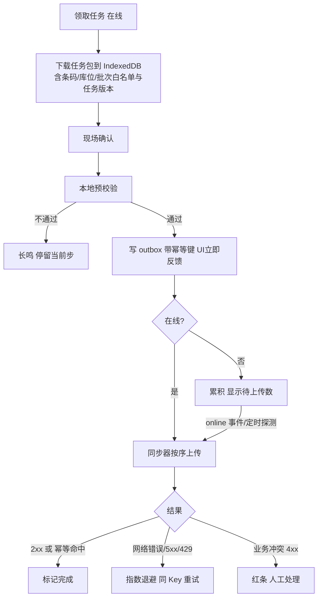
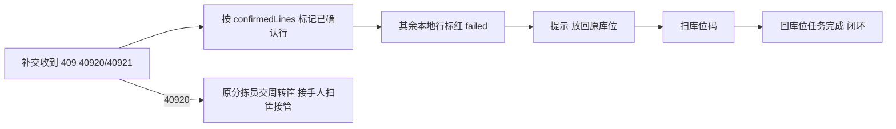

# 14 分拣 H5 / PDA 端 详细设计

> 依据：原《WMS详细设计说明书》§2.2、§4.5、§4.6、§5.2、§5.4、§9.1、§9.2。接口路径以后端模块文档为准，本文只写「待对齐」占位。

## 1. 职责与边界

**负责**
- 分拣员、复核员、仓管员在现场使用的 H5 应用：领取拣货任务、三步扫码拣货、缺货上报、撤销确认、复核装箱；上架/移库扫码作业预留入口。
- 离线优先：任务包本地缓存、本地 outbox、重连后按序补交。
- 扫码输入、语音/震动反馈、大按钮单手操作。

**不负责**
- 库存扣减、任务分配、FEFO 选批、状态迁移合法性：全部由服务端决定。本地只做**预校验**（条码白名单、库位匹配）以便即时反馈，以服务端结果为最终结果。
- 权限安全边界（后端负责，见 §7）。
- 司机装车/签收：二期，见第 15 篇。

**技术栈**：Vue 3 + TypeScript + Vite + Vant，打包为 H5；PDA 用 WebView 壳或自带浏览器。壳能力（扫码广播、蓝牙打印、电子秤）通过 `bridge` 适配层接入，无壳时降级为键盘楔入扫码 + 手输数量。JWT `client_type=PDA`。

## 2. 用例

| 角色 | 用例 |
|---|---|
| 分拣员 | 登录选仓 → 看我的任务/可领任务 → 领取 → 按动线逐行扫库位、扫商品、输数量 → 缺货选原因跳过 → 30 秒内撤销上一次确认 → 提交任务 |
| 复核员 | 扫周转筐/箱码 → 拉应复核清单 → 逐件扫码比对（称重品比重量）→ 复核通过 + 称重 + 打印箱码；不通过退回重拣 |
| 仓管员 | 上架、移库扫码（一期预留入口，交互复用三步扫码，详细设计随第 3、7 篇） |

SoD：复核人不能是该单拣货人，由服务端返回业务码，前端展示「你拣过此单，不能复核」。

## 3. 页面与路由清单

Hash 路由（WebView 兼容）。权限点为建议值，以第 12 篇为准。

| 路由 | 页面 | 权限点 | 期次 |
|---|---|---|---|
| `/login` | 登录 + 选仓 | — | 一期 |
| `/home` | 功能宫格（按权限与 features 显示）+ 待补交数角标 | — | 一期 |
| `/pick/tasks` | 任务列表（我的 / 可领取） | `picking.task.claim` | 一期 |
| `/pick/tasks/:id` | 任务执行（逐行三步扫码） | `picking.task.execute` | 一期 |
| `/pick/tasks/:id/short` | 缺货原因选择 | `picking.task.execute` | 一期 |
| `/pick/tasks/:id/summary` | 任务汇总与提交 | `picking.task.execute` | 一期 |
| `/check` | 复核：扫筐/箱 | `picking.check.execute` | 一期 |
| `/check/:orderCode` | 逐件复核、称重、装箱打印 | `picking.check.execute` | 一期 |
| `/sync` | 补交队列（待上传/失败红条/已完成） | — | 一期 |
| `/putaway`、`/move` | 上架、移库 | `inbound.putaway.execute` / `inventory.move.execute` | 二期 |
| `/settings` | 声音/震动、扫码模式、版本与设备信息 | — | 一期 |

## 4. 组件拆分

| 组件 / 模块 | 职责 |
|---|---|
| `ScanInput` | 统一扫码入口：监听壳广播或键盘楔入（以回车/超时判定结束），常驻隐藏焦点；去抖与重复扫码判定见 §8.3 |
| `StepGuide` | 三步状态条：库位 → 商品 → 数量，当前步高亮，不允许跳步 |
| `QtyStepper` | 数字键盘 + `+/-` 步进；称重品接电子秤读数；值以字符串保存，经 `utils/qty.ts` 计算；客户端校验最多 3 位小数，超过提示不截断（后端 400 为准） |
| `BigButton` | 主按钮高度 ≥ 56dp，底部固定，单手可达 |
| `TaskLineCard` | 当前行：库位、SKU、批次/效期、应拣量、已拣量 |
| `SyncBadge` / `SyncBar` | 在线状态、待补交条数；失败条目红条常驻直到处理 |
| `Feedback` | 成功「嘀」+短震；错误长鸣+长震，**不弹阻断式对话框** |
| `bridge/` | 扫码、打印、电子秤、震动的壳适配；无壳时降级 |
| `offline/` | IndexedDB 封装（任务包、outbox）、同步器 |

数量口径同第 13 篇 §4.2：接口返回固定 3 位小数字符串，单位为 SKU `base_uom`；展示统一走 `utils/format.ts` 的 `formatQty`（显示数量 + 基本单位，与后台共享同一实现），页面不写 `toFixed`；输入最多 3 位小数，超过后端返回 400、不舍入。

## 5. 状态管理

| 位置 | 内容 |
|---|---|
| Pinia `user` / `perm` / `dict` / `warehouse` | 同第 13 篇，仅存跨页、变化慢的数据 |
| IndexedDB `task_pack` | 已领任务包：任务行、库位/条码/批次白名单、任务版本号 |
| IndexedDB `outbox` | 待上传操作（见 §9） |
| 组件本地 | 当前行、当前步骤、输入中的数量 |

任务列表等在线数据不进 store；执行中的任务以 IndexedDB 为准（断电/WebView 被杀后可恢复到上次步骤）。

## 6. 页面 → 接口映射

| 页面 | 动作 | 接口 |
|---|---|---|
| 登录 | 登录、`me`（权限点、features、`min_client_version`） | 待对齐：见第 12 篇 |
| 任务列表 | 我的任务、可领任务 | 待对齐：见第 5 篇 |
| 任务列表 | 领取任务（`rowcount==1` 语义，失败返回「已被领取」） | 待对齐：见第 5 篇 |
| 任务执行 | 任务包预下载（`preload`） | 待对齐：见第 5 篇 |
| 任务执行 | 拣货行确认（库位、条码、数量） | 待对齐：见第 5 篇 |
| 任务执行 | 缺货上报 | 待对齐：见第 5 篇 |
| 任务执行 | 撤销上一次确认（反向流水） | 待对齐：见第 5、2 篇 |
| 任务汇总 | 提交任务完成 | 待对齐：见第 5 篇 |
| 补交队列 | 批量/逐条补交、查询任务当前状态 | 待对齐：见第 5 篇 |
| 复核 | 应复核清单、逐件复核、复核通过/退回、装箱、箱码 | 待对齐：见第 6 篇 |

## 7. 权限点

- 首页宫格与路由按权限点和 `features` 显示；无权限不显示。
- **前端隐藏不是安全措施**：分拣员「只看自己的任务」、仓库范围、SoD 都由后端强制。离线补交时后端仍按当前 token 和任务归属校验，前端不能凭本地缓存越权提交。
- token 过期时离线操作仍可写入 outbox；联网后先重新登录再补交，**补交账号必须与产生操作的账号一致**（outbox 记录 `user_id`，不一致时拒绝补交并提示原账号登录或交主管处理）。

## 8. 交互与异常态

### 8.1 现场交互硬性要求
- 三步扫码不合并：扫库位 → 扫商品 → 输数量。扫错库位直接长鸣提示，停留在第一步。
- 主按钮 ≥ 56dp，字号 ≥ 16sp，高对比度主题，底部单手操作。
- 异常优先不阻断：缺货选原因后跳过该行，任务继续。
- 同一行 30 秒内可撤销上一次确认；撤销也是一条带新幂等键的操作，进 outbox。
- 错误用长震+长鸣+顶部色条，不用模态弹窗。

### 8.2 三态
- 列表加载：骨架屏；空：「暂无任务，下拉刷新」；错误：业务 message + 「重试」+ `trace_id`（可点开查看，方便报给主管）。
- 在线请求失败但可离线的操作，不显示错误态，直接进 outbox 并标「待上传」。

### 8.3 重复扫码与重复提交
| 场景 | 处理 |
|---|---|
| 扫码枪抖动，同码 300ms 内重复 | 丢弃后一次 |
| 计件品逐件扫，每扫一次 +1 | 允许，作为数量累加，不视为重复；超过应拣量长鸣阻止 |
| 已确认的行再次扫同一库位/商品 | 提示「该行已完成」，不生成新操作 |
| 确认按钮连点 | 写 outbox 是同步的本地事务，按钮在写完前禁用；同一行同一 `op_seq` 只生成一条 |

### 8.4 版本
`me` 返回 `min_client_version` 高于当前版本时强制更新；**更新前必须先清空 outbox**（提示先补交），避免新旧版本数据格式不兼容。

## 9. 多端适配与离线

### 9.1 适配
- 目标设备：Android 8+ PDA（4–6 寸，720p 起），WebView Chromium 80+；同时可在普通手机浏览器使用。
- 横竖屏只支持竖屏；适配戴手套、强光/弱光；不依赖 hover。

### 9.2 离线流程

### 9.3 outbox 记录与幂等键生命周期
outbox 每条：`{ op_id(uuid), idem_key, user_id, warehouse_id, task_id, line_no, op_seq, type, payload, task_version, created_at, status, attempts, last_error }`。

- **生成**：用户点确认时生成 uuid 作为 `Idempotency-Key`，与 payload **在同一个 IndexedDB 事务里**写入 outbox；写成功后才给成功反馈。断电后要么整条存在、要么不存在，不会出现「有反馈没记录」。
- **复用**：在线直发失败、离线后补交、App 重启后补交、退避重试，一律使用 outbox 里的同一个 Key 和同一 payload；**任何情况下不重新生成**。服务端 Key 有效期 24h（§4.6），因此离线超过 2 小时任务会被回收（§9.2 原文），补交必然落在 Key 有效期内。
- **结束**：收到 2xx（含幂等命中返回的缓存结果）或确定的业务拒绝后，状态置 `done`/`failed`，保留 24h 便于查看后清理。
- **顺序**：按 `created_at` 严格串行上传，同一任务前一条未结束时不发后一条（撤销依赖前一次确认）。前一条业务失败时，同任务后续条目暂停，等待人工处理。
- 请求在途时 WebView 被杀：重启后该条仍为 `pending`，用同一 Key 重发，服务端返回首次结果，不会重复扣减。

### 9.4 补交冲突处理
| 服务端返回 | 含义 | 前端处理 |
|---|---|---|
| 幂等命中（同 Key 同 body） | 已处理过 | 视为成功 |
| `WMS-10002` 同 Key 不同 body | 本地数据被篡改或 bug | 标红，不重试，上报日志 |
| 409 `40920 TASK_REASSIGNED` | 离线超时回收或主管改派 | 见 §9.4.1 |
| 409 `40921 TASK_CANCELLED` | 任务/出库单已取消 | 见 §9.4.1 |
| `WMS-40902` 库存不足 | 本地认为拣到但服务端扣不了 | 标红，现场选择：重新找货（重扫）或报缺 |
| `WMS-50002` 条码不匹配 / 批次效期不符 | 白名单过期 | 标红，提示重扫 |
| 401 | token 失效 | 暂停队列，重新登录（同一账号）后继续 |
| 403 | 权限被收回 | 暂停队列，提示联系主管 |

#### 9.4.1 任务改派 / 取消（40920 / 40921）

响应体带 `confirmedLines`（服务端已确认的行）。前端处理：

1. **已确认行有效**：`confirmedLines` 中的行保持完成，货物计在原分拣员的周转筐上，本地标「已确认」。
2. **改派（40920）**：服务端生成交接任务；原分拣员界面提示「请将周转筐交给接手人」，接手人扫该周转筐接管。前端不把本地数据重放到新任务。
3. **未上传的离线行一律拒绝**（不静默合并）：凡不在 `confirmedLines` 中的本地已拣行，outbox 条目置 `failed`、标红，提示「放回原库位」并列出库位与数量；服务端同时生成「回库位」任务。
4. **闭环**：分拣员到原库位**扫库位码**确认放回后，该回库任务完成、红条消失；未扫库位前红条常驻首页和 `/sync`。
5. 取消（40921）同样适用第 1、3、4 条：已确认行的货随周转筐按取消回库处理（第 4 篇），未上传行放回原库位。
6. 该任务的后续 outbox 条目全部停止上传，统一按上述流程处理；回库扫码是新操作、新幂等键。

原则：**冲突绝不静默丢弃**；红条在首页和 `/sync` 常驻，处理（重扫/报缺/交主管）后才消失；处理动作本身是新操作、新 Key。

### 9.5 重连
- 监听 `online`/`offline` 事件 + 每 15s 轻量探测（事件在 PDA 上不可靠）。
- 重连后先刷新 token 与任务版本，再上传 outbox；发现任务版本变化（被改派/取消）按 §9.4 处理。
- 离线超过 2 小时未上传：前端提示「任务可能已被回收」，仍尝试补交，由服务端裁决。

## 10. 测试要点

| 层 | 工具 | 重点 |
|---|---|---|
| 单元 | Vitest + fake-indexeddb | outbox 写入原子性、Key 复用（失败/重启/退避后不变）、串行顺序与失败暂停、冲突分类（含 40920/40921 按 `confirmedLines` 拆分已确认行与需回库行）、回库扫库位闭环、重复扫码去抖、数量字符串计算 |
| 组件 | Vitest + @vue/test-utils | 三步扫码不可跳步、缺货跳行、30 秒撤销、BigButton 尺寸、离线时确认仍即时反馈 |
| 模拟弱网 | MSW | 超时后重试同 Key、请求成功但响应丢失、401 中途失效、任务被改派 |
| 真机 | 手工清单 | 冷库断网 30 分钟作业后补交、作业中拔电池/杀 WebView 后恢复、扫码枪抖动 |

覆盖率目标：`offline/`、`utils/`、`composables/` 行 ≥ 85%、分支 ≥ 75%；组件 ≥ 70%。

## 11. 待定问题

| # | 问题 | 依赖 |
|---|---|---|
| Q1 | 全部接口路径；是否提供批量补交接口及其部分失败语义 | 第 5、6 篇 |
| Q2 | 任务包格式、白名单大小上限、任务版本号字段 | 第 5 篇 |
| Q3 | ~~改派/取消的业务码与已拣货处理~~ **已定**：409 + `40920 TASK_REASSIGNED` / `40921 TASK_CANCELLED`，带 `confirmedLines`；已确认行有效、交接扫筐；未上传行拒绝并放回原库位，扫库位闭环，见 §9.4.1 | 已关闭 |
| Q4 | 离线回收阈值（原文 2h）与幂等键保留期（24h）是否作为配置下发 | 总体设计 |
| Q5 | PDA 壳选型（自研壳 / 厂商浏览器）及扫码广播、打印、电子秤接口 | Yuri / 采购 |
| Q6 | 撤销操作在离线时是否允许（依赖前一次确认尚未上传的情况） | 第 5 篇 |
| Q7 | 离线期间 token 过期的宽限策略 | 第 12 篇 |
| Q8 | 称重品复核允差参数由接口下发还是字典 | 第 6 篇 |
| Q9 | 共享 `utils/format.ts` 的方式（monorepo 包 / 复制） | 总体设计工程结构 |
