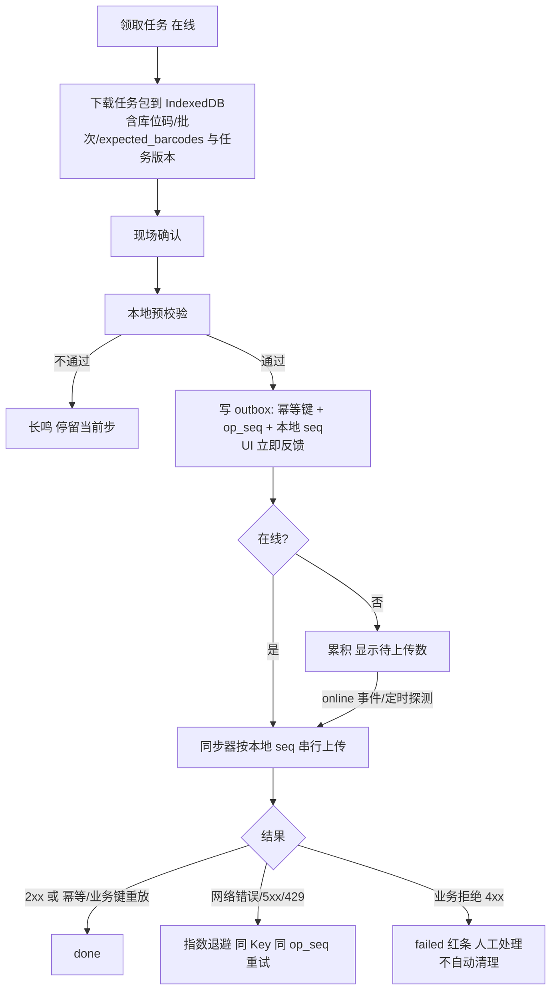
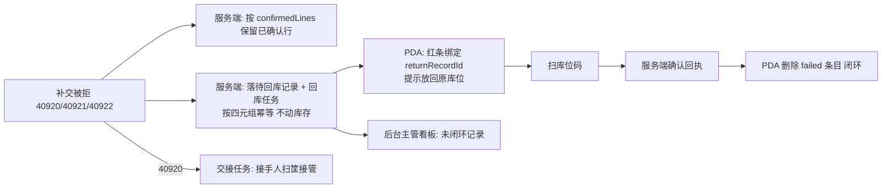
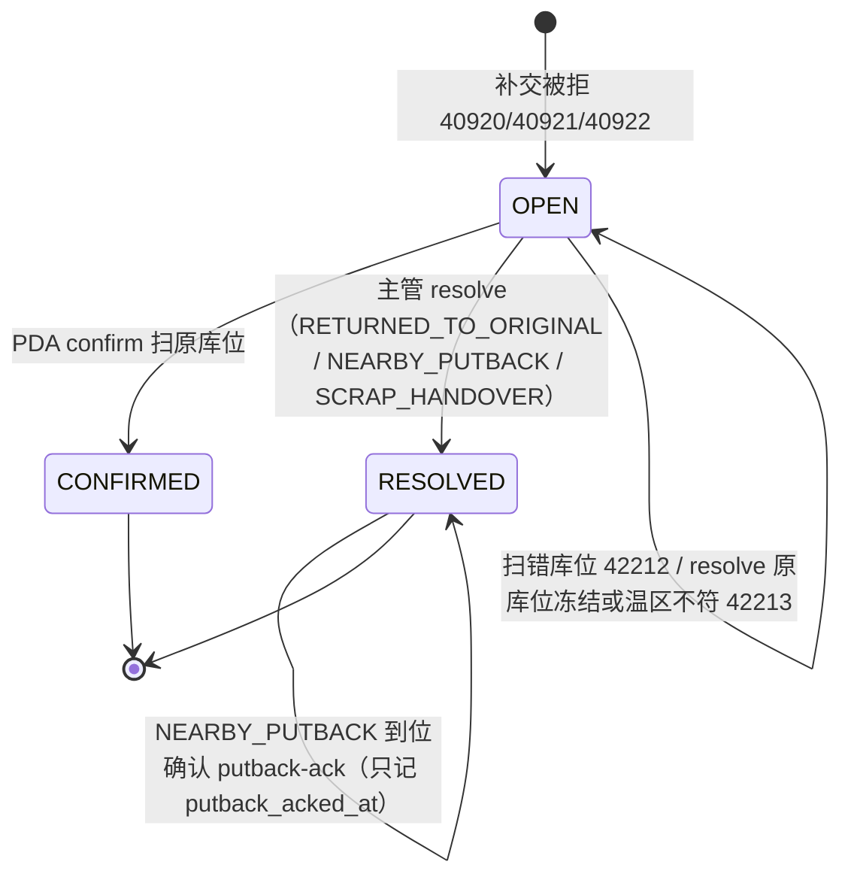

# 14 分拣 H5 / PDA 端 详细设计

> 依据：原《WMS详细设计说明书》§2.2、§4.5、§4.6、§5.2、§5.4、§9.1、§9.2。接口路径以后端模块文档为准，本文只写「待对齐」占位。

## 1. 职责与边界

**负责**
- 分拣员、复核员、仓管员在现场使用的 H5 应用：领取拣货任务、三步扫码拣货、缺货上报、撤销确认、复核装箱；上架/移库扫码作业预留入口。
- 离线优先：任务包本地缓存、本地 outbox、重连后按序补交。
- 扫码输入、语音/震动反馈、大按钮单手操作。

**不负责**
- 库存扣减、任务分配、FEFO 选批、状态迁移合法性：全部由服务端决定。本地只做**预校验**（库位匹配、`expected_barcodes[]` 匹配，见 §9.6）以便即时反馈，以服务端结果为最终结果。
- 权限安全边界（后端负责，见 §7）。
- 司机装车/签收：见第 15 篇。

**技术栈**：Vue 3 + TypeScript + Vite + Vant，打包为 H5；PDA 用 WebView 壳或自带浏览器。壳能力（扫码广播、蓝牙打印、电子秤）通过 `bridge` 适配层接入，无壳时降级为键盘楔入扫码 + 手输数量。JWT `client_type=PDA`。

## 2. 用例

| 角色 | 用例 |
|---|---|
| 分拣员 | 登录选仓 → 看我的任务/可领任务 → 领取 → 按动线逐行扫库位、扫商品、输数量 → 缺货选原因跳过 → 30 秒内撤销上一次确认 → 提交任务 |
| 复核员 | 扫周转筐/箱码 → 拉应复核清单 → 逐件扫码比对（称重品比重量）→ 复核通过 + 称重 + 打印箱码；不通过退回重拣 |
| 仓管员 | 上架、移库扫码（交互复用三步扫码，业务规则见第 3、7 篇） |

SoD：复核人不能是该单拣货人，由服务端返回业务码，前端展示「你拣过此单，不能复核」。

## 3. 页面与路由清单

Hash 路由（WebView 兼容）。权限点为建议值，以第 12 篇为准。

| 路由 | 页面 | 权限点 |
|---|---|---|
| `/login` | 设备登录（账号 + `device_instance_id`）+ 选仓；未绑定时显示「请主管确认绑定」 | — |
| `/home` | 功能宫格（按权限与 features 显示）+ 待补交数角标 | — |
| `/pick/tasks` | 任务列表（我的 / 可领取） | `picking.task.claim` |
| `/pick/tasks/:id` | 任务执行（逐行三步扫码） | `picking.task.execute` |
| `/pick/tasks/:id/short` | 缺货原因选择 | `picking.task.execute` |
| `/pick/tasks/:id/summary` | 任务汇总与提交 | `picking.task.execute` |
| `/check` | 复核：扫筐/箱 | `outbound.check.execute` |
| `/check/:orderCode` | 逐件复核、称重（`weight_g`） | `outbound.check.execute` |
| `/pack/:orderCode` | 开箱、装箱、封箱、打印箱码；集货（扫箱码 + 集货位） | `outbound.pack.execute` / `outbound.stage.execute` |
| `/receive/blind` | 无预约盲收登记（门店退货等） | `inbound.return.blind` |
| `/receive/reservations` | 退货预约到货收货（扫预约单 → 收货进 `RETURN_QC`） | `return.reservation.receive` |
| `/offline/paper` | 纸单补录（恢复联网后 24h 内，生成 `PAPER_BACKFILL` 审批） | `offline.paper.backfill` |
| `/sync` | 补交队列（待上传/失败红条/已完成） | — |
| `/putaway`、`/move` | 上架、移库 | `inbound.putaway.execute` / `inventory.move.execute` |
| `/settings` | 声音/震动、扫码模式、版本与设备信息 | — |

## 4. 组件拆分

| 组件 / 模块 | 职责 |
|---|---|
| `ScanInput` | 统一扫码入口：监听壳广播或键盘楔入（以回车判定结束），常驻隐藏焦点；输出带 `scan_event_id` 的扫码事件；去抖规则见 §8.3 |
| `StepGuide` | 三步状态条：库位 → 商品 → 数量，当前步高亮，不允许跳步 |
| `QtyStepper` | 数字键盘 + `+/-` 步进；称重品接电子秤读数；值以字符串保存，经 `utils/qty.ts` 计算；客户端校验最多 3 位小数，超过提示不截断（后端 400 为准） |
| `BigButton` | 主按钮高度 ≥ 56dp，底部固定，单手可达 |
| `TaskLineCard` | 当前行：库位、SKU、批次/效期、应拣量、已拣量 |
| `SyncBadge` / `SyncBar` | 在线状态、待补交条数；失败条目红条常驻直到处理 |
| `Feedback` | 成功「嘀」+短震；错误长鸣+长震，**不弹阻断式对话框** |
| `bridge/` | 扫码、打印、电子秤、震动的壳适配；无壳时降级 |
| `offline/` | IndexedDB 封装（任务包、outbox）、同步器 |

数量口径同第 13 篇 §4.2：接口返回固定 3 位小数字符串，单位为 SKU `base_uom`；展示统一走 `utils/format.ts` 的 `formatQty`（显示数量 + 基本单位，与后台共享同一实现），页面不写 `toFixed`；输入最多 3 位小数，超过后端返回 400、不舍入。

## 5. 状态管理

| 位置 | 内容 |
|---|---|
| Pinia `user` / `perm` / `dict` / `warehouse` | 同第 13 篇，仅存跨页、变化慢的数据 |
| IndexedDB `task_pack` | 已领任务包：任务行（含 `expected_barcodes[]`）、库位码、批次、任务版本号（**不含条码全表**，见 §9.6） |
| 安全存储 | `device_instance_id`、离线令牌（`offline_token`） |
| IndexedDB `outbox` | 待上传操作（见 §9） |
| 组件本地 | 当前行、当前步骤、输入中的数量 |

任务列表等在线数据不进 store；执行中的任务以 IndexedDB 为准（断电/WebView 被杀后可恢复到上次步骤）。

## 6. 页面 → 接口映射

| 页面 | 动作 | 接口 |
|---|---|---|
| 登录 | 设备登录 | `POST /api/v1/auth/device-login` `{username, password, device_instance_id, client_type}`（第 12 篇 §8） |
| 登录 | 签发离线令牌 | `POST /api/v1/auth/offline-token` |
| 登录 | 刷新、登出 | `POST /api/v1/auth/refresh`、`/auth/logout` |
| 登录 | 当前用户（用户、仓库、权限点、`perm_version`） | `GET /api/v1/me` |
| 任务执行 | 扫商品码解析 | `GET /api/v1/master/barcodes/{barcode}`（第 1 篇 §7，边缘节点本地可用） |
| 任务列表 | 我的任务、可领任务 | 待对齐：见第 5 篇 |
| 任务列表 | 领取任务（`rowcount==1` 语义，失败返回 `40923` TASK_ALREADY_CLAIMED，提示「任务已被领取」并刷新列表） | 待对齐：见第 5 篇 |
| 任务执行 | 任务包预下载（`preload`） | 待对齐：见第 5 篇 |
| 任务执行 | 拣货行确认（库位、条码、数量） | 待对齐：见第 5 篇 |
| 任务执行 | 缺货上报 | 待对齐：见第 5 篇 |
| 任务执行 | 撤销上一次确认（反向流水） | 待对齐：见第 5、2 篇 |
| 任务汇总 | 提交任务完成 | 待对齐：见第 5 篇 |
| 补交队列 | 批量/逐条补交、查询任务当前状态 | 待对齐：见第 5 篇 |
| 补交队列 / 红条 | 查询待回库记录状态 | `GET /api/v1/return-records/{returnRecordId}`（§9.4.2） |
| 回库 | 扫原库位确认回库 | `POST /api/v1/return-records/{returnRecordId}/confirm`（§9.4.2） |
| 复核 | 开复核单 | `POST /api/v1/outbound-orders/{code}/checks`（第 6 篇 §7） |
| 复核 | 复核扫码 / 撤销一扫（四元键） | `POST /api/v1/checks/{code}/scans` |
| 复核 | 提交（带 `version`） | `POST /api/v1/checks/{code}/submit` |
| 装箱 | 开箱 / 整体替换箱明细（仅 OPEN） / 封箱 | `POST /api/v1/outbound-orders/{code}/boxes`、`PUT /api/v1/boxes/{code}/lines`、`POST /api/v1/boxes/{code}/seal` |
| 集货 | 扫箱码 + 集货位（四元键） | `POST /api/v1/boxes/{code}/stage` |
| 收货 | 盲收登记（返回收货记录号 + 异常单号） | `POST /api/v1/inbound/returns/blind` |
| 收货 | 退货预约收货 | `POST /api/v1/returns/reservations/{id}/receive` |
| 纸单补录 | 提交 `{action_type, occurred_at, operator_id, payload, photo_ids[]}` | `POST /api/v1/offline/paper-records` |
| 心跳 / 断网状态 | `{stale_policy, paused, offline_since, offline_deadline_at, paused_actions[]}` | `GET /api/v1/me` 与 PDA 心跳 |

## 7. 权限点

- 首页宫格与路由按权限点和 `features` 显示；无权限不显示。
- **前端隐藏不是安全措施**：分拣员「只看自己的任务」、仓库范围、SoD 都由后端强制。离线补交时后端仍按当前 token 和任务归属校验，前端不能凭本地缓存越权提交。
- **设备绑定与令牌**见 §9.7。补交账号必须与产生操作的账号一致（outbox 按 `user_id` 隔离，换班处理见 §9.3）；服务端用令牌里的 `device_instance_id`，忽略请求体中的值。

## 8. 交互与异常态

### 8.1 现场交互硬性要求
- 三步扫码不合并：扫库位 → 扫商品 → 输数量。扫错库位直接长鸣提示，停留在第一步。
- 主按钮 ≥ 56dp，字号 ≥ 16sp，高对比度主题，底部单手操作。
- 异常优先不阻断：缺货选原因后跳过该行，任务继续。
- 同一行 30 秒内可撤销上一次确认；撤销也是一条带新幂等键的操作，进 outbox。撤销被拒 `42214 OVER_QTY`（`detail.reason=OVER_REVERSE`）时按 §9.4 处理，不自动重试。
- 错误用长震+长鸣+顶部色条，不用模态弹窗。

### 8.2 三态
- 列表加载：骨架屏；空：「暂无任务，下拉刷新」；错误：业务 message + 「重试」+ `trace_id`（可点开查看，方便报给主管）。
- 在线请求失败但可离线的操作，不显示错误态，直接进 outbox 并标「待上传」。

### 8.3 重复扫码与重复提交
| 场景 | 处理 |
|---|---|
| 非计件模式（扫库位、扫商品定位、扫筐）下扫码枪抖动 | 去抖：有壳时按壳的扫码事件 id 判重（同一次触发的重复广播丢弃）；键盘楔入时按两次回车的间隔判断，阈值默认 150ms，可配置 |
| **计件模式**逐件扫，每扫一次 +1 | **不做时间窗去抖**。每次扫码生成唯一 `scan_event_id`（有壳用壳事件 id，否则本地生成 uuid），按事件 id 去重；同码快速连扫都算合法 +1，超过应拣量长鸣阻止 |
| 已确认的行再次扫同一库位/商品 | 提示「该行已完成」，不生成新操作 |
| 确认按钮连点 | 写 outbox 是本地事务，按钮在写完前禁用；同一行同一 `op_seq` 只生成一条 |

### 8.4 版本与强制更新
- `me` 返回 `min_client_version` 高于当前版本时强制更新，**不要求先清空 outbox**。
- outbox 每条带 `format_version`；新版本启动时按版本号逐级自动迁移旧条目（迁移脚本随版本发布，有单测）。迁移失败的条目保留原样并标红，交主管处理，不丢弃。
- 服务端对补交 payload 至少兼容最近 2 个客户端版本（§9.1 原文规则），超出范围返回明确业务码，条目转人工。

## 9. 多端适配与离线

### 9.1 适配
- 目标设备：Android 8+ PDA（4–6 寸，720p 起），WebView Chromium 80+；同时可在普通手机浏览器使用。
- 只支持竖屏；适配戴手套、强光/弱光；不依赖 hover。

### 9.2 离线流程

### 9.3 outbox 记录与幂等
outbox 每条：`{ op_id(uuid), local_seq, format_version, idem_key, device_instance_id, user_id, warehouse_id, task_id, line_no, op_seq, scan_event_ids, type, payload, task_version, created_at, status, attempts, last_error, server_record_id, linked_op_id }`。

**两层去重（B1）**
1. **第一层：`Idempotency-Key`**。用户点确认时生成 uuid，与 payload 在同一个 IndexedDB 事务里写入；重试、重连、重启、退避都复用同一个 Key，不重新生成。服务端 Key 只保留 24h，**它只是第一层**。
2. **第二层：服务端业务唯一键（四元组）`(task_id, line_no, device_instance_id, op_seq)`**。这是兜底：Key 过期后再补交，服务端仍按四元组判重，不会重复扣减。
   - 四元组相同、数量相同 → 重放首次结果，视为成功；
   - 四元组相同、数量不同 → `40910`，`detail.key_type=PDA_OP`，条目转人工。
   - **幂等缓存范围**：服务端只缓存确定性结果——2xx、400xx（参数类）、409xx（冲突类）；其余（422、5xx、429 等）不缓存、不写 `idempotency_record`；这些响应之后用同一 Key 重试会被**重新执行**（不是重放）。因此 422 类（如 `42212`）修正后可用同 Key 重提，5xx/429 退避重试同 Key 也安全（业务键兜底）。
   - `op_seq`：PDA 按任务行单调递增生成，写入 outbox 后不再改变，重试原样发送。
   - `device_instance_id`：设备安装实例 id，重装或清数据时重新生成，与 `op_seq` 一起进入业务唯一键，避免重装后 `op_seq` 从头计数与旧操作撞号（小赵的反例）。已定，见 Q10。
- 因此不再依赖「补交一定落在 Key 有效期内」；离线超过 24h 的条目仍自动补交，由业务键兜底。

**写入与断电**：outbox 写成功后才给成功反馈；断电后要么整条存在、要么不存在。请求在途时 WebView 被杀，重启后同 Key、同 `op_seq` 重发。

**顺序（I2）**：按设备本地单调递增的 `local_seq` 排序（IndexedDB 自增计数，不受时钟影响），`created_at` 只用于展示。同一任务前一条未结束时不发后一条；前一条 `failed` 时，同账号同任务的后续条目暂停。

**状态与清理（B2）**
| 状态 | 含义 | 清理 |
|---|---|---|
| `pending` | 待上传/重试中 | — |
| `done` | 服务端已确认处理 | 保留 24h 后清理 |
| `failed` | 业务拒绝，待人工处理 | **永不自动清理**；只有收到服务端回执确认已处理（回库扫码已确认，或主管已处理）后才删除 |
| `superseded` | 已作废（见撤销规则、重扫） | 与关联条目一起清理 |

红条与 `failed` 条目同生命周期：条目在，红条就在。

**多账号与换班（I3）**
- outbox 按 `user_id` 隔离成独立队列：A 的失败只阻塞 A 自己同任务的后续条目，不影响 B。
- 当前账号 outbox 非空时**不允许登出**；可选择「交给主管」：主管在 PDA 上登录确认后，该批条目转为主管名下处理，服务端记审计。
- 首页显示「其他账号待补交 N 条」，只读，不可代为补交（补交账号须与产生操作的账号一致，或经主管接管）。

**离线撤销（I5，默认口径）**
- 撤销是一条新操作（新 Key、新 `op_seq`），进 outbox，**本地不合并抵消**，确认和撤销按顺序都发，由服务端裁决。
- 若该行的确认被拒（40920/40921/40922 等），其后同行的撤销条目在本地置 `superseded`，不上传。

### 9.4 补交冲突处理
| 服务端返回 | 含义 | 前端处理 |
|---|---|---|
| 幂等命中 / 业务键重放（同四元组同数量） | 已处理过 | 视为成功 |
| `40910` 且 `detail.key_type=IDEMPOTENCY_KEY`（同 Key 不同 body） | 本地数据异常或 bug | `failed`，不重试，上报日志 |
| `40910` 且 `detail.key_type=PDA_OP`（同四元组不同数量） | `op_seq` 冲突 | `failed`，交主管 |
| `40910` 且 `key_type` 为其他已知值（`POD_OP`、`POD_CORRECT`、`SOURCE_ORDER`，属司机端/上游，PDA 不应收到） | 契约异常 | 同下行处理 |
| `40910` 且 `key_type` 缺失/未知 | 服务端违反契约（`key_type` 必填） | `failed` 红条，**不自动重试、不生成新 Key**，交人工处理（同 `42214`），上报日志 |
| `50000` 内部错误 | 服务端异常 | 通用错误提示 + `trace_id`；条目保持 `pending`，按退避同 Key 重试（不缓存，重新执行，业务键兜底） |
| `50010` 不变量违反 | 服务端断言失败 | 通用错误提示 + `trace_id`；**不自动重试**，条目置 `failed` 红条交主管，上报日志 |
| `42214 OVER_QTY` 且 `detail.reason=OVER_PICK`（拣货确认：已确认量 + 本次数量 > 计划量） | 数量录入错误或重复拣 | `failed` 红条，**不自动重试**，提示「请复核数量或联系主管」；复核后改数量为新操作（新 Key、新 `op_seq`，关联原条目） |
| `42214 OVER_QTY` 且 `detail.reason=OVER_REVERSE`（撤销拣货：撤销量超过已拣未撤销量） | 撤销重复或数量错误 | `failed` 红条，**不自动重试**；红条显示「出库行 {outbound_line_id}：已拣 {picked_qty}，已撤销 {reversed_qty}，本次申请撤销 {requested_qty}」（`detail` 字段，数量为 3 位小数字符串，经 `formatQty` + `base_uom` 显示），提示复核或联系主管 |
| `42214 OVER_QTY` 且 `detail.reason` 缺失或不是 `OVER_PICK`/`OVER_REVERSE` | 契约异常（`42214 OVER_QTY` 的 reason 只有这两个值） | `failed` 红条交人工，**不自动重试、不生成新 Key**，上报日志 |
| 409 `40920 TASK_REASSIGNED` | 离线超时回收或主管改派 | 见 §9.4.1 |
| 409 `40921 TASK_CANCELLED` | 任务/出库单已取消 | 见 §9.4.1 |
| 409 `40922 TASK_CLOSED` | 任务已关闭 | 见 §9.4.1 |
| `40902` 库存不足 | 本地认为拣到但服务端扣不了 | 原条目 `failed`；选「重扫」生成**新操作、新 Key、新 `op_seq`**，新条目 `linked_op_id` 指向原条目，新条目成功后原条目置 `superseded`；或选「报缺」 |
| `42210` 条码不匹配 | 扫错（离线时未做条码预校验） | 同上，重扫生成新条目并关联 |
| `40903` 批次效期不符 | 任务包批次信息过期 | 同上，重扫生成新条目并关联 |
| 401 `40110`，`detail.reason=TOKEN_EXPIRED` | 令牌过期 | 暂停该账号队列；刷新令牌后同 Key 继续补交，刷新失败则同一账号重新登录后继续 |
| 401 `40110`，`PERM_VERSION_CHANGED` | 权限已变 | 暂停队列；刷新令牌并重拉 `GET /api/v1/me`，更新首页宫格；仍有对应权限点则继续补交，否则条目转 `failed` 红条交主管 |
| 401 `40110`，`DEVICE_UNBOUND` | 绑定已被吊销（换人、挂失、主管解绑） | 清本地令牌、回登录页，**不清 outbox**；重新登录若返回 `40111` 按下两行处理 |
| 401 `40110`，reason 缺失/未知 | — | 暂停队列，要求同一账号重新登录 |
| 401 `40111 DEVICE_NOT_BOUND`，`detail.reason=BINDING_PENDING` | 首次绑定待主管审批 | 显示等待审批页，见 §9.7；不清 outbox |
| 401 `40111`，`NOT_BOUND` | 审批被驳回/过期，需重新申请 | 提示「绑定未通过，请重新登录申请」，重新登录会再次发起 `DEVICE_BIND`；不清 outbox |
| 401 `40111`，`WAREHOUSE_MISMATCH` / 缺失 | 绑定仓不符 | 暂停队列，提示联系主管；不清 outbox |
| 401 `40112 OFFLINE_TOKEN_INVALID` | 离线令牌无效，`detail.reason`：`EXPIRED` / `REVOKED` / `PERM_STALE` / `DEVICE_MISMATCH` | 暂停队列，不清 outbox：`EXPIRED`/`PERM_STALE` → 在线重新登录后继续；`REVOKED` → 提示「令牌已吊销（设备可能被挂失），请联系主管」；`DEVICE_MISMATCH` → 提示「设备与账号不符」交主管；未知 reason 同 `REVOKED` |
| 403 `40312 SOD_VIOLATION` | 违反职责分离（如复核自己拣的单，SoD-1） | `failed` 红条，显示 `detail.rule`，不重试，交其他人处理 |
| 403 / `40310`、`40311` | 权限或仓库数据权限被收回 | 暂停该账号队列，交主管 |

#### 9.4.1 任务改派 / 取消 / 已关闭（40920 / 40921 / 40922）

响应体带 `confirmedLines`（服务端已确认的行）和 `returnRecordId`（待回库记录 id）。

1. **已确认行有效**：`confirmedLines` 中的行保持完成，货物计在原分拣员的周转筐上。
2. **改派（40920）**：服务端生成交接任务；原分拣员提示「请将周转筐交给接手人」，接手人扫筐接管。前端不把本地数据重放到新任务。`detail.new_holder_device_id` 表示任务已转到另一台设备：红条显示「任务已由设备 {new_holder_device_id} 持有」，本设备该任务的排队操作进入待回库异常队列（第 3 条），**不重试**。
3. **未上传的离线行一律拒绝**（不静默合并）。**服务端用被拒的 payload 落一条「待回库」记录**并生成回库任务（B3），响应返回记录 id；PDA 把红条与该 id 绑定（`server_record_id`），提示「放回原库位」并列出库位与数量。
4. 待回库记录按四元组幂等：同一条目重复补交被拒，返回同一个记录 id，不重复生成。
5. 待回库记录**在回库扫码确认前不动库存**。分拣员到原库位扫库位码，调用 confirm（§9.4.2），成功回执后 PDA 删除 `failed` 条目、红条消失。
6. 换设备、清缓存后记录仍在服务端；未闭环的待回库记录在管理后台主管看板展示（第 13 篇），主管可处理。
7. 取消（40921）、已关闭（40922 TASK_CLOSED）同样适用 1、3–6。该任务后续 outbox 条目停止上传，同样按此处理。

#### 9.4.2 待回库记录接口与闭环

| 动作 | 接口 | 调用方 | 要点 |
|---|---|---|---|
| 主管列表 | `GET /api/v1/return-records?status=OPEN&warehouseId=…`（分页） | 后台 `/picking/pending-returns` | 见第 13 篇 |
| 红条状态 | `GET /api/v1/return-records/{returnRecordId}` | PDA | 重连后、打开 `/sync` 时刷新红条状态 |
| 回库确认 | `POST /api/v1/return-records/{returnRecordId}/confirm` | PDA | 头带 `Idempotency-Key`，body 带扫到的 `locationCode`；**不写库存流水**，只把记录 `OPEN → CONFIRMED` |
| 主管处理 | `POST /api/v1/return-records/{returnRecordId}/resolve` | 后台（`picking.return_record.resolve`） | 必填 `resolution`、`reason`：`RETURNED_TO_ORIGINAL` / `NEARBY_PUTBACK`（必填 `targetLocationCode`，记移库）/ `SCRAP_HANDOVER` |
| 就近放回到位确认（接口定义见第 4 篇 §7.3） | `POST /api/v1/return-records/{returnRecordId}/putback-ack` | PDA（仅原拣货人） | 头带 `Idempotency-Key`，body 带扫到的 `locationCode`；**不写库存流水**，只记 `putback_acked_at/by`；库位不对 `42212` |

PDA 规则：
- confirm 扫错库位 → 422 `42212`（LOCATION_MISMATCH）：红条保留，提示「请扫原库位 XX」重扫。**PDA 不提供就近放回**，就近放回只能主管在后台 resolve。
- confirm 和 resolve 都是 `status=OPEN` 条件更新，只有一方成功。输的一方收到 409 `40932 RECORD_ALREADY_CLOSED`，`detail` **固定五个字段** `{status, resolution, target_location, closed_by, closed_at}`（以总体设计 §6.4 为准）。`target_location` 字段总是存在，仅 `resolution=NEARBY_PUTBACK` 时非空；其他 resolution 下即使有值也忽略。`40930` 只表示通用非法状态迁移。
- PDA 按 `detail.resolution` 处理（GET 详情查到记录已非 OPEN 时同样按其 `resolution` 处理）：

| `resolution` | PDA 处理 | 删除 `failed` 条目的时机 |
|---|---|---|
| `CONFIRMED` / `RETURNED_TO_ORIGINAL` | 提示「已由 {closed_by} 于 {closed_at} 处理」 | 立即 |
| `NEARBY_PUTBACK` | **红条保留**，提示「请放到 {target_location}」；分拣员扫目标库位 → 调 `putback-ack`（不写流水，账已在 resolve 时移过去）；扫错 `42212` 重扫 | `putback-ack` 成功后 |
| `SCRAP_HANDOVER` | 红条保留，提示「请把货交给主管报损」，按第 4 篇交接流程 | `GET /api/v1/return-records/{returnRecordId}` 返回的 `handover_confirmed_at`（及 `handover_confirmed_by`）非空后；为空则保留 `failed` 条目和红条 |
| 缺失 / 未知 | **红条保留**，不删除，交人工 | — |

- `40930`（任何接口）一律保留红条。
- 本人 confirm 成功回执后删除条目。
- confirm 网络失败按 outbox 规则同 Key 重试。

原则：**冲突绝不静默丢弃**；处理动作本身是新操作、新 Key。

### 9.5 边缘节点与权威写库切换（对齐总体设计 §9.1）
- PDA 只连**本仓的权威写库**（形态 A 中心 / 形态 B 仓内边缘节点），**不存在双写**。
- **取地址**：`GET /api/v1/warehouses/{warehouse_code}/write-endpoint` 返回 `{endpoint, epoch}`，**中心和边缘节点本地都提供**。PDA 缓存上次的 `endpoint` + `epoch`；取不到（断网、中心不可达）时**用缓存继续作业**，不阻塞。
- **每个写请求带 `X-Write-Epoch`**（缓存的 epoch）。
- **旧写节点拒写（`STALE_WRITE_NODE`）**：暂停 outbox → 重新取 write-endpoint → 按 `local_seq` 顺序**原样**重提交（原 `Idempotency-Key`、`device_instance_id`、`op_seq` 不变）；条目保持 `pending`，**不标红**，顶栏提示「系统切换中」。
  - 码值：**`50303 STALE_WRITE_NODE`**（总体设计 §6.4）。
  - `50302 ID_CLOCK_BACKWARD`（发号时钟回拨）**不触发**重取地址：按普通 503 处理，条目保持 `pending` 退避重试，不标红。
- 收到 `50301`（`detail.reason` 不是 `STALE_STOCK_PAUSED`）或发现 `epoch` 变化时，同样重取地址后按上述规则重提交。`50301` 且 `detail.reason=STALE_STOCK_PAUSED` 是暂停，不是切换：见 §9.10。
- **继承**：幂等记录、四元组唯一键约束、待回库记录随权威库迁移，新写节点直接继承；切换完成前旧节点只读。切换前已成功的操作重提交得到重放结果，不重复扣减。
- **非计划切换（边缘硬件故障）**：从备份恢复到备用机，RPO 窗口内的写入可能丢失；PDA 只需重取地址，然后 outbox 按原业务键重提交补数，幂等保证不重复入账。恢复后的节点可能使用**新的节点号**，对 PDA 无影响（除重取地址外）。对账（动碰盘点）完成前若服务端暂不开放作业，写请求按 503 处理，条目保持 `pending`。
- 任务包里的任务版本以新库为准；版本变化按 §9.4 处理。

### 9.6 条码解析与离线预校验
- **PDA 不缓存条码全表**（第 1 篇）。任务包的每个任务行带 `expected_barcodes[]`：任务生成时的该 SKU 条码**快照**，只在本任务范围内。
- 在线：扫商品码调用 `GET /api/v1/master/barcodes/{barcode}` 解析；离线：用 `expected_barcodes[]` 做**预校验**，不匹配立即长鸣提示重扫。
- 预校验只用于现场即时反馈，**以服务端补交时的判定为准**：快照之后条码换绑等导致服务端判定不一致时，服务端结果胜出（例如本地通过、服务端返回 `42210` → 红条重扫；本地不通过的码不会入队）。
- 扫到的原始条码随 outbox 条目一起上传，便于服务端判定与审计。

### 9.7 设备绑定与离线令牌（第 12 篇 §3.2、§3.3）
- `device_instance_id` 首次安装生成并存安全存储，**重装即变**（同时是四元组组成部分）。登录走 `device-login`。
- **首次绑定**：服务端建立 PENDING 绑定并生成 `DEVICE_BIND` 审批；主管在后台审批中心通过后变为 ACTIVE。审批前登录返回 `40111`、`detail.reason=BINDING_PENDING`（另带 `approval_id`、`binding_id`）：PDA 显示**等待审批页**（设备实例短码、账号、仓库、「刷新」按钮；可用 `GET /api/v1/approvals/{approval_id}` 凭 `binding_id + device_instance_id` 查询审批状态），**不进入作业、不写 outbox**；点刷新重新登录，通过后进入首页。驳回时提示联系主管。
- 同一设备换人登录：服务端吊销旧绑定、建立新绑定；前端仍要求上一账号 outbox 已清空或已交主管（§9.3）。
- 在线登录后调用 `offline-token` 取离线令牌（响应 `{token, exp, ttl_seconds}`，默认 **12 小时**，覆盖一个班次），存安全存储。PDA 与服务端失联时继续作业、操作入 outbox；联网后补交时服务端校验离线令牌，失败按 `40112` 处理。
- 前端显示离线令牌剩余时间；剩余 < 1 小时在顶栏提醒「请尽快联网」；已过期仍允许记录 outbox（不丢现场数据），但提示「联网后需重新登录才能补交」。
- 设备挂失（`device.status=LOST`）后绑定与离线令牌全部吊销，补交返回 `40112 REVOKED`，outbox 保留交主管。

### 9.8 重连
- 监听 `online`/`offline` + 每 15s 轻量探测（事件在 PDA 上不可靠）。
- 重连后先刷新 token 与任务版本，再上传 outbox；任务版本变化按 §9.4 处理。
- 离线超过 2 小时：提示「任务可能已被回收」，仍补交，由服务端裁决。

### 9.9 复核与装箱（第 6 篇 #11 @820d4e8 + 大肥鱼裁定）
- 开复核单、提交、装箱、封箱只能在线（需取冻结期望数）；复核扫码 / 撤销一扫可离线入 outbox（四元键去重）。
- **复核人 = 拣货人**：`403` `40312 SOD_VIOLATION`，`detail.reason=CHECK_SOD`。前端按「码 + reason」分支：`40312` 且 `CHECK_SOD` → 红条「你拣过此单，不能复核，请换人」，不重试；`40312` 其他 reason → 按 `detail.rule` 通用提示。`CHECK_SOD` 只是 reason，不是业务码。复核人必须与该单**所有**拣货人不同（多人拣同一单时，服务端从 `pick_op` 汇总全部拣货人）；该单没有任何拣货人记录时一律拒绝（同样 `40312` + `CHECK_SOD`），前端不做本地放行判断。
- **多扫**：`42214 OVER_QTY`，`detail.reason=OVER_CHECK`（复核数量超过已拣数量，02 @7592793）→ 长鸣 + 红条「复核数量超过已拣数量」，不自动重试；与 `OVER_PICK`、`OVER_REVERSE` 分开文案，未知 reason 红条交人工。
- **通过（PASSED）至少需要一次扫码**：零扫描时「通过」置灰，服务端也会拒绝。
- **复核少件不允许提交**：清单未扫齐时「提交」置灰，提示「数量不足：先撤销拣货，再重新复核」；不提供「短发通过」按钮。
- **封箱前置**：只有复核单为 PASSED 后才允许封箱；**封箱人必须是该箱的复核人**，「封箱」按钮只对复核人显示。服务端拒绝返回 `409` `40930`，`detail.reason=SEALER_NOT_CHECKER` → 提示「只有本箱复核人可以封箱」，不重试。
- **已发货（SHIPPED）箱完全只读**：不显示任何编辑/解封入口。
- **封箱后不可改明细**：SEALED 箱的明细只读；服务端返回 `409` `40937 BOX_SEALED_IMMUTABLE` → 刷新箱详情，提示「箱已封，需主管解封」，不重试。
- **不允许跨单混箱**：一个箱只装一张出库单；扫到其他出库单的商品立即长鸣拒绝，不入箱（服务端为准）。
- **集货温区不符**：`422` `42215 STAGING_TEMP_ZONE_MISMATCH` → 红条「集货位温区不符」，重扫正确集货位，不重试。
- 称重品显示与录入重量为整数克 `weight_g`，不带小数。
- 交接后装错车不可撤回：PDA 不提供撤回入口。封箱后丢失/损坏由主管走 `BOX_VOID` 审批（管理后台，第 13 篇），PDA 不处理。

### 9.10 断网可用清单与剩余离线时间（Yuri 裁定）
- 断网状态由 `GET /api/v1/me` 与 PDA 心跳返回：`{stale_policy: PAUSE|DEGRADE, paused, offline_since, offline_deadline_at, paused_actions[], backfill_deadline_at}`（00 §6.6.2；`offline_deadline_at` = `offline_since` + 12h）（`stale_policy` 默认 `PAUSE`）。**首页宫格与按钮按 `paused_actions[]` 置灰**，不在前端写死清单；离线期间沿用最后一次收到的值。下表仅为示例（按 Yuri 裁定的默认口径），以服务端返回为准：

| 功能 | 断网时 |
|---|---|
| 执行**已下发**的拣货任务（含扫码、确认、缺货上报、撤销） | 可用，入 outbox |
| 领取新拣货任务 | **置灰**（领取即新分配） |
| 复核扫码 / 撤销一扫 | 可用，入 outbox |
| 开复核单、提交、装箱、封箱 | 置灰（需在线） |
| 收货登记（含盲收登记） | 可用，入 outbox |
| 新分配、调拨 / 移库、波次下发 | **置灰**（跨站点分配类，`PAUSE` 暂停） |
| 待回库确认 | 置灰（需在线校验状态） |

- 置灰项点击提示「断网期间不可用，联网后操作」。
- 被暂停的操作若仍提交，服务端返回 `503` `50301`，`detail.reason=STALE_STOCK_PAUSED`：提示「该仓暂停跨网点分配/移动，稍后再试」，**不重试**，并立即重拉 `GET /api/v1/me` 刷新 `paused_actions[]`；不触发写节点重取（区别于 §9.5）。
- **剩余离线时间**：顶栏常驻倒计时，取 `offline_deadline_at`（UTC，按本地显示；最长 12h，与离线令牌一致），前端不自行用 `offline_since` 推算；剩余 < 1 小时变红提醒；到期后停止新作业记录、只允许查看与联网补交（§9.7）。
- 重连后按 §9.8 对账补交；补交冲突进入服务端异常队列，PDA 对应条目显示红条与异常单号（若响应提供）。

### 9.11 盲收登记与退货预约收货
- **盲收**（无预约到货，`inbound.return.blind`）：`POST /api/v1/inbound/returns/blind`，body `{sku_id, qty, reason_code, container_code, store_code?, photo_ids[]}`（`qty` 为 3 位小数字符串；**`reason_code`、`container_code` 必填**，`store_code` 可选），带 `Idempotency-Key`。前端必填校验：未选退货原因、未扫箱码（`container_code`）时提交置灰并在字段下提示；服务端缺字段返回 `400`，按 `detail` 中的字段名在对应输入框下显示提示，不重试。响应返回**收货记录号**与**自动生成的异常单号**，PDA 结果页同时显示二者，并提示「须在 48 小时内关联订单，超时升级主管」。离线时入 outbox（入队前同样做必填校验），联网补交后再显示两个单号。
- **退货预约收货**（`return.reservation.receive`）：扫/选预约单 → 核对行（`sku_id`、`qty`、`reason_code`）→ `POST /api/v1/returns/reservations/{id}/receive`；收货后进入 `RETURN_QC` 冻结，PDA 只显示「待质检」，不提供解冻。
- **纸单兜底补录**（00 §6.6.1，审批类型 `PAPER_BACKFILL`）：设备不可用时现场用纸质单据记录；恢复联网后由操作人（`offline.paper.backfill`）在「纸单补录」入口提交 `POST /api/v1/offline/paper-records` `{action_type, occurred_at, operator_id, payload, photo_ids[]}`（`occurred_at` 为纸单记录的发生时间，按仓库时区录入、以 UTC 提交；纸单照片必传），带 `Idempotency-Key`，生成待主管审批（`offline.paper.approve`）的审批单，申请人不能自批。
  - **24 小时时限**：必须在恢复联网后 24 小时内提交，超时由服务端转异常单（第 10 篇）。补录入口显示「补录剩余 HH:MM」倒计时，只读服务端下发的 `backfill_deadline_at`（`GET /api/v1/me` 与心跳返回，UTC，= 恢复联网 + 24h；前端**不用设备时间推算**），为 `null`（无待补录）时隐藏倒计时与补录提醒，<1 小时标红。
  - 补录本身必须在线，不进 outbox。

## 10. 测试要点

| 层 | 工具 | 重点 |
|---|---|---|
| 单元 | Vitest + fake-indexeddb | outbox 写入原子性；Key 与 `op_seq` 在失败/重启/退避后不变；`local_seq` 排序（时钟回拨后顺序不变）；串行与失败暂停只影响本账号同任务；`failed` 不被 24h 清理、只在服务端回执后删除；撤销在确认被拒后置 `superseded`；重扫生成新条目并关联；`format_version` 迁移（含迁移失败标红）；数量字符串计算 |
| 组件 | Vitest + @vue/test-utils | 三步扫码不可跳步、缺货跳行、30 秒撤销、BigButton ≥56dp、离线确认即时反馈；计件模式 1 秒扫 5 件得 5（不被去抖）；非计件模式壳重复广播被丢弃；outbox 非空不能登出、可交主管；首页显示其他账号待补交数 |
| 模拟弱网 | MSW | `40110 DEVICE_UNBOUND` 清令牌回登录且 outbox 保留；`40111 NOT_BOUND` 重新登录再发起绑定；`WAREHOUSE_MISMATCH` 提示主管；等待页按 approval_id 查询状态；离线令牌剩余时间取响应 `exp`；`40111 BINDING_PENDING` 显示等待页且 outbox 无写入、刷新后审批通过进入首页；`40920` 带 `new_holder_device_id` 时红条显示持有设备、排队操作转待回库队列、无重试请求；`40111` 暂停队列且不清 outbox；`40112` 四种 reason 分别提示、均不清 outbox；`40312` 红条显示 rule；离线令牌剩余 <1h 提醒、过期仍记录 outbox；离线用任务行 `expected_barcodes[]` 预校验（不匹配长鸣不入队）、本地通过但服务端 `42210` 时红条重扫（服务端胜出）；在线扫码调用 barcodes 解析；IndexedDB 无条码全表；`40110` 三种 reason：TOKEN_EXPIRED 刷新后同 Key 续传、PERM_VERSION_CHANGED 重拉 /me 后按权限继续或转红条、DEVICE_UNBOUND 进入重新绑定且 outbox 保留；`42214 OVER_QTY` 按 `detail.reason` 分支：`OVER_PICK` 超拣红条、`OVER_REVERSE` 红条按 `detail{outbound_line_id, picked_qty, reversed_qty, requested_qty}` 渲染且数量经 `formatQty` 显示（不做浮点运算）、缺失/未知红条交人工，三种情况均不自动重试（断言无二次请求）；超时后重试同 Key；响应丢失；**Key 过期（服务端无 Key 记录）后补交按四元组重放，不重复扣减**；`40932` detail 五字段齐全：非 `NEARBY_PUTBACK` 时 `target_location` 有值也被忽略（不提示去目标库位）、`NEARBY_PUTBACK` 且 `target_location` 为空按契约异常保留红条；`40932` 按 `resolution` 分支：`CONFIRMED`/`RETURNED_TO_ORIGINAL` 立即删除、`NEARBY_PUTBACK` 红条保留直到 `putback-ack` 成功（扫错 `42212` 重扫、ack 不写流水）、`SCRAP_HANDOVER` 红条保留直到 GET 详情 `handover_confirmed_at` 非空（为空保留）、缺失/未知保留；`40910` 的 `POD_OP`/`POD_CORRECT`/`SOURCE_ORDER` 按契约异常处理；断网时用缓存的 endpoint + epoch 继续作业且写请求带 `X-Write-Epoch`；`50303 STALE_WRITE_NODE` → 暂停 outbox、重取 write-endpoint、按 `local_seq` 原 Key 重放，不标红；`50302 ID_CLOCK_BACKWARD` 不触发重取地址、不与 STALE 混淆（只退避重试）；非计划切换后按原业务键重提交补数且新节点号无影响；`50301` 或 `epoch` 变化 → 重取 write-endpoint 后按 `local_seq` 用原 Key/`op_seq` 重提交，切换前已成功的操作得到重放不重复扣减；切换期间不标红；40920/40921/40922 返回 `confirmedLines` + `returnRecordId`，重复被拒返回同一 id（按四元组）；confirm 扫错库位 `42212` 红条保留并提示重扫原库位；confirm 成功后删除 failed 条目；confirm 与主管 resolve 并发：**`40930` 不删除、红条保留**；`40910` 按 `detail.key_type` 分支（`PDA_OP` 交主管、`IDEMPOTENCY_KEY` 上报；缺失/未知时红条、不自动重试、不生成新 Key）；`50000` 退避同 Key 重试；`50010` 不自动重试、红条；`42214 OVER_QTY`（`OVER_PICK`）超拣红条且不自动重试；`42212` 后修正重扫用同 Key 被重新执行（422 不缓存）；5xx/429 后同 Key 重试被重新执行且由业务键兜底不重复扣减；confirm 网络失败同 Key 重试；401 中途失效 |
| 复核/装箱/离线清单 | Vitest + MSW | `40312` + `detail.reason=CHECK_SOD` 红条「换人复核」不重试，`40312` 其他 reason 走通用；`42214 OVER_CHECK` 长鸣红条不重试，文案区别于 OVER_PICK/OVER_REVERSE；未扫齐时提交置灰并提示先撤销拣货；SEALED 箱明细只读，`40937` 刷新不重试；扫到他单商品拒绝入箱；多人拣同一单时复核人与任一拣货人相同、或无拣货人记录均被 `40312 CHECK_SOD` 拒绝；零扫描「通过」置灰；复核未 PASSED 不显示封箱，封箱人规则拒绝走通用处理；SHIPPED 箱无编辑入口；`42215` 红条重扫集货位；重量只接受整数克；断网时领取新任务、新分配、调拨、波次下发、开复核/封箱置灰，已下发任务执行、复核扫码、收货与盲收登记可用并入 outbox；顶栏倒计时取离线令牌 `exp`（≤12h），<1h 变红、到期停止新记录；盲收未选 `reason_code` 或未扫 `container_code` 时提交置灰、离线也不入队，服务端 `400` 按字段提示；纸单补录需 `offline.paper.backfill`、照片必传、在线提交生成 `PAPER_BACKFILL` 审批，恢复联网后 24h 倒计时只取 `backfill_deadline_at`（改设备时间不影响）、<1h 标红、为 `null` 时倒计时与提醒均隐藏；`50301 STALE_STOCK_PAUSED` 提示暂停、不重试、重拉 /me、不重取写节点，其他 `50301` 仍走写节点重取；盲收提交成功显示收货记录号 + 异常单号与 48h 提示、离线时入队补交后显示；预约收货调用 receive 后显示待质检；置灰完全由 `paused_actions[]` 驱动（返回空数组时不置灰、返回新动作时置灰）；倒计时取 `offline_deadline_at` 而非本地推算；非复核人看不到封箱按钮，`40930 SEALER_NOT_CHECKER` 提示不重试 |
| 真机 | 手工清单 | 冷库断网 30 分钟及跨夜（>24h）后补交；拔电池/杀 WebView 后恢复；手动改系统时间后上传顺序；换班换账号；outbox 非空时强制更新 |

覆盖率目标：`offline/`、`utils/`、`composables/` 行 ≥ 85%、分支 ≥ 75%；组件 ≥ 70%。

## 11. 待定问题

| # | 问题 | 依赖 |
|---|---|---|
| Q1 | 全部接口路径；是否提供批量补交接口及其部分失败语义 | 第 5、6 篇 |
| Q2 | 任务包格式、任务版本号字段 | 第 5 篇 |
| Q3 | ~~改派/取消处理~~ **已定**：见 §9.4.1 | 已关闭 |
| Q4 | 离线回收阈值（原文 2h）是否配置下发（幂等不再依赖 Key TTL，见 §9.3） | 总体设计 |
| Q5 | PDA 壳选型及扫码事件 id、打印、电子秤接口 | Yuri / 采购 |
| Q6 | ~~离线撤销~~ **默认口径已定**：不本地合并，按序发；确认被拒后同行撤销作废，见 §9.3 | 待第 5 篇确认 |
| Q7 | ~~离线期间 token 过期~~ **已定**：离线令牌 12h，过期仍可记录 outbox、联网重登后补交，见 §9.7 | 已关闭 |
| Q8 | 称重品复核允差参数由接口下发还是字典 | 第 6 篇 |
| Q9 | 共享 `utils/format.ts` 的方式（monorepo 包 / 复制） | 总体设计工程结构 |
| Q10 | ~~`op_seq` 防撞号形态~~ **已定**：业务唯一键 `(task_id, line_no, device_instance_id, op_seq)`，见 §9.3 | 已关闭 |
| Q11 | ~~已关闭业务码与待回库接口~~ **已定**：`40922 TASK_CLOSED`；接口见 §9.4.2 | 已关闭 |
| Q12 | 交给主管的流程（主管在 PDA 登录确认 / 后台接管）与审计字段 | 第 12 篇 |
| Q13 | 键盘楔入去抖阈值的配置来源 | 第 1 篇字典 |
| Q14 | ~~报损交接完成依据~~ **已定**：GET 详情 `handover_confirmed_at`/`_by` 非空，见 §9.4.2 | 已关闭 |
| Q15 | ~~切换后继承与地址获取~~ **已定**：随库迁移继承；`write-endpoint` + `epoch`，见 §9.5 | 已关闭 |
| Q16 | ~~`STALE_WRITE_NODE` 码值~~ **已定**：`50303`，`50302` 仍为 `ID_CLOCK_BACKWARD`（00 §6.4 @8314830） | 已关闭 |
| Q17 | ~~`OVER_REVERSE` detail 字段~~ **已定**：`{outbound_line_id, picked_qty, reversed_qty, requested_qty}`，数量为 3 位小数字符串（00 §6.4 @5e44905） | 已关闭 |
| Q18 | ~~离线条码预校验~~ **已定**：任务行 `expected_barcodes[]` 快照，仅预校验，服务端判定为准，见 §9.6 | 已关闭 |
| Q19 | ~~me 与首次绑定确认~~ **已定**：`GET /api/v1/me`；首次绑定 PENDING + `DEVICE_BIND` 审批，审批前 `40111 BINDING_PENDING`，见 §9.7 | 已关闭 |
| Q20 | ~~复核/装箱码登记~~ **已定**（00 §6.4 @124b164）：`40937 BOX_SEALED_IMMUTABLE`、`42215 STAGING_TEMP_ZONE_MISMATCH`、`40312` `detail.reason=CHECK_SOD`、`40930` `SEALER_NOT_CHECKER`（无权限例外）、`50301` `STALE_STOCK_PAUSED` | 已关闭 |
| Q21 | ~~断网状态下发~~ **已定**：`GET /api/v1/me` 与心跳返回 `{stale_policy, paused, offline_since, offline_deadline_at, paused_actions[]}`，见 §9.10 | 已关闭 |
| Q22 | ~~盲收接口~~ **已定**：`POST /api/v1/inbound/returns/blind`（`inbound.return.blind`），返回收货记录号 + 异常单号，见 §9.11 | 已关闭 |
| Q24 | ~~封箱人规则~~ **已定**：封箱人必须是复核人，否则 `40930` `detail.reason=SEALER_NOT_CHECKER`，见 §9.9 | 已关闭 |
| Q25 | ~~盲收必填~~ **已定**：`reason_code`、`container_code` 必填，缺失 `400`；`container_code` 更名为 `container_code` | 已关闭 |
| Q26 | ~~纸单补录~~ **已定**：`POST /api/v1/offline/paper-records`，审批 `PAPER_BACKFILL`，`offline.paper.backfill` / `.approve`，联网后 24h 内（00 §6.6.1） | 已关闭 |
| Q27 | ~~纸单补录截止字段~~ **已定**（00 §6.6.2 @fadb60a）：`/me` 与心跳返回 `backfill_deadline_at`（UTC，恢复联网 + 24h，无待补录时为 `null`） | 已关闭 |
