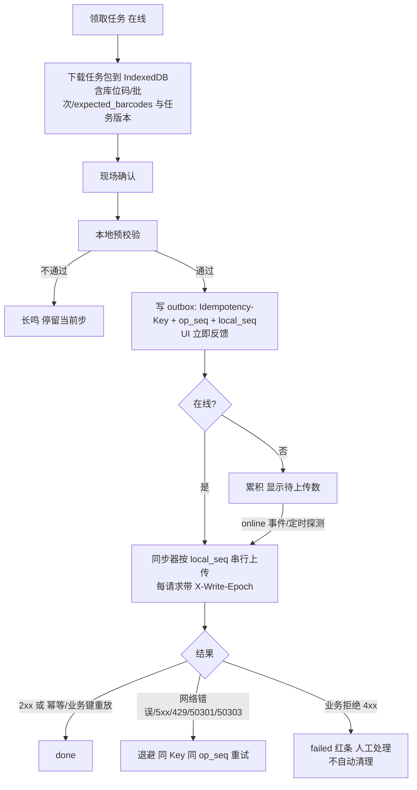
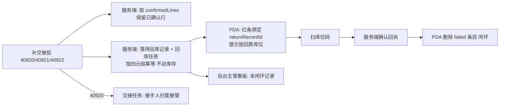
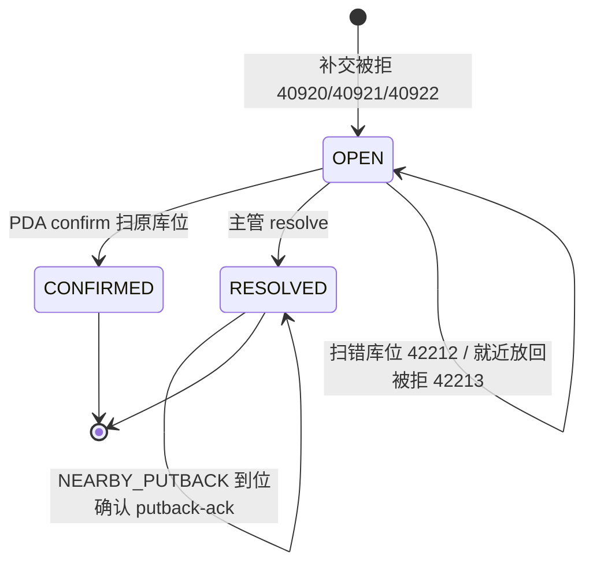

# 14 分拣 H5 / PDA 端 详细设计

| 项 | 内容 |
|---|---|
| 编号 | 14 |
| 作者 | 界面（前端与端上） |
| 评审 | 待定：1 名测试 + 1 名非作者开发（§12 攻击面逐条打） |
| 基线 | `origin/main@f85a95a`（01–12、17、18 均已合入）；总体设计 §6.4 错误码、§6.5 幂等、§6.6.1 审批类型、§6.6.2 离线/暂停下发、§6.6.5 缺口登记、§6.8 时间、§8 前端模板、§9.1 部署形态 |
| 依赖 | 01 主数据（**已合 main**：条码解析 `GET /master/barcodes/{barcode}` 可用，端上不缓存条码表；主数据停用/软删一期未建）；02 库存核心（原语、系统冻结）；03 入库（收货、上架，**已合 main**）；04 出库与分配（待回库记录，**已合 main**）；05 波次与拣货（**已合 main**）；06 复核装箱发货（**已合 main**）；07 补货与移库（**已合 main**）；08 盘点（**已合 main**）；10 退货与异常（**已合 main**，退货预约收货待 #40）；11 集成（纸单补录、outbox，**已合 main**，含非计划切换 §7.3）；12 权限与审计（**已合 main**：`exp` 整秒、`/me` 六字段、`device.binding.*`）；17 加工中心（草稿）；18 活鲜暂存（**已合 main**） |
| 技术栈 | Vue 3 + TypeScript + Vite + Vant，H5 打包；PDA 用 WebView 壳或自带浏览器，壳能力（扫码广播、蓝牙打印、电子秤）走 `bridge/` 适配层 |
| 状态 | 新稿（界面，2026-10-15）。从 `docs/frontend-detail-design` 搬运后按当前 main 逐条重核；**对齐轮第一批（2026-10-15）**：按 00 已定口径、12 篇、01 已合 main 的现状改 §1.3 / §6 / §6.2 / §7 / §9.7 / §11（等 05/06/16/17 的第二批） |

> **引用口径**：凡接口路径、权限点、错误码，以已合 main 的 01–12、18 与 00 为准；**只剩 16 是草稿**（17 已合 main），正文引用处标「（草稿）」。旧稿里的业务码用法全部重核过，差异见 §1.3。**本篇引用 00 §6.4 / §6.5 的权威定义；12 篇与 00 冲突处以 00 为准。**

---

## 1. 职责与边界

### 1.1 负责

1. 分拣员、复核员、仓管员、加工/活鲜作业员在现场使用的 H5 应用：领任务、三步扫码拣货、缺货上报、撤销确认、提交任务、复核、装箱、集货、收货、上架、盲收登记、纸单补录、待回库闭环；加工/活鲜作业员另有领料、报工（含 `LOSS` 行）、冲回与批次追溯查询（17 §7.2）。
2. **离线优先**：任务包本地缓存、本地 outbox、重连后按本地顺序补交，冲突不静默合并。
3. 现场交互硬性要求：扫码输入、震动/声音反馈、大按钮单手操作、不弹阻断式对话框。
4. 设备绑定、离线令牌、写节点地址缓存与切换的端上行为（§9.5、§9.7）。
5. 组件与工具：`ScanInput`、`QtyStepper`、`SyncBadge`、`utils/format.ts`、`offline/` IndexedDB 封装。

### 1.2 不负责

| 事项 | 归属 |
|---|---|
| 库存扣减、FEFO 选批、任务分配、状态迁移合法性 | 服务端（02 / 04 / 05 / 06）。本地只做**预校验**（库位匹配、任务包 `expected_barcodes[]`），以服务端判定为准 |
| 「只看自己的任务」「仓数据权限」「SoD」的安全边界 | 服务端 `require_perm` + 数据层注入；前端隐藏按钮不是安全边界 |
| 权限点定义与角色矩阵 | 12（00 §6.6 只登记命名规则） |
| 三层扫码的业务规则（拣货三步各步的守卫） | 05（已合 main） |
| 复核通过条件、封箱人规则、箱作废审批 | 06（已合 main）+ 00 §6.6.1 |
| 待回库记录的库存口径与并发 | 04 §7.3（已合 main） |
| 司机装车/签收、商城下单 | 15（前端）、16（后端） |
| 加工报工守恒校验、活鲜锁池判定 | 17（**已合 main**）、18（已合 main） |

### 1.3 与旧稿（`docs/frontend-detail-design`）的差异

| # | 旧稿 | 新稿 | 原因 |
|---|---|---|---|
| Δ1 | 任务、复核相关接口写「待对齐：见第 5 / 6 篇」 | 填上 05 / 06 的路径、权限点、错误码 | 05 §7、06 §7（均已合 main） |
| Δ2 | 领任务权限点写 `picking.task.claim` | `picking.task.execute` | 05 §7 / §10 没有 `picking.task.claim`，claim 也走 `picking.task.execute` |
| Δ3 | `paused_actions` 写「三个」「八个值」 | **九个值**（含 `LIVE_WEIGH_OUT`） | 00 §6.6.2 已登记 9 个；11 篇、14 旧稿的「八个」是旧口径 |
| Δ4 | `40312` 提示显示 `detail.rule` | 只认 **`detail.reason`** | 00 §6.4 `SOD_VIOLATION` 明确不再使用 `detail.rule` |
| Δ5 | 上架权限点写 `inbound.putaway.execute` | `inbound.putaway` | 03 §7 / §10 |
| Δ6 | 盲收 / 预约收货路径当成已定 | 保留流程，给出前端消费契约（§6.2），后端侧待登记 | main 的 03/10 均无 `/inbound/returns/blind`、`/returns/reservations/{id}/receive` |
| Δ7 | 旧稿示例的 `client_time` 用带 `T`/`Z` 的 ISO 写法 | 客户端时间统一 `YYYY-MM-DD HH:MM:SS` UTC 整秒 | 00 §6.8 第 4 条；带 `T`/`Z` 或小数秒在 SQLite 侧被拒 → 40003 |
| Δ8 | 「PDA 心跳」被当成已知接口 | 路径待定（Q7） | 00 §6.6.2 只说「`/me` 和终端心跳响应」，未定路径 |
| Δ9 | 离线令牌 `exp` 当 ISO 8601 带时区解析，`/me` 缺 00 §6.6.2 的四项 | `exp` 按 **UTC 整秒 `YYYY-MM-DD HH:MM:SS`** 解析，端上不得按时区换算；`/me` 六字段（`stale_policy` / `paused` / `offline_since` / `paused_actions[]` / `offline_deadline_at` / `backfill_deadline_at`）按 12 篇 §8 | 12 篇 Δ1（`12:10` / `12:91-94`）与 §8（`12:435-447`）；00 §6.6.2 是 400 级硬契约 |
| Δ10 | 盲收错误码列 `42221 MASTER_DISABLED`，当成可达 | 01 一期**没有停用生命周期**，`42221` / `40962` / `42220` 均未建（01 §7.1）：保留文案分支但**不做可达路径**；盲收本身不写主数据表 | 01 §7.1「未建」/ §7「未建接口」 |
| Δ11 | 设备与权限点引用 12 草稿 | 按 12 篇 §4.2：`device.binding.view` / `.approve` / `.revoke`、`inbound.return.blind`、`returns.reservation.*` 均为已登记口径 | 12 篇 §4.2；00 §6.6 第 3 篇清单第 10 个 |

---

## 2. 用例

| 编号 | 角色 | 用例 | 入口路由 | 关键服务端契约 |
|---|---|---|---|---|
| P1 | 分拣员 | 设备登录（账号 + `device_instance_id`），未绑定走等待审批页 | `/login` → `/binding-pending` | `POST /auth/device-login`（12 §8）；未绑定 40111 `detail.reason` |
| P2 | 分拣员 | 看我的任务 / 可领任务，领取 | `/pick/tasks` | `GET /picking/tasks?mine=1&status=`、`POST /picking/tasks/{id}/claim`（05 已合 main）；抢领冲突 40923 |
| P3 | 分拣员 | 任务包预下载（离线可用） | `/pick/tasks/:id` | `GET /picking/tasks?mine=1&preload=1`（05 已合 main） |
| P4 | 分拣员 | 逐行三步扫码：扫库位 → 扫商品 → 输数量 → 确认 | `/pick/tasks/:id` | `POST /picking/tasks/{id}/lines/{seq}/confirm`；42212 库位不对、42210 条码不符、42214 `OVER_PICK` |
| P5 | 分拣员 | 缺货上报，跳过该行继续 | `/pick/tasks/:id/short` | `POST /picking/tasks/{id}/lines/{seq}/short`；必填原因（40002） |
| P6 | 分拣员 | 撤销上一次确认（30 秒内自撤；超时需主管） | 同行 | `POST /picking/tasks/{id}/lines/{seq}/undo`；超 30 s 需 `picking.task.undo_any`；超量 42214 `OVER_REVERSE` |
| P7 | 分拣员 | 任务汇总与提交 | `/pick/tasks/:id/summary` | `POST /picking/tasks/{id}/complete` |
| P8 | 分拣员 | 补交被拒（改派/取消/关闭）后处理待回库 | `/sync`、`/return/:returnRecordId` | 40920/40921/40922 + `returnRecordId`；04 §7.3 |
| P9 | 复核员 | 扫筐拉清单、逐件复核、称重 | `/check`、`/check/:orderCode` | `POST /outbound-orders/{code}/checks`、`POST /checks/{code}/scans`、`/submit`（06 已合 main） |
| P10 | 复核员 | 开箱、装箱、封箱、打印箱码 | `/pack/:orderCode` | `POST /outbound-orders/{code}/boxes`、`PUT /boxes/{code}/lines`、`POST /boxes/{code}/seal`（06 已合 main） |
| P11 | 复核员 | 集货（扫箱码 + 集货位） | `/pack/:orderCode` | `POST /boxes/{code}/stage`；42215 温区不符 |
| P12 | 复核员 | 封箱后丢箱/破损，发起箱作废申请 | 箱详情 | `POST /pack/boxes/{box_id}/void-request`；审批在后台（13 篇） |
| P13 | 仓管员 | 收货登记、上架扫码 | `/receive`、`/putaway` | `POST /inbound/lines/{id}/receipts`、`POST /inbound/receipts/{id}/putaways`（03 §7，已合 main） |
| P14 | 仓管员 | 盲收登记（无预约到货） | `/receive/blind` | 契约见 §6.2；后端侧待 10 篇补登记 |
| P15 | 仓管员 | 设备不可用时用纸质单，恢复联网后纸单补录 | `/offline/paper` | `POST /offline/paper-records`（11 §7，已合 main）；24 h 窗口 |
| P16 | 加工/活鲜作业员 | 领料、成品入库、损耗登记、巡池、死亡登记、出池称重 | `/processing/*`、`/live/*` | 17 / 18；是否可离线见 Q8 |

---

## 3. 页面与路由清单

Hash 路由（WebView 兼容）。权限点为渲染依据，实际以服务端为准。

| 路由 | 页面 | 权限点 | 在线要求 |
|---|---|---|---|
| `/login` | 设备登录（账号 + `device_instance_id`）+ 选仓 | — | 必须在线 |
| `/binding-pending` | 首绑等待审批（设备实例短码、账号、仓库、刷新） | — | 可离线显示，刷新需在线 |
| `/home` | 功能宫格（按 `permissions` 与 `paused_actions[]` 渲染）+ 待补交角标 | — | 离线可用（用缓存） |
| `/pick/tasks` | 任务列表（我的 / 可领取） | `picking.task.execute` | 列表需在线；已缓存任务可离线继续 |
| `/pick/tasks/:id` | 任务执行（逐行三步扫码） | `picking.task.execute` | 离线可用（已领任务） |
| `/pick/tasks/:id/short` | 缺货原因选择 | `picking.task.execute` | 离线可用 |
| `/pick/tasks/:id/summary` | 任务汇总与提交 | `picking.task.execute` | 离线可用（入 outbox） |
| `/check` | 扫筐/箱 | `outbound.check.execute`（06 已合 main） | 可离线（扫码入 outbox）；开复核单需在线 |
| `/check/:orderCode` | 逐件复核、称重（`weight_g`） | `outbound.check.execute` | 扫码可离线，提交需在线 |
| `/pack/:orderCode` | 开箱、装箱、封箱、打印箱码、集货 | `outbound.pack.execute` / `outbound.stage.execute` | 需在线（取冻结期望数） |
| `/pack/boxes/:boxId` | 箱详情、申请作废、看审批状态 | `pack.box.void.request`（申请）/ `outbound.order.view`（查看） | 需在线 |
| `/return/:returnRecordId` | 待回库确认（扫原库位）/ 就近放回到位确认 | 原拣货人 | 需在线（状态以服务端为准） |
| `/receive` | 收货登记 | `inbound.receive` | 可离线（入 outbox） |
| `/receive/blind` | 盲收登记 | `inbound.return.blind`（契约见 §6.2） | 可离线（入 outbox） |
| `/receive/reservations` | 退货预约收货 | `returns.reservation.receive` / `.view`（契约见 §6.2） | 可离线（入 outbox） |
| `/putaway` | 上架扫码 | `inbound.putaway` | 可离线（入 outbox） |
| `/move` | 同仓移库；跨仓调拨 | `inventory.move.view` / `.confirm`（07 §10，已合 main；原 `inventory.move.execute` 作废） | 同仓可离线；跨仓调拨按 `paused_actions` 的 `TRANSFER` 置灰、不重试（11 §6.6） |
| `/offline/paper` | 纸单补录（恢复联网后 24 h 内） | `offline.paper.backfill` | 必须在线 |
| `/sync` | 补交队列（待上传 / 失败红条 / 已完成） | — | 离线可看 |
| `/processing/issue`、`/processing/receipt`、`/processing/loss` | 加工领料 / 成品入库 / 损耗 | `process.order.issue` / `process.order.report` / `process.order.reverse`（17 §7.2 / §10，**已合 main**） | 损耗**无独立路径**（报工带 `LOSS` 行，17 §7.2）；离线可用性见 Q8 |
| `/live/patrol`、`/live/death`、`/live/weigh-out` | 巡池 / 死亡登记 / 出池称重 | `live.inspect.submit` / `live.death.report` / `live.weigh.submit`（18 §7） | 巡检、死亡登记可离线；出池称重看 `paused_actions` |
| `/settings` | 声音/震动、扫码模式、设备信息、离线令牌剩余 | — | 离线可用 |

---

## 4. 组件拆分

| 组件 / 模块 | 职责 |
|---|---|
| `ScanInput` | 统一扫码入口：监听壳广播或键盘楔入（以回车判定结束），常驻隐藏焦点；输出带 `scan_event_id` 的扫码事件；去抖规则见 §8.3 |
| `StepGuide` | 三步状态条：库位 → 商品 → 数量，当前步高亮，不允许跳步 |
| `QtyStepper` | 数字键盘 + `+/-` 步进；称重品接电子秤读数；值以**字符串**保存，经 `utils/qty.ts` 计算；最多 3 位小数，超过不截断（后端 400 为准） |
| `BigButton` | 主按钮高度 ≥ 56 dp，底部固定，单手可达 |
| `TaskLineCard` | 当前行：库位、SKU、批次/效期、应拣量、已拣量 |
| `SyncBadge` / `SyncBar` | 在线状态、待补交条数；失败条目红条常驻直到处理 |
| `RedBar` | 业务拒绝条目（`failed`）与待回库记录绑定：显示 `returnRecordId`、`resolution`、`closed_by`、`closed_at` |
| `Feedback` | 成功「嘀」+短震；错误长鸣+长震，**不弹阻断式对话框** |
| `bridge/` | 扫码、打印、电子秤、震动的壳适配；无壳时降级为键盘楔入 + 手输 |
| `offline/` | IndexedDB 封装（任务包、outbox）、同步器、格式迁移 |

数量口径：接口出参固定 3 位小数字符串，单位是 SKU `base_uom`；展示统一走 `utils/format.ts` 的 `formatQty`（数量 + 基本单位，与后台 13 篇共享同一实现），页面不写 `toFixed`；输入最多 3 位小数（超 3 位后端 400 `40010`，不舍入）。全程不经过 `float`。

时间口径（00 §6.8）：所有时间是 **UTC 整秒**，客户端提交的 `client_time` / `client_occurred_at` 一律 `YYYY-MM-DD HH:MM:SS`（不带 `T`、不带时区后缀、不带小数秒）；显示时按**仓库时区**换算，不用设备时区。设备时间只用于展示和排障，不参与任何业务判断。

---

## 5. 状态管理

| 位置 | 内容 |
|---|---|
| Pinia `user` / `perm` / `dict` / `warehouse` | 跨页、变化慢的数据；`permissions` 只用于渲染 |
| IndexedDB `task_pack` | 已领任务包：任务行（含 `expected_barcodes[]`）、库位码、批次、任务版本号（**不含条码全表**，§9.6） |
| IndexedDB `outbox` | 待上传操作（§9.3） |
| 安全存储 | `device_instance_id`、离线令牌 `offline_token` |
| 内存（不落盘） | `write_endpoint` + `write_epoch` 缓存（每次启动重取，取不到用上次值） |
| 组件本地 | 当前行、当前步骤、输入中的数量 |

任务列表等在线数据不进 store；**执行中的任务以 IndexedDB 为准**（断电 / WebView 被杀后可恢复到上次步骤）。`/home` 的置灰状态来自最近一次收到的 `paused_actions[]`，离线期间沿用缓存值。

---

## 6. 页面 → 接口映射

斜体标注的接口只剩草稿篇 **16**（01–12、17、18 均已合 main），定稿后需复核。**01 已合 main**：条码解析 `GET /api/v1/master/barcodes/{barcode}` 是已定接口（端上仍不缓存条码表）；主数据的停用挂起、软删两段式、字典接口**一期未建**（01 §7「未建接口」/「显式延期」），端上不依赖。

| 页面 | 动作 | 接口 | 幂等键 |
|---|---|---|---|
| 登录 | 设备登录 | **`POST /api/v1/auth/device-login`** `{login_type, username\|phone, password\|sms_code, device_instance_id, client_type}`（12 篇 §8） | — |
| 登录 | 签发离线令牌 | **`POST /api/v1/auth/offline-token`** → `{token, exp, ttl_seconds}`；**`exp` 是 UTC 整秒 `YYYY-MM-DD HH:MM:SS`**（12 篇 Δ1；端上不得按带时区 ISO 或本地时区解析） | — |
| 登录 | 刷新 / 登出 | **`POST /api/v1/auth/refresh`**、**`POST /api/v1/auth/logout`**（12 篇 §8） | — |
| 登录 | 当前用户 / 权限 / 仓 / 暂停动作 / 写节点窗口 | `GET /api/v1/me`（含 `perm_version`、`stale_policy`、`paused`、`offline_since`、`paused_actions[]`、`offline_deadline_at`、`backfill_deadline_at`，00 §6.6.2 硬契约；**12 篇 §8 已补全**） | — |
| 等待审批 | 查审批状态 | **`GET /api/v1/approvals/{approval_id}`**（凭 `binding_id + device_instance_id`） | — |
| 任务列表 | 我的任务 / 可领任务 | **`GET /api/v1/picking/tasks?mine=1&status=…`**（05 §7.1，已合 main） | — |
| 任务列表 | 领取任务 | **`POST /api/v1/picking/tasks/{id}/claim`**，body 带 `device_instance_id` | `Idempotency-Key` |
| 任务执行 | 任务包预下载 | **`GET /api/v1/picking/tasks?mine=1&preload=1`** | — |
| 任务执行 | 扫商品码解析（在线） | **`GET /api/v1/master/barcodes/{barcode}`**（01 §7 已合 main；权限 `master.sku.view`；边缘节点本地可用；**端上不缓存条码表**） | — |
| 任务执行 | 拣货行确认 | **`POST /api/v1/picking/tasks/{id}/lines/{seq}/confirm`** `{device_instance_id, op_seq, scanned_location_code, scanned_barcode, lot_code, confirmed_qty, uom, scan_event_id}`（05 §6.2 无客户端时间字段，时间由服务端写） | `Idempotency-Key` + 四元组 |
| 任务执行 | 缺货上报 | **`POST /api/v1/picking/tasks/{id}/lines/{seq}/short`** `{short_reason_code, …}` | 同上 |
| 任务执行 | 撤销上一次确认 | **`POST /api/v1/picking/tasks/{id}/lines/{seq}/undo`** | 同上 |
| 任务汇总 | 提交任务完成 | **`POST /api/v1/picking/tasks/{id}/complete`** | `Idempotency-Key` |
| 补交队列 | 批量/逐条补交、查任务状态 | 同上的各写接口（按 `local_seq` 顺序重发） | 原 Key + 原 `op_seq` |
| 补交队列 / 红条 | 查待回库记录状态 | `GET /api/v1/return-records/{returnRecordId}`（04 §7.3，已合 main） | — |
| 回库 | 扫原库位确认 | `POST /api/v1/return-records/{returnRecordId}/confirm` `{locationCode}` | `Idempotency-Key` |
| 回库 | 就近放回到位确认 | `POST /api/v1/return-records/{returnRecordId}/putback-ack` `{locationCode}` | `Idempotency-Key` |
| 复核 | 开复核单 | **`POST /api/v1/outbound-orders/{outbound_id}/checks`**（06 §7.1，已合 main） | `Idempotency-Key` |
| 复核 | 复核扫码 / 撤销一扫 | **`POST /api/v1/checks/{code}/scans`**（`line_no`、`device_instance_id`、`op_seq`、`barcode`、`qty`） | 四元键 |
| 复核 | 提交（带 `version`） | **`POST /api/v1/checks/{code}/submit`** | `Idempotency-Key` + version |
| 装箱 | 开箱 / 整体替换箱明细 / 封箱 | **`POST /api/v1/outbound-orders/{outbound_id}/boxes`**（06 §7.2，已合 main）、**`PUT /api/v1/pack/boxes/{box_id}/lines`**、**`POST /api/v1/pack/boxes/{box_id}/seal`** | `Idempotency-Key`（+version） |
| 集货 | 扫箱码 + 集货位 | **`POST /api/v1/pack/boxes/{box_id}/stage`** | 四元键 |
| 箱作废 | 申请作废 / 查箱详情 | `POST /api/v1/pack/boxes/{box_id}/void-request`、`GET /api/v1/pack/boxes/{box_id}`（00 §6.6.1 / 06 §7.3） | `Idempotency-Key` |
| 收货 | 收货登记 | `POST /api/v1/inbound/lines/{id}/receipts`（03 §7，已合 main） | `op_key` / 四元组 |
| 收货 | 盲收登记 | `POST /api/v1/inbound/returns/blind`（契约见 §6.2；**权限点 `inbound.return.blind` 已由 00 §6.6 第 3 篇清单第 10 个登记**，12 §4.2 收录；**03 §7 已合 main：`03:260`**） | `Idempotency-Key` + 四元组 |
| 收货 | 退货预约收货 | `POST /api/v1/returns/reservations/{id}/receive`（**10 §7.2 已合 main：`10:176`**；契约见 §6.2） | `Idempotency-Key` |
| 上架 | 上架扫码 | `POST /api/v1/inbound/receipts/{id}/putaways`（03 §7，已合 main） | `op_key` / 四元组 |
| 纸单补录 | 提交 | `POST /api/v1/offline/paper-records` `{action_type, occurred_at, operator_id, payload, photo_ids[]}`（11 §7，已合 main） | `Idempotency-Key` |
| 加工 | 领料 / 报工 / 冲回 | **`POST /api/v1/processing/orders/{id}/issues`**、**`/reports`**、**`/reversals`**（17 §7.2，已合 main） | 业务键 `issue_client_id` / `report_client_id` / `reversal_client_id` + `Idempotency-Key` |
| 活鲜 | 巡检 / 死亡登记 | `POST /api/v1/live/inspections`、`POST /api/v1/live/deaths`（18 §7） | `(device_instance_id, client_op_id)` |
| 活鲜 | 出池称重 | `POST /api/v1/live/weighs`（18 §7） | `(task_kind, task_id, weigh_client_id)` |
| 活鲜 | 阈值下发包 | `GET /api/v1/live/pda-package?warehouse_code=`（18 §7） | — |
| 写节点 | 取/重取写地址 | `GET /api/v1/warehouses/{warehouse_code}/write-endpoint` → `{endpoint, epoch}`（00 §9.1） | — |
| 全局 | 每个写请求 | 头带 `X-Warehouse-Id`、`X-Write-Epoch`、`Idempotency-Key` | — |

---

### 6.2 盲收与退货预约收货的端上契约

> 这两条接口在 main 上**已定义**（盲收 03 §7：`03:260`；退货预约 10 §7.2：`10:173-176`），权限点也已登记。下面是**端上消费要点与离线约定**：PDA 按此实现与 MSW mock，后端语义与落库由 03/10 篇定；字段名以后端定稿为准，形状有变本篇同步对齐。数量 3 位小数字符串，时间 UTC 整秒 `YYYY-MM-DD HH:MM:SS`。

**盲收登记**（`POST /api/v1/inbound/returns/blind`，权限 `inbound.return.blind`）

```json
{ "sku_id": "7311000000000001", "qty": "12.500", "uom": "KG",
  "reason_code": "STORE_BLIND", "container_code": "BX-000123", "store_code": "ST-001",
  "photo_ids": [], "device_instance_id": "6f1c…", "op_seq": "7",
  "client_occurred_at": "2026-10-15 02:31:00" }
```

- 必填：`sku_id`、`qty`、`reason_code`、`container_code`；`store_code`、`photo_ids` 可选；头带 `Idempotency-Key`、`X-Warehouse-Id`、`X-Write-Epoch`。
- 响应 200：`{"receipt_id": "…", "inbound_order_id": "…", "inbound_order_code": "RTN-WHSH01-0003-20261015-000031", "exception_no": "EXC-…", "link_deadline_at": "2026-10-17 02:31:00"}`。`link_deadline_at` = 创建 + 48 h（UTC），前端**只读、不推算**（剩余 < 4 h 标橙、超时标红）。
- 错误：`40001`（缺 `reason_code` / `container_code`，`detail` 带字段名）、`40010`（数量格式）、`40910`（`key_type` 按 00 §6.5）、`50304`（`RECEIVE` 暂停，`detail.action`）、`40111` / `40112`（设备与令牌）。**`42221 MASTER_DISABLED` 一期未建**（01 §7.1：没有停用生命周期与动作白名单）：保留文案分支但**不做可达路径**，真收到按未知码通用处理。
- 离线：入 outbox（入队前做同样的必填校验），联网后按 §9.3 补交；补交成功才显示两个单号（§9.11）。

**退货预约收货与查询**（`POST /api/v1/returns/reservations/{id}/receive`，权限 `returns.reservation.receive`；`GET /api/v1/returns/reservations`、`GET /api/v1/returns/reservations/{id}`，权限 `returns.reservation.view`）

```json
{ "lines": [ { "line_no": 1, "received_qty": "10.000", "location_code": "A01-02-03" } ] }
```

- 响应 200：`{"id": "…", "reservation_no": "…", "status": "RECEIVED", "inbound_order_code": "RTN-…", "lines": [{"line_no": 1, "received_qty": "10.000"}]}`；收货后该批进 `RETURN_QC` 冻结，PDA 只显示「待质检」，**不提供解冻**。
- 列表入参 `store_code`、`status`、`cursor`；详情返回单头 `{id, reservation_no, store_code, outbound_order_id, status: CREATED|RECEIVED|CANCELLED, created_at}` 与行 `{line_no, sku_id, qty, reason_code, container_code, received_qty}`。
- 错误：`40001`（行号/数量/库位缺失）、`40010`、`40930`（预约非 `CREATED`）、`40906`（库位被盘点冻结）、`42212`（扫到的库位与 `location_code` 不符）、`40910`、`50304`（`RECEIVE` 暂停）。
- 离线：入 outbox，联网补交时由服务端判定预约状态（非 `CREATED` → `40930` 红条，刷新不重试）。

---

## 7. 权限点

- 首页宫格与路由按 `permissions` 与 `paused_actions[]` 渲染；无权限不显示按钮。
- **前端隐藏不是安全措施**：任务归属、仓库范围、SoD 全由服务端强制；离线补交时服务端仍按当前令牌与任务归属校验，前端不能凭本地缓存越权提交。
- 本篇涉及权限点（归属篇见括号）：
  - 拣货：`picking.task.execute`（含 claim / confirm / short / undo / complete）、`picking.task.undo_any`（主管，超 30 s）、`picking.task.reassign`、`picking.task.close`（05 §10，已合 main）。
  - 待回库：`picking.return_record.view`、`picking.return_record.resolve`（04 §10）；confirm / putback-ack 只允许**原拣货人**。
  - 复核装箱：`outbound.check.execute`、`outbound.pack.execute`、`outbound.pack.unseal`、`outbound.stage.execute`、`pack.box.void.request`（06 §10 / 00 §6.6.1）。
  - 入库：`inbound.receive`、`inbound.putaway`（03 §10）、`inbound.return.blind`（盲收登记；**00 §6.6 第 3 篇清单第 10 个已登记**，12 篇 §4.2 收录）。
  - 离线：`offline.paper.backfill`（11 / 00 §6.6.1）。
  - 主数据：`master.sku.view`（条码解析，01 §7 已合 main）。**主数据停用挂起 / 软删两段式 / 字典接口一期未建**（01 §7），端上不出现对应入口；`40962` / `42221` / `42220` 保留文案但不做可达路径。
  - 加工 / 活鲜：`process.order.issue`、`process.order.report`、`process.order.reverse`（`REWORK` 冲回另需 `process.rework.approve`，不能自批）、`process.trace.view`（17 §7.2，已合 main）；`live.inspect.submit`、`live.death.report`、`live.weigh.submit`（18 §10）。
  - 设备：`device.binding.view`、`device.binding.approve`、`device.binding.revoke`（**12 §4.2，已合 main**；PDA 侧只在绑定等待页查 `DEVICE_BIND` 审批状态与展示结果）。
- **补交账号必须与产生操作的账号一致**：outbox 按 `user_id` 隔离（§9.3）；服务端以令牌里的 `device_instance_id` 为准，忽略请求体中的值。

---

## 8. 交互与异常态

### 8.1 现场交互硬性要求

1. 三步扫码不合并：扫库位 → 扫商品 → 输数量。扫错库位长鸣并停留在第一步。
2. 主按钮 ≥ 56 dp，字号 ≥ 16 sp，高对比度主题，底部单手可达；只支持竖屏。
3. 异常优先不阻断：缺货选原因后跳过该行，任务继续。
4. 同一行 **30 秒内**可撤销上一次确认；超时按钮置灰（需 `picking.task.undo_any`，由主管操作）。撤销本身是一条新操作（新 Key、新 `op_seq`），进 outbox。
5. 错误用长震 + 长鸣 + 顶部色条，**不用模态弹窗**。
6. 每个业务拒绝都显示 `trace_id`（可点开复制），方便报主管。

### 8.2 三态

| 状态 | 表现 |
|---|---|
| 加载 | 骨架屏；任务列表禁用重复点击 |
| 空 | 「暂无任务，下拉刷新」（列表）；任务包为空时提示重新下载 |
| 错误 | 业务 `message` + 「重试」+ `trace_id`；可离线的操作失败**不进错误态**，直接入 outbox 并标「待上传」 |

### 8.3 重复扫码与重复提交

| 场景 | 处理 |
|---|---|
| 非计件模式（扫库位、扫商品定位、扫筐）下扫码枪抖动 | 同一次触发的重复广播丢弃（有壳按壳事件 id）；键盘楔入按两次回车间隔判断，默认 150 ms，可配置（Q9） |
| **计件模式**逐件扫，每扫一次 +1 | **不做时间窗去抖**。每次扫码生成唯一 `scan_event_id`（有壳用壳事件 id，否则本地 uuid），按事件 id 去重；同码快速连扫都算合法 +1，超过应拣量长鸣阻止。服务端 `uq_pick_op_scan` 防同一扫码事件重复入账（05 §8） |
| 已确认的行再次扫同一库位/商品 | 提示「该行已完成」，不生成新操作 |
| 确认按钮连点 | 写 outbox 是本地事务，按钮在写完前禁用；同一行同一 `op_seq` 只生成一条 |

### 8.4 版本与强制更新

- `/me` 返回 `min_client_version` 高于当前版本时强制更新，**不要求先清空 outbox**。
- outbox 每条带 `format_version`；新版本启动时按版本号逐级自动迁移旧条目（迁移脚本随版本发布，有单测）。迁移失败的条目保留原样并标红交主管，**不丢弃**。
- 服务端对补交 payload 至少兼容最近 2 个客户端版本；超出范围返回明确业务码，条目转人工。

---

## 9. 多端适配与离线

### 9.1 适配

- 目标设备：Android 8+ PDA（4–6 寸，720p 起），WebView Chromium 80+；同时可在普通手机浏览器使用。
- 只支持竖屏；适配戴手套、强光/弱光；不依赖 hover；离线场景下按钮尺寸与色条对比度单独走查。

### 9.2 离线流程



### 9.3 outbox 记录与幂等

outbox 每条：`{ op_id(uuid), local_seq, format_version, idem_key, device_instance_id, user_id, warehouse_id, task_id, line_no, op_seq, scan_event_ids, type, payload, task_version, created_at, status, attempts, last_error, server_record_id, linked_op_id }`。

**两层去重**

1. **第一层 `Idempotency-Key`**：用户点确认时生成 uuid，与 payload 在同一个 IndexedDB 事务里写入；重试、重连、重启、退避都复用同一个 Key，不重新生成。服务端保留 24 h，它只是第一层。
2. **第二层业务唯一键（四元组）`(task_id, line_no, device_instance_id, op_seq)`**（00 §6.5）：Key 过期后仍按四元组判重。
   - 四元组相同、内容相同 → 重放首次结果，视为成功；
   - 四元组相同、数量或操作类型不同 → `40910`，`detail.key_type=PDA_OP`，条目转人工。
   - 幂等缓存范围：服务端只缓存确定性结果——2xx、400xx、409xx；**422、5xx、429 不缓存**，同一 Key 重试会被**重新执行**。所以 422 类修正后可用同 Key 重提；5xx/429 退避重试同 Key 也安全（业务键兜底）。
   - `op_seq`：PDA 按任务行单调递增生成，写入 outbox 后不再改变。
   - `device_instance_id`：装机时生成并存安全存储，重装或清数据即变；与 `op_seq` 一起进业务键，避免重装后 `op_seq` 从头计数撞旧操作。

**写入与断电**：outbox 写成功后才给成功反馈；断电后要么整条存在、要么不存在。请求在途时 WebView 被杀，重启后同 Key、同 `op_seq` 重发。

**顺序**：按设备本地单调递增的 `local_seq` 排序（IndexedDB 自增计数，不受时钟影响），`created_at` 只用于展示。同一任务前一条未结束时不发后一条；前一条 `failed` 时，同账号同任务的后续条目暂停。

**状态与清理**

| 状态 | 含义 | 清理 |
|---|---|---|
| `pending` | 待上传 / 重试中 | — |
| `done` | 服务端已确认处理 | 保留 24 h 后清理 |
| `failed` | 业务拒绝，待人工处理 | **永不自动清理**；只有收到服务端回执确认已处理（待回库闭环、主管已处理）后才删除 |
| `superseded` | 已作废（撤销、重扫替换） | 与关联条目一起清理 |

红条与 `failed` 条目同生命周期：条目在，红条就在。

**多账号与换班**

- outbox 按 `user_id` 隔离成独立队列：A 的失败只阻塞 A 自己同任务的后续条目，不影响 B。
- 当前账号 outbox 非空时**不允许登出**；可选择「交给主管」：主管在 PDA 上登录确认后，该批条目转为主管名下处理，服务端记审计（Q10）。
- 首页显示「其他账号待补交 N 条」，只读，不可代为补交。

**离线撤销**

- 撤销是一条新操作（新 Key、新 `op_seq`），进 outbox，**本地不合并抵消**；确认和撤销按顺序都发，由服务端裁决。
- 若该行的确认被拒（40920/40921/40922 等），其后同行的撤销条目在本地置 `superseded`，不上传。

### 9.4 补交冲突处理

| 服务端返回 | 含义 | 前端处理 |
|---|---|---|
| 幂等命中 / 业务键重放（同四元组同内容） | 已处理过 | 视为成功 |
| `40910` `key_type=IDEMPOTENCY_KEY` | 同 Key 不同 body（本地数据异常） | `failed`，不重试，上报日志 |
| `40910` `key_type=PDA_OP` | 同四元组不同内容 | `failed`，交主管 |
| `40910` `key_type=PROCESS_REPORT` / `PROCESS_REVERSAL`（17 §7.3） | 加工报工 / 冲回同键异 body（`request_hash` 不符） | `failed` 红条，**不重试、不换 client_id**，交主管 |
| `40910` `key_type` 缺失/未知 | 服务端违反契约（必填） | `failed` 红条，**不自动重试、不生成新 Key**，交人工，上报日志 |
| `50000` | 服务端异常 | 通用错误 + `trace_id`；条目保持 `pending` 退避重试（不缓存，重新执行，业务键兜底） |
| `50010` | 不变量违反 / 撞 CHECK | 通用错误 + `trace_id`；**不自动重试**，置 `failed` 红条交主管 |
| `42214` `reason=OVER_PICK` | 确认量超计划量 | `failed` 红条，不自动重试，提示「请复核数量或联系主管」；改数量是一条新操作（新 Key、新 `op_seq`，`linked_op_id` 关联原条目） |
| `42214` `reason=OVER_REVERSE` | 撤销超可冲回量 | `failed` 红条，不自动重试；显示「出库行 {outbound_line_id}：已拣 {picked_qty}，已撤销 {reversed_qty}，本次申请撤销 {requested_qty}」（数量三位小数字符串，经 `formatQty`） |
| `42214` `reason=OVER_CHECK` | 复核数量超已拣量 | `failed` 红条「复核数量超过已拣数量」，长鸣，不重试 |
| `42214` `reason=SELL_EXPIRED` | 批次已过 `sell_days` 可售期 | `failed` 红条「批次已过可售期」，不重试，引导主管发起拣后取消（`CANCEL_AFTER_PICK`，13 篇） |
| `42214` `reason` 缺失/未知 | 契约异常（只认这四个值） | `failed` 红条交人工，不自动重试、不生成新 Key，上报日志 |
| `40920` / `40921` / `40922` | 改派 / 取消 / 关闭 | 见 §9.4.1 |
| `40902` | 库存不足（本地认为拣到但扣不了） | 原条目 `failed`；「重扫」生成新条目（新 Key、新 `op_seq`，`linked_op_id` 指向原条目），成功后原条目置 `superseded`；或「报缺」 |
| `42210` 条码不匹配 | 扫错（离线预校验放过的） | 同上，重扫生成新条目并关联 |
| `42212` 库位不对 | 扫错库位 | 同 42210；长鸣，停留原步骤重扫 |
| `40903` 批次效期不符 | 任务包批次信息过期 | 同上，重扫生成新条目并关联 |
| `40110` `reason=TOKEN_EXPIRED` | 令牌过期 | 暂停该账号队列；刷新令牌后同 Key 继续；刷新失败则重新登录后继续 |
| `40110` `reason=PERM_VERSION_CHANGED` | 权限已变 | 暂停队列；刷新令牌并重拉 `/me`，更新宫格；仍有权限点则继续，否则转 `failed` 红条交主管 |
| `40110` `reason=DEVICE_UNBOUND` | 绑定被吊销 | 清本地令牌、回登录页，**不清 outbox**；重新登录若返回 40111 按下两行处理 |
| `40110` `reason` 缺失/未知 | — | 暂停队列，要求同账号重新登录 |
| `40111` `reason=BINDING_PENDING` | 首绑待审批 | 显示 `/binding-pending`（§9.7），不清 outbox |
| `40111` `reason=NOT_BOUND` | 审批驳回/过期 | 提示「绑定未通过，请重新登录申请」，重新登录会再次发起 `DEVICE_BIND`，不清 outbox |
| `40111` `reason=WAREHOUSE_MISMATCH` 或缺失 | 绑定仓不符 | 暂停队列，提示联系主管，不清 outbox |
| `40112` `reason=EXPIRED`/`PERM_STALE` | 离线令牌过期 / 权限快照过期 | 暂停队列，在线重新登录后继续，不清 outbox |
| `40112` `reason=REVOKED` | 令牌被吊销（可能挂失） | 提示「令牌已吊销（设备可能被挂失），请联系主管」，不清 outbox |
| `40112` `reason=DEVICE_MISMATCH` | 设备与账号不符 | 提示交主管，不清 outbox |
| `40112` `reason` 缺失/未知 | — | 同 `REVOKED` 处理 |
| `40312 SOD_VIOLATION` | 违反职责分离 | `failed` 红条，显示 **`detail.reason`**（如 `CHECK_SOD`、`BOX_VOID_SELF_APPROVE`、`RECEIVER_NOT_APPROVER`），不重试，交他人处理 |
| `40310` / `40311` | 无权限点 / 仓数据权限被收回 | 暂停该账号队列，交主管 |

#### 9.4.1 任务改派 / 取消 / 已关闭（40920 / 40921 / 40922）

响应带 `confirmedLines`（服务端已确认的行）和 `returnRecordId`（待回库记录 id）；40920 另带 `new_holder_device_id`。

1. **已确认行有效**：`confirmedLines` 中的行保持完成，货物计在原分拣员周转筐上。
2. **改派（40920）**：服务端生成交接任务；提示「请将周转筐交给接手人」，接手人扫筐接管。前端**不把本地数据重放到新任务**。红条显示「任务已由设备 {new_holder_device_id} 持有」，本设备该任务排队操作进待回库异常队列（第 3 条），**不重试**。
3. **未上传的离线行一律拒绝**（不静默合并）。服务端用被拒 payload 落一条待回库记录并生成回库任务，响应返回记录 id；PDA 把红条与 `returnRecordId` 绑定（`server_record_id`），提示「放回原库位」并列出库位与数量。
4. 待回库记录按**四元组**幂等：同一条目重复补交被拒，返回同一个记录 id，不重复生成。
5. 待回库记录**在回库扫码确认前不动库存**。
6. 换设备、清缓存后记录仍在服务端；未闭环记录在管理后台主管看板展示（13 篇）。



#### 9.4.2 待回库记录的闭环（接口见 04 §7.3，已合 main）

| 动作 | 接口 | 调用方 | 要点 |
|---|---|---|---|
| 红条状态 | `GET /api/v1/return-records/{returnRecordId}` | PDA | 重连后、打开 `/sync` 时刷新 |
| 回库确认 | `POST /api/v1/return-records/{returnRecordId}/confirm` | PDA（**仅原拣货人**） | 头带 `Idempotency-Key`，body 带 `locationCode`；**不写库存流水**，只 `OPEN → CONFIRMED` |
| 就近放回到位确认 | `POST /api/v1/return-records/{returnRecordId}/putback-ack` | PDA（仅原拣货人） | 不写流水，只记 `putback_acked_at/by`；库位不对 42212 |
| 主管处理 | `POST /api/v1/return-records/{returnRecordId}/resolve` | 后台（13 篇） | 必填 `resolution`、`reason`；`NEARBY_PUTBACK` 必填 `targetLocationCode` |

PDA 规则：

- confirm 扫错库位 → `42212 LOCATION_MISMATCH`，红条保留，提示「请扫原库位 XX」重扫。**PDA 不提供就近放回**，就近放回只能主管在后台 resolve。
- confirm 和 resolve 都是 `status=OPEN` 条件更新，输的一方收到 `40932 RECORD_ALREADY_CLOSED`，`detail` **固定五个字段** `{status, resolution, target_location, closed_by, closed_at}`（00 §6.4）；`target_location` 总是出现，仅 `NEARBY_PUTBACK` 时非 null；`40930` 只表示通用非法状态流转，**不用于这个场景**。
- 按 `detail.resolution` 处理（GET 详情查到已非 OPEN 时同样）：

| `resolution` | PDA 处理 | 删除 `failed` 条目的时机 |
|---|---|---|
| `CONFIRMED` / `RETURNED_TO_ORIGINAL` | 提示「已由 {closed_by} 于 {closed_at} 处理」 | 立即 |
| `NEARBY_PUTBACK` | 红条保留，提示「请放到 {target_location}」；扫目标库位 → `putback-ack`（不写流水，账已在 resolve 时移走）；扫错 42212 重扫 | `putback-ack` 成功后 |
| `SCRAP_HANDOVER` | 红条保留，提示「请把货交给主管报损」 | `GET` 详情返回的 `handover_confirmed_at`（及 `_by`）非空后；为空则保留 |
| 缺失 / 未知 | 红条保留，不删除，交人工 | — |

- 任何 `40930` 一律保留红条；confirm 网络失败按 outbox 规则同 Key 重试。



原则：**冲突绝不静默丢弃**；处理动作本身是新操作、新 Key。

### 9.5 边缘节点与写库切换（对齐 00 §9.1）

- PDA 只连**本仓的权威写库**（形态 A 中心 / 形态 B 仓内边缘节点），**不存在双写**。
- **取地址**：`GET /api/v1/warehouses/{warehouse_code}/write-endpoint` → `{endpoint, epoch}`。中心和边缘节点本地都提供。缓存上次的 `endpoint` + `epoch`；取不到时**用缓存继续作业**，不阻塞。
- **每个写请求带 `X-Write-Epoch`**。
- **`50303 STALE_WRITE_NODE`**：暂停 outbox → 重新取 write-endpoint → 按 `local_seq` 顺序**原样**重提交（原 `Idempotency-Key`、`device_instance_id`、`op_seq` 不变）；条目保持 `pending`，**不标红**，顶栏提示「系统切换中」。
- **`50301 DEPENDENCY_UNAVAILABLE`**（只表示写库不可用）或发现 `epoch` 变化时：重取 write-endpoint 后按原幂等键重提交。
- **`50302 ID_CLOCK_BACKWARD`**（发号时钟回拨）**不触发**重取地址：按普通 503 处理，条目保持 `pending` 退避重试，不标红。
- **`50304 STALE_STOCK_PAUSED`**：见 §9.10，**不重取写地址**。
- **继承**：幂等记录、四元组唯一键、待回库记录随权威库迁移，新写节点直接继承；切换完成前旧节点只读。切换前已成功的操作重提交得到重放结果，不重复扣减。
- **非计划切换（边缘硬件故障）**：从备份恢复到备用机，RPO 窗口内的写入可能丢失；PDA 只需重取地址，outbox 按原业务键重提交补数。新节点可能使用新节点号，对 PDA 无影响。对账（动碰盘点）完成前若服务端不开放作业，写请求按 503 处理，条目保持 `pending`。**审批流程在服务端**：审批类型 `UNPLANNED_FAILOVER`（00 §6.6.1，`ck_apr_ttl` 上限 1 h），确认接口 `POST /api/v1/failover/{warehouse_code}/confirm`，**共三人**（1 人发起 + 仓库主管与中心运维各确认一次，发起人不能兼任确认人）；PDA 不参与确认，只在切换完成后重取 `write-endpoint`（旧节点 epoch +1、旧节点只读）。

### 9.6 条码解析与离线预校验

- **PDA 不缓存条码全表**。任务包每行带 `expected_barcodes[]`：任务生成时该 SKU 的条码**快照**，只在本任务范围有效。
- 在线：扫商品码走 `GET /api/v1/master/barcodes/{barcode}` 解析；离线：用 `expected_barcodes[]` 做**预校验**，不匹配立即长鸣提示重扫。
- 预校验只用于现场即时反馈，**以服务端补交时的判定为准**：快照之后条码换绑导致不一致时，服务端结果胜出（本地通过、服务端 `42210` → 红条重扫）；本地不通过的码不入队。
- 扫到的原始条码随 outbox 条目一起上传，便于服务端判定与审计。

### 9.7 设备绑定与离线令牌

- `device_instance_id` 首次安装生成并存安全存储，**重装即变**（四元组成员）。登录走 `POST /api/v1/auth/device-login`。
- **首次绑定**：服务端建立 PENDING 绑定并生成 `DEVICE_BIND` 审批；主管在后台审批中心通过后转 ACTIVE。审批前登录返回 `40111`、`detail.reason=BINDING_PENDING`（另带 `approval_id`、`binding_id`）：PDA 进 `/binding-pending`（设备实例短码、账号、仓库、刷新按钮），**不进入作业、不写 outbox**；可用 `GET /api/v1/approvals/{approval_id}` 查询状态。驳回时提示联系主管。
- 同一设备换人登录：服务端吊销旧绑定、建立新绑定；前端要求上一账号 outbox 已清空或已交主管（§9.3）。
- 在线登录后调用 `POST /api/v1/auth/offline-token` 取离线令牌（`{token, exp, ttl_seconds}`，默认 **12 小时**、库层上限同为 12 h，覆盖一个班次），存安全存储。**`exp` 是 UTC 整秒 `YYYY-MM-DD HH:MM:SS`**（12 篇 Δ1）：解析与倒计时都按 UTC 与服务器时间比对，**不得用设备本地时区换算、不得当带时区 ISO 串解析**。失联时继续作业、操作入 outbox；补交时服务端校验离线令牌，失败按 `40112` 处理。
- 顶栏显示离线令牌剩余时间，取响应 `exp`（12 篇 §3.3：`issued_at` / `expires_at` 由库写）；剩余 < 1 小时提醒「请尽快联网」；已过期仍允许记录 outbox（不丢现场数据），但提示「联网后需重新登录才能补交」。
- 设备挂失（`device.status=LOST`）后绑定与离线令牌全部吊销，补交返回 `40112 REVOKED`，outbox 保留交主管。
- **`/me` 六字段已闭环（原 Q1 关闭）**：00 §6.6.2 是 400 级硬契约，**12 篇 §8 的 `/me` 示例已写全** `stale_policy` / `paused` / `offline_since` / `paused_actions[]` / `offline_deadline_at` / `backfill_deadline_at`。端上按这六项渲染置灰与倒计时；返回缺字段时上报并退回上一份缓存，不自行推断。

### 9.8 重连

- 监听 `online`/`offline` + 每 15 s 轻量探测（PDA 上事件不可靠）。
- 重连后先刷新令牌与任务版本，再按 `local_seq` 上传 outbox。
- **先重放 outbox，再由服务端对账**；冲突进异常队列，PDA 红条显示异常单号（若响应提供）。
- 离线超过 2 小时：提示「任务可能已被回收」，仍补交，由服务端裁决（阈值是否配置下发见 Q4）。
- **离线超过 12 小时**：服务端在 `paused_actions` 中下发 `PICK_CONFIRM / CHECK / SHIP / RECEIVE / POD`，并在补交时拒绝这些操作。**PDA 不设本地 12 h 计时禁用**，置灰只看最近一次收到的 `paused_actions`；全程断网收不到更新时仍照常记录进 outbox（不丢现场数据），联网补交后被拒的条目转红条交主管。

### 9.9 复核、装箱与集货

- 开复核单、提交、装箱、封箱、集货只能在线（需取冻结期望数）；复核扫码 / 撤销一扫可离线入 outbox（四元键去重）。接口见 06 §7。
- **复核人 = 任一拣货人**：`40312`，`detail.reason=CHECK_SOD`（另带 `checker_id`、`picker_ids[]`）。前端按「码 + reason」分支：`CHECK_SOD` → 红条「你拣过此单，不能复核，请换人」，不重试；其他 reason → 按 `detail.reason` 通用提示。复核人必须与该单**所有**拣货人不同；该单没有任何拣货人记录时一律拒绝，前端不做本地放行判断。
- **多扫**：`42214`，`detail.reason=OVER_CHECK` → 长鸣 + 红条，不自动重试；文案与 `OVER_PICK`、`OVER_REVERSE` 分开。
- **批次已过可售期**：`42214`，`detail.reason=SELL_EXPIRED` → 长鸣 + 红条，不重试，引导主管发起拣后取消（`CANCEL_AFTER_PICK`）；PDA 不提供绕过入口。
- **通过（PASSED）条件**：至少一行复核行、无 `checked ≠ expected` 的行、且至少登记了一个拣货人；不满足时「通过」置灰，服务端也会拒绝。复核单只能以 `OPEN` 新建。
- **少件不允许提交**：清单未扫齐时「提交」置灰，提示「数量不足：先撤销拣货，再重新复核」；不提供「短发通过」。
- **封箱前置**：箱必须挂在**同一出库单**、状态 `PASSED` 的复核单上；**封箱人必须是该复核单的复核人**，「封箱」按钮只对该复核人显示，没有权限例外（主管也不能代封；换人只能作废复核单重新复核）。服务端拒绝返回 `40930`，`detail.reason=SEALER_NOT_CHECKER` → 提示「只有本箱复核人可以封箱」，不重试。
- **装箱不超复核量**：该复核单下所有有效箱（排除 `CANCELLED` / `VOIDED`）按 SKU 合计不得超过复核量，超出 `42211`（`detail` 带 SKU）→ 红条标出 SKU，不重试。
- **已发货（SHIPPED）箱完全只读**：不显示任何编辑/解封入口。
- **封箱后不可改明细**：SEALED 箱明细只读；服务端 `40937 BOX_SEALED_IMMUTABLE` → 刷新箱详情，提示「箱已封，需主管解封」，不重试。
- **不允许跨单混箱**：一个箱只装一张出库单；扫到其他出库单的商品立即长鸣拒绝，不入箱（服务端为准）。
- **集货温区不符**：`42215`，`detail = {location_code, location_temp_zone, sku_temp_zone}` → 红条显示两个温区，重扫正确集货位，不重试。
- **称重品**显示与录入重量为整数克 `weight_g`，不带小数。
- **箱状态**：`OPEN / SEALED / STAGED / SHIPPED / CANCELLED / VOIDED`；`SHIPPED / CANCELLED / VOIDED` 整行只读。
- **车次与交接**：车次有箱或有单时不能取消；交接时服务端核对箱数 = 已集货（STAGED）箱数，不符拒绝；交接后装错车不可撤回，PDA 不提供撤回入口。
- **箱作废**：封箱后丢失/损坏走 `POST /api/v1/pack/boxes/{box_id}/void-request`（只对 SEALED 箱，`reason_code: LOST|DAMAGED`），审批通过箱变 `VOIDED`；审批人 = 申请人返回 `40312`，`detail.reason=BOX_VOID_SELF_APPROVE`。PDA 复核员可发起（`pack.box.void.request`），审批在管理后台箱详情（13 篇），不进审批中心。箱详情响应携带最近一张 `box_void_request`（无则 `null`）：`{void_request_id, status: PENDING|APPROVED|REJECTED, reason_code, remark, photo_ids[], requested_by, requested_at, decided_by, decided_at, decision_remark}`（时间 UTC，按仓库时区显示）；`PENDING` 时显示「作废审批中」并隐藏「申请作废」按钮，`REJECTED` 时显示驳回意见并允许重新申请，`APPROVED` 时箱为 VOIDED 只读。

### 9.10 断网可用清单与剩余离线时间

断网状态由 `GET /api/v1/me` 与心跳返回（00 §6.6.2）：

`{stale_policy: PAUSE|DEGRADE, paused, offline_since, offline_deadline_at, paused_actions[], backfill_deadline_at}`

`paused_actions` 是**九个值**：`ALLOCATE` / `TRANSFER` / `WAVE_RELEASE` / `LIVE_WEIGH_OUT`（PAUSE 期间即下发）+ `PICK_CONFIRM` / `CHECK` / `SHIP` / `RECEIVE` / `POD`（离线超过 12 h 后由服务端加入）。**首页宫格与按钮按 `paused_actions[]` 置灰，不在前端写死清单**；离线期间沿用最后一次收到的值。新增枚举值须先登记到 00 §6.6.2。

| 枚举值 | 含义 | PDA 置灰 |
|---|---|---|
| `ALLOCATE` | 新分配 / 预占 | 领取新拣货任务（领取触发分配）、缺货后「重新分配」 |
| `TRANSFER` | 调拨（跨仓移库） | `/move` 中跨仓调拨入口（同仓移库不受影响） |
| `WAVE_RELEASE` | 波次释放 | PDA 无此入口（后台 13 篇） |
| `LIVE_WEIGH_OUT` | 活鲜出池称重扣库存（18） | 出池称重确认 |
| `PICK_CONFIRM` | 拣货确认（离线超 12 h） | 任务执行页「确认」、缺货上报、撤销 |
| `CHECK` | 复核 | 复核扫码、提交、开复核单 |
| `SHIP` | 发货（集货 / 交接） | 集货扫码、交接 |
| `RECEIVE` | 收货 | 收货登记、盲收、预约收货 |
| `POD` | 签收 | PDA 无此入口（司机端 15 篇） |

未知枚举值：不映射任何按钮，记录日志上报。

| 功能 | 断网时 |
|---|---|
| 执行**已下发**的拣货任务（扫码、确认、缺货上报、撤销） | 可用，入 outbox |
| 领取新拣货任务 | **置灰**（领取即新分配） |
| 复核扫码 / 撤销一扫 | 可用，入 outbox |
| 开复核单、提交、装箱、封箱、集货 | 置灰（需在线） |
| 收货登记（含盲收登记） | 可用，入 outbox |
| 新分配、跨仓调拨、波次下发 | **置灰** |
| 待回库确认 | 置灰（需在线校验状态） |
| 巡检、死亡登记 | 可用（18 §7.2：不暂停） |

- 置灰项点击提示「断网期间不可用，联网后操作」。
- 被暂停的操作若仍提交，服务端返回 `503` `50304`，`detail.action` ∈ `paused_actions`：提示「该仓暂停跨网点分配/移动」，**不自动重试、不重取写地址**；立即重拉 `/me`，等 `paused=false`（或 `paused_actions` 不再含该动作）后按钮恢复，由用户重新操作。
- **剩余离线时间**：顶栏倒计时取 `offline_deadline_at`（UTC，按仓库时区显示；= `offline_since` + 12 h），前端不自行用 `offline_since` 推算；剩余 < 1 小时变红。**倒计时只做显示，不自行禁用任何按钮**（置灰只由 `paused_actions` 驱动）。
- 重连后按 §9.8 对账补交。

### 9.11 盲收登记、退货预约收货与纸单补录

- **盲收**（无预约到货）：**契约见 §6.2**，权限点 `inbound.return.blind`。流程口径：body `{sku_id, qty, reason_code, container_code, store_code?, photo_ids[]}`（`qty` 三位小数字符串；`reason_code`、`container_code` 必填，`store_code` 可选），带 `Idempotency-Key`。前端必填校验：未选退货原因、未扫箱码时提交置灰并在字段下提示；服务端缺字段返回 `40001`，按 `detail` 字段名定位提示，不重试。响应返回**收货记录号**与自动生成的**异常单号**，结果页同时显示并提示「须在 48 小时内关联订单，超时升级主管」（48 h 口径由后端定）。离线入 outbox（入队前同样做必填校验），联网补交后再显示两个单号。
- **退货预约收货**：**契约见 §6.2**，权限点 `returns.reservation.receive`。流程：扫/选预约单 → 核对行（`sku_id`、`qty`、`reason_code`、`container_code`）→ 提交 `{lines[{line_no, received_qty, location_code}]}`；预约非 `CREATED` 返回 `40930`，刷新不重试。收货后进 `RETURN_QC` 冻结，PDA 只显示「待质检」，不提供解冻。
- **纸单兜底补录**（00 §6.6.1，审批类型 `PAPER_BACKFILL`）：设备不可用时现场用纸质单记录；恢复联网后由操作人（`offline.paper.backfill`）在 `/offline/paper` 提交 `POST /api/v1/offline/paper-records` `{action_type, occurred_at, operator_id, payload, photo_ids[]}`（`occurred_at` 按仓库时区录入、以 UTC 整秒提交；纸单照片必传），带 `Idempotency-Key`，生成待主管审批（`offline.paper.approve`）的审批单，申请人不能自批。
  - **24 小时时限**：必须在恢复联网后 24 h 内提交，超时服务端转异常单（10 篇）。入口显示「补录剩余 HH:MM」倒计时，只读服务端下发的 `backfill_deadline_at`（`/me` 与心跳返回，= 恢复联网 + 24 h；**前端不用设备时间推算**）。为 `null`（窗口已过或设备从未断网）时隐藏入口与倒计时；窗口期内一直显示（服务端无从得知是否还有未录入的纸单）；< 1 小时标红。已提交的补录记录仍可查看。
  - **补录本身必须在线，不进 outbox**。

### 9.12 加工中心与活鲜暂存

加工（17 已合 main）与活鲜（18 已合 main）纳入范围，库存状态新增 `PROCESSING`、`LIVE_HOLD`。

| 流程 | 现场动作 | 接口 |
|---|---|---|
| `/processing/issue` | 加工领料：扫加工单 → 扫原料批次/库位 → 录数量（3 位小数） | **`POST /api/v1/processing/orders/{id}/issues`**（`issue_client_id`；活鲜池另带 `live_weigh_id` + `issue_count`，按件 SKU 带单件净重） |
| `/processing/receipt` | 成品入库：扫加工单 → 录成品数量/重量 → 打印批次标签 → 上架 | **`POST /api/v1/processing/orders/{id}/reports`**（`report_client_id` + `lines[{output_role, sku_id, lot_id?, to_location_id?, gross_qty_milli, tare_qty_milli, loss_reason?}]`） |
| `/processing/loss` | 损耗登记（超得率容差提示） | **同一报工接口**，`lines[].output_role=LOSS`（17 §7.2：不另立路径） |
| `/live/patrol` | 水质/水温巡检：扫池位 → 录指标 → 超限长鸣 | `POST /live/inspections` |
| `/live/death` | 死亡登记：扫池位 → 录重量 + 尾数 → 拍照 → 生成报损 | `POST /live/deaths` |
| `/live/weigh-out` | 出池称重：扫池位 → 电子秤取重 + 录尾数 → 确认 | `POST /live/weighs`（`weigh_client_id`） |

- **库存状态**：`PROCESSING`、`LIVE_HOLD` 是系统锁定，不计可用量，PDA 无释放入口（人工解冻返回 40933）。
- **双数量**：活鲜同时录入/显示重量 `qty_milli`（3 位小数字符串）与尾数 `qty_count`（整数）。死亡登记两者都扣；出池称重按实际重量与实际尾数扣。
- **称重**：电子秤取重或手录；净重入账，毛重/皮重随请求留痕。超出 SKU `weigh_tolerance_bp`（默认 300 = 3%）返回 `42217 WEIGH_OUT_OF_TOLERANCE` → 长鸣红条，不自动重试，提示复称。
- **称重幂等**：每次称重生成 `weigh_client_id`（uuid），与结果一起持久化到 outbox；超时、重连、重启后的重试复用同一个，**只有重新称一次才生成新值**。业务键 `(task_kind, task_id, weigh_client_id)`；同键不同内容返回 `40910`，`detail.key_type=LIVE_WEIGH` → 红条「这次称重和之前提交的内容不一致」，不重试、不换键，交主管。
- **死亡登记**：走 09 报损（来源 `LIVE_DEATH`）；池被 `LIVE_HOLD` 锁定时仍可登记。单池单日超阈值时服务端转 `LIVE_DEATH_OVER` 审批（`40938` 表示未带有效审批），PDA 显示「待审批」。离线/暂停期间按 18 §7.2「先落后扣」处理，PDA 只显示扣减状态为待补。
- **巡检**：超限即长鸣告警；连续 2 次超限或严重超限后整池锁定 `LIVE_HOLD`，PDA 显示锁定且无解锁按钮，复检合格后自动解除；该池已分配未称重的出库会被重新分配，PDA 上对应称重任务消失或改派（按服务端返回）。
- **加工**（17 §5.1 / §6）：加工单状态 `CREATED → RELEASED → IN_PROGRESS → COMPLETED`（越界先 `PENDING_APPROVAL`，驳回回 `IN_PROGRESS`；PDA 只显示状态与可否作业，不自行推进）；领料按净量（按件 SKU 必带单件净重与整件数，缺一 `40001`）；报工由服务端校验守恒（不平衡 `42218`），出成率 / 损耗越界**不拦截**、加工单转 `PENDING_APPROVAL` 并挂 `PROCESS_YIELD_DEVIATION` 审批（12 h），PDA 只提示；冲回三型 `ISSUE` / `OUTPUT`（`SCRAP` / `REWORK`）/ `LOSS`，超量 `42214` `reason=OVER_REVERSE`，`REWORK` 需审批且不能自批（`40312`）；已发货成品不显示冲回。PDA 离线可报工入 outbox，重放按 `report_client_id` 回放首次响应（17 §6.3）；`process_report` / `process_lot_trace` / `process_reversal` 是 append-only，**重放不得用 REPLACE**（17 §13 WP-B12）。

---

## 10. 测试要点

| 层 | 工具 | 重点 |
|---|---|---|
| 单元 | Vitest + fake-indexeddb | outbox 写入原子性；Key 与 `op_seq` 在失败/重启/退避后不变；`local_seq` 排序（改系统时间后顺序不变）；串行与失败暂停只影响本账号同任务；`failed` 不被 24 h 清理、只在服务端回执后删除；撤销在确认被拒后置 `superseded`；重扫生成新条目并关联；`format_version` 迁移（含迁移失败标红）；数量字符串计算不经 `float` |
| 组件 | Vitest + @vue/test-utils | 三步扫码不可跳步；缺货跳行；30 秒撤销窗口（超时置灰）；BigButton ≥ 56 dp；离线确认即时反馈；计件模式 1 秒扫 5 件得 5（不被去抖）；非计件模式壳重复广播被丢弃；outbox 非空不能登出、可交主管；首页显示其他账号待补交数 |
| 模拟弱网 | MSW | `40110` 三种 reason（TOKEN_EXPIRED 刷新后同 Key 续传 / PERM_VERSION_CHANGED 重拉 `/me` / DEVICE_UNBOUND 重新绑定且 outbox 保留）；`40111` 四种表现（BINDING_PENDING 显示等待页且不写 outbox、NOT_BOUND 重登再发起、WAREHOUSE_MISMATCH 提示主管、缺失暂停队列）；`40112` 四种 reason 分别提示、均不清 outbox；`40312` 红条显示 `detail.reason`；离线令牌剩余 < 1 h 提醒、过期仍记录 outbox |
| 模拟弱网 | MSW | `40910` 按 `detail.key_type` 分支（`PDA_OP` 交主管、`IDEMPOTENCY_KEY` 上报、缺失/未知红条不自动重试且不生成新 Key）；`50000` 退避同 Key 重试；`50010` 不自动重试红条；`42214` 四个 reason 分别文案且均不自动重试（断言无二次请求）；`42210` / `42212` / `40903` 生成新条目并 `linked_op_id` 关联 |
| 模拟弱网 | MSW | **Key 过期（服务端无 Key 记录）后补交按四元组重放，不重复扣减**；422 不缓存：修正后用同 Key 重提被重新执行；5xx/429 后同 Key 重试也不重复扣减；超时后重试同 Key；响应丢失；`42212` 修正重扫用同 Key |
| 模拟弱网 | MSW | `40920` 带 `new_holder_device_id` 时红条显示持有设备、排队操作转待回库队列、无重试请求；`40920/40921/40922` 返回 `confirmedLines` + `returnRecordId`，重复被拒返回同一 id；confirm 成功后删除 `failed` 条目；confirm 与主管 resolve 并发 → `40932` 五字段齐全，按 `resolution` 分支（`CONFIRMED`/`RETURNED_TO_ORIGINAL` 立即删、`NEARBY_PUTBACK` 等到 ack 成功、`SCRAP_HANDOVER` 等到 `handover_confirmed_at` 非空、缺失/未知保留）；`40932` 非 `NEARBY_PUTBACK` 时 `target_location` 有值也被忽略；`40930` 一律保留红条 |
| 模拟弱网 | MSW | 断网时用缓存 `endpoint` + `epoch` 继续作业且写请求带 `X-Write-Epoch`；`50303` 暂停队列、重取 write-endpoint、按 `local_seq` 原 Key 重放、不标红；`50301` 与 `epoch` 变化同样重取后原键重提；`50302` 不触发重取地址、只退避重试；非计划切换后按原业务键重提交且新节点号无影响；`50304` 提示暂停、不重试、**不重取写地址**、重拉 `/me` 后按 `paused=false` 恢复 |
| 模拟弱网 | MSW | 置灰完全由 `paused_actions[]` 驱动：九个值各自映射、未知值不映射、返回空数组时不置灰、返回 `LIVE_WEIGH_OUT` 时出池称重置灰；倒计时取 `offline_deadline_at` 而非本地推算；`offline_deadline_at` 到期但 `paused_actions` 未含对应值时按钮不置灰（无本地 12 h 禁用）；断网期间到期仍可记录进 outbox |
| 模拟弱网 | MSW | 离线用任务行 `expected_barcodes[]` 预校验（不匹配长鸣不入队）、本地通过但服务端 `42210` 时红条重扫（服务端胜出）；在线扫码走 `master/barcodes/{barcode}`；IndexedDB 无条码全表 |
| 复核/装箱 | Vitest + MSW | `40312` + `CHECK_SOD` 红条「换人复核」不重试（显示 `picker_ids`）；缺 reason 走通用；`42214 OVER_CHECK` 文案与 `OVER_PICK`/`OVER_REVERSE` 区分；未扫齐时提交置灰并提示先撤销拣货；零扫描「通过」置灰；PASSED 需 ≥ 1 行、无不符、有拣货人；非复核人无封箱按钮（主管也无）；`40930 SEALER_NOT_CHECKER` 提示不重试；装箱超复核量 `42211` 标 SKU；`42215` 显示两个温区；`40937` 刷新不重试；扫到他单商品拒绝入箱；SHIPPED / VOIDED 箱无编辑入口；有箱/有单的车次无取消；箱详情 `box_void_request` PENDING 时隐藏「申请作废」、`REJECTED` 可重申请、`APPROVED` 只读；时间按仓库时区显示；`BOX_VOID_SELF_APPROVE` 提示不能自批；重量只接受整数克 |
| 收货/补录 | Vitest + MSW | 盲收未选 `reason_code` 或未扫 `container_code` 时提交置灰、离线也不入队；服务端 `400` 按 `detail` 字段提示；成功显示收货记录号 + 异常单号与 48 h 提示；预约收货提交后显示待质检；纸单补录需 `offline.paper.backfill`、照片必传、在线提交、生成 `PAPER_BACKFILL` 审批；倒计时只取 `backfill_deadline_at`（改设备时间不影响）、< 1 h 标红、窗口内入口一直显示、`null` 时隐藏入口但已提交记录仍可查看 |
| 加工/活鲜 | Vitest | `PROCESSING`/`LIVE_HOLD` 无释放入口；重量 + 尾数同时录入，缺一不能提交；去皮后提交净重并带毛重/皮重；`42217` 长鸣红条不重试；锁池时死亡登记仍可用、巡检无解锁按钮；死亡超阈值显示待审批；冲回超量 `42214 OVER_REVERSE` 红条；已发货成品无冲回；得率超界只提示不拦截；`weigh_client_id` 重试/重启复用、重称才换；`40910 key_type=LIVE_WEIGH` 红条不重试不换键 |
| 真机 | 手工清单 | 冷库断网 30 分钟及跨夜（> 24 h）后补交；拔电池 / 杀 WebView 后恢复；手动改系统时间后上传顺序；换班换账号；outbox 非空时强制更新 |

覆盖率目标：`offline/`、`utils/`、`composables/` 行 ≥ 85%、分支 ≥ 75%；组件 ≥ 70%。

---

## 11. 待定问题

> **契约对齐台账**：14 篇 §6.2 与 13 篇 §6.3 的每条契约对应的责任篇、状态与行号依据，统一维护在 **13 篇 §6.4「契约对齐台账」**，本篇不重复维护。

| # | 问题 | 依赖 | 影响 |
|---|---|---|---|
| Q1 | ~~12 篇 md 当前不在 main，`/me` 响应缺 00 §6.6.2 的四项~~ **已闭环**：12 篇§4.2 给出权限点矩阵，§8 的 `/me` 示例写全 `stale_policy` / `paused` / `offline_since` / `paused_actions[]` / `offline_deadline_at` / `backfill_deadline_at`；`exp` 为 UTC 整秒（Δ1） | 已关闭 | 登录、设备绑定、置灰与倒计时字段；12 与 00 冲突以 00 为准 |
| Q2 | ~~盲收与退货预约收货的后端缺口~~ **已闭合**：盲收 03 §7（`03:260`）、退货预约 10 §7.2（`10:173-176`）已合 main；端上字段按 §6.2 对齐 | 已关闭 | §6 / §6.2 |
| Q3 | 拣货任务接口（含 `preload` 任务包格式、任务版本号字段、`seq` 与四元组里 `line_no` 的对应）以 05 §7/§10 为依据（**已合 main**） | 已关闭 | §6 全部任务行 |
| Q4 | 离线回收阈值（原文 2 h）是否配置下发 | 00 / 05 | 重连提示 |
| Q5 | PDA 壳选型及扫码事件 id、打印、电子秤接口 | 采购 / 05 | `bridge/` |
| Q6 | 批量补交接口及其部分失败语义 | 05 / 11 | `/sync` 同步器 |
| Q7 | 心跳接口路径与响应字段清单（00 §6.6.2 只说「终端心跳」；**12 篇 §8 只给了 `GET /api/v1/me`，没有心跳路径**） | 12 篇增量 / 00 登记 | §9.10；一期端上只轮询 `/me`，心跳作为可选优化，不阻塞 |
| Q8 | 加工 / 活鲜在 PDA 的离线范围与成品标签打印接口 —— **17 已给**：报工可离线入 outbox 并按 `report_client_id` 回放（17 §6.3）；领料 / 冲回的离线可用性与标签打印接口待定 | 17（已合 main）/ 18（已合 main） | §9.12 |
| Q9 | 键盘楔入去抖阈值的配置来源 —— 原依赖 01 字典接口，**字典一期未建**（01 §7「显式延期」/ §12 Q9） | 01 增量 | §8.3；一期用编译期默认值（可由任务包下发），不依赖字典 |
| Q10 | 「交给主管」的接管流程（主管在 PDA 登录确认 / 后台接管）与审计字段 | 12 篇 §8 + 13/14 篇 | §9.3；存储与审计字段以 12 篇 `system.audit.*` 为准 |
| Q11 | ~~同仓移库 / 跨仓调拨的权限点定名~~ **已定**：07 §10 给 `inventory.move.view` / `.create` / `.confirm` / `.cancel`（无 `.execute`） | 已关闭 | `/move` |
| Q12 | 共享 `utils/format.ts` 的方式（monorepo 包 / 复制） | 工程结构 | 13/14/15 共用 |
| Q13 | ~~客户端时间格式~~ **已裁决**：全按 00 §6.8 用 `YYYY-MM-DD HH:MM:SS` UTC 整秒；05 篇 confirm 示例带 `T`/`Z` 的 ISO 写法不采用，05 篇侧同步改 | 已关闭 | 40003 风险消除 |
| Q14 | 01 增量（`md_version`、停用挂起、软删、字典、伙伴/车队/设备台账、节点号）落地时间 | 磐石 / Chief | 端上按本批标注「不做入口」；字典落地前 §8.3 的去抖阈值与心跳配置仍用默认值 |

---

## 12. 对抗评审攻击面

| # | 攻击面 | 打法 |
|---|---|---|
| F-A1 | 四元组失效 | 重装后 `op_seq` 从头计数撞旧操作；换设备重放旧队列；同四元组不同数量只重试不报错 |
| F-A2 | Key 过期 | 服务端已清 `idempotency_record` 后补交，是否按业务键回放而不是重复入账 |
| F-A3 | 幂等缓存范围 | 把 422 / 5xx / 429 也缓存起来，导致修正后无法重提；或把 409xx 漏掉导致重复冲突 |
| F-A4 | 离线队列顺序 | 改设备时钟、跨作业日、跨重启后 `local_seq` 是否仍单调；前一条失败后后续是否真的暂停 |
| F-A5 | 冲突不静默合并 | 40920/40921/40922 后本地是否偷偷把离线行重放到新任务；待回库记录是否重复生成 |
| F-A6 | 闭环删除时机 | 40932 后过早删除 `failed` 条目；`NEARBY_PUTBACK` 未 ack 就删；`SCRAP_HANDOVER` 未交接就删 |
| F-A7 | 置灰绕过 | 用缓存的 `paused_actions` 之外的路径提交被暂停操作；本地按 12 h 自行禁用或自行解禁 |
| F-A8 | 写节点切换 | `50303` 后生成新 Key / 新 `op_seq`（应原样重提）；`50304` 触发重取地址；`50302` 被当成切换 |
| F-A9 | 权限与绑定 | 前端缓存绕过 `permissions`；换人登录不清 outbox；挂失设备仍能补交；`perm_version` 变化后不重拉 `/me` |
| F-A10 | 时间约定 | 提交带 `T`/`Z` 或小数秒的时间；用设备时间做离线截止判断；显示用设备时区导致跨天 |
| F-A11 | 扫码去抖 | 计件模式被时间窗去抖少记数量；非计件模式重复广播多记一件；`scan_event_id` 复用 |
| F-A12 | 数量口径 | 用 JS `Number` 做数量运算导致 0.1+0.2 漂移；前端四舍五入掩盖 3 位小数校验；`"-0.000"` |
| F-A13 | 强制更新 | 迁移失败条目被丢弃；更新后 outbox 被清空 |
| F-A14 | 一期不存在的分支 | 把 `42221` / `40962` / `42220` 当可达提示写进交互（01 一期没有停用挂起 / 边缘守卫 / 司机台账）；端上做「主数据申请删除 / 撤销停用」入口 |
| F-A15 | 离线令牌 `exp` | 按带时区 ISO 串或设备本地时区解析 `exp`，导致倒计时偏移、过早或过晚提示重新登录（12 篇 Δ1 已明确为 UTC 整秒） |
| F-A16 | 加工报工/冲回重放 | 同一 `report_client_id` / `reversal_client_id` 改数量重放（应 `40910 PROCESS_REPORT` / `PROCESS_REVERSAL`）；本地用 REPLACE 覆盖 outbox 条目造成隐式删除（17 §13 WP-B6 / WP-B12） |
