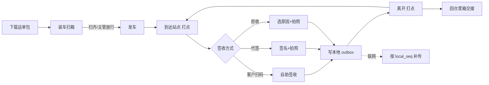
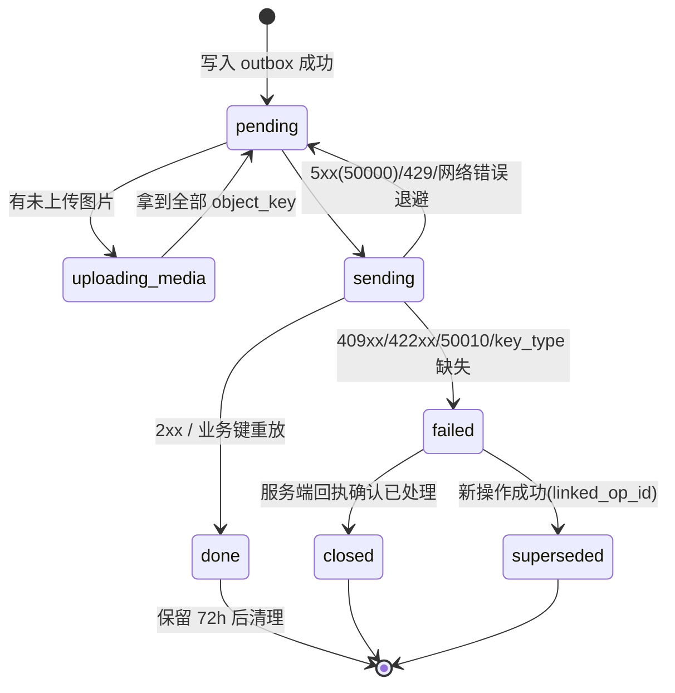

# 15 司机端、商城端 详细设计

> 依据：原《WMS详细设计说明书》§1.7、§2.2、§9.1、§9.3、§9.4；第 00 篇（全局约定 §6、部署 §9）、第 02 篇（库存核心）、第 04 篇（出库与分配）。
> 本文与第 13、14 篇同粒度。所有文档写完再开发，**不再按一期/二期切分**。接口路径以后端模块文档为准：00/02/04 已定义的直接引用，其余写「待对齐：见第 N 篇」。
> 边缘节点（SQLite）部署形态以第 00 篇「中心 PG / 仓库边缘节点」一节为准（大肥鱼正在补写），本文涉及处统一标 **待对齐：见第 00 篇**，不自行发明细则。

## 1. 职责与边界

**负责**
- **司机端**（微信小程序，`client_type=MP_DRIVER`）：接收运单、装车逐箱扫码核对、到店签收（客户扫码自助 / 司机代签 + 手写签名 + 拍照 / 拒收）、部分拒收与缺货登记、回单（POD）上传、周转筐/冷藏箱交接、到达/离开打点。
- **离线优先**：司机跨天离线（>24h）是常态。运单包预下载、本地 outbox、按设备本地单调序号补传、按账号隔离、本地数据 `format_version` 迁移。
- **商城端**（uni-app 或 Taro，H5 + 小程序，`client_type=H5_MALL`）：客户（门店/团长）浏览商品与可售量、下单（选送达日期）、订单列表与状态跟踪、缺发通知、对账查询、退货申请。

**不负责**
- 签收后的库存/应收处理、出库单状态迁移合法性、截单顺延计算、可售量计算：全部由服务端决定（第 04 篇、第 9/10/11 篇）。前端只做预校验（箱码白名单、数量格式）以便即时反馈。
- 路径规划、车辆调度（TMS，系统外，00 §1）；支付、定价、退款（ERP/财务，系统外）。
- 权限安全边界（后端负责，见 §7）。前端隐藏不是安全手段。
- 边缘节点权威库切换本身（00 §6.1a）；前端只感知「当前写入地址」与冲突码。

**技术栈**
| 端 | 选型 | 说明 |
|---|---|---|
| 司机端 | 微信小程序（原生或 Taro + TypeScript，见 Q1） | 存储用 `wx.setStorage`（单 key ≤1MB、总 10MB）+ 文件系统 `wx.getFileSystemManager` 存照片/签名；不依赖 IndexedDB |
| 商城端 | uni-app 或 Taro（Vue3/React + TS，见 Q1），H5 + 小程序 | 不做离线 |

共用 00 §6 API，靠 `client_type`、`/auth/me` 的 `features`、`min_client_version` 区分；服务端兼容至少 2 个客户端版本（原 §9.1）。

## 2. 用例

| 角色 | 端 | 用例 |
|---|---|---|
| 司机 | 司机端 | 登录 → 选今日线路（作业日按仓库时区）→ 下载运单包 → 装车逐箱扫码（扫齐或主管放行才可发车）→ 逐站「到达」→ 签收/部分拒收/全拒收 → 「离开」→ 回仓交接周转筐/冷藏箱 → 全部补传完成后收车 |
| 客户（收货人） | 司机端（司机手机） / 商城端 | 扫司机出示的签收码自助签收；或在司机手机上手写签名 |
| 调度/主管 | 管理后台（第 13 篇） | 改派运单、放行缺箱发车、处理司机端红条（补传冲突）、接管离职司机 outbox |
| 客户（下单人） | 商城端 | 浏览商品与可售量 → 加购 → 选送达日期 → 下单（WMS 计算截单顺延并回显）→ 查订单状态 → 收缺发通知 → 查对账 → 发起退货 |

SoD/约束：司机只能操作分配给自己的运单；客户只能看自己（或所属客户组织）的订单与对账，由服务端按 token 强制过滤。



## 3. 页面与路由清单

权限点为建议值，以第 12 篇为准。

### 3.1 司机端

| 路由（小程序 page） | 页面 | 权限点 |
|---|---|---|
| `pages/login` | 登录（手机号 + 验证码 / 微信授权绑定）+ 选仓 | — |
| `pages/home` | 今日线路、待补传数角标、离线标识 | `delivery.waybill.view_own` |
| `pages/route/detail` | 线路详情：站点顺序、每站状态 | `delivery.waybill.view_own` |
| `pages/load/scan` | 装车逐箱扫码、缺箱/多箱提示 | `delivery.load.scan` |
| `pages/stop/detail` | 站点详情：箱清单、客户信息、导航按钮 | `delivery.waybill.view_own` |
| `pages/stop/sign` | 签收（自助码 / 代签签名 / 拍照） | `delivery.pod.submit` |
| `pages/stop/reject` | 拒收/部分拒收：逐行数量 + 原因 + 照片 | `delivery.pod.submit` |
| `pages/container/handover` | 周转筐/冷藏箱交接（发出/回收数量） | `delivery.container.handover` |
| `pages/outbox` | 待补传/失败列表（红条）、单条重传图片 | — |
| `pages/settings` | 账号、版本、本地数据占用、诊断上报 | — |

### 3.2 商城端

| 路由 | 页面 | 权限点 |
|---|---|---|
| `/login` | 登录（客户账号 / 微信） | — |
| `/goods` | 商品列表 + 可售量（缓存值，带更新时间） | `mall.goods.view` |
| `/goods/:skuId` | 商品详情 | `mall.goods.view` |
| `/cart` | 购物车 | `mall.order.create` |
| `/checkout` | 下单确认：送达日期、地址、缺货策略 | `mall.order.create` |
| `/orders` | 订单列表 | `mall.order.view_own` |
| `/orders/:id` | 订单详情：状态时间线、缺发、签收凭证 | `mall.order.view_own` |
| `/statements` | 对账单 | `mall.statement.view_own` |
| `/returns/new` | 退货申请 | `mall.return.create` |
| `/returns` | 退货记录 | `mall.return.view_own` |
| `/messages` | 缺发/顺延/签收通知 | — |

## 4. 组件拆分

| 组件 | 端 | 职责 |
|---|---|---|
| `ScanInput` | 司机 | 封装 `wx.scanCode` + 手输兜底，去抖、白名单预校验 |
| `SignaturePad` | 司机 | canvas 手写签名，导出 PNG 到本地文件，记录文件 sha256 |
| `PhotoCapture` | 司机 | 拍照、压缩（长边 ≤1600px）、加水印（运单号/站点/时间：仓库时区）、落本地文件 |
| `QtyInput` | 两端 | 数量字符串输入，最多 3 位小数，显示 `base_uom`；禁止浮点运算（00 R2） |
| `OutboxBadge` / `RedBar` | 司机 | 待补传数、失败红条，红条与 failed 条目同生命周期 |
| `GeoStamp` | 司机 | 仅在到达/离开时取 `wx.getLocation`，超 500m 弹说明输入 |
| `SyncEngine` | 司机 | outbox 发送循环、退避、图片两段式上传、回执处理 |
| `LocalStore` | 司机 | 按 `user_id` 分区的存储封装 + `format_version` 迁移 |
| `DeliveryDatePicker` | 商城 | 展示服务端返回的可选送达日期与截单时间（仓库时区） |
| `OrderTimeline` | 商城 | 渲染出库单状态（第 04 篇 §5 状态映射为客户可读文案） |
| `ErrorToast` | 两端 | 按错误码映射文案，展示 `trace_id` |

## 5. 状态管理

| 数据 | 司机端存储 | 商城端 |
|---|---|---|
| 登录态（JWT、`client_type`、features、`min_client_version`） | 内存 + storage（按账号） | 内存 + storage |
| 运单包（线路、站点、箱码白名单、行数量、`waybill_version`） | storage：`u:{user_id}:route:{route_id}` | — |
| outbox | storage：`u:{user_id}:outbox:*` + 本地文件 | — |
| `device_instance_id` | storage 全局 key，装机首次生成（uuid），清数据重生成 | — |
| `local_seq` 计数器 | storage：`u:{user_id}:seq`，与条目写入同次落盘 | — |
| `format_version` | storage 全局，启动时迁移 | — |
| 商品/可售量 | — | 内存缓存 60s，下单时以服务端校验为准 |
| 购物车 | — | storage（按客户账号） |



## 6. 页面 → 接口映射

第 00/02/04 篇未定义的接口一律「待对齐」。配送（运单、签收、筐箱）后端归属见 Q8。

### 6.1 司机端

| 页面 | 动作 | 接口 |
|---|---|---|
| 登录 | 登录 / 当前用户 | 待对齐：见第 12 篇（`/auth/me` 字段见原 §9.1） |
| 首页/线路 | 拉今日线路、下载运单包 | 待对齐：见第 9 篇（配送） |
| 装车扫码 | 提交装车结果 | 待对齐：见第 9 篇 |
| 装车扫码 | 缺箱放行申请 | 待对齐：见第 9 篇 |
| 签收/拒收 | 申请图片上传凭证（预签名 URL） | 待对齐：见第 12 篇（文件服务）/ Q3 |
| 签收/拒收 | 提交 POD（签收/部分拒收/拒收） | 待对齐：见第 9 篇；副作用 `SHIPPED → DELIVERED` 见第 04 篇 §5 |
| 到达/离开 | 打点 | 待对齐：见第 9 篇 |
| 筐箱交接 | 提交交接 | 待对齐：见第 9 篇 / 第 2 篇 `container` 维度 |
| outbox | 查询某条操作的服务端处理结果（回执） | 待对齐：见第 9 篇 |

### 6.2 商城端

| 页面 | 动作 | 接口 |
|---|---|---|
| 商品 | 可售量查询（读 `sku_sellable_stock` 缓存） | 待对齐：见第 11 篇（集成） |
| 下单确认 | 可选送达日期/截单试算 | 待对齐：见第 11 篇 |
| 下单 | 建单 | 内部映射到 `POST /api/v1/outbound-orders`（第 04 篇 §7.1），`source_system=MALL`、`source_order_no` 由商城生成；商城前端是否直连见 Q6 |
| 订单 | 列表/详情 | 待对齐：见第 11 篇（客户视角裁剪的 `GET /api/v1/outbound-orders/{id}`，第 04 篇） |
| 缺发 | 缺货明细 | 待对齐：见第 11 篇（底层 `GET /api/v1/outbound-orders/{id}/shortages`，第 04 篇） |
| 对账 | 对账单 | 待对齐：见第 10 篇（计费） |
| 退货 | 申请/列表 | 待对齐：见第 3 篇（入库/退货入库） |

**数量与单位**：所有出入参数量为 3 位小数字符串 + `base_uom`（如 `"12.500"`,`"KG"`），超过 3 位小数后端返回 `40010`，前端输入阶段即拦截；不做四舍五入、不用 float（00 R2）。ID 为雪花 64 位，**前端一律按字符串处理**（JS Number 精度只到 2^53）。

## 7. 权限点

| 权限点（建议） | 说明 |
|---|---|
| `delivery.waybill.view_own` | 只看分配给自己的运单 |
| `delivery.load.scan` | 装车扫码 |
| `delivery.load.release_short` | 缺箱放行（主管，后台） |
| `delivery.pod.submit` | 签收/拒收提交 |
| `delivery.container.handover` | 筐箱交接 |
| `delivery.outbox.takeover` | 主管接管司机 outbox（后台） |
| `mall.goods.view` / `mall.order.create` / `mall.order.view_own` / `mall.statement.view_own` / `mall.return.create` / `mall.return.view_own` | 商城 |

- 后端强制：按 token 身份过滤；按单号直接访问他人运单/订单返回 `40310`（或 404 不暴露存在性，见 Q9）。
- `X-Warehouse-Id`：司机端按运单所属仓携带；服务端按资源查仓比对，不一致返回 `40311`（00 §6.6）。商城端客户可能跨仓下单，由服务端按收货地址路由仓，前端不传仓号（Q10）。
- 商城可售量走缓存表，不直接查 WMS 主表（原 §9.4）。

## 8. 交互与异常态

### 8.1 司机现场交互硬性要求
- 大按钮、单手操作；强光下高对比度；扫码成功短震、失败长震 + 语音。
- 任何提交先落本地再反馈成功（「已保存，待上传」与「已上传」两种状态必须区分显示）。
- 签收页显示应收行数量（`base_uom`），部分拒收逐行录入拒收量，本地校验 `0 ≤ 拒收量 ≤ 应收量`（字符串定点比较）。

### 8.2 三态
加载 / 空 / 错误三态统一组件；离线时展示本地数据并在顶栏标「离线，最后同步 HH:mm（仓库时区）」。

### 8.3 重复点击与重复提交
- 同一站点同一动作在 outbox 中已有 pending/done 条目时，再次提交弹「已签收，是否更正？」；更正是**新操作**（新 Key、新 `op_seq`，`linked_op_id` 指向原条目），由服务端裁决（Q11）。
- 商城下单：进入确认页生成 `Idempotency-Key`，提交按钮置灰；网络失败重试复用同 Key；离开确认页后重进生成新 Key。

### 8.4 错误码 → 前端处理（两端共用）

| 返回 | 前端处理 |
|---|---|
| 2xx / 业务键重放 | 成功 |
| `40001` / `40010` | 表单报错；司机端 outbox 条目 `failed`（本地数据有误，不重试），上报日志 |
| `40110` | 暂停该账号队列，同账号重新登录后继续 |
| `40310` / `40311` | 暂停该账号队列（司机）/ 跳转无权限页（商城），交主管 |
| `40910` 且 `key_type=IDEMPOTENCY_KEY` | 本地数据异常或 bug：`failed`，不重试，上报 |
| `40910` 且 `key_type` 为业务键类型（司机端 POD 键，取值待对齐：见第 9 篇，见 Q7） | 同一站点同一操作序号带了不同内容：`failed`，交主管 |
| `40910` 且 `key_type` **缺失或未知** | `failed` 红条，**不自动重试、不生成新 Key**，交人工处理（同 `42214` 口径），上报日志 |
| `40930` 非法状态流转（如运单已取消/已改派后补传签收） | `failed` 红条，提示「运单状态已变化」，交主管 |
| `40931` 单据锁定 | 退避同 Key 重试，超过 N 次转 `failed` |
| `40932` 记录已被他方关闭 | `failed` 红条；**只有** `detail.status` 为终态且确认与本地一致时才可清除，否则保留交主管 |
| 其他 409xx（运单专用码，待对齐：见第 9 篇） | `failed` 红条，不静默丢弃 |
| 422xx（如箱码不属于本运单，码值待对齐：见第 9 篇） | 不缓存，修正后可用**同 Key** 重提 |
| 429 / 网络错误 / `50301` | 保持 `pending`，指数退避同 Key 重试 |
| `50000` | 通用错误 + `trace_id`；保持 `pending`，退避同 Key 重试（不缓存，重新执行，业务键兜底） |
| `50010` | 通用错误 + `trace_id`；**不自动重试**，`failed` 红条交主管 |

### 8.5 版本与强制更新
`/auth/me` 返回 `min_client_version`，低于则弹强制更新；但**司机端 outbox 非空时更新前先尝试补传**，补传不完不得清空本地数据（小程序更新不清 storage，`format_version` 迁移负责兼容）。

### 8.6 商城端异常
- 可售量不足：服务端下单校验失败（码值待对齐：见第 11 篇），提示并回到购物车标红行。
- 截单顺延：下单响应返回实际 `work_date` / 预计送达日，若与所选不同，弹窗确认（文案以仓库时区日期展示）。
- 订单状态与第 04 篇状态机映射：CREATED/CUTOFF「已接单」、ALLOCATING~CHECKED「备货中」、SHORT「部分缺货」、STAGED「待发车」、SHIPPED「配送中」、DELIVERED/COMPLETED「已签收」、CANCELLED「已取消」。

## 9. 多端适配与离线

### 9.1 适配
- 司机端：安卓中低端机为主；照片压缩后单张 ≤300KB；本地照片总占用超 200MB 时提示补传，**不自动删除未确认上传的图片**。
- 商城端：H5 与小程序同一套代码；小程序订阅消息（缺发、顺延、签收）模板见 Q5。

### 9.2 离线流程（司机端）

```mermaid
sequenceDiagram
  participant D as 司机端
  participant L as 本地存储
  participant F as 文件服务
  participant S as 服务端
  D->>S: 联网时下载运单包(含 waybill_version)
  Note over D: 进入离线
  D->>L: 签收: 照片/签名落文件 + outbox 条目(同一次写入)
  D-->>D: 显示「已保存，待上传」
  Note over D: 恢复联网
  loop 按 local_seq 升序
    D->>F: 上传未上传图片(凭证待对齐) 得 object_key
    D->>S: 提交 POD(Idempotency-Key, 业务键, object_keys)
    S-->>D: 2xx/重放 → done ; 409xx → failed 红条
  end
```

### 9.3 outbox 记录与幂等

条目：`{ op_id(uuid), local_seq, format_version, idem_key, device_instance_id, user_id, warehouse_id, waybill_no, stop_no, op_seq, type(LOAD|ARRIVE|POD_SIGN|POD_REJECT|DEPART|CONTAINER), payload, media:[{local_path, sha256, object_key?}], waybill_version, created_at(UTC), status, attempts, last_error, server_receipt_id, linked_op_id }`。

**三层去重**（对齐 00 §6.5）
1. **`Idempotency-Key`**：用户点确认时生成，与 payload 同一次落盘；重试/重启/退避复用。服务端只保留 24h，司机离线常超 24h，所以它只是第一层。
2. **业务唯一键**：`(waybill_no, stop_no, device_instance_id, op_seq)`，另加业务约束「同一 `(waybill_no, stop_no)` 只能有一条生效的签收结论」。同键同内容 → 重放首次结果；同键不同内容 → `40910`，`detail.key_type` 必填（取值待对齐：见第 9 篇，Q7）。
   - 换机/重装后 `device_instance_id` 变化，旧 outbox 已不在本机，不存在跨实例重试；但「同站点只能一条生效结论」仍由服务端条件更新兜住（同第 14 篇 42214 的写法：`UPDATE ... WHERE status='SHIPPED'` 影响 0 行 → 冲突码），**不能先查再写**。
   - `op_seq`：按 `(waybill_no, stop_no)` 单调递增，写入后不变。
3. **记账层**：签收触发的出库状态迁移与流水由后端唯一约束兜底（第 02 篇 §4.4、第 04 篇 §5）。

**图片两段式**：先传对象存储拿 `object_key`（按 `sha256` 去重，可单独重传），全部拿到后再提交 POD；POD 的幂等 body 只含 `object_key` 与 `sha256`，图片重传不改变 body，不会触发 40910。

**顺序**：按设备本地单调 `local_seq`（与条目同次落盘的计数器，不受时钟影响）发送；`created_at` 只展示。同一运单前一条未结束时不发后一条；前一条 `failed` 时，同账号同运单后续条目暂停，**其他运单不受影响**。

**状态与清理**
| 状态 | 清理 |
|---|---|
| `pending` | — |
| `done` | 保留 72h 后清理（司机回执查询窗口） |
| `failed` | **永不自动清理**，收到服务端回执（主管已处理）后转 `closed` 再删 |
| `superseded` | 与关联条目一起清理 |

**按账号隔离**：存储 key 以 `u:{user_id}:` 分区；当前账号 outbox 非空不允许登出，可「交给主管」（`delivery.outbox.takeover`，服务端记审计）；首页只读显示「其他账号待补传 N 条」。

**format_version 迁移**：启动时读全局 `format_version`，逐版本执行迁移函数（只增字段、不删数据）；迁移失败进入只读安全模式，禁止新建条目、禁止清空，提示联系主管并上报诊断包。

**时间与日期**：时间戳存 UTC；作业日、水印日期、「今日线路」按**仓库时区**（`warehouse.timezone`，随运单包下发）计算，不按手机时区（00 R3）。

### 9.4 补传冲突
| 场景 | 处理 |
|---|---|
| 运单已改派给他人 | `failed` 红条，交主管；不静默丢弃 |
| 出库单已取消（第 04 篇：SHIPPED 后不允许取消，只能红冲） | 理论不应出现；若出现按 `40930` 处理并上报 |
| 站点已被他人签收（另一台设备/客户自助） | 冲突码（待对齐：见第 9 篇），`failed`，展示对方结论 |
| `waybill_version` 落后 | 服务端以当前版本裁决，返回冲突时前端展示差异 |

### 9.5 边缘节点（SQLite）部署形态
写入目标（中心 PG 或该仓权威边缘节点）、断网与恢复后的数据回传、权威库切换期间的冲突码：**待对齐：见第 00 篇**（单仓单写库 §6.1a 与新增的边缘节点一节）。前端约束仅一条：切换期间收到的写入失败按 §8.4 处理，**同 Key、同业务键重试**，不生成新 Key。

### 9.6 商城端
不做离线；断网时禁止下单，只读显示缓存商品。

## 10. 测试要点
- 离线 48h、产生 30 站签收 + 60 张照片后联网，全部按 `local_seq` 补传，无重复签收、无丢失。
- 发送中杀进程/断电：重启后同 Key 同 `op_seq` 重发，服务端重放首次结果。
- Key 过期（>24h）后补传：业务键兜底，不重复记账。
- 同键不同内容 → 40910 + key_type；**key_type 缺失/未知 → 红条且无任何自动重试请求**（抓包断言）。
- 图片部分失败：单图重传不改变 POD body，不触发 40910。
- 换机重装后再提交同站点：服务端条件更新拦截第二条生效结论。
- 两个账号同机：A 的 failed 不阻塞 B；A outbox 非空不能登出。
- `format_version` 从旧版本升级迁移；迁移失败进入只读模式且数据不丢。
- 时区：手机设为 UTC、仓库为 Asia/Shanghai，23:30–00:30 跨日的「今日线路」与水印日期正确。
- 数量：拒收量 `"1.2345"` 前端拦截，后端 `40010`；`"0.1"+"0.2"` 定点比较。
- 雪花 ID 大于 2^53 时前端不丢精度。
- 商城：重复点击下单只生成一张单；截单后下单顺延提示；越权访问他人订单 403/404。
- 50000 退避同 Key；50010 不重试。

## 11. 对抗评审攻击面（给小吴）

| # | 攻击面 | 期望 |
|---|---|---|
| D-A1 | 离线 >24h 补传，Key 已过期 | 业务键兜底，不重复签收 |
| D-A2 | 同站点两台设备（换机/客户自助+代签）各提交一次 | 服务端条件更新只认一条，另一条明确冲突码 |
| D-A3 | `40910` 无 `key_type` | 红条，无自动重试、无新 Key |
| D-A4 | 本地计数器与条目非原子落盘，断电后 `local_seq` 回退撞号 | 计数器与条目同次写入；回退时检测并拒绝 |
| D-A5 | 账号切换后误用他人 outbox 补传 | 按 user_id 隔离，补传账号必须一致或主管接管 |
| D-A6 | 小程序 storage 10MB 上限写满 | 写入失败不给成功反馈，提示补传；不删未确认数据 |
| D-A7 | 手机时区/时间被改 | 排序用 local_seq，日期用仓库时区，服务端以服务器时间记账 |
| D-A8 | 图片重传导致 body 变化 | body 只含 object_key+sha256，稳定 |
| D-A9 | 越权：按单号枚举他人运单/订单 | 40310/404，不泄露存在性 |
| D-A10 | 商城重复下单、并发下单超卖 | Idempotency-Key + 服务端可售校验 |
| D-A11 | 边缘节点切换期间补传 | 待对齐第 00 篇；前端同 Key 重试 |
| D-A12 | 雪花 ID 用 Number 解析 | 全程字符串 |

## 12. 待定问题

| # | 问题 | 建议 | 负责 |
|---|---|---|---|
| Q1 | 司机端原生小程序还是 Taro；商城端 uni-app 还是 Taro | 司机端原生（离线存储/文件 API 最直接）；商城端 uni-app | 大肥鱼 |
| Q3 | 签收照片/签名存储（OSS/MinIO）、预签名接口与保留期 | MinIO，保留 ≥ 账期 + 1 年 | 第 12 篇 / 大肥鱼 |
| Q4 | 客户自助扫码签收的身份校验（一次性签收码 + 短信？） | 运单站点一次性码，10 分钟有效 | 第 9 篇 |
| Q5 | 小程序订阅消息模板与审核 | — | 大肥鱼 |
| Q6 | 商城是否本团队开发，还是只对接外部商城接口 | 本文按自研写，接口层与外部商城共用 | Yuri |
| Q7 | 司机端 POD 业务唯一键在 40910 中的 `key_type` 取值（如 `POD_OP`）及配送专用冲突码段 | 新增 `key_type=POD_OP`；冲突码在 409xx 内分配，需改 00 §6.4 | 大肥鱼 / 第 9 篇 |
| Q8 | 运单、签收、筐箱交接归哪篇后端文档（第 9 篇？） | 第 9 篇 | 大肥鱼 |
| Q9 | 越权访问他人单据返回 40310 还是 404 | 404 不泄露存在性 | 第 12 篇 |
| Q10 | 商城跨仓下单时仓号由谁决定 | 服务端按地址路由 | 第 11 篇 |
| Q11 | 签收后更正（改签收结论）是否允许、时间窗与审批 | 允许 2h 内、需主管审批 | 第 9 篇 |
| Q12 | 边缘节点部署下司机端写入地址与切换期冲突码 | 待对齐：见第 00 篇 | 大肥鱼 |
