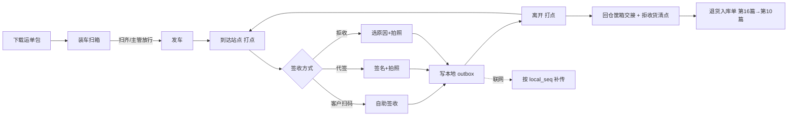
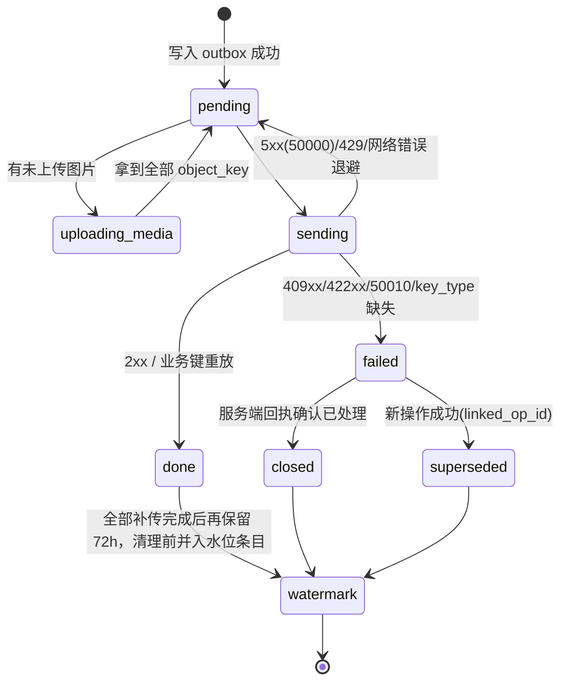

# 15 司机端、商城端 详细设计

> 依据：原《WMS详细设计说明书》§1.7、§2.2、§9.1、§9.3、§9.4；第 00 篇（全局约定 §6、部署 §9）、第 02 篇（库存核心）、第 04 篇（出库与分配）、第 16 篇「配送与签收」（小钱，后端：运单、站点签收、筐箱交接、拒收回仓；第 6 篇只到发运为止）。
> 本文与第 13、14 篇同粒度。所有文档写完再开发。接口路径以后端模块文档为准：00/02/04 已定义的直接引用，其余写「待对齐：见第 N 篇」。
> 边缘节点（SQLite）部署形态以第 00 篇「中心 PG / 仓库边缘节点」一节为准（大肥鱼正在补写），本文涉及处统一标 **待对齐：见第 00 篇**，不自行发明细则。

## 1. 职责与边界

**负责**
- **司机端**（微信小程序，`client_type=MP_DRIVER`）：接收运单、装车逐箱扫码核对、到店签收（客户扫码自助 / 司机代签 + 手写签名 + 拍照 / 拒收）、部分拒收与缺货登记、回单（POD）上传、周转筐/冷藏箱交接、到达/离开打点。
- **离线优先**：司机跨天离线（>24h）是常态。运单包预下载、本地 outbox、按设备本地单调序号补传、按账号隔离、本地数据 `format_version` 迁移。
- **商城端**（uni-app 或 Taro，H5 + 小程序，`client_type=H5_MALL`）：客户（门店/团长）浏览商品与可售量、下单（选送达日期）、订单列表与状态跟踪、缺发通知、对账查询、退货申请。

**不负责**
- 签收后的库存/应收处理、出库单状态迁移合法性、截单顺延计算、可售量计算：全部由服务端决定（第 04 篇、第 16/10/11 篇）。前端只做预校验（箱码白名单、数量格式）以便即时反馈。
- 拒收货回仓的入库与差异处理：第 16 篇在回仓交接时生成退货入库单，交第 10 篇（退货与异常）处理；前端只做逐行清点录入。
- 路径规划、车辆调度（TMS，系统外，00 §1）；支付、定价、退款（ERP/财务，系统外）。
- 权限安全边界（后端负责，见 §7）。前端隐藏不是安全手段。
- 边缘节点权威库切换本身（00 §6.1a）；前端只感知「当前写入地址」与冲突码。

**技术栈**
| 端 | 选型 | 说明 |
|---|---|---|
| 司机端 | 微信小程序（原生或 Taro + TypeScript，见 Q1） | 存储用 `wx.setStorage`（单 key ≤1MB、总 10MB）+ 文件系统 `wx.getFileSystemManager` 存照片/签名；不依赖 IndexedDB |
| 商城端 | uni-app 或 Taro（Vue3/React + TS，见 Q1），H5 + 小程序 | 不做离线 |

共用 00 §6 API，靠 `client_type`、`/auth/me` 的 `features`、`min_client_version` 区分；服务端兼容至少 2 个客户端版本（原 §9.1）。

## 2. 用例

| 角色 | 端 | 用例 |
|---|---|---|
| 司机 | 司机端 | 登录 → 选今日线路（作业日按仓库时区）→ 下载运单包 → 装车逐箱扫码（扫齐或主管放行才可发车）→ 逐站「到达」→ 签收/部分拒收/全拒收 → 「离开」→ 回仓交接周转筐/冷藏箱 + 逐行清点拒收货（生成退货入库单，见第 16 篇）→ 全部补传完成后收车 |
| 客户（收货人） | 司机端（司机手机） / 商城端 | 扫司机出示的签收码自助签收；或在司机手机上手写签名 |
| 调度/主管 | 管理后台（第 13 篇） | 改派运单、放行缺箱发车、审批签收更正（`POD_CORRECT`）、处理拒收回仓清点差异、处理司机端红条（补传冲突）、接管离职司机 outbox |
| 客户（下单人） | 商城端 | 浏览商品与可售量 → 加购 → 选送达日期 → 下单（WMS 计算截单顺延并回显）→ 查订单状态 → 收缺发通知 → 查对账 → 发起退货 |

SoD/约束：司机只能操作分配给自己的运单；客户只能看自己（或所属客户组织）的订单与对账，由服务端按 token 强制过滤。



## 3. 页面与路由清单

权限点为建议值，以第 12 篇为准。

### 3.1 司机端

| 路由（小程序 page） | 页面 | 权限点 |
|---|---|---|
| `pages/login` | 设备登录（账号 + `device_instance_id`，见 §9.7）+ 选仓；未绑定显示设备码请主管确认 | — |
| `pages/home` | 今日线路、待补传数角标、离线标识 | `delivery.waybill.view_own` |
| `pages/route/detail` | 线路详情：站点顺序、每站状态 | `delivery.waybill.view_own` |
| `pages/load/scan` | 装车逐箱扫码、缺箱/多箱提示 | `delivery.load.scan` |
| `pages/stop/detail` | 站点详情：箱清单、客户信息、导航按钮 | `delivery.waybill.view_own` |
| `pages/offline/paper` | 纸单补录（恢复联网后 24h 内） | `offline.paper.backfill` |
| `pages/stop/sign` | 签收（自助码 / 代签签名 / 拍照；每行**到货温度必填** `receive_temp_c10`，超温区范围的行强制 `TEMP_ABNORMAL` 拒收） | `delivery.pod.submit` |
| `pages/stop/reject` | 拒收/部分拒收：逐行数量 + 原因 + 照片 | `delivery.pod.submit` |
| `pages/stop/correct` | 签收更正申请（选被更正的签收、填原因，待主管审批） | `delivery.pod.correct.request` |
| `pages/container/handover` | 周转筐/冷藏箱交接（发出/回收数量）+ 拒收货逐行清点 | `delivery.container.handover` |
| `pages/outbox` | 待补传/失败列表（红条）、单条重传图片 | — |
| `pages/settings` | 账号、版本、本地数据占用、诊断上报 | — |

### 3.2 商城端

| 路由 | 页面 | 权限点 |
|---|---|---|
| `/login` | 登录（客户账号 / 微信） | — |
| `/goods` | 商品列表 + 可售量（缓存值，带更新时间） | `mall.goods.view` |
| `/goods/:skuId` | 商品详情 | `mall.goods.view` |
| `/cart` | 购物车 | `mall.order.create` |
| `/checkout` | 下单确认：送达日期、地址、缺货策略 | `mall.order.create` |
| `/orders` | 订单列表 | `mall.order.view_own` |
| `/orders/:id` | 订单详情：状态时间线、缺发、签收凭证 | `mall.order.view_own` |
| `/statements` | 对账单 | `mall.statement.view_own` |
| `/returns/new` | 退货预约：选原出库单（只列本人可见的已签收单）、选指定退货门店、填退货行（`sku_id`、数量 3 位小数字符串、`reason_code` **必填**） | `return.reservation.create` |
| `/returns` | 退货记录（只看本店的退货预约） | `return.reservation.view` |
| `/messages` | 缺发/顺延/签收通知 | — |

## 4. 组件拆分

| 组件 | 端 | 职责 |
|---|---|---|
| `ScanInput` | 司机 | 封装 `wx.scanCode` + 手输兜底，去抖、白名单预校验 |
| `SignaturePad` | 司机 | canvas 手写签名，导出 PNG 到本地文件，记录文件 sha256 |
| `PhotoCapture` | 司机 | 拍照、压缩（长边 ≤1600px）、加水印（运单号/站点/时间：仓库时区）、落本地文件 |
| `QtyInput` | 两端 | 数量字符串输入，最多 3 位小数，显示 `base_uom`；禁止浮点运算（00 R2） |
| `OutboxBadge` / `RedBar` | 司机 | 待补传数、失败红条，红条与 failed 条目同生命周期 |
| `GeoStamp` | 司机 | 仅在到达/离开时取 `wx.getLocation`，超 500m 弹说明输入；**说明只是现场备注，不是业务校验，服务端不得因距离拒收**（冷库/地库定位漂移） |
| `SyncEngine` | 司机 | outbox 发送循环、退避、图片两段式上传、回执处理 |
| `LocalStore` | 司机 | 按 `user_id` 分区的存储封装 + `format_version` 迁移；启动时从条目推导下一序号（§9.3） |
| `DeliveryDatePicker` | 商城 | 展示服务端返回的可选送达日期与截单时间（仓库时区） |
| `OrderTimeline` | 商城 | 渲染出库单状态（第 04 篇 §5 状态映射为客户可读文案） |
| `ErrorToast` | 两端 | 按错误码映射文案，展示 `trace_id` |

## 5. 状态管理

| 数据 | 司机端存储 | 商城端 |
|---|---|---|
| 登录态（JWT、`client_type`、features、`min_client_version`） | 内存 + storage（按账号） | 内存 + storage |
| 运单包（线路、站点、箱码白名单、行数量、`waybill_version`） | storage：`u:{user_id}:route:{route_id}` | — |
| outbox | storage：`u:{user_id}:outbox:*` + 本地文件 | — |
| `device_instance_id` | storage 全局 key，装机首次生成（uuid），清数据重生成 | — |
| `local_seq` / `op_seq` | **不单独持久化计数器**；启动时由 outbox 条目 + 水位条目推导 max+1（§9.3） | — |
| 水位条目 | storage：`u:{user_id}:outbox:watermark`，记录已清理条目的 `local_seq` 最大值与各站点 `op_seq` 最大值 | — |
| `format_version` | storage 全局，启动时迁移 | — |
| 商品/可售量 | — | 内存缓存 60s，下单时以服务端校验为准 |
| 购物车 | — | storage（按客户账号） |
| 结算会话（`source_order_no` + `Idempotency-Key` + 购物车快照 hash） | — | storage，结算时生成一次，**下单成功才清除**（§8.3） |



## 6. 页面 → 接口映射

配送接口取自第 16 篇 #10（`3699d96`）；其余未定义的接口「待对齐」。通用请求头 `Idempotency-Key`、`X-Warehouse-Id`、`X-Write-Epoch`；业务键 `(waybill_no, stop_no, device_instance_id, op_seq)`，**运单级操作（装车、发车、筐箱、回仓实点）`stop_no=0`**。

### 6.1 司机端

| 页面 | 动作 | 接口 |
|---|---|---|
| 登录 | 发送验证码（限频） | `POST /api/v1/auth/sms-code` |
| 登录 | 设备登录 | `POST /api/v1/auth/device-login` `{login_type: PASSWORD\|SMS, username\|phone, password\|sms_code, device_instance_id, client_type}`（第 12 篇 §8）；司机端默认 `SMS` |
| 登录 | 离线令牌 | `POST /api/v1/auth/offline-token`（返回 `{token, exp, ttl_seconds}`） |
| 登录 | 当前用户 | `GET /api/v1/me` |
| 首页/线路 | 今日线路 | `GET /api/v1/waybills?mine=1&work_date=`（第 16 篇 §7.2） |
| 首页/线路 | 下载运单包（含 `waybill_version`、`timezone`） | `GET /api/v1/waybills/{waybill_no}/package` |
| 写节点 | 取写节点地址 | `GET /api/v1/warehouses/{warehouse_code}/write-endpoint` |
| 装车扫码 | 提交装车结果（`LOAD`，`stop_no=0`） | `POST /api/v1/waybills/{waybill_no}/load` |
| 装车扫码 | 发车（`DEPART`，`stop_no=0`） | `POST /api/v1/waybills/{waybill_no}/depart` |
| 装车扫码 | 缺箱放行（主管，后台） | `POST /api/v1/waybills/{waybill_no}/load/release-short` |
| 签收/拒收 | 申请图片上传凭证（预签名 URL） | `POST /api/v1/files/presign`（第 12 篇文件服务，`object_key=pod/{warehouse_id}/{sha256}.{ext}`；契约待第 12 篇，第 16 篇 Q-M） |
| 签收/拒收 | 提交 POD（`POD_SIGN` / `POD_REJECT`，一次覆盖站点下全部出库单，全有或全无） | `POST /api/v1/waybills/{waybill_no}/stops/{stop_no}/pod`；200 返回 `{pod_id, stop_display_status, orders[{outbound_id, status, valid_pod_id, correct_seq}]}` |
| 签收更正 | 发起 `POD_CORRECT` 审批 | `POST /api/v1/approvals`，`type=POD_CORRECT`（第 12 篇 §8，返回 `202 {approval_id, status}`） |
| 签收更正 | 撤回 | `POST /api/v1/approvals/{id}/withdraw` |
| 签收更正 | 查询审批结果 | `GET /api/v1/approvals/{id}`；我发起的列表 `GET /api/v1/approvals?mine=true&type=POD_CORRECT` |
| 筐箱交接 | 拒收货回仓实点（`RETURN_COUNT`，`stop_no=0`） | `POST /api/v1/waybills/{waybill_no}/returns` |
| 到达/离开 | 打点（`ARRIVE` / `DEPART`） | `POST /api/v1/waybills/{waybill_no}/stops/{stop_no}/arrive`、`/depart` |
| 筐箱交接 | 提交交接（`CONTAINER`，`stop_no=0`） | `POST /api/v1/waybills/{waybill_no}/containers` |
| outbox | 操作回执（重放 `response`） | `GET /api/v1/pod-ops/receipt?waybill_no=&stop_no=&device_instance_id=&op_seq=` |
| outbox | 设备序号水位（水位条目丢失时恢复） | `GET /api/v1/devices/{device_instance_id}/op-seq-hwm` |

### 6.2 商城端

| 页面 | 动作 | 接口 |
|---|---|---|
| 商品 | 可售量查询（读 `sku_sellable_stock` 缓存） | 待对齐：见第 11 篇（集成） |
| 下单确认 | 可选送达日期/截单试算 | 待对齐：见第 11 篇 |
| 下单 | 建单 | 内部映射到 `POST /api/v1/outbound-orders`（第 04 篇 §7.1），`source_system=MALL`、`source_order_no` 由商城生成；商城前端是否直连见 Q6 |
| 订单 | 列表/详情 | 待对齐：见第 11 篇（客户视角裁剪的 `GET /api/v1/outbound-orders/{id}`，第 04 篇） |
| 缺发 | 缺货明细 | 待对齐：见第 11 篇（底层 `GET /api/v1/outbound-orders/{id}/shortages`，第 04 篇） |
| 对账 | 对账单 | 待对齐：见第 10 篇（计费） |
| 退货预约 | 创建 `{store_code, outbound_order_id, lines[{sku_id, qty, reason_code}]}` | `POST /api/v1/returns/reservations` |
| 退货预约 | 列表 / 详情（门店只看本店） | `GET /api/v1/returns/reservations?store_code=&status=`、`GET /api/v1/returns/reservations/{id}` |
| 断网暂停状态 | `{stale_policy: PAUSE|DEGRADE, paused, offline_since, offline_deadline_at, paused_actions[], backfill_deadline_at}`（00 §6.6.2） | `GET /api/v1/me` 与终端心跳 |
| 纸单补录 | 提交 `{action_type, occurred_at, operator_id, payload, photo_ids[]}`，生成 `PAPER_BACKFILL` 审批 | `POST /api/v1/offline/paper-records` |
| 订单详情 | 拒收/部分拒收结果与退货入库进度 | 待对齐：见第 16 篇、第 10 篇 |

**数量与单位**：所有出入参数量为 3 位小数字符串 + `base_uom`（如 `"12.500"`,`"KG"`），超过 3 位小数后端返回 `40010`，前端输入阶段即拦截；不做四舍五入、不用 float（00 R2）。ID 为雪花 64 位，**前端一律按字符串处理**（JS Number 精度只到 2^53）。

## 7. 权限点

| 权限点（第 12 篇 §4.2 矩阵） | 说明 |
|---|---|
| `delivery.waybill.view_own` | 只看分配给自己的运单 |
| `delivery.load.scan` | 装车扫码 |
| `delivery.load.release_short` | 缺箱放行（主管，后台） |
| `delivery.pod.submit` | 签收/拒收提交 |
| `delivery.pod.correct.request` | 发起签收更正（司机） |
| `offline.paper.backfill` / `offline.paper.approve` | 纸单补录申请（司机）/ 审批（主管，后台），不能自批 |
| `delivery.pod.correct.approve` | 审批签收更正（主管，后台）；审批人 ≠ 发起人（第 12 篇 SoD-5） |
| `delivery.container.handover` | 筐箱交接 |
| `delivery.outbox.takeover` | 主管接管司机 outbox（后台） |
| `mall.goods.view` / `mall.order.create` / `mall.order.view_own` / `mall.statement.view_own` / `mall.return.view_own` | 商城 |
| `return.reservation.create` | 门店创建退货预约（替代原 `mall.return.create`）；仓库收货 `return.reservation.receive` 在 PDA（第 14 篇） |

- 后端强制：按 token 身份过滤；按单号直接访问他人运单/订单返回 `40310`（或 404 不暴露存在性，见 Q9）。
- `X-Warehouse-Id`：司机端按运单所属仓携带；服务端按资源查仓比对，不一致返回 `40311`（00 §6.6）。商城端客户可能跨仓下单，由服务端按收货地址路由仓，前端不传仓号（Q10）。
- 商城可售量走缓存表，不直接查 WMS 主表（原 §9.4）。

## 8. 交互与异常态

### 8.1 司机现场交互硬性要求
- 大按钮、单手操作；强光下高对比度；扫码成功短震、失败长震 + 语音。
- 任何提交先落本地再反馈成功（「已保存，待上传」与「已上传」两种状态必须区分显示）。
- 签收页显示应收行数量（`base_uom`），部分拒收逐行录入拒收量，本地校验 `0 ≤ 拒收量 ≤ 应收量`（字符串定点比较）。

- **到货温度（对标盒马，第 16 篇）**：每个签收行必填 `receive_temp_c10`（整数，单位 0.1 °C）。界面按 °C 输入、最多 1 位小数（如 `4.5`），提交时换算为 `45`（字符串运算，不用浮点乘法）；未填不能提交。
  - 允许范围取该 SKU 温区在第 01 篇的 min/max（随运单包下发）。超出范围时该行显示告警，并**强制**选择拒收、`reject_reason=TEMP_ABNORMAL`（不能按正常签收提交）。
  - 服务端校验为准：返回 `422` `42216 POD_TEMP_OUT_OF_RANGE` 时高亮对应行，提示「温度超出范围，须按温度异常拒收」，不自动重试。
- **纸单兜底补录**（00 §6.6.1，审批类型 `PAPER_BACKFILL`）：设备不可用时现场使用纸质签收单；恢复联网后司机（`offline.paper.backfill`）在「纸单补录」入口提交 `POST /api/v1/offline/paper-records` `{action_type, occurred_at, operator_id, payload, photo_ids[]}`（纸单照片必传，`occurred_at` 按仓库时区录入、UTC 提交），主管（`offline.paper.approve`）审批，申请人不能自批。必须在恢复联网后 24 小时内提交，超时由服务端转异常单；入口显示补录剩余倒计时（只读服务端下发的 `backfill_deadline_at`，UTC，= 恢复联网 + 24h；前端**不用设备时间推算**；每次断网→恢复联网后都会下发（不论是否有待补纸单，服务端无从得知），**窗口期内一直显示「纸单补录」入口与倒计时**；为 `null`（窗口已过或设备从未断网）时隐藏补录入口、倒计时与提醒，已提交的补录记录仍可查看（00 §6.6.2 @6906310）），<1 小时标红。补录必须在线，不进 outbox。

### 8.2 三态
加载 / 空 / 错误三态统一组件；离线时展示本地数据并在顶栏标「离线，最后同步 HH:mm（仓库时区）」。

### 8.3 重复点击、更正与重复提交
- 同一站点已有 pending/done 签收条目时，再次点签收只提示「已签收」，**不能再提交 POD_SIGN/POD_REJECT**；要改结论走「申请更正」。
- **签收更正 `POD_CORRECT`**（审批类操作，不进 outbox）：
  - 必须携带被更正签收的 `corrected_pod_id`（服务端回执里的生效签收 `valid_pod_id`；字段名以 00 为准）；本地原签收还未拿到回执时不允许发起更正（按钮置灰并提示「待上传完成」）。
  - 走第 12 篇 `approval_request`（类型 `POD_CORRECT`）：**在线**调用 `POST /api/v1/approvals`，payload 带 `corrected_pod_id` 与更正内容，返回 `202 {approval_id, status}`；同一签收已有待审批时返回那一条。审批是在线操作，**不进 outbox**；离线时「申请更正」按钮置灰，提示「联网后申请」（断网审批服务端返回 `50301`）。
  - **审批通过与执行更正在同一事务**（服务端）：`UPDATE approval_request … WHERE status='PENDING'` 与更正 `UPDATE … WHERE status='DELIVERED' AND valid_pod_id=:corrected_pod_id` **两条都必须命中**，否则整体回滚并把审批置为失效，审批状态冲突（撤回/过期/他人已审）返回 `40934`；**更正前置条件失败**（被更正签收已不再生效）返回 **`40951`**，`detail.reason=CORRECT_TARGET_STALE`，审批失效。`40934/40935` 只用于审批状态冲突（第 12 篇），不用于更正前置条件。撤回、过期、审批通过三者并发只有一个成功。
  - `correct_seq` 由服务端在执行时取 `max+1` 分配，与 #5 幂等键 `POD:{pod_id}:{correct_seq}` 为同一个值，同事务推给第 10 篇；前端不生成、只展示。
  - 发起需 `delivery.pod.correct.request`；审批需 `delivery.pod.correct.approve`，审批人不能是发起人（SoD-5，后端 `40312`）。
  - **24 小时更正窗口（Yuri 裁定）**：只能在出库单签收（DELIVERED）后 24 小时内由司机发起、主管审批。签收详情显示「可更正剩余 HH:MM」倒计时：**只读服务端写入的 `correct_deadline_at`**（= `delivered_at` + 24h，UTC，按仓库时区显示），前端**不自行加 24h**，剩余 < 1 小时标红，到期按钮置灰「已超过更正时限」。
  - **超窗**：服务端返回 `40951`，`detail.reason=POD_CORRECT_WINDOW_EXPIRED` → 提示「已超过 24 小时，已转异常处理」，显示 `detail.exception_no` 并提供跳转该异常单的链接（00 §6.4 @16e640c），不重试；异常单带责任方 `liable_party`（`WAREHOUSE` / `CARRIER` / `STORE` / `UNKNOWN`）。
  - **容差内免审批**：仓库配置签收更正容差（管理后台第 13 篇 `pod_tolerance_config`：绝对量 `max_abs_qty` 与比例 `max_pct_bp` **两项都不超过**才算容差内）；差异在容差内的更正提交后直接生效，前端按响应展示「已更正（容差内免审批）」而非 PENDING，不进入待审批列表。前端不自行判断是否在容差内（服务端为准），响应字段见 Q19。
  - **前端状态**：`PENDING`（待审批，可撤回）→ `APPROVED`（已更正，显示新生效签收与 `correct_seq`）/ `REJECTED`（主管驳回，显示原因）/ `WITHDRAWN`（已撤回）/ `EXPIRED`（24h 过期）/ **失效**（审批通过时返回 `40951 CORRECT_TARGET_STALE`，或审批详情显示执行失败 `fail_code=40951`）：显示「原签收已变化，本次更正未执行」，并提供「基于当前生效签收重新申请」（新 approval，带新的 `corrected_pod_id`）。撤回时若收到 `40934`，刷新后按服务端最终状态展示（可能已被批准），不重试。
  - `40934`（审批已被处理）/ `40935`（审批目标已变，第 12 篇定义）：刷新审批状态并提示；`40951`（`CORRECT_TARGET_STALE` 原签收已变化 / `CORRECTION_PENDING` 已有待审批更正）：显示「失效」或跳到已有那条。
  - 服务端条件更新：`... WHERE status='DELIVERED' AND valid_pod_id=:corrected_pod_id` 影响 0 行返回 `40951`（`CORRECT_TARGET_STALE`）。两台设备并发更正同一签收，**只有一条成功**，另一条 `failed` 红条。
  - 普通 `POD_SIGN` / `POD_REJECT` 仍只认 `status='SHIPPED'`，第二条生效结论返回 `40950`。
- 商城下单：**在购物车点「结算」时生成一次** `source_order_no` 与 `Idempotency-Key`，与购物车快照 hash 一起存 storage。重进确认页、超时重试、杀进程重开都沿用同一组；购物车内容变化（hash 不同）才作废重新生成；**下单成功（或服务端确认已存在）后才清除**。服务端以 `UNIQUE(source_system, source_order_no)` 兜底（第 04 篇 §7.1，重推返回 200 + 已有单号），Key 过期也不会重复下单。

### 8.4 错误码 → 前端处理（两端共用）

| 返回 | 前端处理 |
|---|---|
| 2xx / 业务键重放 | 成功 |
| `40001` / `40010` | 表单报错；司机端 outbox 条目 `failed`（本地数据有误，不重试），上报日志 |
| `40111`，`detail.reason=BINDING_PENDING` | 首次绑定待主管审批（`DEVICE_BIND`）：显示等待审批页，不写 outbox；凭 `approval_id` 查 `GET /api/v1/approvals/{id}`，通过后重新登录 |
| `40111`，`NOT_BOUND` | 绑定被驳回/过期：提示重新登录再次申请；不清 outbox |
| `40111`，`WAREHOUSE_MISMATCH` / 缺失 | 暂停队列，不清 outbox，交主管 |
| `40110`，`DEVICE_UNBOUND` | 绑定被吊销：清本地令牌回登录页，outbox 保留 |
| `40112 OFFLINE_TOKEN_INVALID` | 暂停队列，不清 outbox；按 `detail.reason`：`EXPIRED`/`PERM_STALE` 联网重新登录后续传，`REVOKED`（设备挂失等）/`DEVICE_MISMATCH`/未知 → 交主管 |
| `40312 SOD_VIOLATION` | `failed` 红条显示 `detail.rule`，不重试 |
| `40934` / `40935` | 审批已被处理 / 目标已变：刷新审批状态 |
| `40110`（`TOKEN_EXPIRED` / `PERM_VERSION_CHANGED` / 未知） | `TOKEN_EXPIRED` 先静默刷新；`PERM_VERSION_CHANGED` 刷新后重拉 `GET /api/v1/me`；刷新失败或未知 reason：暂停该账号队列，提示「请联网后重新登录，登录后自动续传」；同一账号登录后自动继续；若登录的是**另一个**手机号，原账号条目保持只读，只能由主管接管 |
| `40310` / `40311` | 暂停该账号队列（司机）/ 跳转无权限页（商城），交主管 |
| `40910` 且 `key_type=IDEMPOTENCY_KEY` | 本地数据异常或 bug：`failed`，不重试，上报 |
| `40910` 且 `key_type=POD_OP` | 同一业务键 `(waybill_no, stop_no, device_instance_id, op_seq)` 带了不同内容：`failed`，交主管 |
| `40910` 且 `key_type` **缺失或未知** | `failed` 红条，**不自动重试、不生成新 Key**，交人工处理（同 `42214` 口径），上报日志 |
| `42216 POD_TEMP_OUT_OF_RANGE`（签收行温度超范围且未带 `reject_reason=TEMP_ABNORMAL`） | 高亮对应行，提示按温度异常拒收，不重试 |
| `40950` 站点已有生效签收（`detail{outbound_id, status, valid_pod_id, signed_at}`） | `failed` 红条，展示服务端返回的生效结论，提示走更正 |
| `40951` 运单状态不允许，`detail.reason` 必带：`REASSIGNED`（已改派）/ `WAYBILL_CANCELLED` / `WAYBILL_CLOSED` / `WAYBILL_RETURNED` / `NOT_DEPARTED`（未发车签收）/ `CORRECT_TARGET_STALE` / `CORRECTION_PENDING` → `failed` 红条，提示「运单状态已变化」，交主管；`WAYBILL_VERSION_STALE`（带 `current_version`）→ 不进红条，暂停队列、重新下载运单包，用新 `op_seq` 重提；未知 reason → 红条 |
| `40930` 通用非法状态流转 | 配送场景应返回 4095x；若收到按 `40951` 处理并上报 |
| `40931` 单据锁定 | 退避同 Key 重试，超过 N 次转 `failed` |
| `40952`–`40959`（配送预留，第 16 篇分配） / 其他未知 409xx | `failed` 红条，不静默丢弃，不自动重试 |
| `42210 BARCODE_MISMATCH`（箱码不属于本运单；第 16 篇不新增 42215） | 不缓存，修正后可用**同 Key** 重提 |
| 429 / 网络错误 / `50301`（非 `STALE_STOCK_PAUSED`） | 保持 `pending`，指数退避同 Key 重试 |
| `50301` 且 `detail.reason=STALE_STOCK_PAUSED` | 该仓暂停跨网点占用/移动：提示暂停，**不重试**，重拉 `GET /api/v1/me` 刷新 `paused_actions[]`；商城下单同样处理 |
| `50000` | 通用错误 + `trace_id`；保持 `pending`，退避同 Key 重试（不缓存，重新执行，业务键兜底） |
| `50010` | 通用错误 + `trace_id`；**不自动重试**，`failed` 红条交主管 |

### 8.5 版本与强制更新
`/auth/me` 返回 `min_client_version`，低于则弹强制更新；但**司机端 outbox 非空时更新前先尝试补传**，补传不完不得清空本地数据（小程序更新不清 storage，`format_version` 迁移负责兼容）。

### 8.6 商城端异常
- 可售量不足：服务端下单校验失败（码值待对齐：见第 11 篇），提示并回到购物车标红行。
- 截单顺延：下单响应返回实际 `work_date` / 预计送达日，若与所选不同，弹窗确认（文案以仓库时区日期展示）。
- 签收以**出库单**为粒度，记录在第 16 篇签收记录（`delivery_order` + `pod`），出库单状态以第 16 篇为准（#11 Q7 裁定）；发运单 `shipment` 只关联 `waybill_id`，司机、车辆、发车时间一律取第 16 篇运单 `waybill`，前端不从发运单读这些字段。签收结论取第 04 篇 `outbound_order.delivery_result`（第 16 篇 @3699d96 引用）：`FULL`「已签收」、`PARTIAL_REJECT`「部分拒收」、`FULL_REJECT`「整单拒收」；站点汇总用 `stop_display_status`：`PENDING` 未到达 / `ARRIVED` 已到达未签 / `DEPARTED_UNSIGNED` 已离开未签 / `FULL` / `PARTIAL_REJECT` / `FULL_REJECT` / `MIXED` 结论不一（仅展示）。**出库单状态为 `DELIVERED` 时，只要 `delivery_result` 为部分/整单拒收，也不得显示为「已签收」**；同时展示拒收行与退货入库进度。
- 订单状态与第 04 篇状态机映射：CREATED/CUTOFF「已接单」、ALLOCATING~CHECKED「备货中」、SHORT「部分缺货」、STAGED「待发车」、SHIPPED「配送中」、DELIVERED/COMPLETED「已签收」（若签收结论为 `PARTIALLY_REJECTED`/`REJECTED` 则显示「部分拒收」/「整单拒收」）、CANCELLED「已取消」。

## 9. 多端适配与离线

### 9.1 适配
- 司机端：安卓中低端机为主；照片压缩后单张 ≤300KB；本地照片总占用超 200MB 时提示补传，**不自动删除未确认上传的图片**。storage 接近上限（剩余 < 1MB）或写入失败时：提示「未上传 N 条、图片占用 X MB，请联网补传」，**禁止开始新站点作业**（已开始的站点允许完成），避免签收写到一半失败。
- 商城端：H5 与小程序同一套代码；小程序订阅消息（缺发、顺延、签收）模板见 Q5。

### 9.2 离线流程（司机端）

```mermaid
sequenceDiagram
  participant D as 司机端
  participant L as 本地存储
  participant F as 文件服务
  participant S as 服务端
  D->>S: 联网时下载运单包(含 waybill_version)
  Note over D: 进入离线
  D->>L: 签收: 照片/签名落文件 + outbox 条目(同一次写入)
  D-->>D: 显示「已保存，待上传」
  Note over D: 恢复联网
  loop 按 local_seq 升序
    D->>F: 上传未上传图片(凭证待对齐) 得 object_key
    D->>S: 提交 POD(Idempotency-Key, 业务键, object_keys)
    S-->>D: 2xx/重放 → done ; 409xx → failed 红条
  end
```

### 9.3 outbox 记录与幂等

条目：`{ op_id(uuid), local_seq, format_version, idem_key, device_instance_id, user_id, warehouse_id, waybill_no, stop_no, op_seq, type(LOAD|ARRIVE|POD_SIGN|POD_REJECT|DEPART|CONTAINER|RETURN_COUNT), payload, media:[{local_path, sha256, object_key?}], waybill_version, created_at(UTC), status, attempts, last_error, server_receipt_id, linked_op_id }`。

**三层去重**（对齐 00 §6.5）
1. **`Idempotency-Key`**：用户点确认时生成，与 payload 同一次落盘；重试/重启/退避复用。服务端只保留 24h，司机离线常超 24h，所以它只是第一层。
2. **业务唯一键**：`(waybill_no, stop_no, device_instance_id, op_seq)`，另加业务约束「同一 `(waybill_no, stop_no)` 只能有一条生效的签收结论」。同键同内容 → 重放首次结果；同键不同内容 → `40910`，`detail.key_type=POD_OP`。
   - 换机/重装后 `device_instance_id` 变化，旧 outbox 已不在本机，不存在跨实例重试；但「同站点只能一条生效结论」仍由服务端条件更新兜住（`UPDATE ... WHERE status='SHIPPED'` 影响 0 行 → `40950`/`40951`），**不能先查再写**。更正见 §8.3 `POD_CORRECT`。
   - `op_seq`：按 `(waybill_no, stop_no)` 单调递增，写入后不变。
3. **记账层**：签收触发的出库状态迁移与流水由后端唯一约束兜底（第 02 篇 §4.4、第 04 篇 §5）。

**序号推导（不单独存计数器）**：`wx.setStorage` 没有跨 key 事务，所以不持久化 `local_seq`/`op_seq` 计数器。
- 启动（及切换账号）时扫描该账号全部 outbox 条目与水位条目：`next_local_seq = max(条目 local_seq, 水位.local_seq_max) + 1`；每个 `(waybill_no, stop_no)` 的 `next_op_seq = max(条目 op_seq, 水位.op_seq_max[站点]) + 1`。运行期在内存递增。
- 一个条目就是一个 storage key，写成功即序号「被占用」；写失败则该序号未占用，下次推导自然复用，不会出现「条目已写、计数器未加」的撞号。
- **服务端已确认的条目不整条清空**：清理 done/closed/superseded 条目前，先把它的 `local_seq` 和站点 `op_seq` 并入水位条目（取 max，单 key 覆盖写），水位写成功后再删条目。删前断电只会多留一条，不会回退。
- 水位条目丢失或损坏：进入只读安全模式，向服务端查询本设备 `device_instance_id` 的最大 `op_seq` 后恢复（`GET /api/v1/devices/{device_instance_id}/op-seq-hwm`，Q13 已关闭）。

**图片两段式**：`object_key` **由内容确定**：`pod/{warehouse_id}/{sha256}.{ext}`，客户端在拍照落盘时就算好。上传凭证接口按这个 key 签发（同 key 重复上传幂等覆盖同一内容）。全部上传成功后再提交 POD，body 只含 `object_key` + `sha256`。即使首次 POD 已成功、响应丢失、图片又重传一遍，body 也逐字节不变，服务端按业务键重放，不会 40910。

**顺序**：按设备本地单调 `local_seq`（由条目推导，不受时钟影响，见下文「序号推导」）发送；`created_at` 只展示。同一运单前一条未结束时不发后一条；前一条 `failed` 时，同账号同运单后续条目暂停，**其他运单不受影响**。

**状态与清理**
| 状态 | 清理 |
|---|---|
| `pending` | — |
| `done` | **该账号全部条目补传完成后**再保留 72h，清理前并入水位条目 |
| `failed` | **永不自动清理**，收到服务端回执（主管已处理）后转 `closed`，并入水位后再删 |
| `superseded` | 与关联条目一起清理（同样先并入水位） |

**按账号隔离**：存储 key 以 `u:{user_id}:` 分区；当前账号 outbox 非空不允许登出，可「交给主管」（`delivery.outbox.takeover`，服务端记审计）；首页只读显示「其他账号待补传 N 条」。

**format_version 迁移**：启动时读全局 `format_version`，逐版本执行迁移函数（只增字段、不删数据）；迁移失败进入只读安全模式，禁止新建条目、禁止清空，提示联系主管并上报诊断包。

**时间与日期**：时间戳存 UTC；作业日、水印日期、「今日线路」按**仓库时区**（`warehouse.timezone`，随运单包下发）计算，不按手机时区（00 R3）。

### 9.4 补传冲突
| 场景 | 处理 |
|---|---|
| 运单已改派给他人 | `failed` 红条，交主管；不静默丢弃 |
| 出库单已取消（第 04 篇：SHIPPED 后不允许取消，只能红冲） | 理论不应出现；服务端返回 `40951`，上报 |
| 站点已被他人签收（另一台设备/客户自助） | `40950`，`failed`，展示对方结论，可走更正 |
| 部分拒收后一个站点多张出库单的状态 | 由第 16 篇定义（是否引入部分签收状态），前端按服务端返回展示，不自行推断 |
| `waybill_version` 落后 | 服务端以当前版本裁决，返回冲突时前端展示差异 |

### 9.5 边缘节点（SQLite）部署形态
写入目标（中心 PG 或该仓权威边缘节点）、断网与恢复后的数据回传、权威库切换期间的冲突码：**待对齐：见第 00 篇**（单仓单写库 §6.1a 与新增的边缘节点一节）。前端约束仅一条：切换期间收到的写入失败按 §8.4 处理，**同 Key、同业务键重试**，不生成新 Key。

### 9.6 商城端
不做离线；断网时禁止下单，只读显示缓存商品。
- **仓库断网 / 可售量不可信**（`stale_stock_policy` 默认 `PAUSE`，Yuri 裁定）：商城读取 `GET /api/v1/me` 的 `{stale_policy: PAUSE|DEGRADE, paused, offline_since, offline_deadline_at, paused_actions[], backfill_deadline_at}`（00 §6.6.2）；`paused=true` 且 `paused_actions[]` 含新接单类动作时，该仓商品显示「暂停接单」并禁用加购/下单（按 `paused_actions[]` 判断，不写死）；不做降额接单。仓库恢复联网对账后自动恢复。
- **退货预约**：`POST /api/v1/returns/reservations`（`return.reservation.create`），body `{store_code, outbound_order_id, lines[{sku_id, qty, reason_code}]}`，`reason_code` 必填；仓库收货后进入 `RETURN_QC` 冻结，商城退货记录显示「待质检」→ 质检结果。没有预约的退货仓库可盲收，会生成异常单并须在 48 小时内关联到订单，商城端不提供盲收入口。

### 9.7 设备绑定与离线令牌（第 12 篇 §3.2、§3.3）
- `device_instance_id` 首次安装生成并存安全存储，重装即变；登录走 `device-login`。首次登录服务端建 PENDING 绑定并发起 `DEVICE_BIND` 审批，返回 `40111 BINDING_PENDING`；主管（`device.binding.approve`）通过后重新登录即可。
- 在线登录后取离线令牌，默认 **12 小时**。对齐第 11 篇 §6.7（#6 @5472b9c）：离线超过 12 小时后，原本允许离线的操作补传时由**服务端拒绝**；司机端到期后停止记录新签收（改用纸单兜底，§8.1），已记录的条目仍按序补传，被拒的转红条交主管，不静默丢弃。被暂停的操作返回 `503` `50301 STALE_STOCK_PAUSED`。重连顺序：先**重放** outbox，再由服务端**对账**，冲突进入异常队列。首页显示离线剩余时间，<1h 提醒。
- 设备挂失后绑定和离线令牌全部吊销，补传返回 `40112 REVOKED`，outbox 保留交主管接管（`delivery.outbox.takeover`）。
- 登录方式：`device-login` 支持 `login_type=PASSWORD|SMS`；司机端默认手机号 + 验证码（`POST /auth/sms-code` 限频，需联网）。微信授权登录未提供，不做。

## 10. 测试要点
- 离线 48h、产生 30 站签收 + 60 张照片后联网，全部按 `local_seq` 补传，无重复签收、无丢失。
- 发送中杀进程/断电：重启后同 Key 同 `op_seq` 重发，服务端重放首次结果。
- Key 过期（>24h）后补传：业务键兜底，不重复记账。
- 设备与令牌：`40111 BINDING_PENDING` 等待页不写 outbox、按 approval_id 查到通过后重登；`NOT_BOUND` 重新申请；`40110 DEVICE_UNBOUND` 清令牌 outbox 保留；验证码登录 `login_type=SMS`；离线令牌剩余时间取响应 `exp`；离线 >12h 后补传 `40112 EXPIRED` → 重登后续传成功；挂失后 `40112 REVOKED` 交主管；离线令牌剩余 <1h 提醒。
- 签收更正：离线时「申请更正」置灰；在线发起返回 202 并显示 PENDING；重复发起返回已有审批；`40934`/`40935` 刷新状态；审批通过后服务端执行（`POD_CORRECT` 判重）。
- 更正前置失败：审批通过时原签收已被他人更正 → `40951 CORRECT_TARGET_STALE`，申请端显示「原签收已变化，本次更正未执行」；`40934` 只在撤回/过期/他人已审时出现。已有待审批更正 → `40951 CORRECTION_PENDING`。
- 部分拒收显示：出库单状态 `DELIVERED` 且 `delivery_result=PARTIAL_REJECT` → 「部分拒收」；`FULL_REJECT` → 「整单拒收」；不出现「已签收」。
- 运单级操作（装车、发车、筐箱、回仓）业务键 `stop_no=0`；箱码不属于本运单 `42210`；水位丢失时调用 op-seq-hwm 恢复。
- 撤回与审批通过同时发生：只有一个成功；撤回方收到 `40934` 时按刷新后的最终状态展示。审批期间签收已被他人更正：审批返回 `40951 CORRECT_TARGET_STALE`，申请端显示「失效」并可基于当前生效签收重新申请。`correct_seq` 显示服务端值。发起人账号看不到审批按钮，强行调用 `40312`。
- 同键不同内容 → 40910 + key_type；**key_type 缺失/未知 → 红条且无任何自动重试请求**（抓包断言）。
- 图片部分失败：单图重传不改变 POD body，不触发 40910。
- 换机重装后再提交同站点：服务端条件更新拦截第二条生效结论（`40950`）。
- **B1**：在「条目写入」前后各杀进程一次，重启推导出的 `local_seq`/`op_seq` 不重复、不回退；清理 done 条目时在「水位写入」与「删除条目」之间杀进程，序号不回退。
- **B2**：签收后发起 `POD_CORRECT`（带 pod_id）+ 主管审批成功；不带 pod_id 被前端拦截；两台设备并发更正同一签收只有一条成功；普通 POD_SIGN 第二次返回 `40950`。
- 首次 POD 已成功、响应丢失、图片重传后再提交：body 不变，重放成功，无 40910。
- 40110 离线多天：提示联网登录；同账号登录自动续传；换另一手机号登录，原账号条目只读、只能主管接管。
- storage 写满：提示未上传条数与图片占用，禁止开始新站点。
- 定位超 500m：填写说明后仍可签收，服务端不拒。
- 拒收货回仓清点生成退货入库单，商城订单详情显示部分拒收。
- 更正窗口：签收后倒计时按仓库时区显示截止时刻，<1h 标红，到期按钮置灰；超窗 `40951 POD_CORRECT_WINDOW_EXPIRED` 提示走异常、不重试；容差内更正直接显示已更正、不出现 PENDING。
- 温度：输入 `4.5` 提交 `receive_temp_c10=45`、`-18.0` 提交 `-180`，超过 1 位小数被拦；超出 SKU 温区 min/max 时正常签收不可选、强制 `TEMP_ABNORMAL` 拒收；`42216` 高亮对应行不重试。
- 超窗 `40951` 显示 `detail.exception_no` 并可跳转异常单。
- 退货记录调用 `GET /api/v1/returns/reservations?store_code=` 只显示本店。
- 离线超过 12h 后停止记录新签收、已记录条目补传被拒转红条；重连先重放后对账。
- 退货预约必选原出库单与退货门店，只能选本人可见的已签收单；到货后显示待质检。
- 仓库 `PAUSE`：按 `/me` 的 `paused_actions[]` 禁用加购/下单并显示暂停接单，空数组时不禁用，恢复后自动可下单。
- 更正倒计时只用 `correct_deadline_at`（修改设备时间或签收时间不影响）。
- 纸单补录照片必传、在线提交生成 `PAPER_BACKFILL` 审批，倒计时只取 `backfill_deadline_at`（改设备时间不影响）、<1h 标红、每次恢复联网后都有值、窗口内入口一直显示（无待补纸单也显示），为 `null`（窗口已过 / 从未断网）时隐藏入口与倒计时但已提交补录记录仍可查看；`50301 STALE_STOCK_PAUSED` 不重试、重拉 /me，其他 `50301` 退避重试。
- 签收未填温度不能提交；温度超范围显示告警并可选温度异常拒收。
- 退货预约 `reason_code` 未选不能提交；请求体字段与接口一致。
- 两个账号同机：A 的 failed 不阻塞 B；A outbox 非空不能登出。
- `format_version` 从旧版本升级迁移；迁移失败进入只读模式且数据不丢。
- 时区：手机设为 UTC、仓库为 Asia/Shanghai，23:30–00:30 跨日的「今日线路」与水印日期正确。
- 数量：拒收量 `"1.2345"` 前端拦截，后端 `40010`；`"0.1"+"0.2"` 定点比较。
- 雪花 ID 大于 2^53 时前端不丢精度。
- 商城：重复点击下单只生成一张单；首次下单超时但已成功、退出重进确认页再提交，仍只有一张单（同 `source_order_no`）；截单后下单顺延提示；越权访问他人订单 403/404。
- 50000 退避同 Key；50010 不重试。

## 11. 对抗评审攻击面（给小吴）

| # | 攻击面 | 期望 |
|---|---|---|
| D-A1 | 离线 >24h 补传，Key 已过期 | 业务键兜底，不重复签收 |
| D-A2 | 同站点两台设备（换机/客户自助+代签）各提交一次；两台并发更正 | 条件更新只认一条，另一条 `40950`/`40951` |
| D-A3 | `40910` 无 `key_type` | 红条，无自动重试、无新 Key |
| D-A4 | 序号与条目非原子、清理后序号回退撞号 | 不存计数器，由条目+水位推导；先写水位再删条目 |
| D-A5 | 账号切换/token 过期后误用他人 outbox 补传 | 按 user_id 隔离，补传账号必须一致或主管接管 |
| D-A6 | 小程序 storage 10MB 上限写满 | 写入失败不给成功反馈，提示补传；不删未确认数据 |
| D-A7 | 手机时区/时间被改 | 排序用 local_seq，日期用仓库时区，服务端以服务器时间记账 |
| D-A8 | 图片重传导致 body 变化（含首次已成功、响应丢失） | object_key 由 sha256 派生，body 稳定 |
| D-A9 | 越权：按单号枚举他人运单/订单 | 40310/404，不泄露存在性 |
| D-A10 | 商城重复下单、并发下单超卖 | Idempotency-Key + 服务端可售校验 |
| D-A11 | 边缘节点切换期间补传 | 待对齐第 00 篇；前端同 Key 重试 |
| D-A12 | 雪花 ID 用 Number 解析 | 全程字符串 |
| D-A13 | 绕过审批直接发 POD_CORRECT / 更正已失效签收 | 服务端校验审批与 valid_pod_id |
| D-A13b | 审批人即发起人 | SoD-5，`40312` |
| D-A13c | 撤回 / 过期 / 审批通过并发 | 同事务双条件更新，只有一个成功，其余 `40934` |
| D-A14 | 商城超时后重进确认页重复下单 | source_order_no 结算时生成并持久化 |
| D-A15 | 拒收货回仓未入账 | 回仓清点生成退货入库单（第 16 篇→第 10 篇） |

## 12. 待定问题

| # | 问题 | 建议 | 负责 |
|---|---|---|---|
| Q1 | 司机端原生小程序还是 Taro；商城端 uni-app 还是 Taro | 司机端原生（离线存储/文件 API 最直接）；商城端 uni-app | 大肥鱼 |
| Q3 | 签收照片/签名存储（OSS/MinIO）、预签名接口与保留期 | MinIO，保留 ≥ 账期 + 1 年 | 第 12 篇 / 大肥鱼 |
| Q4 | 客户自助扫码签收的身份校验（一次性签收码 + 短信？） | 运单站点一次性码，10 分钟有效 | 第 16 篇 |
| Q5 | 小程序订阅消息模板与审核 | — | 大肥鱼 |
| Q6 | 商城是否本团队开发，还是只对接外部商城接口 | 本文按自研写，接口层与外部商城共用 | Yuri |
| ~~Q7~~ | 已定（大肥鱼）：`key_type=POD_OP`；业务键 `(waybill_no, stop_no, device_instance_id, op_seq)`；配送冲突码 4095x：`40950` 站点已有生效签收、`40951` 运单状态不允许、`40952`–`40959` 预留（4094x 属第 04 篇）。需同步进 00 §6.4 | 大肥鱼 |
| ~~Q8~~ | 已定：新增第 16 篇「配送与签收」（小钱）负责运单、站点签收、筐箱交接、拒收回仓；第 6 篇只到发运 | — |
| Q9 | 越权访问他人单据返回 40310 还是 404 | 404 不泄露存在性 | 第 12 篇 |
| Q10 | 商城跨仓下单时仓号由谁决定 | 服务端按地址路由 | 第 11 篇 |
| Q11 | ~~更正时间窗~~ **已定**（Yuri）：签收后 24h 内司机发起、主管审批；超窗 `40951 POD_CORRECT_WINDOW_EXPIRED` 转第 10 篇异常（`liable_party`）；仓库容差内免审批 | 已关闭 |
| Q12 | 边缘节点部署下司机端写入地址与切换期冲突码 | 待对齐：见第 00 篇 | 大肥鱼 |
| Q13 | ~~水位查询接口~~ **已定**：`GET /api/v1/devices/{device_instance_id}/op-seq-hwm`（第 16 篇） | 已关闭 |
| Q14 | ~~部分拒收状态~~ **已定**：出库单状态仍为 `SHIPPED → DELIVERED`，签收结论在第 04 篇 `outbound_order.delivery_result` ∈ `FULL / PARTIAL_REJECT / FULL_REJECT`（第 16 篇 @3699d96） | 已关闭 |
| Q15 | 拒收货回仓清点差异的处理与权限 | 第 16 篇 → 第 10 篇 | 小钱 |
| Q16 | ~~司机发起更正的权限点~~ **已定**：`delivery.pod.correct.request` / `.approve` 拆分 | 已关闭 |
| Q17 | ~~司机登录方式~~ **已定**：`device-login` `login_type=SMS`（手机号 + 验证码）/`PASSWORD`；不做微信授权 | 已关闭 |
| Q18 | ~~第 12/16 篇 POD_CORRECT 流程分歧~~ **已定（大肥鱼裁决，第 12 篇为准）**：仅在线 `POST /api/v1/approvals`（`type=POD_CORRECT`），审批通过同事务执行，不走 `pod_op`、不进离线队列；权限 `.request`/`.approve`；`correct_seq` 执行时服务端分配 | 已关闭 |
| Q19 | 容差内免审批的响应形态（`correct_deadline_at`、超窗 `detail.exception_no` 已定） | 第 16 / 12 篇 |
| Q20 | ~~退货预约~~ **已定**：`POST /api/v1/returns/reservations` `{store_code, outbound_order_id, lines[{sku_id, qty, reason_code}]}`，`return.reservation.create` | 已关闭 |
| Q21 | ~~断网接单~~ **已定**：`PAUSE`；商城读 `GET /api/v1/me` 的 `paused` / `paused_actions[]` | 已关闭 |
| Q22 | ~~退货预约查看~~ **已定**（小钱）：`GET /api/v1/returns/reservations?store_code=&status=`、`GET .../{id}`，`return.reservation.view`，门店只看本店 | 已关闭 |
| Q23 | ~~签收温度~~ **已定**（小钱，00 §6.4 @16e640c）：`receive_temp_c10`（0.1 °C 整数）必填，范围取 SKU 温区 min/max，超范围须 `reject_reason=TEMP_ABNORMAL`，否则 `42216` | 已关闭 |
| Q24 | ~~纸单补录~~ **已定**：`POST /api/v1/offline/paper-records`，`PAPER_BACKFILL`，`offline.paper.backfill` / `.approve`，联网后 24h 内（00 §6.6.1） | 已关闭 |
| Q25 | ~~纸单补录截止字段~~ **已定**（00 §6.6.2 @fadb60a）：`/me` 与心跳返回 `backfill_deadline_at`（UTC，恢复联网 + 24h，窗口已过或从未断网时为 `null`；每次恢复联网都下发，不代表有待补纸单，@6906310 修正） | 已关闭 |
