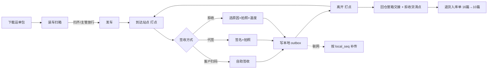
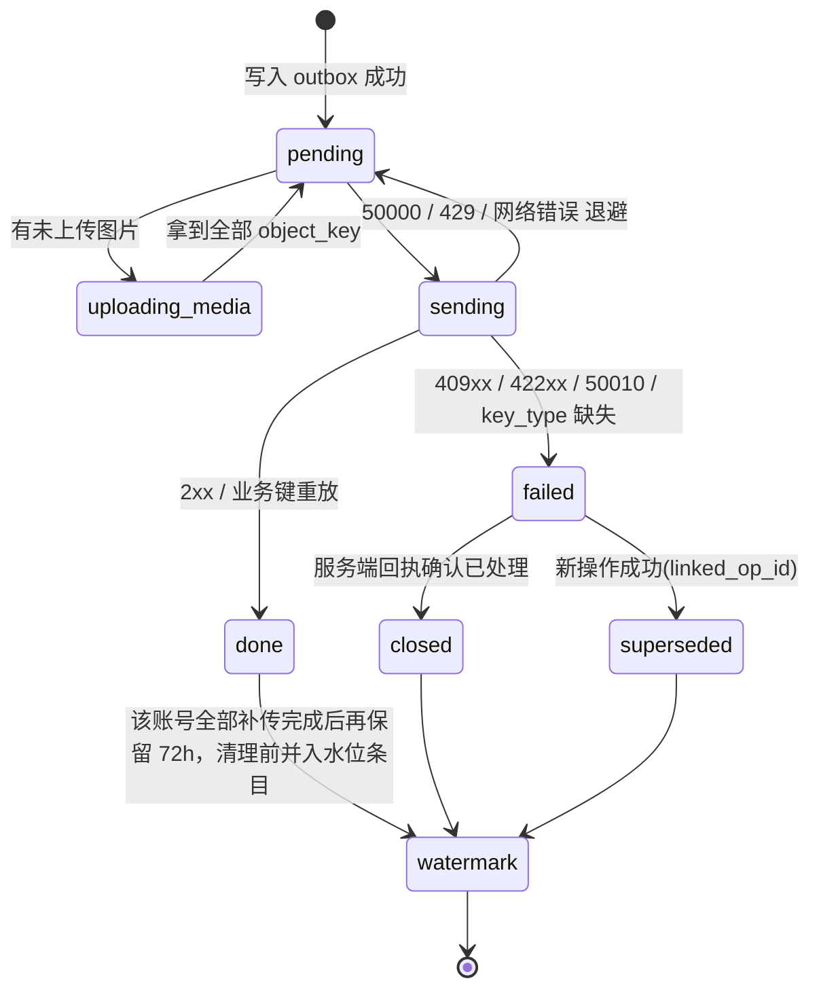

# 15 司机端、商城端 详细设计

| 项 | 内容 |
|---|---|
| 编号 | 15 |
| 作者 | 界面（前端与端上） |
| 评审 | 待定：1 名测试 + 1 名非作者开发（§12 攻击面逐条打） |
| 基线 | `origin/main@5bfd335`（01 / 05 / 06 / 08 / 11 / 12 均已合入）；总体设计 §6.4 错误码、§6.5 幂等（司机端业务键与 `POD_CORRECT`）、§6.6.1 审批类型、§6.6.2 离线/暂停下发、§6.6.5 缺口登记、§6.8 时间、§8 前端模板、§9.1 部署形态与写节点切换 |
| 依赖 | 00（全局）；01 主数据（**已合 main**：条码解析、`sell_days`、温区 `*_c10`；停用/软删/字典一期未建）；04 出库与分配（**已合 main**：出库单状态、`delivery_result`、缺货明细）；11 集成（**已合 main**：纸单补录、非计划切换发起/确认 §7.3、可售量快照出站事件 `wms.stock.sellable`；商城可售量读接口待补）；12 权限与审计（**已合 main**：权限点矩阵 §4.2、`/me` 六字段 §8、`exp` 整秒 Δ1、`pod.tolerance.manage` 定名 Δ7）；**16 配送与签收（草稿 `origin/docs/16-delivery-pod@b5f1ec1`，未合 main，本篇所有配送接口与 4095x 码以它为依据）**；10 退货与异常（**已合 main，只含退供应商；退货预约与异常单接口待补**） |
| 技术栈 | 司机端：微信小程序（原生或 Taro + TypeScript，Q1），`client_type=MP_DRIVER`；商城端：uni-app 或 Taro（Vue3 + TS），H5 + 小程序，`client_type=H5_MALL` |
| 状态 | 新稿（界面，2026-10-15）。从 `docs/15-driver-mall` 与 `docs/frontend-detail-design` 的概要搬运后按当前 main 逐条重核；**对齐轮第一批（2026-10-15）**：按 00 已定口径、12 篇、01 已合 main 的现状改 §1.3 / §6 / §7 / §9.5 / §9.7 / §11 / §12（等 16 篇定稿的第二批） |

> **引用口径**：配送接口与 4095x 冲突码的唯一定义在 16 篇（草稿），本篇只写端上用法；00 §6.4/§6.5 是码值与幂等的最终依据；**12 篇已合 main，与 00 冲突处以 00 为准**。商城端接口在 main 上尚无定义的一律标「契约见」并登记 §11，**不自行造路径**。

---

## 1. 职责与边界

### 1.1 负责

1. **司机端**（微信小程序）：接收运单、装车逐箱扫码核对、到店签收（客户自助码 / 司机代签 + 手写签名 + 拍照 / 部分拒收 / 整单拒收）、缺箱与异常登记、回单上传、周转筐与冷藏箱交接、拒收货回仓清点、到达/离开打点、签收更正申请。
2. **离线优先**：司机跨天离线（> 24 h）是常态。运单包预下载、本地 outbox、按设备本地单调序号补传、按账号隔离、`format_version` 迁移、图片两段式上传。
3. **商城端**（H5 + 小程序）：商品与可售量浏览、下单（选送达日期）、订单列表与状态跟踪、缺发通知、对账查询、退货预约。
4. 端上行为：设备绑定与离线令牌、写节点地址缓存与切换、断网暂停置灰（§9.5、§9.7）。

### 1.2 不负责

| 事项 | 归属 |
|---|---|
| 签收后的库存 / 应收处理、出库单状态迁移合法性、截单顺延计算、可售量计算 | 服务端（04、16、10、11 篇）。前端只做预校验（箱码白名单、数量格式、温度范围）以便即时反馈 |
| 拒收货回仓的入库与差异处理 | 16 篇在回仓交接时生成退货入库单，交 10 篇处理；前端只做逐行清点录入 |
| 路径规划、车辆调度 | TMS（系统外，00 §1） |
| 支付、定价、退款 | ERP / 财务（系统外） |
| 权限安全边界 | 服务端；前端隐藏不是安全手段 |
| 边缘节点权威库切换本身 | 00 §6.1a；前端只感知「当前写入地址」与冲突码 |
| 调度侧改派、放行缺箱发车、审批更正、处理拒收回仓差异、接管离职司机 outbox | 13 篇（管理后台） |

### 1.3 与旧稿（`docs/15-driver-mall` + `docs/frontend-detail-design` 概要）的差异

| # | 旧稿 | 新稿 | 原因 |
|---|---|---|---|
| Δ1 | 配送接口「见第 16 篇 #10」散落引用 | 统一按 16 草稿 §7 的路径、字段与 `op_seq` 字符串口径 | 16 草稿接口表已完整 |
| Δ2 | `40312` 显示 `detail.rule` | 只认 **`detail.reason`** | 00 §6.4 `SOD_VIOLATION` |
| Δ3 | `paused_actions` 写「八值」 | **九个值**（含 `LIVE_WEIGH_OUT`；司机端/商城端不映射它） | 00 §6.6.2 已登记 9 个 |
| Δ4 | 边缘节点形态「待对齐第 00 篇」 | 按 00 §9.1 写全：形态 B、写地址切换、回传与对账 | 00 §9.1 已定稿 |
| Δ5 | 时间「ISO8601 UTC」 | 时间 UTC 整秒 `YYYY-MM-DD HH:MM:SS`，业务日期 `YYYY-MM-DD` 原样显示 | 00 §6.8 |
| Δ6 | 主数据/商城接口「待对齐：见第 11 篇」 | 明确标「待定」并登记 Q2 | main 的 11 篇只有集成/纸单，无可售量、送达日期、客户订单、对账接口 |
| Δ7 | 权限表缺 `delivery.waybill.reassign` | 补上（16 草稿 §10） | 16 草稿权限表 |
| Δ8 | 退货预约接口当成已定 | 标「待定」，登记 Q3 | main 的 10 篇无 `/returns/reservations` |
| Δ9 | `correct_deadline_at`、`backfill_deadline_at` 只读服务端下发 | 保留，并明确「设备时间改动不影响」 | 00 §6.8 第 7 条 |
| Δ10 | 离线令牌 `exp` 当 ISO 8601 带时区解析；`/me` 四项当「待 12 篇补」 | `exp` 按 **UTC 整秒 `YYYY-MM-DD HH:MM:SS`** 解析（12 篇 Δ1），端上不得按本地时区换算；`/me` 六字段按 12 篇 §8 已写全 | 12 篇 Δ1（`12:10` / `12:91-94`）与 §8（`12:435-447`）；00 §6.6.2 是 400 级硬契约 |
| Δ11 | 签收更正容差权限点写 `delivery.pod.tolerance.manage` | **`pod.tolerance.manage`**（不带 `delivery.` 前缀） | 12 §4.2（已合 main）已收录；16 草稿 §10 侧同步改 |
| Δ12 | 主数据（温区 `*_c10`、`sell_days`）当草稿 | 01 已合 main：`sell_days` 必填/范围（`42223` / `42224`）、温区两列要么都空（只允许 `AMBIENT`）要么都有值且 `min_c10 < max_c10`；停用/软删/字典一期未建 | 01 §4 / §7.1「已合 main」/ §7「未建接口」 |

---

## 2. 用例

| 编号 | 角色 | 端 | 用例 |
|---|---|---|---|
| V1 | 司机 | 司机端 | 验证码登录 → 选今日线路（作业日按仓库时区）→ 下载运单包 → 装车逐箱扫码（扫齐或主管放行才可发车）→ 逐站「到达」→ 签收 / 部分拒收 / 整单拒收 → 「离开」→ 回仓交接周转筐与冷藏箱 + 逐行清点拒收货（生成退货入库单，16 篇 → 10 篇）→ 全部补传完成后收车 |
| V2 | 客户（收货人） | 司机端（司机手机） | 扫司机出示的签收码自助签收；或在司机手机上手写签名 |
| V3 | 司机 | 司机端 | 签收后 24 h 内申请更正（容差内直接生效，超出走主管审批） |
| V4 | 司机 | 司机端 | 设备不可用时用纸质签收单；恢复联网后 24 h 内纸单补录（生成 `PAPER_BACKFILL` 审批） |
| V5 | 调度 / 主管 | 管理后台（13 篇） | 改派运单、放行缺箱发车、审批签收更正（`POD_CORRECT`）、处理拒收回仓清点差异、处理司机端红条、接管离职司机 outbox |
| V6 | 客户（下单人） | 商城端 | 浏览商品与可售量 → 加购 → 选送达日期 → 下单（WMS 计算截单顺延并回显）→ 查订单状态 → 收缺发通知 → 查对账 → 发起退货预约 |
| V7 | 门店 / 客户 | 商城端 | 查退货记录与质检进度（只看本店） |

约束：司机只能操作分配给自己的运单；客户只能看自己（或所属客户组织）的订单与对账，**由服务端按 token 强制过滤**。



---

## 3. 页面与路由清单

权限点为渲染依据，实际以服务端为准（12 篇）。

### 3.1 司机端

| 路由（小程序 page） | 页面 | 权限点 |
|---|---|---|
| `pages/login` | 设备登录（手机号 + 验证码，`device_instance_id`，§9.7）+ 选仓；未绑定显示设备码请主管确认 | — |
| `pages/binding-pending` | 首绑等待审批（设备实例短码、账号、仓库、刷新） | — |
| `pages/home` | 今日线路、待补传数角标、离线标识、离线剩余时间 | `delivery.waybill.view_own` |
| `pages/route/detail` | 线路详情：站点顺序、每站状态 | `delivery.waybill.view_own` |
| `pages/load/scan` | 装车逐箱扫码、缺箱/多箱提示 | `delivery.load.scan` |
| `pages/stop/detail` | 站点详情：箱清单、客户信息、导航 | `delivery.waybill.view_own` |
| `pages/stop/sign` | 签收（自助码 / 代签签名 / 拍照）；每行**到货温度必填** `receive_temp_c10`，超温区范围的行强制 `TEMP_ABNORMAL` 拒收 | `delivery.pod.submit` |
| `pages/stop/reject` | 拒收 / 部分拒收：逐行数量 + 原因 + 照片 | `delivery.pod.submit` |
| `pages/stop/correct` | 签收更正申请（选被更正的签收、填原因；在线提交） | `delivery.pod.correct.request` |
| `pages/container/handover` | 周转筐 / 冷藏箱交接（发出/回收数量）+ 拒收货逐行清点 | `delivery.container.handover` |
| `pages/offline/paper` | 纸单补录（恢复联网后 24 h 内，在线提交） | `offline.paper.backfill` |
| `pages/outbox` | 待补传 / 失败列表（红条）、单条重传图片 | — |
| `pages/settings` | 账号、版本、本地数据占用、离线令牌剩余、诊断上报 | — |

### 3.2 商城端

| 路由 | 页面 | 权限点 |
|---|---|---|
| `/login` | 登录（客户账号 / 微信） | — |
| `/goods` | 商品列表 + 可售量（缓存值，带更新时间） | `mall.goods.view` |
| `/goods/:skuId` | 商品详情 | `mall.goods.view` |
| `/cart` | 购物车 | `mall.order.create` |
| `/checkout` | 下单确认：送达日期、地址、缺货策略 | `mall.order.create` |
| `/orders` | 订单列表 | `mall.order.view_own` |
| `/orders/:id` | 订单详情：状态时间线、缺发、签收凭证、拒收与退货入库进度 | `mall.order.view_own` |
| `/statements` | 对账单 | `mall.statement.view_own` |
| `/returns/new` | 退货预约：选原出库单（只列本人可见的已签收单）、选退货门店、填退货行（`sku_id`、数量 3 位小数字符串、`reason_code`、`container_code` **必填**） | `returns.reservation.create` |
| `/returns`、`/returns/:id` | 退货记录与详情（只看本店/本人） | `returns.reservation.view` |
| `/messages` | 缺发 / 顺延 / 签收通知 | — |

---

## 4. 组件拆分

| 组件 | 端 | 职责 |
|---|---|---|
| `ScanInput` | 司机 | 封装 `wx.scanCode` + 手输兜底，去抖、箱码白名单预校验 |
| `SignaturePad` | 司机 | canvas 手写签名，导出 PNG 到本地文件，记录文件 `sha256` |
| `PhotoCapture` | 司机 | 拍照、压缩（长边 ≤ 1600 px、单张 ≤ 300 KB）、加水印（运单号/站点/时间，仓库时区）、落本地文件 |
| `QtyInput` | 两端 | 数量字符串输入，最多 3 位小数，显示 `base_uom`；禁止浮点运算（00 R2） |
| `TempInput` | 司机 | 到货温度输入：按 °C 录入、最多 1 位小数，提交前换算整数 `receive_temp_c10`（字符串运算），未填不能提交 |
| `OutboxBadge` / `RedBar` | 司机 | 待补传数、失败红条；红条与 `failed` 条目同生命周期 |
| `GeoStamp` | 司机 | 仅在到达/离开时取 `wx.getLocation`，超 500 m 弹说明输入；**说明只是现场备注，服务端不得因距离拒收**（冷库/地库定位漂移） |
| `SyncEngine` | 司机 | outbox 发送循环、退避、图片两段式上传、回执处理 |
| `LocalStore` | 司机 | 按 `user_id` 分区的存储封装 + `format_version` 迁移；启动时从条目推导下一序号（§9.3） |
| `DeliveryDatePicker` | 商城 | 展示服务端返回的可选送达日期与截单时间（仓库时区） |
| `OrderTimeline` | 商城 | 把 04 篇出库单状态映射为客户可读文案（§8.6） |
| `ErrorToast` | 两端 | 按错误码映射文案，展示 `trace_id` |

---

## 5. 状态管理

| 数据 | 司机端存储 | 商城端 |
|---|---|---|
| 登录态（JWT、`client_type`、`features`、`min_client_version`） | 内存 + storage（按账号） | 内存 + storage |
| 运单包（线路、站点、箱码白名单、行数量、温度范围、`waybill_version`、`timezone`） | storage：`u:{user_id}:route:{route_id}` | — |
| outbox | storage：`u:{user_id}:outbox:*` + 本地文件 | — |
| `device_instance_id` | storage 全局 key，装机首次生成（uuid），清数据即变 | — |
| `local_seq` / `op_seq` | **不单独持久化计数器**；启动时由 outbox 条目 + 水位条目推导 `max+1`（§9.3） | — |
| 水位条目 | storage：`u:{user_id}:outbox:watermark`，记录已清理条目的 `local_seq` 最大值与各站点 `op_seq` 最大值 | — |
| `format_version` | storage 全局，启动时迁移 | storage 全局 |
| 商品 / 可售量 | — | 内存缓存 60 s，下单时以服务端校验为准 |
| 购物车 | — | storage（按客户账号） |
| 结算会话（`source_order_no` + `Idempotency-Key` + 购物车快照 hash） | — | storage，结算时生成一次，**下单成功才清除**（§8.3） |
| 写节点地址 | 内存缓存 `{endpoint, epoch}`，启动重取 | 内存缓存 |



---

## 6. 页面 → 接口映射

通用请求头：`Idempotency-Key`、`X-Warehouse-Id`、`X-Write-Epoch`。业务键 `(waybill_no, stop_no, device_instance_id, op_seq)`，**运单级操作（装车、发车、筐箱交接、回仓实点）`stop_no=0`**。ID 与 `op_seq` 一律字符串（雪花 ID > 2^53）；数量 3 位小数字符串。

### 6.1 司机端

除登录 / 离线令牌 / `/me`（**12 §8**）、纸单补录与切换发起/确认（**11 §7.3 已合 main**）外，配送接口全部来自 16 草稿 §7（**未合 main**）。

| 页面 | 动作 | 接口 |
|---|---|---|
| 登录 | 发送验证码（限频） | `POST /api/v1/auth/sms-code`（12 篇 §8；14/15 篇客户端） |
| 登录 | 设备登录（司机端默认 `login_type=SMS`） | `POST /api/v1/auth/device-login` `{login_type, username\|phone, password\|sms_code, device_instance_id, client_type}`（12 篇 §8） |
| 登录 | 离线令牌 | `POST /api/v1/auth/offline-token` → `{token, exp, ttl_seconds}`；**`exp` 是 UTC 整秒 `YYYY-MM-DD HH:MM:SS`**（12 篇 Δ1），默认/上限 12 h，端上不得按本地时区换算 |
| 登录 | 当前用户 / 权限 / 暂停动作 | *`GET /api/v1/me`*（含 `perm_version`、`stale_policy`、`paused`、`offline_since`、`paused_actions[]`、`offline_deadline_at`、`backfill_deadline_at`；00 §6.6.2 硬契约，**12 篇 §8 已补全**） |
| 等待审批 | 查审批状态 | `GET /api/v1/approvals/{approval_id}`（凭 `binding_id + device_instance_id`；12 篇 §8） |
| 写节点 | 取写地址 | `GET /api/v1/warehouses/{warehouse_code}/write-endpoint` → `{endpoint, epoch}`（00 §9.1） |
| 首页 / 线路 | 今日线路（作业日按仓库时区） | `GET /api/v1/waybills?mine=1&work_date=` |
| 首页 / 线路 | 下载运单包（含 `waybill_version`、`timezone`、温度范围） | `GET /api/v1/waybills/{waybill_no}/package` |
| 装车扫码 | 提交装车结果（`LOAD`，`stop_no=0`） | `POST /api/v1/waybills/{waybill_no}/load` |
| 装车扫码 | 缺箱放行（主管，后台 13 篇） | `POST /api/v1/waybills/{waybill_no}/load/release-short` |
| 装车扫码 | 发车（`DEPART`，`stop_no=0`） | `POST /api/v1/waybills/{waybill_no}/depart` |
| 站点 | 到达 / 离开打点 | `POST /api/v1/waybills/{waybill_no}/stops/{stop_no}/arrive`、`/depart` |
| 签收 / 拒收 | 申请图片上传凭证 | `POST /api/v1/files/presign`（`object_key=pod/{warehouse_id}/{sha256}.{ext}`；**12 篇 §8 仍无该接口**，属 16 篇 Q-M，随 16 篇定稿或 12 篇增量补） |
| 签收 / 拒收 | 提交 POD（`POD_SIGN` / `POD_REJECT`，一次覆盖站点下全部出库单，全有或全无） | `POST /api/v1/waybills/{waybill_no}/stops/{stop_no}/pod`；200 返回 `{pod_id, stop_display_status, orders[{outbound_id, status, delivery_result, valid_pod_id, correct_seq}]}` |
| 签收更正 | 发起 `POD_CORRECT`（在线） | `POST /api/v1/approvals`，`type=POD_CORRECT`，必带 `correction_client_id`；容差内 `200 {correction_id, status:APPLIED, within_tolerance:true, approval_id:null}`；超出 `202 {correction_id, status:PENDING_APPROVAL, within_tolerance:false, approval_id}` |
| 签收更正 | 撤回 / 查结果 | `POST /api/v1/approvals/{id}/withdraw`；`GET /api/v1/approvals/{id}`；我发起的列表 `GET /api/v1/approvals?mine=true&type=POD_CORRECT` |
| 筐箱交接 | 拒收货回仓实点（`RETURN_COUNT`，`stop_no=0`） | `POST /api/v1/waybills/{waybill_no}/returns` |
| 筐箱交接 | 提交交接（`CONTAINER`，`stop_no=0`） | `POST /api/v1/waybills/{waybill_no}/containers` |
| 纸单补录 | 提交（在线，24 h 内） | `POST /api/v1/offline/paper-records` `{action_type, occurred_at, operator_id, payload, photo_ids[]}`（11 §7，已合 main） |
| outbox | 操作回执（重放 `response`） | `GET /api/v1/pod-ops/receipt?waybill_no=&stop_no=&device_instance_id=&op_seq=` |
| outbox | 设备序号水位（水位条目丢失时恢复） | `GET /api/v1/devices/{device_instance_id}/op-seq-hwm`（返回 `{device_instance_id, as_of, items[{waybill_no, stop_no, op_seq_max}]}`，`op_seq_max` 为字符串） |

**POD 请求体要点**（16 草稿 §7.2）：`{device_instance_id, op_seq, op_type, waybill_version, signer_type, media[{object_key, sha256}], orders[{outbound_id, lines[{outbound_line_id, lot_id, shipped_qty, rejected_qty, reject_reason, uom, receive_temp_c10}]}], client_created_at}`。`POD_SIGN` 时 `rejected_qty` 全 0；`POD_REJECT` 至少一行 > 0；整单拒收 = 全部行 `rejected = shipped`。

### 6.2 商城端

| 页面 | 动作 | 接口 |
|---|---|---|
| 商品 | 可售量查询（读缓存表，不直接查 WMS 主表） | **待定**（Q2） |
| 下单确认 | 可选送达日期 / 截单试算 | **待定**（Q2） |
| 下单 | 建单 | 内部映射到 `POST /api/v1/outbound-orders`（04 §7.1，已合 main），`source_system=MALL`、`source_order_no` 由商城生成；商城前端是否直连见 Q4 |
| 订单 | 列表 / 详情（客户视角裁剪） | **待定**（Q2）；底层 `GET /api/v1/outbound-orders/{id}`（04 §7） |
| 缺发 | 缺货明细 | **待定**（Q2）；底层 `GET /api/v1/outbound-orders/{id}/shortages`（04 §7） |
| 对账 | 对账单 | **待定**（Q2，归 10 篇/财务） |
| 退货预约 | 创建 `{store_code, outbound_order_id, lines[{sku_id, qty, reason_code, container_code}]}` | 契约形状见 13 篇 §6.3-8；后端侧待 10 篇补登记 |
| 退货预约 | 列表 / 详情（门店只看本店） | 契约形状见 13 篇 §6.3-8；后端侧待 10 篇补登记 |
| 订单详情 | 拒收 / 部分拒收结果与退货入库进度 | **待定**（Q3，归 16/10 篇） |
| 断网暂停状态 | 读 `/me` 的 `{stale_policy, paused, offline_since, offline_deadline_at, paused_actions[], backfill_deadline_at}` | `GET /api/v1/me`（00 §6.6.2） |
| 纸单补录 | 司机端入口，商城端不提供 | — |

---

## 7. 权限点

| 权限点 | 说明 | 依据 |
|---|---|---|
| `delivery.waybill.view_own` | 只看分配给自己的运单 | 16 草稿 §10 |
| `delivery.load.scan` / `delivery.load.release_short` | 装车扫码 / 缺箱放行（放行是主管，后台） | 16 草稿 §10 |
| `delivery.pod.submit` | 签收 / 拒收提交 | 16 草稿 §10 |
| `delivery.pod.correct.request` / `delivery.pod.correct.approve` | 发起更正（司机）/ 审批（主管，13 篇），**审批人 ≠ 发起人**（SoD-5，`40312`） | 16 草稿 §10 |
| `delivery.container.handover` | 筐箱交接 | 16 草稿 §10 |
| `delivery.waybill.reassign` | 改派（调度，后台） | 16 草稿 §7/§10 |
| `delivery.outbox.takeover` | 主管接管司机 outbox（后台） | 16 草稿 §10 |
| `pod.tolerance.manage`（**不带 `delivery.` 前缀**） | 更正容差配置（后台，13 篇） | 12 篇 Δ7 / §4.2；接口 16 草稿 §7 |
| `offline.paper.backfill` / `offline.paper.approve` | 纸单补录申请（司机）/ 审批（主管），不能自批 | 00 §6.6.1 |
| `mall.goods.view` / `mall.order.create` / `mall.order.view_own` / `mall.statement.view_own` / `mall.return.view_own` | 商城 | **12 篇 §4.2 已登记**（`12:193`，标 15 ⚠） |
| `returns.reservation.create` / `returns.reservation.view` / `returns.reservation.receive` | 门店创建 / 查看 / 仓库收货（收货在 PDA 14 篇） | **12 篇 §4.2 已按复数收录**（`12:176`）；接口契约形状见 13 篇 §6.3-8 / 14 篇 §6.2，后端侧待 10 篇补登记 |

- 后端强制：按 token 身份过滤；按单号直接访问他人运单/订单返回 `40310`，或 404 不暴露存在性（Q5）。
- `X-Warehouse-Id`：司机端按运单所属仓携带，服务端按资源查仓比对，不一致返回 `40311`（00 §6.6）。商城端客户可能跨仓下单，由服务端按收货地址路由仓，**前端不传仓号**（Q6）。
- 商城可售量走缓存表，不直接查 WMS 主表。

---

## 8. 交互与异常态

### 8.1 司机现场交互硬性要求

- 大按钮、单手操作；强光下高对比度；扫码成功短震、失败长震 + 语音提示。
- 任何提交**先落本地再反馈成功**：「已保存，待上传」与「已上传」两种状态必须区分显示。
- 签收页显示应收行数量（`base_uom`），部分拒收逐行录入拒收量，本地校验 `0 ≤ 拒收量 ≤ 应收量`（**字符串定点比较**，不用浮点）。
- **到货温度**（16 篇）：每个签收行必填 `receive_temp_c10`（整数，单位 0.1 °C）。界面按 °C 输入、最多 1 位小数（如 `4.5`），提交时换算为 `45`（字符串运算）；未填不能提交。
  - **允许范围的取法**：按 `sku.temperature_required` 映射到本仓对应温区的 `zone`，取其 `temp_min_c10` / `temp_max_c10`（整数 0.1 °C，下限 < 上限，随运单包下发），与 `receive_temp_c10` 直接整数比较。**只校验存在的一端**；两端都为空时不做范围校验，但 `receive_temp_c10` **仍必填**。超出范围时该行显示告警并**强制**选择拒收、`reject_reason=TEMP_ABNORMAL`（不能按正常签收提交）。整单另录车厢温度 `temperature_x10`。
  - 服务端校验为准：返回 `42216 POD_TEMP_OUT_OF_RANGE` 时高亮对应行，提示「温度超出范围，须按温度异常拒收」，不自动重试。
- **纸单兜底补录**（00 §6.6.1，审批类型 `PAPER_BACKFILL`）：设备不可用时现场用纸质签收单；恢复联网后司机（`offline.paper.backfill`）在「纸单补录」入口提交 `POST /api/v1/offline/paper-records` `{action_type, occurred_at, operator_id, payload, photo_ids[]}`（纸单照片必传，`occurred_at` 按仓库时区录入、以 UTC 整秒提交），主管（`offline.paper.approve`）审批，申请人不能自批。必须在恢复联网后 24 h 内提交，超时服务端转异常单。入口显示补录剩余倒计时，**只读服务端下发的 `backfill_deadline_at`**（= 恢复联网 + 24 h；**前端不用设备时间推算**；每次断网→恢复联网后都会下发，不论是否有待补纸单；为 `null`（窗口已过或从未断网）时隐藏入口与倒计时，已提交的补录记录仍可查看）；剩余 < 1 h 标红。**补录必须在线，不进 outbox。**

### 8.2 三态

加载 / 空 / 错误三态用统一组件；离线时展示本地数据并在顶栏标「离线，最后同步 HH:mm（仓库时区）」。

### 8.3 重复点击、更正与重复提交

- 同一站点已有 `pending` / `done` 签收条目时，再次点签收只提示「已签收」，**不能再提交 `POD_SIGN` / `POD_REJECT`**；要改结论走「申请更正」。
- **签收更正 `POD_CORRECT`**（**在线提交，离线不发送**）：
  - `correction_client_id`（必填）：客户端在**创建更正草稿时生成一次** UUID，与草稿一起持久化；每次重试、重连、App 重启都复用同一个，只有新建一次更正才生成新值。服务端按 `(driver_id, correction_client_id)` 唯一、**长期保存**，与 `Idempotency-Key` 过期无关。
  - **重放**：同一 `correction_client_id` 再次提交时，服务端返回**原始状态码（200 或 202）、同一 `correction_id`、同一响应体**；前端按 `correction_id` 对账，更新已有记录，**不新增重复记录**。只有新键才做时间窗、目标与容差判定。
  - **同键不同内容**：`40910`，`detail.key_type=POD_CORRECT` → 提示「这次更正和之前提交的内容不一致」，不自动重试、不生成新键；用户可放弃该草稿后新建更正（新键）。
  - 必须携带被更正签收的 `corrected_pod_id`（服务端回执里的生效签收 `valid_pod_id`）；本地原签收还未拿到回执时不允许发起更正（按钮置灰并提示「待上传完成」）。
  - 走第 12 篇 `approval_request`（类型 `POD_CORRECT`）：**在线** `POST /api/v1/approvals`；容差内 `200 {correction_id, status:APPLIED, within_tolerance:true, approval_id:null}`（直接生效），超出 `202 {correction_id, status:PENDING_APPROVAL, within_tolerance:false, approval_id}`（待审批）；同一签收已有待审批时返回那一条。离线时「申请更正」按钮置灰，提示「联网后申请」（断网时审批服务端返回 `50301`）。
  - **审批通过与执行更正在同一事务**：`UPDATE approval_request … WHERE status='PENDING'` 与更正 `UPDATE … WHERE status='DELIVERED' AND valid_pod_id=:corrected_pod_id` 两条都必须命中，否则整体回滚并把审批置为失效。**更正前置条件失败**（被更正签收已不再生效）返回 `40951`，`detail.reason=CORRECT_TARGET_STALE`，审批失效；`40934` / `40935` 只用于审批状态冲突（撤回/过期/他人已审），不用于更正前置条件。
  - `correct_seq` 由服务端在执行时分配（`max+1`），前端不生成、只展示。
  - 发起需 `delivery.pod.correct.request`；审批需 `delivery.pod.correct.approve`，审批人不能是发起人（SoD-5，`40312`）。
  - **24 小时更正窗口**：只能在出库单签收（`DELIVERED`）后 24 h 内发起与审批。签收详情显示「可更正剩余 HH:MM」倒计时，**只读服务端写入的 `correct_deadline_at`**（= `delivered_at` + 24 h，UTC，按仓库时区显示），前端**不自行加 24 h**；剩余 < 1 h 标红，到期按钮置灰「已超过更正时限」。
  - **超窗**：`40951`，`detail.reason=POD_CORRECT_WINDOW_EXPIRED` → 提示「已超过 24 小时，已转异常处理」，显示 `detail.exception_no` 并提供跳转（异常单带责任方 `liable_party`），不重试。
  - **容差内免审批**：差异在容差内的更正提交后直接生效，前端按响应展示「已更正（容差内免审批）」而非 PENDING，不进入待审批列表。**前端不自行判断是否在容差内**（服务端为准）。
  - **前端状态（`202` 路径）**：`PENDING_APPROVAL`（待审批，可撤回）→ `APPLIED`（审批通过并已执行，显示新生效签收与 `correct_seq`）/ `REJECTED`（主管驳回，显示原因）/ `WITHDRAWN`（已撤回）/ `EXPIRED`（24 h 过期）/ **失效**（审批通过时返回 `40951 CORRECT_TARGET_STALE`，或审批详情显示执行失败 `fail_code=40951`）：显示「原签收已变化，本次更正未执行」，并提供「基于当前生效签收重新申请」（新 approval，带新的 `corrected_pod_id`）。撤回时若收到 `40934`，刷新后按服务端最终状态展示（可能已被批准），不重试。
  - **直接生效路径 `APPLIED`**（容差内）：`草稿 → APPLIED`，不经过 `PENDING_APPROVAL`；**不可撤回**、不进待审批列表，直接显示新生效签收与 `correct_seq`。
  - 两台设备并发更正同一签收，**只有一条成功**，另一条 `failed` 红条。
  - 普通 `POD_SIGN` / `POD_REJECT` 仍只认 `status='SHIPPED'`，第二条生效结论返回 `40950`。
- **商城下单**：在购物车点「结算」时生成一次 `source_order_no` 与 `Idempotency-Key`，与购物车快照 hash 一起存 storage。重进确认页、超时重试、杀进程重开都沿用同一组；购物车内容变化（hash 不同）才作废重新生成；**下单成功（或服务端确认已存在）后才清除**。服务端以 `UNIQUE(source_system, source_order_no)` 兜底（04 §7.1，重推返回 200 + 已有单号），Key 过期也不会重复下单。

### 8.4 错误码 → 前端处理（两端共用）

| 返回 | 前端处理 |
|---|---|
| 2xx / 业务键重放 | 成功 |
| `40001` / `40010` | 表单报错；司机端 outbox 条目 `failed`（本地数据有误，不重试），上报日志 |
| `40111` `reason=BINDING_PENDING` | 首绑待主管审批（`DEVICE_BIND`）：显示等待审批页，**不写 outbox**；凭 `approval_id` 查 `GET /api/v1/approvals/{id}`，通过后重新登录 |
| `40111` `reason=NOT_BOUND` | 绑定被驳回/过期：提示重新登录再次申请；**不清 outbox** |
| `40111` `reason=WAREHOUSE_MISMATCH` 或缺失 | 暂停队列，不清 outbox，交主管 |
| `40110` `reason=DEVICE_UNBOUND` | 绑定被吊销：清本地令牌回登录页，**outbox 保留** |
| `40110` `reason=TOKEN_EXPIRED` | 先静默刷新令牌后重放原请求（同 Key） |
| `40110` `reason=PERM_VERSION_CHANGED` | 刷新后重拉 `GET /api/v1/me`；刷新失败或未知 reason：暂停该账号队列，提示「请联网后重新登录，登录后自动续传」；同一账号登录后自动继续；若登录的是**另一个**手机号，原账号条目保持只读，只能由主管接管（`delivery.outbox.takeover`） |
| `40112 OFFLINE_TOKEN_INVALID` | 暂停队列，不清 outbox；按 `detail.reason`：`EXPIRED` / `PERM_STALE` 联网重新登录后续传；`REVOKED`（设备挂失等）/ `DEVICE_MISMATCH` / 未知 → 交主管 |
| `40310` / `40311` | 暂停该账号队列（司机）/ 跳无权限页（商城），交主管 |
| `40312 SOD_VIOLATION` | `failed` 红条显示 **`detail.reason`**，不重试 |
| `40910` `key_type=IDEMPOTENCY_KEY` | 本地数据异常或 bug：`failed`，不重试，上报 |
| `40910` `key_type=POD_CORRECT` | 同一 `correction_client_id` 带了不同更正内容：提示「这次更正和之前提交的内容不一致」，不自动重试、不生成新键 |
| `40910` `key_type=POD_OP` | 同一业务键 `(waybill_no, stop_no, device_instance_id, op_seq)` 带了不同内容：`failed`，交主管 |
| `40910` `key_type` **缺失或未知** | `failed` 红条，**不自动重试、不生成新 Key**，交人工处理，上报日志 |
| `40934` / `40935` | 审批已被处理 / 目标已变：刷新审批状态 |
| `40950` 站点已有生效签收（`detail{outbound_id, status, valid_pod_id, signed_at}`） | `failed` 红条，展示服务端返回的生效结论，提示走更正 |
| `40951` 运单状态不允许，`detail.reason` **必带** | `REASSIGNED` / `WAYBILL_CANCELLED` / `WAYBILL_CLOSED` / `WAYBILL_RETURNED` / `NOT_DEPARTED` / `CORRECT_TARGET_STALE` / `CORRECTION_PENDING` / `POD_CORRECT_WINDOW_EXPIRED` → `failed` 红条，提示「运单状态已变化」，交主管（超窗另显示 `detail.exception_no`）；`WAYBILL_VERSION_STALE`（带 `current_version`）→ **不进红条**，暂停队列、重新下载运单包，用**新 `op_seq`** 重提，旧条目转 `superseded`；未知 reason → 红条 |
| `40930` 通用非法状态流转 | 配送场景**不应返回** 40930；若收到按 `40951` 处理并上报（16 草稿 §7.3） |
| `40931` 单据锁定 | 退避同 Key 重试，超过 N 次转 `failed` |
| `40952`–`40959`（配送预留） / 其他未知 409xx | `failed` 红条，不静默丢弃，不自动重试 |
| `42210 BARCODE_MISMATCH` | 箱码不属于本运单：不缓存，修正后可用**同 Key** 重提 |
| `42216 POD_TEMP_OUT_OF_RANGE` | 高亮对应行，提示按温度异常拒收，不重试 |
| `429` / 网络错误 | 保持 `pending`，指数退避同 Key 重试 |
| `50301 DEPENDENCY_UNAVAILABLE` | **只表示写库不可用**：重取 `write-endpoint` 后按原 Key 重提交，条目保持 `pending` |
| `50302 ID_CLOCK_BACKWARD` | 保持 `pending` 退避同 Key 重试，**不重取写地址、不标红** |
| `50303 STALE_WRITE_NODE` | 暂停 outbox，重取 `write-endpoint`，按 `local_seq` 用原 Key 重放，不标红 |
| `50304 STALE_STOCK_PAUSED`（`detail.action` ∈ `paused_actions`） | 停止该操作：提示暂停，**不自动重试、不重取写地址**；重拉 `/me`，`paused=false` 或 `paused_actions` 不再含该动作后恢复；商城下单同样处理 |
| `50000` | 通用错误 + `trace_id`；保持 `pending`，退避同 Key 重试（不缓存，重新执行，业务键兜底） |
| `50010` | 通用错误 + `trace_id`；**不自动重试**，`failed` 红条交主管 |

### 8.5 版本与强制更新

`/me` 返回 `min_client_version`，低于则强制更新；但**司机端 outbox 非空时更新前先尝试补传**，补传不完不得清空本地数据（小程序更新不清 storage，`format_version` 迁移负责兼容）。迁移失败进入只读安全模式：禁止新建条目、禁止清空，提示联系主管并上报诊断包。

### 8.6 商城端异常

- 可售量不足：服务端下单校验失败（码值待对齐，Q2），提示并回到购物车标红行。
- 截单顺延：下单响应返回实际 `work_date` / 预计送达日，若与所选不同，弹窗确认（文案按仓库时区日期展示）。
- **签收以出库单为粒度**，记录在 16 篇（`delivery_order` + `pod_op` / `pod_line` / `pod_correction`）；出库单状态以 16 篇为准，发运单 `shipment` 只关联 `waybill_id`，司机、车辆、发车时间一律取 16 篇运单 `waybill`，前端不从发运单读这些字段。
- **签收结论**取 04 篇 `outbound_order.delivery_result`：`FULL`「已签收」、`PARTIAL_REJECT`「部分拒收」、`FULL_REJECT`「整单拒收」；站点汇总用 `stop_display_status`（仅展示）：`PENDING` 未到达 / `ARRIVED` 已到达未签 / `DEPARTED_UNSIGNED` 已离开未签 / `FULL` / `PARTIAL_REJECT` / `FULL_REJECT` / `MIXED` 结论不一。**出库单状态为 `DELIVERED` 时，只要 `delivery_result` 为部分/整单拒收，也不得显示为「已签收」**；同时展示拒收行与退货入库进度。
- **订单状态映射**（04 篇状态机 → 客户可读文案）：`CREATED` / `CUTOFF`「已接单」；`ALLOCATING`…`CHECKED`「备货中」；`SHORT`「部分缺货」；`STAGED`「待发车」；`SHIPPED`「配送中」；`DELIVERED` / `COMPLETED`「已签收」（签收结论为部分/整单拒收时显示「部分拒收」/「整单拒收」）；`CANCELLED`「已取消」。
- 仓库 `PAUSE`（`paused_actions` 含 `ALLOCATE`）：该仓商品显示「暂停接单」并禁用加购/下单；恢复联网对账后自动恢复。

---

## 9. 多端适配与离线

### 9.1 适配

- **司机端**：安卓中低端机为主；照片压缩后单张 ≤ 300 KB；本地照片总占用超 200 MB 时提示补传，**不自动删除未确认上传的图片**。storage 接近上限（剩余 < 1 MB）或写入失败时：提示「未上传 N 条、图片占用 X MB，请联网补传」，**禁止开始新站点作业**（已开始的站点允许完成），避免签收写到一半失败。
- **商城端**：H5 与小程序同一套代码；小程序订阅消息（缺发、顺延、签收）模板见 Q7。不做离线，断网时禁止下单，只读显示缓存商品。
- **时间与日期**：时间戳存 UTC 整秒；作业日、水印日期、「今日线路」按**仓库时区**（`warehouse.timezone`，随运单包下发）计算，不按手机时区（00 R3 / §6.8）。

### 9.2 离线流程（司机端）

```mermaid
sequenceDiagram
  participant D as 司机端
  participant L as 本地存储
  participant F as 文件服务
  participant S as 服务端
  D->>S: 联网时下载运单包(含 waybill_version)
  Note over D: 进入离线
  D->>L: 签收: 照片/签名落文件 + outbox 条目(同一次写入)
  D-->>D: 显示「已保存，待上传」
  Note over D: 恢复联网
  loop 按 local_seq 升序
    D->>F: 上传未上传图片(预签名) 得 object_key
    D->>S: 提交 POD(Idempotency-Key, 业务键, object_keys, X-Write-Epoch)
    S-->>D: 2xx/重放 → done ; 409xx → failed 红条
  end
```

### 9.3 outbox 记录与幂等

条目：`{ op_id(uuid), local_seq, format_version, idem_key, device_instance_id, user_id, warehouse_id, waybill_no, stop_no, op_seq, type(LOAD|ARRIVE|POD_SIGN|POD_REJECT|DEPART|CONTAINER|RETURN_COUNT), payload, media:[{local_path, sha256, object_key?}], waybill_version, created_at(UTC), status, attempts, last_error, server_receipt_id, linked_op_id }`。

**三层去重**（00 §6.5）

1. **`Idempotency-Key`**：用户点确认时生成，与 payload 同一次落盘；重试/重启/退避复用。服务端只保留 24 h，而司机离线常超 24 h，所以它只是第一层。
2. **业务唯一键 `(waybill_no, stop_no, device_instance_id, op_seq)`**，另加业务约束「同一 `(waybill_no, stop_no)` 只能有一条生效的签收结论」。同键同内容 → 重放首次结果；同键不同内容 → `40910`，`detail.key_type=POD_OP`。
   - 换机/重装后 `device_instance_id` 变化，旧 outbox 已不在本机，不存在跨实例重试；「同站点只能一条生效结论」由服务端条件更新兜住（`UPDATE … WHERE status='SHIPPED'` 影响 0 行 → `40950` / `40951`），**不能先查再写**。
   - `op_seq`：按 `(waybill_no, stop_no)` 单调递增（字符串），写入后不变。`WAYBILL_VERSION_STALE` 重下运单包后用**新 `op_seq`**（16 草稿 §9）。
3. **记账层**：签收触发的出库状态迁移与流水由后端唯一约束兜底（02 §4.4、04 §5）。

**序号推导（不单独存计数器）**：`wx.setStorage` 没有跨 key 事务，所以不持久化计数器。

- 启动（及切换账号）时扫描该账号全部 outbox 条目与水位条目：`next_local_seq = max(条目 local_seq, 水位.local_seq_max) + 1`；每个 `(waybill_no, stop_no)` 的 `next_op_seq = max(条目 op_seq, 水位.op_seq_max[站点]) + 1`。运行期在内存递增。
- 一个条目就是一个 storage key，写成功即序号「被占用」；写失败则该序号未占用，下次推导自然复用，不会出现「条目已写、计数器未加」的撞号。
- **服务端已确认的条目不整条清空**：清理 `done` / `closed` / `superseded` 条目前，先把它的 `local_seq` 和站点 `op_seq` 并入水位条目（取 max，单 key 覆盖写），水位写成功后再删条目。删前断电只会多留一条，不会回退。
- 水位条目丢失或损坏：进入只读安全模式，向服务端查询本设备的最大 `op_seq` 后恢复（`GET /api/v1/devices/{device_instance_id}/op-seq-hwm`）。

**图片两段式**：`object_key` **由内容确定**：`pod/{warehouse_id}/{sha256}.{ext}`，客户端在拍照落盘时就算好。上传凭证接口按这个 key 签发（同 key 重复上传幂等覆盖同一内容）。全部上传成功后再提交 POD，body 只含 `object_key` + `sha256`。即使首次 POD 已成功、响应丢失、图片又重传一遍，body 也逐字节不变，服务端按业务键重放，不会 `40910`。

**顺序**：按设备本地单调 `local_seq` 发送（由条目推导，不受时钟影响）；`created_at` 只展示。同一运单前一条未结束时不发后一条；前一条 `failed` 时，同账号同运单后续条目暂停，**其他运单不受影响**。

**状态与清理**

| 状态 | 清理 |
|---|---|
| `pending` | — |
| `done` | **该账号全部条目补传完成后**再保留 72 h，清理前并入水位条目 |
| `failed` | **永不自动清理**；收到服务端回执（主管已处理）后转 `closed`，并入水位后再删 |
| `superseded` | 与关联条目一起清理（同样先并入水位） |

**按账号隔离**：存储 key 以 `u:{user_id}:` 分区；当前账号 outbox 非空不允许登出，可「交给主管」（`delivery.outbox.takeover`，服务端记审计）；首页只读显示「其他账号待补传 N 条」。

**`format_version` 迁移**：启动时读全局 `format_version`，逐版本执行迁移函数（只增字段、不删数据）；迁移失败进入只读安全模式（§8.5）。

### 9.4 补传冲突

| 场景 | 处理 |
|---|---|
| 运单已改派给他人 | `40951` `reason=REASSIGNED`，`failed` 红条，交主管；不静默丢弃 |
| 出库单已取消（04 篇：`SHIPPED` 后不允许取消，只能红冲） | 理论不应出现；服务端返回 `40951`，上报 |
| 站点已被他人签收（另一台设备 / 客户自助） | `40950`，`failed`，展示对方结论，可走更正 |
| 部分拒收后一个站点多张出库单的状态 | 由 16 篇定义，前端按服务端返回展示，不自行推断 |
| `waybill_version` 落后 | `40951` `reason=WAYBILL_VERSION_STALE` + `current_version`：重下运单包，用新 `op_seq` 重提，旧条目 `superseded` |
| 运单 `RETURNED` 后迟到的签收补传 | `40951`，红条交主管；主管核实后在线发起 `POD_CORRECT` 审批或后台补录 |

### 9.5 边缘节点（SQLite）部署形态与写节点切换

按 00 §9.1：

- 形态 A（中心直连，中心 PG 是该仓权威库）与形态 B（仓内服务器 SQLite 是该仓权威库）都是正式形态。**一个仓任何时刻只有一个可写库**，司机端只连本仓权威库，不存在双写。
- **取地址**：`GET /api/v1/warehouses/{warehouse_code}/write-endpoint` → `{endpoint, epoch}`，中心和边缘节点本地都提供。司机端缓存上次的 `endpoint` + `epoch`；**取不到时用缓存继续作业**，不阻塞。
- 每个写请求带 `X-Write-Epoch`。请求 epoch 小于本库 epoch 或本节点已被取代 → `50303 STALE_WRITE_NODE`，不写任何行、不缓存。
- 收到 `50303`（或 `50301`、或发现 `epoch` 变化）：**重新取 write-endpoint，用原 `Idempotency-Key` 和原业务键重提**，不生成新 `op_seq`，不标红。`50302` 不触发重取（只退避重试）；`50304` 不重取、不重试（§8.4）。
- `pod_op`、`idempotency_record` 都在权威库，随交接式故障切换迁移；RPO 窗口内丢失的写入由司机端 outbox 原键重提补回，幂等保证不重复入账。
- 边缘节点断网期间：作业照常（本地发号、本地 outbox）；恢复后按 `(node_id, seq)` 严格顺序回传，中心按事件 id 幂等应用；序号缺口暂停应用并请求补发，不跳号。
- 非计划切换（边缘硬件故障）：从最近备份恢复，新节点可能用**新节点号**，对司机端只表现为重取地址；恢复后到开放作业前有动碰盘点对账，期间写请求按 503 处理，条目保持 `pending`。**审批在服务端**：`UNPLANNED_FAILOVER`（00 §6.6.1，`ck_apr_ttl` 上限 1 h）+ `POST /api/v1/failover/{warehouse_code}/request`（发起）+ `/confirm`（确认，11 §7.3 已合 main），**共三人**（1 人发起 + 仓库主管与中心运维各确认一次，发起人不能兼任确认人）；司机端不参与确认。

### 9.6 商城端

- 不做离线；断网时禁止下单，只读显示缓存商品。
- **仓库断网 / 可售量不可信**（`stale_stock_policy` 默认 `PAUSE`）：商城读 `/me` 的 `{stale_policy, paused, offline_since, offline_deadline_at, paused_actions[], backfill_deadline_at}`；`paused_actions` 含 `ALLOCATE`（新分配/预占）时，该仓商品显示「暂停接单」并禁用加购/下单（**只看 `paused_actions`，不写死清单**），不做降额接单；仓库恢复联网对账后自动恢复。
- **退货预约**（契约形状见 13 篇 §6.3-8；后端侧待 10 篇补登记）：`POST /returns/reservations`，body `{store_code, outbound_order_id, lines[{sku_id, qty, reason_code, container_code}]}`，`reason_code`、`container_code` 必填（缺失 `40001`）。仓库收货后进入 `RETURN_QC` 冻结，商城退货记录显示「待质检」→ 质检结果。没有预约的退货由仓库盲收，会生成异常单并须在 48 h 内关联订单；**商城端不提供盲收入口**。

### 9.7 设备绑定与离线令牌

- `device_instance_id` 首次安装生成并存安全存储，**重装即变**；登录走 `device-login`。首次登录服务端建 PENDING 绑定并发起 `DEVICE_BIND` 审批，返回 `40111` `detail.reason=BINDING_PENDING`（另带 `approval_id`、`binding_id`）：司机端进 `pages/binding-pending`，**不进入作业、不写 outbox**；主管（`device.binding.approve`）通过后重新登录即可。
- **`paused_actions` → 司机端 / 商城端按钮**（00 §6.6.2，**九个值**；置灰只由此驱动，未知值不映射并上报）：

| 枚举值 | 司机端 | 商城端 |
|---|---|---|
| `ALLOCATE` | — | 该仓商品加购 / 下单（显示「暂停接单」） |
| `TRANSFER` | — | — |
| `WAVE_RELEASE` | — | — |
| `LIVE_WEIGH_OUT` | —（司机端无此入口） | — |
| `PICK_CONFIRM` | — | — |
| `CHECK` | — | — |
| `SHIP` | 装车扫码、发车 | — |
| `RECEIVE` | 拒收货回仓实点 | — |
| `POD` | 签收 / 拒收提交 | — |

- 在线登录后取离线令牌（`{token, exp, ttl_seconds}`），默认 **12 小时**（覆盖一个班次），库层上限同为 12 h。**`exp` 是 UTC 整秒 `YYYY-MM-DD HH:MM:SS`**（12 篇 Δ1）：端上按 UTC 与服务器时间比对，**不得用设备本地时区换算、不得当带时区 ISO 串解析**。**离线超过 12 小时后**，服务端在 `paused_actions` 中加入 `POD` 等现场动作并在补传时拒绝；**司机端不设本地 12 h 计时禁用**，置灰只看最近一次收到的 `paused_actions`。全程断网收不到更新时仍记录进 outbox，补传被拒的转红条交主管、可走纸单兜底（§8.1），不静默丢弃。被暂停的操作返回 `50304`。
- 首页显示离线剩余时间（取 `offline_deadline_at`，只显示，剩余 < 1 h 提醒）；重连顺序：**先重放 outbox，再由服务端对账**，冲突进入异常队列。
- 设备挂失后绑定和离线令牌全部吊销，补传返回 `40112 REVOKED`，outbox 保留交主管接管（`delivery.outbox.takeover`）。
- 登录方式：`device-login` 支持 `login_type=PASSWORD|SMS`；司机端默认手机号 + 验证码（`POST /auth/sms-code` 限频，需联网）。微信授权登录未提供，不做。

---

## 10. 测试要点

| 层 | 工具 | 重点 |
|---|---|---|
| 单元 | Vitest + 本地存储 mock | outbox 写入原子性；Key 与 `op_seq` 在失败/重启/退避后不变；`local_seq` 排序（改系统时间不影响）；串行与失败暂停只影响本账号同运单；`failed` 不被清理、只在服务端回执后删除；`done` 清理前先写水位；`format_version` 迁移（含迁移失败只读）；温度输入 `"4.5"` → `45`、`"-18.0"` → `-180`，超过 1 位小数被拦；拒收量字符串定点比较 |
| 离网 E2E | 手工 + 自动化 | 离线 48 h、30 站签收 + 60 张照片后联网，全部按 `local_seq` 补传，无重复签收、无丢失；发送中杀进程/断电后重启同 Key 同 `op_seq` 重发；Key 过期（> 24 h）后业务键兜底不重复记账；**B1**：条目写入前后各杀一次，推导出的序号不重复不回退；**B2**：水位写入与删条目之间杀进程，序号不回退 |
| 设备与令牌 | MSW | `40111 BINDING_PENDING` 等待页不写 outbox、按 `approval_id` 查到通过后重登；`NOT_BOUND` 重新申请；`40110 DEVICE_UNBOUND` 清令牌且 outbox 保留；验证码登录 `login_type=SMS`；离线令牌剩余取响应 `exp`；离线 > 12 h 后 `40112 EXPIRED` → 重登后续传；挂失后 `40112 REVOKED` 交主管；剩余 < 1 h 提醒 |
| 签收更正 | MSW | 离线时「申请更正」置灰；容差内 `200 APPLIED` 显示已更正、无撤回按钮、不进待审批列表；超出 `202 PENDING_APPROVAL` 显示待审批并可查 `approval_id`；重复发起返回已有审批；`40934`/`40935` 刷新；审批通过执行失败 `40951 CORRECT_TARGET_STALE` 显示失效并可基于当前生效签收重申请；已有待审批 → `40951 CORRECTION_PENDING`；**`correction_client_id` 在草稿创建时生成一次，杀进程/断网重连/超时重试后抓包断言值不变**；同键不同内容 `40910 key_type=POD_CORRECT` 提示且无自动重试；`Idempotency-Key` 过期后用同一 `correction_client_id` 重放仍得原 200/202 与同一 `correction_id` |
| 签收与温度 | MSW | 签收未填温度不能提交；`receive_temp_c10` 整数比较（只有上限时只比上限、两端都空时不校验但温度仍必填）；超范围时正常签收不可选、强制 `TEMP_ABNORMAL`；`42216` 高亮不重试；`40950` 展示对方结论；`40951` 各 reason 文案；`WAYBILL_VERSION_STALE` 重下运单包用**新 `op_seq`** 且旧条目 `superseded`（不进红条）；`40930` 按 `40951` 处理并上报 |
| 状态展示 | MSW | 出库单 `DELIVERED` + `delivery_result=PARTIAL_REJECT` → 「部分拒收」；`FULL_REJECT` → 「整单拒收」；不出现「已签收」；站点 `MIXED` 仅展示；订单状态映射各态文案 |
| 写节点与暂停 | MSW | 断网用缓存 `endpoint` + `epoch` 继续作业且写请求带 `X-Write-Epoch`；`50303` 暂停队列、重取地址、按 `local_seq` 原 Key 重放、不标红、不换 `op_seq`；`50301` 与 epoch 变化同样重取后原键重提；`50302` 只退避；`50304` 提示暂停、不重试、不重取地址、重拉 `/me` 后恢复；九个 `paused_actions` 值映射（司机端 `SHIP`/`RECEIVE`/`POD`，商城端 `ALLOCATE`）、未知值不映射、空数组不置灰、**无本地 12 h 计时禁用** |
| 图片与回执 | MSW | 图片部分失败可单图重传且不改变 POD body、不触发 `40910`；首次 POD 已成功、响应丢失、图片重传后重提 `body` 不变、重放成功；`GET /pod-ops/receipt` 重放回执；水位丢失时 `GET /devices/{id}/op-seq-hwm` 恢复 |
| 商城 | MSW | 重复点击下单只生成一张单；首次下单超时但已成功、退出重进确认页再提交仍只有一张（同 `source_order_no`）；购物车内容变化才换 Key；截单后下单顺延提示；越权访问他人订单 403/404；`paused_actions` 含 `ALLOCATE` 时禁用加购/下单并显示暂停接单、空数组不禁用、恢复后自动可下单；退货预约 `reason_code`/`container_code` 未填不能提交且服务端 `40001` 按字段提示；退货记录只显示本店 |
| 真机 | 手工清单 | 手机时区设为 UTC、仓库为 Asia/Shanghai，23:30–00:30 跨日「今日线路」与水印日期正确；storage 写满提示未上传条数与图片占用并禁止开启新站点；定位超 500 m 填说明后仍可签收（服务端不拒）；两个账号同机时 A 的 failed 不阻塞 B、A outbox 非空不能登出 |
| 静态 | ESLint + tsc | 禁止浮点数量运算；雪花 ID 全程字符串（`Number` 精度） |

---

## 11. 待定问题

> **契约对齐台账**：15 篇 §6.2 的商城/退货条目对应的责任篇、状态与行号依据（13 篇 §6.4 表 2），以及 §6.1 配送接口状态，统一维护在 **13 篇 §6.4「契约对齐台账」**，本篇不重复维护。

| # | 问题 | 依赖 | 影响 |
|---|---|---|---|
| Q1 | ~~12 篇不在 main~~ **已定稿**：权限点矩阵 §4.2（含 `delivery.*` / `mall.*` / `returns.reservation.*` / `pod.tolerance.manage`）、`/me` 六字段 §8、`exp` 整秒 Δ1 都已在分支里闭合。**仍未定**：`POST /files/presign` 的契约与保留期（12 篇 §8 未列该接口） | 已关闭；预签名归 16 篇 Q-M / 12 增量 | 全端菜单、按钮按 12 篇 §4.2；图片上传的预签名接口仍待补；12 与 00 冲突以 00 为准 |
| Q2 | 商城端接口全缺：可售量（缓存表）、可选送达日期与截单试算、客户视角订单列表/详情、缺发明细、对账 | 第 11 篇 / 项目 | §6.2 多数行；报表归「下一轮独立篇（19 报表）」（00 §6.6.5） |
| Q3 | 退货预约（创建/列表/详情/收货）与异常单接口在 main 的 10 篇里都没有；48 h 关联口径未定 | 第 10 篇 | 权限点已由 12 篇 §4.2 登记；前端契约形状见 13 篇 §6.3-8 / 14 篇 §6.2；**后端侧待 10 篇补登记** |
| Q4 | 商城是否本团队开发，还是只对接外部商城接口；前端是否直连 `POST /outbound-orders` | Yuri | §1.1、§6.2 |
| Q5 | 越权访问他人运单 / 订单返回 `40310` 还是 404（不泄露存在性）——12 篇 §4.3 只定了**仓隔离**返回 `40311`，他人单据口径仍未定 | 第 12 篇增量 | §7 |
| Q6 | 商城跨仓下单时仓号由谁决定（服务端按地址路由） | 第 11 篇 | §7 |
| Q7 | 小程序订阅消息模板与审核（缺发、顺延、签收） | 项目 | `/messages` |
| Q8 | 客户自助扫码签收的身份校验方式（一次性签收码时效） | 第 16 篇 | `pages/stop/sign` |
| Q9 | 签收照片/签名的存储（OSS/MinIO）、预签名接口与保留期 | 第 16 篇 Q-M / 第 12 篇增量 | §9.3；**12 篇 §8 未列 `POST /files/presign`**，12 篇 §6.3 的审计保留期（18 个月 + 归档 5 年）不适用于 POD 图片 |
| Q10 | 拒收货回仓清点差异的处理与权限 | 第 16 篇 → 第 10 篇 | `pages/container/handover` |
| Q11 | 司机端原生小程序还是 Taro；商城端 uni-app 还是 Taro | 项目 | §1 技术栈 |
| Q12 | 部分拒收后站点多张出库单的状态展示口径 | 第 16 篇 | §8.6 |
| Q13 | 共享 `utils/format.ts` / `qty.ts` 的方式（monorepo 包 / 复制） | 工程结构 | 13/14/15 共用 |
| Q14 | 端到端联调所需的运单/站点/筐箱数据准备与演练环境 | 项目 | §10 |
| Q15 | 01 增量（停用挂起 / 软删 / 字典 / 伙伴车队设备台账）与 16 篇定稿时间 | 磐石 / 长流 / Chief | 端上不依赖 01 未建能力；配送接口与 4095x 码等 16 篇定稿后回核（第二批对齐轮） |

---

## 12. 对抗评审攻击面

| # | 攻击面 | 期望 |
|---|---|---|
| D-A1 | 离线 > 24 h 补传，Key 已过期 | 业务键兜底，不重复签收 |
| D-A2 | 同站点两台设备（换机 / 客户自助 + 代签）各提交一次；两台并发更正 | 条件更新只认一条，另一条 `40950` / `40951` |
| D-A3 | `40910` 无 `key_type` | 红条，无自动重试、无新 Key（抓包断言） |
| D-A4 | 序号与条目非原子、清理后序号回退撞号 | 不存计数器，由条目 + 水位推导；先写水位再删条目 |
| D-A5 | 账号切换 / token 过期后误用他人 outbox 补传 | 按 `user_id` 隔离，补传账号必须一致或主管接管 |
| D-A6 | 小程序 storage 10 MB 上限写满 | 写入失败不给成功反馈，提示补传；不删未确认数据 |
| D-A7 | 手机时区 / 时间被改 | 排序用 `local_seq`，日期用仓库时区，服务端以服务器时间记账 |
| D-A8 | 图片重传导致 body 变化（含首次已成功、响应丢失） | `object_key` 由 sha256 派生，body 稳定 |
| D-A9 | 越权：按单号枚举他人运单 / 订单 | `40310` 或 404，不泄露存在性 |
| D-A10 | 商城重复下单、并发下单 | `Idempotency-Key` + `source_order_no` 唯一 + 服务端可售校验 |
| D-A11 | 边缘节点切换期间补传 | 00 §9.1：同 Key、同业务键重提，不换 `op_seq` |
| D-A12 | 雪花 ID 用 Number 解析 | 全程字符串 |
| D-A13 | 绕过审批直接发 `POD_CORRECT` / 更正已失效签收 | 服务端校验审批与 `valid_pod_id`，失败 `40951 CORRECT_TARGET_STALE` |
| D-A14 | 审批人即发起人 | SoD-5，`40312`（`detail.reason`） |
| D-A15 | 撤回 / 过期 / 审批通过并发 | 同事务双条件更新，只有一个成功，其余 `40934` |
| D-A16 | 商城超时后重进确认页重复下单 | `source_order_no` 结算时生成并持久化 |
| D-A17 | 拒收货回仓未入账 | 回仓清点生成退货入库单（16 篇 → 10 篇） |
| D-A18 | 温度校验绕过 | 未填温度不能提交；超范围不能按正常签收提交；服务端 `42216` 兜底 |
| D-A19 | `50304` 被当成写节点切换 | 不重取写地址、不重试，只按 `/me` 的 `paused_actions` 恢复 |
| D-A20 | 离线令牌 `exp` | 按带时区 ISO 串或设备本地时区解析 `exp`，倒计时偏移导致过早或过晚重新登录（12 篇 Δ1 已明确为 UTC 整秒） |
| D-A21 | 一期不存在的错误分支 | 把 `42221` / `40962` / `42220` 当可达提示；端上做「主数据申请删除 / 撤销停用」入口（01 一期没有停用挂起 / 软删两段式 / 司机台账） |
