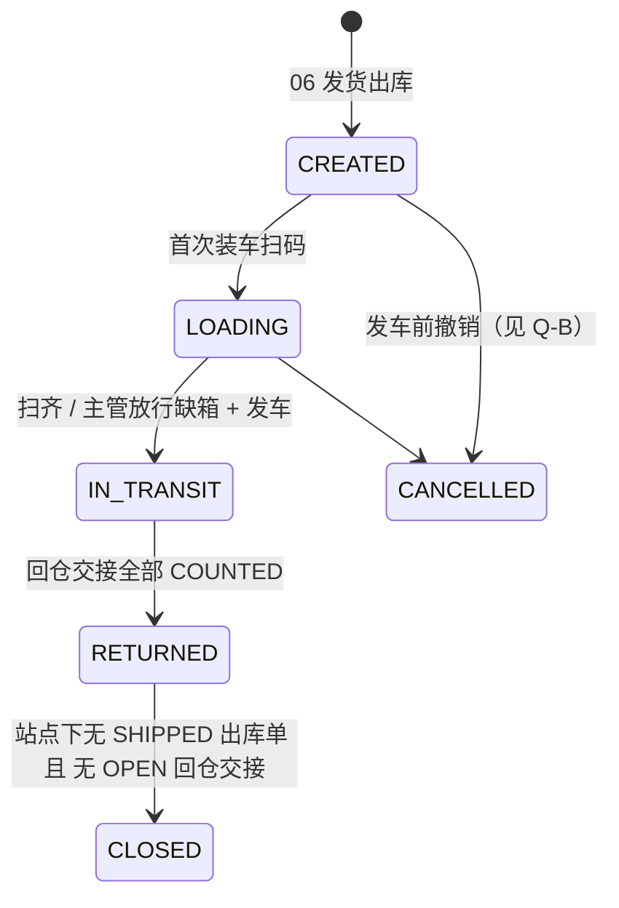
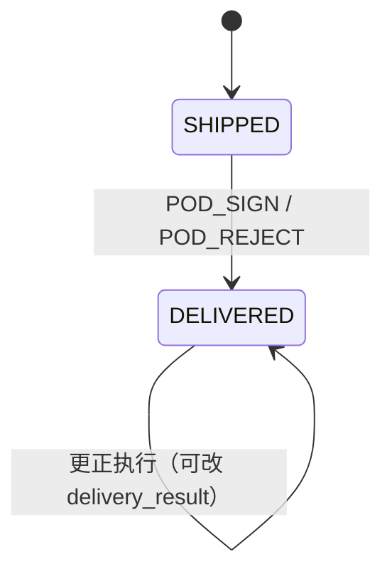
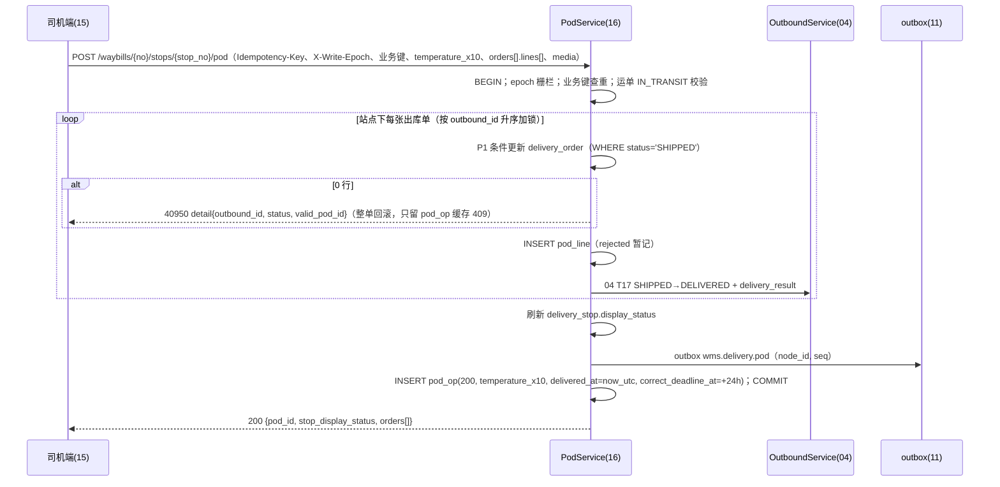
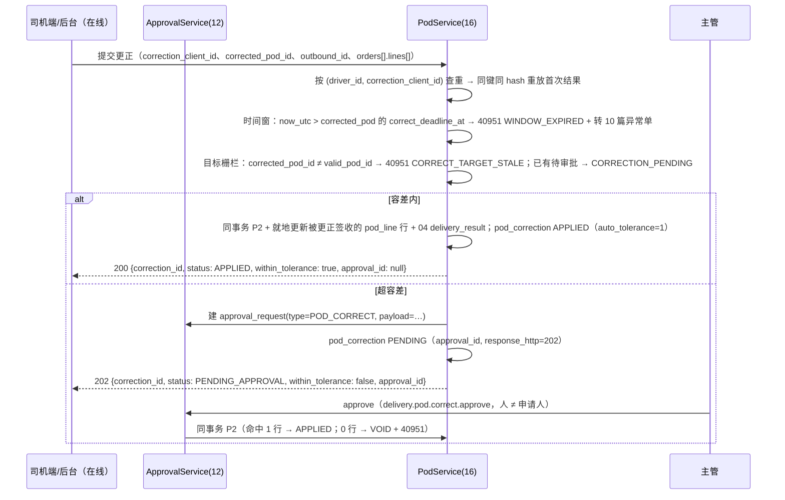
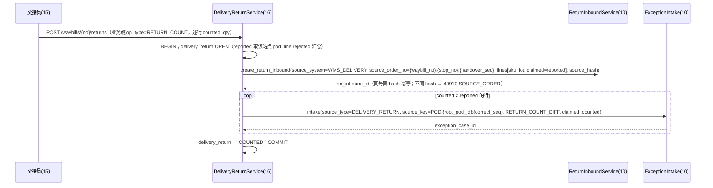

# 16 配送与签收 详细设计

| 项 | 内容 |
|---|---|
| 编号 | 16 |
| 作者 | 镜鉴（本轮按 main 现存 DDL 重写；旧稿 `origin/docs/16-delivery-pod`（528 行）只当素材） |
| 评审 | 磐石、长流（对抗评审）；前端侧回核 界面 |
| 基准 | `wms-design/sql/schema/16_delivery.sql` @ main `d2b8ac1`（331 行，**唯一 DDL 基准**）；`docs/00-总体设计.md`、`docs/04-出库与分配.md`、`docs/06-复核装箱发货.md`、`docs/10-退货与异常.md`、`docs/11-接口集成.md`、`docs/12-权限与审计.md`、`docs/13/14/15`（前端） |
| 状态 | **已落库**：9 表 + PK/UK/FK/CHECK + 31 索引 + 只追加 / 重放只读触发器 + SQLite 9 条 no-REPLACE 守卫 + 授权；本轮再落 **Q16-2 修法 ④（更正就地 UPDATE `pod_line`，不新增行）** 与 **Q16-4（`delivery_return_line.lot_id` NOT NULL）**，两库断言同批补齐。`§12 Q16-3`（`correct_op_id` 命名语义）与 `Q16-10` 仍待登记 |

> 本篇只写**服务端**：运单、站点、签收（POD）、签收更正、拒收回仓交接。前端行为（outbox、序号推导、图片两段式、更正倒计时）以第 15 篇为准，本篇只给接口和服务端裁决规则。**全局约定不重复定义**：雪花 ID（00 §6.1）、单号（00 §6.2）、数量 `*_qty_milli` 与 3 位小数字符串（00 §6.3 / R2）、作业日按仓库时区（00 R3）、错误码规则（00 §6.4）、幂等三层（00 §6.5）、写节点与 epoch（00 §9.1）、时间（00 §6.8）、`search_path`（00 §6.9）、SQLite 防 REPLACE（00 §6.10）。

---

## 0. 与旧稿的差异（Δ）

旧稿分支 `origin/docs/16-delivery-pod` 停在 `b896a1d`（52 表基线），与现网 93 表基线不可比；下表只列**会误导实现**的差异。

| # | 旧稿 | 本篇 | 原因 |
|---|---|---|---|
| **Δ1** | `pod_op.client_created_at`，示例写 `"2026-10-15T02:31:00Z"` | **`client_occurred_at`**，UTC 整秒 `YYYY-MM-DD HH:MM:SS`，并加整秒 CHECK `ck_pod_op_cct`（PG `date_trunc`、SQLite 长度+`typeof`） | 00 §6.8 第 3/4/7 条：列名统一 `client_occurred_at`、只供展示排障；带 `T`/`Z` 与小数秒一律 `40003`。DDL 已在 PR #52 改名 |
| **Δ2** | 行级字段 `shipped_qty` / `rejected_qty` / `reject_reason` / `uom` | **`shipped_qty_milli` / `rejected_qty_milli` / `reason_code`**；**无 `uom` 列**（uom 由出库行 / SKU 推导，回显放响应）。**注意：`*_milli` 是 DDL 列名，不是接口字段名**——接口一律传 3 位小数字符串（`"5.000"`，见 §7.3），服务端换算成 milli 落库 | 对齐 DDL `ck_podl_qty` / `ck_podl_rsn_v`，数量一律整型 milli（00 §6.3）；15 篇 §6.2 已按此收口 |
| **Δ3** | `pod_tolerance_config.sku_category` 可空 + `UNIQUE (warehouse_id, COALESCE(sku_category,''))` | **`sku_category NOT NULL DEFAULT ''`**（`''` = 全品类），`uq_podt_scope UNIQUE (warehouse_id, sku_category)` 普通列唯一；数量列名 `max_abs_qty_milli`；加 `ck_podt_cat`（`trim` 相等）、`ck_podt_notblank`（两项不能同时为 0） | 00 §6.10 第 3/4 条的 no-REPLACE 扫描**不能判定表达式唯一索引**（表达式唯一索引一律红）；`''` 是列值，扫描器逐列可判 |
| **Δ4** | `pod_correction`「四字段只读」含 `approver_id` 语义；状态迁移散写 | 确定列名 **`decided_by` / `decided_at`**（`ck_podc_decide` 成组）；`ck_podc_http`、`ck_podc_auto`、`ck_podc_seq`；去重键 `uq_podc_client UNIQUE (driver_id, correction_client_id)` + 3 个部分唯一索引 | 对齐 DDL；12 篇 §5.2.1 旧文写作 `approver_id`，属 12 篇的笔误（`Q16-7`，归镜鉴小 PR 修） |
| **Δ5** | `pod_op` 用 `waybill_id`、水位查询按 `user_id` 过滤 | `pod_op` 只有 **`waybill_no`（字符串）**，**没有 `user_id`/`driver_id`**；水位接口只按 `device_instance_id` 分组 | DDL 实况；操作人靠 12 篇 `user_device_binding`（设备 ↔ 使用人）反查 |
| **Δ6** | 运单迁移 W3「回仓交接完成 → 写 `returned_at`」 | `waybill` **没有 `returned_at` 列**：状态 `RETURNED` 只由 `delivery_return` 全 `COUNTED` 推导，完成时间取该运单 `max(delivery_return.counted_at)` | DDL 实况；不再凭虚构列写迁移 |
| **Δ7** | 触发器名 `trg_pod_op_immutable` | **`trg_pod_op_append_only`**（PG，函数复用 `trg_append_only()`；SQLite 拆 `trg_pod_op_no_update` / `no_delete`）；`trg_podc_replay_immutable`（两库） | 对齐 DDL；PG 侧另有授权收窄（`pod_op` 只 `SELECT, INSERT`） |
| **Δ8** | §4 写「新增 9 表 / 28 索引，总计 52 表 / 146 索引」 | 9 表（9 PK / 10 UK / 18 FK / **38 CHECK** / 31 索引，含 3 个部分唯一）；全库 **93 表 / 307 索引 / 3 视图** | 旧稿基准 `b896a1d` 已作废；数字以 `verify.sh` / `verify_sqlite.py` 实测为准 |
| **Δ9** | §11.2 写「262/262、260/260 通过」 | PG **1767 项 / 0 失败**、SQLite **2525 项 / 0 失败**（main `d2b8ac1` 实测） | 断言总数随全项目增长，旧数字无意义 |
| **Δ10** | 更正执行「同事务写 `pod_line`」，未定父列 | 更正**不新增行**，就地 UPDATE 被更正签收的 `pod_line` 行（`pod_id = pod_correction.correct_op_id`，Chief 裁定 Q16-2 = 修法 ④） | 本篇重写时实测发现原两条出路都撞约束（`§11.3` A/B），④ 是唯一同时满足 `fk_podl_pod` 与 `uq_podl` 的走法 |

---

## 1. 职责与边界

### 1.1 本模块负责

1. **运单 `waybill`**：由第 6 篇发运单 `shipment` 生成（首版 1:1，见 `Q16-1`），装车、发车、在途、回仓、关闭；运单包下发（含 `waybill_version`、箱码白名单、行数量、批次、仓库时区）。
2. **站点 `delivery_stop`**：到达 / 离开打点；`display_status` **只是展示汇总**，业务判断一律读出库单（04）。
3. **出库单签收**：以**出库单**为粒度（Q14 定案）。状态沿用第 4 篇 `SHIPPED → DELIVERED`（04 T17），签收结论写第 4 篇 `outbound_order.delivery_result`（`FULL / PARTIAL_REJECT / FULL_REJECT`，仅 `DELIVERED` 时非空；**列由第 4 篇加，本篇只引用**）；`delivery_order` 保存生效签收栅栏。
4. **司机端作业幂等**：四字段业务键 `(waybill_no, stop_no, device_instance_id, op_seq)`（`pod_op`）+ 首次结果回放缓存。
5. **签收更正** `POD_CORRECT`：**只能在线**，走第 12 篇 `POST /api/v1/approvals`（`type=POD_CORRECT`，带 `corrected_pod_id`），审批通过时同一事务执行；**容差内**更正免审批、同事务直接执行（§6.3）；不经 `pod_op`、不离线排队。
6. **拒收回仓交接**：司机登记数暂记，以仓库回仓实点为准（Q15）；生成第 10 篇 RTN，差异生成第 10 篇异常单。
7. **设备序号水位查询**（Q13）。
8. 第 4095x 码（40950–40959）的分配。

### 1.2 本模块不负责

| 事项 | 归属 |
|---|---|
| 复核、装箱、发货出库（扣库存 `post_event(SHIP)`） | 06 / 02 |
| 出库单状态机、`ck_obo_status`、`delivery_result` 列 | 04（本篇只触发 T17 并写 `delivery_result`） |
| 审批单 `approval_request`（`POD_CORRECT` 类型、撤回 / 过期、40934 / 40935、TTL） | 12（`ck_apr_ttl` 的 `POD_CORRECT` 段） |
| RTN 收货、质检、上架 / 报损；异常单处置 | 10 |
| 司机端 outbox、序号推导、图片上传前端逻辑 | 15 |
| 文件服务预签名、对象存储保留期 | 12 / 15（`Q16-9`：12 篇 §8 目前无该接口） |
| 路径规划、车辆调度 | TMS（系统外，00 §1） |
| 签收回传上游 | 11（本篇只写 outbox `wms.delivery.*`） |
| `write_epoch`、`warehouse_db_authority`、write-endpoint 实现 | 00 §9.1（本篇只规定司机端接口的遵守方式） |

### 1.3 与第 6 篇的边界（Chief 已拍）

- **司机、车辆、发车、签收的权威与快照都归 16 的 `waybill`**（`06:30` 自己就是这么写的）。`waybill` 存 `driver_id / driver_name / driver_phone / vehicle_no / planned_depart_at / departed_at / signed_at / temp_log_ref` 的**发车时点快照**，不随 01 主数据回溯。
- 06 `shipment` **只留** `carrier_code` + 交接字段（`box_count` / `handed_over_at` / `handed_over_by` / `dock_location_id`）；`vehicle_no` / `driver_id` / `driver_name` / `driver_phone` / `planned_depart_at` / `departed_at` / `signed_at` / `temp_log_ref` **删除**（06 Δ1 已计划、DDL 未动，见 `Q16-6`）。
- 关联方向用 **`waybill.shipment_id`**，**不要**反向的 `shipment.waybill_id`（06 Δ1 里「加 `shipment.waybill_id`」那条已撤）。
- 01 台账里的车辆 / 司机是**主数据**；运单里的是**发车时点快照**，两边语义不互相替。`waybill.driver_id` 目前无 FK（等 01 台账落地，00 §6.6.5 跨篇 FK 队列）。

---

## 2. 用例

| # | 用例 | 触发 | 权限点 | 写库存 | 离线可补传 |
|---|---|---|---|---|---|
| UC1 | 发运生成运单 | 06 发货出库（同事务） | — | 否 | — |
| UC2 | 下载运单包 | 司机端 | `delivery.waybill.view_own` | 否 | — |
| UC3 | 装车扫码 / 缺箱放行 | 司机 / 主管 | `delivery.load.scan` / `delivery.load.release_short` | 否 | 是 |
| UC4 | 到达 / 离开打点 | 司机 | `delivery.pod.submit` | 否 | 是 |
| UC5 | 签收 / 部分拒收 / 全拒收（`POD_SIGN` / `POD_REJECT`） | 司机（客户扫码或代签） | `delivery.pod.submit` | 否 | 是 |
| UC6 | 签收更正申请（在线；`POST /approvals`，`type=POD_CORRECT`） | 司机 / 调度 | `delivery.pod.correct.request` | 否 | **否（只能在线）** |
| UC7 | 审批更正 | 主管（13 篇后台） | `delivery.pod.correct.approve` | 否 | — |
| UC8 | 回仓交接：拒收货逐行实点 → RTN + 差异异常单 | 交接员 | `delivery.container.handover` | 否（RTN 收货时由 10 入账） | 是 |
| UC9 | 查询设备序号水位（Q13） | 司机端 | `delivery.waybill.view_own` | 否 | — |
| UC10 | 查询某操作回执（重放首次结果） | 司机端 | `delivery.waybill.view_own` | 否 | — |
| UC11 | 改派运单 | 调度 | `delivery.waybill.reassign` | 否 | — |
| UC12 | 主管接管司机 outbox | 主管 | `delivery.outbox.takeover` | 否 | — |
| UC13 | 更正容差配置读写 | 仓库主管 / `CENTER_OPS` | `pod.tolerance.manage` | 否 | — |

---

## 3. 领域模型与不变量

- `Waybill`：`code`（=`waybill_no`，`WB-{仓}-{节点}-{作业日}-{序号}`；前缀 **`WB` 已登记进 00 §6.2（PR #63 已合 main）**，Q16-8 关闭）、`shipment_id`、`driver_*` / `vehicle_no` 快照、`work_date`、`status`、`waybill_version`、时间列。
- `DeliveryStop(waybill_id, stop_no, customer_id, display_status)`：`display_status ∈ {PENDING, ARRIVED, DEPARTED_UNSIGNED, FULL, PARTIAL_REJECT, FULL_REJECT, MIXED}`（`ck_dstop_st`），由站点下出库单的 `outbound_order.delivery_result` 与打点推导，**只展示**。
- `DeliveryOrder(outbound_id, waybill_id, stop_no, status, valid_pod_id, root_pod_id, correct_seq, version)`：签收聚合根，驱动 04 T17。
- `PodOp`：司机端一次写操作；签收类操作的 `id` 即 `pod_id`。
- `PodLine(pod_id, outbound_line_id, lot_id, shipped_qty_milli, rejected_qty_milli, reason_code, receive_temp_c10)`：签收结论的行明细。
- `PodCorrection(correct_op_id, corrected_pod_id, root_pod_op_id, outbound_id, driver_id, correction_client_id, request_hash, status, approval_id, auto_tolerance, tolerance_version, correct_seq)`：`id` 同时是更正后的签收 id；`root_pod_op_id` 是链根（FK → `pod_op`）。
- `PodToleranceConfig(warehouse_id, sku_category, max_abs_qty_milli, max_pct_bp, version)`：`''` = 全品类兜底。
- `DeliveryReturn(waybill_id, stop_no, handover_seq, status, rtn_inbound_id, counted_by, counted_at)` + `DeliveryReturnLine(sku_id, lot_id, reported_qty_milli, counted_qty_milli, exception_case_id)`。

**不变量**

| # | 不变量 | 落地 |
|---|---|---|
| D1 | 一张出库单同时只有一个生效签收 | `delivery_order.valid_pod_id` + 条件更新 `WHERE status='SHIPPED'` / `WHERE status='DELIVERED' AND valid_pod_id=:pod_id` |
| D2 | 未签收 ⇔ 无生效签收 ⇔ 无首签 | `ck_dord_pod` |
| D3 | `0 ≤ rejected ≤ shipped`（且拒收必须有原因、原因在枚举内） | `ck_podl_qty`、`ck_podl_rsn`、`ck_podl_rsn_v` |
| D4 | 业务键唯一，缓存只存确定性结果 | `uq_pod_op_key`、`ck_pod_op_cache` |
| D5 | 一个生效签收最多一条待审批更正；每张出库单的更正序号唯一；一张审批单最多一条更正 | `uq_podc_pending`、`uq_podc_seq`、`uq_podc_approval` |
| D6 | 更正决策人 ≠ 申请人；`APPLIED` / `REJECTED` 必有决策时间 | `ck_podc_sod`、`ck_podc_decide` |
| D7 | 实点 ≠ 登记数 ⇒ 必须挂异常单；同一 `(交付单, SKU, 批次)` 只能一行 | `ck_dretl_exc`、`uq_dretl` + `lot_id NOT NULL`（Q16-4） |
| D8 | 回放缓存只追加；更正去重键与首次结果建单后只读 | `trg_pod_op_append_only`、`trg_podc_replay_immutable`、PG `pod_op` 只授 `SELECT, INSERT` |
| D9 | 运单 `CLOSED` 必有 `signed_at` | `ck_wb_signed` |
| D10 | 签收类操作温度必填且在 −40.0…60.0 ℃；非签收操作必须为空 | `ck_pod_op_temp` |
| D11 | 逐行到货温度必填（−40.0…60.0 ℃） | `ck_podl_temp`（NOT NULL + 范围） |

---

## 4. 表、约束与索引（以 `16_delivery.sql` 为准）

9 表：`waybill`、`delivery_stop`、`delivery_order`、`pod_op`、`pod_line`、`pod_correction`、`pod_tolerance_config`、`delivery_return`、`delivery_return_line`。合计 **9 PK / 10 UNIQUE / 18 FK / 38 CHECK / 31 索引**（PG 目录实读，2026-10-16；索引含 PK 与 UNIQUE 的隐式索引，其中 3 个是部分唯一索引）。

### 4.1 `waybill`

`code` UK（= `waybill_no`）、`shipment_id` UK（首版 1:1）+ FK `shipment(id)`、`warehouse_id` FK；`status ∈ {CREATED, LOADING, IN_TRANSIT, RETURNED, CLOSED, CANCELLED}`（`ck_wb_status`）；`waybill_version ≥ 0`，改派 / 改站点 +1；`ck_wb_signed`（`CLOSED` 必有 `signed_at`）；`ix_wb_driver(driver_id, work_date, status)` 供「今日线路」。时间列（`created_at` / `updated_at`）已是 00 §6.8 第 3 条的 `DEFAULT (date_trunc('second', now() AT TIME ZONE 'UTC'))`。

**无 `returned_at`**：回仓完成时间取该运单 `delivery_return.counted_at` 的最大值（Δ6）。

### 4.2 `delivery_stop`

`uq_dstop(waybill_id, stop_no)`、`ck_dstop_no(stop_no >= 1)`、`ck_dstop_st`；`customer_id` 目前无 FK（01 `customer` 台账落地后按 00 §6.6.5 队列补）；`ix_dstop_wb(waybill_id, stop_no)`。

### 4.3 `delivery_order`

| 列 | 说明 |
|---|---|
| `outbound_id` | `uq_dord_out`：一张出库单只挂一张有效运单；改派 = 更新 `waybill_id` / `stop_no`，不新建行 |
| `status` | `SHIPPED / DELIVERED`（`ck_dord_status`），与 `outbound_order.status` 同事务同步；签收结论只在 04 `delivery_result` |
| `valid_pod_id` | 当前生效签收：首签 = `pod_op.id`，更正后 = `pod_correction.id`（**无 FK**：跨两张表，由 `ck_dord_pod` + 条件更新保证）。更正执行的栅栏 |
| `root_pod_id` | 首次签收 `pod_id`，更正后不变 |
| `correct_seq` | 首签 0，每次 `APPLIED` 更正 +1（`ck_dord_cseq`） |
| `version` | 每次条件更新 +1 |

`ck_dord_pod`（D2）：`SHIPPED` ⇔ 两个 pod 列都空；`DELIVERED` ⇔ 两列都非空。

### 4.4 `pod_op`（业务键 + 回放缓存）

| 列 | 说明 |
|---|---|
| `(waybill_no, stop_no, device_instance_id, op_seq)` | `uq_pod_op_key`；运单级操作（`LOAD` / `CONTAINER` / `RETURN_COUNT`）`stop_no=0` |
| `op_type` | `LOAD / ARRIVE / POD_SIGN / POD_REJECT / DEPART / CONTAINER / RETURN_COUNT`（`ck_pod_op_type`）；**不含 `POD_CORRECT`**（更正不进 `pod_op`） |
| `req_hash` | 规范化请求体 SHA-256，`ck_pod_op_hash` 钉 64 位；body 只含 `object_key + sha256` 等稳定字段（15 篇图片两段式） |
| `http_status / biz_code / response` | 首次结果；`ck_pod_op_cache` 只允许 2xx+`"0"`、400+`400xx`、409+`409xx` |
| `client_occurred_at` | **设备原始时间（UTC 整秒）**，只供展示 / 排障，不参与任何判断；`ck_pod_op_cct` 钉整秒（PG `date_trunc` 相等、SQLite 长度 19 + `typeof` 为 text） |
| `temperature_x10` | 整单车厢温度（0.1 ℃ 整数）；`ck_pod_op_temp`：`POD_SIGN` / `POD_REJECT` 必填且 −400…600，其他操作必须为 NULL |
| `delivered_at` | UTC，服务端受理成功签收的时间；`ck_pod_op_cdl`：2xx 的签收操作必有、其他必空 |
| `correct_deadline_at` | UTC，**= `delivered_at` + 24h**（服务端写）；`ck_pod_op_cdl24`（PG `+ INTERVAL '24 hours'`、SQLite `datetime(…,'+24 hours')`） |

整行只追加：`trg_pod_op_append_only`（PG）/ `trg_pod_op_no_update` + `trg_pod_op_no_delete`（SQLite）拦 UPDATE / DELETE，温度与截止时间写入后都不能改；PG 侧 `wms_app` 不授 UPDATE。索引：`ix_pod_op_dev(device_instance_id, waybill_no, stop_no, op_seq)`（水位）、`ix_pod_op_stop(waybill_no, stop_no, created_at)`。

**没有 `user_id` / `driver_id` / `signer_type`**：操作人由 12 篇 `user_device_binding`（设备 ↔ 使用人）反查；`signer_type`（司机代签 / 客户自助扫码）目前**无落库位置**（`Q16-10`），只进 `req_hash` 与响应。

### 4.5 `pod_line`

`uq_podl(pod_id, outbound_line_id, lot_id)`；FK `fk_podl_pod → pod_op(id)`、`fk_podl_obl → outbound_line(id)`、`fk_podl_lot → lot(id)`；`ck_podl_qty`、`ck_podl_rsn`（拒收必填原因）、`ck_podl_rsn_v`（`DAMAGED / QUALITY / EXPIRED / SHORT / WRONG_ITEM / TEMP_ABNORMAL / CUSTOMER_REFUSED / OTHER`）、`ck_podl_temp`（`receive_temp_c10` NOT NULL 且 −400…600）。

- 逐行到货温度 `receive_temp_c10` **必填**；按 SKU 温区的业务校验（§6.2 / `42216`）取第 1 篇 `zone.temp_min_c10 / temp_max_c10`。
- `TEMP_ABNORMAL` 是温度异常拒收专用原因：签收温度超出该 SKU 温区时才允许，且该行必须整行拒收（`rejected = shipped`）。
- `lot_id` 来自装车明细（10 篇要求拒收 RTN 必带批次）。
- **父列只有 `pod_id` 且指向 `pod_op`**：更正**不新增行**，而是就地 UPDATE 被更正签收的那批行（`pod_id = pod_correction.correct_op_id`）——`fk_podl_pod` 与 `uq_podl` 因此同时成立（Chief 裁定 Q16-2 = 修法 ④，实测见 §11.3）。首签行的原值留在 `pod_correction`（每版一条）与 12 篇 `audit_log`。

### 4.6 `pod_correction`

| 列 | 说明 |
|---|---|
| `correct_op_id` | NOT NULL，FK `pod_op(id)`。语义：**被更正的首签 `pod_op.id`** —— 更正就 UPDATE `pod_line WHERE pod_id = correct_op_id` 的那批行 |
| `corrected_pod_id` | **信息列，无 FK**：本次更正「基于哪一版」签收（`delivery_order.valid_pod_id` 的值）。首签时是 `pod_op.id`、链式更正时是 `pod_correction.id` —— 单列 FK 只能指一张表，所以不建 FK，语义在 `pod_correction` 上单独登记 |
| `root_pod_op_id` | NOT NULL，FK `fk_podc_root → pod_op(id)`：**链根** = 首次签收的 `pod_op.id`，链式更正时不变。它是更正链的真实外键落点，也是「从任一版回到首签」的遍历键 |
| `outbound_id` | FK `outbound_order(id)`；更正的最小粒度是出库单 |
| `driver_id` | 申请人（司机）；`ck_podc_sod` 要求 `decided_by ≠ driver_id` |
| `correction_client_id` | 客户端 UUID，`ck_podc_client` 钉 36 位；`uq_podc_client(driver_id, correction_client_id)` **长期去重**，撤回 / 驳回后不释放 |
| `request_hash` | 规范化请求体 SHA-256（`ck_podc_hash`） |
| `status` | `PENDING / APPLIED / REJECTED / WITHDRAWN / EXPIRED / VOID`（`ck_podc_status`，镜像 12 篇审批单） |
| `approval_id` | FK `approval_request(id)`；`uq_podc_approval` 部分唯一（一张审批单最多一条更正） |
| `auto_tolerance` / `tolerance_version` | `ck_podc_auto`：`auto_tolerance=1` ⇔ `approval_id IS NULL` 且 `tolerance_version` 非空 |
| `response_http` | `ck_podc_http`：200 ⇔ 容差内自动更正；202 ⇔ 建审批单 |
| `correct_seq` | `ck_podc_seq`：`APPLIED` ⇔ `correct_seq ≥ 1` |
| `decided_by` / `decided_at` | `ck_podc_decide`：`APPLIED` / `REJECTED` 必有 `decided_at`，未决不能有 |

部分唯一索引：`uq_podc_pending(corrected_pod_id, outbound_id) WHERE status='PENDING'`、`uq_podc_seq(outbound_id, correct_seq) WHERE status='APPLIED'`；`ix_podc_out(outbound_id, status)`。

`trg_podc_replay_immutable`（两库）拦「去重键与首次结果」的改写：`driver_id` / `correction_client_id` / `request_hash` / `response_http` / `approval_id` / `auto_tolerance` / `corrected_pod_id` / `outbound_id` 建单后只读（错误名 `podc_replay_immutable`）。

### 4.7 `pod_tolerance_config`（更正容差）

| 列 | 说明 |
|---|---|
| `warehouse_id` | FK `warehouse(id)` |
| `sku_category` | **NOT NULL DEFAULT `''`**；`''` = 全品类兜底（不用 NULL，好让 no-REPLACE 扫描逐列判定）；`ck_podt_cat` 要求无前后空白 |
| `max_abs_qty_milli` | 允许的绝对差异（milli），`ck_podt_abs ≥ 0` |
| `max_pct_bp` | 允许的相对差异，万分比（`100` = 1 %），`ck_podt_pct` 0…10000 |
| `version` | 乐观锁；`PUT` 必带，`WHERE version=:v` 0 行 → **40930** |
| `ck_podt_notblank` | 两项不能同时为 0（等于「没有容差」，应显式删配置） |
| `uq_podt_scope` | `UNIQUE (warehouse_id, sku_category)`；同仓每个品类一条、全品类（`''`）一条 |

判定：先找 SKU 品类的配置，没有再取全品类；**`|Δ| ≤ max_abs_qty_milli` 且 `|Δ| × 10000 ≤ max_pct_bp × shipped_milli` 两项都满足**才算容差内；**没有任何配置 = 一律走审批**。

### 4.8 `delivery_return` / `delivery_return_line`

- `uq_dret(waybill_id, stop_no, handover_seq)`；RTN 来源单号 = `{waybill_no}:{stop_no}:{handover_seq}`（10 篇 §1）；`status ∈ {OPEN, COUNTED, CANCELLED}`；`ck_dret_cnt`（`COUNTED` 必须已生成 RTN）、`ck_dret_cancel`（`CANCELLED` 必有原因）、`ck_dret_seq`；FK `waybill(id)`、`inbound_order(id)`；`ix_dret_wb`。
- `delivery_return_line`：`uq_dretl(delivery_return_id, sku_id, lot_id)`；FK `delivery_return(id)`、`sku(id)`、`lot(id)`、`exception_case(id)`；`ck_dretl_qty`（登记 / 实点非负）、`ck_dretl_exc`（实点 ≠ 登记 ⇒ 必须挂异常单）；`ix_dretl_ret`。
- `lot_id` **NOT NULL**（本轮随 Q16-4 落库）：`uq_dretl` 含 `lot_id`，可空时两库 UNIQUE 都把 NULL 当「彼此不相等」，同 `(单, SKU, NULL)` 能插多行（实测见 §11.3 C）；拒收 RTN 本来就必带批次（10 篇），DDL 现在与业务口径一致。

### 4.9 触发器与守卫清单

| 库 | 对象 | 作用 |
|---|---|---|
| 两库 | `trg_pod_op_append_only` / `trg_pod_op_no_update` + `trg_pod_op_no_delete` | `pod_op` 整行只追加 |
| 两库 | `trg_podc_replay_immutable` | 更正去重键与首次结果只读（`podc_replay_immutable`） |
| SQLite | `trg_wb_no_replace` / `trg_dstop_no_replace` / `trg_dord_no_replace` / `trg_pod_op_no_replace` / `trg_podl_no_replace` / `trg_podc_no_replace` / `trg_podt_no_replace` / `trg_dret_no_replace` / `trg_dretl_no_replace` | 9 条 no-REPLACE 守卫（00 §6.10 第 3/4 条），**逐唯一键、每列都进 `WHEN`**：`waybill_duplicate`、`delivery_stop_duplicate`、`delivery_order_duplicate`、`pod_op_duplicate`、`pod_line_duplicate`、`pod_correction_duplicate`、`pod_tolerance_config_duplicate`、`delivery_return_duplicate`、`delivery_return_line_duplicate` |
| PG | `trg_podc_replay_immutable()` / 复用 `trg_append_only()` | `SET search_path = pg_catalog, public, pg_temp`（00 §6.9） |

PG 侧没有 REPLACE，唯一键冲突由 `ON CONFLICT` / 唯一约束本身拦；应用层**禁止** `ON CONFLICT REPLACE`（注释里出现都判红）。

### 4.10 授权（PG，`-- @pg-only`）

```sql
GRANT SELECT, INSERT, UPDATE ON waybill, delivery_stop, delivery_order, pod_line,
      pod_correction, pod_tolerance_config, delivery_return, delivery_return_line TO wms_app;
GRANT SELECT, INSERT ON pod_op TO wms_app;                  -- 只追加，不授 UPDATE
```

---

## 5. 状态机

### 5.1 运单 `waybill`



| # | from → to | 触发 | 守卫 | 副作用 |
|---|---|---|---|---|
| W1 | CREATED → LOADING | `LOAD` | 操作人是运单 `driver_id`（经 12 篇设备绑定反查） | — |
| W2 | LOADING → IN_TRANSIT | `DEPART`（`stop_no=0`） | 箱码扫齐或已放行 | 写 `departed_at`（服务端） |
| W3 | IN_TRANSIT → RETURNED | 回仓交接完成 | 该运单无 `OPEN` 的 `delivery_return` | 无 `returned_at` 列，时间看 `counted_at`（Δ6） |
| W4 | RETURNED → CLOSED | 定时 / 主管 | 无 `SHIPPED` 的 `delivery_order`，无 `OPEN` 的 `delivery_return` | 写 `signed_at`（若尚未有）→ outbox `wms.delivery.closed`；`ck_wb_signed` 兜底 |
| W5 | {CREATED, LOADING} → CANCELLED | 调度 | 未发车 | 见 Q-B（04 无 SHIPPED→STAGED 迁移） |

迁移一律条件更新 `WHERE status=:from`，0 行返回 **40951**（运单状态不允许），不用 40930。

### 5.2 出库单签收（Q14 定案）



| # | from → to | 条件更新（同事务） | 0 行 |
|---|---|---|---|
| P1 | SHIPPED → DELIVERED | `UPDATE delivery_order SET status='DELIVERED', valid_pod_id=:pod, root_pod_id=:pod, correct_seq=0, version=version+1 WHERE id=:id AND status='SHIPPED'`；04 T17 `UPDATE outbound_order SET status='DELIVERED', delivery_result=:r WHERE id=:ob AND status='SHIPPED'` | 已有生效签收 → **40950**（`detail` 带生效结论）；运单状态不允许 → **40951**（带 `reason`） |
| P2 | DELIVERED → DELIVERED（更正执行） | `UPDATE delivery_order SET valid_pod_id=:corr_id, correct_seq=correct_seq+1, version=version+1 WHERE outbound_id=:ob AND status='DELIVERED' AND valid_pod_id=:corrected_pod_id`；04 `UPDATE outbound_order SET delivery_result=:r_new` | **40951** `reason=CORRECT_TARGET_STALE`；审批单置 `REJECTED`（12 篇 §5.2.1） |

- `delivery_result` 判定：全部行 `rejected = 0` → `FULL`；全部行 `rejected = shipped` → `FULL_REJECT`；其余 `PARTIAL_REJECT`。
- 三种结论都可以更正（栅栏只看 `status='DELIVERED' AND valid_pod_id`）。
- P2 之后必须落**更正后的签收结论**：就地 `UPDATE pod_line SET shipped/rejected/reason_code/receive_temp_c10 … WHERE pod_id = :correct_op_id AND outbound_line_id = :obl AND lot_id = :lot`（不改三个键列，`uq_podl` 不撞），再按更新后的行重算 04 `delivery_result`（§5.2 的判定）。

### 5.3 签收更正 `pod_correction`（镜像第 12 篇审批单）

| # | from → to | 触发 | 守卫 / 副作用 |
|---|---|---|---|
| C1 | — → PENDING | 在线提交更正，超容差 → 建 `approval_request(type=POD_CORRECT)` | 读校验 `corrected_pod_id = delivery_order.valid_pod_id`，否则 40951 `CORRECT_TARGET_STALE`；撞 `uq_podc_pending` → 40951 `CORRECTION_PENDING`；写 `response_http=202` |
| C2 | — → APPLIED | **容差内自动执行**（`auto_tolerance=1`，不建审批单） | 同事务 P2 命中 1 行 → 分配 `correct_seq`、就地更新被更正签收的 `pod_line` 行（§4.5）、改 04 `delivery_result`；写 `response_http=200` + `tolerance_version` |
| C3 | PENDING → APPLIED | 审批通过（`delivery.pod.correct.approve`，1 人，审批人 ≠ 申请人） | 同事务 P2 命中 1 行；`decided_by` / `decided_at`；就地更新被更正签收的 `pod_line` 行 |
| C4 | PENDING → REJECTED | 审批驳回 | `decided_by` / `decided_at` 必填；原因进 12 篇审批单 |
| C5 | PENDING → WITHDRAWN / EXPIRED | 第 12 篇撤回 / 超时 | 之后再审批返回 **40934 / 40935** |
| C6 | PENDING / APPLIED → VOID | P2 命中 0 行（原签收已变） | 审批单显示作废；接口返回 **40951** |

### 5.4 回仓交接 `delivery_return`

`OPEN → COUNTED`（已建 RTN）、`OPEN → CANCELLED`（误建，主管，必填原因）。终态不可再迁。

---

## 6. 核心流程

### 6.1 司机端写请求的统一模板

所有司机端 POST 在**同一事务**内：

1. 校验 `X-Write-Epoch`（§8.5），过期 → **50303**，**不写任何行**。
2. 权限与数据权限（§10）；失败 401 / 403 **不缓存**。
3. 业务键查重：`SELECT … FROM pod_op WHERE (waybill_no, stop_no, device_instance_id, op_seq) = …`
   - 命中且 `req_hash` 相同 → 原样返回首次 `http_status / response`（重放）。
   - 命中且 `req_hash` 不同 → **40910**，`detail.key_type = POD_OP`，`detail` 带首次 `op_type`。
4. 执行业务（一律条件更新，不读后写）。
5. 结果分类：2xx / 400xx / 409xx → `INSERT pod_op`（并发插入撞 `uq_pod_op_key` → 回滚后按第 3 步重读）；422xx / 5xx / 429 → **整个事务回滚，不写 `pod_op`、不写 `idempotency_record`**，客户端同键重提会重新执行（00 §6.5）。
6. `Idempotency-Key` 记录与 `pod_op` 同库同事务。

### 6.2 签收 / 拒收（UC5）



- 一次请求覆盖站点下**全部**出库单，**全有或全无**；任一张 0 行即整单 40950。
- 409 结果也写 `pod_op`（409xx 可缓存）：业务写在 SAVEPOINT 内，失败回滚到 SAVEPOINT 后只插 `pod_op` 一行。
- 拒收数**不动库存**（货还在车上）；入账发生在第 10 篇 RTN 收货。
- **温度必录**：整单车厢温度 `temperature_x10` + 逐行 `receive_temp_c10` 都必填。服务端按 `sku.temperature_required` → 本仓 `zone`（`temp_min_c10` / `temp_max_c10`，0.1 ℃ 整数）比较：超范围且该行未以 `reason_code=TEMP_ABNORMAL` 整行拒收 → **42216**（422，不缓存，`detail` 带 `{line_no, sku_id, receive_temp_c10, temp_min_c10, temp_max_c10}`）；温度在界内却用 `TEMP_ABNORMAL` → 40001；温区只填一端时只校验该端，两端都空则不做 42216 校验，但 `receive_temp_c10` 仍必填（缺失 → 40001）。依据 GB/T 40956-2021。

### 6.3 签收更正（UC6 / UC7）



- 更正**不进 `pod_op`、不进司机端 outbox**，断网时按钮置灰（15 篇对齐）；40910 的 `key_type=POD_CORRECT` 由 `uq_podc_client` 与 `Idempotency-Key` 兜住。
- **时间窗**：取**被更正签收**的 `correct_deadline_at`（首签 `pod_op` 上的值；更正后的签收沿用首签截止时间，**不顺延**）。超窗 → `40951 reason=POD_CORRECT_WINDOW_EXPIRED`，同时向 10 篇推异常单（`source_type=DELIVERY_RETURN`、`source_key=POD:{root_pod_id}:{correct_seq}:LATE`、责任方 `UNKNOWN`），`detail` 带 `exception_no`；重复请求按 10 篇 `uq_exc_src` 返回同一单号。
- **容差**：逐行 `Δ = 新 rejected − 原 rejected`；按 SKU 品类取配置（无品类配置用全品类），**所有行**都满足两个条件才算容差内；容差配置变更不影响已建审批单，自动更正记下当时的 `tolerance_version`。
- 更正的**执行代码**（12 篇 §5.2.1）：`UPDATE pod_correction SET status='APPLIED', decided_by=:me, decided_at=:decided WHERE id=:corr_id AND status='PENDING'`（列名以 DDL 为准）。
- **就地覆盖的代价（验收项）**：`pod_line` 只保留最新值，更正前的行值**不在 `pod_line` 里**。因此更正落库必须在**同一事务**把更正前的值写进第 12 篇 `audit_log`，字段至少含 `{correction_id, correct_seq, pod_id, outbound_line_id, lot_id, before:{shipped_qty_milli, rejected_qty_milli, reason_code, receive_temp_c10}, after:{同名四项}, corrected_pod_id, root_pod_op_id}`；缺这条就丢失历史、不可回溯。12 篇 §8 有对应口径。
- **读「当前生效签收的行」**：`delivery_order.valid_pod_id` 可能是 `pod_op.id`（首签）也可能是 `pod_correction.id`（更正后）。取行一律按**父 op** 取：
  - `valid_pod_id` ∈ `pod_op` → `SELECT … FROM pod_line WHERE pod_id = :valid_pod_id`；
  - `valid_pod_id` ∈ `pod_correction` → `SELECT … FROM pod_line WHERE pod_id = (SELECT correct_op_id FROM pod_correction WHERE id = :valid_pod_id)`。
  重算 04 `delivery_result` 时用这一组行；`pod_line` 本身不再有「多版行」，版本差异记在 `pod_correction`。就地 UPDATE 不改 `pod_id` / `outbound_line_id` / `lot_id` 三列，`uq_podl` 因此不会被撞。

### 6.4 回仓交接（UC8，Q15）



- **仓库实点为准**：RTN 行 `claimed = reported`，第 10 篇以仓管 `received_qty` 入账；本篇 `counted_qty` 只用于判定差异与责任（`CARRIER`）。
- 异常单 `source_key = POD:{root_pod_id}:{correct_seq}`（首签 `correct_seq=0`；更正后用新 `correct_seq`，旧单先取消）。一个签收多行差异共用一键、行明细放 `payload`（10 篇 `Q-D`）。
- 接口对齐：`ReturnInboundService.create_return_inbound(...)`、`ExceptionIntake.intake(...)` 均为同库同事务服务调用（10 §7.1、§7.2）。

### 6.5 设备序号水位（UC9，Q13）

```sql
SELECT waybill_no, stop_no, max(op_seq) AS op_seq_max
  FROM pod_op
 WHERE device_instance_id = :dev          -- ix_pod_op_dev；无 user_id 列（Δ5）
 GROUP BY waybill_no, stop_no;
```

只统计**已缓存**的操作（2xx / 400xx / 409xx）；被 422 / 5xx / 429 回滚的 `op_seq` 不占位，客户端推导 `max+1` 时会复用——与 15 篇「写失败序号未占用」一致。

---

## 7. 接口契约

### 7.1 服务内（Python，同库同事务）

| 函数 | 调用方 | 说明 |
|---|---|---|
| `WaybillService.create_from_shipment(shipment_id)` | 06 发货出库 | 生成运单、站点、`delivery_order(SHIPPED)`；`waybill.code` 用 `WB` 前缀取号 |
| `PodService.outbound_status(outbound_id)` | 04 / 11 / 15 商城 | 返回 `delivery_order.status` |
| `DeliveryReturnService.create_return_inbound(...)` | 10 | 委托建 RTN（§6.4） |

### 7.2 HTTP（`/api/v1`）

| 方法 | 路径 | 说明 | 权限点 | 业务键 op_type |
|---|---|---|---|---|
| GET | `/warehouses/{warehouse_code}/write-endpoint` | 00 §9.1，中心和边缘都提供 | 登录 | — |
| GET | `/waybills?mine=1&work_date=` | 今日线路 | `delivery.waybill.view_own` | — |
| GET | `/waybills/{waybill_no}/package` | 运单包（含 `waybill_version`、`timezone`、行数量 / 批次、温区上下限） | `delivery.waybill.view_own` | — |
| POST | `/waybills/{waybill_no}/load` | 装车扫码结果 | `delivery.load.scan` | LOAD |
| POST | `/waybills/{waybill_no}/load/release-short` | 缺箱放行 | `delivery.load.release_short` | — |
| POST | `/waybills/{waybill_no}/depart` | 发车（`stop_no=0`） | `delivery.load.scan` | DEPART |
| POST | `/waybills/{waybill_no}/stops/{stop_no}/arrive` \| `/depart` | 打点 | `delivery.pod.submit` | ARRIVE / DEPART |
| POST | `/waybills/{waybill_no}/stops/{stop_no}/pod` | 签收 / 部分拒收 / 全拒收 | `delivery.pod.submit` | POD_SIGN / POD_REJECT |
| POST | `/approvals`（12 篇，`type=POD_CORRECT`） | 签收更正申请（**在线**） | `delivery.pod.correct.request` | —（不进 `pod_op`） |
| POST | `/approvals/{id}/approve` \| `/reject`（12 篇） | 审批；通过时同事务执行更正 | `delivery.pod.correct.approve` | — |
| GET | `/warehouses/{code}/pod-tolerance` | 查本仓容差（全品类 + 各品类，带 `version`） | `pod.tolerance.manage` | — |
| PUT | `/warehouses/{code}/pod-tolerance` | 改容差：`{items:[{sku_category?, max_abs_qty_milli, max_pct_bp, version}]}`，逐条 `WHERE version=:v`，任一 0 行整单回滚 **40930** | `pod.tolerance.manage` | Idempotency-Key |
| POST | `/files/presign`（12 篇文件服务） | 签收图片预签名，`object_key=pod/{warehouse_id}/{sha256}.{ext}` | `delivery.pod.submit` | —（`Q16-9`：12 篇尚无该接口） |
| POST | `/waybills/{waybill_no}/containers` | 筐箱交接 | `delivery.container.handover` | CONTAINER |
| POST | `/waybills/{waybill_no}/returns` | 拒收货回仓实点 | `delivery.container.handover` | RETURN_COUNT |
| GET | `/devices/{device_instance_id}/op-seq-hwm` | 设备序号水位（Q13） | `delivery.waybill.view_own` | — |
| GET | `/pod-ops/receipt?waybill_no=&stop_no=&device_instance_id=&op_seq=` | 操作回执（重放首次 `response`） | `delivery.waybill.view_own` | — |
| PUT | `/waybills/{waybill_no}/driver` | 改派 | `delivery.waybill.reassign` | — |

**通用请求头**：`Idempotency-Key`、`X-Warehouse-Id`、`X-Write-Epoch`。**业务键字段在 body**：`waybill_no`（路径）、`stop_no`（路径；运单级 = 0）、`device_instance_id`、`op_seq`。

### 7.3 关键契约

**`POST /waybills/{no}/stops/{stop_no}/pod`**

```json
{ "device_instance_id": "6f1c…", "op_seq": "12", "op_type": "POD_REJECT",
  "waybill_version": 3, "signer_type": "DRIVER_PROXY",
  "temperature_x10": 40,
  "media": [ { "object_key": "pod/1/9a3f…e1.jpg", "sha256": "9a3f…e1" } ],
  "orders": [ { "outbound_id": "184467440737095516",
                "lines": [ { "outbound_line_id": "…", "lot_id": "…", "shipped_qty": "5.000",
                             "rejected_qty": "1.000", "reason_code": "DAMAGED", "receive_temp_c10": 41 } ] } ],
  "client_occurred_at": "2026-10-15 02:31:00" }
```

200：

```json
{ "code": "0", "data": { "pod_id": "…", "stop_display_status": "PARTIAL_REJECT",
  "orders": [ { "outbound_id": "…", "status": "DELIVERED", "delivery_result": "PARTIAL_REJECT",
                "valid_pod_id": "…", "correct_seq": 0 } ] } }
```

- `stop_display_status` 取值见 §4.2，**只用于展示**。
- ID 与 `op_seq` 一律**字符串**（15 篇 §6，雪花 > 2^53）；数量 3 位小数字符串（`40010`）；服务端换算成 `*_milli`。
- `POD_SIGN` 时 `rejected_qty` 全 0；`POD_REJECT` 至少一行 > 0；全拒 = 全部行 `rejected = shipped`。
- 行里**不带 `uom`**；`client_occurred_at` 为设备时间、UTC 整秒（`T`/`Z`/小数秒 → 40003），只供展示排障（Δ1）。
- `signer_type` 目前只进 `req_hash` 与响应，无落库列（`Q16-10`）。

**更正提交的返回**：服务端先判重放（同键同 hash → 原样返回首次结果），再判时间窗、目标、容差。

| 情况 | HTTP | 响应体 |
|---|---|---|
| 容差内（免审批，同事务执行） | **200** | `{"correction_id":"…","status":"APPLIED","within_tolerance":true,"approval_id":null}` |
| 超容差（建审批单） | **202** | `{"correction_id":"…","status":"PENDING_APPROVAL","within_tolerance":false,"approval_id":"APR-…"}` |

判定顺序：

1. 按 `(driver_id, correction_client_id)` 查已有更正：**同键同 `request_hash` → 重放**，原样返回首次结果（原 `correction_id`、原状态码 `response_http`、由只读列重建的响应体），不再判时间窗 / 目标 / 容差；
2. 同键不同 `request_hash` → **40910**，`detail.key_type=POD_CORRECT`；
3. 只有新键才继续判时间窗（40951 `POD_CORRECT_WINDOW_EXPIRED`）、目标（40951 `CORRECT_TARGET_STALE` / `CORRECTION_PENDING`）与容差；并发同键插入撞 `uq_podc_client` 时回读按 1 / 2 处理。

`status=PENDING_APPROVAL` 是接口展示值，对应 `pod_correction.status='PENDING'`；审批结果按 12 篇回调 / 轮询。

**`GET /devices/{id}/op-seq-hwm`**

```json
{ "code": "0", "data": { "device_instance_id": "6f1c…", "as_of": "2026-10-15 03:20:00",
  "items": [ { "waybill_no": "WB-WHSH01-0003-20261015-000012", "stop_no": 3, "op_seq_max": "12" } ] } }
```

### 7.4 错误码（码表以 00 §6.4 为准；本篇只在 4095x 段取码，5 位数字、前 3 位 = HTTP 状态、废弃码不复用）

| 码 | HTTP | 名称 | 场景 | 可缓存 |
|---|---|---|---|---|
| **40950** | 409 | POD_ALREADY_SIGNED | 站点下任一出库单已有有效签收（`delivery_order.status ≠ 'SHIPPED'`）；`detail{outbound_id, status, valid_pod_id, signed_at}` | 是 |
| **40951** | 409 | WAYBILL_STATE_INVALID | 运单或签收状态不允许。`detail.reason` **必带**：`REASSIGNED`、`WAYBILL_CANCELLED`、`WAYBILL_CLOSED`、`WAYBILL_RETURNED`、`NOT_DEPARTED`、`WAYBILL_VERSION_STALE`（另带 `current_version`）、`CORRECT_TARGET_STALE`、`CORRECTION_PENDING`、`POD_CORRECT_WINDOW_EXPIRED`（另带 `exception_no`）。未知 reason 前端按红条处理 | 是 |
| 40934 / 40935 | 409 | （12 篇） | 审批单已撤回 / 过期 / 已处理 / 目标已变 | 是 |
| 40952–40959 | 409 | — | 预留给本篇，本稿不分配 | — |
| 40910 | 409 | IDEMPOTENCY_CONFLICT | `key_type=POD_OP`（四字段业务键同键不同内容）/ `POD_CORRECT`（同司机同 `correction_client_id`、请求体不同）/ `IDEMPOTENCY_KEY` | 是 |
| 40001 / 40010 | 400 | 参数 / 数量格式 | 缺 `reason_code`、缺 `corrected_pod_id`、缺 `receive_temp_c10`、`rejected > shipped` | 是 |
| 40003 | 400 | CLIENT_TIME_INVALID | `client_occurred_at` 带 `T`/`Z`/小数秒、非 UTC 整秒 | 是 |
| 40310 / 40311 | 403 | 权限 / 数据权限 | 非本人运单；`X-Warehouse-Id` 与运单仓不一致 | 否 |
| **42216** | 422 | POD_TEMP_OUT_OF_RANGE | 签收行温度超出 SKU 温区（01 `zone.temp_min_c10` / `temp_max_c10`）且未以 `TEMP_ABNORMAL` 整行拒收（§6.2） | 否 |
| 42210 | 422 | BARCODE_MISMATCH | 箱码不属于本运单（**不新增 42215**，沿用 00 §6.4 既有码） | 否 |
| 40930 | 409 | ILLEGAL_STATE_TRANSITION | **仅**后台容差配置 `PUT /warehouses/{code}/pod-tolerance` 版本不符；司机端场景不返回 40930（15 篇 §8.4：收到按 40951 处理并上报） | 是 |
| 50301 / 50303 | 503 | 依赖不可用 / 写节点过期 | 重新取 write-endpoint，原键重提 | 否 |

---

## 8. 并发与幂等

### 8.1 业务键与回放（00 §6.5）

- 业务键 `(waybill_no, stop_no, device_instance_id, op_seq)`；`op_seq` 由客户端按 `(waybill_no, stop_no)` 单调递增（15 篇 §9.3）。
- 同键同 `req_hash` → 重放首次 `http_status + response`（含首次的 409）；同键不同 → 40910 + `key_type=POD_OP`，`detail.key_type` 永远存在。
- **缓存范围**：`pod_op` 与 `idempotency_record` 只存 2xx / 400xx / 409xx；库层 `ck_pod_op_cache` 拒绝其他组合。
- Key 过期（>24h）后靠业务键兜底；换机后 `device_instance_id` 变化，靠 D1 条件更新兜底（第二条生效结论 → 40950）。

### 8.2 条件更新（不读后写）

签收 P1 `WHERE status='SHIPPED'`；更正 P2 `WHERE status='DELIVERED' AND valid_pod_id=:pod_id`；运单迁移 `WHERE status=:from`。两台设备并发签收 / 更正同一出库单，只有一条命中（`rowcount = 1,0,1,0`）。

### 8.3 加锁顺序

同一请求多张出库单按 `outbound_id` 升序更新；事务内固定顺序：`delivery_order` → `pod_line` → `outbound_order` → `delivery_stop` → `outbox_event` → `pod_op`。SQLite 下 `BEGIN IMMEDIATE`。

### 8.4 编号与 ID

运单号、`pod_id`、更正 id 一律走 00 §6.1 / §6.2（本地节点号发号，边缘离线可发）；`work_date` 按仓库时区。`WB` 前缀**待 00 §6.2 登记**（`Q16-8`）。

### 8.5 写节点（00 §9.1）

- `GET /warehouses/{code}/write-endpoint` 返回 `{endpoint, epoch}`，中心与边缘都提供；司机端缓存地址与 epoch，取不到时用缓存继续作业。
- 每个写请求带 `X-Write-Epoch`；请求 epoch < 本库 epoch 或本节点已被取代 → **50303**，不写任何行、不缓存。
- 客户端收到 50303 / 50301 或 epoch 变化：**重新取 write-endpoint，用原 `Idempotency-Key` 和原业务键重提**，不生成新 `op_seq`，不标红（15 篇 §9.5）。
- `pod_op`、`idempotency_record` 都在权威库，随故障切换迁移；RPO 窗口内丢失的签收由司机端 outbox 原键重提补回。

### 8.6 改派

`PUT /waybills/{no}/driver` 只改 `driver_id` 与 `waybill_version+1`；旧司机补传时按 token / 绑定判定不是本人 → 40951（`reason=REASSIGNED`），结果仍按业务键写 `pod_op`（409xx 可缓存），旧司机重试拿到同一结果。

---

## 9. 异常与补偿

| 场景 | 处理 |
|---|---|
| 签收提交后响应丢失 | 原键重提 → 重放（§8.1） |
| 图片重传后再提交 | `object_key` 由 sha256 派生，`req_hash` 不变 → 重放（15 篇 D-A8） |
| 写节点切换中 | 50303 → 重取地址、原键重提（§8.5） |
| RTN 建单 40910 `SOURCE_ORDER` | 回仓交接整单回滚，司机端红条交调度（10 篇 §6.1） |
| 更正后回仓差异需重推 | 先取消旧异常单（10 篇 X5）再 `intake` 新 `source_key`（`correct_seq` 已 +1，键不同，不撞 40910） |
| 回仓交接后到 RTN 收货之间丢货 | 10 篇另开 `RETURN_INBOUND` 来源异常单，与本篇单互不覆盖 |
| 运单包 `waybill_version` 落后（改派 / 改站点后旧包提交） | 40951 `reason=WAYBILL_VERSION_STALE` + `current_version`，结果写 `pod_op`（409xx）；客户端重新下载运单包，用**新 `op_seq`** 提交，旧条目转 superseded |
| 运单 `RETURNED` / `CLOSED` 后迟到的签收补传 | 运单不在 `IN_TRANSIT` → 40951；主管核实后在线发起 `POD_CORRECT` 审批或后台补录（Q-F） |
| 04 T17 失败（出库单已非 `SHIPPED`） | 整单回滚 + 50010 告警（理论上不应出现：04 `SHIPPED` 后不可取消） |
| 更正执行时命中 0 行 | `pod_correction → VOID`，审批单置 `REJECTED`，返回 40951（12 篇 §5.2.1） |

---

## 10. 权限与审计

10 个权限点已在第 12 篇 §4.2 登记（`12:188-192`，含 `⚠`「16 篇尚未合 main」标记）；**00 §6.6.3 目前没有 16 的清单**，取值以 12 篇 §4.2 为准。16 篇合入 main 后由本篇作者回填 12 篇 §4.2 的 `⚠` 标记。

| 权限点 | 角色 | 数据范围 |
|---|---|---|
| `delivery.waybill.view_own` | 司机 | `waybill.driver_id = 当前用户`（经 12 篇设备绑定 / 登录态）；他人运单 404 |
| `delivery.load.scan` / `delivery.pod.submit` / `delivery.pod.correct.request` / `delivery.container.handover` | 司机 / 交接员 | 同上 + `X-Warehouse-Id` 与运单仓一致（40311） |
| `delivery.load.release_short` / `delivery.pod.correct.approve` / `delivery.waybill.reassign` / `delivery.outbox.takeover` | 主管 / 调度 | 仓数据权限；全部写 `audit_log` |
| `pod.tolerance.manage` | 仓库主管、`CENTER_OPS` | 主管限本仓，`CENTER_OPS` 全仓；变更写 `audit_log`（前后值 + `version`） |

SoD：更正审批人 ≠ 申请人（`ck_podc_sod`；违反 → 12 篇 `40312`）；系统管理员不能做业务操作（00 §6.6）。审计：运单状态迁移、改派、更正申请 / 决策、容差变更、缺箱放行都写 `audit_log`（12 篇只追加）。

---

## 11. 测试要点

### 11.1 自动化测试

1. **业务键**：同键同内容重放（含首次 409）；同键不同内容 40910 + `key_type=POD_OP`；`key_type` 永远存在。
2. **缓存范围**：422 / 5xx / 429 / 401 / 403 不写 `pod_op` / `idempotency_record`，同 Key 重提重新执行；`ck_pod_op_cache` 拒绝 422 / 503 / 409+非 409xx 组合。
3. **并发**：两台设备同站点签收 → 一条 200、一条 40950；两台并发更正 → 一条 `APPLIED`、一条 40951。
4. **一站多单**：其中一张已签 → 整单 40950，其余不生效。
5. **更正栅栏**：更正已失效签收 → 40951 `CORRECT_TARGET_STALE`；审批时被别人先更正 → 命中 0 行 → `VOID` + 审批置 `REJECTED`；审批撤回 / 过期 / 已处理 → 40934 / 40935。
6. **回仓**：实点 ≠ 登记 → 异常单 `POD:{root_pod_id}:{correct_seq}`；更正后重推新键、旧单取消；RTN 同号同 hash 幂等。
7. **写节点**：旧 epoch → 50303 且无行写入；重取后原键重提成功，`op_seq` 不变。
8. **水位**：被 422 回滚的 `op_seq` 不计入。
9. **时区**：仓库 `Asia/Shanghai`，23:30–00:30 的 `work_date` 与「今日线路」。
10. **温度 42216**：冷藏 SKU、`zone(CHILLED).temp_min_c10=0 / temp_max_c10=40`；行温 41 未拒收 → 42216 且 `detail` 回显上下限；同温以 `TEMP_ABNORMAL` 整行拒收 → 200；行温 40（边界）→ 通过；行温 30 却用 `TEMP_ABNORMAL` → 40001；只填一端时只校验该端；两端都空 → 不做 42216 校验，但缺 `receive_temp_c10` 仍 40001。
11. **时间列**：`client_occurred_at` 带 `T`/`Z`/小数秒 → 40003；`ck_pod_op_cct` 拦非整秒。
12. **更正容差**：容差内 → 200 + `auto_tolerance=1`；超容差 → 202 + 审批单；`ck_podc_http` / `ck_podc_auto` / `ck_podc_seq` 的反例（改回码、缺 `tolerance_version`、未 APPLIED 却有 `correct_seq`）。
13. **只追加**：改 `pod_op` 温度 / 截止时间、删 `pod_op` → 被拒；改 `pod_correction` 去重键 / 首次结果 → `podc_replay_immutable`；PG `wms_app` UPDATE `pod_op` → permission denied。
14. **SQLite no-REPLACE**：9 条守卫逐唯一键实打（`REPLACE` 必须被拒且原行在；去掉守卫的变异必须通过且原行被删）。
15. **双库矩阵**（SQLite / PG）。

### 11.2 当前两库实测（本笔 head）

| 脚本 | 环境 | 结果 |
|---|---|---|
| `verify.sh` | PG16 @ 127.0.0.1:55434（空库） | **1930 项 / 0 失败**（基线 1801 → +129）；16 段 = 9 条正向 + 59 条按名拒绝 + 59 条变异 + 1 组语义重叠对 |
| `verify_sqlite.py` | Python 3 + SQLite | **2707 项 / 0 失败**（基线 2581 → +126）；另有 16 的 9 张表种子、逐唯一键无子行样本与 3 个部分唯一索引的谓词样本（2z3b） |

**三件套覆盖（Q16-11 已关闭）**：38 个 CHECK（`ck_dord_status` 与 `ck_dord_pod` 语义重叠，按各库实际先报的那条断言 + 同时去掉两条的变异）、19 个外键（PG：按名拒绝 + `DROP CONSTRAINT` 变异；SQLite：`FOREIGN KEY constraint failed` + 删 FK 行的变异）、3 个部分唯一索引（PG：按名拒绝 + `DROP INDEX` 变异；SQLite：no-REPLACE 守卫先命中，断言到 `pod_correction_duplicate`，索引本身由 2z3b 逐键实打覆盖）。

### 11.3 已实测的攻击用例（本篇重写时现打）

| # | 攻击 | 实测结果 |
|---|---|---|
| **A** | 按 12 篇 §5.2.1 旧文执行更正：`INSERT INTO pod_line (pod_id = pod_correction.id, …)` | **被拒** `fk_podl_pod`：`Key (pod_id)=(99102) is not present in table "pod_op"` |
| **B** | 绕开 A：把更正作为**新行**挂回被更正的首签 `pod_id` | **被拒** `uq_podl`：`Key (pod_id, outbound_line_id, lot_id)=(99101, 1, 1) already exists` |
| **C** | 同一 `delivery_return` + 同一 SKU + `lot_id = NULL` 插两行 | **两行都成功**（`count=2`）→ `uq_dretl` 对 NULL 批次的重复行不设防 → 本轮已改 `lot_id NOT NULL`（Q16-4） |
| **D** | Chief 裁定 ④ 的三条候选走法逐条实打 | ① `pod_id = correct_op_id` 且 `correct_op_id` = 被更正的首签 op、**新增行** → 仍撞 `uq_podl`；② `pod_id` = 另一条新 `pod_op` → **通过**（但要求更正另发一条 `pod_op`，与「更正不进 `pod_op`」冲突）；③ **就地 `UPDATE` 首签那批行 → 通过**（`pod_line` 不是只追加表，实测 UPDATE 未被拦）→ **采用 ③** |

A / B 是「新增行」的两条出路，都撞约束；D 证明 ④ 必须落在**就地 UPDATE**上（否则要么再撞 `uq_podl`、要么推翻「更正不进 `pod_op`」）。

---

## 12. 待定问题

| # | 问题 | 建议 | 裁决 |
|---|---|---|---|
| ~~Q16-2~~ | ~~**更正行落库路径（阻塞）**~~ | **已关闭（Chief 裁定 = 修法 ④）**：更正**就地 UPDATE** 被更正签收的 `pod_line` 行（`pod_id = pod_correction.correct_op_id`），不新增行、不加 `correction_seq`；12 篇 §5.2.1 的 `INSERT INTO pod_line` 同步改成 UPDATE。§11.3 D 记录了三条候选走法的实打结果（新增行两条都撞约束） | Chief |
| **Q16-1** | 关联基数自相矛盾：DDL 头注写「一张运单带多张集货 / 发货单」，但 `uq_wb_shipment UNIQUE (shipment_id)` 是 **1:1** | 首版按 1:1（保留 UK）+ 改 DDL 头注；要多发货单就把 FK 挪到 `shipment.waybill_id`（与 Chief 已拍的「不反向」冲突，须重拍） | 待 Chief |
| **Q16-3** | `pod_correction.correct_op_id` 的**命名**语义：Q16-2 ④ 之后它的语义确定为「拥有被更正签收行的 `pod_op.id`」，但列名读起来像「更正自己的 op」 | 建议改名 `source_pod_id`（纯命名，不动数据）；改则要同步 12/16 两篇与断言 | 待 Chief（可延后） |
| ~~Q16-4~~ | ~~`delivery_return_line.lot_id` 可空 + `uq_dretl` 含 `lot_id`~~ | **已关闭（Chief 裁定 + 本轮落库）**：`lot_id` 改 **NOT NULL**，`uq_dretl` 真正生效；重放/种子同步 | Chief |
| **Q16-5** | `waybill.driver_id`、`delivery_stop.customer_id` 无 FK（01 台账未落） | 按 00 §6.6.5 跨篇 FK 队列，01 台账落地后补；期间服务层「先查后插」兜底 | 已排队 |
| **Q16-6** | 06 Δ1 未落：`shipment` 仍留 `vehicle_no` / `driver_*` / `planned_depart_at` / `departed_at` / `signed_at` / `temp_log_ref`，且缺 `box_count` / `handed_over_at` / `handed_over_by` / `dock_location_id` | 06 侧一笔删列 + 加交接字段（归长流），本篇 `waybill` 已是权威 | 待 06 |
| **Q16-7** | 12 篇 §5.2.1 执行更正写 `pod_correction SET approver_id=:me`，DDL 列名是 **`decided_by`** | 12 篇改列名（4 个字符，归镜鉴小 PR） | 本篇作者已认领 |
| **Q16-8** | 运单号前缀 `WB` **未登记**在 00 §6.2 的已登记前缀表（该表要求「新增前缀先登记」） | 00 §6.2 加 `WB`（运单，16） | 待 00（磐石） |
| **Q16-9** | 签收图片预签名 `POST /files/presign` 的契约与保留期（12 篇 §8 目前只有审计保留期，无该接口） | 12 篇增量补契约，或本篇明确走 15 篇的既有上传通道 | 待 12 |
| **Q16-10** | `signer_type`（`DRIVER_PROXY` / 客户自助扫码）无落库列；15 篇 body 里有它，`pod_op` 没有 | 司机代签可不存（`driver_id` 即申请人）；客户自助扫码要留证就加 `pod_op.signer_type` + `CHECK`，同时 12 篇设备绑定语义要覆盖「站点一次性签收码」 | 待 Chief（Q-K） |
| ~~Q16-11~~ | ~~16 的 38 CHECK / 19 FK / 3 部分唯一索引缺两库三件套断言~~ | **已关闭（本笔落库）**：两库各加 16 段三件套（正向 / 按名拒绝 / 变异），PG 1930/0、SQLite 2707/0；覆盖明细见 §11.2 | 本篇作者 |
| ~~Q13~~ | 设备序号水位接口 | **已定**：`GET /api/v1/devices/{device_instance_id}/op-seq-hwm`（§7.2） | — |
| ~~Q14~~ | 一站多单、部分拒收的状态 | **已定**：出库单沿用 `SHIPPED → DELIVERED`，结论写 04 `delivery_result`；站点只展示汇总 | — |
| ~~Q15~~ | 拒收回仓差异 | **已定**：司机数暂记、回仓实点为准，差异 → 10 异常单，拒收 → 10 RTN | — |
| ~~Q-J~~ | 更正时间窗与容差 | **已定**：24h（`correct_deadline_at`）、超窗 40951 + 转异常单；容差内免审批（`pod_tolerance_config`） | — |
| Q-B | 发车前撤销运单时出库单回到哪（04 无 `SHIPPED → STAGED`，06 已扣库存） | 发车前不允许撤运单，只允许改派；要撤走 06 红冲 | 待 04 / 06 |
| Q-F | 运单 `RETURNED` / `CLOSED` 后迟到的签收补传 | 40951 + 主管后台补录（带审批），不自动接受 | 待 Chief |
| Q-M | 签收图片预签名接口契约 | 同 `Q16-9` | 待 12 |
| Q-K | 客户自助扫码签收的身份校验（15 Q4） | 站点一次性签收码、10 分钟有效；与 `Q16-10` 一起定 | 待 Chief |
| Q-O | 第 15 篇签收页的温度录入、`TEMP_ABNORMAL` 原因与超时提示 | 15 篇已按本篇字段收口（对照 §11.1 第 10 条） | 已对齐（界面） |

---

## 13. 对抗评审攻击面

| # | 攻击面 | 打法 | 防线 | 我认为最可能出问题的地方 |
|---|---|---|---|---|
| P-A1 | 重复签收 | 换机 / 客户自助 + 代签 / Key 过期后补传 | `WHERE status='SHIPPED'` + `uq_pod_op_key` | 一站多单时部分已签的 SAVEPOINT 回滚 |
| P-A2 | 更正覆盖 | 两台并发更正；更正已失效签收；绕审批直接执行 | `valid_pod_id` 栅栏 + `uq_podc_pending` + `uq_podc_approval` + `ck_podc_sod` | 读校验与 P2 之间的窗口（只能提前失败，不能放过） |
| P-A3 | 缓存了不该缓存的 | 422 / 50303 写进 `pod_op`，之后修正也一直重放错误 | `ck_pod_op_cache` | `idempotency_record` 侧没有同等 CHECK |
| P-A4 | 40910 缺 `key_type` | — | 统一模板第 3 步固定填 `POD_OP` | 司机端绕过审批把更正当 POD_SIGN 重提（只认 SHIPPED → 40950） |
| P-A5 | 司机数直接入账 | 拒收数改库存 | 本篇不写库存，RTN 由 10 按实点入账 | 10 与 16 共用 DTO 时 claimed / received 混用 |
| P-A6 | 异常单被吞 / 重复 | 更正后同键重推 | `correct_seq` 进 `source_key` + 先取消旧单 | 取消与新建不在同一事务时的中间态 |
| P-A7 | 写节点脑裂 | 旧边缘节点恢复后接收补传 | epoch 栅栏 50303 | 客户端缓存 epoch 未刷新时反复 50303 |
| P-A8 | 越权 | 枚举他人运单；改派后旧司机补传 | token + 设备绑定过滤 + 404 + 40951 | 交接员（非司机）提交回仓的数据范围 |
| P-A9 | 序号水位 | 水位接口返回被回滚的 `op_seq`，导致跳号或复用撞键 | 只统计已缓存行 | 客户端拿到水位前已有 pending 条目 |
| P-A10 | 时区 | 手机 UTC、跨零点 | 服务端按仓库时区算 `work_date` | 运单包缓存跨日 |
| **P-A11** | 更正落库路径 | 更正**新增行**（挂 `pod_correction.id` 或挂首签 pod）→ 撞 `fk_podl_pod` / `uq_podl`（§11.3 A/B/D） | Q16-2 ④：更正**就地 UPDATE** 被更正签收的 `pod_line` 行，不新增行 | 实现者若仍按「更正新增一行」写代码，会在生产上撞 `uq_podl` |
| **P-A12** | 回仓差异被 NULL 批次绕过 | 同一 `(交付单, SKU)` 以 `lot_id=NULL` 插多行，`uq_dretl` 不生效，差异行被拆散（§11.3 C） | 本轮已落 `lot_id NOT NULL`（Q16-4） | 服务层/Legacy 数据若仍写 NULL，会直接撞 NOT NULL |
| P-A13 | 温度校验被绕 | 超温区不拒收 / 界内乱用 `TEMP_ABNORMAL` / 温区只配一端 | `ck_podl_temp` + 服务层 42216 + 15 篇强制拒收交互 | 温区上下限随运单包下发，旧包可能带旧温区 |
