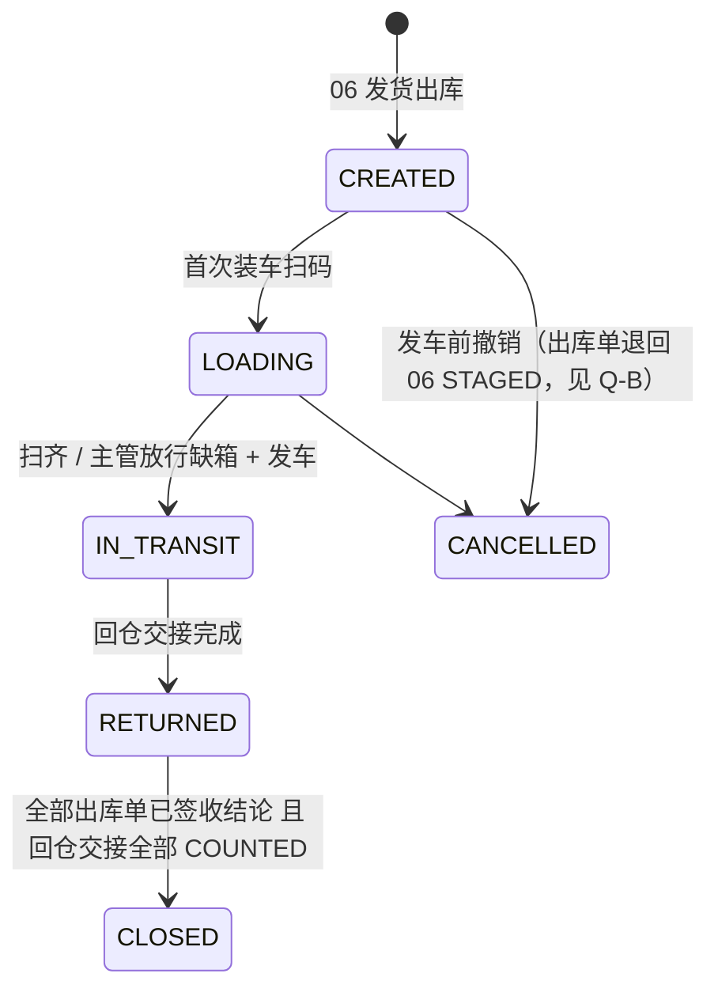
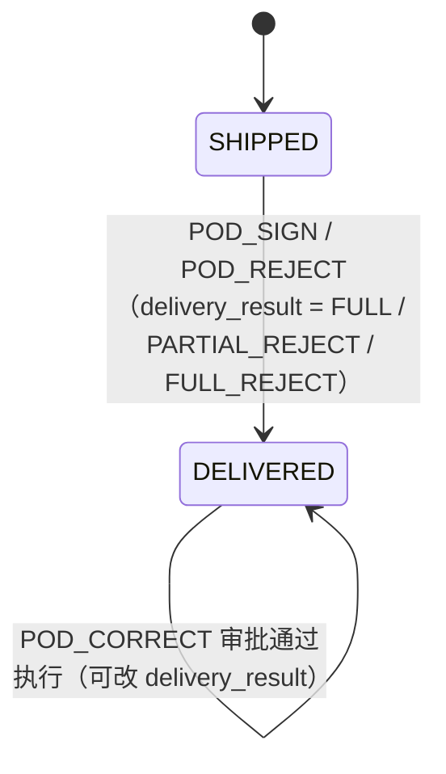
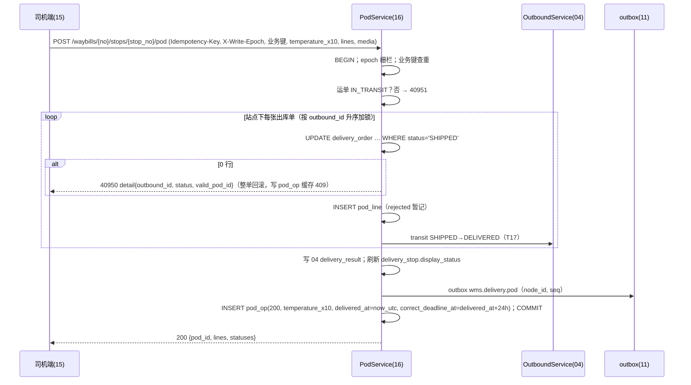
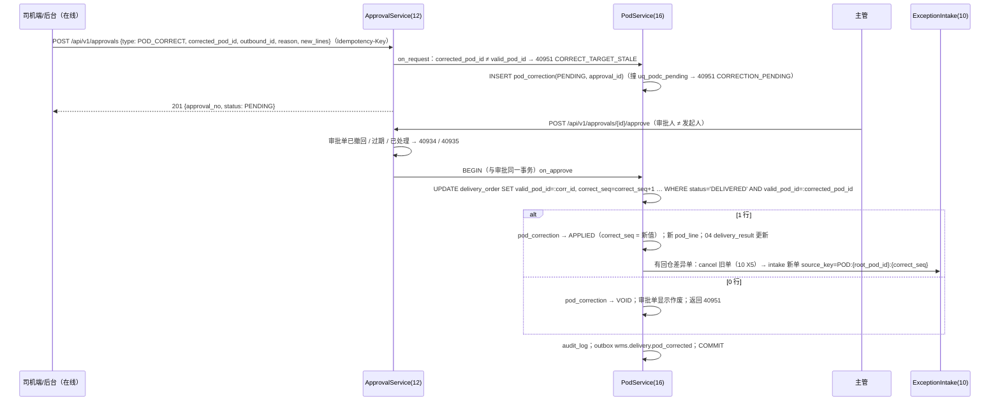
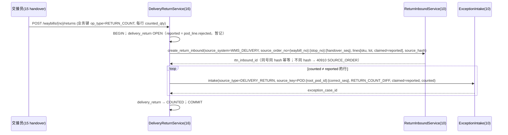

# 16 配送与签收（后端）详细设计

| 项 | 内容 |
|---|---|
| 模块编号 | 16 |
| 作者 | 小钱（后端） |
| 评审 | 小赵（测试，对抗评审 §13）、小吴（开发） |
| 基线 | `docs/first-design@b896a1d`；原说明书 §9.1、§9.3；00 §6.1–§6.6、§9.1；02；04 §5；06（只到发运）；10（#5）；15（小周，#3 `396717a`） |
| 依赖 | 00 全局约定（ID、单号、数量、时区、错误码、幂等、写节点）；04 出库单状态机（T17）；06 发运单 `shipment`；10 退货入库 RTN 与异常单 EXC；11 outbox；12 权限与审计；15 司机端前端 |
| 状态 | 草稿 |

> 本篇只写**服务端**：运单、站点、签收（POD）、签收更正、拒收回仓交接。前端行为（outbox、序号推导、图片两段式）以第 15 篇为准，本篇只给接口和服务端裁决规则。**全局约定不重复定义**：雪花 ID（00 §6.1）、单号格式（00 §6.2）、数量 `*_qty_milli` 与 3 位小数字符串（00 §6.3 / R2）、作业日按仓库时区（00 R3）、错误码规则（00 §6.4）、幂等三层（00 §6.5）、写节点与 epoch（00 §9.1）。

---

## 1. 职责与边界

### 1.1 本模块负责
1. **运单** `waybill`：由第 6 篇发运单（`shipment`）1:1 生成，装车、发车、在途、回仓、关闭；运单包下发（含 `waybill_version`、箱码白名单、行数量、批次、`warehouse.timezone`）。
2. **站点** `delivery_stop`：到达/离开打点；站点状态**只是展示汇总**（Q14）。
3. **出库单签收**：以**出库单**为粒度（Q14）。状态沿用第 4 篇 `SHIPPED → DELIVERED`（T17），签收结论写进第 4 篇 `outbound_order.delivery_result`（`FULL / PARTIAL_REJECT / FULL_REJECT`，只在 DELIVERED 时 NOT NULL；**列由第 4 篇加，本篇只引用**）；`delivery_order` 保存生效签收栅栏，驱动第 4 篇 T17。
4. **司机端作业幂等**：四字段业务键 `(waybill_no, stop_no, device_instance_id, op_seq)`（`pod_op`），回放缓存。
5. **签收更正** `POD_CORRECT`：**只能在线**提交第 12 篇审批 `POST /api/v1/approvals`（`type=POD_CORRECT`，带 `corrected_pod_id`），审批通过时同一事务执行更正，以 `valid_pod_id` 为栅栏；`correct_seq` 执行时由服务端分配；不经 `pod_op`、不离线排队。
6. **拒收回仓**：司机拒收数暂记，以仓库回仓实点为准（Q15）；生成第 10 篇 RTN，差异生成第 10 篇异常单。
7. **设备序号水位查询**（Q13）。
8. 第 4095x 码（40950–40959）的分配。

### 1.2 本模块不负责

| 事项 | 归属 |
|---|---|
| 复核、装箱、发货出库（扣库存 `post_event(SHIP)`） | 06 / 02 |
| 出库单状态机、`ck_obo_status`、`delivery_result` 列 | 04（本篇只触发 T17 并写 `delivery_result`） |
| 审批单 `approval_request`（POD_CORRECT 类型、撤回/过期、40934/40935） | 12 |
| RTN 收货、质检、上架/报损；异常单处置 | 10（#5） |
| 司机端 outbox、序号推导、图片上传前端逻辑 | 15（#3） |
| 文件服务预签名、对象存储保留期 | 12 / 15 Q3 |
| 路径规划、车辆调度 | TMS（系统外，00 §1） |
| 签收回传上游 | 11（本篇只写 outbox `wms.delivery.*`） |
| `write_epoch`、`warehouse_db_authority`、write-endpoint 实现 | 00 §9.1（本篇只规定司机端接口的遵守方式） |

### 1.3 与原文档的差异（评审重点）

| # | 原文档 | 本篇 | 理由 |
|---|---|---|---|
| Δ1 | 签收挂在发运单 `shipment.status=SIGNED` | 签收状态在**出库单**粒度（`delivery_order.status`），站点、运单只做汇总 | 一个站点多张出库单、部分拒收（Q14） |
| Δ2 | 拒收数即入账数 | 司机登记数**暂记**，回仓实点为准，差异进第 10 篇异常单 | Q15，防止司机端数字直接改库存 |
| Δ3 | 只有 `Idempotency-Key` | 加四字段业务键 + 只缓存 2xx/400xx/409xx（库层 CHECK 兜底） | 司机离线 >24h，Key 已过期（00 §6.5） |
| Δ4 | 签收可重复提交覆盖 | 普通签收只认 `SHIPPED`；改结论只能在线 `POD_CORRECT` 审批（第 12 篇） | 防两台设备互相覆盖 |
| Δ5 | 码值 `WMS-xxxxx` | 40950/40951，40952–40959 预留 | 00 §6.4 号段 |

## 2. 用例

| # | 用例 | 触发 | 权限点 | 写库存 | 离线可补传 |
|---|---|---|---|---|---|
| UC1 | 发运生成运单 | 06 发货出库（同事务） | — | 否 | — |
| UC2 | 下载运单包 | 司机端 | `delivery.waybill.view_own` | 否 | — |
| UC3 | 装车扫码 / 缺箱放行 | 司机 / 主管 | `delivery.load.scan` / `delivery.load.release_short` | 否 | 是 |
| UC4 | 到达 / 离开打点 | 司机 | `delivery.pod.submit` | 否 | 是 |
| UC5 | 签收 / 部分拒收 / 全拒收（POD_SIGN / POD_REJECT） | 司机（客户扫码或代签） | `delivery.pod.submit` | 否 | 是 |
| UC6 | 签收更正申请（`POST /approvals`，type=POD_CORRECT） | 司机 / 调度 | `delivery.pod.correct.request` | 否 | **否（只能在线）** |
| UC7 | 审批更正 | 主管（后台 13） | `delivery.pod.correct.approve` | 否 | — |
| UC8 | 回仓交接：拒收货逐行实点 → RTN + 差异异常单 | 交接员 | `delivery.container.handover` | 否（RTN 收货时由 10 入账） | 是 |
| UC9 | 查询设备序号水位（Q13） | 司机端 | `delivery.waybill.view_own` | 否 | — |
| UC10 | 查询某操作回执 | 司机端 | `delivery.waybill.view_own` | 否 | — |
| UC11 | 改派运单 | 调度 | `delivery.waybill.reassign` | 否 | — |
| UC12 | 主管接管司机 outbox | 主管 | `delivery.outbox.takeover` | 否 | — |

## 3. 领域模型

- `Waybill(code=waybill_no, shipment_id, driver_id, work_date, status, waybill_version)`；单号 `WB-{仓}-{节点}-{作业日}-{序号}`（00 §6.2）。
- `DeliveryStop(waybill_id, stop_no, customer_id, display_status)`：`display_status ∈ {PENDING 未到达, ARRIVED 已到达未签, DEPARTED_UNSIGNED 已离开未签, FULL, PARTIAL_REJECT, FULL_REJECT, MIXED 站点内结论不一}`（`ck_dstop_st`），由站点下出库单的 `outbound_order.delivery_result` 与打点推导，**业务判断一律读出库单**。
- `DeliveryOrder(outbound_id, status, valid_pod_id, root_pod_id, correct_seq)`：签收聚合根。
- `PodOp`：司机端一次写操作；签收类操作的 `id` 即 `pod_id`。
- `PodLine(pod_id, outbound_line_id, lot_id, shipped_qty, rejected_qty, reason)`：签收结论的行明细；数量用第 2 篇 `Quantity`。
- `PodCorrection(correct_op_id, corrected_pod_id, status, correct_seq)`。
- `DeliveryReturn(waybill_id, stop_no, handover_seq)` + `DeliveryReturnLine(reported_qty, counted_qty, exception_case_id)`。

**不变量**

| # | 不变量 | 落地 |
|---|---|---|
| D1 | 一张出库单同时只有一个生效签收 | `delivery_order.valid_pod_id` + 条件更新 `WHERE status='SHIPPED'` / `WHERE status='DELIVERED' AND valid_pod_id=:pod_id` |
| D2 | 未签收 ⇔ 无生效签收 ⇔ 无首签 | `ck_dord_pod` |
| D3 | `0 ≤ rejected ≤ shipped`，拒收必须有原因 | `ck_podl_qty`、`ck_podl_rsn` |
| D4 | 业务键唯一，缓存只存确定性结果 | `uq_pod_op_key`、`ck_pod_op_cache` |
| D5 | 一个生效签收最多一条待审批更正；每张出库单的更正序号唯一 | `uq_podc_pending`、`uq_podc_seq` |
| D6 | 更正审批人 ≠ 申请人 | `ck_podc_sod` |
| D7 | 实点 ≠ 登记数 ⇒ 必须挂异常单 | `ck_dretl_exc` |
| D8 | 回放缓存只追加 | `pod_op` 只授 `SELECT, INSERT`（PG） |

## 4. 涉及的表（字段、约束、索引）

DDL 见 `wms-design/sql/schema_postgres.sql`「配送与签收（docs/16）」一节，SQLite 由 `verify_sqlite.py` 机械生成。**新增 9 表 / 28 索引**（9 PK + 9 UNIQUE 约束 + 2 部分唯一 + 1 表达式唯一 + 6 普通/部分），总计 **52 表 / 146 索引 / 1 视图**（base 为 43 / 118）（PG 实测）。

### 4.1 `waybill`
`code` UK（= `waybill_no`），`shipment_id` UK（1:1 第 6 篇），`status ∈ {CREATED, LOADING, IN_TRANSIT, RETURNED, CLOSED, CANCELLED}`（`ck_wb_status`），`waybill_version` 改派/改站点 +1，`ix_wb_driver(driver_id, work_date, status)` 供"今日线路"。

### 4.2 `delivery_stop`
`uq_dstop(waybill_id, stop_no)`，`stop_no > 0`；`display_status` 仅展示（Q14）。

### 4.3 `delivery_order`
| 列 | 说明 |
|---|---|
| `outbound_id` | UK：一张出库单只挂一张有效运单；改派 = 更新 `waybill_id/stop_no`，不新建 |
| `status` | `SHIPPED / DELIVERED`（`ck_dord_status`），与 `outbound_order.status` 同事务同步；签收结论只在 04 `delivery_result` |
| `valid_pod_id` | 当前生效签收 id（首签 = `pod_op.id`，更正后 = `pod_correction.id`）；更正执行的栅栏 |
| `root_pod_id` | 首次签收 `pod_id`，更正后不变 |
| `correct_seq` | 首签 0，每次 APPLIED 更正 +1（`ck_dord_cseq`） |
| `version` | 每次条件更新 +1 |

### 4.4 `pod_op`（业务键 + 回放缓存）
| 列 | 说明 |
|---|---|
| `(waybill_no, stop_no, device_instance_id, op_seq)` | `uq_pod_op_key`；运单级操作（LOAD / CONTAINER / RETURN_COUNT）`stop_no=0` |
| `op_type` | `LOAD / ARRIVE / POD_SIGN / POD_REJECT / DEPART / CONTAINER / RETURN_COUNT`（现场操作，可离线；**不含 POD_CORRECT**，`ck_pod_op_type` 拦） |
| `req_hash` | 规范化请求体 SHA-256；**body 只含 `object_key + sha256`**，不含 Key、时间戳之外的易变字段（第 15 篇图片两段式） |
| `http_status / biz_code / response` | 首次结果；`ck_pod_op_cache`：只允许 2xx+`"0"`、400+`400xx`、409+`409xx` |
| `client_created_at` | 只展示 |
| `temperature_x10` | **签收温度**（GB/T 40956-2021 冷链交接要求），单位 0.1℃ 的整数（如 `40` = 4.0℃）。`ck_pod_op_temp`：`POD_SIGN / POD_REJECT` 必填、其他操作必须为空、范围 −40.0～60.0℃ |
| `delivered_at` | UTC，服务端受理成功签收的时间；2xx 签收必填，失败签收（409 缓存）为空（`ck_pod_op_cdl`） |
| `correct_deadline_at` | UTC，**= `delivered_at` + 24h**（Q-J 定案），服务端写入；`ck_pod_op_cdl24` 校验等式（PG `+ INTERVAL '24 hours'`，SQLite `datetime(…,'+24 hours')`） |

`pod_op` 整行只追加：`trg_pod_op_immutable`（两库）拦 UPDATE / DELETE，温度和截止时间写入后都不能改；PG 另有 `wms_app` 不授 UPDATE。

索引：`ix_pod_op_dev(device_instance_id, waybill_no, stop_no, op_seq)`（Q13），`ix_pod_op_stop(waybill_no, stop_no, created_at)`。

### 4.5 `pod_line`
`uq_podl(pod_id, outbound_line_id, lot_id)`；`ck_podl_int / ck_podl_qty / ck_podl_rsn`；**`receive_temp_c10 INTEGER NOT NULL`**（逐行到货温度，0.1℃，`ck_podl_temp` 整数且 -400～600；按 SKU 温区的业务校验见 §6.2 / 42216）；`ck_podl_rsn_v` 拒收原因枚举 `DAMAGED / QUALITY / EXPIRED / SHORT / WRONG_ITEM / TEMP_ABNORMAL / CUSTOMER_REFUSED / OTHER`。**`TEMP_ABNORMAL`** 是温度异常拒收专用原因：签收温度超出该 SKU 温区要求（第 1 篇 `temperature_required` 对应的温区上下限）时允许整单或部分拒收，服务层校验所在签收 `temperature_x10` 确实越界，否则 40001。`lot_id` 来自装车明细（第 10 篇要求拒收 RTN 必带批次）。

### 4.6 `pod_correction`

**更正去重键（大肥鱼定案）**：`driver_id`、`correction_client_id`（客户端 UUID，36 位，`ck_podc_client`）、`request_hash`（规范化请求体 SHA-256）、`response_http`（首次返回码 200 / 202，`ck_podc_http`：200 ⇔ 容差内自动更正）。**`uq_podc_client UNIQUE (driver_id, correction_client_id)`**，长期保留、不随 Idempotency-Key 过期、撤回 / 驳回后也不释放；触发器 `podc_replay_immutable`（两库）保证这四列及 `approval_id / auto_tolerance` 建单后只读，重放结果因此恒定。
按**审批单号**关联：`approval_id`（第 12 篇 `approval_request.id`）`uq_podc_approval`；**容差内自动更正**（`auto_tolerance=1`）不走审批，`approval_id` 为空、记 `tolerance_version`（命中的 `pod_tolerance_config.version`），只能直接 `APPLIED / VOID` 且无审批人（`ck_podc_auto`）；`id` 同时是更正后的签收 id；`status ∈ {PENDING, APPLIED, REJECTED, WITHDRAWN, EXPIRED, VOID}`（镜像审批单；VOID = 执行时原签收已变）；`ck_podc_sod`、`ck_podc_decide`、`ck_podc_seq`（APPLIED ⇔ `correct_seq ≥ 1`）；部分唯一 `uq_podc_pending(corrected_pod_id, outbound_id) WHERE status='PENDING'`、`uq_podc_seq(outbound_id, correct_seq) WHERE status='APPLIED'`。

### 4.6a `pod_tolerance_config`（更正容差，Q-J）
| 列 | 说明 |
|---|---|
| `warehouse_id` | 仓 |
| `sku_category` | 品类，可空；**NULL = 全品类兜底**；空串被 `ck_podt_cat` 拦 |
| `max_abs_qty` | 允许的绝对差异，按 SKU 最小单位计的整数（如 KG 类按克 → milli） |
| `max_pct_bp` | 允许的相对差异，万分比整数（`100` = 1%），0–10000 |
| `version` | 乐观锁；PUT 必须带，`WHERE version=:v` 0 行 → 40930 |

`uq_podt_scope`：`UNIQUE (warehouse_id, COALESCE(sku_category, ''))`（表达式唯一索引，两库都支持），保证同仓的全品类（NULL）也只能有一条。判定：先找 SKU 品类的配置，没有再用全品类；**`|Δ| ≤ max_abs_qty` 且 `|Δ| / shipped ≤ max_pct_bp / 10000` 两项都满足**才算容差内；没有任何配置 = 一律走审批。

### 4.7 `delivery_return` / `delivery_return_line`
`uq_dret(waybill_id, stop_no, handover_seq)`；RTN 来源单号 = `{waybill_no}:{stop_no}:{handover_seq}`（第 10 篇 §1）。`ck_dret_cnt`：COUNTED 必须已生成 RTN；`ck_dretl_exc`：实点 ≠ 登记数必须挂 `exception_case_id`。

### 4.8 同步改动的非本模块表
`outbound_order.delivery_result`（`FULL / PARTIAL_REJECT / FULL_REJECT`，DELIVERED 时 NOT NULL）由第 4 篇（大肥鱼）加，本篇不改 04 的表。

### 4.9 授权（PG，`-- @pg-only`）
`pod_op`：`SELECT, INSERT`（只追加，`verify.sh` 断言 `wms_app` UPDATE → permission denied）；其余 8 表（含 `pod_tolerance_config`）`SELECT, INSERT, UPDATE`。

## 5. 状态机

### 5.1 运单 `waybill`



| # | from → to | 触发 | 守卫 | 副作用 |
|---|---|---|---|---|
| W1 | CREATED → LOADING | LOAD | 司机 = `driver_id` | — |
| W2 | LOADING → IN_TRANSIT | DEPART（stop_no=0） | 箱码扫齐或已放行 | `departed_at` |
| W3 | IN_TRANSIT → RETURNED | 回仓交接提交 | — | `returned_at` |
| W4 | RETURNED → CLOSED | 定时 / 主管 | 无 `SHIPPED` 的 `delivery_order`，无 OPEN `delivery_return` | outbox `wms.delivery.closed` |
| W5 | {CREATED, LOADING} → CANCELLED | 调度 | 未发车 | 见 Q-B |

迁移一律条件更新 `WHERE status=:from`，0 行返回 **40951**（运单状态不允许），不用 40930。

### 5.2 出库单签收（Q14）



| # | from → to | 条件更新（同事务） | 0 行 |
|---|---|---|---|
| P1 | SHIPPED → DELIVERED | `delivery_order SET status='DELIVERED', valid_pod_id=:pod, root_pod_id=:pod, version=version+1 WHERE id=:id AND status='SHIPPED'`；04 T17 `outbound_order SET status='DELIVERED', delivery_result=:r WHERE id=:ob AND status='SHIPPED'` | 已有生效签收 → **40950**（`detail` 带生效结论）；运单状态不允许 → **40951**（带 `reason`） |
| P2 | DELIVERED → DELIVERED（更正执行） | `delivery_order SET valid_pod_id=:corr_id, correct_seq=correct_seq+1, version=version+1 WHERE id=:id AND status='DELIVERED' AND valid_pod_id=:corrected_pod_id`；`outbound_order SET delivery_result=:r_new` | **40951** `reason=CORRECT_TARGET_STALE`，审批单显示**作废**（`pod_correction.status=VOID`） |

- `delivery_result` 判定：全部行 `rejected = 0` → `FULL`；全部行 `rejected = shipped` → `FULL_REJECT`；其余 `PARTIAL_REJECT`。
- 三种结论都可以更正（栅栏只看 `status='DELIVERED' AND valid_pod_id`）。

### 5.3 签收更正 `pod_correction`（镜像第 12 篇审批单）

| # | from → to | 触发 | 守卫 / 副作用 |
|---|---|---|---|
| C1 | — → PENDING | `POST /api/v1/approvals`（type=POD_CORRECT，在线） | 读校验 `corrected_pod_id = valid_pod_id`，否则 40951 `CORRECT_TARGET_STALE`；`uq_podc_pending`（已有待审批 → 40951 `CORRECTION_PENDING`） |
| C2 | PENDING → APPLIED | 审批通过（`delivery.pod.correct.approve`，审批人 ≠ 发起人） | 同事务 P2 命中 1 行；服务端分配 `correct_seq = delivery_order.correct_seq + 1`；写新 `pod_line`；更新 04 `delivery_result` |
| C3 | PENDING → VOID | 审批通过但 P2 0 行 | 返回 **40951**，审批单显示作废 |
| C4 | PENDING → REJECTED | 审批驳回 | 必填原因 |
| C5 | PENDING → WITHDRAWN / EXPIRED | 第 12 篇撤回 / 过期 | 之后再审批返回 **40934 / 40935**（第 12 篇码，审批被撤回、过期或已处理） |

### 5.4 回仓交接 `delivery_return`：`OPEN → COUNTED`（RTN 已建）/ `OPEN → CANCELLED`（误建，主管）。

## 6. 核心流程

### 6.1 司机端写请求的统一模板

所有司机端 POST 在**同一事务**内：

1. 校验 `X-Write-Epoch`（§8.5），过期 → 50303，**不写任何行**。
2. 权限与数据权限（§10）；失败 401/403 不缓存。
3. 业务键查重：`SELECT … FROM pod_op WHERE (waybill_no, stop_no, device_instance_id, op_seq)=…`
   - 命中且 `req_hash` 相同 → 原样返回 `http_status / response`（重放）。
   - 命中且 `req_hash` 不同 → **40910**，`detail.key_type = POD_OP`，`detail` 带首次 `op_type`。
4. 执行业务（条件更新）。
5. 结果分类：2xx / 400xx / 409xx → `INSERT pod_op`（并发插入撞 `uq_pod_op_key` → 回滚后按第 3 步重读）；422xx / 5xx / 429 → **整个事务回滚，不写 `pod_op`、不写 `idempotency_record`**，客户端同 Key 重提会重新执行（00 §6.5）。
6. `Idempotency-Key` 记录与 `pod_op` 同库同事务。

### 6.2 签收 / 拒收（UC5）



- 一次请求覆盖站点下全部出库单，**全有或全无**；任一张 0 行即整单 40950，避免一半生效。
- 409 结果也写 `pod_op`（409xx 可缓存），所以 40950 写缓存时**只写 `pod_op` 一行**，业务行全部回滚（实现：业务写在 SAVEPOINT 内，失败回滚到 SAVEPOINT 后插 `pod_op`）。
- 拒收数不动库存（货还在车上）；入账发生在第 10 篇 RTN 收货。
- **温度必录（逐行）**：每个签收行必带 `receive_temp_c10`（单位 0.1℃ 整数，`pod_line` NOT NULL，`ck_podl_temp` 兜底 -40.0～60.0℃），整单另带车厢温度 `temperature_x10`。缺温度 → 40001。服务端按 SKU 温区校验，温度上下限取第 1 篇（#8 `5d8c877`）库区上的 **`zone.temp_min_c10 / zone.temp_max_c10`**（INT，0.1℃，替换原 `temp_min/temp_max NUMERIC`）：按 `sku.temperature_required` 取本仓 `zone.temp_zone` 相同的库区上下限，与 `receive_temp_c10` 直接做整数比较（`receive_temp_c10 < temp_min_c10 OR receive_temp_c10 > temp_max_c10` 即超温区；某一侧为 NULL 表示该侧不限，两侧都为 NULL 不校验）。超出范围的行必须整行以 `reject_reason=TEMP_ABNORMAL` 拒收（`rejected = shipped`），否则返回 **42216 `POD_TEMP_OUT_OF_RANGE`（422，不缓存）**，`detail` 带 `{line_no, sku_id, receive_temp_c10, temp_min_c10, temp_max_c10}`；温度在界内却用 `TEMP_ABNORMAL` → 40001。依据 GB/T 40956-2021。

### 6.3 签收更正（UC6、UC7，在线审批，第 12 篇）



- 更正不进 `pod_op`、不进司机端 outbox，断网时按钮置灰（第 15 篇对齐）。40910 不再有 `key_type=POD_CORRECT`：重复提交由 `Idempotency-Key` 与 `uq_podc_pending` 兜住。

### 6.3a 更正时间窗与容差（Q-J 定案，大肥鱼）

1. **时间窗**：申请更正时服务端取被更正签收的 `correct_deadline_at`（首签 `pod_op` 上的值，更正后的签收沿用首签的截止时间，不顺延）。`now_utc > correct_deadline_at` → **40951 `reason=POD_CORRECT_WINDOW_EXPIRED`**（00 §6.4 已登记），同时向第 10 篇推一张异常单（`source_type=DELIVERY_RETURN`，`source_key=POD:{root_pod_id}:{correct_seq}:LATE`，责任方 UNKNOWN），由主管线下处理。错误 `detail` 带 **`exception_no`**（这张异常单的单号），重复请求按 `uq_exc_src` 返回同一单号。
2. **容差**：在窗口内，逐行算 `Δ = 新 rejected − 原 rejected`；按 SKU 品类取 `pod_tolerance_config`（无品类配置用全品类），**所有行**都满足 `|Δ| ≤ max_abs_qty` 且 `|Δ|·10000 ≤ max_pct_bp·shipped` 才算容差内。
3. 容差内：不建审批单，同一事务直接执行（条件更新同 §5.2 P2），写 `pod_correction(auto_tolerance=1, approval_id=NULL, tolerance_version, status=APPLIED)`；0 行写 `VOID` 并返回 40951 `CORRECT_TARGET_STALE`。超容差：照 §6.3 走 `POD_CORRECT` 审批。
4. 容差配置变更不影响已建的审批单；自动更正记下当时的 `tolerance_version` 便于审计。

### 6.4 回仓交接（UC8，Q15）



- **仓库实点为准**：RTN 行 `claimed = reported`，第 10 篇收货以仓管 `received_qty` 入账；本篇的 `counted_qty` 只用于判断差异和责任（CARRIER）。
- 异常单 `source_key = POD:{pod_id}:{correct_seq}`（`pod_id` 取 `root_pod_id`，首签 `correct_seq=0`；更正后用新 `correct_seq`，旧单先取消）。一个签收多行差异共用一个键，行明细放 `payload`（见 Q-D）。
- 接口对齐 #5：`ReturnInboundService.create_return_inbound(...)` 与 `ExceptionIntake.intake(...)` 均为同库同事务服务调用（10 §7.1、§7.2）。

### 6.5 设备序号水位（UC9，Q13）

```sql
SELECT waybill_no, stop_no, max(op_seq) AS op_seq_max
  FROM pod_op WHERE device_instance_id = :dev AND user_id = :me
 GROUP BY waybill_no, stop_no;           -- ix_pod_op_dev
```
只统计**已缓存**的操作（2xx/400xx/409xx）；被 422/5xx 回滚的 op_seq 不占位，客户端推导 `max+1` 时会复用——这与第 15 篇"写失败序号未占用"一致。

## 7. 接口清单与契约

### 7.1 服务内（Python，同库同事务）

| 函数 | 调用方 | 说明 |
|---|---|---|
| `WaybillService.create_from_shipment(shipment_id)` | 06 发货出库 | 生成运单、站点、`delivery_order(SHIPPED)` |
| `PodService.outbound_status(outbound_id)` | 04 / 11 / 15 商城 | 返回 `delivery_order.status` |

### 7.2 HTTP（`/api/v1`）

| 方法 | 路径 | 说明 | 权限点 | 业务键 op_type |
|---|---|---|---|---|
| GET | `/warehouses/{warehouse_code}/write-endpoint` | 00 §9.1，中心和边缘都提供 | 登录 | — |
| GET | `/waybills?mine=1&work_date=` | 今日线路 | `delivery.waybill.view_own` | — |
| GET | `/waybills/{waybill_no}/package` | 运单包（含 `waybill_version`、`timezone`） | `delivery.waybill.view_own` | — |
| POST | `/waybills/{waybill_no}/load` | 装车扫码结果 | `delivery.load.scan` | LOAD |
| POST | `/waybills/{waybill_no}/load/release-short` | 缺箱放行 | `delivery.load.release_short` | — |
| POST | `/waybills/{waybill_no}/depart` | 发车（stop_no=0） | `delivery.load.scan` | DEPART |
| POST | `/waybills/{waybill_no}/stops/{stop_no}/arrive` / `/depart` | 打点 | `delivery.pod.submit` | ARRIVE / DEPART |
| POST | `/waybills/{waybill_no}/stops/{stop_no}/pod` | 签收 / 部分拒收 / 拒收 | `delivery.pod.submit` | POD_SIGN / POD_REJECT |
| POST | `/approvals`（第 12 篇，type=POD_CORRECT） | 签收更正申请（在线） | `delivery.pod.correct.request` | —（不走 pod_op） |
| POST | `/approvals/{id}/approve` / `/reject`（第 12 篇） | 审批，通过时同事务执行更正 | `delivery.pod.correct.approve` | — |
| GET | `/warehouses/{code}/pod-tolerance` | 查本仓容差配置（全品类 + 各品类，带 `version`） | `pod.tolerance.manage` | — |
| PUT | `/warehouses/{code}/pod-tolerance` | 改容差：`{items:[{sku_category?, max_abs_qty, max_pct_bp, version}]}`，逐条 `WHERE version=:v`，任一 0 行整单回滚 **40930** | `pod.tolerance.manage` | Idempotency-Key |
| POST | `/files/presign`（第 12 篇文件服务，15 Q3） | 签收图片预签名上传，`object_key=pod/{warehouse_id}/{sha256}.{ext}` | `delivery.pod.submit` | — |
| POST | `/waybills/{waybill_no}/containers` | 筐箱交接 | `delivery.container.handover` | CONTAINER |
| POST | `/waybills/{waybill_no}/returns` | 拒收货回仓实点 | `delivery.container.handover` | RETURN_COUNT |
| GET | `/devices/{device_instance_id}/op-seq-hwm` | 设备序号水位（Q13） | `delivery.waybill.view_own` | — |
| GET | `/pod-ops/receipt?waybill_no=&stop_no=&device_instance_id=&op_seq=` | 操作回执（重放 `response`） | `delivery.waybill.view_own` | — |
| PUT | `/waybills/{waybill_no}/driver` | 改派 | `delivery.waybill.reassign` | — |

**通用请求头**：`Idempotency-Key`、`X-Warehouse-Id`、`X-Write-Epoch`。**业务键字段在 body**：`waybill_no`（路径）、`stop_no`（路径；运单级 = 0）、`device_instance_id`、`op_seq`。

**契约 `POST /waybills/{no}/stops/{stop_no}/pod`**

```json
{ "device_instance_id": "6f1c…", "op_seq": "12", "op_type": "POD_REJECT",
  "waybill_version": 3, "signer_type": "DRIVER_PROXY",
  "media": [ { "object_key": "pod/1/9a3f…e1.jpg", "sha256": "9a3f…e1" } ],
  "orders": [ { "outbound_id": "184467440737095516",
                "lines": [ { "outbound_line_id": "…", "lot_id": "…", "shipped_qty": "5.000",
                             "rejected_qty": "1.000", "reject_reason": "DAMAGED", "uom": "KG" } ] } ],
  "client_created_at": "2026-10-15T02:31:00Z" }
```
200：
```json
{ "code": "0", "data": { "pod_id": "…", "stop_display_status": "PARTIAL_REJECT",
  "orders": [ { "outbound_id": "…", "status": "DELIVERED", "delivery_result": "PARTIAL_REJECT", "valid_pod_id": "…", "correct_seq": 0 } ] } }
```
- `stop_display_status` 取值（`ck_dstop_st`）：`PENDING`（未到达）、`ARRIVED`（已到达未签）、`DEPARTED_UNSIGNED`（已离开未签）、`FULL`、`PARTIAL_REJECT`、`FULL_REJECT`、`MIXED`（站点内多张出库单结论不同）。只用于展示。
- ID 与 `op_seq` 一律字符串（第 15 篇 §6 雪花 > 2^53）；数量 3 位小数字符串（40010）。
- `POD_SIGN` 时 `rejected_qty` 全 0；`POD_REJECT` 至少一行 > 0。全拒 = 全部行 `rejected = shipped`。

**签收更正**：只走第 12 篇 `POST /api/v1/approvals`，`payload = {corrected_pod_id, outbound_id, reason, orders[同上]}`，契约以第 12 篇为准。

**更正提交的返回（大肥鱼定案）**：服务端先判时间窗（§6.3a，过期 40951），再判容差：

| 情况 | HTTP | 响应体 |
|---|---|---|
| 容差内（不走审批，同事务执行） | **200** | `{"correction_id": "…", "status": "APPLIED", "within_tolerance": true, "approval_id": null}` |
| 超出容差（建审批单） | **202** | `{"correction_id": "…", "status": "PENDING_APPROVAL", "within_tolerance": false, "approval_id": "APR-WHSH01-20261015-000001"}` |

请求体**必填 `correction_client_id`**（客户端 UUID，缺失 → 40001）。判定顺序：

1. 按 `(driver_id, correction_client_id)` 查已有更正：**同键同 `request_hash` → 重放**，原样返回首次结果：原 `correction_id`、原状态码（`response_http`，200 或 202）、原响应体（由只读列重建：200 → `APPLIED / true / null`；202 → `PENDING_APPROVAL / false / 原 approval_id`，**不随更正后来的状态变化**），不再判时间窗、目标、容差；
2. **同键不同 `request_hash` → 40910 `IDEMPOTENCY_CONFLICT`，`detail.key_type=POD_CORRECT`**（沿用 00 §6.4 现有码值）；
3. **只有新键**才继续判时间窗（40951 `POD_CORRECT_WINDOW_EXPIRED`）、目标（40951 `CORRECT_TARGET_STALE` / `CORRECTION_PENDING`）和容差。并发同键插入撞 `uq_podc_client` 时回读按 1 / 2 返回。

`status=PENDING_APPROVAL` 是接口展示值，对应 `pod_correction.status='PENDING'`；审批结果按第 12 篇回调 / 轮询。

**契约 `GET /devices/{id}/op-seq-hwm`**：
```json
{ "code": "0", "data": { "device_instance_id": "6f1c…", "as_of": "2026-10-15T03:20:00Z",
  "items": [ { "waybill_no": "WB-WHSH01-0003-20261015-000012", "stop_no": 3, "op_seq_max": "12" } ] } }
```

### 7.3 错误码（码表以 00 §6.4 为准，本篇在 4095x 段内分配，规则同 00 §6.4：5 位数字、前 3 位 = HTTP 状态、只能在本段取码、废弃码不复用）

| 码 | HTTP | 名称 | 场景 | 可缓存 |
|---|---|---|---|---|
| **40950** | 409 | POD_ALREADY_SIGNED | 站点下任一出库单已有有效签收（`delivery_order.status ≠ 'SHIPPED'`）；`detail{outbound_id, status, valid_pod_id, signed_at}` | 是 |
| **40951** | 409 | WAYBILL_STATE_INVALID | 运单或签收状态不允许。`detail.reason` **必带**，枚举：`REASSIGNED`（已改派）、`WAYBILL_CANCELLED`、`WAYBILL_CLOSED`、`WAYBILL_RETURNED`（回仓后迟到补传）、`NOT_DEPARTED`（未发车就签收）、`WAYBILL_VERSION_STALE`（运单包 `waybill_version` 落后，`detail` 另带 `current_version`，客户端重新下载运单包后用**新 op_seq** 提交）、`CORRECT_TARGET_STALE`（更正目标已不是生效签收；审批执行时出现则审批显示作废）、`CORRECTION_PENDING`（已有待审批更正）、**`POD_CORRECT_WINDOW_EXPIRED`**（超过 `correct_deadline_at` = 签收 + 24h，同时转第 10 篇异常单）。未知 reason 前端按红条处理 | 是 |
| 40934 / 40935 | 409 | （第 12 篇） | 审批单已撤回 / 过期 / 已处理，码义以第 12 篇为准 | 是 |
| 40952–40959 | 409 | — | 预留给第 16 篇，本稿不分配 | — |
| 40910 | 409 | IDEMPOTENCY_CONFLICT | `key_type=POD_OP`（四字段业务键同键不同内容）/ **`POD_CORRECT`**（同一司机同一 `correction_client_id`、请求体不同，§7.2）/ `IDEMPOTENCY_KEY` | 是 |
| 40001 / 40010 | 400 | 参数 / 数量格式 | `rejected > shipped`、缺 `reject_reason`、缺 `corrected_pod_id` | 是 |
| 40310 / 40311 | 403 | 权限 / 数据权限 | 非本人运单；仓不一致 | 否 |
| **42216** | 422 | POD_TEMP_OUT_OF_RANGE | 签收行温度超出 SKU 温区 `temp_min_c10`/`temp_max_c10`（第 1 篇 `zone`） 且未以 `TEMP_ABNORMAL` 拒收（§6.2）。00 §6.4 已登记（16e640c） | 否 |
| 42215 | — | — | **不新增**：箱码不属于本运单用 42210 BARCODE_MISMATCH（第 15 篇 §8.4 待对齐项） | 否 |
| 50301 / 50303 | 503 | 依赖不可用 / 写节点过期 | 重新取 write-endpoint，原键重提 | 否 |

- 司机端配送场景不返回 40930（第 15 篇 §8.4 约定收到 40930 按 40951 处理并上报）。唯一例外是后台容差配置 `PUT /warehouses/{code}/pod-tolerance` 版本不一致返回 40930（不在司机端）。

## 8. 并发与幂等

### 8.1 业务键与回放（00 §6.5）
- 业务键 `(waybill_no, stop_no, device_instance_id, op_seq)`，`op_seq` 由客户端按 `(waybill_no, stop_no)` 单调递增（第 15 篇 §9.3）。
- 同键同 `req_hash` → 重放首次 `http_status + response`（含首次的 409）；同键不同 → 40910 + `key_type=POD_OP`，`detail.key_type` 总是存在。
- **缓存范围**：`pod_op` 与 `idempotency_record` 只存 2xx、400xx、409xx；库层 `ck_pod_op_cache` 拒绝其他组合（verify 断言 422、503、409+42214 被拦）。
- Key 过期（>24h）后靠业务键兜底；换机 `device_instance_id` 变化后靠 D1 条件更新兜底（第二条生效结论 40950）。

### 8.2 条件更新（不读后写）
签收 P1 `WHERE status='SHIPPED'`；更正 P2 `WHERE status='DELIVERED' AND valid_pod_id=:pod_id`；运单迁移 `WHERE status=:from`。两台设备并发签收/更正同一出库单，只有一条命中（verify：rowcount `1,0,1,0`）。

### 8.3 加锁顺序
同一请求多张出库单按 `outbound_id` 升序更新；事务内顺序固定：`delivery_order` → `pod_line` → `outbound_order` → `delivery_stop` → `outbox_event` → `pod_op`。SQLite 下 `BEGIN IMMEDIATE`。

### 8.4 编号与 ID
运单号、`pod_id`、更正 id 一律走 00 §6.1/§6.2（本地节点号发号，边缘离线可发）。`work_date` 按仓库时区。

### 8.5 写节点（00 §9.1）
- `GET /warehouses/{code}/write-endpoint` 返回 `{endpoint, epoch}`，**中心和边缘节点都提供**；司机端缓存地址和 epoch，取不到时用缓存继续作业。
- 每个写请求带 `X-Write-Epoch`；请求 epoch < 本库 epoch 或本节点已被取代 → **50303 STALE_WRITE_NODE**，不写任何行、不缓存。
- 客户端收到 50303（或 50301、或 epoch 变化）：**重新取 write-endpoint，用原 `Idempotency-Key` 和原业务键重提**，不生成新 `op_seq`，不标红（第 15 篇 §9.5）。
- `pod_op`、`idempotency_record` 都在权威库，随故障切换迁移（00 §9.1"写节点切换"）；RPO 窗口内丢失的签收由司机端 outbox 原键重提补回。

### 8.6 改派
`PUT /waybills/{no}/driver` 只改 `driver_id`、`waybill_version+1`；旧司机补传时按 token 判定不是本人 → 40951（`reason=REASSIGNED`），**不缓存为对方的结果之外的东西**：结果按业务键写 `pod_op`（409xx），旧司机重试拿到同一 40951。

## 9. 异常与补偿

| 场景 | 处理 |
|---|---|
| 签收提交后响应丢失 | 原键重提 → 重放 |
| 图片重传后再提交 | `object_key` 由 sha256 派生，`req_hash` 不变 → 重放（第 15 篇 D-A8） |
| 写节点切换中 | 50303 → 重取地址原键重提 |
| RTN 建单 40910 SOURCE_ORDER | 回仓交接整单回滚，司机端红条交调度（第 10 篇 §6.1） |
| 更正后回仓差异需要重推 | 先取消旧异常单（10 X5）再 `intake` 新 `source_key`（`correct_seq` 已 +1，键不同，不撞 40910） |
| 回仓交接后到 RTN 收货之间丢货 | 第 10 篇 R2 另开 `RETURN_INBOUND` 来源异常单（10 §6.2），与本篇单互不覆盖 |
| 运单包 `waybill_version` 落后（改派 / 改站点后旧包提交） | 40951 `reason=WAYBILL_VERSION_STALE` + `current_version`，结果写 `pod_op`（409xx 可缓存）；客户端重新下载运单包，用**新 op_seq** 重新提交，旧条目转 superseded |
| 运单 RETURNED 后迟到的签收补传 | 运单不在 IN_TRANSIT → 40951；主管核实后在线发起 `POD_CORRECT` 审批或后台补录（Q-F） |
| outbound_order T17 失败（出库单已非 SHIPPED） | 整单回滚，50010 告警（理论不应出现，04 SHIPPED 后不可取消） |

## 10. 权限

| 权限点 | 角色 | 数据范围 |
|---|---|---|
| `delivery.waybill.view_own` | 司机 | `waybill.driver_id = 当前用户`；他人运单 404（第 15 篇 Q9 建议） |
| `delivery.load.scan` / `delivery.pod.submit` / `delivery.pod.correct.request` / `delivery.container.handover` | 司机 / 交接员 | 同上 + `X-Warehouse-Id` 与运单仓一致（40311） |
| `delivery.load.release_short` / `delivery.pod.correct.approve` / `delivery.waybill.reassign` / `delivery.outbox.takeover` | 主管 / 调度 | 仓数据权限；全部写 `audit_log` |
| `pod.tolerance.manage` | 仓库主管、`CENTER_OPS` | 仓库主管限本仓，`CENTER_OPS` 全仓；变更写 `audit_log`（前后值 + version） |

SoD：更正审批人 ≠ 申请人（`ck_podc_sod`）。系统管理员不能做业务操作（00 §6.6）。

## 11. 测试要点

### 11.1 自动化测试
1. 业务键：同键同内容重放（含首次 409）；同键不同内容 40910 + `key_type=POD_OP`；`key_type` 永远存在。
2. 缓存范围：422、5xx、429、401、403 不写 `pod_op` / `idempotency_record`，同 Key 重提重新执行。
3. 并发：两台设备同站点签收 → 一条 200、一条 40950；两台并发更正 → 一条 APPLIED、一条 40951。
4. 一个站点多张出库单，其中一张已签 → 整单 40950，其余不生效。
5. 更正栅栏：更正已失效签收 → 40951 `CORRECT_TARGET_STALE`；审批时被别人先更正 → 40951、`pod_correction.status=VOID`（审批显示作废）；审批单撤回 / 过期 / 已处理 → 40934 / 40935（第 12 篇）。
6. 回仓：实点 ≠ 登记 → 异常单 `POD:{root_pod_id}:{correct_seq}`；更正后重推新键、旧单取消；RTN 同号同 hash 幂等。
7. 写节点：旧 epoch → 50303 且无行写入；重取后原键重提成功，`op_seq` 不变。
8. Q13 水位：被 422 回滚的 op_seq 不计入。
9. 时区：仓库 Asia/Shanghai，23:30–00:30 的 `work_date` 与"今日线路"。
10. 温度 42216：冷藏 SKU、`zone(CHILLED).temp_min_c10=0 / temp_max_c10=40`；行温 41 未拒收 → 42216 且 `detail.temp_min_c10/temp_max_c10` 回显；同温以 `TEMP_ABNORMAL` 整行拒收 → 200；行温 40（边界）→ 通过；行温 30 却用 `TEMP_ABNORMAL` → 40001；库区上下限均为 NULL → 不校验。
11. 双库矩阵（SQLite / PG）。

### 11.2 本 PR 的验证脚本结果

| 脚本 | 环境 | 结果 |
|---|---|---|
| `verify_sqlite.py` | 本机 Python 3 + SQLite 3.46 | **262 / 262 通过**（base 16e640c），52 表 / 1 视图 |
| `verify.sh` | 本机 PG 16（/home/box/tools/pg16，临时实例 `/tmp/qian-pg16` 端口 5446，新建空库） | **260 / 260 通过**（base 16e640c），实测 **52 表 / 146 索引 / 1 视图**，与手算一致；S4 权限矩阵含本篇 8 表 |

本篇断言（两库同一张用例表）：运单状态、`ck_dord_pod`、`ck_dord_status`（只 SHIPPED/DELIVERED）、`ck_dord_cseq`、站点展示值 `ck_dstop_st`、业务键重复、缓存范围（409 允许，422 / 503 / 409+42214 拦截）、`POD_CORRECT` 不能进 `pod_op`（`ck_pod_op_type`）、拒收量上限与原因、`uq_podc_approval`（一张审批单一条更正）、待审批更正唯一、更正 SoD、APPLIED 缺审批人 / 缺服务端 `correct_seq`、WITHDRAWN 缺 `decided_at`、旧 `FAILED` 取值被拦、首签 rowcount 1/0、更正执行命中 1、原签收已变 0（→ VOID）、更正序号唯一、op-seq-hwm、COUNTED 缺 RTN、差异缺异常单、非整数 milli（SQLite）、`wms_app` 不能 UPDATE `pod_op`（PG）、S4 权限矩阵。 本轮新增：同司机同 `correction_client_id` 再建 / 撤回后再建（`uq_podc_client`）、不同司机同键放行、非 UUID（`ck_podc_client`）、超容差记 200（`ck_podc_http`）、改返回码 / 改 client_id / 改 hash（`podc_replay_immutable`）、状态仍可推进；签收行缺温度 / 越界 / 非整数（`ck_podl_temp`）、冷冻 -18.0℃ 放行、旧原因码 TEMPERATURE_ABNORMAL 拒绝；签收缺温度 / 非签收带温度 / 温度越界（`ck_pod_op_temp`）、成功签收缺截止时间 / 失败签收带截止时间（`ck_pod_op_cdl`）、截止 ≠ +24h（`ck_pod_op_cdl24`）、温度异常拒收放行、改截止时间 / 改温度 / 删签收（`pod_op_immutable`）、`TEMP_ABNORMAL` 放行与非法原因（`ck_podl_rsn_v`）、容差内自动更正放行与五条反例（`ck_podc_auto`）、容差配置全品类 NULL 唯一 / 同品类唯一 / 跨仓放行 / 空串 / 越界（`uq_podt_scope`、`ck_podt_cat`、`ck_podt_val`）、PUT version 命中 1 行、旧 version 0 行（→ 40930）。

## 12. 待定问题

| # | 问题 | 建议 | 裁决 |
|---|---|---|---|
| ~~Q13~~ | 设备序号水位接口 | **已定**：`GET /api/v1/devices/{device_instance_id}/op-seq-hwm`（§7.2） | — |
| ~~Q14~~ | 一站多单、部分拒收的状态 | **已定（大肥鱼）**：出库单状态沿用 `SHIPPED → DELIVERED`，结论写 04 `outbound_order.delivery_result`（`FULL / PARTIAL_REJECT / FULL_REJECT`，DELIVERED 时 NOT NULL，列由 04 加）；站点只展示汇总 | — |
| ~~Q15~~ | 拒收回仓差异 | **已定**：司机数暂记，回仓实点为准，差异 → 10 异常单，拒收 → 10 RTN | — |
| ~~Q-A~~ | outbound_order 是否加部分/全拒状态 | **已关闭**：不加状态，用 04 `delivery_result` | 大肥鱼 |
| Q-B | 发车前撤销运单时出库单回到哪（04 无 SHIPPED → STAGED 迁移，06 已扣库存） | 发车前不允许撤运单，只允许改派；要撤走 06 红冲 | 大肥鱼 / 小李 |
| ~~Q-C~~ | 更正 PARTIAL_REJECT / FULL_REJECT 的签收 | **已随 Q14 解决**：出库单都是 DELIVERED，栅栏只看 `valid_pod_id`，三种结论都可更正 | — |
| Q-D | 异常单 `source_key = POD:{pod_id}:{correct_seq}` 是**签收级**，一个签收多行差异只能开一张单；10 现有 `claimed/counted` 是单值 | 一张单、行明细放 payload，`claimed/counted` 存合计；或 10 增加异常单行表 | 小吴 / 小钱（#5） |
| ~~Q-E~~ | 更正字段名 | **已关闭**：统一 `corrected_pod_id`（第 15 篇已对齐） | — |
| Q-F | 运单 RETURNED/CLOSED 后迟到的签收补传 | 40951 + 主管后台补录（带审批），不自动接受 | 大肥鱼 |
| ~~Q-G~~ | 商城「已签收」映射 | **已关闭**：第 15 篇按 `delivery_result` 显示部分 / 全拒 | — |
| ~~Q-H~~ | 运单级操作的 `stop_no` | **已关闭**：`stop_no=0` | — |
| ~~Q-I~~ | 更正失败码 | **已关闭**：执行时原签收已变 40951（审批作废）；审批撤回 / 过期 / 已处理 40934 / 40935 | — |
| Q-M | 签收图片预签名接口 `POST /files/presign` 的契约与保留期 | 归第 12 篇文件服务（15 Q3） | 第 12 篇 |
| ~~Q-J~~ | 更正时间窗 | **已定（大肥鱼）**：签收后 24h（`correct_deadline_at`，服务端写入、不可改），超时 40951 `POD_CORRECT_WINDOW_EXPIRED` + 转异常单；容差内的更正免审批（`pod_tolerance_config`，§6.3a） | — |
| Q-N | 各温区的温度上下限从哪取 | **已关闭**：#8 `5d8c877` 在 `zone` 上落 `temp_min_c10 / temp_max_c10`（INT，0.1℃，`ck_zone_temp` 下限<上限），按 `sku.temperature_required` → `zone.temp_zone` 取值，见 §6.2 | 已关闭 |
| Q-P | SKU 温区 min/max（0.1℃）字段 | **已关闭**：#8 `5d8c877` 在 `zone` 上落 `temp_min_c10 / temp_max_c10`（INT，0.1℃，`ck_zone_temp` 下限<上限），按 `sku.temperature_required` → `zone.temp_zone` 取值，见 §6.2 | 已关闭 |
| Q-O | 第 15 篇签收页加温度录入、`TEMP_ABNORMAL` 原因与超时提示 | 小周按本篇字段改 | 小周 |
| Q-K | 客户自助扫码签收身份校验（15 Q4） | 站点一次性签收码，10 分钟有效，存 `pod_op.signer_type=CUSTOMER_SCAN` | 大肥鱼 |
| Q-L | 箱码不属于本运单的 422 码 | 复用 42210，不新增 | 大肥鱼 |

## 13. 对抗评审攻击面（给小赵、小吴）

| # | 攻击面 | 打法 | 防线 | 我认为最可能出问题的地方 |
|---|---|---|---|---|
| P-A1 | 重复签收 | 换机 / 客户自助 + 代签 / Key 过期后补传 | `WHERE status='SHIPPED'` + `uq_pod_op_key` | 一站多单时部分已签的 SAVEPOINT 回滚 |
| P-A2 | 更正覆盖 | 两台并发更正；更正已失效签收；绕审批直接执行 | `valid_pod_id` 栅栏 + `uq_podc_pending` + `uq_podc_approval` + `ck_podc_sod` | 读校验与 P2 之间的窗口（只能提前失败，不能放过） |
| P-A3 | 缓存了不该缓存的 | 422 / 50303 被写进 `pod_op`，之后修正也一直重放错误 | `ck_pod_op_cache` | `idempotency_record` 侧没有同等 CHECK |
| P-A4 | 40910 缺 `key_type` | — | 统一模板第 3 步固定填 `POD_OP` | 司机端绕过审批把更正当 POD_SIGN 重提（只认 SHIPPED → 40950） |
| P-A5 | 司机数直接入账 | 拒收数改库存 | 本篇不写库存，RTN 由 10 按实点入账 | 10 与 16 共用 DTO 时 claimed/received 混用（10 R-A1） |
| P-A6 | 异常单被吞 / 重复 | 更正后同键重推 | `correct_seq` 进 `source_key` + 先取消旧单 | 取消与新建不在同一事务时的中间态 |
| P-A7 | 写节点脑裂 | 旧边缘节点恢复后接收补传 | epoch 栅栏 50303 | 客户端缓存 epoch 未刷新时反复 50303 |
| P-A8 | 越权 | 枚举他人运单；改派后旧司机补传 | token 过滤 + 404 + 40951 | 交接员（非司机）提交回仓的数据范围 |
| P-A9 | 序号水位 | 水位接口返回被回滚的 op_seq 导致跳号或复用撞键 | 只统计已缓存行 | 客户端拿到水位前已有 pending 条目 |
| P-A10 | 时区 | 手机 UTC、跨零点 | 服务端按仓库时区算 `work_date` | 运单包缓存跨日 |
