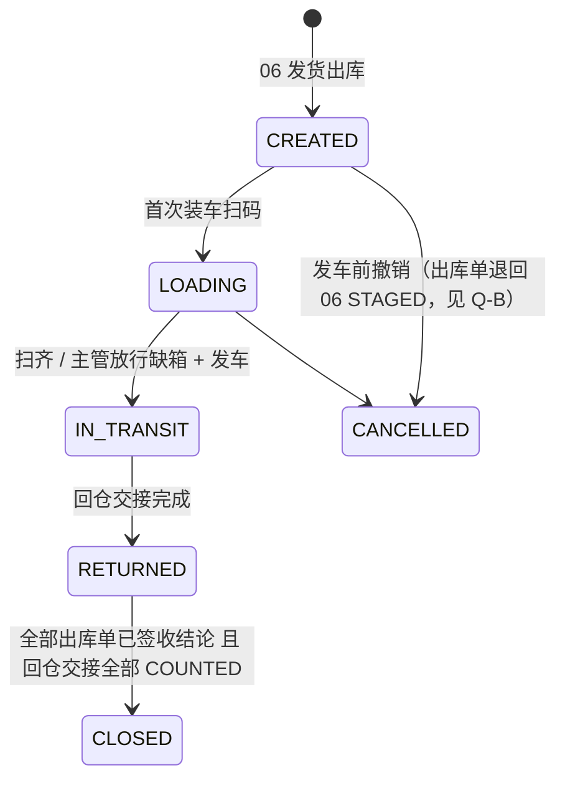
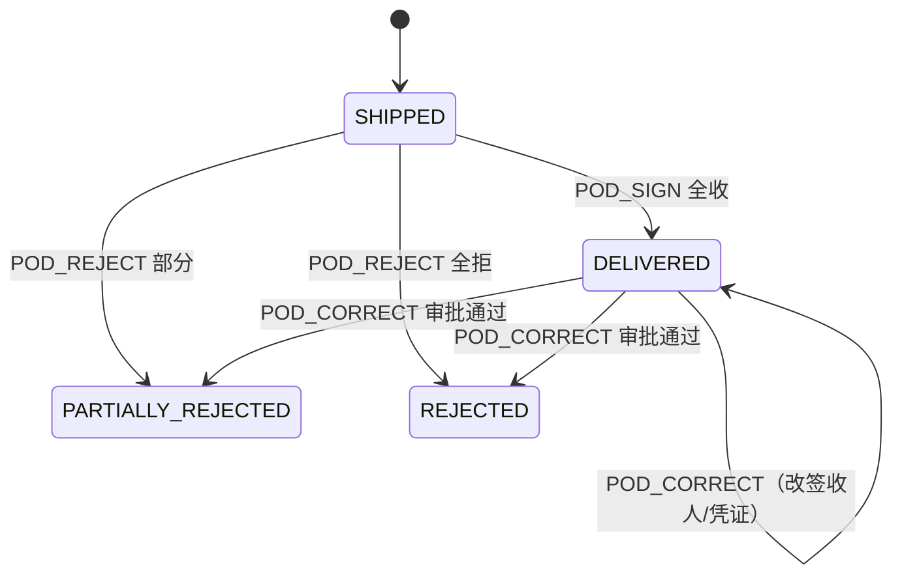
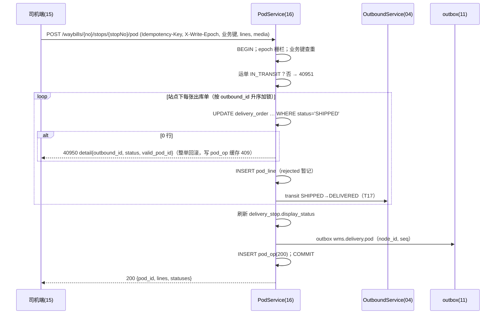
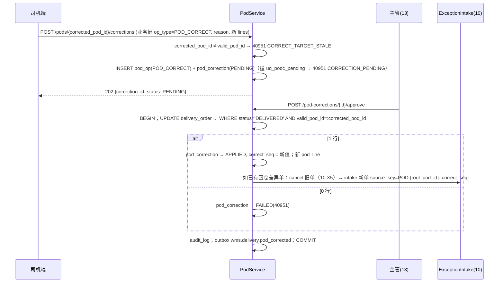
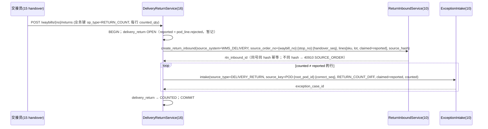

# 16 配送与签收（后端）详细设计

| 项 | 内容 |
|---|---|
| 模块编号 | 16 |
| 作者 | 小钱（后端） |
| 评审 | 小赵（测试，对抗评审 §13）、小吴（开发） |
| 基线 | `docs/first-design@73a55d0`；原说明书 §9.1、§9.3；00 §6.1–§6.6、§9.1；02；04 §5；06（只到发运）；10（#5）；15（小周，#3 `396717a`） |
| 依赖 | 00 全局约定（ID、单号、数量、时区、错误码、幂等、写节点）；04 出库单状态机（T17）；06 发运单 `shipment`；10 退货入库 RTN 与异常单 EXC；11 outbox；12 权限与审计；15 司机端前端 |
| 状态 | 草稿 |

> 本篇只写**服务端**：运单、站点、签收（POD）、签收更正、拒收回仓交接。前端行为（outbox、序号推导、图片两段式）以第 15 篇为准，本篇只给接口和服务端裁决规则。**全局约定不重复定义**：雪花 ID（00 §6.1）、单号格式（00 §6.2）、数量 `*_qty_milli` 与 3 位小数字符串（00 §6.3 / R2）、作业日按仓库时区（00 R3）、错误码规则（00 §6.4）、幂等三层（00 §6.5）、写节点与 epoch（00 §9.1）。

---

## 1. 职责与边界

### 1.1 本模块负责
1. **运单** `waybill`：由第 6 篇发运单（`shipment`）1:1 生成，装车、发车、在途、回仓、关闭；运单包下发（含 `waybill_version`、箱码白名单、行数量、批次、`warehouse.timezone`）。
2. **站点** `delivery_stop`：到达/离开打点；站点状态**只是展示汇总**（Q14）。
3. **出库单签收状态** `delivery_order`：签收以**出库单**为粒度，`SHIPPED → DELIVERED / PARTIALLY_REJECTED / REJECTED`（Q14），驱动第 4 篇 T17。
4. **司机端作业幂等**：四字段业务键 `(waybill_no, stop_no, device_instance_id, op_seq)`（`pod_op`），回放缓存。
5. **签收更正** `POD_CORRECT`：带 `corrected_pod_id`，主管审批，以 `valid_pod_id` 为栅栏。
6. **拒收回仓**：司机拒收数暂记，以仓库回仓实点为准（Q15）；生成第 10 篇 RTN，差异生成第 10 篇异常单。
7. **设备序号水位查询**（Q13）。
8. 第 4095x 码（40950–40959）的分配。

### 1.2 本模块不负责

| 事项 | 归属 |
|---|---|
| 复核、装箱、发货出库（扣库存 `post_event(SHIP)`） | 06 / 02 |
| 出库单状态机定义与 `ck_obo_status` | 04（本篇只触发 T17，见 Q-A） |
| RTN 收货、质检、上架/报损；异常单处置 | 10（#5） |
| 司机端 outbox、序号推导、图片上传前端逻辑 | 15（#3） |
| 文件服务预签名、对象存储保留期 | 12 / 15 Q3 |
| 路径规划、车辆调度 | TMS（系统外，00 §1） |
| 签收回传上游 | 11（本篇只写 outbox `wms.delivery.*`） |
| `write_epoch`、`warehouse_db_authority`、write-endpoint 实现 | 00 §9.1（本篇只规定司机端接口的遵守方式） |

### 1.3 与原文档的差异（评审重点）

| # | 原文档 | 本篇 | 理由 |
|---|---|---|---|
| Δ1 | 签收挂在发运单 `shipment.status=SIGNED` | 签收状态在**出库单**粒度（`delivery_order.status`），站点、运单只做汇总 | 一个站点多张出库单、部分拒收（Q14） |
| Δ2 | 拒收数即入账数 | 司机登记数**暂记**，回仓实点为准，差异进第 10 篇异常单 | Q15，防止司机端数字直接改库存 |
| Δ3 | 只有 `Idempotency-Key` | 加四字段业务键 + 只缓存 2xx/400xx/409xx（库层 CHECK 兜底） | 司机离线 >24h，Key 已过期（00 §6.5） |
| Δ4 | 签收可重复提交覆盖 | 普通签收只认 `SHIPPED`；改结论只能 `POD_CORRECT` + 审批 | 防两台设备互相覆盖 |
| Δ5 | 码值 `WMS-xxxxx` | 40950/40951，40952–40959 预留 | 00 §6.4 号段 |

## 2. 用例

| # | 用例 | 触发 | 权限点 | 写库存 | 离线可补传 |
|---|---|---|---|---|---|
| UC1 | 发运生成运单 | 06 发货出库（同事务） | — | 否 | — |
| UC2 | 下载运单包 | 司机端 | `delivery.waybill.view_own` | 否 | — |
| UC3 | 装车扫码 / 缺箱放行 | 司机 / 主管 | `delivery.load.scan` / `delivery.load.release_short` | 否 | 是 |
| UC4 | 到达 / 离开打点 | 司机 | `delivery.pod.submit` | 否 | 是 |
| UC5 | 签收 / 部分拒收 / 全拒收（POD_SIGN / POD_REJECT） | 司机（客户扫码或代签） | `delivery.pod.submit` | 否 | 是 |
| UC6 | 签收更正申请（POD_CORRECT） | 司机 | `delivery.pod.correct` | 否 | 是 |
| UC7 | 审批更正 | 主管（后台 13） | `delivery.pod.correct.approve` | 否 | — |
| UC8 | 回仓交接：拒收货逐行实点 → RTN + 差异异常单 | 交接员 | `delivery.container.handover` | 否（RTN 收货时由 10 入账） | 是 |
| UC9 | 查询设备序号水位（Q13） | 司机端 | `delivery.waybill.view_own` | 否 | — |
| UC10 | 查询某操作回执 | 司机端 | `delivery.waybill.view_own` | 否 | — |
| UC11 | 改派运单 | 调度 | `delivery.waybill.reassign` | 否 | — |
| UC12 | 主管接管司机 outbox | 主管 | `delivery.outbox.takeover` | 否 | — |

## 3. 领域模型

- `Waybill(code=waybill_no, shipment_id, driver_id, work_date, status, waybill_version)`；单号 `WB-{仓}-{节点}-{作业日}-{序号}`（00 §6.2）。
- `DeliveryStop(waybill_id, stop_no, customer_id, display_status)`：`display_status` 由站点下各 `delivery_order.status` 推导（全 DELIVERED→DELIVERED，全 REJECTED→REJECTED，有部分拒收→PARTIALLY_REJECTED，混合→MIXED），**业务判断一律读 `delivery_order`**。
- `DeliveryOrder(outbound_id, status, valid_pod_id, root_pod_id, correct_seq)`：签收聚合根。
- `PodOp`：司机端一次写操作；签收类操作的 `id` 即 `pod_id`。
- `PodLine(pod_id, outbound_line_id, lot_id, shipped_qty, rejected_qty, reason)`：签收结论的行明细；数量用第 2 篇 `Quantity`。
- `PodCorrection(correct_op_id, corrected_pod_id, status, correct_seq)`。
- `DeliveryReturn(waybill_id, stop_no, handover_seq)` + `DeliveryReturnLine(reported_qty, counted_qty, exception_case_id)`。

**不变量**

| # | 不变量 | 落地 |
|---|---|---|
| D1 | 一张出库单同时只有一个生效签收 | `delivery_order.valid_pod_id` + 条件更新 `WHERE status='SHIPPED'` / `WHERE status='DELIVERED' AND valid_pod_id=:pod_id` |
| D2 | 未签收 ⇔ 无生效签收 ⇔ 无首签 | `ck_dord_pod` |
| D3 | `0 ≤ rejected ≤ shipped`，拒收必须有原因 | `ck_podl_qty`、`ck_podl_rsn` |
| D4 | 业务键唯一，缓存只存确定性结果 | `uq_pod_op_key`、`ck_pod_op_cache` |
| D5 | 一个生效签收最多一条待审批更正；每张出库单的更正序号唯一 | `uq_podc_pending`、`uq_podc_seq` |
| D6 | 更正审批人 ≠ 申请人 | `ck_podc_sod` |
| D7 | 实点 ≠ 登记数 ⇒ 必须挂异常单 | `ck_dretl_exc` |
| D8 | 回放缓存只追加 | `pod_op` 只授 `SELECT, INSERT`（PG） |

## 4. 涉及的表（字段、约束、索引）

DDL 见 `wms-design/sql/schema_postgres.sql`「配送与签收（docs/16）」一节，SQLite 由 `verify_sqlite.py` 机械生成。**新增 8 表 / 25 索引**（8 PK + 9 UNIQUE 约束 + 2 部分唯一 + 6 普通/部分），总计 **51 表 / 143 索引 / 1 视图**（base 73a55d0 为 43 / 118）（PG 实测）。

### 4.1 `waybill`
`code` UK（= `waybill_no`），`shipment_id` UK（1:1 第 6 篇），`status ∈ {CREATED, LOADING, IN_TRANSIT, RETURNED, CLOSED, CANCELLED}`（`ck_wb_status`），`waybill_version` 改派/改站点 +1，`ix_wb_driver(driver_id, work_date, status)` 供"今日线路"。

### 4.2 `delivery_stop`
`uq_dstop(waybill_id, stop_no)`，`stop_no > 0`；`display_status` 仅展示（Q14）。

### 4.3 `delivery_order`
| 列 | 说明 |
|---|---|
| `outbound_id` | UK：一张出库单只挂一张有效运单；改派 = 更新 `waybill_id/stop_no`，不新建 |
| `status` | `SHIPPED / DELIVERED / PARTIALLY_REJECTED / REJECTED`（`ck_dord_status`） |
| `valid_pod_id` | 当前生效签收；`POD_CORRECT` 栅栏 |
| `root_pod_id` | 首次签收 `pod_id`，更正后不变 |
| `correct_seq` | 首签 0，每次 APPLIED 更正 +1（`ck_dord_cseq`） |
| `version` | 每次条件更新 +1 |

### 4.4 `pod_op`（业务键 + 回放缓存）
| 列 | 说明 |
|---|---|
| `(waybill_no, stop_no, device_instance_id, op_seq)` | `uq_pod_op_key`；运单级操作（LOAD / CONTAINER / RETURN_COUNT）`stop_no=0` |
| `op_type` | `LOAD / ARRIVE / POD_SIGN / POD_REJECT / POD_CORRECT / DEPART / CONTAINER / RETURN_COUNT`（与第 15 篇 outbox `type` 一致） |
| `req_hash` | 规范化请求体 SHA-256；**body 只含 `object_key + sha256`**，不含 Key、时间戳之外的易变字段（第 15 篇图片两段式） |
| `http_status / biz_code / response` | 首次结果；`ck_pod_op_cache`：只允许 2xx+`"0"`、400+`400xx`、409+`409xx` |
| `corrected_pod_id` | 仅 `POD_CORRECT`，且必填（`ck_pod_op_corr`） |
| `client_created_at` | 只展示 |

索引：`ix_pod_op_dev(device_instance_id, waybill_no, stop_no, op_seq)`（Q13），`ix_pod_op_stop(waybill_no, stop_no, created_at)`。

### 4.5 `pod_line`
`uq_podl(pod_id, outbound_line_id, lot_id)`；`ck_podl_int / ck_podl_qty / ck_podl_rsn`。`lot_id` 来自装车明细（第 10 篇要求拒收 RTN 必带批次）。

### 4.6 `pod_correction`
`uq_podc_op(correct_op_id)`；`status ∈ {PENDING, APPLIED, REJECTED, FAILED}`；`ck_podc_sod`、`ck_podc_decide`、`ck_podc_seq`（APPLIED ⇔ `correct_seq ≥ 1`）；部分唯一 `uq_podc_pending(corrected_pod_id, outbound_id) WHERE status='PENDING'`、`uq_podc_seq(outbound_id, correct_seq) WHERE status='APPLIED'`。

### 4.7 `delivery_return` / `delivery_return_line`
`uq_dret(waybill_id, stop_no, handover_seq)`；RTN 来源单号 = `{waybill_no}:{stop_no}:{handover_seq}`（第 10 篇 §1）。`ck_dret_cnt`：COUNTED 必须已生成 RTN；`ck_dretl_exc`：实点 ≠ 登记数必须挂 `exception_case_id`。

### 4.8 同步改动的非本模块表
无。`outbound_order` 状态值是否扩展见 Q-A。

### 4.9 授权（PG，`-- @pg-only`）
`pod_op`：`SELECT, INSERT`（只追加，`verify.sh` 断言 `wms_app` UPDATE → permission denied）；其余 7 表 `SELECT, INSERT, UPDATE`。

## 5. 状态机

### 5.1 运单 `waybill`



| # | from → to | 触发 | 守卫 | 副作用 |
|---|---|---|---|---|
| W1 | CREATED → LOADING | LOAD | 司机 = `driver_id` | — |
| W2 | LOADING → IN_TRANSIT | DEPART（stop_no=0） | 箱码扫齐或已放行 | `departed_at` |
| W3 | IN_TRANSIT → RETURNED | 回仓交接提交 | — | `returned_at` |
| W4 | RETURNED → CLOSED | 定时 / 主管 | 无 `SHIPPED` 的 `delivery_order`，无 OPEN `delivery_return` | outbox `wms.delivery.closed` |
| W5 | {CREATED, LOADING} → CANCELLED | 调度 | 未发车 | 见 Q-B |

迁移一律条件更新 `WHERE status=:from`，0 行返回 **40951**（运单状态不允许），不用 40930。

### 5.2 出库单签收 `delivery_order`（Q14）



| # | from → to | 条件更新 | 0 行 |
|---|---|---|---|
| P1 | SHIPPED → {DELIVERED, PARTIALLY_REJECTED, REJECTED} | `SET status=:to, valid_pod_id=:pod, root_pod_id=:pod, version=version+1 WHERE id=:id AND status='SHIPPED'` | 已有生效签收 → **40950**（`detail` 带生效结论）；运单非 IN_TRANSIT → **40951** |
| P2 | DELIVERED → {DELIVERED, PARTIALLY_REJECTED, REJECTED} | `SET status=:to, valid_pod_id=:new_pod, correct_seq=correct_seq+1, version=version+1 WHERE id=:id AND status='DELIVERED' AND valid_pod_id=:pod_id` | **40951**，`detail.reason=CORRECT_TARGET_STALE`（被更正签收已不再生效） |

- 出库单状态（第 4 篇 T17）：P1 成功时同事务把 `outbound_order` `SHIPPED → DELIVERED`（三种结论都走 T17，部分/全拒的区分见 Q-A）。
- `PARTIALLY_REJECTED / REJECTED` 的更正：本篇按任务要求**只允许更正 DELIVERED**（见 Q-C）。

### 5.3 签收更正 `pod_correction`

| # | from → to | 触发 | 守卫 |
|---|---|---|---|
| C1 | — → PENDING | 司机 POD_CORRECT | `corrected_pod_id = delivery_order.valid_pod_id`（读校验，提前失败）；`uq_podc_pending` |
| C2 | PENDING → APPLIED | 主管审批通过 | 同事务 P2 命中 1 行；`approver_id ≠ requested_by` |
| C3 | PENDING → FAILED | 主管审批通过但 P2 0 行 | `fail_code='40951'` |
| C4 | PENDING → REJECTED | 主管驳回 | 必填原因 |

### 5.4 回仓交接 `delivery_return`：`OPEN → COUNTED`（RTN 已建）/ `OPEN → CANCELLED`（误建，主管）。

## 6. 核心流程

### 6.1 司机端写请求的统一模板

所有司机端 POST 在**同一事务**内：

1. 校验 `X-Write-Epoch`（§8.5），过期 → 50303，**不写任何行**。
2. 权限与数据权限（§10）；失败 401/403 不缓存。
3. 业务键查重：`SELECT … FROM pod_op WHERE (waybill_no, stop_no, device_instance_id, op_seq)=…`
   - 命中且 `req_hash` 相同 → 原样返回 `http_status / response`（重放）。
   - 命中且 `req_hash` 不同 → **40910**，`detail.key_type = POD_CORRECT`（命中行 `op_type=POD_CORRECT`）否则 `POD_OP`，`detail` 带首次 `op_type`。
4. 执行业务（条件更新）。
5. 结果分类：2xx / 400xx / 409xx → `INSERT pod_op`（并发插入撞 `uq_pod_op_key` → 回滚后按第 3 步重读）；422xx / 5xx / 429 → **整个事务回滚，不写 `pod_op`、不写 `idempotency_record`**，客户端同 Key 重提会重新执行（00 §6.5）。
6. `Idempotency-Key` 记录与 `pod_op` 同库同事务。

### 6.2 签收 / 拒收（UC5）



- 一次请求覆盖站点下全部出库单，**全有或全无**；任一张 0 行即整单 40950，避免一半生效。
- 409 结果也写 `pod_op`（409xx 可缓存），所以 40950 写缓存时**只写 `pod_op` 一行**，业务行全部回滚（实现：业务写在 SAVEPOINT 内，失败回滚到 SAVEPOINT 后插 `pod_op`）。
- 拒收数不动库存（货还在车上）；入账发生在第 10 篇 RTN 收货。

### 6.3 签收更正（UC6、UC7）



### 6.4 回仓交接（UC8，Q15）



- **仓库实点为准**：RTN 行 `claimed = reported`，第 10 篇收货以仓管 `received_qty` 入账；本篇的 `counted_qty` 只用于判断差异和责任（CARRIER）。
- 异常单 `source_key = POD:{pod_id}:{correct_seq}`（`pod_id` 取 `root_pod_id`，首签 `correct_seq=0`；更正后用新 `correct_seq`，旧单先取消）。一个签收多行差异共用一个键，行明细放 `payload`（见 Q-D）。
- 接口对齐 #5：`ReturnInboundService.create_return_inbound(...)` 与 `ExceptionIntake.intake(...)` 均为同库同事务服务调用（10 §7.1、§7.2）。

### 6.5 设备序号水位（UC9，Q13）

```sql
SELECT waybill_no, stop_no, max(op_seq) AS op_seq_max
  FROM pod_op WHERE device_instance_id = :dev AND user_id = :me
 GROUP BY waybill_no, stop_no;           -- ix_pod_op_dev
```
只统计**已缓存**的操作（2xx/400xx/409xx）；被 422/5xx 回滚的 op_seq 不占位，客户端推导 `max+1` 时会复用——这与第 15 篇"写失败序号未占用"一致。

## 7. 接口清单与契约

### 7.1 服务内（Python，同库同事务）

| 函数 | 调用方 | 说明 |
|---|---|---|
| `WaybillService.create_from_shipment(shipment_id)` | 06 发货出库 | 生成运单、站点、`delivery_order(SHIPPED)` |
| `PodService.outbound_status(outbound_id)` | 04 / 11 / 15 商城 | 返回 `delivery_order.status` |

### 7.2 HTTP（`/api/v1`）

| 方法 | 路径 | 说明 | 权限点 | 业务键 op_type |
|---|---|---|---|---|
| GET | `/warehouses/{warehouse_code}/write-endpoint` | 00 §9.1，中心和边缘都提供 | 登录 | — |
| GET | `/waybills?mine=1&workDate=` | 今日线路 | `delivery.waybill.view_own` | — |
| GET | `/waybills/{waybill_no}/package` | 运单包（含 `waybill_version`、`timezone`） | `delivery.waybill.view_own` | — |
| POST | `/waybills/{waybill_no}/load` | 装车扫码结果 | `delivery.load.scan` | LOAD |
| POST | `/waybills/{waybill_no}/load/release-short` | 缺箱放行 | `delivery.load.release_short` | — |
| POST | `/waybills/{waybill_no}/depart` | 发车（stop_no=0） | `delivery.load.scan` | DEPART |
| POST | `/waybills/{waybill_no}/stops/{stop_no}/arrive` / `/depart` | 打点 | `delivery.pod.submit` | ARRIVE / DEPART |
| POST | `/waybills/{waybill_no}/stops/{stop_no}/pod` | 签收 / 部分拒收 / 拒收 | `delivery.pod.submit` | POD_SIGN / POD_REJECT |
| POST | `/pods/{corrected_pod_id}/corrections` | 签收更正申请 | `delivery.pod.correct` | POD_CORRECT |
| POST | `/pod-corrections/{id}/approve` / `/reject` | 审批 | `delivery.pod.correct.approve` | — |
| POST | `/waybills/{waybill_no}/containers` | 筐箱交接 | `delivery.container.handover` | CONTAINER |
| POST | `/waybills/{waybill_no}/returns` | 拒收货回仓实点 | `delivery.container.handover` | RETURN_COUNT |
| GET | `/devices/{device_instance_id}/op-seq-hwm` | 设备序号水位（Q13） | `delivery.waybill.view_own` | — |
| GET | `/pod-ops/receipt?waybillNo=&stopNo=&deviceInstanceId=&opSeq=` | 操作回执（重放 `response`） | `delivery.waybill.view_own` | — |
| PUT | `/waybills/{waybill_no}/driver` | 改派 | `delivery.waybill.reassign` | — |

**通用请求头**：`Idempotency-Key`、`X-Warehouse-Id`、`X-Write-Epoch`。**业务键字段在 body**：`waybill_no`（路径）、`stop_no`（路径；运单级 = 0）、`device_instance_id`、`op_seq`。

**契约 `POST /waybills/{no}/stops/{stopNo}/pod`**

```json
{ "device_instance_id": "6f1c…", "op_seq": "12", "op_type": "POD_REJECT",
  "waybill_version": 3, "signer_type": "DRIVER_PROXY",
  "media": [ { "object_key": "pod/1/9a3f…e1.jpg", "sha256": "9a3f…e1" } ],
  "orders": [ { "outbound_id": "184467440737095516",
                "lines": [ { "outbound_line_id": "…", "lot_id": "…", "shipped_qty": "5.000",
                             "rejected_qty": "1.000", "reject_reason": "DAMAGED", "uom": "KG" } ] } ],
  "client_created_at": "2026-10-15T02:31:00Z" }
```
200：
```json
{ "code": "0", "data": { "pod_id": "…", "stop_display_status": "PARTIALLY_REJECTED",
  "orders": [ { "outbound_id": "…", "status": "PARTIALLY_REJECTED", "valid_pod_id": "…", "correct_seq": 0 } ] } }
```
- ID 与 `op_seq` 一律字符串（第 15 篇 §6 雪花 > 2^53）；数量 3 位小数字符串（40010）。
- `POD_SIGN` 时 `rejected_qty` 全 0；`POD_REJECT` 至少一行 > 0。全拒 = 全部行 `rejected = shipped`。

**契约 `POST /pods/{corrected_pod_id}/corrections`**：body 同上加 `reason`；路径参数即 `corrected_pod_id`（第 15 篇本地字段名 `correct_target_pod_id`，见 Q-E）。202 `{correction_id, status:"PENDING"}`。

**契约 `GET /devices/{id}/op-seq-hwm`**：
```json
{ "code": "0", "data": { "device_instance_id": "6f1c…", "as_of": "2026-10-15T03:20:00Z",
  "items": [ { "waybill_no": "WB-SH01-0003-20261015-000012", "stop_no": 3, "op_seq_max": "12" } ] } }
```

### 7.3 错误码（码表以 00 §6.4 为准，本篇在 4095x 段内分配，规则同 00 §6.4：5 位数字、前 3 位 = HTTP 状态、只能在本段取码、废弃码不复用）

| 码 | HTTP | 名称 | 场景 | 可缓存 |
|---|---|---|---|---|
| **40950** | 409 | POD_ALREADY_SIGNED | 站点下任一出库单已有有效签收（`delivery_order.status ≠ 'SHIPPED'`）；`detail{outbound_id, status, valid_pod_id, signed_at}` | 是 |
| **40951** | 409 | WAYBILL_STATE_INVALID | 运单状态不允许（已改派 / 已取消 / 已关闭 / 未发车签收）、更正目标已失效（`detail.reason=CORRECT_TARGET_STALE`）、已有待审批更正（`CORRECTION_PENDING`）；`detail.reason` 必带 | 是 |
| 40952–40959 | 409 | — | 预留给第 16 篇，本稿不分配 | — |
| 40910 | 409 | IDEMPOTENCY_CONFLICT | `key_type=POD_OP`（四字段业务键同键不同内容）/ `POD_CORRECT`（更正同键不同内容）/ `IDEMPOTENCY_KEY` | 是 |
| 40001 / 40010 | 400 | 参数 / 数量格式 | `rejected > shipped`、缺 `reject_reason`、缺 `corrected_pod_id` | 是 |
| 40310 / 40311 | 403 | 权限 / 数据权限 | 非本人运单；仓不一致 | 否 |
| 42215 | — | — | **不新增**：箱码不属于本运单用 42210 BARCODE_MISMATCH（第 15 篇 §8.4 待对齐项） | 否 |
| 50301 / 50303 | 503 | 依赖不可用 / 写节点过期 | 重新取 write-endpoint，原键重提 | 否 |

- 配送场景不返回 40930（第 15 篇 §8.4 约定收到 40930 按 40951 处理并上报）。

## 8. 并发与幂等

### 8.1 业务键与回放（00 §6.5）
- 业务键 `(waybill_no, stop_no, device_instance_id, op_seq)`，`op_seq` 由客户端按 `(waybill_no, stop_no)` 单调递增（第 15 篇 §9.3）。
- 同键同 `req_hash` → 重放首次 `http_status + response`（含首次的 409）；同键不同 → 40910 + `key_type`（`POD_OP` / `POD_CORRECT`），`detail.key_type` 总是存在。
- **缓存范围**：`pod_op` 与 `idempotency_record` 只存 2xx、400xx、409xx；库层 `ck_pod_op_cache` 拒绝其他组合（verify 断言 422、503、409+42214 被拦）。
- Key 过期（>24h）后靠业务键兜底；换机 `device_instance_id` 变化后靠 D1 条件更新兜底（第二条生效结论 40950）。

### 8.2 条件更新（不读后写）
签收 P1 `WHERE status='SHIPPED'`；更正 P2 `WHERE status='DELIVERED' AND valid_pod_id=:pod_id`；运单迁移 `WHERE status=:from`。两台设备并发签收/更正同一出库单，只有一条命中（verify：rowcount `1,0,1,0`）。

### 8.3 加锁顺序
同一请求多张出库单按 `outbound_id` 升序更新；事务内顺序固定：`delivery_order` → `pod_line` → `outbound_order` → `delivery_stop` → `outbox_event` → `pod_op`。SQLite 下 `BEGIN IMMEDIATE`。

### 8.4 编号与 ID
运单号、`pod_id`、更正 id 一律走 00 §6.1/§6.2（本地节点号发号，边缘离线可发）。`work_date` 按仓库时区。

### 8.5 写节点（00 §9.1）
- `GET /warehouses/{code}/write-endpoint` 返回 `{endpoint, epoch}`，**中心和边缘节点都提供**；司机端缓存地址和 epoch，取不到时用缓存继续作业。
- 每个写请求带 `X-Write-Epoch`；请求 epoch < 本库 epoch 或本节点已被取代 → **50303 STALE_WRITE_NODE**，不写任何行、不缓存。
- 客户端收到 50303（或 50301、或 epoch 变化）：**重新取 write-endpoint，用原 `Idempotency-Key` 和原业务键重提**，不生成新 `op_seq`，不标红（第 15 篇 §9.5）。
- `pod_op`、`idempotency_record` 都在权威库，随故障切换迁移（00 §9.1"写节点切换"）；RPO 窗口内丢失的签收由司机端 outbox 原键重提补回。

### 8.6 改派
`PUT /waybills/{no}/driver` 只改 `driver_id`、`waybill_version+1`；旧司机补传时按 token 判定不是本人 → 40951（`reason=REASSIGNED`），**不缓存为对方的结果之外的东西**：结果按业务键写 `pod_op`（409xx），旧司机重试拿到同一 40951。

## 9. 异常与补偿

| 场景 | 处理 |
|---|---|
| 签收提交后响应丢失 | 原键重提 → 重放 |
| 图片重传后再提交 | `object_key` 由 sha256 派生，`req_hash` 不变 → 重放（第 15 篇 D-A8） |
| 写节点切换中 | 50303 → 重取地址原键重提 |
| RTN 建单 40910 SOURCE_ORDER | 回仓交接整单回滚，司机端红条交调度（第 10 篇 §6.1） |
| 更正后回仓差异需要重推 | 先取消旧异常单（10 X5）再 `intake` 新 `source_key`（`correct_seq` 已 +1，键不同，不撞 40910） |
| 回仓交接后到 RTN 收货之间丢货 | 第 10 篇 R2 另开 `RETURN_INBOUND` 来源异常单（10 §6.2），与本篇单互不覆盖 |
| 运单 RETURNED 后迟到的签收补传 | 运单不在 IN_TRANSIT → 40951；主管核实后用 `POD_CORRECT` 或后台补录（Q-F） |
| outbound_order T17 失败（出库单已非 SHIPPED） | 整单回滚，50010 告警（理论不应出现，04 SHIPPED 后不可取消） |

## 10. 权限

| 权限点 | 角色 | 数据范围 |
|---|---|---|
| `delivery.waybill.view_own` | 司机 | `waybill.driver_id = 当前用户`；他人运单 404（第 15 篇 Q9 建议） |
| `delivery.load.scan` / `delivery.pod.submit` / `delivery.pod.correct` / `delivery.container.handover` | 司机 / 交接员 | 同上 + `X-Warehouse-Id` 与运单仓一致（40311） |
| `delivery.load.release_short` / `delivery.pod.correct.approve` / `delivery.waybill.reassign` / `delivery.outbox.takeover` | 主管 / 调度 | 仓数据权限；全部写 `audit_log` |

SoD：更正审批人 ≠ 申请人（`ck_podc_sod`）。系统管理员不能做业务操作（00 §6.6）。

## 11. 测试要点

### 11.1 自动化测试
1. 业务键：同键同内容重放（含首次 409）；同键不同内容 40910 + `key_type`（POD_OP / POD_CORRECT）；`key_type` 永远存在。
2. 缓存范围：422、5xx、429、401、403 不写 `pod_op` / `idempotency_record`，同 Key 重提重新执行。
3. 并发：两台设备同站点签收 → 一条 200、一条 40950；两台并发更正 → 一条 APPLIED、一条 40951。
4. 一个站点多张出库单，其中一张已签 → 整单 40950，其余不生效。
5. 更正栅栏：更正已失效签收 → 40951 `CORRECT_TARGET_STALE`；审批时被别人先更正 → FAILED。
6. 回仓：实点 ≠ 登记 → 异常单 `POD:{root_pod_id}:{correct_seq}`；更正后重推新键、旧单取消；RTN 同号同 hash 幂等。
7. 写节点：旧 epoch → 50303 且无行写入；重取后原键重提成功，`op_seq` 不变。
8. Q13 水位：被 422 回滚的 op_seq 不计入。
9. 时区：仓库 Asia/Shanghai，23:30–00:30 的 `work_date` 与"今日线路"。
10. 双库矩阵（SQLite / PG）。

### 11.2 本 PR 的验证脚本结果

| 脚本 | 环境 | 结果 |
|---|---|---|
| `verify_sqlite.py` | 本机 Python 3 + SQLite 3.46 | **147 / 147 通过**（base 73a55d0 116 + 本篇 31），51 表 / 50 手工索引 / 1 视图 |
| `verify.sh` | 本机 PG 16（/home/box/tools/pg16，临时实例 `/tmp/qian-pg16` 端口 5446，新建空库） | **144 / 144 通过**（base 112 + 本篇 32，含 PG 专属 2 条授权断言），实测 **51 表 / 143 索引 / 1 视图**，与手算一致 |

本篇断言：运单状态、`ck_dord_pod`、`ck_dord_status`、`ck_dord_cseq`、业务键重复、缓存范围（409 允许，422 / 503 / 409+42214 拦截）、`POD_CORRECT` 必带 `corrected_pod_id`、拒收量上限与原因、待审批更正唯一、更正 SoD、审批缺审批人、APPLIED 缺序号、更正序号唯一、COUNTED 缺 RTN、差异缺异常单、条件更新 rowcount `1,0,1,0`、op-seq-hwm 查询、非整数 milli（SQLite）、`wms_app` 不能 UPDATE `pod_op`（PG）。

## 12. 待定问题

| # | 问题 | 建议 | 裁决 |
|---|---|---|---|
| ~~Q13~~ | 设备序号水位接口 | **已定**：`GET /api/v1/devices/{device_instance_id}/op-seq-hwm`（§7.2） | — |
| ~~Q14~~ | 一站多单、部分拒收的状态 | **已定**：状态按出库单 `DELIVERED / PARTIALLY_REJECTED / REJECTED`，站点只展示汇总 | — |
| ~~Q15~~ | 拒收回仓差异 | **已定**：司机数暂记，回仓实点为准，差异 → 10 异常单，拒收 → 10 RTN | — |
| Q-A | 第 4 篇 `outbound_order.status` 是否增加 `PARTIALLY_REJECTED / REJECTED`（现 `ck_obo_status` 只有 DELIVERED） | 本篇三种结论都走 T17 → DELIVERED，细分读 `delivery_order.status`；若 04 要扩展，需改 `ck_obo_status` 与 T17 | 大肥鱼 |
| Q-B | 发车前撤销运单时出库单回到哪（04 无 SHIPPED → STAGED 迁移，06 已扣库存） | 发车前不允许撤运单，只允许改派；要撤走 06 红冲 | 大肥鱼 / 小李 |
| Q-C | 是否允许更正 `PARTIALLY_REJECTED / REJECTED` 的签收（本稿按要求只认 `status='DELIVERED'`） | 建议放宽为 `status IN (三种结论)`，栅栏仍是 `valid_pod_id` | 大肥鱼 |
| Q-D | 异常单 `source_key = POD:{pod_id}:{correct_seq}` 是**签收级**，一个签收多行差异只能开一张单；10 现有 `claimed/counted` 是单值 | 一张单、行明细放 payload，`claimed/counted` 存合计；或 10 增加异常单行表 | 小吴 / 小钱（#5） |
| Q-E | 字段名：00 用 `corrected_pod_id`，15 outbox 用 `correct_target_pod_id`、§8.3 写 `pod_id` | 接口统一 `corrected_pod_id`（放路径），15 本地字段名不影响接口 | 小周 |
| Q-F | 运单 RETURNED/CLOSED 后迟到的签收补传 | 40951 + 主管后台补录（带审批），不自动接受 | 大肥鱼 |
| Q-G | 与 15 的冲突：15 §8.6 商城映射把 DELIVERED/COMPLETED 统一显示"已签收"，与 15 自己"部分拒收不得显示为已签收"矛盾；需按 `delivery_order.status` 显示 | 15 改映射 | 小周 |
| Q-H | 与 15 的冲突：15 §9.3 运单级操作的 `stop_no` 未定义 | 运单级（LOAD / DEPART / CONTAINER / RETURN_COUNT）`stop_no=0` | 小周 |
| Q-I | 与 15 的冲突：15 §8.3 写"POD_CORRECT 0 行返回 40950/40951"，本篇统一 40951（`CORRECT_TARGET_STALE`），40950 只用于普通签收 | 15 对齐 | 小周 |
| Q-J | 更正时间窗与对账期影响（15 Q11 剩余项） | 签收后 48h 内、且账期未关闭 | Yuri（范围） |
| Q-K | 客户自助扫码签收身份校验（15 Q4） | 站点一次性签收码，10 分钟有效，存 `pod_op.signer_type=CUSTOMER_SCAN` | 大肥鱼 |
| Q-L | 箱码不属于本运单的 422 码 | 复用 42210，不新增 | 大肥鱼 |

## 13. 对抗评审攻击面（给小赵、小吴）

| # | 攻击面 | 打法 | 防线 | 我认为最可能出问题的地方 |
|---|---|---|---|---|
| P-A1 | 重复签收 | 换机 / 客户自助 + 代签 / Key 过期后补传 | `WHERE status='SHIPPED'` + `uq_pod_op_key` | 一站多单时部分已签的 SAVEPOINT 回滚 |
| P-A2 | 更正覆盖 | 两台并发更正；更正已失效签收；绕审批直接调 approve | `valid_pod_id` 栅栏 + `uq_podc_pending` + `ck_podc_sod` | 读校验与 P2 之间的窗口（只能提前失败，不能放过） |
| P-A3 | 缓存了不该缓存的 | 422 / 50303 被写进 `pod_op`，之后修正也一直重放错误 | `ck_pod_op_cache` | `idempotency_record` 侧没有同等 CHECK |
| P-A4 | 40910 缺 `key_type` | — | 统一模板第 3 步固定填 | `POD_CORRECT` 与 `POD_OP` 判定依赖首次行 `op_type` |
| P-A5 | 司机数直接入账 | 拒收数改库存 | 本篇不写库存，RTN 由 10 按实点入账 | 10 与 16 共用 DTO 时 claimed/received 混用（10 R-A1） |
| P-A6 | 异常单被吞 / 重复 | 更正后同键重推 | `correct_seq` 进 `source_key` + 先取消旧单 | 取消与新建不在同一事务时的中间态 |
| P-A7 | 写节点脑裂 | 旧边缘节点恢复后接收补传 | epoch 栅栏 50303 | 客户端缓存 epoch 未刷新时反复 50303 |
| P-A8 | 越权 | 枚举他人运单；改派后旧司机补传 | token 过滤 + 404 + 40951 | 交接员（非司机）提交回仓的数据范围 |
| P-A9 | 序号水位 | 水位接口返回被回滚的 op_seq 导致跳号或复用撞键 | 只统计已缓存行 | 客户端拿到水位前已有 pending 条目 |
| P-A10 | 时区 | 手机 UTC、跨零点 | 服务端按仓库时区算 `work_date` | 运单包缓存跨日 |
