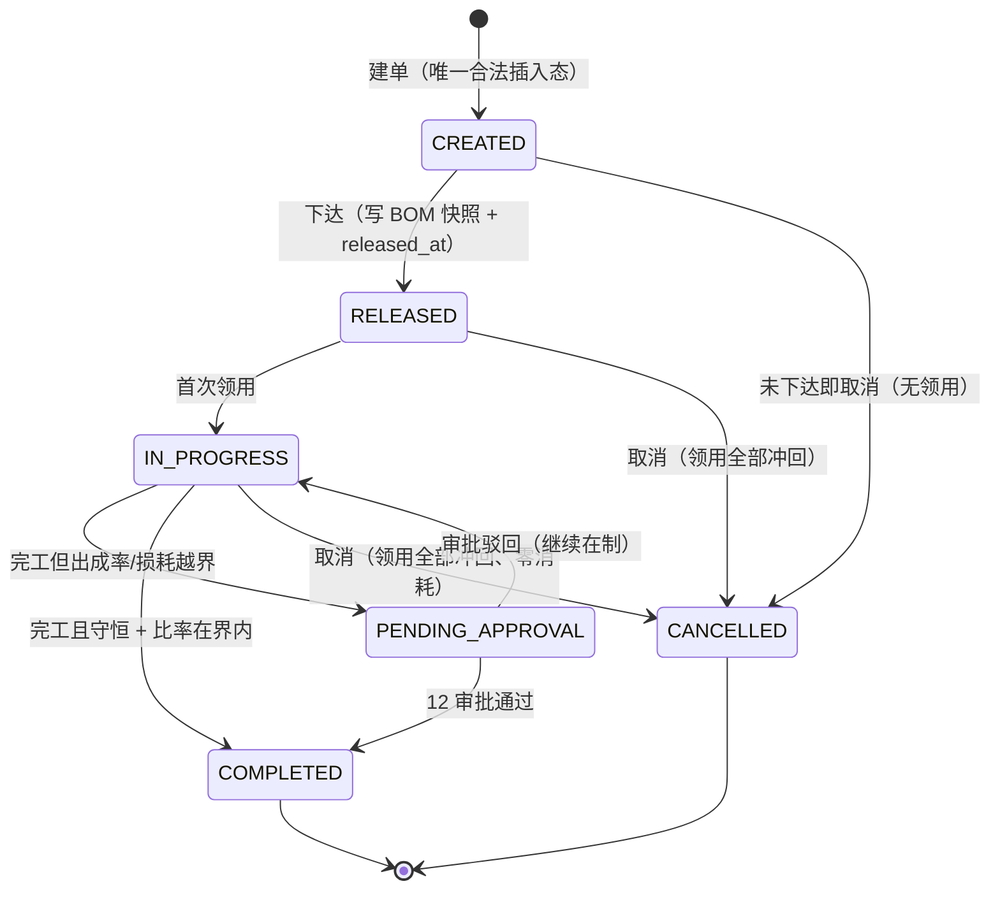

# 17 加工中心 详细设计

| 项 | 内容 |
|---|---|
| 编号 | 17 |
| 作者 | 长流（本轮按 main 现存 DDL 重写；旧稿 `a797978` 只当素材） |
| 评审 | 镜鉴（独立复核）；前端侧回核 界面 |
| 基准 | `wms-design/sql/schema/17_processing.sql` @ main `4c90132`（550 行，**唯一 DDL 基准**）；`docs/00-总体设计.md`、`docs/02-库存核心.md`、`docs/04-出库与分配.md`、`docs/10-退货与异常.md`、`docs/12-认证权限.md` |
| 状态 | 落库：本篇 8 张表 + 约束 + 索引 + 触发器 + 授权（均已在 main）。未落库：指向 09 `scrap_order`、18 `live_weigh`、12 审批的**外键**（对应篇合并后加，见 §12 Q2） |

---

## 1. 职责与边界

### 1.1 本篇负责

- **BOM 与版本**：`process_bom` / `process_bom_line`，同仓同编码多版本，`DRAFT → ACTIVE → RETIRED` 只前进；生效后行冻结。
- **加工单**：`process_order`，下达时**快照** BOM（含行 JSON 与四个比率），执行期只读。
- **领料**：`process_issue`（一行 = 一个来源 stock 行 × 一个批次），含 `LIVE_TANK` 活鲜池来源与按件 SKU 换算。
- **报工与产出**：`process_report`（幂等回执）+ `process_output`（成品 / 副产品 / 损耗）。
- **出成率与损耗定案**：`yield_bp` 与越界转 `PROCESS_YIELD_DEVIATION` 审批；损耗行 `loss_status` 定案。
- **批次追溯**：`process_lot_trace`（成品/副产批次 ↔ 原料批次，多对多）。
- **冲回**：`process_reversal`（领用冲回 / 产出报废 / 返工回台 / 损耗改判）。

### 1.2 本篇不负责

| 内容 | 归属 |
|---|---|
| 库存余额、占用、冻结、流水、条件 UPDATE 的实现（`move` / `place_hold` / `consume_process_hold` / `post_in` / `post_out` / `release_hold`） | 02（§7 原语） |
| 审批引擎、审批单与过期回调（`PROCESS_YIELD_DEVIATION` / `PROCESS_REWORK`） | 12（`approval_request`、`12b_auth_audit.sql`） |
| 报损单（`scrap_order`，损耗与报废的对外单据） | 09 |
| 活鲜池称重（`live_weigh`，`task_kind=PROCESS_ISSUE`） | 18 |
| 加工损耗转异常单后的处置（`exception_case`） | 10（本篇只按 10 §7.3 建单 / 联动） |
| 出库、分配、拣货 | 04 / 05 |

### 1.3 与旧稿（`a797978`，304 行）的差异

| # | 旧稿说法 | 现状 |
|---|---|---|
| Δ1 | 只有 §1–§7，无并发 / 异常 / 权限 / 测试 / 待定 / 攻击面 | 本篇按 00 §8 十三节补齐 |
| Δ2 | 部分约束描述停留在草稿 | 一律以 `17_processing.sql` 为准（§4 逐条对齐） |
| Δ3 | 接口是骨架 | §7 定名并对齐 13/14 台账（含 14 §8.10 草稿三条的映射） |
| Δ4 | 损耗定案只有一句话 | 按 DDL 注释写成 §6.5（条件更新是主守卫，`uq_exc_pl_key` 是第二道保险） |
| Δ5 | 未写 `ck_prci_pcs` 整件约束、`ck_prco_loss_whole` 整行转出 | 补进 §4 / §5 |

---

## 2. 用例

| # | 用例 | 角色 | 权限点（§10） |
|---|---|---|---|
| UC1 | 建 BOM 版本（草稿）并维护行 | 工艺 / 主管 | `process.bom.manage` |
| UC2 | BOM 生效（`ACTIVE`）/ 退役（`RETIRED`） | 主管 | `process.bom.manage` |
| UC3 | 下达加工单（生成 BOM 快照） | 主管 | `process.order.create` / `.release` |
| UC4 | 领料（PDA，含活鲜池 / 按件 / 尾数） | 加工员 | `process.order.issue` |
| UC5 | 报工（产出/副产/损耗、称重、定案行） | 加工员 | `process.order.report` |
| UC6 | 完工（守恒 + 出成率写入；由报工 `is_final` 触发，**无独立入口**） | 系统 / 主管 | `process.order.report` |
| UC7 | 出成率或损耗越界 → 转审批 | 系统（12） | `process.yield.approve`（12 侧审批人） |
| UC8 | 冲回：领用冲回 / 产出报废 / 返工回台 / 损耗改判 | 主管 / 加工员 | `process.order.reverse`、`process.rework.approve` |
| UC9 | 损耗定案（审批回调 / 12 h 过期转异常） | 系统（12/10） | — |
| UC10 | 批次追溯与召回（成品批 → 原料批，反向亦然） | 品控 / 主管 | `process.trace.view` |
| UC11 | 取消加工单（领用全冲回、零消耗） | 主管 | `process.order.cancel` |
| UC12 | 读：加工单列表 / 详情、BOM 列表 / 详情、追溯图 | 主管 / 客服 | `process.order.view`、`process.bom.view` |

---

## 3. 领域模型

### 3.1 计量与守恒

- 数量一律 `*_qty_milli`（BIGINT，00 §6.3），`base_uom=KG` 时 1 milli-KG = 1 g；出成率 / 容差一律万分比整数 `*_bp`（10000 = 100%）。
- **守恒按净重**（C1–C5，`process_order` 的 CHECK 逐条落地）：

| # | 公式 | 落库位置 |
|---|---|---|
| C1 | 净投入 `net_in = issued − reversed − reworked` | `ck_prc_cap` / `ck_prc_balance` |
| C2 | 已消耗 `consumed = output + byproduct + loss + scrapped + reworked` | `ck_prc_consume` |
| C3 | 余料 `residual = issued − reversed − consumed ≥ 0` | `ck_prc_cap` |
| C4 | 完工 / 待审批：`residual = 0` 且 `net_in > 0` | `ck_prc_balance` |
| C5 | 出成率 `output × 10000 / net_in`，越界判定用**交叉相乘**不做整除 | `ck_prc_yield` / `ck_prc_dev` |

- 负值一律由 `ck_prc_nonneg` / `ck_prci_qty` / `ck_prco_net` 拦；累计列只增（触发器，§4）。

### 3.2 按件 SKU（`ck_prci_pcs`）

`issue_pcs` 与 `unit_net_weight_g` 成对出现，`issue_qty_milli = issue_pcs × unit_net_weight_g`（g = milli-KG），且 `reversed` / `consumed` 必须是 `unit_net_weight_g` 的整数倍——**按件只能整件冲回 / 消耗**。`unit_net_weight_g` 在领用时快照自 01 `sku.std_net_weight_g`；为空 → 40001 拒领。

### 3.3 活鲜池来源（`ck_prci_live`）

`src_location_type='LIVE_TANK'` 时必须有 `issue_count`（尾数，18 篇双计量）与 `live_weigh_id`（18 的 `live_weigh(task_kind=PROCESS_ISSUE, result='ACCEPTED')`）；其他来源两者必须为空。冲回时 **LIVE_TANK 不回池**，退加工暂存位。

### 3.4 批次追溯（§6.6）

`process_lot_trace` 一条边 = 一个产出批次 ↔ 一个原料批次（`uq_plt(output_id, issue_id)`），`output_lot_id <> raw_lot_id`（`ck_plt_self`）。召回时从成品批反查原料批（`ix_plt_out`），或从原料批正查受影响成品批（`ix_plt_raw`）。

### 3.5 损耗（`process_output` 的 `LOSS` 行）

损耗行只记账、不直接扣库存（原料已随报工 `consume_process_hold` 扣）：`scrap_order_id`（09 `PROCESS_LOSS`）必填、`loss_reason ∈ {TRIM, DRIP, WEIGH_DIFF, DEFECT}`、无批次与库位。全部转出才允许冲回（`ck_prco_loss_whole`：`reversed ∈ {0, qty}`）。

---

## 4. 涉及的表（约束名以 `17_processing.sql` 为准）

### 4.1 `process_bom`

`id / warehouse_id / code / bom_version / name / status / yield_min_bp / yield_max_bp / loss_max_bp / balance_tol_bp / activated_at / version / created_at / updated_at`

- `uq_pbom(warehouse_id, code, bom_version)` + 部分唯一 `uq_pbom_active(warehouse_id, code) WHERE status='ACTIVE'`（同仓同编码只能一个生效版本）。
- `ck_pbom_status` 值域；`ck_pbom_ver ≥ 1`；`ck_pbom_yield(0 < min ≤ max ≤ 20000)`；`ck_pbom_loss(0–10000)`；`ck_pbom_tol(0–1000)`；`ck_pbom_act`（非 DRAFT 必须有 `activated_at`）。
- `trg_pbom_forward`（BEFORE UPDATE）：状态只前进，且非 `DRAFT` 时 `code / bom_version / warehouse_id / 四个比率` 只读。

### 4.2 `process_bom_line`

`id / bom_id / line_no / line_role(INPUT|FINISHED|BYPRODUCT) / sku_id / std_qty_milli`

- `uq_pboml(bom_id, line_no)`、`uq_pboml_sku(bom_id, line_role, sku_id)`、`ck_pboml_role`、`ck_pboml_qty(std_qty_milli > 0, 整数, line_no ≥ 1)`、`fk_pboml_bom` / `fk_pboml_sku`。
- `trg_pboml_frozen`（BEFORE INSERT/UPDATE/DELETE）：BOM 非 `DRAFT` 时行只读——改配方 = 新版本。

### 4.3 `process_order`

关键列：`code`（`PRC-{仓}-{节点}-{作业日}-{序号}`，00 §6.2）、`work_date`、`bom_id` + 快照列（`bom_code / bom_version / bom_snapshot / yield_min_bp / yield_max_bp / loss_max_bp / balance_tol_bp`）、六个累计列（`issued / reversed / consumed / output / byproduct / loss / scrapped / reworked`）、`yield_bp`、`approval_no` + `approval_expires_at`、`status`、`version`。

- 约束：`uq_prc_code`、`uq_prc_apr(approval_no) WHERE approval_no IS NOT NULL`、`fk_prc_bom/wh/loc`、`ck_prc_status`、`ck_prc_int`、`ck_prc_nonneg`、`ck_prc_reverse`、`ck_prc_consume`、`ck_prc_cap`、`ck_prc_snapshot`（除 `CREATED` 与「未下达即取消」外快照列必填）、`ck_prc_yrange`、`ck_prc_balance`、`ck_prc_yield`、`ck_prc_dev`、`ck_prc_apr_exp`、`ck_prc_done`、`ck_prc_cancel`、`ck_prc_apr`（审批单号格式同 02 `ck_hold_approval_no`，两库各一份：PG 正则 + 真实日历日，SQLite GLOB + `date()` 校验）。
- 索引 `ix_prc_status(warehouse_id, status, work_date, bom_code)`。
- `trg_prc_snapshot`（BEFORE UPDATE）：快照列只读、终态（`COMPLETED`/`CANCELLED`）只读、累计列只增，并做状态迁移白名单（§5.1）；`trg_prc_insert`（BEFORE INSERT）：只能以 `CREATED` 插入。

### 4.4 `process_issue`

`id / process_order_id / line_no / op_key / src_location_id / src_location_type / src_stock_id / pc_stock_id / hold_id / sku_id / lot_id / lot_expiry_date / issue_qty_milli / issue_pcs / unit_net_weight_g / issue_count / live_weigh_id / reversed_qty_milli / consumed_qty_milli / issued_by / issued_at / version`

- `uq_prci(order, line_no)`、`uq_prci_op(op_key)`、`uq_prci_hold(hold_id)`；`op_key = PRCI:{process_order_id}:{issue_client_id}` 且 `ck_prci_op LIKE 'PRCI:%'`（= `stock_hold.op_key`，02 `ck_hold_process`）。
- `ck_prci_qty`、`ck_prci_reverse(reversed + consumed ≤ issue)`、`ck_prci_live`、`ck_prci_pcs`、外键到 `process_order` / `stock_hold` / `stock` ×2 / `lot` / `sku`。
- `trg_prci_immutable`（BEFORE UPDATE/DELETE）：关键列只读、累计列只增、不可删。索引 `ix_prci_lot`。

### 4.5 `process_report`

`id / process_order_id / report_client_id(UUID) / request_hash(SHA-256) / report_seq / is_final / response_http(200|202) / response / reported_by / created_at`

- `uq_prcr_client(process_order_id, report_client_id)`、`uq_prcr_seq(process_order_id, report_seq)`、`ck_prcr_client`（UUID 形状）、`ck_prcr_hash`（64）、`ck_prcr_seq`、`ck_prcr_http`。
- 只追加（`trg_prcr_append_only`）；**只缓存成功结果**（200/202），4xx 不占键。

### 4.6 `process_output`

`id / process_order_id / report_id / line_no / output_role / sku_id / lot_id / to_location_id / gross_qty_milli / tare_qty_milli / qty_milli(= gross − tare) / reversed_qty_milli / processed_at / expiry_date / sell_deadline / earliest_raw_expiry / scrap_order_id / loss_reason / from_output_id / loss_status / loss_approved_qty_milli / loss_exception_no`

- `uq_prco(report_id, line_no)`、部分唯一 `uq_prco_lot(lot_id) WHERE lot_id IS NOT NULL`；`ck_prco_role/int/net/reverse`。
- `ck_prco_kind`：成品/副产必须有批次、目标库位、效期、原料最早效期，且无报损单 / 原因 / `from_output_id`；`LOSS` 必须无批次与库位、有报损单与原因。
- `ck_prco_loss_status`、`ck_prco_loss_settle`（`APPROVED` 获批量 = 数量；`REJECTED` 需 `loss_exception_no`；`EXPIRED_TO_EXCEPTION` 获批量 0）、`ck_prco_loss_whole`（整行转出）、`ck_prco_expiry`（成品效期 ≤ 原料最早效期）、`ck_prco_sell`。
- 索引 `ix_prco_order`；`trg_prco_immutable`（关键列只读、`reversed` 只增）+ `process_loss_settle_once`（`loss_status` 只能从 `PENDING_APPROVAL` 前进一次，见 §6.5）。

### 4.7 `process_lot_trace` / `process_reversal`

- `process_lot_trace`：`uq_plt(output_id, issue_id)`、`ck_plt_self`、5 个外键（order / output / issue / lot ×2）；索引 `ix_plt_out` / `ix_plt_raw`；只追加。
- `process_reversal`：`op_key = PRCR:{process_order_id}:{reversal_client_id}`（`uq_prcv_op`）；`ck_prcv_type` 按 `ISSUE / OUTPUT / LOSS` 三态约束必填/必空组合（`ISSUE` 必有 `hold_release_id` + `movement_ref`；`OUTPUT` 必有 `movement_ref`，`SCRAP` 无审批单、`REWORK` 必须有；`LOSS` 两者必空）；`ck_prcv_qty`、`ck_prcv_op`、`ck_prcv_apr`；`fk_prcv_mv(movement_ref) → stock_movement_key(idempotency_key)`；**`hold_release_id` 不建外键**（02 的 `stock_hold_release` TRUNCATE 由触发器拦，FK 会抢先报错），改由 §9 日终对账；索引 `ix_prcv_order`；只追加。

### 4.8 引用的 02 / 01 表

| 表 | 用法 |
|---|---|
| `stock` / `stock_hold` / `stock_hold_release` / `stock_movement` / `stock_movement_key` | 02 原语：领用 = `move` + `place_hold(PROCESSING)`；报工 = `consume_process_hold` + `post_in`；冲回 = `release_hold` + `move` / `post_out`。本篇**不改 02 任何表与 CHECK** |
| `stock_hold.hold_type='PROCESSING'`（02 `ck_hold_process`） | `op_key=PRCI:…`、`source_id=process_order.id`；`PROCESSING` 是 12/18 之外的第三种系统冻结，只由本篇 `release_hold` / `consume_process_hold` 释放 |
| `sku.std_net_weight_g`（01） | 按件换算快照来源 |
| `location.location_type='PROCESS'`（01，待补） | 加工中心库位；DDL 注释标注「#8 待加」 |

### 4.9 授权（PG）

`GRANT SELECT, INSERT, UPDATE ON process_bom, process_bom_line, process_order, process_issue, process_output TO wms_app`；`GRANT SELECT, INSERT ON process_report, process_lot_trace, process_reversal`（只追加，无 UPDATE / DELETE）。

---

## 5. 状态机

### 5.1 加工单 `process_order`



| from → to | 触发 | 守卫 |
|---|---|---|
| `CREATED → RELEASED` | 下达 | 写快照列 + `released_at`（`ck_prc_snapshot`）；`rowcount=0` → 40930 |
| `CREATED/RELEASED/IN_PROGRESS → CANCELLED` | 取消 | `ck_prc_cancel`：`issued = reversed` 且 `consumed = 0` 且原因非空 |
| `RELEASED → IN_PROGRESS` | 首次领用 | 领用行插入成功即推进 |
| `IN_PROGRESS → COMPLETED` | 完工 | `ck_prc_balance` + `ck_prc_yield` + `ck_prc_dev`（比率在界内、`approval_no IS NULL`） |
| `IN_PROGRESS → PENDING_APPROVAL` | 完工越界 | `ck_prc_apr_exp`：必须带 `approval_expires_at`（≤ 进入 + 12 h） |
| `PENDING_APPROVAL → COMPLETED` | 审批通过 | `approval_no` 已写、比率越界仍成立（`ck_prc_dev` 第二分支） |
| `PENDING_APPROVAL → IN_PROGRESS` | 审批驳回 | 继续在制（可补领用 / 再报工） |

状态迁移白名单在库里（`trg_prc_flow`），越界 → `process_order_bad_transition`（23514 → 50010）；终态只读、累计列只增由 `trg_prc_snapshot` 兜。

### 5.2 BOM

`DRAFT → ACTIVE → RETIRED`（只前进，`trg_pbom_forward`）；同仓同编码 `ACTIVE` 唯一（`uq_pbom_active`）；非 `DRAFT` 后行冻结（`trg_pboml_frozen`）。改配方 = 新版本。

### 5.3 损耗行 `loss_status`

`SETTLED`（默认，完工时在界内）→ 越界行随加工单进入 `PENDING_APPROVAL` → 定案一次：`APPROVED` / `REJECTED` / `EXPIRED_TO_EXCEPTION`。`trg_prco_loss_settle_once` 保证只能从 `PENDING_APPROVAL` 前进一次，且定案后数量/原因列只读。

---

## 6. 核心流程

### 6.1 下达（UC3）

1. 校验 BOM 为 `ACTIVE`、加工中心库位存在；2. 单事务写 `status='RELEASED'` + `released_at` + 快照四比率与 `bom_snapshot`（行 JSON）；3. `ck_prc_snapshot` 兜住「非 CREATED 必须有快照」；4. 写 `outbox_event`（11，`wms.process.released`）。

### 6.2 领料（UC4，含活鲜池）

```
PDA → POST /api/v1/processing/orders/{id}/issues {issue_client_id, src_stock_id, issue_qty_milli, issue_pcs?, issue_count?, live_weigh_id?}
API → DB: BEGIN
API → DB: INSERT process_issue(op_key=PRCI:{order}:{issue_client_id}, …, hold_id)
API → INV: move(src → 加工中心库位) + place_hold(pc_stock, PROCESSING, source=PROCESS_ORDER, op_key=同)
API → DB: UPDATE process_order SET issued_qty_milli=issued_qty_milli+:q, status=CASE WHEN status='RELEASED' THEN 'IN_PROGRESS' ELSE status END, version=version+1 WHERE id=:id AND status IN ('RELEASED','IN_PROGRESS')
API → DB: COMMIT
```

- 同一事务；`op_key` 撞 `uq_prci_op` → 按 `Idempotency-Key` / 四元组回放（§8）。
- `unit_net_weight_g` 从 01 快照；为空 → 40001（`ck_prci_pcs` 兜「成对出现 + 整除」）。
- `LIVE_TANK`：先由 18 出池称重（`live_weigh` ACCEPTED）拿 `live_weigh_id`，再领用；`issue_count` 必填。
- 库存侧的 `PROCESSING` 冻结量 = 该来源行已领未消耗量，日终与 `process_issue` 对齐（§9）。

### 6.3 报工（UC5）

```
PDA → POST /api/v1/processing/orders/{id}/reports {report_client_id, is_final?, lines:[{output_role, sku_id, lot_id?, to_location_id?, gross_qty_milli, tare_qty_milli, loss_reason?}]}
API → DB: BEGIN; 以 (order, report_client_id) 查 process_report（回执缓存，同 hash 回放、异 hash 40910）
API → DB: SELECT … FROM process_order WHERE id=:id FOR UPDATE  -- 取 report_seq = max+1（同一单串行）
API → DB: INSERT process_report(…, response_http, response) + INSERT process_output ×N + INSERT process_lot_trace ×M
API → INV: consume_process_hold(hold_id, q×N, biz=(PROCESS_CONSUME, order, issue_line, report_seq), op_key=PRCC:{order}:{report_seq}:{line_no})
API → INV: 成品/副产 post_in(PROCESS_OUTPUT, 新批次); 损耗只记账（09 报损单）
API → DB: UPDATE process_order SET consumed/output/byproduct/loss/scrapped/reworked=… WHERE id AND version=:v
API → DB: COMMIT
```

- 实时性：PDA 离线时入 outbox（14 §）；重放按 `report_client_id` 回放首次响应。
- 产出行的批号 / 效期 / `sell_deadline` 由服务端按 01 主数据算；`ck_prco_expiry` 兜「成品效期 ≤ 原料最早效期」。

### 6.4 完工（UC6 / UC7）

1. 条件更新把 `consumed` 累加到与 `issued − reversed` 相等（余料 0），写 `yield_bp = output × 10000 / net_in`（整除，仅展示）。
2. 比率在界内 → `COMPLETED` + `completed_at`（`ck_prc_yield` / `ck_prc_dev` 第一分支）。
3. 越界 → `PENDING_APPROVAL` + 建 `PROCESS_YIELD_DEVIATION` 审批（12），出成率与损耗**合并一张单**；`approval_expires_at ≤ +12 h`。
4. 余料超过 `balance_tol_bp` → 先领用冲回，不许完工（`ck_prc_balance` 兜）。

### 6.5 损耗定案（UC9，条件更新是主守卫）

```
审批回调 / 12h 过期任务 →
  UPDATE process_output SET loss_status=:result, loss_approved_qty_milli=:q, loss_exception_no=:no
   WHERE id=:loss_line_id AND loss_status='PENDING_APPROVAL'
  影响 1 行 → 同事务（REJECTED / EXPIRED 时）建 10 篇异常单（source_type=PROCESS_LOSS，key=PRCL:{id}）、写 outbox wms.process.loss_settled
  影响 0 行 → 已被另一方定案：读回本行 loss_status / loss_exception_no 原样返回，不建异常、不发事件
```

不动库存（`consume_process_hold` 已扣）。10 篇 `uq_exc_pl_key` 是第二道保险；`trg_prco_loss_settle_once` 是库层第三道。

### 6.6 冲回（UC8）

| 类型 | 动作 |
|---|---|
| `ISSUE` | `release_hold(hold_id, q, op_key=PRCR:…)` + `move(加工中心 → 来源库位)`；LIVE_TANK 退加工暂存位（不回池）；`ck_prci_reverse` 兜「冲回 + 消耗 ≤ 领用」，超量 42214 `reason=OVER_REVERSE` |
| `OUTPUT` `SCRAP` | `post_out(lot_stock, q, PROCESS_REVERSE)` + 累加 `scrapped_qty_milli`（09 报损单 `PROCESS_REVERSE`） |
| `OUTPUT` `REWORK` | 需 12 审批（`PROCESS_REWORK`，审批人须持 `process.rework.approve`）+ `move(成品批 → 加工中心)` + `place_hold(PROCESSING)`，并记一条 `src_location_type='REWORK'` 的领用行、累加 `reworked_qty_milli` |
| `LOSS` | 只改原因 / 拆数量：新 `LOSS` 行 `from_output_id` 指回旧行；`ck_prco_loss_whole` 保证整行转出 |

### 6.7 追溯与召回（UC10）

成品批 → `process_lot_trace` → 原料批（`ix_plt_out`）；反向用 `ix_plt_raw`。召回清单按「成品批 → 出库行（04）→ 客户」外联，本篇只负责给出批次边。

---

## 7. 接口清单与契约

### 7.1 服务内（同库同事务）

只经 02 原语：`move` / `place_hold` / `consume_process_hold` / `post_in` / `post_out` / `release_hold`；本篇不直接改 `stock` / `stock_hold`。

### 7.2 HTTP（`/api/v1`，POST 带 `Idempotency-Key`）

| 方法 | 路径 | 权限点 | 幂等 | 主要失败码 |
|---|---|---|---|---|
| POST | `/api/v1/processing/boms` | `process.bom.manage` | `code+version` | 40930 |
| PUT | `/api/v1/processing/boms/{id}/activate` | `process.bom.manage` | 状态条件更新 | 40930（`bom_forward_only` → 50010） |
| POST | `/api/v1/processing/orders` | `process.order.create` | `code` | 40001 |
| POST | `/api/v1/processing/orders/{id}/release` | `process.order.release` | 状态条件更新 | 40930 |
| POST | `/api/v1/processing/orders/{id}/issues` | `process.order.issue` | `PRCI:{id}:{issue_client_id}` | 40001（按件缺单件净重）、42214 `OVER_REVERSE`、40906（库位盘点锁） |
| POST | `/api/v1/processing/orders/{id}/reports` | `process.order.report` | `(id, report_client_id)` + `request_hash` | 40910 `PROCESS_REPORT`、42218（守恒）、40003/40004（时间） |
| POST | `/api/v1/processing/orders/{id}/reversals` | `process.order.reverse`（`REWORK` 另需 `process.rework.approve`） | `PRCR:{id}:{reversal_client_id}` | 40910 `PROCESS_REVERSAL`、42214 `OVER_REVERSE`、40312（返工自批） |
| POST | `/api/v1/processing/orders/{id}/cancel` | `process.order.cancel` | 状态条件更新 | 40930（守恒不满足） |
| GET | `/api/v1/processing/orders?status=&work_date=` | `process.order.view` | — | 标准信封 `{items[], next_cursor}` |
| GET | `/api/v1/processing/orders/{id}` | `process.order.view` | — | 单 + 领用行 + 报工产出 + 追溯边 |
| GET | `/api/v1/processing/boms`、`/{id}` | `process.bom.view` | — | 版本列表 / 行明细 |
| GET | `/api/v1/processing/trace?lot_id=` | `process.trace.view` | — | 正反查受影响批次 |

**与 14 §8.10 草稿骨架的映射**（界面回核用）：草稿 `/processing/issue` → `POST /orders/{id}/issues`；`/processing/receipt` → `POST /orders/{id}/reports`；`/processing/loss` → 报工里的 `LOSS` 行（无独立路径）。若前端坚持原路径，在群里改，不两套并存。

### 7.3 错误码（全部取自 00 §6.4）

本篇只新增 `PROCESS_REPORT` / `PROCESS_REVERSAL` 两个 40910 的 `key_type`（12 篇 `12b` 侧登记）；其余复用：40001（参数）、40003/40004（时间）、40312（自批）、40906（库位盘点锁）、40910、42214（`OVER_REVERSE`）、42218（守恒）、50010（撞库层不变量 / 触发器）。库层错误名（`bom_forward_only`、`bom_frozen`、`process_order_frozen`、`process_order_bad_transition`、`process_issue_immutable`、`process_output_immutable`、`process_loss_settle_once`）只进日志与 `detail.db_rule`。

---

## 8. 并发与幂等

| 场景 | 防线 |
|---|---|
| 领用重试 / 狂点 | `op_key=PRCI:{order}:{issue_client_id}`（`uq_prci_op`）+ `Idempotency-Key`；撞键读回比对 |
| 报工重试 | `(process_order_id, report_client_id)` 回执表 `process_report`；同键同 hash 回放首次响应，异 hash → 40910 `PROCESS_REPORT`；4xx 不占键 |
| 报工序号并发 | `SELECT … FOR UPDATE process_order` 后 `report_seq = max+1`（`uq_prcr_seq` 兜底） |
| 冲回重试 | `op_key=PRCR:{order}:{reversal_client_id}`（`uq_prcv_op`）；`ISSUE` 冲回撞 02 `uq_hold_op` |
| 并发领用同一 hold | `place_hold` 的 02 原语条件更新 + `uq_prci_hold`（一 hold 一行） |
| 完工与报工并发 | 累计列条件更新 `WHERE id AND version=:v` / `residual` 约束兜底（`ck_prc_cap` / `ck_prc_balance`） |
| 审批回调与 12 h 过期任务并发 | §6.5 主守卫条件更新（影响 1 行才建异常、才发事件）；`uq_exc_pl_key` 第二道 |
| 损耗定案后重复回调 | `trg_prco_loss_settle_once`（库层第三道） |
| LIVE_TANK 领用 | 18 的 `live_weigh` 先 ACCEPTED，再领用；`live_weigh_id` 唯一引用（18 侧 `uq_lw_key`） |
| 累计列被改小 | `trg_prc_snapshot` / `trg_prci_immutable` / `trg_prco_immutable`（只增） |

**加锁顺序**：`process_order → process_issue/process_output → stock（按 stock_id 升序）`，与 02 §8.2 一致；不用 `SELECT FOR UPDATE`（R7 只约束库存条件扣减），报工序号那处是为「同单内 seq 单调」串行，范围限单行。

---

## 9. 异常与补偿

| 场景 | 处理 |
|---|---|
| 审批 12 h 过期 | 12 篇过期回调 → `PENDING_APPROVAL` 转异常（10 篇，`PROCESS_LOSS` / `PRCL`），**绝不自动通过**；加工单回到 `IN_PROGRESS` |
| 损耗定案被拒 / 过期 | 建 10 篇异常单；差额以 10 篇为准（`loss_exception_no`） |
| 领用冲回后来源库位被占用 | `move` 走 02 条件更新，失败 → 40906/40930，整笔回滚 |
| `hold_release_id` 不建外键 | 日终对账：`process_reversal(ISSUE)` 的 `(hold_release_id, movement_ref)` 必须能在 02 找到对应释放行与流水键；对不上 → 异常队列（10） |
| `PROCESSING` 冻结量核对 | 日终：`stock_hold(PROCESSING)` 的 `hold_qty − released` 之和 = `Σ(issue_qty − reversed − consumed)` |
| 报工成功但产出写库失败 | 同一事务，整体回滚；`process_report` 的回执只在成功后写（`response_http ∈ {200,202}`） |
| 追溯边缺失 | 报工时同事务写 `process_lot_trace`；缺边 = 一致性问题，进异常队列并按 09/10 排查 |

---

## 10. 权限

- 本篇**只用 00 §6.6.3 登记的第 17 篇 11 个接口权限点**（`00:448`），命名逐字一致、本篇不新造：
  `process.bom.view`、`process.bom.manage`、`process.order.view`、`process.order.create`、`process.order.release`、`process.order.issue`、`process.order.report`、`process.order.reverse`、`process.order.cancel`、`process.yield.approve`、`process.trace.view`。
- 另外两个**审批点**来自 00 §6.6.1，不是接口权限点：`process.yield.approve`（`PROCESS_YIELD_DEVIATION` 审批人）、`process.rework.approve`（`PROCESS_REWORK` 审批人，主管）。`process.rework.approve` 已在 12 篇 `12:247` 登记，`00:467` 那句「第 17 篇 §10 没有 `process.rework.approve`」是过期陈述，由磐石在 01 增量收掉。
- 完工**没有独立入口**：由报工（`is_final`）触发，权限随 `process.order.report`；BOM 生效 / 退役随 `process.bom.manage`（评审 M1 收口，Q4 已关闭）。
- SoD：返工回台需 `process.rework.approve`，**申请人不能自批**（12 篇审批，`40312`）；报损单 / 异常单的处置权限分别在 09 / 10。
- 库授权见 §4.9；`process_report` / `process_lot_trace` / `process_reversal` 只追加（无 UPDATE / DELETE）。

---

## 11. 测试要点（已落在 `verify.sh` §2h / §2h-loss / §2h-apr 与 `verify_sqlite.py` 同名段）

1. **守恒 C1–C5**：`ck_prc_consume` / `ck_prc_cap` / `ck_prc_balance` / `ck_prc_yield` / `ck_prc_dev` 的正反断言；越界用交叉相乘（构造 `output×10000` 恰好边界的两组数）。**整数列**（评审 S1）：`ck_prci_int`、`ck_prco_int` 的「非整数 milli 被拒」，以及 `ck_prco_reverse`（`reversed ≤ qty`）的边界（`reversed = qty` 放行、`qty + 1` 拒）。
2. **状态机**：白名单放行与越界（`process_order_bad_transition`）；终态只读、累计列只增、快照列只读（`process_order_frozen`）。
3. **BOM**：只前进（`bom_forward_only`）、生效后行冻结（`bom_frozen`）、`uq_pbom_active` 同仓同编码唯一。
4. **领用**：`ck_prci_reverse`、`ck_prci_pcs`（按件整件）、`ck_prci_live`（活鲜池三件套）、`uq_prci_op` / `uq_prci_hold`、不可删 / 只增。
5. **报工**：`uq_prcr_client` / `uq_prcr_seq` / `ck_prcr_http`；产出 `ck_prco_kind` / `ck_prco_expiry`；`uq_prco_lot` 成品批唯一。
6. **损耗定案**：条件更新影响 1 行 → 建异常 + 事件；影响 0 行 → 原样返回不建异常（§2h-loss 已覆盖）；`process_loss_settle_once` 变异。
7. **冲回**：三态 `ck_prcv_type`；`OUTPUT` 报废 / 返工（`REWORK` 无审批单被拒）；`LOSS` 整行转出（`ck_prco_loss_whole`）；只追加。
8. **追溯**：`uq_plt` / `ck_plt_self`、正反查索引命中。
9. **双库**：同一用例在 PG 与 SQLite 各跑一遍；SQLite 另有 `INSERT OR REPLACE` 防绕（`trg_prcr_dup` / `trg_prco_dup` / `trg_plt_dup` / `trg_prcv_dup`）。
10. **边界用例**（评审 S2）：`ck_prco_loss_whole`——LOSS 行 `reversed` 只能取 `0` 或 `qty`，部分冲回（`qty/2`）必须被拒；`ck_plt_self`——`output_lot_id = raw_lot_id`（同批拆分/返工回台后误把原料批当成品批）必须被拒，合法跨批边放行。

> 本轮先落正文；断言按与 05/06/08 同密度补齐（缺三件套的对象、边界交叉相乘用例、活跃/冻结基线）另开一笔或在评审后追加，数字以 `verify.sh` / `verify_sqlite.py` 实测为准。

---

## 12. 待定问题

| # | 问题 | 建议 | 裁决人 |
|---|---|---|---|
| Q1 | `00 §8` 的 17 行仍是「契约位置 待定 / 状态 待定」 | **待 00 owner 填**：位置指向本篇 §7.2，状态「已落库」 | Chief / 磐石 |
| Q2 | 指向 09 `scrap_order`、18 `live_weigh`、12 审批的外键 | **待对应篇合并后加**（DDL 注释已标 `#4` / `#12`）：`process_output.scrap_order_id`、`process_issue.live_weigh_id`、`process_reversal.approval_no` | 长流 / 09/18/12 owner |
| Q3 | `stock_hold_release` 不建外键的对账口径 | 已写进 §9（日终核对 `hold_release_id` + `movement_ref`）；若 02 愿意改 TRUNCATE 断言，可改成 FK | 02 owner / 镜鉴 |
| Q4 | §10 的 11 个权限点命名与 12 篇矩阵 | **已关闭**（评审 M1 收口）：本篇只用 `00:448` 登记的 11 个点名；`process.bom.approve` → `process.bom.manage`，`process.order.complete` → `process.order.report`（完工无独立入口）；`process.rework.approve` 属 00 §6.6.1 审批点，12 篇 `12:247` 已登记 | — |
| Q5 | `location.location_type='PROCESS'`（01 待补） | 01 增量里加；本篇 DDL 注释已标 `#8 待加` | 磐石 |
| Q6 | 14 §8.10 的三条草稿路径 vs 本篇 §7.2 | 统一到子资源复数（`issues` / `reports` / `reversals`），界面回核时一起改 | 界面 / 长流 |
| Q7 | 报工 `request_hash` 的规范化算法 | 建议「JSON 按 key 排序 + 去空白 + SHA-256」，与 00 §6.5 幂等中间件同口径 | Chief |

---

## 13. 对抗评审攻击面（给镜鉴 / 界面）

| # | 攻击面 | 打法 | 防线 |
|---|---|---|---|
| WP-B1 | 守恒被绕过 | 直接 UPDATE 把 `consumed` 改小 / 把 `residual` 做成负 | `ck_prc_consume` / `ck_prc_cap` / 累计列只增触发器 |
| WP-B2 | 完工不守恒 | `consumed ≠ issued − reversed` 时强行置 `COMPLETED` | `ck_prc_balance` + `ck_prc_yield` |
| WP-B3 | 越界白拿 | 出成率低于下限仍置 `COMPLETED`（不挂审批单） | `ck_prc_dev` + `ck_prc_yrange` |
| WP-B4 | 改配方绕过冻结 | `ACTIVE` BOM 的行 DELETE 后重插 | `trg_pboml_frozen`（INSERT/UPDATE/DELETE 三路）+ 新版本规则 |
| WP-B5 | 按件拆零 | `reversed` / `consumed` 非整件 | `ck_prci_pcs` 整除约束 |
| WP-B6 | 报工重放双记账 | 同 `report_client_id` 异 body；并发同键 | `process_report` 回执 + `request_hash` + `uq_prcr_seq` |
| WP-B7 | 损耗定案双写 | 审批回调与 12 h 过期任务并发 | §6.5 条件更新（影响 1 行才建异常）+ `uq_exc_pl_key` + `process_loss_settle_once` |
| WP-B8 | 返工回台洗库存 | 无审批单的 `REWORK`；自批 | `ck_prcv_type` + `40312` + 12 审批类型 `PROCESS_REWORK` |
| WP-B9 | 追溯断链 | 报工写产出但不写边；产出批复用他人批次 | 同事务写边 + `uq_prco_lot` + `uq_plt` |
| WP-B10 | 取消后继续领用 | `CANCELLED` 单再插领用行 | `trg_prc_snapshot` 终态只读 + 领用的状态条件更新 |
| WP-B11 | 活鲜池不回池被利用 | 冲回 `LIVE_TANK` 时 `move` 回池虚增在池量 | §6.6：退加工暂存位；18 侧池位清点 |
| WP-B12 | 绕过只追加 | SQLite `INSERT OR REPLACE` 隐式 DELETE | `trg_prcr_dup` / `trg_prco_dup` / `trg_plt_dup` / `trg_prcv_dup`（两库同名断言） |
