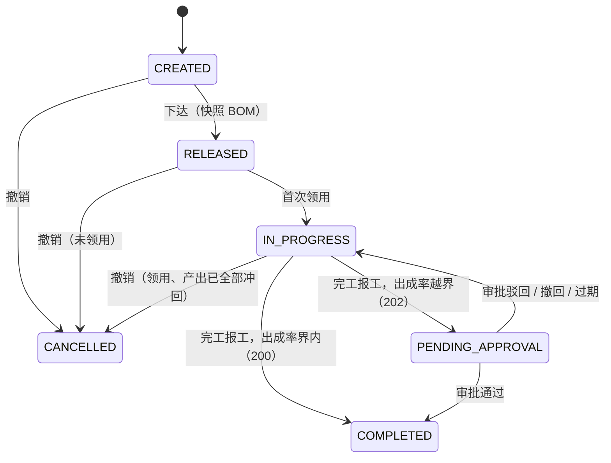

# 17 加工中心详细设计

| 项 | 内容 |
|---|---|
| 模块编号 | 17 |
| 作者 | 小钱（后端） |
| 评审 | 小赵（测试，主评，对抗评审 §13）、小吴（交叉看 §6.4 守恒与 §6.2 活鲜池领用的双计量） |
| 基线 | `docs/first-design@8a66782`；00 §6.2–§6.6、§6.4 码表（40910 / 40933 / 42214 / 42217）、库存状态 `PROCESSING`、`location_type=LIVE_TANK`、审批类型 `PROCESS_YIELD_DEVIATION`；02 库存原语；09（#4）报损单；18（小李，活鲜暂存，并行编写） |
| 依赖 | 00 全局约定；02 `stock` / `stock_hold` / 流水；01 SKU（`shelf_life_days`、`sell_days`）与库位；09 报损单；12 审批与权限；11 outbox |
| 状态 | 草稿 |

> 范围按大肥鱼定案（对标盒马）：**加工单、BOM / 出成率、原料领用（含活鲜池 `LIVE_TANK`，宰杀和分切归本篇）、成品与副产品入库、损耗、批次追溯**。全局约定不重复定义：雪花 ID（00 §6.1）、单号（00 §6.2）、数量 `*_qty_milli`（00 §6.3）、错误码（00 §6.4）、幂等（00 §6.5）、审批（00 §6.6.1 / 第 12 篇）、状态机写法（00 §6.7）。
> 标 **【待确认】** 的条目是本篇提出的方案，已写进 DDL 和用例，等大肥鱼在 §12 拍板；改了就同步改表和用例。

---

## 1. 职责与边界

### 1.1 本模块负责
1. **BOM**（`process_bom` / `process_bom_line`）：原料、成品、副产品的标准配比，出成率上下限 `yield_min_bp / yield_max_bp`，守恒容差 `balance_tol_bp`；版本化，生效后只读。
2. **加工单**（`process_order`）：创建、下达（**快照 BOM 与出成率上下限**【待确认 Q1】）、领用、报工、完工、撤销。
3. **原料领用**（`process_issue`）：从普通库位或活鲜池 `LIVE_TANK` 领用；原料**实物移到加工中心库位**【待确认 Q5】，并挂 `stock_hold(hold_type=PROCESSING)` 系统锁，**不可用、不可手工解冻**（40933）。
4. **报工**（`process_report` / `process_output`）：成品、副产品**各自建新批次入库**【待确认 Q2】；损耗走第 9 篇报损单，来源 `PROCESS_LOSS`【待确认 Q2】；称重毛重 / 皮重 / 净重留痕。
5. **守恒校验**：净领用 = 成品 + 副产品 + 损耗，服务端校验，超出容差返回 **42218 PROCESS_BALANCE_MISMATCH**【待确认 Q3，需 00 登记】。
6. **出成率偏差**：越界**不拦**，转主管审批 `PROCESS_YIELD_DEVIATION`。
7. **冲回**（`process_reversal`）：领用冲回（原料退回）、产出冲回（成品未出库才能冲）；冲回量 ≤ 可冲回量，超出 **42214 `OVER_REVERSE`**。
8. **成品保质期**：按加工时间重算，**不晚于原料中最早到期日**；`sell_deadline` 同理。
9. **批次追溯**（`process_lot_trace`）：成品 / 副产批次 ↔ 原料批次多对多，召回双向查，支持多级加工。

### 1.2 本模块不负责

| 事项 | 归属 |
|---|---|
| 库存原语（移库、冻结、消耗、入库）的实现、流水、`v_stock_available` | 02 |
| SKU 主数据（`shelf_life_days`、`sell_days`、称重容差）、库位主数据（新增 `location_type=PROCESS`） | 01（大肥鱼） |
| 活鲜池主数据、双计量账、水质巡检、`LIVE_HOLD`、出池称重键 `LIVE_WEIGH` | 18（小李） |
| 报损单的状态机与财务口径 | 09（本人，`PROCESS_LOSS` 来源在 #4 补） |
| 审批单 `approval_request`、权限点注册、审计 | 12 |
| 外部推送（完工结果给 ERP 做成本） | 11（本篇只写 outbox） |
| 后台页面 / PDA 页面 | 13 / 14（小周） |

### 1.3 与原文档的差异

| # | 原文档 | 本篇 | 理由 |
|---|---|---|---|
| Δ1 | 无加工模块 | 新增，纳入（不分期，Yuri 定） | 对标盒马：鲜切、分切、宰杀 |
| Δ2 | — | 原料领用后挂 `PROCESSING` 系统锁，不是"直接扣减" | 加工中原料仍是实物库存，盘点、追溯、撤销都需要它 |
| Δ3 | — | 出成率越界转审批，不拦 | 大肥鱼定案：生鲜出成率天然波动，拦了现场停工 |

## 2. 用例

| # | 用例 | 触发 | 权限点 | 写库存 | 离线 |
|---|---|---|---|---|---|
| UC1 | 维护 BOM（草稿、生效、停用） | 计划员（后台 13） | `process.bom.manage` | 否 | — |
| UC2 | 建加工单 | 计划员 | `process.order.create` | 否 | — |
| UC3 | 下达（快照 BOM） | 计划员 / 组长 | `process.order.release` | 否 | — |
| UC4 | 原料领用（普通库位 / 活鲜池） | 加工员（PDA 14） | `process.order.issue` | 是：移库 + PROCESSING 冻结 | 否（Q8） |
| UC5 | 报工（成品 / 副产 / 损耗，可多次） | 加工员 | `process.order.report` | 是：新批次入库 | 否（Q8） |
| UC6 | 完工报工（守恒、出成率） | 加工员 | `process.order.report` | 是：释放冻结 + 消耗原料 | 否 |
| UC7 | 审批出成率偏差 | 主管（后台 13） | `process.yield.approve` | 否（通过后同事务完工） | — |
| UC8 | 冲回领用 / 冲回产出 | 加工员 / 组长 | `process.order.reverse` | 是 | 否 |
| UC9 | 撤销加工单 | 组长 | `process.order.cancel` | 否（要求已全部冲回） | — |
| UC10 | 批次追溯 / 召回查询 | 品控、主管 | `process.trace.view` | 否 | — |
| UC11 | 查加工单列表 / 详情 | 各角色 | `process.order.view` | 否 | — |

## 3. 领域模型

- `ProcessBom(code, bom_version, status, yield_min_bp, yield_max_bp, balance_tol_bp)` + `ProcessBomLine(line_role ∈ {INPUT, FINISHED, BYPRODUCT}, sku_id, std_qty)`。
- `ProcessOrder(code=PRC-…, bom 快照, process_location_id, status, issued, reversed, output, byproduct, loss, yield_bp, approval_no)`：聚合根。
- `ProcessIssue(src_stock, lot, issue_qty, issue_count?, reversed_qty, hold_id, pc_stock_id)`。
- `ProcessReport(report_client_id, report_seq, is_final, response)` + `ProcessOutput(output_role ∈ {FINISHED, BYPRODUCT, LOSS}, lot?, gross/tare/net, expiry_date, sell_deadline)`。
- `ProcessLotTrace(output_lot ↔ raw_lot)`；`ProcessReversal(ISSUE | OUTPUT)`。

**不变量**（括号内为库层兜底）

| # | 不变量 | 兜底 |
|---|---|---|
| P1 | 冲回 ≤ 领用（单头、领用行都成立） | `ck_prc_reverse`、`ck_prci_reverse` |
| P2 | 任何时刻 成品 + 副产 + 损耗 ≤ 净领用 | `ck_prc_cap` |
| P3 | 完工（含待审批）时 净领用 = 成品 + 副产 + 损耗，且净领用 > 0 | `ck_prc_balance` |
| P4 | `yield_bp = output × 10000 ÷ 净领用`（整除），不信任应用传值 | `ck_prc_yield` |
| P5 | 出成率越界 ⇔ 必须挂审批单；界内不能挂、不能进 PENDING_APPROVAL | `ck_prc_dev`、`ck_prc_apr`、`uq_prc_apr` |
| P6 | 下达后 BOM 快照、出成率上下限、守恒容差只读；终态整行只读；领用 / 冲回累计只增 | `trg_prc_snapshot` |
| P7 | BOM 生效后行只读 | `trg_pboml_frozen` |
| P8 | 成品到期日 ≤ 最早原料到期日；可售截止 ≤ 到期日 | `ck_prco_expiry`、`ck_prco_sell` |
| P9 | 成品 / 副产必有新批次（批次不复用），损耗无批次、必挂报损单 | `ck_prco_kind`、`uq_prco_lot` |
| P10 | 净重 = 毛重 − 皮重；产出关键列只读，冲回量只增 | `ck_prco_net`、`trg_prco_immutable` |
| P11 | PROCESSING 冻结只能挂加工单、`operator_id=0`、`op_key=PRCI:…` | `ck_hold_process`（02 `stock_hold`） |
| P12 | 活鲜池领用必带尾数，其他库位不能带 | `ck_prci_live` |
| P13 | 报工、追溯、冲回只追加；报工业务键长期保留 | 触发器 + PG 不授 UPDATE |
| P14 | 撤销 ⇒ 领用全部冲回且无产出 | `ck_prc_cancel` |

## 4. 涉及的表（字段、约束、索引）

DDL 见 `wms-design/sql/schema_postgres.sql`「加工中心（docs/17）」一节，SQLite 由 `verify_sqlite.py` 机械生成。**新增 8 表 / 29 索引**（8 PK + 12 UNIQUE 约束 + 3 部分唯一 + 6 普通），总计 **51 表 / 147 索引 / 1 视图**（base `8a66782` 为 43 / 118，PG 实测）。另改 02 的 `stock_hold` 两条 CHECK 并加一条（§4.8）。

### 4.1 `process_bom` / `process_bom_line`
`uq_pbom(warehouse_id, code, bom_version)`；部分唯一 `uq_pbom_active(warehouse_id, code) WHERE status='ACTIVE'`（同编码只一个生效版本）；`ck_pbom_yield`：`0 < min ≤ max ≤ 20000`（上限放到 200%，给腌制、上浆等增重工艺留口子）；`ck_pbom_tol`：守恒容差 0–1000 bp，默认 50（0.5%）；`ck_pbom_act`：非草稿必须有 `activated_at`。
行：`uq_pboml(bom_id, line_no)`、`uq_pboml_sku(bom_id, line_role, sku_id)`、`ck_pboml_role`、`ck_pboml_qty`。`trg_pboml_frozen`（两库）：BOM 非 DRAFT 时拦行的增删改（`bom_frozen`）。改配方 = 建新版本 → 生效 → 旧版本 RETIRED。

### 4.2 `process_order`

| 列 | 说明 |
|---|---|
| `code` | `PRC-{仓}-{节点}-{作业日}-{序号}`（00 §6.2；前缀 `PRC` 请 00 登记），`uq_prc_code` |
| `process_location_id` | 加工中心库位（`location_type=PROCESS`，请第 1 篇登记） |
| `bom_code / bom_version / bom_snapshot / yield_min_bp / yield_max_bp / balance_tol_bp` | **下达时快照**【Q1】；`ck_prc_snapshot`：下达后必须齐全；`trg_prc_snapshot`：下达后只读 |
| `issued / reversed / output / byproduct / loss_qty_milli` | 汇总，与明细同事务条件更新；`output/byproduct/loss` 是扣除产出冲回后的净额 |
| `yield_bp` | 只在 PENDING_APPROVAL / COMPLETED 时有值，`ck_prc_yield` 校验等于整除结果 |
| `approval_no` | `PROCESS_YIELD_DEVIATION` 审批单号，格式 `APR-{仓库编码}-{yyyyMMdd}-{6 位}`（PG 正则 / SQLite GLOB，长度 22–36，同 02 `ck_hold_approval_no`）；`uq_prc_apr` 部分唯一 |

索引：`ix_prc_status(warehouse_id, status, work_date)`（列表页）。

### 4.3 `process_issue`
`uq_prci(process_order_id, line_no)`；`uq_prci_op(op_key)`，`op_key = PRCI:{process_order_id}:{issue_client_id}`（PDA 生成 UUID，重试不变，与 `stock_hold.op_key` 同值）；`uq_prci_hold(hold_id)`；`ck_prci_reverse`；`ck_prci_live`：`src_location_type='LIVE_TANK'` ⇔ `issue_count > 0`（第 18 篇双计量：重量按实称净重、尾数按实点）；`lot_expiry_date` 冗余原料到期日，算成品到期上限用；`ix_prci_lot(lot_id)`。

### 4.4 `stock_hold` 的 `PROCESSING`（02 表，本人维护）
- `ck_hold_type`、`ck_hold_reason` 加 `PROCESSING`（`reason_code='PROCESSING'`），计入 `stock.hold_qty_milli` → `v_stock_available` 自动扣除，FEFO 分不到（用例"PROCESSING 不计入可用库存"实测 available=0）。
- 新增 `ck_hold_process`：`source_type='PROCESS_ORDER' AND source_id>0 AND operator_id=0 AND op_key LIKE 'PRCI:%'`。
- 人工解冻接口对 `PROCESSING` 返回 **40933**（00 已登记），`detail={hold_type:"PROCESSING", source_type:"PROCESS_ORDER", source_id}`。只能由本篇完工（§6.4）或领用冲回（§6.5）释放。

### 4.5 `process_report`
`uq_prcr_client(process_order_id, report_client_id)`【Q4】，长期保留，不随 `Idempotency-Key` 过期；`uq_prcr_seq(process_order_id, report_seq)`（服务端分配）；`ck_prcr_client`（36 位 UUID 形状）、`ck_prcr_hash`（SHA-256）、`ck_prcr_http ∈ {200, 202}`：**只缓存成功结果**（4xx 整个事务回滚，不落行，客户端修正后用同一个键重提）。整行只追加（两库触发器 + PG 不授 UPDATE）。完工报工可能多条（偏差审批驳回后再完工，§5.1），所以 `is_final` 不建唯一。

### 4.6 `process_output`

| 列 | 说明 |
|---|---|
| `output_role` | `FINISHED / BYPRODUCT / LOSS` |
| `lot_id / to_location_id` | 成品、副产必填（新批次，`uq_prco_lot`）；LOSS 必为空 |
| `gross / tare / qty_milli` | `ck_prco_net`：净 = 毛 − 皮，皮 ≥ 0，净 > 0 |
| `processed_at` | UTC；按仓库时区取日期作为保质期起算日 |
| `expiry_date / sell_deadline / earliest_raw_expiry` | §6.3；`ck_prco_expiry`、`ck_prco_sell` |
| `scrap_order_id / loss_reason` | LOSS 必填；原因 `TRIM 修整 / DRIP 滴水 / WEIGH_DIFF 容差内称重差 / DEFECT 次品` |
| `reversed_qty_milli` | 产出冲回累计，`ck_prco_reverse`；`trg_prco_immutable` 拦其他列修改和删除 |

### 4.7 `process_lot_trace` / `process_reversal`
追溯：`uq_plt(output_id, issue_id)`、`ck_plt_self`、`ix_plt_out(output_lot_id, raw_lot_id)`（反查）、`ix_plt_raw(raw_lot_id, output_lot_id)`（正查），只追加。
冲回：`uq_prcv_op(op_key)`，`op_key = PRCR:{reversal_client_id}`；`ck_prcv_type`：ISSUE 只挂 `issue_id`、OUTPUT 只挂 `output_id`；只追加。

### 4.8 同步改动的非本模块内容
- 02 `stock_hold`：见 §4.4（02 是本人的篇目；02 正文的冻结类型表在 PR #2 里同步补一行，**本 PR 只改 DDL**）。
- `stock_movement.biz_type` 注释新增 `PROCESS_ISSUE / PROCESS_CONSUME / PROCESS_OUTPUT / PROCESS_REVERSE`（列无 CHECK，不改 DDL；02 正文同上）。
- 其他篇目的改动全部作为请求列在 §12.2，本 PR 不改。

### 4.9 授权（PG，`-- @pg-only`）
`process_bom / process_bom_line / process_order / process_issue / process_output`：SELECT、INSERT、UPDATE；`process_report / process_lot_trace / process_reversal`：只 SELECT、INSERT。都不给 DELETE / TRUNCATE。`verify.sh` S4 权限矩阵已同步。

## 5. 状态机

### 5.1 加工单 `process_order`



| from → to | 触发者 | 守卫 | 副作用 |
|---|---|---|---|
| CREATED → RELEASED | `process.order.release` | BOM 为 ACTIVE；加工中心库位可用 | 写快照；`released_at` |
| RELEASED → IN_PROGRESS | 首次领用 | — | 与领用同事务 |
| IN_PROGRESS → COMPLETED | 完工报工 | 守恒（§6.4）、`yield_bp ∈ [min,max]` | 释放全部 PROCESSING 冻结、消耗原料净领用；outbox `wms.process.completed` |
| IN_PROGRESS → PENDING_APPROVAL | 完工报工 | 守恒成立、出成率越界 | 第 12 篇建审批单 `PROCESS_YIELD_DEVIATION`，写 `approval_no`；**冻结不释放**；返回 202 |
| PENDING_APPROVAL → COMPLETED | 审批通过（同事务） | 审批人 ≠ 报工人（SoD） | 同 IN_PROGRESS → COMPLETED |
| PENDING_APPROVAL → IN_PROGRESS | 驳回 / 撤回 / 过期 | — | 清 `yield_bp`、`approval_no`（审批单留在第 12 篇）；现场冲回或补报后重新完工 |
| * → CANCELLED | `process.order.cancel` | `issued = reversed`、产出净额全为 0、`cancel_reason` 非空 | outbox `wms.process.cancelled` |

COMPLETED、CANCELLED 是终态，整行只读（`trg_prc_snapshot`）。完工后发现问题不回滚加工单：成品走第 9 篇报损或第 10 篇异常（Q7）。

### 5.2 BOM：`DRAFT → ACTIVE → RETIRED`；ACTIVE 同编码唯一，生效后行只读。

## 6. 核心流程

### 6.1 下达（UC3）
1. 读 BOM（必须 ACTIVE）→ 把 BOM 行序列化成 `bom_snapshot`（JSON，键排序），复制 `bom_code / bom_version / yield_min_bp / yield_max_bp / balance_tol_bp`。
2. `UPDATE process_order SET status='RELEASED', … WHERE id=:id AND status='CREATED'`，0 行 → 40930。
3. 之后改 BOM 只影响新下达的单；审批和追溯都按快照（这就是 Q1 选快照的理由）。

### 6.2 原料领用（UC4，含活鲜池）
同一事务：
1. `op_key = PRCI:{order_id}:{issue_client_id}` 查重：已存在且内容相同 → 回放；内容不同 → 40910（`key_type` 见 Q4b）。
2. 加工单 `status IN (RELEASED, IN_PROGRESS)`，否则 40930。
3. 来源 stock 条件扣减：02 `move(src_stock → pc_stock, qty)`，可用量不足 → 40902 STOCK_INSUFFICIENT（00 L172）。**活鲜池**：重量取实称净重（毛重 − 皮重，皮重由秤 / PDA 去皮录入），尾数取实点，`issue_count` 必填；池位被 `LIVE_HOLD` 锁住时能否领用见 Q6（小李）。
4. 02 `place_hold(pc_stock, PROCESSING, source=PROCESS_ORDER:{order_id}, op_key=同上, operator=0)`。
5. 写 `process_issue`；单头 `issued_qty_milli += qty`，首次领用同时 `RELEASED → IN_PROGRESS`。
6. 跨仓不涉及：领用在本仓内移库，不在 `paused_actions` 里，PAUSE 期间可做。

### 6.3 报工（UC5）与成品保质期
请求：`{report_client_id, is_final, outputs:[{role, sku_id, to_location_id?, gross, tare, loss_reason?}]}`。
1. 业务键 `(process_order_id, report_client_id)`：已存在 → `request_hash` 相同则原样返回首次的 HTTP 码和响应体；不同 → **40910 `key_type=PROCESS_REPORT`**【Q4】。只有新键才往下走。
2. 加工单 `IN_PROGRESS`，否则 40930。
3. 每条 FINISHED / BYPRODUCT：SKU 必须在快照的 FINISHED / BYPRODUCT 行里，否则 40001；定量装成品（SKU 有标准规格）净重偏离超过 SKU `weigh_tolerance_bp` → **42217 WEIGH_OUT_OF_TOLERANCE**。
4. 建新批次 `lot`：
   - `earliest_raw_expiry` = 本单**净领用 > 0** 的领用行 `lot_expiry_date` 最小值；
   - `expiry_date = min(加工日 + sku.shelf_life_days, earliest_raw_expiry)`，加工日 = `processed_at` 按仓库时区的日期；
   - `sell_deadline = min(加工日 + sku.sell_days, expiry_date)`，`sku.sell_days` 为空则为空（`sku.sell_days` 待第 1 篇加，见 §12.2）；
   - 批次号 `lot_code = {order_code}-{report_seq}-{line_no}`。
5. 02 `receive(to_location, new lot, net)`（`biz_type=PROCESS_OUTPUT`），写 `process_output`；对每条净领用 > 0 的领用行写 `process_lot_trace`。
6. 每条 LOSS：第 9 篇建报损单（来源 `PROCESS_LOSS`，来源键 `PRCL:{output_id}`），写 `scrap_order_id`。损耗的库存在完工时随原料消耗一起扣（§6.4），报损单只记数量和原因、不再冻结库存（第 9 篇 #4 补"记账型"来源）。
7. 单头 `output / byproduct / loss += …`，受 `ck_prc_cap`（P2）约束：超过净领用 → 42218。
8. `is_final=true` 时接 §6.4。写 `process_report`（只在成功时写）。

### 6.4 完工：守恒与出成率（UC6、UC7）
设 `net = issued − reversed`，`sum = output + byproduct + loss`，`diff = net − sum`，`tol = net × balance_tol_bp ÷ 10000`（整除）。
1. `0 < diff ≤ tol`：服务端自动补一条 LOSS（`loss_reason=WEIGH_DIFF`，同样建 `PROCESS_LOSS` 报损单），使 `sum = net`。
2. `diff = 0`：直接通过。
3. `diff > tol` 或 `diff < 0`：**42218 PROCESS_BALANCE_MISMATCH**，`detail={net_issued, output, byproduct, loss, diff, tolerance}`，整个事务回滚。`diff < 0`（产出多于领用）一律拒绝，不吃容差：少领的原料要先补领（Q3）。
4. `yield_bp = output × 10000 ÷ net`。
   - 界内 → `COMPLETED`，同事务：逐行 `release_hold(PROCESSING)` 并 `consume(pc_stock, 净领用)`（`biz_type=PROCESS_CONSUME`），outbox `wms.process.completed`。返回 **200** `{process_order_id, status:"COMPLETED", yield_bp, approval_id:null}`。
   - 越界 → 第 12 篇建审批单 `PROCESS_YIELD_DEVIATION`，`PENDING_APPROVAL`，冻结**不释放**。返回 **202** `{process_order_id, status:"PENDING_APPROVAL", yield_bp, yield_min_bp, yield_max_bp, approval_id, approval_no}`。重放同一个 `report_client_id` 返回同一个 200 / 202。
5. 审批通过：同事务执行第 4 步界内分支（审批单号保留）。审批人不能是报工人（第 12 篇 SoD）。驳回 / 撤回 / 过期：回到 `IN_PROGRESS`，现场冲回错报的产出或补报后重新完工（新的 `report_client_id`）。
6. 条件更新：`UPDATE process_order SET status=…, version=version+1 WHERE id=:id AND status='IN_PROGRESS'`，0 行 → 40930。

### 6.5 冲回（UC8）
请求 `{reversal_client_id, type: ISSUE|OUTPUT, issue_id|output_id, qty, reason}`，`op_key = PRCR:{reversal_client_id}` 去重。加工单必须 `IN_PROGRESS`（PENDING_APPROVAL 期间不能冲，先撤回审批）。
- **领用冲回**：`UPDATE process_issue SET reversed_qty_milli = reversed_qty_milli + :q WHERE id=:id AND reversed_qty_milli + :q <= issue_qty_milli`，0 行 → **42214 `OVER_REVERSE`**，`detail={issue_id, issued_qty, reversed_qty, requested_qty}`；再校验单头 `sum ≤ net − q`（已产出的部分不能退），不满足同样 42214。成功后 `release_hold(PROCESSING, q)` + `move(pc_stock → 原来源库位)`（`biz_type=PROCESS_REVERSE`）；原库位不可用时退到加工中心暂存位由组长处理（Q7）。活鲜池领用冲回：只冲重量，尾数按实点回池（是否允许回池见 Q6）。
- **产出冲回**：只能冲**还在库、未分配、未出库**的部分。`UPDATE stock SET on_hand = on_hand − :q … WHERE id=:lot_stock AND on_hand − allocated − reserved − quality_hold − hold >= :q`，0 行 → **42214 `OVER_REVERSE`**，`detail={output_id, output_qty, reversed_qty, requested_qty, reversible_qty}`（已发货 / 已分配的成品不能冲回）。成功后 `process_output.reversed_qty_milli += q`、单头产出净额 −q；货回到加工中心继续算在制（净领用不变）。LOSS 冲回 = 第 9 篇作废对应报损单。
- 冲回不改追溯：追溯表只追加，查询时按 `process_output.qty − reversed > 0` 过滤"有效"关系，召回默认**不过滤**（宁多勿漏）。

### 6.6 批次追溯与召回（UC10）
- 反查（成品 → 原料）：`SELECT raw_lot_id FROM process_lot_trace WHERE output_lot_id=:lot`，走 `ix_plt_out`。
- 正查（原料 → 成品，召回用）：走 `ix_plt_raw`。
- 多级加工（成品再当原料）：递归 CTE，两库语法一致：
```sql
WITH RECURSIVE f(lot) AS (
  SELECT output_lot_id FROM process_lot_trace WHERE raw_lot_id = :lot
  UNION
  SELECT t.output_lot_id FROM process_lot_trace t JOIN f ON t.raw_lot_id = f.lot)
SELECT lot FROM f;
```
  `UNION`（不是 `UNION ALL`）去重防环；`depth` 参数默认 5、上限 10。用例实测：原料 1 → {1760, 1761, 1780}；成品 1780 → {1, 2, 1760}。
- 召回结果带每个下游批次的当前库存（02）和已出库的出库单（04），由第 13 篇展示。

## 7. 接口清单与契约

### 7.1 服务内（Python，同库同事务）
`release_order(order_id)`、`issue(order_id, issue_client_id, src_stock_id, qty, count?)`、`report(order_id, report_client_id, is_final, outputs)`、`reverse(order_id, reversal_client_id, …)`、`apply_yield_approval(approval_id, decision)`（第 12 篇回调）、`trace(lot_id, direction, depth)`。

### 7.2 HTTP（`/api/v1`，所有 POST 带 `Idempotency-Key`）

| 方法 路径 | 权限点 | 说明 |
|---|---|---|
| `GET /process/boms?code=&status=` / `GET /process/boms/{id}` | `process.bom.view` | BOM 列表 / 详情（含行） |
| `POST /process/boms` / `POST /process/boms/{id}/lines` | `process.bom.manage` | 建草稿 / 维护行（只限 DRAFT，否则 40930） |
| `POST /process/boms/{id}/activate` / `…/retire` | `process.bom.manage` | 生效（同编码旧 ACTIVE 同事务转 RETIRED）/ 停用 |
| `GET /process/orders?status=&work_date=&bom_code=&created_from=&created_to=` | `process.order.view` | 列表 |
| `GET /process/orders/{id}` | `process.order.view` | 详情：快照、领用、报工、产出、冲回、审批单号 |
| `POST /process/orders` | `process.order.create` | `{bom_id, process_location_id, planned_input_qty}` |
| `POST /process/orders/{id}/release` | `process.order.release` | 下达 |
| `POST /process/orders/{id}/issues` | `process.order.issue` | `{issue_client_id, src_stock_id, qty, count?, gross?, tare?}` |
| `POST /process/orders/{id}/reports` | `process.order.report` | §6.3；完工 200 / 202 |
| `POST /process/orders/{id}/reversals` | `process.order.reverse` | §6.5 |
| `POST /process/orders/{id}/cancel` | `process.order.cancel` | `{reason}` |
| `GET /process/trace?lot_id=&direction=UP\|DOWN&depth=` | `process.trace.view` | §6.6 |
| 审批：第 12 篇 `POST /approvals/{id}/approve\|reject` | `process.yield.approve` | `type=PROCESS_YIELD_DEVIATION` |

### 7.3 错误码（以 00 §6.4 为准）

| 码 | 场景 | `detail` |
|---|---|---|
| 40001 | 产出 SKU 不在快照里；LIVE_TANK 缺尾数 | 字段 |
| 40311 | 跨仓 | — |
| 40902 | 领用时来源库存不足 | 00 |
| 40910 | 报工同键不同内容 `key_type=PROCESS_REPORT`【Q4】；领用同 `issue_client_id` 不同内容（`key_type` 见 Q4b） | `key_type` |
| 40930 | 状态不允许（未下达领用、PENDING_APPROVAL 期间冲回、BOM 非草稿改行等） | 当前状态 |
| 40933 | 人工解冻 PROCESSING | `{hold_type, source_type, source_id}` |
| 42214 | `OVER_REVERSE`：冲回超可冲回量（含已出库成品） | 见 §6.5 |
| 42217 | 定量装产出称重超差 | `{expected, actual, tolerance_bp}` |
| **42218** | `PROCESS_BALANCE_MISMATCH`：守恒差超容差或产出多于领用【Q3，请 00 登记】 | `{net_issued, output, byproduct, loss, diff, tolerance}` |

### 7.4 outbox
`wms.process.completed`（成品 / 副产批次、原料消耗、出成率，给 ERP 算成本）、`wms.process.cancelled`。事件格式按第 11 篇。

## 8. 并发与幂等
- **业务键**：领用 `op_key`、报工 `(process_order_id, report_client_id)`、冲回 `op_key`，都在业务表上有唯一约束，与业务写同事务；`Idempotency-Key` 过期后照样去重。
- **条件更新**：状态迁移 `WHERE status=:from`；冲回 `WHERE reversed + q <= issued`；产出冲回按 stock 可用量条件扣。不读后写。
- **加锁顺序**（PG `FOR UPDATE` / SQLite 单写者）：`process_order` → `process_issue`（按 id 升序）→ `stock`（按 id 升序，同 02）→ `stock_hold`。
- **并发报工**：两台 PDA 同时完工，第二个条件更新 0 行 → 40930；两台同时普通报工靠 `uq_prcr_seq` + 重取序号（最多 3 次）。

## 9. 异常与补偿

| 场景 | 处理 |
|---|---|
| 领用后长时间不完工 | 每日 06:00 列出 `IN_PROGRESS` 超过 24h 的单进主管待办（不自动冲回） |
| 偏差审批过期 | 回到 `IN_PROGRESS`，冻结保持 |
| 报工响应丢失 | 客户端用同一 `report_client_id` 重放，拿到原 200 / 202 |
| 成品发现质量问题（已完工） | 第 9 篇报损 / 第 10 篇异常；追溯查上下游 |
| 加工中心盘点差异 | 第 2 篇盘点；PROCESSING 冻结行盘点前需先完工或冲回（Q7） |

## 10. 权限
新增：`process.bom.view`、`process.bom.manage`、`process.order.view`、`process.order.create`、`process.order.release`、`process.order.issue`、`process.order.report`、`process.order.reverse`、`process.order.cancel`、`process.yield.approve`（主管）、`process.trace.view`。审批 SoD：审批人 ≠ 完工报工人。全部请第 12 篇注册（§12.2）。

## 11. 测试要点

### 11.1 自动化测试（`verify.sh` / `verify_sqlite.py` 第 2h 节，用例同名）
- BOM：出成率区间、容差上限、同角色同 SKU、生效缺时间、生效后行增删改（`bom_frozen`）、同编码两个 ACTIVE。
- 加工单：单号唯一、下达缺快照、下达后改快照（`process_order_frozen`）、领用量回退、终态只读。
- 领用：LIVE_TANK 尾数双向、`op_key` 格式与重放；PROCESSING 冻结四条反例；PROCESSING 不计入 `v_stock_available`。
- 冲回：行 / 单头超冲回；条件更新命中 1 行、超量 0 行（42214）；已分配成品不可冲（0 行）。
- 报工：同单同键唯一、跨单同键放行、序号唯一、UUID 形状、只缓存 200/202、只追加。
- 产出：净重 = 毛 − 皮、到期日上限、可售截止上限、成品缺批次、批次复用、损耗必挂报损单 / 不带批次 / 原因枚举、关键列只读、不可删、冲回上限。
- 追溯：重复、自指、只追加、单级反查、多级递归正查 / 反查。
- 完工：进行中超产、守恒不平、出成率与净额不符、界内不能转审批、缺完工时间、界内完工；越界无审批、审批单号格式、越界转审批、审批通过、审批单号复用；撤销缺原因 / 有未冲回领用 / 正常撤销。
- 冲回记录：类型互斥、`op_key` 重放、只追加。PG 另测 `wms_app` 对 `process_report` 无 UPDATE。
- 服务层（M1 实现时补）：42218 两个方向、容差内自动补 WEIGH_DIFF、200/202 重放、40910 PROCESS_REPORT、审批驳回回到 IN_PROGRESS 后再完工、成品到期 = min(加工日+保质期, 最早原料到期)。

### 11.2 本 PR 的验证脚本结果
- SQLite：`python3 sql/verify_sqlite.py` → **275 / 275**（base 179）。
- PG16（全新空库）：`verify.sh` → **274 / 274**（base 178）；表 / 索引 / 视图 = 51 / 147 / 1。
- PG 比 SQLite 少 1 条："领用数量非整数 milli"只在 SQLite 测（PG BIGINT 列按类型取整，入参整数由服务端 40001 校验，同第 16 篇做法）。

## 12. 待定问题

### 12.1 本篇方案（【待确认】，请 @大肥鱼 拍板）

| # | 问题 | 本篇方案（已写进 DDL / 用例） | 状态 |
|---|---|---|---|
| Q1 | BOM 和出成率上下限是快照还是引用当前版本 | **下达时快照**（`bom_snapshot` 等列 + `trg_prc_snapshot`）；BOM 生效后也只读 | 待确认 |
| Q2 | 副产品与损耗 | 副产品是**独立 SKU，入库建新批次**；损耗走第 9 篇报损单，来源 **`PROCESS_LOSS`**，报损单为"记账型"（库存在完工时随原料消耗扣，不再冻结） | 待确认 |
| Q3 | 守恒不平 | 新码 **42218 PROCESS_BALANCE_MISMATCH**（请 00 登记）；容差 `balance_tol_bp` 按 BOM 配、默认 50；容差内正差自动记 WEIGH_DIFF 损耗；负差（产出多于领用）一律拒 | 待确认 |
| Q4 | 报工幂等 | 业务键 **`(process_order_id, report_client_id)`**，冲突 **40910 `key_type=PROCESS_REPORT`**（请 00 登记）；只缓存 200 / 202 | 待确认 |
| Q4b | 领用幂等的 `key_type` | `op_key=PRCI:{order_id}:{issue_client_id}`；冲突建议 `key_type=PROCESS_ISSUE`（或并入 PROCESS_REPORT，请定一个） | 待确认 |
| Q5 | PROCESSING 库存是什么 | **加工中心库位上的实物库存**（移库 + `stock_hold(PROCESSING)`），不是加工单上的在制数 | 待确认 |

### 12.2 需要其他篇目改的（请求，本 PR 不改）

| 篇目 | 负责人 | 请求 |
|---|---|---|
| 00 §6.4 | 大肥鱼 | 登记 **42218 PROCESS_BALANCE_MISMATCH**；40910 `key_type` 加 `PROCESS_REPORT`（和 Q4b 定下的领用键）；40933 的 PROCESSING 说明里补 `source_type=PROCESS_ORDER` |
| 00 §6.2 | 大肥鱼 | 单号前缀 `PRC`（加工单） |
| 00 §6.6.1 | 大肥鱼 | 回填 `PROCESS_YIELD_DEVIATION`：申请 = 完工报工自动发起（`process.order.report`），审批 `process.yield.approve`（主管），接口第 12 篇 `/approvals`，驳回 / 撤回 / 过期回到 IN_PROGRESS |
| 00 报损来源 | 大肥鱼 | 登记 `PROCESS_LOSS`，来源键 `PRCL:{process_output_id}` |
| 00 模块表 L312 | 大肥鱼 | 第 17 篇负责人小钱、评审小赵（主）/ 小吴 |
| 01 | 大肥鱼 | `location_type` 新增 `PROCESS`（加工中心库位）；`sku.sell_days`（之前已提）；SKU `weigh_tolerance_bp` 加工产出也用 |
| 12 | 大肥鱼 | 注册 §10 的 11 个权限点和审批类型 |
| 18 | 小李 | Q6、活鲜池领用的称重键是否复用 `LIVE_WEIGH` |
| 13 / 14 | 小周 | 后台：BOM、加工单列表 / 详情、偏差审批、追溯页；PDA：领用、报工（毛 / 皮 / 净）、冲回；202 显示待审批 |
| 02 / 09 | 小钱（本人） | 02 正文补 PROCESSING 冻结类型；09 补 `PROCESS_LOSS` 记账型来源（#4） |

### 12.3 其他待定

| # | 问题 | 建议 |
|---|---|---|
| Q6 | 活鲜池被 `LIVE_HOLD` 锁住时能否领用宰杀；领用冲回能否回池 | 锁住期间不能领用（水质异常的鱼不进加工）；冲回只退死体到加工暂存位，不回池。请小李在第 18 篇定 |
| Q7 | 完工后的问题、冲回目标库位不可用、加工中心盘点 | 完工不回滚；冲回目标不可用退到加工暂存位；盘点前先完工或冲回 |
| Q8 | 领用 / 报工能否离线 | 不能（PDA 断网提示，00 §9 离线清单不含加工） |

## 13. 对抗评审攻击面（给小赵、小吴）

| # | 攻击面 | 本篇防线 | 建议重点打 |
|---|---|---|---|
| P-A1 | 守恒绕过 | `ck_prc_cap` 全程、`ck_prc_balance` 完工 | 冲回领用后已产出 > 净领用的时序 |
| P-A2 | 出成率造假 | `ck_prc_yield` 库层重算，`ck_prc_dev` 越界必审批 | 审批中途冲回产出改变出成率（已禁：PENDING_APPROVAL 不能冲） |
| P-A3 | 快照篡改 | `trg_prc_snapshot`、`trg_pboml_frozen` | 驳回回到 IN_PROGRESS 后改快照 |
| P-A4 | PROCESSING 被手工解冻或被分配 | `ck_hold_process`、40933、`v_stock_available` | 冻结与 stock.hold 汇总不一致 |
| P-A5 | 已出库成品冲回 | stock 条件扣减 | 已分配未拣、已拣未发的时序 |
| P-A6 | 保质期延长 | `ck_prco_expiry`、`ck_prco_sell` | 冲回最早到期原料后报工的 `earliest_raw_expiry` 计算 |
| P-A7 | 报工重放 | `uq_prcr_client` 长期保留、只追加 | 4xx 后同键改内容重提（不落行，所以允许） |
| P-A8 | 追溯漏召回 | 只追加、递归 UNION | 产出冲回后的关系是否仍召回（默认召回） |
| P-A9 | 活鲜双计量 | `ck_prci_live` | 重量、尾数与第 18 篇池账的一致性 |
