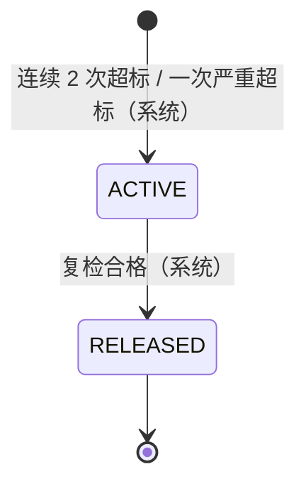
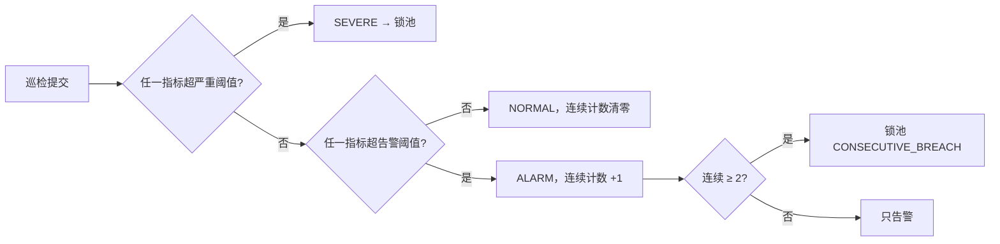
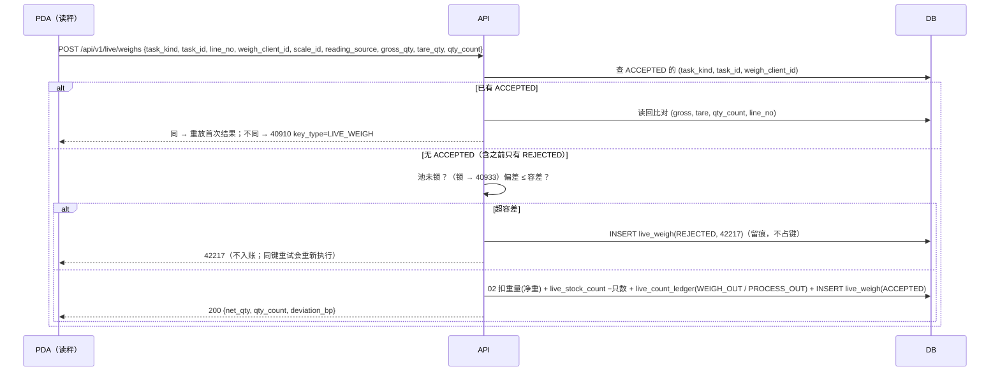

# 18 活鲜暂存

| 项 | 内容 |
|---|---|
| 作者 | 小李 |
| 评审 | 小玛丽（主）、小企鹅（副） |
| 状态 | 草稿（二轮：按 PM P1–P6 改 B2/B3/B5/B6，基线 `docs/first-design@1d907031`（#2 四轮）） |
| 依赖 | 00 全局约定（ID、单号、数量 R2、时区 R3、错误码 §6.4、幂等 §6.5、§6.6.1 审批 `LIVE_DEATH_OVER`、§6.6.2 `paused_actions`、§9.1）；02 库存核心（`stock`、`stock_movement`、`stock_hold`、可用量；原语 `place_hold` / `release_live_hold` / `consume_live_hold` / `post_out`）；04 出库与分配（分配、撤销分配、拣后取消）；05 波次与拣货（`pick_task`）；08 盘点（差异）；09 报损（`scrap_order`、`uq_scr_source`）；12 审批与审计；17 加工单（宰杀、分切）；15 PDA 前端（爱弥斯） |

> 本篇只写服务端。数量：重量一律 `BIGINT *_qty_milli`（SKU 基本单位 KG 的千分之一，即克），只数 `BIGINT *_count`；接口重量用 3 位小数字符串，只数用整数。温度一律 `*_c10`（0.1 ℃ 整数，与第 1 篇温区 `temp_min_c10 / temp_max_c10` 同口径）。所有时间存 UTC；SQLite 时间列为 `'YYYY-MM-DD HH:MM:SS'`（无小数秒，CHECK 约束）。示例仓库编码 `WHSH01`，审批单号 `APR-WHSH01-20261015-000123`。

## 1. 职责与边界

### 1.1 负责
1. **暂养池**：`location_type = LIVE_TANK` 的库位及其扩展属性（水体积、温控、水质阈值、巡检频率）；一池一 SKU，可多批次。
2. **双数量账**：重量走第 2 篇（`stock.on_hand_qty_milli`、`stock_movement`），只数走本篇（`live_stock_count`、`live_count_ledger`），同一事务、同一业务键。
3. **巡检**：水温、溶解氧、pH 录入；先告警，连续 2 次超标或一次超严重阈值则整池 `LIVE_HOLD`。
4. **出池称重**：活鲜出库按实际净重、实际只数扣减；容差内入账，超容差拒绝（42217）。
5. **死亡登记**：本篇直接扣重量和只数（P1），同时生成第 9 篇报损单（来源 `LIVE_DEATH`），报损单**只记账、不再扣库存**；超阈值走审批 `LIVE_DEATH_OVER`（未带审批返回 40938）。
6. **日失重结算**：每日按池、批次结算自然失重（只扣重量）；容差内由本篇扣重量并生成只记账的 `LIVE_SHRINK` 损耗单，超容差转第 8 篇盘点差异（不扣）。

### 1.2 不负责
- 宰杀、分切：纳入第 17 篇加工单。原料从池里领用时走本篇出池称重（`task_kind = PROCESS_ISSUE`，§6.2），之后由 17 处理。锁池期间加工领用返回 40933；加工冲回**不回池**（走 17 的报废/冲回，不写本篇只数流水）。
- 分配算法（04）、波次（05）、报损单本身（09）、盘点（08）、审批流（12）。
- PDA 界面行为（15）；本篇只给接口与服务端规则，§11 回答小周的前端问题。

## 2. 用例
| # | 用例 | 角色 | 权限点 | 动库存 | PDA 离线 |
|---|---|---|---|---|---|
| UC1 | 维护暂养池参数 | 仓主管 | `live.tank.edit` | 否 | 否 |
| UC2 | 维护 SKU 活鲜参数（容差、阈值） | 仓主管 / CENTER_OPS | `live.param.edit` | 否 | 否 |
| UC3 | 入池（收货上架到池） | 收货员 | 沿用收货权限 | 重量 +、只数 + | 否 |
| UC4 | 巡检录入 | 养殖员 | `live.inspect.submit` | 否（可能触发锁池） | 是 |
| UC5 | 复检（锁池后） | 养殖员 | `live.inspect.submit` | 否（合格则系统解锁） | 是 |
| UC6 | 出池称重 | 拣货员 | `live.weigh.submit` | 重量 −、只数 − | 是（键见 §8） |
| UC7 | 死亡登记 | 养殖员 | `live.death.report` | 重量 −、只数 − | 是 |
| UC8 | 死亡超阈值审批 | 仓主管 | `live.death.approve` | 否 | 否 |
| UC9 | 日失重结算（作业） | 系统 | — | 重量 − | — |
| UC10 | 查询池况、流水 | 有仓权限者 | `live.tank.view` | 否 | — |

## 3. 领域模型

### 3.1 双数量（PM 1）
- 分配、出库计价、拣货计划都按**重量**。只数是并行的第二本账，用于死亡率、盘点与客户要求。
- 各动作对两本账的影响：

| 动作 | 重量 | 只数 |
|---|---|---|
| 入池 | + 实收净重 | + 实收只数 |
| 出池称重（ACCEPTED） | − 实际净重 | − 实际只数 |
| 死亡 | − 死亡重量 | − 死亡只数 |
| 自然失重 | − 失重重量 | 不变 |
| 盘点调整（08） | ± | ± |
| 加工领用（17 原料，`task_kind=PROCESS_ISSUE`） | 同出池称重 | 同出池称重（`PROCESS_OUT`） |
| 加工冲回 | 不回池（17 处理） | 不回池 |

- 库层不变量（两库）：只数、重量均 `>= 0`；只数 `> 0` ⇒ 重量 `> 0`。`live_stock_count` 写入时由触发器核对对应 `stock` 行重量；第 2 篇改重量时不回查只数，由巡检码 `LIVE_COUNT_WEIGHT` 兜底（§9）。

### 3.2 池与锁（PM 4、5）
- 池 = `location`（`location_type='LIVE_TANK'`）+ `live_tank` 1:1 扩展。一池一 SKU（`live_tank.sku_id` 不可改），可多批次。
- 锁池 = `live_tank_hold` 一条 ACTIVE 记录 + 池内每个 stock 行用 02 `place_hold(stock_id, 'LIVE_HOLD', qty, source=('LIVE_TANK_HOLD', live_tank_hold.id), op_key)` 生成一条 `stock_hold`（`operator_id=0`）。**LIVE_HOLD 在锁池时生成，入池时不生成**。锁池单与冻结明细 1 对 N：`live_tank_hold.id` ≠ `stock_hold.id`。
- 解锁只有一条路：复检 NORMAL → `release_live_hold(live_tank_hold_id, release_inspection_id, op_key, release_ids[])`（02 §7.1.7，#2 四轮），按 `source_type='LIVE_TANK_HOLD' AND source_id=live_tank_hold_id` 一次释放全部 HELD 明细，每条按**加锁后**的余量释放。`release_ids[]` 是应用为每条明细发的雪花 id（一条明细一个，不用 id_base + hold_id）；每条释放记录的 `op_key = :op_key || ':' || hold_id`。锁池中的死亡、失重用 `consume_live_hold(hold_id, qty, biz_type, source_id, op_key)`（`hold_id` 是 02 单条冻结）部分扣。不调 `release_hold` / `unhold`。
- 手工解冻、`release_hold` 碰到 LIVE_HOLD 都返回 40933，`detail = {hold_type: "LIVE_HOLD", source_type: "LIVE_TANK_HOLD", source_id}`。
- `LIVE_HOLD` 与 `PROCESSING` 都计入 `hold_qty`，**不计入可用库存**（02 §3、`v_stock_available`，#2 已落库）。

### 3.3 称重（PM 2）
- 秤或 PDA 录入毛重、皮重，服务端存净重 = 毛 − 皮，并保留毛重、皮重留痕。
- 偏差 `deviation_bp = ceil(|净重 − 计划重量| × 10000 / 计划重量)`。`deviation_bp <= sku_live_param.weigh_tolerance_bp`（默认 300，即 3%）→ ACCEPTED；否则 REJECTED，返回 **42217** `WEIGH_OUT_OF_TOLERANCE`，`detail = {planned_qty, net_qty, deviation_bp, tolerance_bp}`，不入账，现场重新称或主管调整计划。REJECTED 行只留痕，**不占幂等键**（P3，§8）。

## 4. 涉及的表（`wms-design/sql/schema/18_live.sql`；PG 源，SQLite 由 `verify_sqlite.py` 生成）

### 4.1 `sku_live_param`（新增）
`sku_id` 主键（FK → `sku`）；`weigh_tolerance_bp` 默认 300，`death_rate_threshold_bp` 默认 500，`shrink_tolerance_bp`（每日，默认 100，见 Q3）；`ck_slp_bp` 全部 0–10000。可改（带 `version`），不可删，PG 不可 TRUNCATE，SQLite 挡 REPLACE（`slp_duplicate`）。

### 4.2 `live_tank`（新增，PM 5）
| 列 | 说明 |
|---|---|
| location_id | 主键，FK → `location`；触发器 `trg_lt_type`：`location.location_type='LIVE_TANK'` 且同仓，否则 `lt_not_live_tank` |
| warehouse_id / sku_id | 不可改（`lt_immutable`）；一池一 SKU |
| water_volume_l | 水体积（升），`ck_lt_volume > 0` |
| temp_controlled | 是否温控 |
| temp_min_c10 / temp_max_c10 | 告警阈值；`temp_severe_min_c10 / temp_severe_max_c10` 严重阈值；`ck_lt_temp`：严重下限 ≤ 下限 < 上限 ≤ 严重上限 |
| do_min_x100 / do_severe_min_x100 | 溶解氧（mg/L ×100）；`ck_lt_do` |
| ph_min_x100 / ph_max_x100 | pH ×100；`ck_lt_ph`（0–1400） |
| inspect_interval_min | 巡检频率，默认 120，`ck_lt_interval` 10–1440 |
| status | `ACTIVE / DISABLED`（锁池不在这里） |
不可删，PG 不可 TRUNCATE，SQLite 挡 REPLACE。

### 4.3 `live_stock_count`（新增）
`stock_id` 主键（FK → `stock`，1:1），`location_id` FK → `live_tank`，`lot_id` FK → `lot`，`location_id / lot_id` 冗余且不可改，`on_hand_count`（`ck_lsc_count >= 0`），`version`。触发器 `live_count_without_weight`：只数 > 0 而 stock 重量 ≤ 0 时拦。不可删，PG 不可 TRUNCATE。

### 4.4 `live_count_ledger`（新增，只追加）
`(biz_type, biz_no, line_no, stock_id)` 唯一（`uq_lcl_biz`）；`biz_type ∈ {RECEIVE, WEIGH_OUT, DEATH, COUNT_ADJ, MOVE_IN, MOVE_OUT, PROCESS_OUT}`；`ck_lcl_math`：`count_after = count_before + delta_count`、`delta ≠ 0`、前后都 ≥ 0；`stock_id` FK → `live_stock_count`；`movement_id` FK → 02 `stock_movement_key(movement_id)`（`stock_movement` 是分区表，主键含 `occurred_at`，外键挂 1:1 的 key 表）。PG `trg_append_only` 拦 UPDATE / DELETE / TRUNCATE；SQLite 拦 UPDATE / DELETE / REPLACE。

### 4.5 `live_inspection`（新增，只追加）
键 `uq_li_op (device_instance_id, client_op_id)`（离线重放）；`temp_c10 / do_x100 / ph_x100`；`result ∈ {NORMAL, ALARM, SEVERE}`，**由服务端按 `live_tank` 阈值判定**，不信客户端；`consecutive_breach`（`ck_li_breach`：NORMAL ⇔ 0）；`is_recheck` 标记锁池后的复检。`location_id` FK → `live_tank`。索引 `ix_li_tank(location_id, inspected_at)`。

### 4.6 `live_tank_hold`（新增）
`reason ∈ {CONSECUTIVE_BREACH, SEVERE}`；`status ∈ {ACTIVE, RELEASED}` 单向；`uq_lth_active`：一池至多一条 ACTIVE；`ck_lth_release`：RELEASED ⇔ `release_inspection_id`、`released_at` 非空。FK：`location_id` → `live_tank`，`trigger_inspection_id` / `release_inspection_id` → `live_inspection`。触发器：INSERT 只能 ACTIVE（`lth_state`）；释放必须挂**同池、`is_recheck`、NORMAL** 的巡检记录（`lth_recheck_required`）；释放后冻结（`lth_closed`）；身份列不可改、不可删（`lth_immutable`）。`wms_app` 只有 `SELECT, INSERT` 和列级 `UPDATE(status, release_inspection_id, released_at)`。

### 4.7 `live_weigh`（新增，只追加）
`task_kind ∈ {PICK, PROCESS_ISSUE}`（`ck_lw_kind`，B3/P4：PICK 的 `task_id` 是 05 `pick_task.id`，PROCESS_ISSUE 是 17 领料行 id）；键 `uq_lw_key (task_kind, task_id, weigh_client_id)` 是**只约束 `result='ACCEPTED'` 的部分唯一索引**（P3），REJECTED 不占键；`gross / tare / net_qty_milli`，`ck_lw_qty`：净 = 毛 − 皮，全部 ≥ 0，计划 > 0；`ck_lw_dual`：只数 > 0 ⇒ 净重 > 0；`ck_lw_src`：`reading_source ∈ {SCALE, MANUAL}`，SCALE 必须带 `scale_id`；`ck_lw_result`：ACCEPTED ⇒ 无 `result_code` 且有 `movement_id`，REJECTED ⇒ `result_code = '42217'` 且无流水（S1）。FK：`location_id` → `live_tank`，`stock_id` → `stock`，`sku_id`、`lot_id`，`movement_id` → `stock_movement_key`。

### 4.8 `live_death`（新增，只追加）
键 `uq_ld_op (device_instance_id, client_op_id)`；`death_count > 0`、`death_qty_milli > 0`（`ck_ld_qty`）；`day_rate_bp`（含本次的池当日只数死亡率）；超阈值时 `approval_no` 必填（应用层判定，未带返回 40938；库层 `ck_ld_apr` 校验格式）；本表不存 `hold_id`：锁池中扣的那条 LIVE_HOLD 记在 02 `stock_movement.hold_id`（#2 四轮），经 `movement_id` 取；`movement_id`（本篇写的那条 `SCRAP` −1 流水，FK → `stock_movement_key`，可空：先落后扣，见 §7.2），`uq_ld_mv` 保证一条流水只挂一次死亡；`deduct_status ∈ {PENDING, DEDUCTED, EXCEPTION}`（默认 DEDUCTED）、`deducted_qty_milli`（已扣重量，milli，默认 0）、`exception_key`；`ck_ld_deduct`：PENDING ⇒ 已扣 = 0 且无流水、无来源键；DEDUCTED ⇒ 已扣 = 死亡量且有流水；EXCEPTION ⇒ 已扣 < 死亡量，已扣 > 0 ⇔ 有流水，`exception_key = 'LDTH:' || id`（正整数、无前导零）。只追加的唯一例外是补扣：`trg_ld_append_only`（PG `trg_ld_guard()`，SQLite `trg_ld_upd` 的 WHEN）只放行 PENDING → DEDUCTED / EXCEPTION，且只改 `deduct_status / movement_id / deducted_qty_milli / exception_key`；`wms_app` 只有这 4 列的列级 UPDATE。索引 `ix_ld_pending`（部分索引，非 DEDUCTED 行）供补扣作业和对账。视图 `v_live_death_in_transit` 列出 PENDING / EXCEPTION 行。`scrap_order_id` 指向第 9 篇报损单（只记账）。FK：`location_id` → `live_tank`，`stock_id` → `live_stock_count`，`lot_id`。索引 `ix_ld_tank_day(location_id, work_date)` 供日死亡率。

### 4.9 `live_shrink_settlement`（新增，只追加）
键 `uq_lss_day (location_id, lot_id, work_date)`；`shrink_qty_milli = book − measured`；`outcome`：`NONE`（无失重）/ `LOSS`（≤ 容差，本篇扣重量，必带 `movement_id`，挂只记账的报损单）/ `VARIANCE`（> 容差，不扣，挂盘点单），`ck_lss_outcome` 成对约束；`movement_id`（`uq_lss_mv`）同 `live_death`，锁池中扣的 LIVE_HOLD 经流水 `stock_movement.hold_id` 取，本表不存；`tolerance_bp` 存结算时快照。

### 4.10 对第 2 / 9 篇的依赖
- 02（已定，#2 四轮 `1d907031`；`stock_movement.hold_id` 也在四轮）：`ck_hold_type` / `ck_hold_reason` / `ck_hold_live` 已收进 `LIVE_HOLD`，可用量已排除；原语 `place_hold`、`release_live_hold`、`consume_live_hold` 已有。本篇不改 02 的任何约束。
- 09 `scrap_order`（`ck_scr_src_type` 的 `LIVE_*` 由 #4 加，本篇引用）：`LIVE_DEATH` / `LIVE_SHRINK` 报损单**只记账**——由本篇在同事务建成，09 过账时跳过 `post_out`（与 17 `PROCESS_LOSS` 同一机制，#4 落实标记方式）。`LIVE_DEATH` 写 `source_type='LIVE_DEATH', source_id=live_death.id, source_date='1970-01-01'`（无日期来源口径）；`LIVE_SHRINK` 写 `source_type='LIVE_SHRINK', source_id=live_shrink_settlement.id, source_date=work_date`，都由 3 列 `uq_scr_source` 去重，本篇不另建唯一。

### 4.11 外键范围（P6）
- 现在加：同篇表之间，以及指向 01 / 02 的 `warehouse`、`location`、`sku`、`lot`、`stock`、`stock_hold`、`stock_movement_key`（两库都有；SQLite `PRAGMA foreign_keys = ON`）。
- 待对应篇合并后补（登记在此，不在本 PR）：`live_weigh.task_id` → 05 `pick_task` / 17 领料行（按 `task_kind` 多态，用触发器）；`live_death.scrap_order_id`、`live_shrink_settlement.scrap_order_id` → 09 `scrap_order`（#4）；`live_shrink_settlement.count_order_id` → 08 `count_order`（08 新稿）；`live_death.approval_no` → 12 `approval_request.code`（#9）。

### 4.12 授权（`wms_app`）
| 表 | 授权 |
|---|---|
| sku_live_param, live_tank, live_stock_count | SELECT, INSERT, UPDATE |
| live_count_ledger, live_inspection, live_weigh, live_death, live_shrink_settlement | SELECT, INSERT |
| live_tank_hold | SELECT, INSERT, UPDATE(status, release_inspection_id, released_at) |
无 DELETE / TRUNCATE / REFERENCES / TRIGGER；PUBLIC 与清理角色无任何权限（verify 矩阵逐表核对）。

## 5. 状态机

### 5.1 池锁

锁池期间：不能分配、不能出池称重、**不能加工领用**（都返回 40933）；**死亡登记照常**（PM 3，走 `consume_live_hold`）；巡检、复检照常。加工冲回不回池（17 处理），所以不存在“冲回进锁住的池”。

### 5.2 巡检判定

连续计数按同池、按 `inspected_at` 顺序计算；离线补传乱序时服务端按时间重算（同一事务内锁池行用 `uq_lth_active` 防重）。

## 6. 核心流程

### 6.1 锁池与撤销分配（PM 4）
同一事务：
1. 插 `live_inspection`（服务端判定 result、consecutive_breach）。
2. 需锁池时插 `live_tank_hold(ACTIVE)`；撞 `uq_lth_active` 说明已锁，跳过。
3. 对池内每个 stock 行（按 `stock.id` 升序，先锁 stock 行、再写冻结明细）：先把**已分配未称重**的占用按 04 撤销分配（`release`），出库行回到待分配并重新分配（与 `sell_days` 过期同口径）；再对剩余可用重量调 `place_hold(stock_id, 'LIVE_HOLD', qty, ('LIVE_TANK_HOLD', live_tank_hold.id), 'LH:{live_tank_hold_id}:{stock_id}')`。
4. 写 outbox `wms.live_tank.held`，通知调度与 PDA（已下发的出池任务收到 40933，见 §7.2）。

**解锁**：复检提交且判定 NORMAL → 同事务：`live_tank_hold` 条件更新为 RELEASED（`WHERE status='ACTIVE'`，触发器核对复检记录），再调 `release_live_hold(live_tank_hold_id, release_inspection_id, 'LTH:{live_tank_hold_id}:{release_inspection_id}', release_ids[])`，步骤按 02 §7.1.7：① 幂等预查：按每条明细的 `op_key`（`LTH:{lth}:{insp}:{hold_id}`）**等值**查释放记录，已有就直接返回上次结果，不用 LIKE；② 先锁池内 `stock` 行、再锁 HELD 明细，都按 id 升序 `FOR UPDATE`；③ 用 `release_ids[]` 逐条写释放记录，量 = 加锁后余量；④ 明细一次释放完；⑤ `stock.hold_qty` 只按本次插入的释放行 id 汇总扣减。插入行数 = 明细更新行数，库存更新行数 = 本次 distinct stock_id，任一不等 → 50010 回滚。写 `audit_log` 与 outbox `wms.live_tank.released`。预查漏掉时撞 `uq_hr_op`（SQLite `hold_duplicate`）兜底。复检仍超标则保持锁定，只记录。

### 6.2 出池称重（UC6）

- 写法：两库都用普通 INSERT；ACCEPTED 撞部分唯一索引 `uq_lw_key`（SQLite 撞 `lw_duplicate`）说明并发重放，回滚后在新事务读回比对。不用 `ON CONFLICT` / `INSERT OR REPLACE`。
- 加工领用（`task_kind=PROCESS_ISSUE`）：重量走 #13 定下的领用冻结 / `consume_process_hold`，只数记 `PROCESS_OUT`；锁池期间返回 40933。领用后冲回不回池。
- 实际净重 > 已分配量时，差额按 04 补分配（同池同批次），补不上返回 40904；实际净重 < 分配量的余量 `release`。

### 6.3 死亡登记（UC7）
1. 服务端算 `day_rate_bp = ceil((当日该池已登记死亡只数 + 本次) × 10000 / 当日开盘只数)`。
2. `day_rate_bp > death_rate_threshold_bp` 且未带有效 `approval_no` → 返回 **40938**（只用这一个码，不再用 40930 + reason），前端引导发起审批 `LIVE_DEATH_OVER`（12，申请人不能自批）；审批通过后带 `approval_no` 重提（同 `client_op_id`）。
3. 同事务，**库存只在这里扣一次**（P1）：
   - 未锁池：02 `post_out(SCRAP)`（流水 `biz_type=SCRAP`），流水 `hold_id` 为空；可用不足（已分配未称重的死货）先按 04 撤销分配再扣。
   - 锁池中：`consume_live_hold(hold_id, qty, 'LIVE_DEATH', live_death.id, '{biz_no}:{line_no}:D{op_no}:1')`，一条 UPDATE 同时扣冻结和在库，不先释放再扣；这条 `SCRAP` −1 流水写 `stock_movement.hold_id = hold_id`（02 §7.1 `consume_live_hold`，I3g 据此对账）。
   - `live_stock_count` −只数 + `live_count_ledger(DEATH)`；`live_death.movement_id` = 这一条 −1 流水（`uq_ld_mv`）。
   - 写节点暂停时：本步只落 `deduct_status='PENDING'`，重量恢复后补扣（§7.2：先锁 `live_death` 行并复查 PENDING，再按 `live_death` → `stock` → `stock_hold` 加锁扣减）；正常路径直接 `DEDUCTED`，`deducted_qty_milli = death_qty_milli`。
   - 第 9 篇报损单（`source_type='LIVE_DEATH'`）**只记账**，09 过账不再 `post_out`。
   - 加锁顺序：`live_tank` 行 → `stock` 行 → `stock_hold` 明细（与 02 §7.1 一致：先 stock 行，再冻结明细）。

### 6.4 日失重结算（UC9，Q2 待定）
权威库（中心 PG；边缘节点由写节点执行，00 §9.1）每日按仓 `work_date` 结束后运行：对每个池、批次，按抽称推算重量 `measured` 与账面 `book` 比较。`shrink_bp = ceil(shrink × 10000 / book)`。
- `shrink ≤ 0` → `NONE`；
- `0 < shrink_bp ≤ shrink_tolerance_bp` → `LOSS`：本篇扣重量（未锁池 `post_out(SCRAP)`；锁池中 `consume_live_hold(hold_id, qty, 'LIVE_SHRINK', live_shrink_settlement.id, op_key)`，流水同样写 `stock_movement.hold_id`），只数不变；同事务建第 9 篇**只记账**损耗单（来源键 `LIVE_SHRINK:{location_id}:{lot_id}:{date}`，落库 `uq_scr_source(source_type, source_id, source_date)`）；
- `shrink_bp > shrink_tolerance_bp` → `VARIANCE`：开第 8 篇盘点单，按盘点差异处理。
作业幂等：`uq_lss_day` + `uq_scr_source`，重跑只会读回已有结果；同键而结果不同返回 40910 `key_type=LIVE_SHRINK`。

## 7. 接口清单与契约（前缀 `/api/v1/live`）
| 方法 | 路径 | 说明 | 权限点 | 幂等 |
|---|---|---|---|---|
| GET / PUT | `/tanks/{location_code}` | 池参数（PUT 带 `version`） | `live.tank.view` / `live.tank.edit` | Idempotency-Key |
| GET | `/tanks?warehouse_code=&status=` | 池列表（含锁池状态、当日死亡率、下次巡检时间） | `live.tank.view` | — |
| GET / PUT | `/sku-params/{sku_code}` | SKU 活鲜参数 | `live.tank.view` / `live.param.edit` | Idempotency-Key |
| POST | `/inspections` | 巡检 / 复检 | `live.inspect.submit` | `(device_instance_id, client_op_id)` |
| POST | `/weighs` | 出池称重 / 加工领用称重 | `live.weigh.submit` | `(task_kind, task_id, weigh_client_id)`，只约束 ACCEPTED |
| POST | `/deaths` | 死亡登记 | `live.death.report` | `(device_instance_id, client_op_id)` |
| GET | `/tanks/{location_code}/ledger?from=&to=` | 双数量流水 | `live.tank.view` | — |
| GET | `/pda-package?warehouse_code=` | PDA 下发包（池阈值、SKU 容差、巡检频率、`version`） | `live.tank.view` | — |

**加工领用（`POST /weighs`，`task_kind=PROCESS_ISSUE`）的取料范围**：从池里领用只取该池库位上的**活货**库存；死鱼不走领用，一律先走死亡登记（未锁池 `post_out(SCRAP)`，锁池中 `consume_live_hold`，§6.3）。非活鲜原料（冷藏、冷冻）从普通库位领，单独一条领料行。一张领料单可以有多行，但**每行只对应一个库位**（`live_weigh.location_id` 单值，领料行同口径），所以活鲜和非活鲜不会混在同一行。池处于锁定（LIVE_HOLD）期间调用返回 **40933**。

示例（称重）：
```json
{ "task_kind": "PICK", "task_id": "7300000000000000001", "line_no": 1, "weigh_client_id": "b4a1c0e2-…", "scale_id": "SC-01",
  "reading_source": "SCALE", "gross_qty": "10.500", "tare_qty": "0.500", "qty_count": 8 }
```

### 7.1 错误码（取自 00，含本篇申请登记、#2 已登记的值）
| 码 | 场景 |
|---|---|
| 40001 / 40010 | 参数 / 重量格式（超 3 位小数）；只数不是非负整数也是 40001 |
| 40310 / 40311 / 40312 | 无权限 / 仓权限 / 自批 |
| 40902 | 只数或重量不足（含活鲜只数不足、条件更新 rowcount=0） |
| 40904 | 称重多出的部分补分配不足 |
| 40905 | `consume_live_hold` 明细余量不足 |
| 40910 | 幂等冲突；`key_type` 取 00 §6.5 清单（本篇用 `LIVE_WEIGH / LIVE_INSPECT / LIVE_DEATH / LIVE_SHRINK`，均已由 #2 四轮登记） |
| 40933 | 池已 LIVE_HOLD：不能出池称重、不能加工领用、不能手工解冻 / `release_hold`；`detail = {hold_type, source_type, source_id}` |
| 40938 | 当日死亡率超阈值且未带有效 `LIVE_DEATH_OVER` 审批单号（00 §6.4：只用此码，不用 40930） |
| 42217 | WEIGH_OUT_OF_TOLERANCE |
| 50304 | STALE_STOCK_PAUSED：`detail.action` 见 §7.2 |

### 7.2 暂停（50304，00 §6.6.2）
- 库存镜像过期时，出池称重扣减库存，属于被暂停的操作；建议在 `paused_actions` 登记新值 `LIVE_WEIGH_OUT`（Q5，须先登记到 00）；已登记的 `PICK_CONFIRM / CHECK / SHIP / RECEIVE / POD` 按 00 口径。
- 巡检、复检、死亡登记**不暂停**：死亡是事实记录，延迟登记会让账更不准（与盒马门店断网照常记损一致）。
- **先落后扣（Doro 定）**：暂停期间死亡照常落库，`deduct_status='PENDING'`、`movement_id` 为空、`deducted_qty_milli=0`；只数照常扣（`live_stock_count` 是本地账），重量不扣。不另建延后扣减表。
- 写节点恢复后，补扣作业按 `ix_ld_pending` 逐行处理。每行一个事务，**第一步** `SELECT … FROM live_death WHERE id = :id FOR UPDATE`（SQLite `BEGIN IMMEDIATE`），拿到锁后立刻检查 `deduct_status = 'PENDING'`；不是 PENDING 就直接返回已有结果（DEDUCTED / EXCEPTION 及 `movement_id`、`exception_key`），不碰库存，也不开异常单。加锁顺序：`live_death` 行 → `stock` 行 → `stock_hold` 明细（后两步由原语按 02 §7.1 自己加锁）。是 PENDING 才扣，扣法和正常路径一样：未锁池 `post_out(SCRAP)`，锁池中 `consume_live_hold(hold_id, …, 'LIVE_DEATH', live_death.id, op_key)`，`op_key` 仍是 `{biz_no}:{line_no}:D{op_no}:1`。同事务 `UPDATE live_death SET deduct_status=…, movement_id=…, deducted_qty_milli=… WHERE id=:id AND deduct_status='PENDING'`；这条条件更新是第二道保险：正常情况下前面的行锁 + 状态检查已经挡住重复补扣，这里 0 行说明有漏洞，回滚并返回现有结果。幂等按 02 四轮口径：先用 op_key 等值预查已有流水，有则直接返回；漏查时撞 `uq_mvk_idem` 兜底，不会二次扣。锁池中补扣的流水同样写 `stock_movement.hold_id`。
- 补扣时在库不足：**不返回 40933，也不留在 PENDING**。能扣多少扣多少，`deduct_status='EXCEPTION'`；部分扣时回填 `movement_id` 和 `deducted_qty_milli`，一点都没扣时 `movement_id` 为空、`deducted_qty_milli=0`。差额（死亡量 − 已扣）同事务写一张第 10 篇异常单：`source_type='LIVE_DEATH'`，来源键 `LDTH:{live_death.id}`（只含 id，不含 SKU），异常单自己的 `sku_id` 填这条死亡的真实 SKU（`stock.sku_id`，> 0，不用 0 = 未知）。来源约束 `ck_exc_ldth_key` 和唯一索引 `uq_exc_ldth_key`（同一来源键只有一张单）由 #5 加，本篇引用；`live_death.exception_key` 记同一个键。

## 8. 并发与幂等
| 场景 | 手段 |
|---|---|
| 称重重传 | `uq_lw_key` + 读回比对；不同 → 40910 `LIVE_WEIGH` |
| 巡检 / 死亡离线重放 | `uq_li_op` / `uq_ld_op` |
| 同池两次同时触发锁池 | `uq_lth_active` |
| 锁池与称重并发 | 称重事务内对池加行锁（`SELECT … FROM live_tank WHERE location_id=:l FOR UPDATE`，SQLite `BEGIN IMMEDIATE`）后检查 ACTIVE 锁 |
| 只数扣减 | 条件更新 `on_hand_count = on_hand_count − :c WHERE on_hand_count >= :c`，rowcount=0 → 40902 |
| 42217 重试 | REJECTED 不占 `uq_lw_key`（部分唯一索引只覆盖 ACCEPTED），同键重试重新判定 |
| 死亡 / 失重不重复扣 | `consume_live_hold` 的 `op_key` 撞 `uq_mvk_idem`；`uq_ld_mv` / `uq_lss_mv` 一条流水只挂一次；09 单只记账 |
| 补扣（PENDING → DEDUCTED / EXCEPTION） | 先 `SELECT … FROM live_death WHERE id=:id FOR UPDATE`，锁后检查 `deduct_status='PENDING'`，不是就返回现有结果（不碰库存、不开异常单）；加锁顺序 `live_death` → `stock` → `stock_hold`；最后的条件更新 `WHERE deduct_status='PENDING'` 是第二道保险；原语 `op_key` 撞 `uq_mvk_idem`；异常单靠 #5 `uq_exc_ldth_key` 兜底，撞键返回已有单号。在库不足不返回 40933，按 §7.2 转 EXCEPTION。约束：`ck_ld_deduct`（见 §4.8），只放行这一种 UPDATE |
| 补扣的 PG 实现 | `18_live.sql` 的 `live_death_makeup(live_death_id, movement_id)`（@pg-only）就是上面这套：锁 live_death → 复查 PENDING → 锁 stock → 锁 HELD 明细 → 扣（锁池中挂 hold_id，否则 post_out）→ 条件 UPDATE；返回 `WON:{已扣}:{差额}:{sku}` 或 `EXISTING:{状态}`；同一 `idempotency_key` 已有流水时按 02 五轮口径返回 `EXISTING_MOVEMENT:{状态}`，不进库存。差额 > 0 时调用方同事务开 LDTH 异常单。verify §2h2 用两个会话直接调它（4 条：余量够 / 部分 / 零 + 提交后重放），测试代码本身不加锁；补扣与 `release_live_hold` 的并发不在本篇 verify（02 没有该原语的 PG 函数，各篇只改自己的 sql），由小玛丽的独立脚本覆盖；SQLite 单写者，不测并发 |
| 加锁顺序 | 本篇先锁 `live_tank` 行；之后按 02 §7.1（#2 四轮）：先 `stock` 行、再 `stock_hold` 明细，都按 id 升序 `FOR UPDATE`（SQLite `BEGIN IMMEDIATE`、语句同序）。本篇不另定义 |
| 40933 与 40905 的区分 | 按 02 §7.1（#2 四轮）：明细更新 0 行时先读 `hold_type`。`consume_live_hold`：不是 `LIVE_HOLD` → 40933，是但余量不够 → 40905；`release_hold` 碰到 `LIVE_HOLD` → 40933。本篇不另定义；明细够而 `stock` 行 0 行 → 40902 / 50010 |
| 日结算重跑 | `uq_lss_day` + `uq_scr_source` |

## 9. 异常与巡检
| 巡检码 | 说明 |
|---|---|
| `LIVE_COUNT_WEIGHT` | 只数 > 0 而重量 = 0，或只数 = 0 而重量 > 0（需人工确认是否盘点） |
| `LIVE_COUNT_LEDGER` | `live_stock_count` ≠ 流水回放 |
| `LIVE_HOLD_MISMATCH` | ACTIVE 锁池但池内有未冻结在库量，或已释放仍有 HELD 明细；**逐条明细对账**：即 02 I3g：每条 LIVE_HOLD 的 `released_qty` = Σ `stock_movement`（`hold_id` = 本行、`biz_type=SCRAP`、−1）+ Σ `stock_hold_release`（本行）；死亡、日失重、补扣都经流水 `hold_id` 计入，不再读本篇表（由本篇巡检写入 02 `stock_recon_alert`） |
| `LIVE_DEATH_IN_TRANSIT`（对账口径，不新增巡检码） | `v_live_death_in_transit`（`hold_id` 经 `movement_id` 从 `stock_movement` 取）：PENDING 行全量列为在途差异，EXCEPTION 行的差额在异常单关单前列为差异，**都不算对平**。守恒检查：每行 死亡量 = `deducted_qty_milli` + 异常量（`diff_qty_milli`），且挂的流水量 = `deducted_qty_milli`。`LIVE_HOLD_MISMATCH` 的逐条明细对账只计 DEDUCTED / EXCEPTION 已扣的流水 |
| `LIVE_INSPECT_OVERDUE` | 超过 `inspect_interval_min` 未巡检（告警，不锁池） |
四个码已在 02 `ck_recon_code`（#2）。

## 10. 权限
新增：`live.tank.view`、`live.tank.edit`、`live.param.edit`、`live.inspect.submit`、`live.weigh.submit`、`live.death.report`、`live.death.approve`（审批，不能自批）。`live.tank.edit`、`live.param.edit`、`live.death.approve` 写 `audit_log`。全部受仓数据权限约束（40311）。权限点回填第 12 篇权限矩阵由 #9 负责。

## 11. 前端问题回复（原小周，现爱弥斯，适用本篇部分）
| 问题 | 回复 |
|---|---|
| 接口与权限点 | 见 §7、§10 |
| 精度 | 重量 3 位小数字符串（KG，即精确到克）；只数整数；温度、溶解氧、pH 用整数（×10 / ×100），显示时前端换算；bp 整数 |
| 巡检频率与阈值 | 每池 `inspect_interval_min`（默认 120 分钟）；阈值在 `live_tank`，见 §4.2；判定以服务端为准 |
| PDA 读秤 | 蓝牙秤读数作为 `reading_source=SCALE` + `scale_id` 提交；读不到时允许手输 `MANUAL`（记录留痕，审计可查）；皮重由秤去皮或手输，服务端只认毛重、皮重、只数，净重自己算 |
| 阈值下发 | `GET /api/v1/live/pda-package` 带 `version`，PDA 开班拉取、每次收到 outbox `wms.live_param.changed` 后刷新；离线时用缓存做预判，提交后以服务端判定为准 |
| 死亡来源与审批 | 来源 `LIVE_DEATH`（第 9 篇报损单）；超池日死亡率阈值返回 40938，前端发起 `LIVE_DEATH_OVER` 审批，通过后带 `approval_no` 用原 `client_op_id` 重提 |

## 12. 测试要点
两库 verify（基线 1d907031 + `18_live.sql`：SQLite 310/310；PG 309/309，PG 17.11 本机补充，正式以 PG 16 为准）。§2h 新增 56 条（含 D1/D2 先落后扣 20 条：PENDING 落库、补扣、补扣重放只扣一次、PENDING / EXCEPTION 列为在途差异与守恒、改回 PENDING 或改死亡量被拦、ck_ld_deduct 各分支被拦）：B2 锁池中死亡一次只有一条 −1 流水、重放不二扣、两条死亡不能挂同一流水；P2 整池释放与 op_key 重放、关闭后不能再释放；B5 REJECTED 不占键、ACCEPTED 同键重放被拦；B3 task_kind；B6 外键（SKU、stock、流水、非池库位）。原有覆盖：双数量不变量、尾数流水算术与只追加、巡检判定字段、锁池单 ACTIVE / 复检释放 / 不可复活、称重净重算式 / 双数量 / 结果与流水成对 / 读秤留痕、死亡数量与审批格式与离线重放、日结算结果成对与按日去重；所有新表的 UPDATE / DELETE / TRUNCATE / REPLACE 拦截；SQLite 时间列格式；`wms_app` 权限矩阵与列级授权。

## 13. 待定问题
| # | 问题 | 建议 | 决策人 |
|---|---|---|---|
| Q1 | 称重幂等键 | **已定**：`(task_kind, task_id, weigh_client_id)`，只约束 ACCEPTED；冲突 40910 `LIVE_WEIGH`；日失重 `LIVE_SHRINK` 待登记 00 | PM |
| Q2 | 日失重结算 | 建议在权威库每日作业，来源键 `LIVE_SHRINK:{location_id}:{lot_id}:{date}`，落库 `uq_scr_source`（source_id = 结算行 id，source_date = work_date） | PM / 小钱 |
| Q3 | `shrink_tolerance_bp` 默认值 | 暂定 100（1%/天），按品类调整 | PM |
| Q4 | `LIVE_HOLD`、`PROCESSING` 不计入可用 | **已定**，#2 已落库 | — |
| Q5 | `paused_actions` 新增 `LIVE_WEIGH_OUT` | 登记到 00 §6.6.2 | 大肥鱼 |
| Q6 | 02 `ck_hold_type` / `ck_recon_code`；09 `ck_scr_src_type` | **已定**：02 由 #2 完成，09 由 #4 完成，本篇引用 | — |
| Q7 | 死亡率分母 | 建议用当日开盘只数（日结算后快照）；入池当日新增是否计入待定 | PM |
| Q8 | 锁池期间已拣在手（未称重）的货 | 建议称重拒绝（40933），货放回原池，按 04 撤销分配 | PM |

