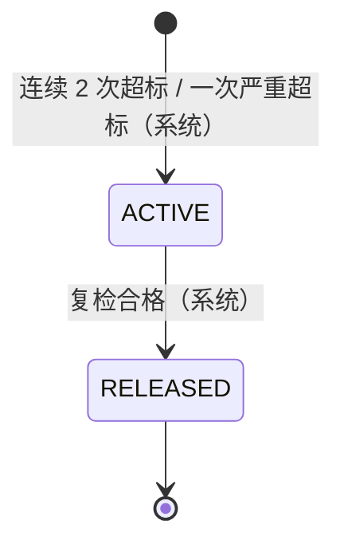
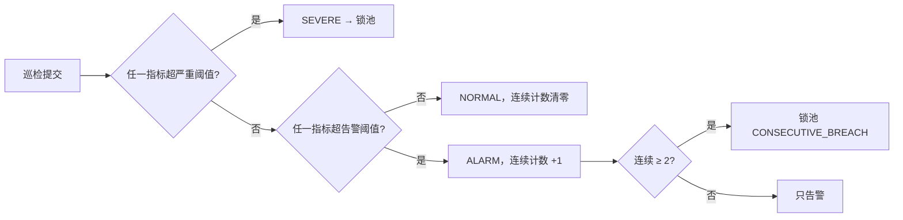
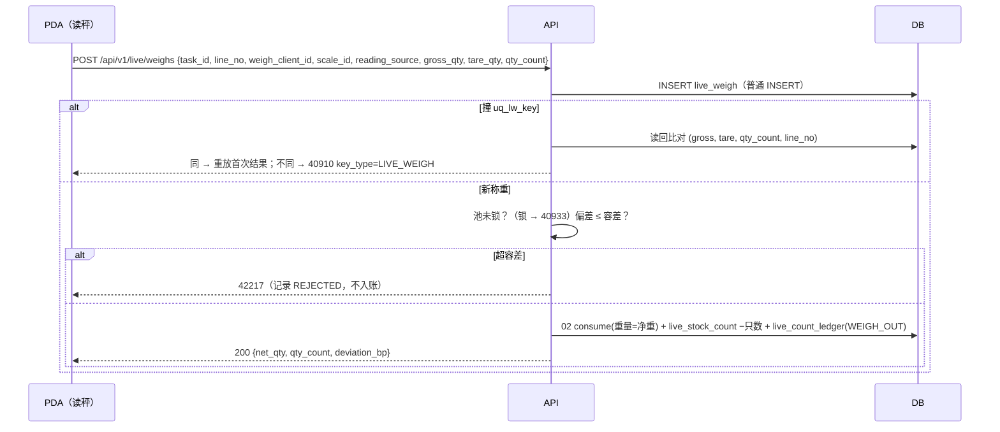

# 18 活鲜暂存

| 项 | 内容 |
|---|---|
| 作者 | 小李 |
| 评审 | 小吴（主）、小赵（副） |
| 状态 | 草稿 |
| 依赖 | 00 全局约定（ID、单号、数量 R2、时区 R3、错误码 §6.4、幂等 §6.5、§6.6.1 审批 `LIVE_DEATH_OVER`、§6.6.2 `paused_actions`、§9.1）；02 库存核心（`stock`、`stock_movement`、`stock_hold`、可用量）；04 出库与分配（分配、撤销分配、拣后取消）；05 波次与拣货（`pick_task`）；08 盘点（差异）；09 报损（`scrap_order`、`uq_scr_source`）；12 审批与审计；17 加工单（宰杀、分切）；15 PDA 前端（小周） |

> 本篇只写服务端。数量：重量一律 `BIGINT *_qty_milli`（SKU 基本单位 KG 的千分之一，即克），只数 `BIGINT *_count`；接口重量用 3 位小数字符串，只数用整数。温度一律 `*_c10`（0.1 ℃ 整数，与第 1 篇温区 `temp_min_c10 / temp_max_c10` 同口径）。所有时间存 UTC；SQLite 时间列为 `'YYYY-MM-DD HH:MM:SS'`（无小数秒，CHECK 约束）。示例仓库编码 `WHSH01`，审批单号 `APR-WHSH01-20261015-000123`。

## 1. 职责与边界

### 1.1 负责
1. **暂养池**：`location_type = LIVE_TANK` 的库位及其扩展属性（水体积、温控、水质阈值、巡检频率）；一池一 SKU，可多批次。
2. **双数量账**：重量走第 2 篇（`stock.on_hand_qty_milli`、`stock_movement`），只数走本篇（`live_stock_count`、`live_count_ledger`），同一事务、同一业务键。
3. **巡检**：水温、溶解氧、pH 录入；先告警，连续 2 次超标或一次超严重阈值则整池 `LIVE_HOLD`。
4. **出池称重**：活鲜出库按实际净重、实际只数扣减；容差内入账，超容差拒绝（42217）。
5. **死亡登记**：同时扣重量和只数，生成第 9 篇报损单（来源 `LIVE_DEATH`）；超阈值走审批 `LIVE_DEATH_OVER`。
6. **日失重结算**：每日按池、批次结算自然失重（只扣重量）；容差内转损耗 `LIVE_SHRINK`，超容差转第 8 篇盘点差异。

### 1.2 不负责
- 宰杀、分切：纳入第 17 篇加工单。原料从池里拣出时走本篇出池称重，之后由 17 处理。
- 分配算法（04）、波次（05）、报损单本身（09）、盘点（08）、审批流（12）。
- PDA 界面行为（15）；本篇只给接口与服务端规则，§11 回答小周的前端问题。

## 2. 用例
| # | 用例 | 角色 | 权限点 | 动库存 | PDA 离线 |
|---|---|---|---|---|---|
| UC1 | 维护暂养池参数 | 仓主管 | `live.tank.edit` | 否 | 否 |
| UC2 | 维护 SKU 活鲜参数（容差、阈值） | 仓主管 / CENTER_OPS | `live.param.edit` | 否 | 否 |
| UC3 | 入池（收货上架到池） | 收货员 | 沿用收货权限 | 重量 +、只数 + | 否 |
| UC4 | 巡检录入 | 养殖员 | `live.inspect.submit` | 否（可能触发锁池） | 是 |
| UC5 | 复检（锁池后） | 养殖员 | `live.inspect.submit` | 否（合格则系统解锁） | 是 |
| UC6 | 出池称重 | 拣货员 | `live.weigh.submit` | 重量 −、只数 − | 是（键见 §8） |
| UC7 | 死亡登记 | 养殖员 | `live.death.report` | 重量 −、只数 − | 是 |
| UC8 | 死亡超阈值审批 | 仓主管 | `live.death.approve` | 否 | 否 |
| UC9 | 日失重结算（作业） | 系统 | — | 重量 − | — |
| UC10 | 查询池况、流水 | 有仓权限者 | `live.tank.view` | 否 | — |

## 3. 领域模型

### 3.1 双数量（PM 1）
- 分配、出库计价、拣货计划都按**重量**。只数是并行的第二本账，用于死亡率、盘点与客户要求。
- 各动作对两本账的影响：

| 动作 | 重量 | 只数 |
|---|---|---|
| 入池 | + 实收净重 | + 实收只数 |
| 出池称重（ACCEPTED） | − 实际净重 | − 实际只数 |
| 死亡 | − 死亡重量 | − 死亡只数 |
| 自然失重 | − 失重重量 | 不变 |
| 盘点调整（08） | ± | ± |
| 加工出池（17 原料） | 同出池称重 | 同出池称重 |

- 库层不变量（两库）：只数、重量均 `>= 0`；只数 `> 0` ⇒ 重量 `> 0`。`live_stock_count` 写入时由触发器核对对应 `stock` 行重量；第 2 篇改重量时不回查只数，由巡检码 `LIVE_COUNT_WEIGHT` 兜底（§9）。

### 3.2 池与锁（PM 4、5）
- 池 = `location`（`location_type='LIVE_TANK'`）+ `live_tank` 1:1 扩展。一池一 SKU（`live_tank.sku_id` 不可改），可多批次。
- 锁池 = `live_tank_hold` 一条 ACTIVE 记录 + 池内每个 stock 行一条第 2 篇 `stock_hold(hold_type='LIVE_HOLD', source_type='LIVE_TANK_HOLD', source_id=live_tank_hold.id, operator_id=0)`。系统冻结，手工解冻返回 40933，`detail = {hold_type: "LIVE_HOLD", source_type: "LIVE_TANK_HOLD", source_id}`。
- `LIVE_HOLD` 与 `PROCESSING` 都**不计入可用库存**（00 §6.4 库存状态补充）。

### 3.3 称重（PM 2）
- 秤或 PDA 录入毛重、皮重，服务端存净重 = 毛 − 皮，并保留毛重、皮重留痕。
- 偏差 `deviation_bp = ceil(|净重 − 计划重量| × 10000 / 计划重量)`。`deviation_bp <= sku_live_param.weigh_tolerance_bp`（默认 300，即 3%）→ ACCEPTED；否则 REJECTED，返回 **42217** `WEIGH_OUT_OF_TOLERANCE`，`detail = {planned_qty, net_qty, deviation_bp, tolerance_bp}`，不入账，现场重新称或主管调整计划。

## 4. 涉及的表（两份 schema；PG 编辑，SQLite 由脚本生成）

### 4.1 `sku_live_param`（新增）
`sku_id` 主键；`weigh_tolerance_bp` 默认 300，`death_rate_threshold_bp` 默认 500，`shrink_tolerance_bp`（每日，默认 100，见 Q3）；`ck_slp_bp` 全部 0–10000。可改（带 `version`），不可删，PG 不可 TRUNCATE，SQLite 挡 REPLACE（`slp_duplicate`）。

### 4.2 `live_tank`（新增，PM 5）
| 列 | 说明 |
|---|---|
| location_id | 主键 = `location.id` |
| warehouse_id / sku_id | 不可改（`lt_immutable`）；一池一 SKU |
| water_volume_l | 水体积（升），`ck_lt_volume > 0` |
| temp_controlled | 是否温控 |
| temp_min_c10 / temp_max_c10 | 告警阈值；`temp_severe_min_c10 / temp_severe_max_c10` 严重阈值；`ck_lt_temp`：严重下限 ≤ 下限 < 上限 ≤ 严重上限 |
| do_min_x100 / do_severe_min_x100 | 溶解氧（mg/L ×100）；`ck_lt_do` |
| ph_min_x100 / ph_max_x100 | pH ×100；`ck_lt_ph`（0–1400） |
| inspect_interval_min | 巡检频率，默认 120，`ck_lt_interval` 10–1440 |
| status | `ACTIVE / DISABLED`（锁池不在这里） |
不可删，PG 不可 TRUNCATE，SQLite 挡 REPLACE。

### 4.3 `live_stock_count`（新增）
`stock_id` 主键（与第 2 篇 `stock` 1:1），`location_id / lot_id` 冗余且不可改，`on_hand_count`（`ck_lsc_count >= 0`），`version`。触发器 `live_count_without_weight`：只数 > 0 而 stock 重量 ≤ 0 时拦。不可删，PG 不可 TRUNCATE。

### 4.4 `live_count_ledger`（新增，只追加）
`(biz_type, biz_no, line_no, stock_id)` 唯一（`uq_lcl_biz`）；`biz_type ∈ {RECEIVE, WEIGH_OUT, DEATH, COUNT_ADJ, MOVE_IN, MOVE_OUT, PROCESS_OUT}`；`ck_lcl_math`：`count_after = count_before + delta_count`、`delta ≠ 0`、前后都 ≥ 0；`movement_id` 指向同事务的第 2 篇重量流水。PG `trg_append_only` 拦 UPDATE / DELETE / TRUNCATE；SQLite 拦 UPDATE / DELETE / REPLACE。

### 4.5 `live_inspection`（新增，只追加）
键 `uq_li_op (device_instance_id, client_op_id)`（离线重放）；`temp_c10 / do_x100 / ph_x100`；`result ∈ {NORMAL, ALARM, SEVERE}`，**由服务端按 `live_tank` 阈值判定**，不信客户端；`consecutive_breach`（`ck_li_breach`：NORMAL ⇔ 0）；`is_recheck` 标记锁池后的复检。索引 `ix_li_tank(location_id, inspected_at)`。

### 4.6 `live_tank_hold`（新增）
`reason ∈ {CONSECUTIVE_BREACH, SEVERE}`；`status ∈ {ACTIVE, RELEASED}` 单向；`uq_lth_active`：一池至多一条 ACTIVE；`ck_lth_release`：RELEASED ⇔ `release_inspection_id`、`released_at` 非空。触发器：INSERT 只能 ACTIVE（`lth_state`）；释放必须挂**同池、`is_recheck`、NORMAL** 的巡检记录（`lth_recheck_required`）；释放后冻结（`lth_closed`）；身份列不可改、不可删（`lth_immutable`）。`wms_app` 只有 `SELECT, INSERT` 和列级 `UPDATE(status, release_inspection_id, released_at)`。

### 4.7 `live_weigh`（新增，只追加）
键 `uq_lw_key (task_id, weigh_client_id)`（Q1 待定）；`gross / tare / net_qty_milli`，`ck_lw_qty`：净 = 毛 − 皮，全部 ≥ 0，计划 > 0；`ck_lw_dual`：只数 > 0 ⇒ 净重 > 0；`ck_lw_src`：`reading_source ∈ {SCALE, MANUAL}`，SCALE 必须带 `scale_id`；`ck_lw_result`：ACCEPTED ⇒ 无 `result_code` 且有 `movement_id`，REJECTED ⇒ 有 `result_code`（42217）且无流水。

### 4.8 `live_death`（新增，只追加）
键 `uq_ld_op (device_instance_id, client_op_id)`；`death_count > 0`、`death_qty_milli > 0`（`ck_ld_qty`）；`day_rate_bp`（含本次的池当日只数死亡率）；超阈值时 `approval_no` 必填（应用层判定，库层 `ck_ld_apr` 校验格式）；`scrap_order_id` 指向第 9 篇报损单。

### 4.9 `live_shrink_settlement`（新增，只追加）
键 `uq_lss_day (location_id, lot_id, work_date)`；`shrink_qty_milli = book − measured`；`outcome`：`NONE`（无失重）/ `LOSS`（≤ 容差，挂报损单）/ `VARIANCE`（> 容差，挂盘点单），`ck_lss_outcome` 成对约束；`tolerance_bp` 存结算时快照。

### 4.10 对第 2 / 9 篇的依赖（需对方同步）
- 02 `stock_hold.ck_hold_type / ck_hold_reason` 加 `LIVE_HOLD`（reason `LIVE_HOLD`，`source_type='LIVE_TANK_HOLD'`，`operator_id=0`），可用量公式排除 LIVE_HOLD（00 已登记口径，02 schema 待同步，见 Q6）。
- 09 `scrap_order`：`LIVE_DEATH` 写 `source_type='LIVE_DEATH', source_id=live_death.id, source_date='1970-01-01'`（无日期来源口径）；`LIVE_SHRINK` 写 `source_type='LIVE_SHRINK', source_id=live_shrink_settlement.id, source_date=work_date`，都由 3 列 `uq_scr_source` 去重，本篇不另建唯一。

### 4.11 授权（`wms_app`）
| 表 | 授权 |
|---|---|
| sku_live_param, live_tank, live_stock_count | SELECT, INSERT, UPDATE |
| live_count_ledger, live_inspection, live_weigh, live_death, live_shrink_settlement | SELECT, INSERT |
| live_tank_hold | SELECT, INSERT, UPDATE(status, release_inspection_id, released_at) |
无 DELETE / TRUNCATE / REFERENCES / TRIGGER；PUBLIC 与清理角色无任何权限（verify 矩阵逐表核对）。

## 5. 状态机

### 5.1 池锁

锁池期间：不能分配、不能出池称重（42217 之外返回 40933）；**死亡登记照常**（PM 3）；巡检、复检照常。

### 5.2 巡检判定

连续计数按同池、按 `inspected_at` 顺序计算；离线补传乱序时服务端按时间重算（同一事务内锁池行用 `uq_lth_active` 防重）。

## 6. 核心流程

### 6.1 锁池与撤销分配（PM 4）
同一事务：
1. 插 `live_inspection`（服务端判定 result、consecutive_breach）。
2. 需锁池时插 `live_tank_hold(ACTIVE)`；撞 `uq_lth_active` 说明已锁，跳过。
3. 对池内每个 stock 行：先把**已分配未称重**的占用按 04 撤销分配（`release`），出库行回到待分配并重新分配（与 `sell_days` 过期同口径）；再按剩余在库重量建 `stock_hold(LIVE_HOLD)`。
4. 写 outbox `LIVE_TANK_HELD`，通知调度与 PDA（已下发的出池任务收到 40933，见 §7.2）。

**解锁**：复检提交且判定 NORMAL → 同事务 `live_tank_hold → RELEASED`，按 `source_id` 释放所有 LIVE_HOLD 明细，写 outbox `LIVE_TANK_RELEASED`。复检仍超标则保持锁定，只记录。

### 6.2 出池称重（UC6）

- 写法：两库都用普通 INSERT，撞键后在新事务读回比对，不用 `ON CONFLICT` / `INSERT OR REPLACE`。
- 实际净重 > 已分配量时，差额按 04 补分配（同池同批次），补不上返回 40904；实际净重 < 分配量的余量 `release`。

### 6.3 死亡登记（UC7）
1. 服务端算 `day_rate_bp = ceil((当日该池已登记死亡只数 + 本次) × 10000 / 当日开盘只数)`。
2. `day_rate_bp > death_rate_threshold_bp` 且未带有效 `approval_no` → 返回 40930 `detail.reason = LIVE_DEATH_OVER_APPROVAL_REQUIRED`，前端引导发起审批 `LIVE_DEATH_OVER`（12，申请人不能自批）；审批通过后带 `approval_no` 重提（同 `client_op_id`）。
3. 同事务：`live_death` + 02 扣重量（`biz_type=SCRAP`，原因 `LIVE_DEATH`）+ 只数流水 `DEATH` + 第 9 篇报损单（`source_type='LIVE_DEATH'`）。LIVE_HOLD 期间允许：先从 LIVE_HOLD 明细释放对应重量再扣减。

### 6.4 日失重结算（UC9，Q2 待定）
权威库（中心 PG；边缘节点由写节点执行，00 §9.1）每日按仓 `work_date` 结束后运行：对每个池、批次，按抽称推算重量 `measured` 与账面 `book` 比较。`shrink_bp = ceil(shrink × 10000 / book)`。
- `shrink ≤ 0` → `NONE`；
- `0 < shrink_bp ≤ shrink_tolerance_bp` → `LOSS`：第 9 篇损耗单（来源键 `LIVE_SHRINK:{location_id}:{lot_id}:{date}`，落库 `uq_scr_source(source_type, source_id, source_date)`），扣重量，只数不变；
- `shrink_bp > shrink_tolerance_bp` → `VARIANCE`：开第 8 篇盘点单，按盘点差异处理。
作业幂等：`uq_lss_day` + `uq_scr_source`，重跑只会读回已有结果。

## 7. 接口清单与契约（前缀 `/api/v1/live`）
| 方法 | 路径 | 说明 | 权限点 | 幂等 |
|---|---|---|---|---|
| GET / PUT | `/tanks/{location_code}` | 池参数（PUT 带 `version`） | `live.tank.view` / `live.tank.edit` | Idempotency-Key |
| GET | `/tanks?warehouse_code=&status=` | 池列表（含锁池状态、当日死亡率、下次巡检时间） | `live.tank.view` | — |
| GET / PUT | `/sku-params/{sku_code}` | SKU 活鲜参数 | `live.tank.view` / `live.param.edit` | Idempotency-Key |
| POST | `/inspections` | 巡检 / 复检 | `live.inspect.submit` | `(device_instance_id, client_op_id)` |
| POST | `/weighs` | 出池称重 | `live.weigh.submit` | `(task_id, weigh_client_id)` |
| POST | `/deaths` | 死亡登记 | `live.death.report` | `(device_instance_id, client_op_id)` |
| GET | `/tanks/{location_code}/ledger?from=&to=` | 双数量流水 | `live.tank.view` | — |
| GET | `/pda-package?warehouse_code=` | PDA 下发包（池阈值、SKU 容差、巡检频率、`version`） | `live.tank.view` | — |

示例（称重）：
```json
{ "task_id": "7300000000000000001", "line_no": 1, "weigh_client_id": "b4a1c0e2-…", "scale_id": "SC-01",
  "reading_source": "SCALE", "gross_qty": "10.500", "tare_qty": "0.500", "qty_count": 8 }
```

### 7.1 错误码（全部取自 00 §6.4）
| 码 | 场景 |
|---|---|
| 40001 / 40010 | 参数 / 重量格式（超 3 位小数）；只数不是非负整数也是 40001 |
| 40310 / 40311 / 40312 | 无权限 / 仓权限 / 自批 |
| 40904 | 称重多出的部分补分配不足 |
| 40910 | 幂等冲突；`key_type ∈ {LIVE_WEIGH, LIVE_INSPECT, LIVE_DEATH}`（新增取值，Q1） |
| 40930 | 非法状态；`detail.reason = LIVE_DEATH_OVER_APPROVAL_REQUIRED` |
| 40933 | 池已 LIVE_HOLD：不能出池称重、不能手工解冻；`detail = {hold_type, source_type, source_id}` |
| 42217 | WEIGH_OUT_OF_TOLERANCE |
| 50304 | STALE_STOCK_PAUSED：`detail.action` 见 §7.2 |

### 7.2 暂停（50304，00 §6.6.2）
- 库存镜像过期时，出池称重扣减库存，属于被暂停的操作；建议在 `paused_actions` 登记新值 `LIVE_WEIGH_OUT`（Q5，须先登记到 00）；已登记的 `PICK_CONFIRM / CHECK / SHIP / RECEIVE / POD` 按 00 口径。
- 巡检、复检、死亡登记**不暂停**：死亡是事实记录，延迟登记会让账更不准；死亡的重量扣减在恢复后由写节点执行。

## 8. 并发与幂等
| 场景 | 手段 |
|---|---|
| 称重重传 | `uq_lw_key` + 读回比对；不同 → 40910 `LIVE_WEIGH` |
| 巡检 / 死亡离线重放 | `uq_li_op` / `uq_ld_op` |
| 同池两次同时触发锁池 | `uq_lth_active` |
| 锁池与称重并发 | 称重事务内对池加行锁（`SELECT … FROM live_tank WHERE location_id=:l FOR UPDATE`，SQLite 单写）后检查 ACTIVE 锁 |
| 只数扣减 | 条件更新 `on_hand_count = on_hand_count − :c WHERE on_hand_count >= :c`，rowcount=0 → 40902 |
| 日结算重跑 | `uq_lss_day` + `uq_scr_source` |

## 9. 异常与巡检
| 巡检码 | 说明 |
|---|---|
| `LIVE_COUNT_WEIGHT` | 只数 > 0 而重量 = 0，或只数 = 0 而重量 > 0（需人工确认是否盘点） |
| `LIVE_COUNT_LEDGER` | `live_stock_count` ≠ 流水回放 |
| `LIVE_HOLD_MISMATCH` | ACTIVE 锁池但池内有未冻结在库量，或已释放仍有 LIVE_HOLD 明细 |
| `LIVE_INSPECT_OVERDUE` | 超过 `inspect_interval_min` 未巡检（告警，不锁池） |
新巡检码需加入 02 `ck_recon_code`（Q6）。

## 10. 权限
新增：`live.tank.view`、`live.tank.edit`、`live.param.edit`、`live.inspect.submit`、`live.weigh.submit`、`live.death.report`、`live.death.approve`（审批，不能自批）。`live.tank.edit`、`live.param.edit`、`live.death.approve` 写 `audit_log`。全部受仓数据权限约束（40311）。

## 11. 前端问题回复（小周，适用本篇部分）
| 问题 | 回复 |
|---|---|
| 接口与权限点 | 见 §7、§10 |
| 精度 | 重量 3 位小数字符串（KG，即精确到克）；只数整数；温度、溶解氧、pH 用整数（×10 / ×100），显示时前端换算；bp 整数 |
| 巡检频率与阈值 | 每池 `inspect_interval_min`（默认 120 分钟）；阈值在 `live_tank`，见 §4.2；判定以服务端为准 |
| PDA 读秤 | 蓝牙秤读数作为 `reading_source=SCALE` + `scale_id` 提交；读不到时允许手输 `MANUAL`（记录留痕，审计可查）；皮重由秤去皮或手输，服务端只认毛重、皮重、只数，净重自己算 |
| 阈值下发 | `GET /api/v1/live/pda-package` 带 `version`，PDA 开班拉取、每次收到 outbox `LIVE_PARAM_CHANGED` 后刷新；离线时用缓存做预判，提交后以服务端判定为准 |
| 死亡来源与审批 | 来源 `LIVE_DEATH`（第 9 篇报损单）；超池日死亡率阈值返回 40930 `LIVE_DEATH_OVER_APPROVAL_REQUIRED`，前端发起 `LIVE_DEATH_OVER` 审批，通过后带 `approval_no` 用原 `client_op_id` 重提 |

## 12. 测试要点
两库 verify（PG 253/253、SQLite 246/246）：双数量不变量、尾数流水算术与只追加、巡检判定字段、锁池单 ACTIVE / 复检释放 / 不可复活、称重净重算式 / 双数量 / 结果与流水成对 / 读秤留痕、死亡数量与审批格式与离线重放、日结算结果成对与按日去重；所有新表的 UPDATE / DELETE / TRUNCATE / REPLACE 拦截；SQLite 时间列格式；`wms_app` 权限矩阵与列级授权。

## 13. 待定问题
| # | 问题 | 建议 | 决策人 |
|---|---|---|---|
| Q1 | 称重幂等键 | 建议 `(task_id, weigh_client_id)`；冲突 40910 `key_type=LIVE_WEIGH`；巡检、死亡用 `LIVE_INSPECT / LIVE_DEATH`（需登记到 00 §6.4） | PM / 大肥鱼 |
| Q2 | 日失重结算 | 建议在权威库每日作业，来源键 `LIVE_SHRINK:{location_id}:{lot_id}:{date}`，落库 `uq_scr_source`（source_id = 结算行 id，source_date = work_date） | PM / 小钱 |
| Q3 | `shrink_tolerance_bp` 默认值 | 暂定 100（1%/天），按品类调整 | PM |
| Q4 | `LIVE_HOLD`、`PROCESSING` 不计入可用 | 已按 00 口径写入；02 可用量公式与 `v_stock_available` 待同步 | 小钱 |
| Q5 | `paused_actions` 新增 `LIVE_WEIGH_OUT` | 登记到 00 §6.6.2 | 大肥鱼 |
| Q6 | 02 `ck_hold_type` 加 `LIVE_HOLD`、`ck_recon_code` 加 §9 四个码；09 `ck_scr_src_type` 加 `LIVE_DEATH / LIVE_SHRINK` | 由 02 / 09 作者同步，本 PR 不改他人表 | 小钱 |
| Q7 | 死亡率分母 | 建议用当日开盘只数（日结算后快照）；入池当日新增是否计入待定 | PM |
| Q8 | 锁池期间已拣在手（未称重）的货 | 建议称重拒绝（40933），货放回原池，按 04 撤销分配 | PM |
